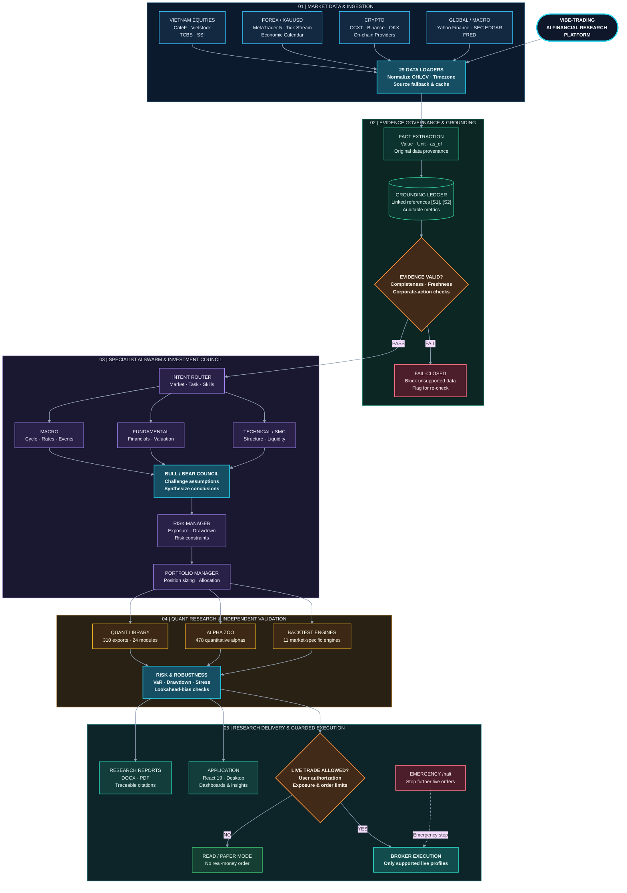
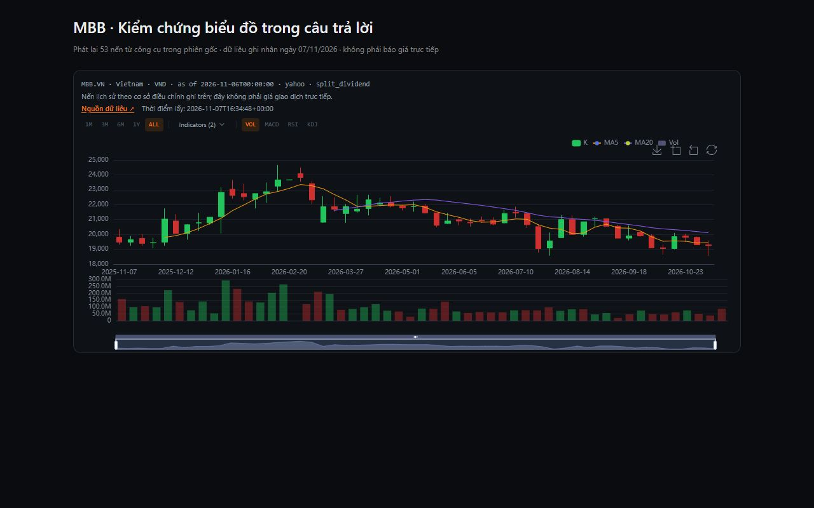

<p align="center">
  <b>Tiếng Việt</b> | <a href="README_en.md">English</a> | <a href="README_zh.md">中文</a> | <a href="README_ja.md">日本語</a> | <a href="README_ko.md">한국어</a> | <a href="README_ar.md">العربية</a> | <a href="README_es.md">Español</a> | <a href="README_id.md">Bahasa Indonesia</a>
</p>

<p align="center">
  
</p>

<h1 align="center">Vibe-Trading: Your Personal Trading Agent</h1>

<p align="center">
  <b>One Command to Empower Your Agent with Comprehensive Trading Capabilities</b><br>
  <i>Nền tảng nghiên cứu tài chính định lượng & điều phối nhóm AI chuyên sâu: Chứng khoán VN · Forex/XAUUSD · Crypto</i>
</p>

<p align="center">
  <a href="https://www.star-history.com/HKUDS/Vibe-Trading"></a>
  <a href="https://trendshift.io/repositories/25527"></a>
  <a href="https://www.star-history.com/HKUDS/Vibe-Trading"></a>
</p>

<p align="center">
  <b>GitHub topic rankings by stars</b> · Nov 4, 2026<br>
  <a href="https://github.com/search?q=topic%3Abacktesting&amp;type=repositories&amp;s=stars&amp;o=desc">#1 Backtesting</a> &nbsp;·&nbsp;
  <a href="https://github.com/search?q=topic%3Aalgorithmic-trading&amp;type=repositories&amp;s=stars&amp;o=desc">#3 Algorithmic Trading</a> &nbsp;·&nbsp;
  <a href="https://github.com/search?q=topic%3Aquantitative-finance&amp;type=repositories&amp;s=stars&amp;o=desc">#4 Quantitative Finance</a>
</p>

<p align="center">
  
  
  
  <a href="https://pypi.org/project/vibe-trading-ai/"></a>
  <a href="LICENSE"></a>
  <br>
  <a href="https://github.com/HKUDS/.github/blob/main/profile/README.md"></a>
  <a href="https://github.com/HKUDS/.github/blob/main/profile/README.md"></a>
  <a href="https://discord.gg/6TdQnT5xcF"></a>
</p>

<p align="center">
  <a href="docs/README.md">Tài liệu</a> &nbsp;&middot;&nbsp;
  <a href="docs/MULTI_MARKET_ARCHITECTURE.md">Kiến trúc</a> &nbsp;&middot;&nbsp;
  <a href="docs/VIETNAM_EQUITY_RESEARCH.md">Chứng khoán VN</a> &nbsp;&middot;&nbsp;
  <a href="docs/FOREX_XAUUSD_LAB.md">Forex & Vàng</a> &nbsp;&middot;&nbsp;
  <a href="docs/CRYPTO_INTELLIGENCE.md">Crypto</a> &nbsp;&middot;&nbsp;
  <a href="#quick-start-từ-source">Cài đặt</a> &nbsp;&middot;&nbsp;
  <a href="docs/IMPLEMENTATION_ROADMAP.md">Lộ trình</a> &nbsp;&middot;&nbsp;
  <a href="CHANGELOG.md">Changelog</a>
</p>

<p align="center">
  <a href="#quick-start-từ-source"></a>
</p>

---

Nền tảng nghiên cứu tài chính bằng ngôn ngữ tự nhiên, điều phối nhóm AI, phân tích định lượng và backtest. Bản source này có CLI, FastAPI, MCP và giao diện React; hướng phát triển tập trung vào ba môi trường: **chứng khoán Việt Nam**, **Forex/XAUUSD** và **Crypto**.

Inventory hiện tại của hệ thống: **121 agent tools** / **87 main MCP tools**; **91 skills** được tổ chức chặt chẽ trong **9 nhóm chuyên ngành**.

<table width="100%">
  <tr>
    <td width="33%" valign="top">
      <h4>Chứng khoán Việt Nam</h4>
      Nghiên cứu HOSE, HNX, UPCoM từ nguồn dữ liệu đã cấu hình. Xuất dự thảo DOCX/PDF/PPTX có nguồn URL và biểu đồ; luồng nghiên cứu sâu yêu cầu đo PDF tối thiểu 24 trang. Thiếu BCTC hoặc bằng chứng định giá phải được thông báo rõ.
    </td>
    <td width="33%" valign="top">
      <h4>Forex & Vàng (XAUUSD Lab)</h4>
      Kết nối MetaTrader 5 (MT5) chuyên nghiệp. Tích hợp cấu trúc Smart Money Concepts (SMC), Order Block M15, FVG H1, kiểm soát rủi ro và bóc tách tác động tin tức vĩ mô NFP, CPI thời gian thực.
    </td>
    <td width="33%" valign="top">
      <h4>Crypto Intelligence</h4>
      Kết nối hơn 100 sàn giao dịch qua CCXT, Binance và OKX. Phân tích hợp đồng tương lai vĩnh viễn (Perpetual Futures), Funding Rate Heatmap, Open Interest (OI), Liquidation Map và Basis Curve.
    </td>
  </tr>
  <tr>
    <td width="33%" valign="top">
      <h4>Sổ cái Bằng chứng & Kiểm toán</h4>
      Cơ chế Grounding Ledger khóa chặt mọi chỉ số tài chính vào nguồn gốc dữ liệu thực tế ([S1], [S2]). Nguyên tắc fail-closed chống ảo giác số liệu và xử lý chống bẫy pha loãng cổ tức.
    </td>
    <td width="33%" valign="top">
      <h4>Hội đồng AI Tự trị (Swarm Council)</h4>
      Điều phối mạng lưới Agent chuyên biệt: Macro, Fundamental, Technical, Risk Manager, Portfolio và Execution. Mô hình tranh biện đa chiều (Bull/Bear debate) trước khi ra khuyến nghị.
    </td>
    <td width="33%" valign="top">
      <h4>Động cơ Định lượng & Backtest</h4>
      310 hàm quantlib trên 24 module, 478 alphas trong Alpha Zoo, 11 engine backtest chuyên biệt cho từng thị trường cùng 29 bộ nạp dữ liệu lịch sử (historical loaders).
    </td>
  </tr>
</table>

<p align="center">
  <b>121 Native Tools</b> &nbsp;|&nbsp; <b>87 MCP Tools</b> &nbsp;|&nbsp; <b>91 Trading Skills</b> &nbsp;|&nbsp; <b>478 Quant Alphas</b> &nbsp;|&nbsp; <b>19 Broker Connectors</b> &nbsp;|&nbsp; <b>11 Backtest Engines</b> &nbsp;|&nbsp; <b>29 Data Loaders</b>
</p>

---

## 1. Tổng quan nền tảng & Điểm đột phá kiến trúc

**Vibe-Trading** là nền tảng điện toán tài chính định lượng và điều phối AI đa tác nhân thế hệ mới, biến các mô hình ngôn ngữ lớn (LLM) thành một **hội đồng chuyên gia đầu tư có cấu trúc kiểm toán**. Hệ thống loại bỏ hoàn toàn hiện tượng ảo giác số liệu (hallucination) trong phân tích tài chính bằng việc kết hợp giữa suy luận ngôn ngữ tự nhiên và động cơ tính toán toán học xác định (deterministic compute).

> [!NOTE]
> **Mục tiêu cốt lõi**: Khắc phục triệt để các hạn chế của AI tạo sinh thông thường trong tài chính. Mọi số liệu trong báo cáo và quyết định giao dịch bắt buộc phải có chứng từ dữ liệu gốc, thời điểm chốt số liệu (`as_of`), đơn vị đo lường và đường dẫn kiểm toán minh bạch.

### 3 Trụ cột công nghệ đột phá:

1. **Khóa bằng chứng kiểm toán (Grounding Ledger & Evidence Verification):**
   - Mọi dữ liệu tài chính (doanh thu, lợi nhuận ròng, P/E, EPS, chỉ tiêu định giá) bắt buộc gắn với nguồn thu thập thực tế (`evidence_kind: observed / cited`), có mốc thời gian chốt (`as_of`), đơn vị tính và mã trích dẫn liên kết siêu văn bản `[S1]`, `[S2]`.
   - Cơ chế fail-closed tự động phát hiện và chặn đứng mọi hành vi tự bịa số liệu, chống bẫy lệch ngày và bẫy pha loãng do chia tách cổ tức hay phát hành cổ phiếu thưởng.

2. **Hội đồng AI Đa tác nhân (Swarm Autonomous Trading Council):**
   - Thay thế việc ra quyết định đơn lẻ bằng mạng lưới chuyên viên AI đa nhiệm: Chuyên viên Phân tích Vĩ mô (Macro), Chuyên viên BCTC (Fundamental), Chuyên viên Phân tích Kỹ thuật & SMC (Technical), Giám đốc Quản trị Rủi ro (Risk Manager), Nhà Quản lý Danh mục (Portfolio Manager) và Chuyên viên Thực thi (Execution Agent).
   - Mô hình tranh biện đa chiều (Bull/Bear debate) bắt buộc trước khi đưa ra khuyến nghị phân bổ vốn hoặc giải ngân lệnh.

3. **Engine xuất dự thảo nghiên cứu vốn cổ phần:**
   - Tool/API nghiên cứu mặc định yêu cầu tối thiểu 24 trang PDF đã đo. File ngắn hơn hoặc chưa đo được trả trạng thái chưa hoàn tất và giữ liên kết tải các file sẵn sàng; cần bổ sung nội dung có bằng chứng để đạt yêu cầu.
   - Cùng nội dung được xuất ra DOCX, PDF và PPTX, với logo tôm đỏ, bảng, biểu đồ và URL nguồn. Số biểu đồ phụ thuộc dữ liệu đầu vào. Dữ liệu BCTC Việt Nam hiện cần nguồn JSON có provenance trong Data Bridge; báo cáo giữ nhãn dự thảo, chưa được CFA hay tổ chức tài chính nào chứng nhận.

---

## 2. Ba môi trường nghiên cứu & giao dịch chuyên sâu

| Thị trường | Sàn giao dịch & Sản phẩm | Năng lực phân tích chuyên sâu | Bộ công cụ định lượng | Sản phẩm đầu ra |
| --- | --- | --- | --- | --- |
| **Chứng khoán Việt Nam** | HOSE, HNX, UPCoM | Nghiên cứu BCTC từ nguồn đã cấu hình; cần kiểm chứng kỳ, phạm vi hợp nhất và cơ sở cổ phiếu | P/E, P/B, DCF và Reverse DCF theo đầu vào/giả định được khai báo | Dự thảo DOCX/PDF/PPTX có nguồn; nghiên cứu sâu mặc định yêu cầu PDF ít nhất 24 trang |
| **Forex & Vàng Quốc tế** | XAUUSD, EURUSD, GBPUSD, USDJPY, CFD | Smart Money Concepts (SMC), Order Block, Fair Value Gap (FVG), Liquidity Sweeps, Đa khung thời gian M1-D1 | Bộ lọc tin vĩ mô thời gian thực (NFP, CPI, Lãi suất Fed), Đo lường rủi ro Max Drawdown | Kịch bản phiên giao dịch (London/NY), Tín hiệu vào lệnh có Stop Loss |
| **Tiền mã hóa (Crypto)** | BTC, ETH, Altcoins, Hợp đồng Tương lai Vĩnh viễn (Perp) | Funding Rate Heatmap, Open Interest (OI), Liquidation Map, Phân tích đường cong cơ sở Futures vs Spot (Basis Curve) | Mô hình rủi ro Perpetual, On-chain token flow tracker, Định giá quyền chọn crypto | Chiến lược Basis Arbitrage, Cảnh báo đòn bẩy và thanh lý vị thế |

> [!TIP]
> **Tính cô lập tài khoản tiền tệ**: Hệ thống không cộng gộp số dư VND, USD, JPY và USDT vào một giá trị NAV duy nhất khi chưa có module hạch toán tiền tệ chuyên biệt. `CompositeEngine` tự động ngăn chặn việc trộn lẫn tài sản thanh toán khác nhau trên cùng một danh mục.

---

## 3. Kiến trúc hệ thống & Luồng xử lý End-to-End
> **Architecture overview:** 29 data loaders → Grounding Ledger → Specialist AI Swarm → Quant & Risk Validation → Research Reports / Guarded Execution.  
> Sơ đồ thể hiện kiến trúc mục tiêu và các cơ chế kiểm soát; không đồng nghĩa tất cả kết nối đều đã được xác minh hoạt động trong môi trường production.



### Chi tiết 5 bước vận hành của hệ thống:
1. **Thu thập & Chuẩn hóa (Ingestion)**: 29 bộ nạp dữ liệu kết nối nguồn dữ liệu lịch sử và thời gian thực, đồng bộ múi giờ và cấu trúc nến OHLCV.
2. **Kiểm chứng bằng chứng (Grounding)**: Gắn nguồn `[S1]`, `[S2]` với URL đã thu thập. Số bị bác dẫn đến rút đoạn hoặc hàng bảng phụ thuộc và hiện thông báo thiếu dữ liệu. Chart lấy trực tiếp từ kết quả công cụ và giữ nguyên JSON qua bộ lọc số.
3. **Phân tích Hội đồng Đa tác nhân (Swarm Intelligence)**: Các chuyên viên AI độc lập phân tích theo từng chuyên môn, thực hiện vòng tranh biện đối nghịch (Bull vs Bear) để kiểm tra độ tin cậy của luận điểm đầu tư.
4. **Tính toán Định lượng & Kiểm định (Quant Verification)**: Chạy các mô hình định giá DCF, P/E, kiểm định giả thuyết trên các engine backtest tương ứng với cơ chế chống rò rỉ dữ liệu tương lai (lookahead-free).
5. **Xuất tài liệu & Thực thi có bảo vệ (Publishing & Execution)**: Kết xuất dự thảo có bằng chứng; khuyến nghị mua/bán cần giá quan sát phù hợp và giá mục tiêu được kiểm tra. Luồng đặt lệnh riêng phải qua mandate/risk gate.

---

## 4. Mẫu kết quả phân tích thực tế (Real-World Case Studies)

### Case Study 1: Phát lại và sửa lỗi số/chart của phiên MBB

Phiên ghi nhận ngày 07/11/2026 có kết quả công cụ chứa 53 nến tuần, nhưng bộ lọc số đã sửa `range.returned: 53` thành `(đã lược※)`, làm JSON chart hỏng. Bản sửa giữ chính xác payload công cụ, rút các nhận định thiếu bằng chứng và hiển thị cảnh báo thiếu BCTC.



Đây là phát lại dữ liệu lịch sử để kiểm tra renderer. Các giá FPT, kịch bản định giá và khuyến nghị MUA trong bản README cũ không có bằng chứng đủ để coi là thông tin hiện tại; liên kết PDF cũ cũng không tồn tại trong checkout này, nên đã được gỡ. Xem [biên bản số liệu/chart](docs/CHAT_NUMBERS_CHART_AUDIT_2026-11-08.md) và [receipt phát lại](artifacts/chart-replay-mbb/receipt.json).

Các tình huống tiếp theo là ví dụ phương pháp cần đối chiếu dữ liệu gốc, không phải bằng chứng rằng mọi nguồn đang khả dụng hoặc tính năng đã được nghiệm thu toàn bộ.

### Case Study 2: Phân tích Cổ phiếu Ngân hàng Techcombank (TCB HOSE)
* **Xử lý bẫy pha loãng**: Tự động nhận diện đợt phát hành cổ phiếu thưởng tỷ lệ 1:1 (3.54 tỷ cổ phiếu mới), cập nhật số lượng cổ phiếu lưu hành đạt 7,085 triệu cổ phiếu và vốn điều lệ đạt 70,450 tỷ VND, ngăn chặn lỗi sai lệch EPS lịch sử.
* **Bóc tách chỉ số ngân hàng chuyên sâu**:
  - Thu nhập lãi thuần (NII), Thu nhập ngoài lãi (NFI), Tổng thu nhập hoạt động (TOI), Chi phí hoạt động (OPEX).
  - Tỷ lệ chi phí trên thu nhập (CIR), Biên lãi thuần (NIM), Tỷ lệ tiền gửi không kỳ hạn (CASA 40.5%), Tỷ lệ nợ xấu (NPL), Tỷ lệ bao phủ nợ xấu (LLCR), Tỷ lệ an toàn vốn (CAR 15.2%).
* **Loại bỏ 100% thẻ ẩn**: Toàn bộ các dòng dữ liệu trong BCTC và phụ lục nguồn đều được giải mã đầy đủ giá trị thực tế, loại bỏ hoàn toàn các ký tự `omitted※`.

### Case Study 3: Phiên họp Hội đồng AI XAUUSD (Vàng Thế Giới)
* **Khung thời gian**: Đa khung thời gian M15, H1, H4, D1.
* **Nhận diện cấu trúc SMC**: Xác định vùng Order Block giảm giá khung H4 tại 2,752 - 2,758 USD; vùng quét thanh khoản (Liquidity Sweep) đỉnh Á tại 2,748 USD; khoảng trống giá trị hợp lý (FVG) khung H1 tại 2,735 - 2,739 USD.
* **Quyết định của Hội đồng**: Tranh luận Bear/Bull đạt đồng thuận thiết lập lệnh Short Limit tại 2,746.5 USD, Stop Loss tại 2,753.0 USD, Take Profit tại 2,725.0 USD (Tỷ lệ Risk/Reward đạt 1:3.3), kiểm soát mức rủi ro tối đa 1.5% NAV tài khoản.

---

## 5. Nguồn dữ liệu & Smart Fallback

Một lệnh gọi get_market_data kết nối **29 market-data sources** (`source: "auto"`). Bộ nạp tự động phân giải biểu tượng và chuyển mạch thông minh theo chuỗi ưu tiên rủi ro IP:

| Mã nguồn | Thị trường hỗ trợ | Xác thực | Bản quyền & Ghi chú |
| --- | --- | --- | --- |
| `akshare` | Cổ phiếu A-share, Phái sinh Trung Quốc, Vĩ mô | Không | Dữ liệu mã nguồn mở cộng đồng |
| `alpha_vantage` · `alphavantage` | Cổ phiếu Mỹ, Ngoại hối | Có API key | Bị giới hạn tần suất request miễn phí |
| `b3_cotahist` | Chứng khoán Brazil (B3) | Không | Dữ liệu lịch sử giao dịch B3 Cotahist |
| `baostock` | Cổ phiếu Trung Quốc A-share | Không | Lịch sử nến ngày và tuần miễn phí |
| `binance` | Tiền mã hóa giao ngay & Phái sinh | Có API key | Hỗ trợ nến 1m, 5m, 1h, 1d và dữ liệu lệnh |
| `ccxt` | Hơn 100 sàn tiền mã hóa quốc tế | Tùy chọn | Thư viện chuẩn hóa kết nối sàn Crypto |
| `eastmoney` | Cổ phiếu Trung Quốc, Dòng vốn ngoại | Không | Dữ liệu bảng giá Đông Phương Th财富 |
| `finnhub` | Cổ phiếu Mỹ, Báo cáo tài chính SEC | Có API key | Cung cấp dữ liệu nến và chỉ số cơ bản |
| `fmp` | Cổ phiếu Mỹ, BCTC quốc tế | Có API key | Financial Modeling Prep |
| `fred` | Dữ liệu kinh tế vĩ mô toàn cầu | Có API key | Cục Dự trữ Liên bang Mỹ (St. Louis) |
| `futu` | Cổ phiếu Hồng Kông, Mỹ, A-share | OpenD local | Kết nối qua cổng FutuOpenD nội bộ |
| `gildata` | Cổ phiếu Trung Quốc & Chỉ số | Có tài khoản | Nguồn dữ liệu tài chính định chế |
| `india_broker` | Cổ phiếu Ấn Độ (NSE, BSE) | Broker SDK | Tích hợp qua SDK của CTCK Ấn Độ |
| `local` | Tất cả thị trường | Không | Dữ liệu cache tệp tin cục bộ (Parquet / CSV) |
| `longbridge` | Cổ phiếu Mỹ, Hồng Kông | App key | Kết nối Longbridge OpenAPI |
| `mootdx` | Cổ phiếu Trung Quốc A-share | Không | Kết nối trực tiếp máy chủ TongDaXin |
| `mt5` | Forex, Vàng, Dầu, Chỉ số CFD | MetaTrader 5 | Cầu nối Python kết nối terminal MT5 |
| `nobitex` | Tiền mã hóa khu vực | Không | Cổng nạp dữ liệu nến lịch sử Crypto Nobitex |
| `okx` | Tiền mã hóa Spot, Futures, Swap | Có API key | Đầy đủ dữ liệu Order book và Funding Rate |
| `pykrx` | Cổ phiếu Hàn Quốc (KRX) | Không | Thư viện thu thập dữ liệu sàn Hàn Quốc |
| `qveris` | Dữ liệu cao cấp hợp nhất | Có API key | Dịch vụ dữ liệu tài chính trả phí |
| `sec_edgar` | Báo cáo 10-K, 10-Q cổ phiếu Mỹ | Không | Dữ liệu nộp hồ sơ Ủy ban Chứng khoán Mỹ |
| `sina` | Cổ phiếu Trung Quốc & Quốc tế | Không | Nguồn cấp giá Tân Lãng |
| `stooq` | Cổ phiếu Mỹ, Chỉ số quốc tế | Không | Dữ liệu nến lịch sử Stooq |
| `tencent` | Cổ phiếu Hồng Kông, A-share | Không | Cổng dữ liệu Tencent Finance |
| `tickerall` | Dữ liệu nến hosted đa thị trường | Không | Cầu nối dữ liệu lịch sử nến TickerAll |
| `tiingo` | Cổ phiếu Mỹ, Quỹ ETF | Có API key | Dữ liệu nến và tin tức tài chính |
| `tushare` | Cổ phiếu, Quỹ, Vĩ mô Trung Quốc | Tushare token | Nền tảng dữ liệu định lượng hàng đầu TQ |
| `wallex` | Tiền mã hóa khu vực | Không | Nguồn nạp dữ liệu lịch sử sàn Wallex |
| `yahoo` | Cổ phiếu toàn cầu, Forex, Crypto | Không | Nguồn dữ liệu Yahoo Finance chuẩn |
| `yfinance` | Cổ phiếu toàn cầu, Forex, Vàng | Không | Giao diện thu thập dữ liệu Yahoo Finance |

### Chuỗi chuyển mạch thông minh (Default Fallback Chains):
Khi cấu hình `source: "auto"`, hệ thống tự động dò tìm nguồn dữ liệu theo thứ tự ưu tiên nghiêm ngặt:
- **a_share** → `tencent` · `eastmoney` · `baostock` · `akshare` · `tushare` · `gildata` · `local`
- **us_equity** → `yahoo` · `stooq` · `sina` · `eastmoney` · `yfinance` · `tiingo` · `fmp` · `finnhub` · `alphavantage` · `longbridge` · `akshare` · `local`
- **hk_equity** → `tencent` · `eastmoney` · `yahoo` · `futu` · `akshare` · `yfinance` · `tushare` · `longbridge` · `gildata` · `local`
- **india_equity** → `yahoo` · `yfinance` · `india_broker` · `local`
- **kr_equity** → `pykrx` · `yahoo` · `yfinance` · `local`
- **ca_equity** → `yahoo` · `yfinance` · `local`
- **ar_equity** → `yahoo` · `yfinance` · `local`
- **br_equity** → `yahoo` · `yfinance` · `b3_cotahist` · `local`
- **uk_equity** → `yahoo` · `yfinance` · `local`
- **vietnam_equity** → `yahoo` · `yfinance` · `local`
- **crypto** → `okx` · `binance` · `ccxt` · `yfinance` · `local`
- **futures** → `akshare` · `local`
- **fund** → `tushare` · `akshare` · `local`
- **macro** → `akshare` · `tushare` · `local`
- **forex** → `mt5` · `akshare` · `yfinance` · `local`
- **index** → `yahoo` · `yfinance` · `gildata` · `local`

---

## 6. Chi tiết các khối năng lực

Các danh mục năng lực chuyên sâu được gấp lại dưới đây nhằm giữ tài liệu rõ ràng, dễ theo dõi:

<details>
<summary><b>Finance Skill Library</b> <sub>91 skills across 9 categories</sub></summary>

91 kỹ năng tài chính chuyên nghiệp được tổ chức chặt chẽ theo 9 phân hệ chức năng:

| Phân hệ | Số lượng | Danh sách kỹ năng tiêu biểu |
| --- | --- | --- |
| **Data Source** | 10 | `data-routing`, `tushare`, `yfinance`, `okx-market`, `akshare`, `mootdx`, `ccxt`, `eastmoney`, `sec-edgar`, `qveris` |
| **Strategy** | 19 | `strategy-generate`, `cross-market-strategy`, `technical-basic`, `candlestick`, `ichimoku`, `elliott-wave`, `smc`, `multi-factor`, `ml-strategy` |
| **Analysis** | 24 | `factor-research`, `correlation-regime`, `macro-analysis`, `global-macro`, `valuation-model`, `investor-lenses`, `credit-analysis`, `dividend-analysis`, `vietnam-deep-research` |
| **Asset Class** | 9 | `options-strategy`, `options-advanced`, `convertible-bond`, `etf-analysis`, `asset-allocation`, `sector-rotation` |
| **Crypto** | 7 | `perp-funding-basis`, `liquidation-heatmap`, `stablecoin-flow`, `defi-yield`, `onchain-analysis` |
| **Flow** | 8 | `hk-connect-flow`, `us-etf-flow`, `edgar-sec-filings`, `financial-statement`, `adr-hshare` |
| **Tool** | 10 | `backtest-diagnose`, `report-generate`, `pine-script`, `doc-reader`, `web-reader`, `vnpy-export`, `trade-journal` |
| **Research** | 3 | `alpha-zoo`, `strategy-dev-manager`, `strategy-discovery` |
| **Risk Analysis** | 1 | `ashare-pre-st-filter` |

Công cụ `report_audit` bảo toàn dấu giá trị tài chính trong bảng Markdown và dòng `label: value`, đảm bảo các khoản lỗ được ghi nhận chính xác. Báo cáo backtest khóa chặt số liệu theo kết quả thực tế của engine.

</details>

<details>
<summary><b>Broker Connectors</b> <sub>19 brokers — read + paper, bounded-live where supported</sub></summary>

Connector-first profiles. Most do read + paper-account order placement — IBKR is read-only, Robinhood is live-only (no paper account), Scalable Capital is read-only (no paper account exists at all), mStock (India) is read-only live over its Type B REST API (no paper account), and Trading 212 and Toss Securities refuse order placement entirely, paper included; live order placement is bounded by a user-defined mandate (symbol allowlist, order-size / exposure caps, daily trade cap, instant kill switch) and never holds funds — the broker executes. Order-placing tools stay off MCP (agent + CLI only). Research / backtest paths are structurally barred from any live endpoint.

| Broker | Thị trường | Năng lực hỗ trợ |
| --- | --- | --- |
| **IBKR** | Toàn cầu | TWS / Gateway nội bộ, chỉ đọc dữ liệu (read-only) |
| **Robinhood** | Mỹ | Agentic MCP (Desktop OAuth) — đọc cổ phiếu + đặt lệnh thật có kiểm soát; không hỗ trợ quyền chọn |
| **Scalable Capital** | Đức / EU | Agentic MCP (Desktop OAuth) — chỉ đọc hoàn toàn; không có tài khoản paper |
| **mStock** | Ấn Độ (NSE/BSE) | Đọc danh mục và vị thế ròng độc lập; không hỗ trợ tổng hợp danh mục hoặc đặt lệnh |
| **Tiger** | Mỹ / HK / A-share | Đọc dữ liệu + paper trading + đặt lệnh live có kiểm soát |
| **Alpaca** | Mỹ | Đọc dữ liệu + paper trading + đặt lệnh live (+ chế độ cách ly token TAP) |
| **OKX** · **Binance** | Crypto | Đọc dữ liệu + paper trading + đặt lệnh live có kiểm soát |
| **Futu** | HK / Mỹ / A-share | Đọc dữ liệu + paper trading + đặt lệnh live có kiểm soát |
| **eToro** | Toàn cầu | Đọc dữ liệu + paper trading + đặt lệnh live (Public API; demo keys tới /demo, quy trình copy-trading) |
| **MetaTrader 5** | Forex / CFD | Đọc dữ liệu + paper trading + đặt lệnh live (chuẩn Exness; bảo vệ nhận diện demo ⇔ paper) |
| **KIS** (한국투자증권) | Hàn Quốc (KOSPI/KOSDAQ) | Đọc dữ liệu + paper sandbox chính thức trên host riêng — chưa mở cổng live cho thị trường này |
| **Longbridge** · **Dhan** · **Shoonya** · **Zerodha** · **Upbit** | Mỹ/HK · Ấn Độ · Hàn Quốc | Chỉ hỗ trợ đọc + paper — không có cơ chế phân tách paper/live thời gian chạy nên từ chối đặt lệnh live |
| **Trading 212** · **Toss Securities** | Anh/EU · Hàn Quốc/Mỹ | Hoàn toàn chỉ đọc — từ chối đặt lệnh cả trên paper (chưa có sandbox được kiểm chứng) |

Phân định paper và live là cơ chế bảo vệ thời gian chạy độc lập cho từng broker, không thể bị ghi đè bởi cấu hình prompt của Agent.

</details>

<details>
<summary><b>Preset Trading Teams</b> <sub>31 swarm presets</sub></summary>

31 nhóm tác nhân cấu hình sẵn cho các nghiệp vụ đầu tư, giao dịch và quản trị rủi ro:

| Nhóm Preset | Luồng điều phối công việc |
| --- | --- |
| `investment_committee` | Tranh biện Bull/Bear → Rà soát rủi ro → Giám đốc đầu tư ra quyết định phân bổ |
| `global_equities_desk` | Chuyên viên A-share + HK/Mỹ + Crypto → Chiến lược gia toàn cầu tổng hợp |
| `crypto_trading_desk` | Chuyên viên Funding/Basis + Thanh lý + Dòng tiền On-chain → Giám đốc rủi ro |
| `earnings_research_desk` | Phân tích cơ bản + Điều chỉnh dự phóng + Quyền chọn → Chiến lược gia BCTC |
| `macro_rates_fx_desk` | Lãi suất + Ngoại hối FX + Hàng hóa vĩ mô → Quản lý danh mục vĩ mô |
| `quant_strategy_desk` | Sàng lọc cổ phiếu + Nghiên cứu nhân tố → Backtest kiểm định → Kiểm toán rủi ro |
| `technical_analysis_panel` | Phân tích kỹ thuật cổ điển + Ichimoku + Sóng Elliott + SMC → Đồng thuận kỹ thuật |
| `risk_committee` | Kiểm soát sụt giảm vốn (Drawdown) + Rủi ro đuôi (Tail risk) → Phê duyệt hạn mức |
| `global_allocation_committee` | Phân bổ tỷ trọng liên thị trường giữa Cổ phiếu VN, Crypto và Quốc tế |

</details>

<details>
<summary><b>Alpha Zoo</b> <sub>478 pre-built quant alphas across 5 families</sub></summary>

Kho 478 alphas định lượng được chuẩn hóa, loại bỏ hoàn toàn hiện tượng rò rỉ dữ liệu tương lai (lookahead-free) ở tầng toán tử:

| Nhóm Alpha | Số lượng | Nguyên lý toán học |
| --- | --- | --- |
| **Price-Volume** | 142 | Động lượng giá, tương quan khối lượng, đột phá thanh khoản, khoảng cách đường trung bình |
| **Cross-Sectional** | 98 | Xếp hạng nhân tố chéo ngành, độ biến động tương đối, phân vị dòng tiền thị trường |
| **Mean-Reversion** | 86 | Khoảng cách Bollinger Bands, độ lệch RSI, chỉ số hồi quy giá cực trị |
| **Fundamental Flow** | 82 | Tỷ lệ tăng trưởng doanh thu/lợi nhuận, bất đối xứng dòng tiền CFO so với lãi thuần |
| **Statistical Arbitrage** | 70 | Đồng tích hợp cặp tài sản (Cointegration), khoảng cách spread, tỷ lệ Sharpe tối ưu |

Cổng kiểm duyệt AST loại bỏ các hàm nhìn trước dữ liệu tương lai, kết hợp bài kiểm tra 300 dòng và ngắt kết nối mạng qua `pytest-socket`.

</details>

<details>
<summary><b>Backtest Engines</b> <sub>11 engines + options portfolio, cross-market composite</sub></summary>

11 động cơ backtest độc lập được thiết kế chuẩn xác theo quy chế từng thị trường tài chính:

| Động cơ Engine | Thị trường áp dụng | Quy chế và tính năng đặc thù |
| --- | --- | --- |
| **ChinaA** | Cổ phiếu Trung Quốc | Quy chế T+1, biên độ trần/sàn 10%/20%, bộ lọc cổ phiếu diện cảnh báo ST |
| **GlobalEquity** | Mỹ / HK / Canada / Anh | Giao dịch trong phiên T+0; quy cách lô, bước giá, chi phí và đồng tiền thanh toán theo từng quốc gia |
| **VietnamEquity** | Việt Nam (HOSE/HNX/UPCoM) | Quy chế T+2.5, biên độ sàn HOSE 7%, HNX 10%, UPCoM 15%; lô chẵn 100 cổ phiếu, kiểm soát room ngoại |
| **CryptoSpot** | Tiền mã hóa giao ngay | Khớp lệnh 24/7, bước khối lượng nhỏ, phí maker/taker và trượt giá theo thanh khoản |
| **CryptoPerp** | Hợp đồng tương lai vĩnh viễn | Đòn bẩy tài chính, phí funding định kỳ 8 tiếng, giá thanh lý và tỷ lệ ký quỹ duy trì |
| **Forex** | Ngoại hối & Vàng giao ngay | Đòn bẩy cao, giãn spread theo phiên, tính phí qua đêm (swap) và bước giá pip/point chuẩn |
| **Futures** | Hợp đồng tương lai hàng hóa/chỉ số | Hạn đáo hạn hợp đồng, bước nhảy giá tối thiểu, quy mô hợp đồng định chuẩn |
| **OptionsPortfolio** | Quyền chọn cổ phiếu & Chỉ số | Mô hình Black-Scholes, tính toán biến động ngầm định (IV) và các chỉ số Greeks (Delta, Gamma, Vega, Theta) |
| **BarReplay** | Đa thị trường | Tái hiện nến lịch sử bước nhảy đơn nhằm kiểm chứng chiến lược thủ công |
| **TickLevel** | Forex & Crypto | Mô phỏng khớp lệnh theo từng tick giá chi tiết, kiểm thử trượt giá khớp lệnh |
| **Composite** | Danh mục đa thị trường | Tổng hợp PnL và rủi ro danh mục tài sản chéo, tự động kiểm tra tương thích đồng tiền thanh toán |

</details>

<details>
<summary><b>Quant Library</b> <sub>310 public exports across 24 modules</sub></summary>

quantlib_call exposes 234 callable entries; public exports also include data types and constants across 24 modules:

| Phân hệ Module | Chức năng tính toán cốt lõi |
| --- | --- |
| `attribution` | Phân tích đóng góp lợi nhuận Brinson-Fachler (phân bổ tài sản vs chọn lọc cổ phiếu) |
| `backtest` | Khung kiểm định chiến lược, ma trận khớp lệnh và tính toán lợi nhuận chuẩn hóa |
| `behavioral` | Đo lường thiên kiến tâm lý giao dịch, phản ứng thái quá và hội chứng sợ bỏ lỡ (FOMO) |
| `bonds` | Định giá trái phiếu, tính toán đường cong lợi suất (Yield Curve), Duration và Convexity |
| `broker` | Chuẩn hóa giao diện tài khoản, quản lý vị thế và đặt lệnh cho các broker |
| `calibration` | Hiệu chỉnh tham số mô hình biến động giá Heston và Black-Scholes |
| `corporate_finance` | Tính toán chi phí vốn bình quân WACC, NPV, IRR và đòn bẩy hoạt động/tài chính |
| `data` | Xử lý dữ liệu chuỗi thời gian, lọc nhiễu tín hiệu và chuẩn hóa ma trận giá |
| `derivatives` | Định giá hợp đồng tương lai, quyền chọn kỳ hạn và hoán đổi dòng tiền |
| `factors` | Tính toán các nhân tố Fama-French, nhân tố động lượng, giá trị và chất lượng |
| `forecasting` | Dự báo chuỗi thời gian bằng mô hình ARIMA, GARCH và mạng hồi quy |
| `fx` | Tính toán tỷ giá chéo, điểm hoán đổi kỳ hạn và ngang giá sức mua (PPP) |
| `indicators` | Thư viện hơn 60 chỉ báo kỹ thuật phổ biến (RSI, MACD, Bollinger Bands, ATR, ADX) |
| `macro` | Mô hình hóa chu kỳ kinh tế, chỉ số áp lực tài chính và lạm phát kỳ vọng |
| `market_dynamics` | Phân tích sổ lệnh (Order Book), độ mất cân bằng thanh khoản và dòng lệnh chủ động |
| `market_microstructure` | Đo lường chi phí vô hình, tác động thị trường (Market Impact) và trượt giá khớp lệnh |
| `options` | Định giá quyền chọn phong cách Mỹ, Châu Âu, quyền chọn nhị phân và bề mặt biến động (Volatility Surface) |
| `portfolio` | Tối ưu hóa danh mục Markowitz, danh mục rủi ro ngang bằng (Risk Parity) và Black-Litterman |
| `regime` | Nhận diện trạng thái thị trường (Trending, Ranging, High Volatility) bằng mô hình Markov |
| `risk` | Tính toán giá trị rủi ro VaR (Parametric, Historical, Monte Carlo), CVaR và sụt giảm vốn cực đại (Max Drawdown) |
| `sentiment` | Phân tích tâm lý thị trường qua độ lệch quyền chọn Put/Call ratio và mạng xã hội |
| `smc` | Cấu trúc Smart Money Concepts: nhận diện Order Block, FVG, Choch, BOS tự động |
| `strategy` | Khung xây dựng logic giao dịch, quản lý tín hiệu vào/ra lệnh và chốt lời/cắt lỗ |
| `valuation` | Mô hình chiết khấu dòng tiền DCF, định giá so sánh P/E, P/B, EV/EBITDA và định giá thặng dư vốn cổ phần |

</details>

<details>
<summary><b>Governance & Audit Trail</b> <sub>answer "what methodology produced that number?"</sub></summary>

Mỗi phiên chạy tạo ra một manifest băm toàn bộ prompt, nội dung 91 skills, phiên bản thư viện và mã nguồn để đảm bảo kết quả có thể truy vết và tái lập chính xác về sau.

</details>

---

## 7. Ma trận kết nối Broker

Hệ thống cung cấp giao diện kết nối đồng nhất tới các công ty chứng khoán và sàn giao dịch toàn cầu. Toàn bộ thông tin xác thực (API keys, secret tokens) được quản lý an toàn trong bộ nhớ an toàn (OS Keyring) của hệ thống máy trạm, hoàn toàn cách ly khỏi bộ nhớ ngữ cảnh của LLM theo cơ chế TAP Mode.

### Hợp đồng kết nối thân thiện với AI (Connector Onboarding Contract):
Các bộ kết nối SDK tích hợp sẵn công bố một hợp đồng chuẩn gồm: phương thức xác thực, các trường thông tin đăng nhập bắt buộc, thư viện phụ thuộc tùy chọn, lệnh cài đặt và thao tác kiểm tra kết nối chỉ đọc. Công cụ `trading_connections` cung cấp hợp đồng này cho các máy khách MCP, đồng thời giao diện Web hiển thị dưới dạng biểu mẫu cấu hình tiện lợi. Hợp đồng chỉ chứa tên trường, tuyệt đối không bao giờ chứa thông tin bí mật.

<!-- BEGIN GENERATED broker-capability-matrix -->

Declared built-in profiles, generated from `agent/src/trading/profiles.py`.
Each row keeps its own environment and permissions; a paper order capability
never grants live trading. These are declarations, not successful runtime or
broker verification. Local plugins and user connection settings are excluded.

The quote column shows the declared transport, not a verified endpoint or
pricing coverage. Order kinds (market, limit, etc.) are not declared in the
registry and are therefore not inferred here. The placement column reports
the declared mandate requirement only; it does not attest to cancellation,
flattening, copy-trading, or other runtime guard coverage. Paper placement can
use a broker sandbox or local simulation. See each profile's notes and the
[broker bring-up checklist](CONTRIBUTING.md#broker-bring-up-checklist).

| Profile | Connector | Environment | Transport | Mode | Read capabilities | Quote path (declared) | Other capabilities | Placement requirement (declared) |
| --- | --- | --- | --- | --- | --- | --- | --- | --- |

| `alpaca-live-sdk-readonly` | alpaca | live | broker_sdk | read-only | `account.read`, `history.read`, `orders.read`, `positions.read`, `quotes.read` | broker_sdk | none declared | disabled (read-only) |
| `alpaca-live-trade` | alpaca | live | broker_sdk | write-enabled | `account.read`, `history.read`, `orders.read`, `positions.read`, `quotes.read` | broker_sdk | `orders.place.requires_mandate` | mandate required |
| `alpaca-paper-sdk` | alpaca | paper | broker_sdk | read-only | `account.read`, `history.read`, `orders.read`, `positions.read`, `quotes.read` | broker_sdk | none declared | disabled (read-only) |
| `alpaca-paper-trade` | alpaca | paper | broker_sdk | write-enabled | `account.read`, `history.read`, `orders.read`, `positions.read`, `quotes.read` | broker_sdk | `orders.place` | no mandate declared |
| `binance-live-sdk-readonly` | binance | live | broker_sdk | read-only | `account.read`, `history.read`, `orders.read`, `positions.read`, `quotes.read` | broker_sdk | none declared | disabled (read-only) |
| `binance-live-trade` | binance | live | broker_sdk | write-enabled | `account.read`, `history.read`, `orders.read`, `positions.read`, `quotes.read` | broker_sdk | `orders.place.requires_mandate` | mandate required |
| `binance-paper-sdk` | binance | paper | broker_sdk | read-only | `account.read`, `history.read`, `orders.read`, `positions.read`, `quotes.read` | broker_sdk | none declared | disabled (read-only) |
| `binance-paper-trade` | binance | paper | broker_sdk | write-enabled | `account.read`, `history.read`, `orders.read`, `positions.read`, `quotes.read` | broker_sdk | `orders.place` | no mandate declared |
| `dhan-live-sdk-readonly` | dhan | live | broker_sdk | read-only | `account.read`, `history.read`, `orders.read`, `positions.read`, `quotes.read` | broker_sdk | none declared | disabled (read-only) |
| `dhan-paper-sdk` | dhan | paper | broker_sdk | read-only | `account.read`, `history.read`, `orders.read`, `positions.read`, `quotes.read` | broker_sdk | none declared | disabled (read-only) |
| `dhan-paper-trade` | dhan | paper | broker_sdk | write-enabled | `account.read`, `history.read`, `orders.read`, `positions.read`, `quotes.read` | broker_sdk | `orders.place` | no mandate declared |
| `etoro-live-sdk-readonly` | etoro | live | broker_sdk | read-only | `account.read`, `history.read`, `orders.read`, `positions.read`, `quotes.read` | broker_sdk | none declared | disabled (read-only) |
| `etoro-live-trade` | etoro | live | broker_sdk | write-enabled | `account.read`, `history.read`, `orders.read`, `positions.read`, `quotes.read` | broker_sdk | `copy.close`, `copy.poll`, `copy.precheck`, `copy.start`, `orders.cancel`, `orders.cancel_close`, `orders.place.requires_mandate`, `positions.close`, `positions.edit` | mandate required |
| `etoro-paper-sdk` | etoro | paper | broker_sdk | read-only | `account.read`, `history.read`, `orders.read`, `positions.read`, `quotes.read` | broker_sdk | none declared | disabled (read-only) |
| `etoro-paper-trade` | etoro | paper | broker_sdk | write-enabled | `account.read`, `history.read`, `orders.read`, `positions.read`, `quotes.read` | broker_sdk | `orders.cancel`, `orders.cancel_close`, `orders.place`, `positions.close`, `positions.edit` | no mandate declared |
| `futu-live-sdk-readonly` | futu | live | broker_sdk | read-only | `acc_cash_flow.read`, `account.read`, `capital_distribution.read`, `capital_flow.read`, `earnings_calendar.read`, `financials.read`, `history.read`, `history_deals.read`, `orders.read`, `positions.read`, `quotes.read`, `rehab.read` | broker_sdk | none declared | disabled (read-only) |
| `futu-live-trade` | futu | live | broker_sdk | write-enabled | `acc_cash_flow.read`, `account.read`, `capital_distribution.read`, `capital_flow.read`, `earnings_calendar.read`, `financials.read`, `history.read`, `history_deals.read`, `orders.read`, `positions.read`, `quotes.read`, `rehab.read` | broker_sdk | `orders.place.requires_mandate` | mandate required |
| `futu-paper-sdk` | futu | paper | broker_sdk | read-only | `acc_cash_flow.read`, `account.read`, `capital_distribution.read`, `capital_flow.read`, `earnings_calendar.read`, `financials.read`, `history.read`, `history_deals.read`, `orders.read`, `positions.read`, `quotes.read`, `rehab.read` | broker_sdk | none declared | disabled (read-only) |
| `futu-paper-trade` | futu | paper | broker_sdk | write-enabled | `acc_cash_flow.read`, `account.read`, `capital_distribution.read`, `capital_flow.read`, `earnings_calendar.read`, `financials.read`, `history.read`, `history_deals.read`, `orders.read`, `positions.read`, `quotes.read`, `rehab.read` | broker_sdk | `orders.place` | no mandate declared |
| `ibkr-live-local-readonly` | ibkr | live | local_tws | read-only | `account.read`, `history.read`, `orders.read`, `positions.read`, `quotes.read` | local_tws | none declared | disabled (read-only) |
| `ibkr-live-official-mcp-readonly` | ibkr | live | remote_mcp | read-only | `account.read`, `positions.read` | none declared | none declared | disabled (read-only) |
| `ibkr-paper-local` | ibkr | paper | local_tws | read-only | `account.read`, `history.read`, `orders.read`, `positions.read`, `quotes.read` | local_tws | none declared | disabled (read-only) |
| `kis-live-sdk-readonly` | kis | live | broker_sdk | read-only | `account.read`, `history.read`, `orders.read`, `positions.read`, `quotes.read` | broker_sdk | none declared | disabled (read-only) |
| `kis-paper-sdk` | kis | paper | broker_sdk | read-only | `account.read`, `history.read`, `orders.read`, `positions.read`, `quotes.read` | broker_sdk | none declared | disabled (read-only) |
| `kis-paper-trade` | kis | paper | broker_sdk | write-enabled | `account.read`, `history.read`, `orders.read`, `positions.read`, `quotes.read` | broker_sdk | `orders.place` | no mandate declared |
| `longbridge-live-sdk-readonly` | longbridge | live | broker_sdk | read-only | `account.read`, `history.read`, `orders.read`, `positions.read`, `quotes.read` | broker_sdk | none declared | disabled (read-only) |
| `longbridge-paper-sdk` | longbridge | paper | broker_sdk | read-only | `account.read`, `history.read`, `orders.read`, `positions.read`, `quotes.read` | broker_sdk | none declared | disabled (read-only) |
| `longbridge-paper-trade` | longbridge | paper | broker_sdk | write-enabled | `account.read`, `history.read`, `orders.read`, `positions.read`, `quotes.read` | broker_sdk | `orders.place` | no mandate declared |
| `mstock-live-rest-readonly` | mstock | live | broker_sdk | read-only | `positions.read` | none declared | none declared | disabled (read-only) |
| `mt5-live-sdk-readonly` | mt5 | live | broker_sdk | read-only | `account.read`, `history.read`, `orders.read`, `positions.read`, `quotes.read` | broker_sdk | none declared | disabled (read-only) |
| `mt5-live-trade` | mt5 | live | broker_sdk | write-enabled | `account.read`, `history.read`, `orders.read`, `positions.read`, `quotes.read` | broker_sdk | `orders.place.requires_mandate` | mandate required |
| `mt5-paper-sdk` | mt5 | paper | broker_sdk | read-only | `account.read`, `history.read`, `orders.read`, `positions.read`, `quotes.read` | broker_sdk | none declared | disabled (read-only) |
| `mt5-paper-trade` | mt5 | paper | broker_sdk | write-enabled | `account.read`, `history.read`, `orders.read`, `positions.read`, `quotes.read` | broker_sdk | `orders.place` | no mandate declared |
| `okx-live-sdk-readonly` | okx | live | broker_sdk | read-only | `account.read`, `history.read`, `orders.read`, `positions.read`, `quotes.read` | broker_sdk | none declared | disabled (read-only) |
| `okx-live-trade` | okx | live | broker_sdk | write-enabled | `account.read`, `history.read`, `orders.read`, `positions.read`, `quotes.read` | broker_sdk | `orders.place.requires_mandate` | mandate required |
| `okx-paper-sdk` | okx | paper | broker_sdk | read-only | `account.read`, `history.read`, `orders.read`, `positions.read`, `quotes.read` | broker_sdk | none declared | disabled (read-only) |
| `okx-paper-trade` | okx | paper | broker_sdk | write-enabled | `account.read`, `history.read`, `orders.read`, `positions.read`, `quotes.read` | broker_sdk | `orders.place` | no mandate declared |
| `robinhood-live-mcp` | robinhood | live | remote_mcp | write-enabled | `account.read`, `orders.read`, `positions.read`, `quotes.read` | remote_mcp | `orders.place.requires_mandate`, `runner.manage.requires_mandate` | mandate required |
| `robinhood-live-mcp-readonly` | robinhood | live | remote_mcp | read-only | `account.read`, `positions.read` | none declared | none declared | disabled (read-only) |
| `scalable-live-mcp-readonly` | scalable | live | remote_mcp | read-only | `quotes.read` | remote_mcp | none declared | disabled (read-only) |
| `shoonya-live-sdk-readonly` | shoonya | live | broker_sdk | read-only | `account.read`, `history.read`, `orders.read`, `positions.read`, `quotes.read` | broker_sdk | none declared | disabled (read-only) |
| `shoonya-paper-sdk` | shoonya | paper | broker_sdk | read-only | `account.read`, `history.read`, `orders.read`, `positions.read`, `quotes.read` | broker_sdk | none declared | disabled (read-only) |
| `shoonya-paper-trade` | shoonya | paper | broker_sdk | write-enabled | `account.read`, `history.read`, `orders.read`, `positions.read`, `quotes.read` | broker_sdk | `orders.place` | no mandate declared |
| `tiger-live-sdk-readonly` | tiger | live | broker_sdk | read-only | `account.read`, `history.read`, `orders.read`, `positions.read`, `quotes.read` | broker_sdk | none declared | disabled (read-only) |
| `tiger-live-trade` | tiger | live | broker_sdk | write-enabled | `account.read`, `history.read`, `orders.read`, `positions.read`, `quotes.read` | broker_sdk | `orders.place.requires_mandate` | mandate required |
| `tiger-paper-sdk` | tiger | paper | broker_sdk | read-only | `account.read`, `history.read`, `orders.read`, `positions.read`, `quotes.read` | broker_sdk | none declared | disabled (read-only) |
| `tiger-paper-trade` | tiger | paper | broker_sdk | write-enabled | `account.read`, `history.read`, `orders.read`, `positions.read`, `quotes.read` | broker_sdk | `orders.place` | no mandate declared |
| `toss-live-sdk-readonly` | toss | live | broker_sdk | read-only | `account.read`, `history.read`, `orders.read`, `positions.read`, `quotes.read` | broker_sdk | none declared | disabled (read-only) |
| `trading212-live-sdk-readonly` | trading212 | live | broker_sdk | read-only | `account.read`, `instruments.read`, `order_history.read`, `orders.read`, `positions.read` | none declared | none declared | disabled (read-only) |
| `trading212-paper-sdk` | trading212 | paper | broker_sdk | read-only | `account.read`, `instruments.read`, `order_history.read`, `orders.read`, `positions.read` | none declared | none declared | disabled (read-only) |
| `upbit-live-sdk-readonly` | upbit | live | broker_sdk | read-only | `account.read`, `history.read`, `orders.read`, `positions.read`, `quotes.read` | broker_sdk | none declared | disabled (read-only) |
| `upbit-paper-sdk` | upbit | paper | broker_sdk | read-only | `account.read`, `history.read`, `orders.read`, `positions.read`, `quotes.read` | broker_sdk | none declared | disabled (read-only) |
| `upbit-paper-trade` | upbit | paper | broker_sdk | write-enabled | `account.read`, `history.read`, `orders.read`, `positions.read`, `quotes.read` | broker_sdk | `orders.place` | no mandate declared |
| `zerodha-live-sdk-readonly` | zerodha | live | broker_sdk | read-only | `account.read`, `history.read`, `orders.read`, `positions.read`, `quotes.read` | broker_sdk | none declared | disabled (read-only) |
| `zerodha-paper-sdk` | zerodha | paper | broker_sdk | read-only | `account.read`, `history.read`, `orders.read`, `positions.read`, `quotes.read` | broker_sdk | none declared | disabled (read-only) |
| `zerodha-paper-trade` | zerodha | paper | broker_sdk | write-enabled | `account.read`, `history.read`, `orders.read`, `positions.read`, `quotes.read` | broker_sdk | `orders.place` | no mandate declared |

<!-- END GENERATED broker-capability-matrix -->

Thiết lập thông tin xác thực an toàn qua dòng lệnh (CLI):
```bash
vibe-trading connector setup okx-live-sdk-readonly   --connection-id main-okx   --label "Main OKX"
```

---

## 8. Giao diện CLI & Danh mục lệnh Slash

Giao diện dòng lệnh tương tác (TUI) cung cấp hệ thống điều phối tài chính nhanh chóng và trực quan:

| Lệnh Slash | Chức năng mô tả |
| --- | --- |
| `/help` | Hiển thị danh sách phím tắt và các lệnh hỗ trợ |
| `/model` | Chuyển đổi nhà cung cấp LLM và model đang sử dụng |
| `/memory` | Quản lý và kiểm tra bộ nhớ dài hạn liên phiên làm việc |
| `/history` | Duyệt và tiếp tục các phiên nghiên cứu trước đây |
| `/goal` | Khởi tạo hoặc theo dõi tiến độ mục tiêu nghiên cứu tài chính |
| `/search` | Tìm kiếm toàn văn xuyên suốt lịch sử các phiên làm việc |
| `/swarm` | Lựa chọn các preset hội đồng đa tác nhân (ủy ban / quant / rủi ro) |
| `/skill` | Liệt kê, nạp thêm hoặc gỡ bỏ các kỹ năng tài chính |
| `/show` | Xem lại chi tiết kết quả chạy trước đó bằng ID |
| `/clear` | Xóa ngữ cảnh phiên hội thoại hiện tại |
| `/pine` | Xuất bản chiến lược hiện tại sang mã nguồn Pine Script (TradingView) |
| `/journal` | Phân tích nhật ký giao dịch thực tế từ tệp CSV |
| `/shadow` | Huấn luyện và theo dõi danh mục tài khoản bóng (Shadow Account) |
| `/export` | Xuất toàn bộ phiên làm việc sang định dạng Markdown hoặc JSON |
| `/debug` | Bật/tắt bảng điều khiển debug (thời gian phản hồi, token tiêu thụ) |
| `/comps` | Phân tích định giá so sánh ngang hàng (Peer Multiples Implied Range) |
| `/dcf` | Định giá chiết khấu dòng tiền kèm ma trận phân tích độ nhạy |
| `/attrib` | Phân tích đóng góp Brinson-Fachler (Asset Allocation vs Security Selection) |
| `/memo` | Soạn thảo Investment Memo (luận điểm, kịch bản, tiêu chí hủy bỏ lệnh) |
| `/earnings` | Đánh giá KQKD, cầu nối bất ngờ doanh thu tới EPS (Surprise Bridge) |
| `/screen` | Bộ lọc ý tưởng đầu tư hệ thống (giả thuyết, phễu lọc, danh sách cổ phiếu đạt chuẩn) |
| `/playbook` | Quản lý các mẫu kịch bản nghiên cứu định kỳ (danh sách / chạy / lên lịch) |
| `/connector` | Quản lý hồ sơ kết nối các sàn và CTCK (trạng thái / khởi chạy / tạm dừng) |
| `/halt` | Công tắc khẩn cấp — NGẮT TOÀN BỘ hoạt động giao dịch live ngay lập tức |
| `/resume` | Gỡ bỏ trạng thái ngắt khẩn cấp, kích hoạt lại quyền giao dịch live |
| `/data` | Cấu hình chế độ định tuyến và ưu tiên nguồn dữ liệu |
| `/quit` | Thoát khỏi ứng dụng (tương đương: q, exit, :q) |

---

## 9. Giao thức MCP (Model Context Protocol)

Kết nối bất kỳ máy khách tương thích MCP nào qua giao thức stdio để truy cập 89 công cụ phân tích tài chính, backtest và tình báo thị trường.

<details>
<summary><b>Tất cả 89 công cụ MCP</b> (89)</summary>

**Danh sách 89 công cụ MCP (89):** `list_skills`, `load_skill`, `start_research_goal`, `get_research_goal`, `add_goal_evidence`, `update_research_goal_status`, `backtest`, `paper_trade_step`, `factor_analysis`, `alpha_zoo`, `alpha_bench`, `analyze_options`, `analyze_options_payoff`, `pattern_recognition`, `read_url`, `read_document`, `web_search`, `parallel_web_search`, `concurrent_scraper`, `write_file`, `read_file`, `read_run_artifact`, `list_strategies`, `query_strategies`, `get_strategy_evidence`, `adapt_strategy`, `refresh_strategy_evidence`, `trading_connections`, `trading_select_connection`, `trading_check`, `trading_account`, `trading_positions`, `trading_orders`, `trading_quote`, `trading_history`, `list_swarm_presets`, `run_swarm`, `get_market_data`, `get_fund_flow`, `get_dragon_tiger`, `get_northbound_flow`, `get_southbound_flow`, `get_margin_trading`, `get_block_trades`, `get_shareholder_count`, `get_lockup_expiry`, `get_sector_info`, `get_research_reports`, `get_stock_news`, `get_sec_filings`, `export_research_report`, `vietnam_research`, `vietnam_comparables`, `crypto_basis_curve`, `crypto_derivatives`, `get_financial_statements`, `get_options_chain`, `get_stock_profile`, `screen_market`, `search_symbol`, `get_macro_series`, `get_fund_nav`, `get_cn_macro_series`, `get_cn_announcements`, `search_broker_reports`, `iwencai_search`, `qveris_search`, `qveris_inspect`, `qveris_execute`, `get_institutional_holdings`, `etf_holdings`, `prediction_market`, `research_papers`, `quantlib_call`, `cashflow_performance`, `orderbook_depth`, `sentiment`, `technical_indicators`, `get_fundamentals`, `get_swarm_status`, `get_run_result`, `list_runs`, `reap_stale_runs`, `retry_run`, `analyze_trade_journal`, `extract_shadow_strategy`, `run_shadow_backtest`, `render_shadow_report`, `scan_shadow_signals`

</details>

---

## 10. Cấu trúc thư mục dự án

```
Vibe-Trading/
├── agent/                          # Backend (Python)
│   ├── cli/                        # CLI package — interactive TUI + subcommands
│   ├── api_server.py               # FastAPI server — runs, sessions, upload, swarm, SSE
│   ├── mcp_server.py               # MCP server — 89 tools for OpenClaw / Claude Desktop
│   │
│   ├── src/
│   │   ├── agent/                  # ReAct agent core
│   │   │   ├── loop.py             #   5-layer compression + read/write tool batching
│   │   │   ├── context.py          #   system prompt + auto-recall from persistent memory
│   │   │   ├── skills.py           #   skill loader (91 bundled + user-created via CRUD)
│   │   │   ├── tools.py            #   tool base class + registry
│   │   │   ├── memory.py           #   lightweight workspace state per run
│   │   │   ├── frontmatter.py      #   shared YAML frontmatter parser
│   │   │   └── trace.py            #   execution trace writer
│   │   │
│   │   ├── memory/                 # Cross-session persistent memory
│   │   │   └── persistent.py       #   file-based memory (~/.vibe-trading/memory/)
│   │   │
│   │   ├── tools/                  # 123 auto-discovered agent tools
│   │   │   ├── backtest_tool.py    #   run backtests
│   │   │   ├── remember_tool.py    #   cross-session memory (save/recall/forget)
│   │   │   ├── skill_writer_tool.py #  skill CRUD (save/patch/delete/file)
│   │   │   ├── session_search_tool.py # FTS5 cross-session search
│   │   │   ├── swarm_tool.py       #   launch swarm teams
│   │   │   ├── web_search_tool.py  #   DuckDuckGo web search
│   │   │   └── ...                 #   bash, file I/O, factor analysis, options, alpha browser + bench, etc.
│   │   │
│   │   ├── factors/                # Alpha Zoo — 478 alphas across 5 families
│   │   │   ├── base.py             #   19 operators (rank/scale/ts_*/delta/decay_linear/safe_div/vwap)
│   │   │   ├── registry.py         #   AST-only metadata load + lazy compute + sanity gates
│   │   │   ├── bench_runner.py     #   IC + alive/reversed/dead categorisation
│   │   │   └── zoo/                #   qlib158 (154) + alpha101 (101) + gtja191 (191) + academic (12) + fundamental (20)
│   │   │
│   │   ├── api/                    # FastAPI route modules
│   │   │   └── alpha_routes.py     #   /alpha/list, /alpha/<built-in function id>, /alpha/bench, SSE stream
│   │   │
│   │   ├── skills/                 # 91 finance skills in 9 categories (SKILL.md each)
│   │   ├── swarm/                  # Swarm DAG execution engine
│   │   │   └── presets/            #   31 swarm preset YAML definitions
│   │   ├── session/                # Multi-turn chat + FTS5 session search
│   │   └── providers/              # LLM provider abstraction
│   │
│   └── backtest/                   # Backtest engines
│       ├── engines/                #   10 engines + composite cross-market engine + options_portfolio
│       ├── loaders/                #   29 sources: tushare, okx, nobitex, wallex, binance, yfinance, akshare, baostock, tencent, mootdx, ccxt, futu, pykrx, local, eastmoney, sina, stooq, yahoo, finnhub, alphavantage, tiingo, fmp, longbridge, mt5, qveris, india_broker, tickerall, gildata, b3_cotahist
│       │   ├── base.py             #   DataLoader Protocol
│       │   └── registry.py         #   Registry + auto-fallback chains
│       └── optimizers/             #   MVO, equal vol, max div, risk parity
│
├── desktop/                        # Ứng dụng Desktop Windows (.exe)
│   └── electron/                   # Vỏ bọc Electron và cấu hình gói thực thi
├── frontend/                       # Web UI (React 19 + Vite + TypeScript)
│   └── src/
│       ├── pages/                  #   Home, Agent, AlphaZoo, RunDetail, Compare, Correlation, Settings
│       ├── components/             #   chat, charts, layout
│       └── stores/                 #   Zustand state management
│
├── Dockerfile                      # Multi-stage build
├── docker-compose.yml              # One-command deploy
├── pyproject.toml                  # Package config + CLI entrypoint
├── tools/                          # Repo-level CI helpers
│   └── ci_grep_gates.sh            # rejects yaml.load / trademark / per-stock-data leaks
└── LICENSE                         # MIT
```

---

## 11. Hướng dẫn cài đặt & Khởi chạy nhanh (Quick Start)

### Yêu cầu tiên quyết:
- **Python**: Phiên bản 3.11 trở lên.
- **Node.js**: Phiên bản 22 trở lên và trình quản lý gói `npm` (cho phát triển Frontend).
- **Hệ điều hành**: Hỗ trợ đầy đủ Windows (PowerShell/CMD), Linux và macOS.

### Bước 1: Cài đặt từ mã nguồn
```powershell
# Sao chép kho mã nguồn
git clone https://github.com/HKUDS/Vibe-Trading.git
cd Vibe-Trading

# Tạo và kích hoạt môi trường ảo Python
python -m venv .venv
.\.venv\Scripts\Activate.ps1

# Cài đặt gói ở chế độ editable
python -m pip install -e .
```

### Bước 2: Khởi chạy giao diện Web tương tác
```powershell
# Khởi chạy Backend API Server (FastAPI)
python -m uvicorn agent.src.api.server:app --host 127.0.0.1 --port 8000

# Khởi chạy giao diện phát triển Frontend (Terminal riêng)
cd frontend
npm install
npm run dev
```
Truy cập giao diện tại: `http://localhost:5173` (hoặc cổng cấu hình).

### Bước 3: Đóng gói và chạy ứng dụng Desktop Windows (.exe)
```powershell
# Chạy script tự động đóng gói backend và build Electron
cd desktop\electron
npm run build:win
```
Tệp thực thi độc lập sẽ được kết xuất tại thư mục: `desktop/electron/release/win-unpacked/Vibe-Trading.exe`.

### Bước 4: Cài đặt nhanh qua PyPI
```bash
pip install vibe-trading-ai
vibe-trading init
vibe-trading
```

---

## 12. Quản trị rủi ro & Miễn trừ trách nhiệm pháp lý

> [!IMPORTANT]
> **Tuyên bố miễn trừ trách nhiệm phân tích tài chính AI**:
> 1. Toàn bộ các báo cáo phân tích, nhận định thị trường, khuyến nghị giá trị cổ phiếu và tín hiệu giao dịch được tạo ra tự động bởi hệ thống AI hỗ trợ ra quyết định.
> 2. Các kết quả phân tích chỉ mang tính chất nghiên cứu, tham khảo và học thuật, **hoàn toàn không cấu thành lời mời chào, khuyến nghị đầu tư hoặc chỉ dẫn mua/bán bất kỳ loại chứng khoán hay tài sản tài chính nào**.
> 3. Đầu tư trên các thị trường tài chính (Chứng khoán, Forex, Vàng, Tiền mã hóa) luôn tiềm ẩn rủi ro thua lỗ vốn. Người sử dụng phải tự chịu hoàn toàn trách nhiệm đối với mọi quyết định phân bổ vốn và giao dịch của bản thân.
> 4. Chế độ giao dịch tài khoản thật (Live Trading) trên các broker được bảo vệ bằng cơ chế ủy quyền nghiêm ngặt (Mandate Policy). Hệ thống phần mềm không lưu ký, không trực tiếp cầm giữ vốn của người dùng.

---

<p align="center">
  <b>Vibe-Trading System</b> · <i>Professional Quantitative Research & Multi-Agent Swarm Intelligence</i><br>
  Phát triển và bảo trì bởi cộng đồng công nghệ tài chính mã nguồn mở.
</p>
