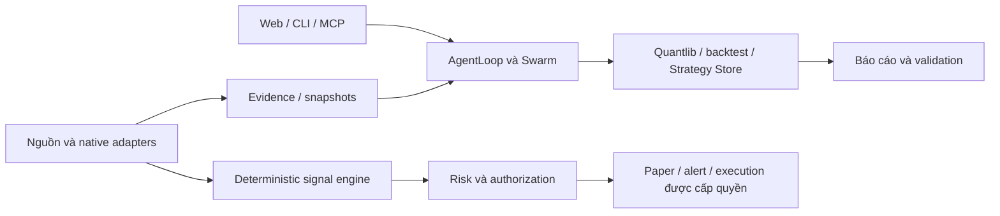

<p align="center">
  <b>Tiếng Việt</b> | <a href="README_en.md">English</a> | <a href="README_zh.md">中文</a> | <a href="README_ja.md">日本語</a> | <a href="README_ko.md">한국어</a> | <a href="README_ar.md">العربية</a> | <a href="README_es.md">Español</a> | <a href="README_id.md">Bahasa Indonesia</a>
</p>

<p align="center">
  
</p>

<h1 align="center">Vibe-Trading: Your Personal Trading Agent</h1>

<p align="center">
  <b>One Command to Empower Your Agent with Comprehensive Trading Capabilities</b><br>
  <i>Nền tảng nghiên cứu tài chính định lượng & điều phối nhóm AI chuyên sâu: Chứng khoán VN · Forex/XAUUSD · Crypto</i>
</p>

<p align="center">
  <a href="https://www.star-history.com/HKUDS/Vibe-Trading"></a>
  <a href="https://trendshift.io/repositories/25527"></a>
  <a href="https://www.star-history.com/HKUDS/Vibe-Trading"></a>
</p>

<p align="center">
  <b>GitHub topic rankings by stars</b> · Nov 4, 2026<br>
  <a href="https://github.com/search?q=topic%3Abacktesting&amp;type=repositories&amp;s=stars&amp;o=desc">#1 Backtesting</a> &nbsp;·&nbsp;
  <a href="https://github.com/search?q=topic%3Aalgorithmic-trading&amp;type=repositories&amp;s=stars&amp;o=desc">#3 Algorithmic Trading</a> &nbsp;·&nbsp;
  <a href="https://github.com/search?q=topic%3Aquantitative-finance&amp;type=repositories&amp;s=stars&amp;o=desc">#4 Quantitative Finance</a>
</p>

<p align="center">
  
  
  
  <a href="https://pypi.org/project/vibe-trading-ai/"></a>
  <a href="LICENSE"></a>
  <br>
  <a href="https://github.com/HKUDS/.github/blob/main/profile/README.md"></a>
  <a href="https://github.com/HKUDS/.github/blob/main/profile/README.md"></a>
  <a href="https://discord.gg/6TdQnT5xcF"></a>
</p>

<p align="center">
  <a href="docs/README.md">Tài liệu</a> &nbsp;&middot;&nbsp;
  <a href="docs/MULTI_MARKET_ARCHITECTURE.md">Kiến trúc</a> &nbsp;&middot;&nbsp;
  <a href="docs/VIETNAM_EQUITY_RESEARCH.md">Chứng khoán VN</a> &nbsp;&middot;&nbsp;
  <a href="docs/FOREX_XAUUSD_LAB.md">Forex & Vàng</a> &nbsp;&middot;&nbsp;
  <a href="docs/CRYPTO_INTELLIGENCE.md">Crypto</a> &nbsp;&middot;&nbsp;
  <a href="#quick-start-từ-source">Cài đặt</a> &nbsp;&middot;&nbsp;
  <a href="docs/IMPLEMENTATION_ROADMAP.md">Lộ trình</a> &nbsp;&middot;&nbsp;
  <a href="CHANGELOG.md">Changelog</a>
</p>

<p align="center">
  <a href="#quick-start-từ-source"></a>
</p>

---

Nền tảng nghiên cứu tài chính bằng ngôn ngữ tự nhiên, điều phối nhóm AI, phân tích định lượng và backtest. Bản source này có CLI, FastAPI, MCP và giao diện React; hướng phát triển tập trung vào ba môi trường: **chứng khoán Việt Nam**, **Forex/XAUUSD** và **Crypto**.

**Phiên bản trong source:** `0.1.18`. **Tài liệu đối chiếu:** 05/11/2026. **Repository:** [qtu11/vibe-trading-vn](https://github.com/qtu11/vibe-trading-vn). Đây là bản định hướng và hướng dẫn của workspace hiện tại; tính năng đề xuất được đánh dấu riêng, không coi việc viết tài liệu là triển khai phần mềm.

[Tài liệu chi tiết](docs/README.md) · [Baseline mã nguồn](docs/SOURCE_BASELINE.md) · [Kiến trúc](docs/MULTI_MARKET_ARCHITECTURE.md) · [Lộ trình](docs/IMPLEMENTATION_ROADMAP.md) · [Changelog](CHANGELOG.md)

**Cập nhật code local 05/11/2026:** đã bổ sung bảo toàn reference/price-basis của dữ liệu Việt Nam, chặn funding ngoài grid Crypto và lỗi quote có cấu trúc ở Forex preflight. Xem [phạm vi triển khai và kiểm thử](docs/IMPLEMENTATION_STATUS_2026-11-05.md). [Master plan](VIBE_TRADING_MULTI_MARKET_MASTER_PLAN_V1.md) và [catalog 265 đặc tả](docs/specs/README.md) vẫn phân biệt những phần còn là đề xuất.

**Đợt code tiếp theo:** tool/MCP đã đọc [BCTC VN local có nguồn, đơn vị và revision theo `as_of`](docs/LOCAL_VN_FINANCIAL_STATEMENTS.md); `.VN` profile có nhãn market đúng, Forex kiểm raw provider data và Crypto ghi rõ giả định perpetual/funding trong run card. Xem [phạm vi và kiểm thử đợt 2](docs/IMPLEMENTATION_STATUS_2026-11-05_02.md). Dữ liệu BCTC local vẫn mang nhãn do người dùng cung cấp, chưa xác minh nội dung.

Các README ngôn ngữ khác giữ phần hướng dẫn/danh mục từ baseline upstream: [中文](README_zh.md), [日本語](README_ja.md), [한국어](README_ko.md), [العربية](README_ar.md), [Español](README_es.md), [Bahasa Indonesia](README_id.md). Thiết kế multi-market mới được viết bằng tiếng Việt trong bộ tài liệu liên kết ở trên.

## Phạm vi hiện tại và hướng mở rộng

| Mảng | Đã thấy trong mã nguồn | Phần cần bổ sung hoặc kiểm chứng |
| --- | --- | --- |
| Điều phối AI | AgentLoop, tool registry, Swarm DAG, preset và task artifacts | Nhóm chuyên biệt theo market, quality gates và budget xuyên toàn run |
| Dữ liệu và định lượng | Historical loaders, market engines, quantlib, run cards | Chất lượng/độ phủ từng vendor, provenance và snapshot thống nhất |
| Việt Nam | VietnamEquityEngine cho HOSE, `.VN` profile, BCTC local theo disclosure-time có provenance | Thu thập/xác minh BCTC và công bố VN, HNX/UPCoM rules, corporate actions và nguồn được cấp phép |
| Forex/XAUUSD | Forex workspace, native adapters, chart polling, research/council, demo runner và policy | Kiểm chứng broker theo tài khoản, cost calibration, strategy validation, tick stream/replay khi cần |
| Crypto | OKX/Binance/CCXT, preset research/trading desk, perpetual risk và connector profiles | Spot/perp accounting phù hợp, historical funding/OI, on-chain có provenance và feed replay |
| Chiến lược | Strategy Store/SDM, discovery, lifecycle và validation fields | Version bất biến, validation scope theo instrument/source/cost model |
| Giao dịch | SDK/MCP/Forex có các đường mandate, risk, halt, audit | Kiểm chứng từng profile/action; paper/demo không chứng minh live sẵn sàng |

Đây là ma trận đọc source, không phải chứng nhận runtime. Chi tiết và giới hạn nằm trong [SOURCE_BASELINE](docs/SOURCE_BASELINE.md). Một số prompt cũ chưa phản ánh capability mới: chẳng hạn có prompt nói chưa có DCF trong khi quantlib đã có module định giá.

## Ba môi trường nghiên cứu

**Vietnam Stock Intelligence:** nghiên cứu doanh nghiệp và ngành, đọc BCTC/tài liệu gốc, đối chiếu dự báo, xây kịch bản định giá và phản biện. Mỗi con số cần kỳ kế toán, đơn vị, ngày công bố, revision và locator. Giá lịch sử HOSE chưa đủ để tuyên bố có pipeline nghiên cứu toàn thị trường Việt Nam. [Đặc tả Vietnam](docs/VIETNAM_EQUITY_RESEARCH.md)

**Forex & XAUUSD Trading Lab:** nghiên cứu phương pháp trên dữ liệu đúng broker/symbol, tách nến đang chạy với nến đã đóng, đo chi phí và kiểm định ngoài mẫu. LLM nghiên cứu/giải thích; engine xác định đánh giá tín hiệu và risk gate kiểm tra quyền. Chart polling đã có, persistent tick stream/replay vẫn là phần mở rộng. [Đặc tả Forex/XAUUSD](docs/FOREX_XAUUSD_LAB.md)

**Crypto Intelligence:** phân biệt spot, linear/inverse perpetual, venue, trade/mark/index price; phân tích funding, OI, depth và on-chain khi có nguồn thật. Một vai trò On-chain Analyst trong preset không chứng minh đã tích hợp một nhà cung cấp on-chain. [Đặc tả Crypto](docs/CRYPTO_INTELLIGENCE.md)

Không cộng VND/USD/JPY/USDT thành một NAV khi chưa có currency accounting và FX snapshot. CompositeEngine hiện chặn mixed settlement currency ở đường composite; điều đó chưa tự bảo vệ mọi basket cùng market.

## Kiến trúc làm việc



Sơ đồ thể hiện hướng kiến trúc; không phải mọi mũi tên đã được triển khai. Tái sử dụng runtime, registry và stores có sẵn trước khi tạo module mới. [Kiến trúc và lựa chọn thiết kế](docs/MULTI_MARKET_ARCHITECTURE.md) · [Hợp đồng dữ liệu/evidence](docs/DATA_EVIDENCE_CONTRACTS.md)

## Quick start từ source

Cần **Python 3.11+**. Phát triển/build frontend cần **Node 22.22+** và npm. Extra MT5 dùng cầu nối chính thức trên Windows và terminal MT5 cục bộ; tài khoản, symbol và broker permissions cần kiểm tra riêng.

Tại thư mục dự án, với PowerShell:

```powershell
python -m venv .venv
.\.venv\Scripts\Activate.ps1
python -m pip install -e .
vibe-trading init
```

Trên Linux/macOS, bước kích hoạt là `source .venv/bin/activate`. `vibe-trading init` là bước cấu hình tương tác; chọn provider/model bạn có quyền dùng. Xem các trường cấu hình trong [agent/.env.example](agent/.env.example) và schema hiện hành; không ghi secret vào README hoặc report. Nếu đã có venv/cấu hình, giữ và dùng lại thay vì tạo đè.

Chạy một yêu cầu nghiên cứu sau khi cấu hình provider:

```powershell
vibe-trading run -p "Nghiên cứu BTC-USDT bằng dữ liệu có nguồn; ghi thời điểm, phần còn thiếu và rủi ro. Không đặt lệnh."
```

Lệnh nghiên cứu có thể gọi model và nguồn dữ liệu ngoài, phát sinh chi phí theo cấu hình. Nó không phải bài kiểm tra offline và chưa được chạy trong đợt sửa tài liệu này.

### Web UI khi phát triển

Terminal thứ nhất, tại root:

```powershell
vibe-trading serve --host 127.0.0.1 --port 8899
```

Terminal thứ hai:

```powershell
cd frontend
npm ci
npm run dev
```

Mở [Web UI cục bộ](http://localhost:5899). Vite dùng cổng `5899`, proxy mặc định tới `http://127.0.0.1:8899`; có thể đổi target bằng `VITE_API_URL`. `serve` khi không ghi port có mặc định `8000`; dùng lệnh rõ port ở trên để khớp Vite. Backend mặc định bind `127.0.0.1` theo [server_cli.py](agent/src/api/server_cli.py).

Sau khi build frontend, FastAPI có thể phục vụ `frontend/dist` trên cùng cổng backend:

```powershell
cd frontend
npm run build
cd ..
vibe-trading serve --host 127.0.0.1 --port 8899
```

Truy cập từ máy khác cần cấu hình `API_AUTH_KEY`, CORS và hạ tầng tương ứng; xem [hướng dẫn bảo mật](SECURITY.md) và [quy tắc contributor](AGENT_CONTRIBUTOR_GUIDE.md). Không mở dịch vụ công khai chỉ để thử một thay đổi tài liệu.

### MCP và Forex

| Lệnh | Vai trò |
| --- | --- |
| `vibe-trading` | CLI/TUI tương tác |
| `vibe-trading-mcp` | MCP chung cho client AI |
| `vibe-forex-mcp` | MCP chuyên biệt Forex, có connection và policy riêng |
| `vibe-trading --swarm-presets` | Danh sách preset đã có |
| `vibe-trading swarm inspect investment_committee` | Kiểm tra preset/DAG, không khởi chạy worker |
| `vibe-trading provider doctor` | Chẩn đoán cấu hình provider đã che dữ liệu nhạy cảm |

MCP chung và MCP Forex có tool surface khác nhau. Không suy từ tool đọc của server này sang quyền execution của server khác. Dùng [Forex MCP implementation](docs/FOREX_MCP_IMPLEMENTATION.md), [live candles](docs/FOREX_LIVE_CANDLES.md) và [agentic research](docs/FOREX_AGENTIC_RESEARCH.md) cho cấu hình chi tiết; file ví dụ trong `docs/examples/forex/` chỉ là cấu hình mẫu.

## Đọc và triển khai tiếp

| Tài liệu | Câu hỏi trả lời |
| --- | --- |
| [Source baseline](docs/SOURCE_BASELINE.md) | Source hiện tại hỗ trợ gì, còn giới hạn ở đâu? |
| [Multi-market architecture](docs/MULTI_MARKET_ARCHITECTURE.md) | Ba môi trường dùng chung và tách trách nhiệm thế nào? |
| [Data/evidence contracts](docs/DATA_EVIDENCE_CONTRACTS.md) | Identity, time, PIT, revision, snapshot và null có nghĩa gì? |
| [Implementation roadmap](docs/IMPLEMENTATION_ROADMAP.md) | Làm slice nào trước và nghiệm thu bằng gì? |
| [Documentation verification](docs/DOCUMENTATION_VERIFICATION.md) | Đã kiểm tra tài liệu gì, còn phần nào chưa chạy? |

Theo quy ước hiện tại, `docs/` là tài liệu làm việc cục bộ; tài liệu công khai dùng `wiki/docs/`. [Tài liệu website](https://vibetrading.wiki/docs/) và các bản dịch có thể theo revision upstream khác. Việc xuất bản cần review nội dung công khai và workflow riêng, không force-add toàn bộ local docs.

## Kiểm tra và đóng góp

Với thay đổi tài liệu, kiểm tra links, code fences, danh mục được sinh từ source và những contract bị ảnh hưởng:

```powershell
python -m pytest agent/tests/test_readme_counts.py agent/tests/test_capability_matrix.py -q --tb=short
```

Khi thay source, chạy thêm test phù hợp theo [AGENT_CONTRIBUTOR_GUIDE](AGENT_CONTRIBUTOR_GUIDE.md) và [CONTRIBUTING](CONTRIBUTING.md). Không dùng giao dịch thật để kiểm tra sửa lỗi thông thường. Không đưa credentials, broker exports, local memory hoặc reports riêng vào commit.

Nội dung từ upstream HKUDS/Vibe-Trading được giữ attribution theo [LICENSE](LICENSE), [NOTICE](NOTICE) và [CHANGELOG](CHANGELOG.md). Tham khảo [SECURITY](SECURITY.md) cho báo cáo lỗ hổng và kênh chính thức.

## Giới hạn sử dụng

Phần mềm phục vụ nghiên cứu và giao dịch theo quyền được cấp. Kết quả backtest không bảo đảm lợi nhuận; dữ liệu chưa xác minh, chi phí mặc định và mô hình sai sản phẩm có thể làm kết quả sai. Báo cáo LONG/SHORT, artifact active hoặc Risk Agent đồng ý không tự cấp quyền đặt lệnh. Mọi phần broker/live chưa được kiểm tra trong đợt tài liệu này được ghi rõ trong các tài liệu liên quan.

## Danh mục kỹ thuật của baseline

Các phần dưới giữ inventory nguồn, lệnh và profile từ bản hiện có, với số lượng được kiểm tra bởi test. Danh mục mô tả những gì source khai báo; khả năng kết nối, quyền dữ liệu và broker behavior vẫn cần xác minh theo tài khoản. Các cập nhật thiết kế multi-market ở bộ docs phía trên.

## 📡 Data Sources & Smart Fallback

One `get_market_data` call, **29 market-data sources**, one of them the optional **QVeris** premium marketplace. Set `source: "auto"` — the loader resolves the symbol and walks the configured per-market fallback chain. Sources remain subject to dependency, entitlement, rate-limit, network and coverage requirements; fallback does not guarantee availability or equivalent data.

| Source | Markets | Auth | Role |
|--------|---------|------|------|
| `tencent` | A-share + HK | none | public source early in the relevant default fallback chains; availability is conditional |
| `mootdx` | A-share (explicit-only) | none | retired from the default chain 2026-10: TDX servers stopped answering the client protocol it speaks (#1729) |
| `eastmoney` | A / US / HK | none | OHLCV + deep fundamentals & flow tools (throttled) |
| `baostock` · `akshare` | A (+ US/HK/futures/macro/fx) | none | free fallbacks |
| `tushare` | A / HK / fund | token | historical loader supports these declared markets; futures is explicitly excluded |
| `gildata` | A-share | token (Settings / `GILDATA_TOKEN`) | Hundsun Juyuan (恒生聚源) commercial feed — forward-adjusted dailies, joins the A-share chain tail |
| `yahoo` | US / HK / Canada / UK | none | direct chart/quotes/options; TSX `.TO` / TSXV `.V`; LSE `.L` with declared-currency normalization |
| `sina` · `stooq` | US | none | K-line to 1984 · EOD CSV |
| `yfinance` | US / HK / Canada / UK | none | wrapper; TSX `.TO` / TSXV `.V`; LSE `.L` under the same GBP/GBp contract |
| `longbridge` | US / HK | App Key + App Secret + Access Token | optional historical OHLCV source; install the optional SDK |
| `finnhub` · `alphavantage` · `tiingo` · `fmp` | US | key | optional providers |
| `qveris` | global multi-asset | key · credits | **premium marketplace** — 63+ providers via one key (explicit-only, never in auto fallback) |
| `nobitex` · `wallex` | crypto (Iranian Toman pairs) | none | public UDF endpoints; **explicit-only** — the only Toman-quoted sources, so they never join the crypto chain where a USD-quoted series could stand in for one |
| `okx` · `ccxt` · `binance` | crypto | none | OKX + 100+ exchanges + Binance historical / USD-M perps |
| `futu` | HK / A | OpenD | optional local FutuOpenD |
| `mt5` | forex / metals | MT5 terminal | MetaTrader 5 (Exness-style) forex / metal bars, 1m–1D |
| `tickerall` | forex / metals | key + account (read-only) | same broker MT5 feed, **hosted** — no local terminal, any OS (explicit-only, never in auto fallback) |
| `pykrx` | Korea (KRX: KOSPI/KOSDAQ) | none | daily KOSPI / KOSDAQ bars for `.KS` / `.KQ` (optional `krx` extra) |
| `india_broker` | India (NSE/BSE) | broker login | read-only Zerodha / Shoonya / Dhan bars for `.NS` / `.BO` (fallback-chain tail) |
| `b3_cotahist` | Brazil (B3) | none | official daily B3 cash/odd-lot bars (raw, BRL) from the local store populated by `python -m src.br_data sync`; offline fallback for `.SA` |
| `local` | any | none | your own CSV / Parquet / DuckDB via `local:` prefix |

Local sources can read bar dates from a `DatetimeIndex`, with or without a
configured `date_format`; an explicitly mapped date column takes precedence.

**Fallback chains (by IP-ban risk):**

- **A-share** → `tencent` · `eastmoney` · `baostock` · `akshare` · `tushare` · `gildata` · `local`
- **US** → `yahoo` · `stooq` · `sina` · `eastmoney` · `yfinance` · `tiingo` · `fmp` · `finnhub` · `alphavantage` · `longbridge` · `akshare` · `local`
- **HK** → `tencent` · `eastmoney` · `yahoo` · `futu` · `akshare` · `yfinance` · `tushare` · `longbridge` · `gildata` · `local`
- **India (NSE/BSE)** → `yahoo` · `yfinance` · `india_broker` · `local`
- **Brazil (B3 `.SA`)** → `yahoo` · `yfinance` · `b3_cotahist` · `local`
- **Korea (KOSPI/KOSDAQ)** → `pykrx` · `yahoo` · `yfinance` · `local`
- **Indices** → `yahoo` · `yfinance` · `gildata` · `local`
- **UK (LSE)** → `yahoo` · `yfinance` · `local` *(declared GBP/GBp quotes only)*
- **Crypto** → `okx` · `binance` · `ccxt` · `yfinance` · `local`
- **Forex / metals** → `mt5` · `akshare` · `yfinance` · `local`
- **Canada / Vietnam / Argentina** → `yahoo` · `yfinance` · `local`
- **China futures** → `akshare` · `local` &nbsp;·&nbsp; **funds** → `tushare` · `akshare` · `local` &nbsp;·&nbsp; **macro** → `akshare` · `tushare` · `local`

### Using Longbridge explicitly

Longbridge is an optional US/HK historical OHLCV loader. Install its SDK with:

```bash
pip install "vibe-trading-ai[longbridge]"
```

Configure the three credentials in `.env`:

```dotenv
LONGBRIDGE_APP_KEY=...
LONGBRIDGE_APP_SECRET=...
LONGBRIDGE_ACCESS_TOKEN=...
```

For a backtest, set `source` in `config.json`:

```json
{
  "codes": ["QQQ.US"],
  "start_date": "2025-01-01",
  "end_date": "2025-01-10",
  "interval": "1D",
  "source": "longbridge"
}
```

In an Agent conversation, ask explicitly: **"Use Longbridge to fetch QQQ.US historical data."** The explicit source request is separate from `source: "auto"`; `auto` keeps the normal per-market fallback chain.

Beyond OHLCV, **29 read-only data tools** reach into fundamentals & flow — fund flow, dragon-tiger, northbound, southbound, margin, block trades, shareholder count, lockup, sector, research reports, broker research search, news, SEC filings, Chinese-market announcements, financial statements, PIT fundamentals, options chains, crypto order-book depth, stock profile, market screening, symbol search, macro, China macro (EDB), iwencai, institutional holdings (13F), ETF look-through, off-exchange fund NAV, prediction markets, and research papers — all exposed over MCP. An explicit `local:` symbol never silently falls back to a network source.

<!-- QVERIS-START -->
### 💎 Optional premium data — QVeris


**Data: free routing or premium, your choice.** Free stays the default: 29 built-in sources with ban-risk fallback, no key, no cost. Premium via QVeris adds 10,000+ capabilities (per QVeris) across 63+ providers for options Greeks, premium fundamentals, China/HK/global data, macro, crypto, news, and filings; failed calls are not charged. Enable it in Settings -> QVeris or `vibe-trading data mode paid`.

*QVeris disclosure: [signing up through the Vibe-Trading referral link](https://qveris.ai/?ref=Vyjjo5G_1cAHJA) gets you **+1,000 bonus credits** and supports the project.*
<!-- QVERIS-END -->

---

## 🔩 Detailed Capabilities

Detailed inventories are folded below to keep the main README scannable. Open them when you want to inspect the available building blocks.

<details>
<summary><b>Finance Skill Library</b> <sub>90 skills across 9 categories</sub></summary>

- 📊 90 specialized finance skills organized into 9 categories
- 🌐 Methods for traditional markets, crypto and DeFi; source coverage varies
- 🔬 Comprehensive capabilities spanning data sourcing to quantitative research

| Category | Skills | Examples |
|----------|--------|----------|
| Data Source | 10 | `data-routing`, `tushare`, `yfinance`, `okx-market`, `akshare`, `mootdx`, `ccxt`, `eastmoney`, `sec-edgar`, `qveris` |
| Strategy | 19 | `strategy-generate`, `cross-market-strategy`, `technical-basic`, `candlestick`, `ichimoku`, `elliott-wave`, `smc`, `multi-factor`, `ml-strategy` |
| Analysis | 23 | `factor-research`, `correlation-regime`, `macro-analysis`, `global-macro`, `valuation-model`, `investor-lenses`, `credit-analysis`, `dividend-analysis` |
| Asset Class | 9 | `options-strategy`, `options-advanced`, `convertible-bond`, `etf-analysis`, `asset-allocation`, `sector-rotation` |
| Crypto | 7 | `perp-funding-basis`, `liquidation-heatmap`, `stablecoin-flow`, `defi-yield`, `onchain-analysis` |
| Flow | 8 | `hk-connect-flow`, `us-etf-flow`, `edgar-sec-filings`, `financial-statement`, `adr-hshare` |
| Tool | 10 | `backtest-diagnose`, `report-generate`, `pine-script`, `doc-reader`, `web-reader`, `vnpy-export`, `trade-journal` |
| Research | 3 | `alpha-zoo`, `strategy-dev-manager`, `strategy-discovery` |
| Risk Analysis | 1 | `ashare-pre-st-filter` |

The read-only `report_audit` tool preserves signed financial values in Markdown
tables and `label: value` lines, so losses are checked as losses rather than profits.
Backtest reports ground their figures in the engine's own output for that call.
For list results, equivalent references such as `data.positions[0].contribution_pct`
and `data.positions.0.contribution_pct` select the same element; an explicit index
cannot borrow another element's value. Correction hints suggest exact references
without treating the suggestion itself as evidence.

</details>

<details>
<summary><b>Custom Data Source</b> <sub>register your own historical OHLCV loader</sub></summary>

Need a market or vendor we don't ship a loader for? Add your own historical-bar
loader and select it with `source="<name>"`. The steps edit package source, so
run from a clone (`pip install -e .`).

1. **Write the loader** — create `agent/backtest/loaders/<name>_loader.py` with a
   class that satisfies `DataLoaderProtocol` (duck-typed, no base class needed)
   and is tagged with `@register`:

   ```python
   import pandas as pd
   from backtest.loaders.registry import register

   @register
   class DataLoader:
       name = "mysource"            # the value you pass as source=
       markets = {"us_equity"}      # a_share/us_equity/hk_equity/crypto/futures/fund/macro/forex
       requires_auth = False

       def is_available(self) -> bool:
           return True              # token present? network reachable?

       def fetch(self, codes, start_date, end_date, *, interval="1D", fields=None):
           # return {symbol: DataFrame indexed by trade_date,
           #         columns: open, high, low, close, volume}
           ...
   ```

2. **Register the module** so `@register` fires — add
   `"backtest.loaders.<name>_loader"` to `_loader_modules` in
   `agent/backtest/loaders/registry.py`.
3. **Allow the name** through config validation — add `"mysource"` to
   `_VALID_SOURCES` in `agent/backtest/runner.py`.
4. *(Optional)* slot it into a market's `FALLBACK_CHAINS` in `registry.py` so
   `source="auto"` can reach it.
5. **Use it** — `source="mysource"` in a backtest config, or via the CLI / agent.

> **Real-time ticks / order-book depth are out of scope for loaders** — the
> loader layer is point-in-time historical bars only. Live market data flows
> through the broker connectors instead: `okx` / `binance` / `ccxt` for crypto,
> `futu` / `tiger` for equities.

</details>

<details>
<summary><b>Broker Connectors</b> <sub>19 brokers — read + paper, bounded-live where supported</sub></summary>

Connector-first profiles. Most do read + paper-account order placement — IBKR is read-only, Robinhood is live-only (no paper account), Scalable Capital is read-only (no paper account exists at all), mStock (India) is read-only live over its Type B REST API (no paper account), and Trading 212 and Toss Securities refuse order placement entirely, paper included. Supported live order paths require their mandate, risk and halt checks; the broker executes and this software does not hold funds. The general MCP server omits placement tools; the dedicated Forex MCP can expose execution tools through explicit opt-in and its own policy gates. Research may read history through a live-account terminal, which does not authorize orders. Guard coverage must be verified per profile and action.

| Broker | Markets | Capabilities |
|--------|---------|--------------|
| **IBKR** | global | local TWS / Gateway, read-only |
| **Robinhood** | US | Agentic MCP (desktop OAuth) — equity read + bounded live; options order placement is not supported |
| **Scalable Capital** | DE / EU | Agentic MCP (desktop OAuth) — fully read-only; no paper account exists |
| **mStock** | India (NSE/BSE) | Separate holdings/net-position reads; no portfolio aggregation or orders |
| **Tiger** | US / HK / A | read + paper + bounded live |
| **Alpaca** | US | read + paper + bounded live (+ TAP credential-isolation mode) |
| **OKX** · **Binance** | crypto | read + paper + bounded live |
| **Futu** | HK / US / A | read + paper + bounded live |
| **eToro** | global | read + paper + bounded live (Public API; demo keys reach only `/demo` paths, plus copy-trading workflows) |
| **MetaTrader 5** | forex / CFD | read + paper + bounded live (Exness-style; demo ⇔ paper identity guard) |
| **KIS** (한국투자증권) | Korea (KOSPI/KOSDAQ) | read + genuine paper (모의투자, a real broker-side sandbox on a separate host) — live order placement not yet wired for this market |
| **Longbridge** · **Dhan** · **Shoonya** · **Zerodha** · **Upbit** | US / HK · India (NSE/BSE) · Korea (crypto) | read + paper only — no runtime paper/live discriminator, so live order placement is hard-refused |
| **Trading 212** · **Toss Securities** | UK / EU · Korea/US | fully read-only — `place_order` / `cancel_order` hard-refuse even paper (no verified sandbox) |

Paper-vs-live is a **structural per-broker runtime guard** (account-id format, host separation, demo flag, or trade environment), never a config flag the agent can flip. A broker exposing no such discriminator is capped at paper + read-only.

</details>

<details>
<summary><b>Preset Trading Teams</b> <sub>30 swarm presets</sub></summary>

- 🏢 30 ready-to-use agent teams
- ⚡ Pre-configured finance workflows
- 🎯 Investment, trading & risk management presets

| Preset | Workflow |
|--------|----------|
| `investment_committee` | Bull/bear debate → risk review → PM final call |
| `global_equities_desk` | A-share + HK/US + crypto researcher → global strategist |
| `crypto_trading_desk` | Funding/basis + liquidation + flow → risk manager |
| `earnings_research_desk` | Fundamental + revision + options → earnings strategist |
| `macro_rates_fx_desk` | Rates + FX + commodity → macro PM |
| `quant_strategy_desk` | Screening + factor research → backtest → risk audit |
| `technical_analysis_panel` | Classic TA + Ichimoku + harmonic + Elliott + SMC → consensus |
| `risk_committee` | Drawdown + tail risk + regime review → sign-off |
| `global_allocation_committee` | A-shares + crypto + HK/US → cross-market allocation |

<sub>Plus 20+ additional specialist presets — run vibe-trading --swarm-presets to explore all.
Bring your own: drop preset YAMLs into <code>~/.vibe-trading/swarm/presets/</code> — they are listed
alongside the bundled roster (same-name files override it, like user skills) and survive upgrades.

</sub>

</details>

<details>
<summary><b>Alpha Zoo</b> <sub>478 pre-built quant alphas across 5 families</sub></summary>

- 🧬 478 cross-sectional alphas, lookahead-banned at the operator layer
- 📈 IC + IR + alive/reversed/dead categorisation in one CLI command
- 🔬 AST purity gate + 300-row lookahead sentinel test + `pytest-socket` network kill-switch
- 📦 Apache-2 attribution for Qlib; per-zoo `LICENSE.md` declaring formulas as mathematical content
- 🤝 Developer Certificate of Origin (DCO) sign-off workflow for community PRs

| Zoo | Count | Source | License |
|-----|-------|--------|---------|
| **qlib158** | 154 | Microsoft Qlib `Alpha158` (Apache-2.0, commit-pinned) | Apache-2.0 |
| **alpha101** | 101 | Kakushadze (2015), "101 Formulaic Alphas", arXiv:1601.00991 | Formulas are mathematical content |
| **gtja191** | 191 | Guotai Junan (2014), "191 Short-period Trading Alpha Factors" | Formulas are mathematical content |
| **academic** | 12 | Fama-French 5 + Carhart momentum + Jegadeesh reversal + George-Hwang 52-week-high + Amihud illiquidity + Harvey-Siddique skew + Frazzini-Pedersen betting-against-beta + correlation-rewiring stability (price-based proxies) | Public academic literature |
| **fundamental** | 20 | PIT-safe SEC company facts (14, filed-date anchored: earnings yield, book-to-market, ROE, ROA, gross profitability, growth, accruals, leverage, cash-flow yields …) + A-share P/B, P/S TTM and dividend yield (3) + their Shenwan industry-neutral variants (3) | Public financial data |

Run `vibe-trading alpha list` to browse, `vibe-trading alpha show <id>` for formulas + source, `vibe-trading alpha bench --zoo X --universe Y --period Z` to score a whole zoo, and `vibe-trading alpha compare --all` to rank zoos side by side.

</details>

<details>
<summary><b>Backtest Engines</b> <sub>11 engines + options portfolio, cross-market composite</sub></summary>

| Engine | Market | Notes |
|--------|--------|-------|
| **ChinaA** | A-share | T+1, price limits, pre-ST filter |
| **GlobalEquity** | US / HK / Canada / UK | same-session trading; market-specific lots, ticks, settlement currencies, and costs |
| **IndiaEquity** | India (NSE/BSE) | T+1, circuit bands, config-driven STT / stamp / SEBI / GST cost stack |
| **KoreaEquity** | Korea (KRX: KOSPI/KOSDAQ) | long-only, ±30% band judged at execution time on the unified tick grid, 2026 0.20% transaction tax |
| **VietnamEquity** | Vietnam (HOSE) | long-only, T+2 settlement hold, ±7% band on the 10/50/100-VND tick grid, 100-share lots, 0.1% sell-side tax |
| **BrazilEquity** | Brazil (B3) | BRL, B3 trading + settlement fees, configurable broker fee, 1- or 100-share lots, R$0.01 tick, shorting allowed |
| **Crypto** | crypto spot / USD-M perps | funding settlements, execution/mark split |
| **ChinaFutures** · **GlobalFutures** | futures | margin, contract multipliers |
| **Forex** | FX / metals | via the `mt5` loader (local terminal) or the hosted `tickerall` loader (no terminal, any OS) |
| **Composite** | cross-market | one shared capital pool across markets (`source="auto"`) |
| **options_portfolio** | options | multi-leg, Greeks, payoff/scenario |

Benchmark selection honors `.SH`, `.SZ`, and `.BJ` A-share suffixes, plus Yahoo's `.SS` spelling for Shanghai, independently of the chosen loader, including offline local sources.

Bars: 1m / 5m / 15m / 30m / 1H / 4H / 1D, plus weekly / monthly (1W / 1M, built from daily bars). 15 metrics + benchmark comparison, **5 portfolio optimizers** (equal-volatility / risk-parity / mean-variance / max-diversification / turnover-aware), and 3 validation tools (Monte Carlo / Bootstrap / Walk-Forward).

The turnover-aware optimizer validates per-name and group caps for single-asset
allocations too. It preserves feasible supplied allocations (including cash),
and raises an error when the singleton allocation exceeds a cap.

When the opt-in market-data cache is enabled, local-source cache entries are
scoped to the configured file, query, and column mapping. Changing a symbol's
source declaration does not reuse bars from its previous source. The settled-data
cache policy for an unchanged declaration remains the same.
Unusable cached metadata is treated as a cache miss: the declared local source
is read again, and the replacement entry can serve subsequent cache hits.
The turnover-aware optimizer measures allocation changes in signed position
space: reversing a 50% long to a 50% short contributes 0.5 turnover, including
both the close and the reopen. Its penalty and recorded allocation turnover
include these reversals; execution-derived turnover remains a separate metric.
Local data date ranges include the entire UTC end day, including subsecond
timestamps; bars at the following midnight are excluded before aggregation.

The shared backtest market classifier recognizes `BTC/USD`, `ETH/USD`,
`BNB/USD`, `SOL/USD`, `ADA/USD`, and `DOGE/USD` as crypto. Fiat pairs such as
`GBP/USD`, `EUR/USD`, and `USD/JPY` retain their forex classification.

</details>

<details>
<summary><b>Quant Library</b> <sub>308 tested functions across 24 modules, callable from every transport</sub></summary>

`src/quantlib` holds one tested implementation of each piece of finance math the
agent needs. Skills **import** these rather than carrying formulas inside
markdown code blocks — if you find a pricing formula living in a `SKILL.md`,
that is a bug, not a pattern.

| Module | What it covers |
|--------|----------------|
| `options` | Black-Scholes price + greeks, implied-volatility inversion |
| `fixedincome` | Bond math, Nelson-Siegel / Svensson curve fitting; schedules, accrual, key-rate tenors and yield inversion reject non-finite inputs by name. |
| `credit` | Altman Z-score, Merton / KMV distance-to-default; CDS premium dates retain their configured frequency, with a final stub when maturity falls between coupons. |
| `timeseries` | Stationarity, cointegration, GARCH, bootstrap; OU fits use adjacent observed lag pairs; missing observations never become artificial one-step transitions. |
| `risk` · `var_backtest` | VaR / CVaR / EVT and their backtests |
| `attribution` | Brinson-Fachler decomposition |
| `performance` · `fundmath` | TWR / MWR / Modified Dietz; XIRR / MOIC / DPI / TVPI |
| `factormodel` · `eventstudy` | Factor regressions, event studies; portfolio style exposure reports incomplete factor rows as unmatched weight. |
| `neutralization` | Optional per-observation OLS/WLS factor residualization, audited control quality selection, and cross-sectional PCA at any panel frequency. [Workflow and examples](agent/src/skills/factor-research/references/neutralization.md). |
| `multipletesting` · `crossvalidation` | Deflated significance, purged CV; purged walk-forward splits omit folds with no training observations left after purging; Sharpe significance summaries reject non-finite inputs by name. |
| `impact` | Market-impact models |
| `volatility` | Heston (1993) stochastic-volatility pricing; Heston pricing requires finite inputs and a positive integration limit; invalid inputs return a domain error. |
| `portfolio` | Hierarchical Risk Parity allocation |
| `copula` | Gaussian and Archimedean copulas |
| `microstructure` | VPIN, Roll spread, Amihud illiquidity, Kyle's lambda |

The read-only `quantlib_call` tool reaches all of it through one contract, so the
finance math works on the CLI, the Web UI, the REST API and MCP — including
deployments where `bash` is gated off. It is
structurally not a shell — module allowlist, `__all__`-only dispatch, `export_*`
refused. Econometrics needs the `stats` extra
(`pip install "vibe-trading-ai[stats]"`); those functions lazy-import and tell
you which one is missing.

</details>

<details>
<summary><b>Valuation & Institutional Research</b> <sub>DCF, comps, three-statement, and six research commands</sub></summary>

A valuation engine that refuses to invent its own inputs. The one rule in
`contracts.py`: **a missing input makes a model NOT RUNNABLE and is never
silently defaulted** — every default in a valuation model is an opinion wearing
a constant's clothes.

| Model | Behaviour worth knowing |
|-------|-------------------------|
| `run_dcf` | FCFF bridge, WACC build, mid-year discounting, net-debt bridge, WACC×g sensitivity grid. Dual terminal value: each method is cross-checked against the other's implied multiple and implied g |
| `run_comps` | EV bridge, LTM + calendar-year calendarisation, multiple matrix. A peer with a non-positive denominator is **excluded and reported**, never averaged in as a negative multiple |
| `threestatement` | Linked projection with a hard balance assertion, an explicit revolver plug, and an iterated interest↔debt circularity that must converge or raise |

Artifacts are input-hashed and versioned, with xlsx / pptx export.

Six slash commands drive the workflows — `/comps` `/dcf` `/attrib` `/memo`
`/earnings` `/screen` — each carrying a step skeleton and an
arithmetic-consistent worked example (the Brinson decomposition sums exactly to
active return; the earnings bridge sums exactly to the EPS delta). The
`investor-lenses` skill stacks named-investor reasoning frameworks on top as
analysis overlays: each lens is an operating procedure — priority signals,
disqualifying conditions, typical misuse — not a biography, and names no tool.

Beyond bars, `src/entities` ingests irregular dated cash flows (NAVs, capital
calls, coupons) and `cashflow_performance` reports XIRR / MOIC / DPI / TVPI /
TWR / Modified Dietz / MWR over them. This path is deliberately parallel to the
bar engines so a `nav` column can never reach one and get priced as a close.

</details>

<details>
<summary><b>Governance & Audit Trail</b> <sub>answer "what methodology produced that number?"</sub></summary>

Every run writes a **manifest** hashing the prompt, the skill contents, the tool
registry and the package versions, so a number produced last month can be traced
to the exact methodology that produced it.

The **audit ledger** chains each record to its predecessor's hash and fsyncs, so
editing or deleting a record is detectable — and an edit that recomputes its own
hash is still caught one record later via `prev_hash_mismatch`. Timestamps are
always caller-supplied; no module here calls `datetime.now()`.

Trace redaction is **sink-aware**: tool-call arguments and the live audit ledger
use a fail-closed sink where `content` stays redacted, while the tool-result
sink releases it and pattern-scrubs its string leaves. `env` is never released
in either.

</details>

## Declared broker profiles

<!-- BEGIN GENERATED broker-capability-matrix -->

Declared built-in profiles, generated from `agent/src/trading/profiles.py`.
Each row keeps its own environment and permissions; a paper order capability
never grants live trading. These are declarations, not successful runtime or
broker verification. Local plugins and user connection settings are excluded.

The quote column shows the declared transport, not a verified endpoint or
pricing coverage. Order kinds (market, limit, etc.) are not declared in the
registry and are therefore not inferred here. The placement column reports
the declared mandate requirement only; it does not attest to cancellation,
flattening, copy-trading, or other runtime guard coverage. Paper placement can
use a broker sandbox or local simulation. See each profile's notes and the
[broker bring-up checklist](CONTRIBUTING.md#broker-bring-up-checklist).

| Profile | Connector | Environment | Transport | Mode | Read capabilities | Quote path (declared) | Other capabilities | Placement requirement (declared) |
| --- | --- | --- | --- | --- | --- | --- | --- | --- |

| `alpaca-live-sdk-readonly` | alpaca | live | broker_sdk | read-only | `account.read`, `history.read`, `orders.read`, `positions.read`, `quotes.read` | broker_sdk | none declared | disabled (read-only) |
| `alpaca-live-trade` | alpaca | live | broker_sdk | write-enabled | `account.read`, `history.read`, `orders.read`, `positions.read`, `quotes.read` | broker_sdk | `orders.place.requires_mandate` | mandate required |
| `alpaca-paper-sdk` | alpaca | paper | broker_sdk | read-only | `account.read`, `history.read`, `orders.read`, `positions.read`, `quotes.read` | broker_sdk | none declared | disabled (read-only) |
| `alpaca-paper-trade` | alpaca | paper | broker_sdk | write-enabled | `account.read`, `history.read`, `orders.read`, `positions.read`, `quotes.read` | broker_sdk | `orders.place` | no mandate declared |
| `binance-live-sdk-readonly` | binance | live | broker_sdk | read-only | `account.read`, `history.read`, `orders.read`, `positions.read`, `quotes.read` | broker_sdk | none declared | disabled (read-only) |
| `binance-live-trade` | binance | live | broker_sdk | write-enabled | `account.read`, `history.read`, `orders.read`, `positions.read`, `quotes.read` | broker_sdk | `orders.place.requires_mandate` | mandate required |
| `binance-paper-sdk` | binance | paper | broker_sdk | read-only | `account.read`, `history.read`, `orders.read`, `positions.read`, `quotes.read` | broker_sdk | none declared | disabled (read-only) |
| `binance-paper-trade` | binance | paper | broker_sdk | write-enabled | `account.read`, `history.read`, `orders.read`, `positions.read`, `quotes.read` | broker_sdk | `orders.place` | no mandate declared |
| `dhan-live-sdk-readonly` | dhan | live | broker_sdk | read-only | `account.read`, `history.read`, `orders.read`, `positions.read`, `quotes.read` | broker_sdk | none declared | disabled (read-only) |
| `dhan-paper-sdk` | dhan | paper | broker_sdk | read-only | `account.read`, `history.read`, `orders.read`, `positions.read`, `quotes.read` | broker_sdk | none declared | disabled (read-only) |
| `dhan-paper-trade` | dhan | paper | broker_sdk | write-enabled | `account.read`, `history.read`, `orders.read`, `positions.read`, `quotes.read` | broker_sdk | `orders.place` | no mandate declared |
| `etoro-live-sdk-readonly` | etoro | live | broker_sdk | read-only | `account.read`, `history.read`, `orders.read`, `positions.read`, `quotes.read` | broker_sdk | none declared | disabled (read-only) |
| `etoro-live-trade` | etoro | live | broker_sdk | write-enabled | `account.read`, `history.read`, `orders.read`, `positions.read`, `quotes.read` | broker_sdk | `copy.close`, `copy.poll`, `copy.precheck`, `copy.start`, `orders.cancel`, `orders.cancel_close`, `orders.place.requires_mandate`, `positions.close`, `positions.edit` | mandate required |
| `etoro-paper-sdk` | etoro | paper | broker_sdk | read-only | `account.read`, `history.read`, `orders.read`, `positions.read`, `quotes.read` | broker_sdk | none declared | disabled (read-only) |
| `etoro-paper-trade` | etoro | paper | broker_sdk | write-enabled | `account.read`, `history.read`, `orders.read`, `positions.read`, `quotes.read` | broker_sdk | `orders.cancel`, `orders.cancel_close`, `orders.place`, `positions.close`, `positions.edit` | no mandate declared |
| `futu-live-sdk-readonly` | futu | live | broker_sdk | read-only | `acc_cash_flow.read`, `account.read`, `capital_distribution.read`, `capital_flow.read`, `earnings_calendar.read`, `financials.read`, `history.read`, `history_deals.read`, `orders.read`, `positions.read`, `quotes.read`, `rehab.read` | broker_sdk | none declared | disabled (read-only) |
| `futu-live-trade` | futu | live | broker_sdk | write-enabled | `acc_cash_flow.read`, `account.read`, `capital_distribution.read`, `capital_flow.read`, `earnings_calendar.read`, `financials.read`, `history.read`, `history_deals.read`, `orders.read`, `positions.read`, `quotes.read`, `rehab.read` | broker_sdk | `orders.place.requires_mandate` | mandate required |
| `futu-paper-sdk` | futu | paper | broker_sdk | read-only | `acc_cash_flow.read`, `account.read`, `capital_distribution.read`, `capital_flow.read`, `earnings_calendar.read`, `financials.read`, `history.read`, `history_deals.read`, `orders.read`, `positions.read`, `quotes.read`, `rehab.read` | broker_sdk | none declared | disabled (read-only) |
| `futu-paper-trade` | futu | paper | broker_sdk | write-enabled | `acc_cash_flow.read`, `account.read`, `capital_distribution.read`, `capital_flow.read`, `earnings_calendar.read`, `financials.read`, `history.read`, `history_deals.read`, `orders.read`, `positions.read`, `quotes.read`, `rehab.read` | broker_sdk | `orders.place` | no mandate declared |
| `ibkr-live-local-readonly` | ibkr | live | local_tws | read-only | `account.read`, `history.read`, `orders.read`, `positions.read`, `quotes.read` | local_tws | none declared | disabled (read-only) |
| `ibkr-live-official-mcp-readonly` | ibkr | live | remote_mcp | read-only | `account.read`, `positions.read` | none declared | none declared | disabled (read-only) |
| `ibkr-paper-local` | ibkr | paper | local_tws | read-only | `account.read`, `history.read`, `orders.read`, `positions.read`, `quotes.read` | local_tws | none declared | disabled (read-only) |
| `kis-live-sdk-readonly` | kis | live | broker_sdk | read-only | `account.read`, `history.read`, `orders.read`, `positions.read`, `quotes.read` | broker_sdk | none declared | disabled (read-only) |
| `kis-paper-sdk` | kis | paper | broker_sdk | read-only | `account.read`, `history.read`, `orders.read`, `positions.read`, `quotes.read` | broker_sdk | none declared | disabled (read-only) |
| `kis-paper-trade` | kis | paper | broker_sdk | write-enabled | `account.read`, `history.read`, `orders.read`, `positions.read`, `quotes.read` | broker_sdk | `orders.place` | no mandate declared |
| `longbridge-live-sdk-readonly` | longbridge | live | broker_sdk | read-only | `account.read`, `history.read`, `orders.read`, `positions.read`, `quotes.read` | broker_sdk | none declared | disabled (read-only) |
| `longbridge-paper-sdk` | longbridge | paper | broker_sdk | read-only | `account.read`, `history.read`, `orders.read`, `positions.read`, `quotes.read` | broker_sdk | none declared | disabled (read-only) |
| `longbridge-paper-trade` | longbridge | paper | broker_sdk | write-enabled | `account.read`, `history.read`, `orders.read`, `positions.read`, `quotes.read` | broker_sdk | `orders.place` | no mandate declared |
| `mstock-live-rest-readonly` | mstock | live | broker_sdk | read-only | `positions.read` | none declared | none declared | disabled (read-only) |
| `mt5-live-sdk-readonly` | mt5 | live | broker_sdk | read-only | `account.read`, `history.read`, `orders.read`, `positions.read`, `quotes.read` | broker_sdk | none declared | disabled (read-only) |
| `mt5-live-trade` | mt5 | live | broker_sdk | write-enabled | `account.read`, `history.read`, `orders.read`, `positions.read`, `quotes.read` | broker_sdk | `orders.place.requires_mandate` | mandate required |
| `mt5-paper-sdk` | mt5 | paper | broker_sdk | read-only | `account.read`, `history.read`, `orders.read`, `positions.read`, `quotes.read` | broker_sdk | none declared | disabled (read-only) |
| `mt5-paper-trade` | mt5 | paper | broker_sdk | write-enabled | `account.read`, `history.read`, `orders.read`, `positions.read`, `quotes.read` | broker_sdk | `orders.place` | no mandate declared |
| `okx-live-sdk-readonly` | okx | live | broker_sdk | read-only | `account.read`, `history.read`, `orders.read`, `positions.read`, `quotes.read` | broker_sdk | none declared | disabled (read-only) |
| `okx-live-trade` | okx | live | broker_sdk | write-enabled | `account.read`, `history.read`, `orders.read`, `positions.read`, `quotes.read` | broker_sdk | `orders.place.requires_mandate` | mandate required |
| `okx-paper-sdk` | okx | paper | broker_sdk | read-only | `account.read`, `history.read`, `orders.read`, `positions.read`, `quotes.read` | broker_sdk | none declared | disabled (read-only) |
| `okx-paper-trade` | okx | paper | broker_sdk | write-enabled | `account.read`, `history.read`, `orders.read`, `positions.read`, `quotes.read` | broker_sdk | `orders.place` | no mandate declared |
| `robinhood-live-mcp` | robinhood | live | remote_mcp | write-enabled | `account.read`, `orders.read`, `positions.read`, `quotes.read` | remote_mcp | `orders.place.requires_mandate`, `runner.manage.requires_mandate` | mandate required |
| `robinhood-live-mcp-readonly` | robinhood | live | remote_mcp | read-only | `account.read`, `positions.read` | none declared | none declared | disabled (read-only) |
| `scalable-live-mcp-readonly` | scalable | live | remote_mcp | read-only | `quotes.read` | remote_mcp | none declared | disabled (read-only) |
| `shoonya-live-sdk-readonly` | shoonya | live | broker_sdk | read-only | `account.read`, `history.read`, `orders.read`, `positions.read`, `quotes.read` | broker_sdk | none declared | disabled (read-only) |
| `shoonya-paper-sdk` | shoonya | paper | broker_sdk | read-only | `account.read`, `history.read`, `orders.read`, `positions.read`, `quotes.read` | broker_sdk | none declared | disabled (read-only) |
| `shoonya-paper-trade` | shoonya | paper | broker_sdk | write-enabled | `account.read`, `history.read`, `orders.read`, `positions.read`, `quotes.read` | broker_sdk | `orders.place` | no mandate declared |
| `tiger-live-sdk-readonly` | tiger | live | broker_sdk | read-only | `account.read`, `history.read`, `orders.read`, `positions.read`, `quotes.read` | broker_sdk | none declared | disabled (read-only) |
| `tiger-live-trade` | tiger | live | broker_sdk | write-enabled | `account.read`, `history.read`, `orders.read`, `positions.read`, `quotes.read` | broker_sdk | `orders.place.requires_mandate` | mandate required |
| `tiger-paper-sdk` | tiger | paper | broker_sdk | read-only | `account.read`, `history.read`, `orders.read`, `positions.read`, `quotes.read` | broker_sdk | none declared | disabled (read-only) |
| `tiger-paper-trade` | tiger | paper | broker_sdk | write-enabled | `account.read`, `history.read`, `orders.read`, `positions.read`, `quotes.read` | broker_sdk | `orders.place` | no mandate declared |
| `toss-live-sdk-readonly` | toss | live | broker_sdk | read-only | `account.read`, `history.read`, `orders.read`, `positions.read`, `quotes.read` | broker_sdk | none declared | disabled (read-only) |
| `trading212-live-sdk-readonly` | trading212 | live | broker_sdk | read-only | `account.read`, `instruments.read`, `order_history.read`, `orders.read`, `positions.read` | none declared | none declared | disabled (read-only) |
| `trading212-paper-sdk` | trading212 | paper | broker_sdk | read-only | `account.read`, `instruments.read`, `order_history.read`, `orders.read`, `positions.read` | none declared | none declared | disabled (read-only) |
| `upbit-live-sdk-readonly` | upbit | live | broker_sdk | read-only | `account.read`, `history.read`, `orders.read`, `positions.read`, `quotes.read` | broker_sdk | none declared | disabled (read-only) |
| `upbit-paper-sdk` | upbit | paper | broker_sdk | read-only | `account.read`, `history.read`, `orders.read`, `positions.read`, `quotes.read` | broker_sdk | none declared | disabled (read-only) |
| `upbit-paper-trade` | upbit | paper | broker_sdk | write-enabled | `account.read`, `history.read`, `orders.read`, `positions.read`, `quotes.read` | broker_sdk | `orders.place` | no mandate declared |
| `zerodha-live-sdk-readonly` | zerodha | live | broker_sdk | read-only | `account.read`, `history.read`, `orders.read`, `positions.read`, `quotes.read` | broker_sdk | none declared | disabled (read-only) |
| `zerodha-paper-sdk` | zerodha | paper | broker_sdk | read-only | `account.read`, `history.read`, `orders.read`, `positions.read`, `quotes.read` | broker_sdk | none declared | disabled (read-only) |
| `zerodha-paper-trade` | zerodha | paper | broker_sdk | write-enabled | `account.read`, `history.read`, `orders.read`, `positions.read`, `quotes.read` | broker_sdk | `orders.place` | no mandate declared |

<!-- END GENERATED broker-capability-matrix -->

## 🖥 CLI Reference

The interactive TUI (`vibe-trading`) now uses a terminal-native transcript: a startup banner, prompt rule, previous-turn recap, live activity rail, Markdown/table rendering, and run timing all stay in the CLI. Non-interactive invocations such as `vibe-trading run`, pipes, and `--json` remain script-friendly.

```bash
vibe-trading               # interactive TUI
vibe-trading run -p "..."  # single run
vibe-trading serve         # API server
vibe-trading alpha list    # browse 478 pre-built alphas; show / bench / compare / export-manifest sub-commands available
vibe-trading playbook list # five scheduled-research templates; show / create sub-commands available
vibe-trading channels status --local  # inspect IM channel config and install hints
vibe-trading provider doctor  # print redacted provider/proxy/package diagnostics
```

<details>
<summary><b>Slash commands inside TUI</b></summary>

| Command | Description |
|---------|-------------|
| `/help` | Show keyboard shortcuts and command list |
| `/model` | Switch LLM provider and model |
| `/memory` | Show / manage persistent memory |
| `/history` | Browse and resume prior sessions |
| `/goal` | Start / inspect a finance research goal |
| `/search` | Full-text search across all sessions |
| `/swarm` | Multi-agent presets (committee / quant / risk) |
| `/skill` | List / load / unload skills |
| `/show` | Show prior run by id |
| `/clear` | Clear current conversation |
| `/pine` | Export current strategy as Pine Script |
| `/journal` | Analyze trade journal CSV |
| `/shadow` | Train / view shadow account |
| `/export` | Export current session (md / json) |
| `/debug` | Toggle debug panel (token usage / latency) |
| `/comps` | Comparable company analysis (peer multiples -> implied range) |
| `/dcf` | Discounted cash flow valuation with sensitivity grid |
| `/attrib` | Brinson-Fachler attribution (allocation vs selection) |
| `/memo` | Investment memo — thesis, variant view, scenarios, kill criteria |
| `/earnings` | Earnings review — surprise bridge from revenue to EPS |
| `/screen` | Systematic idea screen — hypothesis, funnel, survivor queue |
| `/playbook` | Scheduled research templates (list / run / schedule) |
| `/connector` | Trading connector profiles (status / start / halt) |
| `/halt` | Set halt flag to block new orders on gated paths; does not cancel orders or close positions |
| `/resume` | Clear the relevant halt flag; account, mandate, risk and any other halt checks still apply |
| `/data` | Data routing mode |
| `/quit` | Exit (also: q, exit, :q) |

</details>

<details>
<summary><b>Single run & flags</b></summary>

```bash
vibe-trading run -p "Backtest BTC-USDT MACD strategy, last 30 days"
vibe-trading run -p "Analyze AAPL momentum" --json
vibe-trading run -f strategy.txt
echo "Backtest 000001.SZ RSI" | vibe-trading run
```

```bash
vibe-trading -p "your prompt"
vibe-trading --skills
vibe-trading --swarm-presets
vibe-trading --swarm-run investment_committee '{"topic":"BTC outlook"}'
vibe-trading --list
vibe-trading --show <run_id>
vibe-trading --code <run_id>
vibe-trading --pine <run_id>           # Export indicators (TradingView + TDX + MT5)
vibe-trading --trace <run_id>
vibe-trading --continue <run_id> "refine the strategy"
vibe-trading --upload report.pdf
```

```bash
vibe-trading alpha list --zoo gtja191 --limit 10
vibe-trading alpha show gtja191_171
vibe-trading alpha bench --zoo gtja191 --universe csi300 --period 2018-2025 --top 20
```

</details>

<details>
<summary><b>IM channels</b></summary>

IM channel adapters connect outside chat apps to the same session runtime used by the Web UI and CLI. Configure enabled adapters under `channels` in `~/.vibe-trading/agent.json`; SDK-backed adapters are optional extras, and missing SDKs report recovery hints instead of crashing the runtime.

**Telegram quick start (pip installation):** activate the same virtual environment
in both terminals, then upgrade the package and install its Telegram adapter:

```bash
python -m pip install -U "vibe-trading-ai[telegram]"
vibe-trading channels --help
```

Create a bot with `@BotFather`. Merge the following into
`~/.vibe-trading/agent.json`, replacing the token and sender ID (do not overwrite
other channel settings). `allow_from` accepts your numeric Telegram user ID or
username without `@`; listed senders do not need pairing approval.

```json
{
  "channels": {
    "telegram": {
      "enabled": true,
      "token": "YOUR_BOTFATHER_TOKEN",
      "allow_from": ["YOUR_TELEGRAM_USER_ID"]
    }
  }
}
```

Run `vibe-trading channels status --local` to check configuration and adapter
availability. Start `vibe-trading serve --port 8000` in terminal 1, then run
`vibe-trading channels start` in terminal 2 and send your bot a message.
For another port, set `VIBE_TRADING_API_URL` to that server's URL in terminal 2.
If `channels` is missing, check `python -m pip show vibe-trading-ai` in that
same environment and upgrade there; installing into one environment does not
update another environment's command. Missing SDK hints from `status --local`
mean the optional adapter still needs installation.

For long-running channel tasks, tune the central assistant-reply wait budget with `replyTimeoutS` (seconds, default `600`):

```json
{
  "channels": {
    "replyTimeoutS": 1800,
    "feishu": {
      "enabled": true
    }
  }
}
```

This controls how long the shared channel runtime waits for the agent session to produce an assistant message; adapter HTTP/socket timeouts remain adapter-specific.

```bash
vibe-trading channels status --local   # inspect config and missing SDK hints without API
vibe-trading channels status           # query the running API runtime
vibe-trading channels start            # start enabled adapters through the API
vibe-trading channels stop             # stop enabled adapters through the API
vibe-trading channels login weixin     # run an adapter login hook when needed
vibe-trading channels pairing --channel telegram list
```

Telegram long polling permits only one active `getUpdates` poller per bot
token. `vibe-trading serve` owns the channel runtime; it starts channels at
startup when `VIBE_TRADING_CHANNELS_AUTO_START=true`, and the Web UI controls
that same runtime. `vibe-trading channels start` sends a start request to the
running API server (`VIBE_TRADING_API_URL`, default
`http://127.0.0.1:8000`), so running it against that same server after
auto-start does not create another poller. Keep only one API server process
with a given Telegram bot token enabled. Separate server processes, or a CLI
configured to target a different server, each own a runtime and can conflict
when they use the same token.

`vibe-trading channels login feishu` saves the QR-authorized app credentials to
`~/.vibe-trading/agent.json` with owner-only file permissions before reporting
login success.

The built-in adapters cover `websocket`, `telegram`, `slack`, `discord`, `matrix`, `whatsapp`, `signal`, `qq`, `napcat`, `weixin`, `wecom`, `feishu`, `dingtalk`, `msteams`, `email`, and `mochat`. Use narrow extras such as `pip install "vibe-trading-ai[telegram]"`, or install the full channel set with `pip install "vibe-trading-ai[channels]"`.

**In-chat slash commands** (channel-agnostic, work in all 16 adapters):

| Command | Description |
|---------|-------------|
| `/new` | Reset the current session — the next message starts a fresh conversation |
| `/reset` | Alias for `/new` |
| `/newsession` | Alias for `/new` |
| `/pairing list` | Show pending sender-pairing requests (operators only) |

Commands are case-insensitive and must be sent as the entire message (e.g. `hello /new` is treated as a regular message, not a reset).

> **`/pairing` is operator-gated.** In-chat pairing-control commands are rejected unless the sender is listed as an operator — set `channels.operators` (cross-channel authority) or a channel section's own `operators` list in your channels config. With no operators configured, in-chat `/pairing` is refused (fail-closed) and pairing is managed only through the authenticated CLI (`vibe-trading channels pairing …`) and the auth-gated REST endpoint. This prevents any allow-listed group member from taking over pairing across channels.

**Configure from the Web UI**: the **IM Channels** panel on the Settings page configures channels without hand-editing files. Expand a channel to open its config panel: fields render from backend metadata, and secret values are never returned to the browser, only masked (`****` plus the last 4 characters). DingTalk is the first fully-guided channel: create an app at [open-dev.dingtalk.com](https://open-dev.dingtalk.com/), add the bot capability, enable Stream Mode (no public callback URL needed), copy the AppKey into Client ID and the AppSecret into Client Secret, then publish the app. QQ has joined it as a fully-guided channel: register a bot on the QQ Open Platform ([q.qq.com](https://q.qq.com/)), copy the AppID and AppSecret into the form, verify with **Test connection** before saving, then enable; no public callback URL is needed (WebSocket via the official botpy SDK). Email and WebSocket have joined as fully-guided channels: Email's **Test connection** probes the IMAP login, the mailbox folder and the SMTP login against your provider without sending anything, while WebSocket — a local server rather than a remote service — validates the TLS certificate/key material and the address availability on this machine; an address held by the already-running server reads as the expected state, not a failure. Saving a WebSocket config hot-swaps the server, so connected clients (including the Web UI chat) briefly disconnect and reconnect. Feishu has joined them as a fully-guided channel: create a custom app on the Feishu Open Platform ([open.feishu.cn](https://open.feishu.cn/), or [open.larksuite.com](https://open.larksuite.com/) for international Lark), add the bot capability, select the matching domain in the form, copy the App ID and App Secret, verify with **Test connection** before saving, then enable; no public callback URL is needed (WebSocket long connection via the official lark-oapi SDK). **Test connection** probes the values in the form before anything is saved and answers with an honest result code (`ok`, `invalid_credentials`, `network`, or `unsupported`). **Enable** applies immediately: a running channel runtime hot-swaps that one adapter with no process restart, and enabling auto-verifies credentials unless you explicitly choose **Enable anyway** after a failed check. Disabling a channel keeps its stored credentials, so re-enabling needs no re-entry. Only the built-in adapters are listed here; entry-points plugin channels remain file-configured.

Saves write the `channels.<name>` section of `~/.vibe-trading/agent.json` atomically. YAML config files are read-only for the web UI (JSON is required to edit from the browser), and the panel says so instead of failing. Channels without a dedicated guide render a generic form derived from their defaults.

</details>

---

## 🔌 MCP Plugin

Vibe-Trading exposes 82 MCP tools for compatible clients. It runs as a stdio subprocess; some research sources can be used without API keys, subject to provider availability and coverage. Trading reads use the selected connector profile, and `run_swarm` requires a configured LLM provider. The dedicated Forex MCP has a separate tool surface.

**Environment variables:** the server inherits the spawning client's environment. An interactive shell export only reaches a client launched from that environment; configure the client's `env` block when needed. Generated backtest code is sandboxed to allowed run roots, so writing results into another workspace needs `VIBE_TRADING_ALLOWED_RUN_ROOTS`:

```json
{
  "mcpServers": {
    "vibe-trading": {
      "command": "vibe-trading-mcp",
      "env": { "VIBE_TRADING_ALLOWED_RUN_ROOTS": "C:\\Users\\me\\research" }
    }
  }
}
```

<details>
<summary><b>Claude Desktop</b></summary>

Add to `claude_desktop_config.json`:

```json
{
  "mcpServers": {
    "vibe-trading": {
      "command": "vibe-trading-mcp"
    }
  }
}
```

</details>

<details>
<summary><b>OpenClaw</b></summary>

Add to `~/.openclaw/config.yaml`:

```yaml
skills:
  - name: vibe-trading
    command: vibe-trading-mcp
```

For a first research-only smoke test, confirm tool discovery and run a market
data or backtest request before selecting a trading connector profile. Core
research tools can run without broker credentials; connector-backed `trading_*`
tools should be used only after you intentionally select and check a connector
profile. `run_swarm` requires an LLM key.

</details>

<details>
<summary><b>Cursor / Windsurf / other MCP clients</b></summary>

```bash
vibe-trading-mcp                   # stdio (default)
vibe-trading-mcp --transport http  # Streamable HTTP (current MCP spec default) at http://127.0.0.1:8900/mcp
vibe-trading-mcp --transport sse   # legacy SSE (deprecated) for older clients
```

For HTTP clients (QwenPaw, and any client that negotiates by POSTing an
`InitializeRequest`), use `--transport http` and point the client at the single
`/mcp` endpoint — e.g. `http://127.0.0.1:8900/mcp`. Do **not** point an HTTP
client at `/sse`; that path belongs to the deprecated two-endpoint SSE transport
and will return `405 Method Not Allowed` on `POST`. Override the bind address
with `--host` / `--port`.

</details>

**MCP tools exposed (82):** `list_skills`, `load_skill`, `start_research_goal`, `get_research_goal`, `add_goal_evidence`, `update_research_goal_status`, `backtest`, `factor_analysis`, `alpha_zoo`, `alpha_bench`, `analyze_options`, `analyze_options_payoff`, `pattern_recognition`, `read_url`, `read_document`, `web_search`, `write_file`, `read_file`, `read_run_artifact`, `list_strategies`, `query_strategies`, `get_strategy_evidence`, `refresh_strategy_evidence`, `adapt_strategy`, `trading_connections`, `trading_select_connection`, `trading_check`, `trading_account`, `trading_positions`, `trading_orders`, `trading_quote`, `trading_history`, `list_swarm_presets`, `run_swarm`, `get_market_data`, `get_fund_flow`, `get_dragon_tiger`, `get_northbound_flow`, `get_southbound_flow`, `get_margin_trading`, `get_block_trades`, `get_shareholder_count`, `get_lockup_expiry`, `get_sector_info`, `get_research_reports`, `get_stock_news`, `get_sec_filings`, `get_financial_statements`, `get_options_chain`, `get_stock_profile`, `screen_market`, `search_symbol`, `get_macro_series`, `iwencai_search`, `qveris_search`, `qveris_inspect`, `qveris_execute`, `get_institutional_holdings`, `etf_holdings`, `prediction_market`, `research_papers`, `get_swarm_status`, `get_run_result`, `list_runs`, `reap_stale_runs`, `retry_run`, `analyze_trade_journal`, `extract_shadow_strategy`, `run_shadow_backtest`, `render_shadow_report`, `scan_shadow_signals`, `quantlib_call`, `cashflow_performance`, `orderbook_depth`, `sentiment`, `technical_indicators`, `get_fundamentals`, `get_fund_nav`, `get_cn_macro_series`, `get_cn_announcements`, `search_broker_reports`, `paper_trade_step`.

`quantlib_call` attribution requires finite sector weights and returns, finite Carino return inputs, and a finite non-negative weight-sum tolerance. Invalid data is rejected explicitly rather than returned as an attribution result containing `NaN`. Missing returns for a zero-weight sector may still be inferred from the other side.

`quantlib_call` maximum-drawdown analysis measures underwater duration from the latest visit to the peak before the worst trough. An earlier drawdown that already recovered is excluded from that duration.

`quantlib_call` VaR backtests count finite return/forecast pairs for coverage. Missing pairs break the consecutive-observation chain for independence testing; they never create a transition between the observations on either side of a gap.

`quantlib_call` option analytics use an absolute **price** tolerance for implied-volatility inversion. A finite result must reprice the quote within that tolerance; the underlying analytics function returns `NaN` for an unconverged or volatility-unidentifiable quote rather than an asserted volatility.

## 📁 Project Structure

<details>
<summary><b>Click to expand</b></summary>

```
Vibe-Trading/
├── agent/                          # Backend (Python)
│   ├── cli/                        # CLI package — interactive TUI + subcommands
│   ├── api_server.py               # FastAPI server — runs, sessions, upload, swarm, SSE
│   ├── mcp_server.py               # MCP server — 82 tools for OpenClaw / Claude Desktop
│   │
│   ├── src/
│   │   ├── agent/                  # ReAct agent core
│   │   │   ├── loop.py             #   5-layer compression + read/write tool batching
│   │   │   ├── context.py          #   system prompt + auto-recall from persistent memory
│   │   │   ├── skills.py           #   skill loader (90 bundled + user-created via CRUD)
│   │   │   ├── tools.py            #   tool base class + registry
│   │   │   ├── memory.py           #   lightweight workspace state per run
│   │   │   ├── frontmatter.py      #   shared YAML frontmatter parser
│   │   │   └── trace.py            #   execution trace writer
│   │   │
│   │   ├── memory/                 # Cross-session persistent memory
│   │   │   └── persistent.py       #   file-based memory (~/.vibe-trading/memory/)
│   │   │
│   │   ├── tools/                  # 114 auto-discovered agent tools
│   │   │   ├── backtest_tool.py    #   run backtests
│   │   │   ├── remember_tool.py    #   cross-session memory (save/recall/forget)
│   │   │   ├── skill_writer_tool.py #  skill CRUD (save/patch/delete/file)
│   │   │   ├── session_search_tool.py # FTS5 cross-session search
│   │   │   ├── swarm_tool.py       #   launch swarm teams
│   │   │   ├── web_search_tool.py  #   DuckDuckGo web search
│   │   │   └── ...                 #   bash, file I/O, factor analysis, options, alpha browser + bench, etc.
│   │   │
│   │   ├── factors/                # Alpha Zoo — 478 alphas across 5 families
│   │   │   ├── base.py             #   19 operators (rank/scale/ts_*/delta/decay_linear/safe_div/vwap)
│   │   │   ├── registry.py         #   AST-only metadata load + lazy compute + sanity gates
│   │   │   ├── bench_runner.py     #   IC + alive/reversed/dead categorisation
│   │   │   └── zoo/                #   qlib158 (154) + alpha101 (101) + gtja191 (191) + academic (12) + fundamental (20)
│   │   │
│   │   ├── api/                    # FastAPI route modules
│   │   │   └── alpha_routes.py     #   /alpha/list, /alpha/{id}, /alpha/bench, SSE stream
│   │   │
│   │   ├── skills/                 # 90 finance skills in 9 categories (SKILL.md each)
│   │   ├── swarm/                  # Swarm DAG execution engine
│   │   │   └── presets/            #   30 swarm preset YAML definitions
│   │   ├── session/                # Multi-turn chat + FTS5 session search
│   │   └── providers/              # LLM provider abstraction
│   │
│   └── backtest/                   # Backtest engines
│       ├── engines/                #   10 engines + composite cross-market engine + options_portfolio
│       ├── loaders/                #   29 sources: tushare, okx, nobitex, wallex, binance, yfinance, akshare, baostock, tencent, mootdx, ccxt, futu, pykrx, local, eastmoney, sina, stooq, yahoo, finnhub, alphavantage, tiingo, fmp, longbridge, mt5, qveris, india_broker, tickerall, gildata, b3_cotahist
│       │   ├── base.py             #   DataLoader Protocol
│       │   └── registry.py         #   Registry + auto-fallback chains
│       └── optimizers/             #   MVO, equal vol, max div, risk parity
│
├── frontend/                       # Web UI (React 19 + Vite + TypeScript)
│   └── src/
│       ├── pages/                  #   Home, Agent, AlphaZoo, RunDetail, Compare, Correlation, Settings
│       ├── components/             #   chat, charts, layout
│       └── stores/                 #   Zustand state management
│
├── Dockerfile                      # Multi-stage build
├── docker-compose.yml              # One-command deploy
├── pyproject.toml                  # Package config + CLI entrypoint
├── tools/                          # Repo-level CI helpers
│   └── ci_grep_gates.sh            # rejects yaml.load / trademark / per-stock-data leaks
└── LICENSE                         # MIT
```

</details>

---
