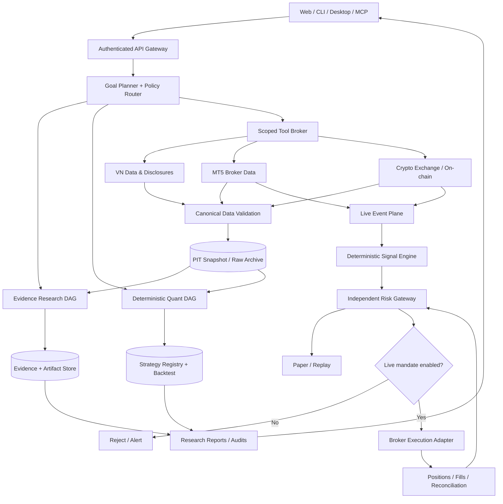

# VIBE-TRADING — MASTER PLAN NÂNG CẤP CHUYÊN SÂU

> **Trạng thái:** TÀI LIỆU ĐỀ XUẤT ĐỂ DUYỆT. Không khẳng định đã triển khai bất kỳ thay đổi nào trên mã nguồn.
>
> **Định hướng:** Kiến trúc nhiều thị trường, nghiên cứu có bằng chứng, giao dịch thời gian thực có cổng an toàn, đo lường chất lượng và hiệu quả token.
>
> **Giới hạn trung thực:** Không thể bảo đảm phần mềm “0 bug” tuyệt đối. Dùng SLO, kiểm thử, fail-closed, quan trắc, kiểm toán và quy trình phát hành để giảm rủi ro có thể đo được.
>
> **Tách lớp bắt buộc:** LLM nghiên cứu và lập kế hoạch; engine tính toán thực thi quyết định có tính tất định; broker adapter chỉ thi hành lệnh đã qua authorization + risk gate.

## Cập nhật nghiên cứu và triển khai ngày 05/11/2026

Giữ nguyên 265 ID/tên đặc tả, 54 Scenario, 10 giai đoạn P0–P9 và 16 DECISION của bản gốc. Mã chạy xuyên chương trình: PLATFORM-001–067, VN-068–131, FX-132–193, CRYPTO-194–265. Không đánh số lại theo từng nhóm.

| Nhóm | Số đặc tả | Đối chiếu source và nghiệm thu cụ thể |
| --- | --- | --- |
| Core AI Platform | 67 | [Catalog](docs/specs/CORE_AI_PLATFORM_67.md) |
| Vietnam Stock | 64 | [Catalog](docs/specs/VIETNAM_STOCK_64.md) |
| Forex/XAUUSD | 62 | [Catalog](docs/specs/FOREX_XAUUSD_62.md) |
| Crypto | 72 | [Catalog](docs/specs/CRYPTO_72.md) |

Mỗi heading capability được bổ sung source seam, trạng thái baseline và một gate cụ thể từ catalog. Baseline catalog chụp ngày 04/11; các thay đổi code ngày 05/11 phải đọc tại [biên bản triển khai](docs/IMPLEMENTATION_STATUS_2026-11-05.md), không tự nâng toàn capability thành hoàn tất.

Đọc [54 fixture/oracle](docs/specs/VALIDATION_54.md) và [10 giai đoạn/16 quyết định](docs/specs/DELIVERY_10_PHASES_16_DECISIONS.md). Ba template A/B/C cho mỗi capability là bộ khung thiết kế, không phải tests đã pass. Các tiêu chí đã bổ sung không thay thế kiểm tra quyền, license và tài khoản thật.

Những điều chỉnh quan trọng: dùng lại SQLite/file stores và registry hiện có trước migration; deferred schema loading không phải semantic top-k routing; walk-forward hiện chia equity chứ chưa retrain; funding intrabar cần event fidelity; protocol orderbook/checksum phải theo venue/channel version; SSI MCP cần account/OAuth và chưa là integration đã xác minh.

Yêu cầu viết code trong chat cho phép các thay đổi local đã giao; không có nghĩa 16 quyết định chương trình, migration production hoặc live execution được duyệt. Các flag mặc định vẫn giữ nghiên cứu/demo và phạm vi quyền hiện hữu.

## Mục lục điều hướng

1. [Quyết định cần duyệt](#1-các-quyết-định-cần-duyệt)
2. [Mức độ xác minh repository](#2-baseline-repository-và-khoảng-trống)
3. [Kiến trúc đích](#3-kiến-trúc-đích-và-hợp-đồng-bất-biến)
4. [Luồng xử lý end-to-end](#4-luồng-xử-lý-end-to-end)
5. [Thiết kế Agent](#5-multi-agent-orchestration)
6. [Memory & token economy](#6-bộ-nhớ-rag-và-tối-ưu-token)
7. [VN Equity](#7-chứng-khoán-việt-nam)
8. [Forex & XAUUSD](#8-forexxauusd-realtime)
9. [Crypto](#9-crypto-intelligence)
10. [Risk, backtest, live execution](#10-định-lượng-risk-và-execution)
11. [Bảo mật, kiểm thử, SRE](#11-security-sre-và-kiểm-thử)
12. [Danh mục đặc tả chức năng chi tiết](#12-danh-mục-capability-specs)
13. [Bộ test acceptance chi tiết](#13-ma-trận-kiểm-thử-và-tình-huống-hỏng)
14. [ADR / Tradeoffs / Roadmap](#14-architecture-decisions-và-roadmap)
15. [Bảng duyệt cuối](#15-bảng-duyệt-kiến-trúc)

---

# 1. CÁC QUYẾT ĐỊNH CẦN DUYỆT

## 1.1 Phạm vi chức năng

- [ ] Chấp thuận ba vertical chính: VN Stock Research, Forex/XAUUSD Real-Time Lab, Crypto Intelligence.
- [ ] Cho phép mở rộng repository gốc theo mô hình **modular monolith trước, tách service sau khi đo được nút nghẽn**.
- [ ] Không viết lại các bộ phận mà upstream đã làm tốt: ReAct loop, tool registry, skill loader, Swarm DAG, data/backtest registry, provider adapters, evidence/run artifacts, persistent memory, paper workflows.
- [ ] Chấp thuận ưu tiên research và paper trading; mặc định live order là `DISABLED`.
- [ ] Dữ liệu tài chính cần hợp đồng rõ ràng về giấy phép, độ trễ, truy xuất lịch sử, timestamp và giới hạn tái phân phối.
- [ ] Cấm tự động triển khai chiến lược mới từ kết quả LLM khi chưa có kiểm thử và phê duyệt.
- [ ] Tất cả thay đổi upstream phải có regression test và compatibility matrix.

## 1.2 Các lựa chọn bắt buộc trước khi triển khai live

| Mã | Quyết định | Khuyến nghị mặc định | Điều kiện đổi |
|---|---|---|---|
| GOV-01 | Phạm vi người dùng | Single-operator research first | Multi-tenant qua IAM, isolation, billing, audit |
| GOV-02 | Đặt lệnh | Research/Paper only | Consent có thời hạn + giới hạn rủi ro + kiểm thử broker demo |
| GOV-03 | VN stock execution | Không đặt lệnh | Có broker SDK/API hợp pháp, quyền và test theo venue |
| GOV-04 | Forex execution | Demo-only initial | Broker contract, quote/session constraints, kill switch |
| GOV-05 | Crypto execution | Testnet/Paper | Exchange permissions, regulatory assessment, hard caps |
| GOV-06 | Data store | PostgreSQL + object store | Benchmark chứng minh cần TSDB/columnar độc lập |
| GOV-07 | Cache | Redis khi có nhiều process | Single process có thể cache bộ nhớ được kiểm soát |
| GOV-08 | Queue/Event | Durable outbox trước, NATS/Kafka sau | Realtime throughput/retention bắt buộc |
| GOV-09 | Models | Task-specific routing | Benchmark theo độ đúng, tổng chi phí và độ trễ |
| GOV-10 | Default language | Vietnamese research + English identifiers | Locales qua i18n chứ không nhân bản logic |

## 1.3 Không thuộc phạm vi giai đoạn đầu

- Không hứa cam kết lợi nhuận, xác suất thắng hay giá trị định giá là chắc chắn.
- Không triển khai high-frequency trading ở tầng LLM; không tối ưu sub-millisecond bằng prompt.
- Không tự phát hành crypto token, lưu private key ví hoặc điều phối rút tiền.
- Không dùng scraping trái điều khoản / vượt paywall / bypass anti-bot để thu thập dữ liệu.
- Không xây mạng lưới agent tự sửa production không cần phê duyệt.
- Không nhân bản mọi chức năng terminal chuyên nghiệp ngay MVP, ưu tiên pipeline đúng và có bằng chứng.

## 1.4 Định nghĩa hoàn thành (Definition of Done) ở cấp chương trình

1. Tài liệu kiến trúc khớp commit đã pin; PR có ảnh hưởng luồng nào phải kèm contract và test cho luồng đó.
2. Backtest không nhìn trước tương lai; accounting của vị thế, phí, thuế, tỷ giá có thể đối chiếu bằng fixture độc lập.
3. Dữ liệu trọng yếu không thiếu nguồn, không bị lẫn phiên bản, đơn vị, múi giờ, symbol, venue hoặc quote currency.
4. Tool gọi bất đồng bộ phải có timeout, cancellation, idempotency và retry policy có giới hạn.
5. Mọi lỗi hệ thống phải đi vào trạng thái rõ ràng; không đổi `UNKNOWN` thành `SUCCESS` hoặc `NO_SIGNAL` thành `NO_DATA`.
6. Không thể đi từ prompt/document/web page đến lệnh thật nếu thiếu operator approval và deterministic risk gateway.
7. Tự động hoá kiểm thử gồm unit, contract, integration, replay, property, mutation, security, load, failover, chaos phù hợp.
8. SLO đạt mục tiêu *sau khi* được đo trên khối lượng thiết kế, không trình bày mục tiêu như kết quả đã đạt.
9. Cần runbook khôi phục, dashboard observability, backup/restore drill và kế hoạch rollback.
10. Research artifact được tái hiện từ snapshot, version code, version tool, prompt/skill, seed khi có yếu tố ngẫu nhiên.

---

# 2. BASELINE REPOSITORY VÀ KHOẢNG TRỐNG

## 2.1 Nguồn và ranh giới xác minh

- Repository gốc: https://github.com/HKUDS/Vibe-Trading
- README tại `main` (đọc ngày 2026-11-04): https://raw.githubusercontent.com/HKUDS/Vibe-Trading/main/README.md
- Changelog: https://github.com/HKUDS/Vibe-Trading/blob/main/CHANGELOG.md
- Vibe-Trading là hệ nghiên cứu gồm Python/FastAPI, React/Vite, CLI, MCP, Swarm DAG, loader, backtest và multi-provider.
- Baseline cục bộ đã kiểm tra inventory: 29 historical data sources, 19 broker connectors, 90 bundled skills, 114 agent tools và 82 tools của MCP chung. Đây là số lượng registry/source, không phải coverage hoặc broker runtime đã xác minh; xem biên bản kiểm tra tài liệu.
- README chỉ ra Forex/metals có `mt5`, `tickerall`, nguồn lịch sử; crypto có OKX/CCXT/Binance; VN có `VietnamEquity` HOSE và fallback Yahoo/yfinance/local.
- README phân biệt historical OHLCV loaders với realtime ticks/orderbook; không đưa feed streaming vào hợp đồng loader lịch sử.
- Tài liệu upstream mô tả 5-layer compaction, on-demand tool schemas, persisted research artifacts, verified run cards, audit ledger, paper trading, bounded-live brokers.
- Đã đọc source cục bộ và chạy các nhóm test fixture/mock được ghi trong docs/DOCUMENTATION_VERIFICATION.md; không suy từ các nhóm đó thành repository-wide, broker/live hoặc 54 acceptance scenarios đã đạt.
- Ghi lại SHA/tag, lockfiles, OS, Python/Node, dependency tree khi có quyền truy cập source trong workspace dev.

## 2.2 Ma trận: giữ / xác minh / phát triển

| Thành phần | Hiện trạng theo README | Hướng đi | Bằng chứng trước code |
|---|---|---|---|
| ReAct Loop | Có | GIỮ + benchmark | Trace 10 tác vụ, lỗi, usage |
| Agent skills | Có + CRUD | GIỮ + domain packs | Contract skill loader, versioning |
| Tool registry | Có + lazy schemas | GIỮ deferred schemas; semantic routing chỉ sau benchmark | discover, permission, schema cache |
| Swarm DAG | Có | MỞ RỘNG preset | dependency, cancellation, heartbeat |
| Session memory + FTS5 | Có | TÁI DÙNG + ACL/thời hạn | isolation, deletion, tombstone |
| Research artifacts | Có revision | TÁI DÙNG + VN provenance | evidence refs, PIT replay |
| Historical data loaders | Có | MỞ RỘNG licensing/venue | parser, calendar, timezone |
| Real-time feed | Có broker connectors | TÁCH event pipeline | MT5 quote/tick event proof |
| Backtest engines | Có nhiều markets | REUSE; thêm fidelity | settlement + costs fixtures |
| Paper trading | Có, giới hạn venue/bar | MỞ RỘNG riêng khi đủ | supported vs unsupported per market |
| Broker live mandates | Có guardrails upstream | GIỮ; thêm policy độc lập | authorization penetration tests |
| VN Equity | HOSE engine | THÊM HNX/UPCoM riêng | venue rule matrices verified |
| On-chain research | Một số skills | THÊM provenance/normalizer | indexer freshness and coverage |
| Operator UI | Có React dashboard | MỞ RỘNG domain workspaces | routes, performance, error states |
| Deployment | Docker etc. | HARDEN | restore, canary, rollback |

## 2.3 Lệnh khảo sát bắt buộc ở P0 (không thực thi trong tài liệu này)

```bash
set -euo pipefail
git rev-parse HEAD
git status --short
git log -1 --format='%H%n%ci%n%s'
python --version
node --version
python -m pytest -q
python -m pip check
# Chạy lệnh lint/types theo đúng pyproject/package.json đã kiểm chứng.
# Không kết luận PASS nếu test bị skip, timeout, thiếu service hoặc thiếu credentials.
```

## 2.4 Baseline artifacts cần lưu

- `docs/architecture/current-state.md`: C4 context/container/component và sequence diagram thực tế.
- `docs/architecture/compatibility.md`: Python/Node/OS/provider versions; capability matrix theo broker.
- `docs/architecture/tool-inventory.csv`: ID, schema, side-effect, permission, timeout, retry, owner.
- `docs/architecture/market-loader-map.csv`: source, market, intervals, quote basis, adjusted/raw, limits.
- `docs/architecture/agent-flow-traces/`: traces đã scrub secrets của 12 workflow chuẩn.
- `docs/quality/baseline.json`: tests pass/fail/skip, duration, flakiness, token usage và chi phí.
- `docs/security/threat-model.md`: entry points gồm web, PDF, MCP, agent memory, browser, exchange APIs.
- `docs/finance/broker-legal-capability.md`: pháp lý dữ liệu, lệnh giao dịch, giới hạn venue.

---

# 3. KIẾN TRÚC ĐÍCH VÀ HỢP ĐỒNG BẤT BIẾN

## 3.1 Mô hình đề xuất



## 3.2 Các bounded context

- `Identity & Permissions`: người dùng, tenant, consent, role, policy, session.
- `Research`: câu hỏi, kế hoạch nghiên cứu, citations, claim verification, document index.
- `Market Reference`: symbol master, exchange, trading calendar, currency, adjustments, contract metadata.
- `Historical Data`: PIT snapshots, raw/adjusted bars, corporate actions, data quality.
- `Real-Time Data`: connection state, quote source, monotonically tracked sequence, freshness, candles.
- `Strategy`: versioned strategy definition, rules, parameters, experiment hashes, approvals.
- `Backtest`: deterministically replayed data, execution assumptions, ledger, risk stats.
- `Portfolio`: balances, positions, exposure, fees, realization, reconciliation.
- `Broker Gateway`: broker identity, credential handles, order preview, idempotency, order reconciliation.
- `Agent Runtime`: planning, DAG, model routing, tool execution, token budget, memory.
- `Compliance & Audit`: logs, evidence, approvals, user mandates, trace integrity.

## 3.3 Hợp đồng dữ liệu sự kiện

```yaml
MarketEvent:
  event_id: ulid
  market: VN_EQUITY | FX_METAL | CRYPTO
  venue_id: string
  instrument_id: canonical_id
  source_id: string
  source_mode: LIVE | DELAYED | HISTORICAL | SIMULATED
  source_timestamp_utc: timestamp_or_null
  received_timestamp_utc: timestamp
  processed_timestamp_utc: timestamp
  sequence: integer_or_null
  quote_currency: ISO_or_contract_currency
  price_scale: decimal
  payload_schema_version: semver
  quality_flags: []
  provenance_hash: sha256
  trace_id: string
```

## 3.4 Bất biến kỹ thuật (không được phá)

1. `instrument_id` phải định danh cả venue và instrument type, không đồng nhất `BTC/USDT spot` với `BTC/USDT perp`.
2. Không thể chuyển dữ liệu DELAYED/HISTORICAL thành LIVE bằng cách đổi label ở frontend.
3. `source_timestamp` nếu thiếu thì ghi UNKNOWN, không tự lấy `received_at` thay nguồn.
4. Tất cả tiền và khối lượng dùng Decimal khi liên quan sổ lệnh, margin, accounting.
5. Dữ liệu tài chính có `valid_from`, `published_at`, `known_at` để tái dựng thế giới tại thời điểm quyết định.
6. Mọi revision tài liệu có hash và lineage; không sửa âm thầm bằng cùng ID.
7. Không thể dùng normalized adjusted price để tính giá lệnh thực tế nếu chưa có chính sách mapping rõ.
8. Mỗi side-effect chỉ chạy với explicit permission + idempotency key + state transition hợp lệ.
9. Cancellation không được đổi trạng thái order đã gửi thành chưa gửi; reconciliation quyết định thực trạng.
10. Các trạng thái `NO_DATA`, `STALE`, `INVALID`, `UNKNOWN`, `NOT_SUPPORTED`, `REJECTED` không được gộp làm zero/null.
11. Mọi retry phải biết thao tác nào có thể lặp; không retry `place_order` như một GET.
12. Clock time của scheduler không được dùng làm market time nếu venue còn đóng cửa hoặc bị nghỉ.
13. Các nguồn đồng nhất khi fallback phải có contract cho currency, bar convention, adjustment, volume, timezone.
14. Risk gate kiểm tra lại quote/account/mandate ngay trước submit, không tin kết quả LLM trước đó.
15. Tất cả thay đổi policy/strategy phải có version và actor, audit và rollback rõ ràng.
16. Paper execution và live execution không dùng chung credential hoặc endpoint.
17. `UNKNOWN` không được giải thích thành cơ hội giao dịch.
18. Bất kỳ đề xuất `BUY` nào thiếu căn cứ phải hạ xuống `INSUFFICIENT_EVIDENCE`.
19. Lỗi hạ tầng quan sát phải tạo cảnh báo, không giấu lỗi bằng thông báo thành công rỗng.
20. Dữ liệu trong prompt từ web/PDF/MCP luôn được coi là untrusted và không được nâng quyền.

## 3.5 Kiến trúc triển khai sơ bộ

- Bắt đầu một backend triển khai nhất quán có module boundaries + typed APIs; không tách 20 microservice chỉ để tăng độ phức tạp.
- API và workers phân process; chuyển long-running jobs qua job queue với durable status và heartbeats.
- Module realtime broker/market feed có worker riêng; UI stream chỉ đẩy snapshot/delta, không điều khiển khớp lệnh.
- Postgres quản lý metadata, ledger, permissions, research references và strategy versions; object storage chứa PDF, JSONL, Parquet, run artifacts.
- Redis dùng cho rate limiting, khóa TTL, hot cache (không là nguồn chân lý cho số dư/lệnh).
- Nếu tick rate cao và cần replay đáng tin, dùng stream broker NATS JetStream/Redpanda theo benchmark; phải có schema registry và DLQ.
- Giám sát metrics/traces qua OpenTelemetry; CI/CD có SBOM, signatures, scan secrets và database migrations.
- Tách Data Plane, AI Control Plane, Execution Plane; outage của AI không được khiến market-risk protection ngừng.

---

# 4. LUỒNG XỬ LÝ END-TO-END

## 4.1 Workflow A — Câu hỏi phân tích cổ phiếu Việt Nam

1. API xác thực yêu cầu, scope, quota và mã tài sản.
2. Symbol resolver chuẩn hóa venue, trạng thái niêm yết và corporate-action identity.
3. Planner tạo evidence checklist, không gọi tất cả Agent theo mặc định.
4. Research DAG gọi document/search tools có phân cấp nguồn và budget.
5. Fetcher tải bản gốc khi được phép, lưu content hash và timestamp nguồn.
6. Parser trích bảng và text, giữ trang/section và đơn vị/currency.
7. Financial normalizer kiểm tra kỳ kế toán, tỷ lệ, dấu âm, báo cáo hợp nhất/riêng.
8. Verifier kiểm tra những claim vật chất với nguồn gốc và đối chiếu số liệu.
9. Analyst tính metrics bằng công thức tất định, không để LLM nhẩm số.
10. Valuation engine dựng Bull/Base/Bear với giả định có kiểm soát.
11. Independent bear reviewer ghi phản chứng và điểm yếu dữ liệu.
12. Risk reviewer gắn xác suất thiếu thông tin, khả năng thanh khoản và giới hạn khuyến nghị.
13. Final report ghi nguyên nhân, từng nguồn, ngày dữ liệu, các kịch bản và điều kiện bác bỏ.
14. Report lưu bất biến theo revision, không tự động đặt lệnh.

## 4.2 Workflow B — XAUUSD live signal

1. MT5 gateway đọc cấu hình broker/symbol và kiểm tra trạng thái kết nối.
2. Feed nhận tick, gắn source/receive timestamps, phát hiện out-of-order và stale.
3. Candle builder tính M1/M5/H1 bằng policy timestamp riêng, tránh dùng nến chưa đóng như đã đóng.
4. Deterministic indicator worker cập nhật EMA/ATR/ADX và feature state sau khi có sufficient warm-up.
5. Regime detector xác định sideway/trending/volatile/unknown và hysteresis.
6. Strategy registry chọn phiên bản đã duyệt tương ứng regime.
7. Signal rule engine đánh giá điều kiện, không gọi LLM trên mỗi tick.
8. Macro/news gate xem event blackout và tính kịp thời tin tức.
9. Risk gateway lấy spread, leverage, margin, contract size, account equity và open exposure MỚI NHẤT.
10. Nếu rule không hợp lệ: `REJECTED` có reason codes, không phát lệnh.
11. Mặc định tín hiệu vào paper executor; live cần active mandate và operator mode.
12. Executor tạo order intent idempotent, ghi durable journal trước call broker.
13. Broker response được reconcile qua ticket/deal/order history để xử lý timeout không rõ trạng thái.
14. Risk loop theo dõi vị thế, fill, SL, drawdown, disconnect, kill switch.
15. Trading journal lưu decision snapshot để phân tích post-trade và replay.

## 4.3 Workflow C — Crypto spot/perp analysis

1. Resolve symbol/exchange/instrument type và phân biệt spot, USDT perp, coin-margined futures.
2. Kết hợp venue quotes, mark/index prices, funding, OI, order-book snapshot/deltas có timestamp.
3. Verify depth sequence/gap và resnapshot khi mất gói, tuyệt đối không tin book lỗi.
4. On-chain worker load chain+token contract+decimals và address labels có version.
5. Tokenomics worker load unlock schedule và bản công bố mới nhất.
6. Derivatives desk đánh giá basis, funding regime, crowding chỉ như giả thuyết có uncertainty.
7. Quant engine tính features, kiểm tra stationarity/regime và hiện tượng survivorship.
8. Risk engine xét cross-/isolated-margin, leverage tier, maintenance, liquidation/ADL, exchange concentration.
9. Agent committee xuất evidence-based scenario; chưa có quyền đặt lệnh chỉ vì narrative hấp dẫn.
10. Paper engine nhận event phù hợp, giả lập slippage/funding/fees, ghi ledger và run card.

## 4.4 State machine của research run

```text
CREATED -> VALIDATING -> PLANNING -> FETCHING -> ANALYZING
       -> REVIEWING -> PUBLISHING -> COMPLETED
  |           |             |             |
  v           v             v             v
REJECTED    STALE        DEGRADED      NEEDS_REVIEW
  |           |             |             |
  +-----------+-------------+-------------+
                              -> FAILED / CANCELED
```

- Mỗi transition có event + actor + run_id + expected_revision + UTC timestamp.
- `DEGRADED` chỉ tiếp tục nếu kết quả không phụ thuộc vào nguồn bị thiếu.
- `NEEDS_REVIEW` không bị tự động biến thành COMPLETED bằng LLM tự phê duyệt.
- `FAILED` phải có retryable flag, error class, compensating action và diagnostics.

## 4.5 State machine của order intent

```text
DRAFT -> RISK_CHECKED -> AWAITING_APPROVAL -> APPROVED
            |                  |                |
            v                  v                v
         REJECTED           EXPIRED          SUBMITTING
                                                 |
                                       ACKNOWLEDGED / UNKNOWN
                                                 |
                                PARTIAL_FILL / FILLED / CANCELED
                                                 |
                                             RECONCILED
```

- Timeout khi submit phải chuyển `UNKNOWN`, không auto-submit lại.
- Order ticket và client order id là correlation keys; kiểm soát trùng gửi bằng durable idempotency store.
- Các transition broker cụ thể cần adapter mapping tường minh, không giả định mọi venue cùng trạng thái.

---

# 5. MULTI-AGENT ORCHESTRATION

## 5.1 Nguyên tắc đội Agent

- Agent tăng hiệu quả khi có **tính chuyên môn và phản biện**, không phải tăng số lượng vô hạn.
- Planner chọn minimum viable DAG; chỉ spawn team nếu expected quality gain lớn hơn chi phí/latency.
- Các bước có thể xác định bằng code thì ưu tiên code, không gọi model.
- Agent worker không được tự đổi chính sách, ngân sách, whitelist tools hoặc cấp quyền live.
- Kết quả mỗi agent là JSON schema-validated artifact; output dài lưu file, context chỉ nhận summary + pointers.
- Debate có stopping rule: khi bằng chứng không thay đổi và hội đồng đồng ý, dừng, không tạo thêm vòng tranh luận token-expensive.
- Chuyên gia phát hiện `INSUFFICIENT_EVIDENCE` phải được bảo tồn qua summarization.

## 5.2 Team topology

### Vietnam Equity Research Committee

- Equity Research Lead — scope decomposition, source acquisition plan, report integration.
- Disclosure Intelligence — công bố HOSE/HNX/UBCK, sửa đổi và legal events.
- Financial Statement Forensics — BCTC, dòng tiền, accounting adjustments.
- Macro & Sector Analyst — CPI, lãi suất, vốn tín dụng, ngành.
- Valuation Analyst — DCF, relative valuation, scenarios.
- Quant & Liquidity Analyst — price, volume, factor, cost, rotation.
- Bull Thesis Critic — phát hiện upside driver và catalyst có chứng cứ.
- Bear Thesis Critic — phát hiện rủi ro, giả định lỗi, debt/liquidity trap.
- Evidence Auditor — kiểm chứng citation, thời gian, số liệu.
- Independent Risk Officer — reject hoặc request clarification/evidence.

### Forex/XAUUSD Desk

- FX Chief Strategist — strategy selection theo regime.
- Global Macro Agent — Fed, USD, real yields, event severity.
- Market Structure Analyst — swing structure định nghĩa khách quan.
- Volatility/Session Analyst — ATR regime, session/DST/rollover.
- Strategy Engineer — strategy DSL, parameters, invalidation.
- Quant Validator — WFA, distribution, broker friction.
- Live Signal Supervisor — monitor live signal state, not low-latency inference.
- Execution Risk Officer — order preview, spread, margin, risk caps.
- Post-Trade Reviewer — drift, implementation shortfall và reason codes.

### Crypto Desk

- Crypto Research Lead — allocate research questions.
- Token Fundamental Analyst — token utility, dilution, governance.
- On-chain Analyst — labels/flows/confounders.
- Derivatives Analyst — funding, OI, basis, liquidation proxies.
- Liquidity Analyst — book integrity and executable capacity.
- Smart Contract / Venue Risk — oracle, exploits, custody, outages.
- Strategy/Quant Analyst — backtesting and statistical checks.
- Independent Risk Officer — leverage, collateral, fragmentation.

## 5.3 DAG scheduler

- Node states: PENDING, READY, RUNNING, SUCCEEDED, FAILED, SKIPPED, CANCELED.
- Dependency can be hard, soft or optional. Hard failure blocks dependent order generation.
- Node result has schema version, evidence pointers, cost, latency, token usage, code hash.
- Critical path optimization: macro/price/disclosures fetch concurrently, valuation waits financial extraction.
- Concurrency limits per provider, market source and tenant; priorities distinguish interactive vs scheduled workloads.
- Worker heartbeat + lease; on timeout distinguish read-only safe retry and side-effect unsafe retry.
- DAG must detect cycles before scheduling, limit fanout, cap node total and depth.
- Bounded debate: max 2 independent critical reviews unless an explicit material evidence conflict remains.
- Cost estimator before run; hard budget limit blocks new work but preserves partial artifacts.

## 5.4 Tool semantics

```yaml
ToolManifest:
  name: vn_disclosure_search
  input_schema: JSONSchema
  output_schema: JSONSchema
  scopes: [research.read]
  side_effect: false
  idempotent: true
  source: licensed_or_public
  timeout_ms: 15000
  retry_policy: bounded_exponential_jitter
  cache_key: [venue, symbol, event_type, date_range]
  cache_ttl_policy: source_specific
  max_output_tokens: 1000
  evidence_required: true
  audit_level: metadata_and_hash
```

- Schema validation cả input/output; typo không được bỏ qua âm thầm.
- Side-effect tools mặc định bị từ chối nếu worker không có capability token.
- Data tools trả structured records và artifact URIs; không nhồi toàn PDF vào hội thoại.
- Tool response chứa `status`, `reason_code`, `freshness`, `source`, `schema_version`, `record_count`.
- Dedupe cùng fetch bằng singleflight locks; cache key bao gồm venue/instrument/adjustment/period/access rights.
- Quota/backoff/tokens được kế toán theo tenant và provider.

---

# 6. BỘ NHỚ, RAG VÀ TỐI ƯU TOKEN

## 6.1 Memory architecture (6 lớp)

| Tầng | Ý nghĩa | TTL/retention | Quy tắc ghi |
|---|---|---|---|
| L0 Run Context | Current task, state, facts | Trong run | Auto, bounded |
| L1 Working Notes | Hypotheses, intermediate facts | Theo goal | Versioned, provisional |
| L2 Session Episodes | Q&A, decisions, tool pointers | Retention có cấu hình | Có tenant ACL |
| L3 Semantic Research | Verified facts, entities, claims | Theo nguồn và data-as-of | Evidence required |
| L4 Strategy Memory | Rules, experiments, rejection reasons | Không sửa lịch sử | Hash+version immutable |
| L5 Operational Memory | Runbooks, incidents, tool performance | Incident policy | Human-reviewed policies |

- Không biến câu trả lời model thành sự thật tài chính chỉ bằng hành động `remember`.
- Facts định lượng phải kèm source, time, units, subject ID, revision, verification status.
- Retrieval kiểm tra point-in-time và tenant ACL **trước** khi rerank kết quả.
- Store trade events và fills ở immutable ledger, không trong vector DB.
- Research memory có stale date, revalidation trigger, conflict resolution và tombstone.
- Entity linker quản lý mã cổ phiếu đổi mã, delisting, ticker alias, crypto chain/token ID.

## 6.2 Context optimization pipeline

1. Query Intent Classifier chạy rules hoặc model nhỏ; phân loại VNI, XAUUSD, Crypto, meta/system, ambiguous.
2. Tool Capability Search truy cập index tool metadata, không nạp toàn bộ tool schemas mặc định.
3. Lấy top-k skills phù hợp (thường 2–5) dựa trên định danh domain, nhiệm vụ, policy.
4. Query plan lập budget token/calls/fetch-size và giới hạn độ sâu.
5. Dùng retrieval metadata trước full text; PDF extract từng trang/bảng cần thiết.
6. Structured tool response truyền `facts`, `pointers`, `warnings`, `summary`, không raw dumps.
7. Tool batches cho read-only độc lập; singleflight khi nhiều Agent xin cùng nguồn.
8. Summarize old reasoning thành claim ledger + citations; giữ contradictions và unresolved items.
9. Model routing: smaller model cho classification/extraction đơn giản; capable model cho analysis conflicts.
10. Bật verifier qua rules/statistics trước gọi LLM adjudicator nếu không cần.
11. Không sử dụng LLM tạo lại cùng report khi chỉ có 1 nguồn thay đổi; incremental update.
12. Tập hợp tool result duplicates trước inject context; dedupe theo content hash/semantic key.
13. Áp dụng output budget và stop tokens; người dùng có thể mở sâu từng appendix khi cần.

## 6.3 Token budget policy (đề xuất, phải benchmark)

| Workflow | Query plan budget | Typical tool results in context | LLM phase cap | Chính sách |
|---|---:|---:|---:|---|
| Ticker/news quick brief | 1–2k | 2–5k | 1 analyst + verifier | Cache-first |
| VN full investment memo | 3–6k | 12–30k | 4–7 specialist runs | Evidence DAG |
| XAUUSD live signal | 0 trên tick hot path | 0 | LLM không nằm trong signal loop | Deterministic |
| XAUUSD deep strategy lab | 3–6k | 8–20k | 2–4 specialist runs | Reuse backtests |
| Crypto token due diligence | 2–5k | 8–25k | 3–5 specialist runs | Source reconciliation |
| Cross-market portfolio review | 3–5k | 8–16k | Specialist-on-demand | Cache snapshots |

Các dải trên là **ngân sách dự thảo** chứ không phải token usage thực đo. Benchmark phải thống kê P50/P95 quality-adjusted token cost, quality score và latency.

## 6.4 Tối ưu tool calls theo mức độ quan trọng

- `search->head->extract->verify`: tìm metadata trước, chỉ fetch đầy đủ tài liệu nếu score vượt ngưỡng.
- Batch ticker đồng nhất venue/period theo khả năng nguồn; không batch các loại giá thiếu tương đương.
- Dùng `get_market_data` đã cache để tránh mỗi Agent query một nguồn độc lập.
- Nạp tokenized snippets + canonical facts thay vì nguyên document OCR dài.
- Canonical cache không lưu giá LIVE vô thời hạn; TTL theo interval/session và stale threshold.
- Trước backtest, tìm run-card có cùng `strategy_hash+dataset_hash+engine_version+cost_model_hash+seed`.
- Reuse kết quả có hash chính xác; bản tương tự chỉ dùng làm tham khảo, không giả mạo test mới.
- Self-evolving skill chỉ được đề xuất qua staged PR: không tự ghi đè skill đã duyệt.
- Dựa trên quality-gated evaluations để đánh giá tiết kiệm: giảm token nhưng không làm mất nguồn hoặc bỏ kiểm tra rủi ro.
- Dừng ngay khi cost budget vượt ngưỡng hoặc xác suất hoàn thành thấp; partial outputs vẫn có giá trị.

## 6.5 Cache key và invalidation

```text
research_cache_key = hash(tenant_access_scope, research_subject, source_ids,
                          source_versions, data_as_of, retrieval_policy_version,
                          parser_version, normalization_version)

backtest_cache_key = hash(strategy_version, engine_commit, dataset_manifest,
                          corporate_action_policy, commission_slippage_model,
                          calendar_version, parameter_grid, random_seed)

live_feature_key = (venue, account_or_public_feed, instrument_id,
                    feature_version, interval, last_closed_candle_id)
```

- `stale-while-revalidate` chỉ dùng cho thông tin **không dùng đặt lệnh**; trading risk decisions phải dựa trên giá/account fresh.
- Pinned model outputs có thể tái sử dụng làm văn bản nhưng không tự biến thành verified market facts.
- Negative cache phải phân biệt `source unavailable` với `symbol not found` và TTL ngắn.
- Mọi invalidate có event reason, affected keys và causality chain.

## 6.6 Bảng đánh giá chất lượng và chi phí agent

- Evidence coverage = số claim trọng yếu có nguồn / tổng claim trọng yếu.
- Numeric grounding precision = số trị số đúng theo artifact / số trị số được nêu.
- False confidence rate = số claim được diễn đạt chắc chắn khi evidence yếu / tổng claim yếu.
- Tool call efficiency = số tool calls thành công hữu ích / toàn bộ calls.
- Token-per-valid-fact = token tiêu thụ / số fact đã verify, so sánh theo cùng độ khó.
- Cost per accepted report = tổng API + data + compute cost / report được reviewer chấp nhận.
- Incremental reuse rate = số subtask không cần chạy lại nhờ artifact hợp lệ / tổng subtask lặp.
- Latency P50/P95/P99 và error budget theo loại run; không gom live path vào LLM path.

---

# 7. CHỨNG KHOÁN VIỆT NAM

## 7.1 Mục tiêu nghiệp vụ

- Tự động nghiên cứu doanh nghiệp niêm yết bằng nguồn chính thức và báo cáo chuyên môn.
- Theo dõi VN-Index, VN30, nhóm ngành, thanh khoản, foreign flows theo data source được phép.
- Phân tích BCTC năm/quý, hợp nhất/riêng, kiểm toán, restatement, doanh thu, lợi nhuận, FCFF/FCFE.
- Định giá theo đúng sector: ngân hàng khác doanh nghiệp công nghiệp; DCF và multiples có assumptions.
- Đối chiếu SSI, VCBS, MBS, HSC, VNDirect, BSC, KBSV khi báo cáo có quyền truy cập.
- Theo dõi HOSE/HNX/UPCoM bằng market-rule versioning, không gán luật của sàn này cho sàn khác.
- Xử lý hạn chế giao dịch, sửa đổi BCTC, corporate actions, trading halts và data delay.

## 7.2 Các bộ nguồn cần khảo sát quyền truy cập

- HNX Portal: https://www.hnx.vn/ hoặc https://portal.hnx.vn/
- HOSE: https://www.hsx.vn/
- SSC (UBCKNN): https://www.ssc.gov.vn/
- VSDC: https://www.vsd.vn/
- Cục Thống kê: https://www.nso.gov.vn/
- NHNN: https://www.sbv.gov.vn/
- CafeF: https://cafef.vn/
- Vietstock: https://vietstock.vn/
- VnEconomy: https://vneconomy.vn/
- SSI Research: https://research.ssi.com.vn/
- VCBS: https://www.vcbs.com.vn/
- MBS: https://www.mbs.com.vn/
- HSC: https://www.hsc.com.vn/
- VNDirect: https://www.vndirect.com.vn/
- BSC: https://www.bsc.com.vn/
- KBSV: https://www.kbsec.com.vn/

**Cần xác minh:** API chính thức, license, quyền lưu cache, quyền trích dẫn, historical backfill, giới hạn truy vấn, TTL. URL trên là điểm khảo sát, không mặc định là API công khai.

## 7.3 Các quy tắc tài chính bắt buộc

- Chuẩn hóa đơn vị VND, nghìn, triệu, tỷ; phân biệt triệu cổ phiếu với giá trị vốn hóa.
- Kỳ kế toán Q1/Q2/Q3/Q4, LTM/TTM, YTD; phân biệt báo cáo quý đơn lẻ và số lũy kế.
- Tài sản/nghĩa vụ hợp nhất, sở hữu cổ đông không kiểm soát, lợi nhuận thuộc cổ đông công ty mẹ.
- EPS pha loãng, shares outstanding theo ngày, treasury shares, stock dividends, quyền mua, splits.
- Cash flow reconciliation: CFO/CFI/CFF và các khoản chi phí vốn thực tế.
- Price adjusted vs raw và giá tham chiếu theo sàn; dividend yield có ex-date/pay-date.
- Trước ngày một báo cáo thực sự công bố, backtest không thể biết số liệu trong báo cáo đó.
- Phân tích bank: NIM, CASA, credit growth, NPL, coverage, LLR, CET1/CAR khi có.
- Bất động sản: cash conversion cycle, người mua trả tiền trước, backlog, pháp lý, bond maturity.
- Chứng khoán: margin loan book, proprietary trading, broker liquidity, equity capital.

## 7.4 Đầu ra nghiên cứu tiêu chuẩn

1. Executive thesis kèm ngày và horizon.
2. Sector/macro state, dữ liệu nền và phản chứng.
3. Business model + competitive position.
4. Historical statements reconciliation và adjusted notes.
5. Driver-based earnings forecast + three scenarios.
6. Valuation bridge và sensitivity, không ép một target price duy nhất.
7. Market liquidity, technical context, corporate action constraints.
8. Downside case và catalysts, rủi ro chiến lược và giá trị.
9. Bull/Bear review + disputes not resolved.
10. Risk-limited positioning scenario, **không phải lệnh mua tự động**.
11. Full citations và phiên bản artifact.

---

# 8. FOREX/XAUUSD REALTIME

## 8.1 Nguyên tắc phân chia AI và machine logic

- Tick ingestion, indicator, signal, risk order validation, execution và monitoring phải deterministic.
- Agent dùng cho research, hypothesis generation, market commentary và post-trade diagnosis.
- Live trader cần chọn chỉ một hoặc một tập chiến lược tương thích, không cộng mù phiếu BUY/SELL từ 10 Agent.
- Khung M1/M5 XAUUSD yêu cầu broker-specific tick precision, spread, point, contract, freeze/stop level.
- Phải lưu tick bid/ask để đo lường khả năng khớp SL, spread, slippage, negative spikes.
- Không dùng giá mid để thay giá khớp; buy theo ask, sell theo bid và ngược lại khi đóng.

## 8.2 Quy tắc chọn chiến lược

- Regime detector có `TREND`, `RANGE`, `BREAKOUT`, `HIGH_VOL`, `LOW_LIQUIDITY`, `UNKNOWN`.
- Transition hysteresis và min-duration để tránh chuyển chế độ liên tục mỗi tick.
- Trend strategies chỉ chạy nếu trend confidence vượt ngưỡng đã calibrate trên train, không tối ưu trên test.
- Range strategies đình chỉ khi structural break được xác nhận theo rule định nghĩa trước.
- Tin NFP/CPI/FOMC phải dùng lịch sự kiện có thời gian chuẩn, timezone/DST và verified timestamps.
- Nếu calendar thiếu hoặc tin bất thường không phân loại được, policy xác định rõ giảm hoạt động hay WAIT.

## 8.3 Fidelity bắt buộc cho backtest XAUUSD

- Intrabar ambiguity: khi một nến chạm cả SL và TP, không ưu ái target; dùng tick replay hoặc bảo thủ.
- Phí: spread động, commission, swap/financing, triple swap tùy broker, conversion currency.
- Symbol specification historical changes không giả định contract/lot luôn giống hiện tại.
- Session calendar, timezone của server MT5, DST và nghỉ lễ liên quan.
- Stop level, freeze level, order fill policy, requote, partial fill và netting/hedging account mode.
- ATR/EMA/ADX warmup đủ số nến, taint marker cho dữ liệu thiếu.
- Purged/embargo split nếu features có nhãn overlap; train/test/walk-forward phải đúng thời gian.
- Stress test spread so với thực tế, latency, VPS outage, gap, broker market close, margin stop-out.
- Grid/hedge strategies cần path-dependent basket margin, tail risk, worst-case exposure; không chỉ nhìn closed-profit curve.

## 8.4 Công thức quản trị rủi ro đề xuất

```text
risk_budget = min(account_equity * risk_fraction,
                  strategy_remaining_daily_budget,
                  portfolio_remaining_budget)
loss_one_lot_at_stop = abs(broker_order_calc_profit(side, symbol, 1_lot,
                                                    entry_price, stop_price))
raw_lots = risk_budget / (loss_one_lot_at_stop + estimated_fees_per_lot)
lots = floor_to_broker_volume_step(raw_lots)
approve iff lots >= minimum_lot and expected_loss <= risk_budget
          and account_margin_check_passes
          and risk policy + spread + freshness + mandate all pass
```

- Dùng giá khớp bảo thủ, stop loss hợp lệ và broker order calculator; không dựa hardcoded `1 pip = $x`.
- Sau rounding, tính lại loss và margin để chắc chắn không vượt rủi ro.
- Không dùng `0.25%/trade` như mặc định đã được chứng minh; đó là tham số thử nghiệm cần duyệt.

---

# 9. CRYPTO INTELLIGENCE

## 9.1 Các lớp dữ liệu quan trọng

- Spot trades, order book sequence/snapshots, venue status, symbol precision và min notional.
- Perpetual futures: mark, index, funding schedule/history, OI, leverage tiers, maintenance margin.
- Cross-venue spot basis, perpetual basis, transfer costs, order-book depth và executable liquidity.
- On-chain: chain ID, token contract, decimals, wallet label confidence, reorg status, finality.
- Tokenomics: unlock emissions, circulating/full supply, vesting, protocol revenue, treasury.
- DeFi: TVL methodology, token prices, oracles, liquidation parameters, bridge and admin key risks.
- News: official exchange/product announcements, exploits, listing/delisting; exact timestamp.

## 9.2 Những điều cấm suy diễn từ dữ liệu

- OI tăng không tự động có nghĩa chắc chắn sắp short squeeze.
- Funding dương không tự động tương đương phải SHORT.
- Coin di chuyển vào sàn không mặc định đã được bán.
- Heatmap liquidation là ước tính; không trình bày như vị thế thật của mọi trader.
- TVL tăng không nhất thiết là doanh thu hoặc dòng tiền thực tế.
- Wallet labels mang uncertainty và phải cập nhật khi nguồn label thay đổi.
- Dữ liệu fake volume/self-trading cần cảnh báo venue-specific.
- Orderbook spoofing/cancel rates khiến quoted depth không đồng nghĩa khả năng khớp chắc chắn.

## 9.3 Tiêu chuẩn quản trị giao dịch phái sinh

- Phân biệt Spot, isolated perp, cross-margin perp, inverse contract, options.
- Funding PnL và fee phải tính đúng chiều, thời điểm, danh nghĩa và định mức sàn.
- Kiểm tra margin tier và liquidation safety ngay tại quote hiện tại.
- API key trading không bao giờ có withdrawal permission; read key tách biệt trade key.
- Broker/exchange downtime phải khóa order mới và reconcile vị thế qua API khi khôi phục.
- Network/chain congestion, reorg và token decimals phải được xử lý trong on-chain pipeline.
- Không xây flash-loan/on-chain execution bước đầu nếu chưa có threat model độc lập.

---

# 10. ĐỊNH LƯỢNG, RISK VÀ EXECUTION

## 10.1 Validation ladder

```text
Hypothesis -> Specification -> Static Check -> Unit Fixtures
          -> Historical Backtest -> Walk-forward / Purged CV
          -> Transaction Cost / Capacity Stress
          -> Monte Carlo / Sensitivity -> Shadow/Paper
          -> Risk & Compliance Approval -> Optional bounded-live
```

- Strategy không đạt OOS không được triển khai paper như “approved edge”, vẫn có thể chạy nghiên cứu.
- Data snooping/multiple testing: ghi số lần thử và áp dụng điều chỉnh significance khi so sánh nhiều phương pháp.
- Returns vs benchmark, drawdown, exposure time, risk of ruin, capacity được báo cáo đầy đủ.
- Không chỉ đưa win rate; expectancy sau phí và tail risk quan trọng hơn.
- Monte Carlo phải mô tả assumptions, distribution và giới hạn mẫu.
- Thống kê dưới số mẫu tối thiểu thì xuất `NOT_ESTIMABLE`, không tạo xác suất đẹp.

## 10.2 Cổng risk bắt buộc

- Tenant/account permission; trading consent có thời gian sống và scope cụ thể.
- Venue and symbol allowlist; order notional, position, leverage, concentration, margin caps.
- Daily trade count, daily drawdown, rolling loss, session exposure, aggregate correlated exposure.
- Guard stale bid/ask, crossed book, spread spike, holiday/session close.
- Kill switch độc lập, không phụ thuộc vào LLM/có thể kích hoạt từ UI và server.
- Broker state discrepancies sẽ khóa lệnh mới và yêu cầu reconciliation.
- No blind retry after ambiguous submit; status UNKNOWN dừng order mới tương tự cho intent đó.

## 10.3 Tính toán hiệu suất

```text
expectancy = P(win) * mean_win - P(loss) * mean_loss - mean_transaction_cost
profit_factor = gross_profit / abs(gross_loss)     # undefined if denominator = 0
max_drawdown = max_t ((peak_equity_to_t - equity_t) / peak_equity_to_t)
implementation_shortfall = benchmark_price_cost - realized_execution_cost
```

- Profit factor không có lệnh thua phải trả `null/undefined`, không phải 9999.
- Return kỳ lẻ phải căn theo calendar thực; không annualize bất hợp lý data intraday.
- VaR và CVaR cần sample size phù hợp; thể hiện confidence interval.
- Missing bars không forward-fill returns qua khoảng trống dài dẫn đến giảm drawdown giả.

---

# 11. SECURITY, SRE VÀ KIỂM THỬ

## 11.1 Threat model

- Prompt injection trong báo cáo PDF, bài báo, nội dung web, MCP tool responses.
- Credential exfiltration qua tool hoặc Agent, SSRF, endpoint substitution, DNS rebinding.
- Command injection / shell access qua skill self-editing và plugin tool descriptions.
- Live order escalation qua prompt, API giả mạo, state machine race, replayed approval.
- Multi-tenant leakage qua cache keys, vector retrieval, artifacts, session search.
- Backtest poisoning/market-data tampering, inaccurate source attribution, fabricated citations.
- Loss of audit log, clock skew, accidental deleted ledger, unsafe restore.

## 11.2 Phòng vệ

- Least privilege, isolated worker, sandbox file access, allowlist network egress.
- Secrets manager, rotation, avoid writing keys to debug logs, trace or LLM context.
- Domain/source allowlists + signed source manifests, document data labeling UNTRUSTED.
- Read-only tool wrappers in research; order execution tools physically omitted from registry.
- Policy-as-code, test deny by default và audit mọi exception.
- Validate signature/webhook, nonces, mTLS/service identity nơi phù hợp.
- Rate-limiter và budget guard per tenant/provider/tool.
- WAF + auth + origin allowlist nếu public deployment; TLS everywhere.
- Security regression chạy sau mọi update upstream/pip dependencies.

## 11.3 SLO đề xuất để bắt đầu đo

| SLO | Mục tiêu thử nghiệm | Ghi chú |
|---|---|---|
| Research API availability | >=99.5% | Exclude planned maintenance theo policy |
| Read-only request p95 | <=2 s | Chỉ endpoints local/cache, không tính full research |
| Run status consistency | 100% audited | No contradictory terminal states |
| Historical data identity | 100% verified | Invalid market/symbol/venue must reject |
| Live quote stale gating | 100% fail-closed | Stale threshold theo feed/broker |
| Side-effect idempotency | 0 duplicate orders in tests | Broker may return UNKNOWN; reconcile |
| Critical security regressions | 0 open Critical at release | Dependency exceptions require written sign-off |
| Restore drill | Quarterly PASS | Defined RPO/RTO before public launch |

Mọi SLO trong bảng đều **đề xuất**; không khẳng định đã được hệ thống đáp ứng.

## 11.4 Dự kiến ngân sách và sức chứa theo tầng

- Nhỏ (1 operator): 1–2 backend workers, Postgres, object store, nguồn dữ liệu có giới hạn; đo trước khi mua hạ tầng.
- Nhóm research nhỏ: queue, worker scaling, isolated connectors, Redis, advanced observability.
- Multi-tenant: authz row-level, quota, scheduler fair-share, secret isolation, billing/audit.
- Realtime XAU: yêu cầu VPS/host phù hợp MT5 terminal và broker route, monitor jitter/clock skew.
- Crypto book streaming: yêu cầu benchmark subscriptions, fanout và storage cost; không lưu mọi tick vô thời hạn nếu chưa có mục đích và retention.
- Dự toán CAPEX/OPEX phải lấy giá hiện tại từ nhà cung cấp và phép đo usage, không bịa USD/tháng trong plan.

---
# 12. DANH MỤC CAPABILITY SPECS

> Phần này là danh mục công việc cấp **implementation-ready design**; mỗi mục phải được gắn owner và issue riêng khi được duyệt. Các tên interface bên dưới là kiến trúc đề xuất, chưa được khẳng định có trong upstream.

**Số capability:** 265. CORE=67, VN=64, FX=62, CRYPTO=72.

## 12A. Shared Platform / AI / Memory / Risk

Các mục ở nhóm này phải triển khai theo dependency, không theo thứ tự xuất hiện trong tài liệu nếu có một thay đổi upstream tương ứng.

### PLATFORM-001 — Goal and Intent Resolver

> **Đối chiếu baseline:** PARTIAL. **Ưu tiên đề xuất:** P0.
> **Source/seam:** [goal/store.py](agent/src/goal/store.py), [swarm/presets.py](agent/src/swarm/presets.py)
> **Gate bổ sung:** Ticker mơ hồ giữa hai venue trả yêu cầu làm rõ; câu hỏi nghiên cứu không sinh execution scope
> **Chi tiết và giới hạn:** [catalog của nhóm](docs/specs/CORE_AI_PLATFORM_67.md). Contract bên dưới vẫn là đề xuất, không phải API đã phát hành.

- **Business capability:** route research goal to right market and authorization scope.
- **Nhóm / owner:** `CORE` / Platform Architecture.
- **Priority & gate:** P2/P3 — sau khi hợp đồng dữ liệu đủ.
- **Plane:** Shared Control/Data Plane.
- **Dữ liệu đầu vào:** natural-language query, session locale, permission.
- **Business/quant rule:** resolve ticker aliases, horizon, action class and uncertainty.
- **Failure cần phòng tránh:** market collision and unsafe implicit execution.
- **Trigger:** API request or durable event depending on capability.
- **Storage:** PostgreSQL transaction store + immutable object artifact (if material).
- **Source contract:** source/type policy and license-aware request.
- **Tool interface đề xuất:** `platform.goal_and_intent_resolver.v1(request) -> TypedResult` (tên dự thảo).
- **Request contract:** `tenant_id`, `run_id`, `scope`, `as_of_utc`, `input_manifest`, `idempotency_key`; ràng buộc payload: natural-language query, session locale, permission.
- **Result contract:** `status`, `reason_codes`, `data`, `source_refs`, `quality_flags`, `known_at`, `schema_version`, `trace_id`.
- **Authorization:** tenant-scoped service identity; deny side effects unless explicit capability.
- **Dependencies:** Identity/Permissions -> Source Manifest -> Typed Contract -> Observability.
- **Xử lý bước 1:** validate tenant/account scope, instrument identity và request schema trước goal and intent resolver.
- **Xử lý bước 2:** lấy nguyên liệu `natural-language query, session locale, permission` từ nguồn được phép; lưu bản gốc hoặc source pointers.
- **Xử lý bước 3:** áp dụng quy tắc `resolve ticker aliases, horizon, action class and uncertainty` bằng code/unit-tested transformation khi có phép tính.
- **Xử lý bước 4:** kiểm tra currency/unit, hiệu lực thời gian, NaN/Infinity, duplication và provenance completeness.
- **Xử lý bước 5:** so sánh chính xác kết quả với invariant và các sai lệch liên quan đến `market collision and unsafe implicit execution`.
- **Xử lý bước 6:** commit record theo transaction hoặc immutable revision; phát domain event có correlation ID.
- **Xử lý bước 7:** trả summary nhỏ + artifact reference; chỉ đưa phần trích dẫn cần thiết vào LLM context.
- **Freshness:** cache do source/event-time quyết định; stale không được mang nhãn live và không dùng làm risk check.
- **Retry/circuit:** retry bounded-jitter chỉ với read/idempotent action; side-effect ambiguous phải reconcile.
- **Idempotency:** xác định record từ canonical identity, data-as-of, vendor revision và request hash.
- **Observability:** trace spans, success/failure/unknown counters, duration histogram, freshness lag, reason code cardinality.
- **Agent policy:** Agent chỉ gọi tool có manifest phù hợp; tóm tắt phải giữ claim-evidence và uncertainty.
- **Đơn vị thử nghiệm:** contract + property + concurrency + fault-injection.
- **Positive acceptance:** với nguồn hợp lệ và `natural-language query, session locale, permission`, kết quả phản ánh đúng `resolve ticker aliases, horizon, action class and uncertainty` và có provenance.
- **Negative acceptance:** inject tình huống `market collision and unsafe implicit execution`; hệ thống trả `REJECTED/STALE/UNKNOWN/INVALID` kèm lý do, không tự bịa giá trị.
- **Concurrency acceptance:** hai yêu cầu trùng cùng khóa không nhân đôi materialization hoặc side effects.
- **Security acceptance:** cross-tenant read, prompt-injected instructions và unauthorized side-effect bị chặn ở server.
- **Regression acceptance:** upstream tool, API, CLI và frontend đang được hỗ trợ không thay đổi hành vi ngoài feature flag.
- **DoD:** schema+fixtures+unit/integration tests+dashboard metrics+runbook+docs+artifact example+review sign-off.

### PLATFORM-002 — Canonical Instrument Registry

> **Đối chiếu baseline:** PARTIAL. **Ưu tiên đề xuất:** P0.
> **Source/seam:** [_market_hooks.py](agent/backtest/engines/_market_hooks.py), `_detect_market`
> **Gate bổ sung:** Hai mã trần giống nhau không collision; unknown symbol không mặc định một thị trường để thực thi
> **Chi tiết và giới hạn:** [catalog của nhóm](docs/specs/CORE_AI_PLATFORM_67.md). Contract bên dưới vẫn là đề xuất, không phải API đã phát hành.

- **Business capability:** assign stable ID across venues and asset types.
- **Nhóm / owner:** `CORE` / Platform Architecture.
- **Priority & gate:** P0/P1 — trước pilot hoạt động liên quan.
- **Plane:** Shared Control/Data Plane.
- **Dữ liệu đầu vào:** exchange listings, vendor symbols, corporate actions.
- **Business/quant rule:** map symbol + venue + type + quote currency with effective dates.
- **Failure cần phòng tránh:** same ticker maps to unrelated assets.
- **Trigger:** API request or durable event depending on capability.
- **Storage:** PostgreSQL transaction store + immutable object artifact (if material).
- **Source contract:** source/type policy and license-aware request.
- **Tool interface đề xuất:** `platform.canonical_instrument_registry.v1(request) -> TypedResult` (tên dự thảo).
- **Request contract:** `tenant_id`, `run_id`, `scope`, `as_of_utc`, `input_manifest`, `idempotency_key`; ràng buộc payload: exchange listings, vendor symbols, corporate actions.
- **Result contract:** `status`, `reason_codes`, `data`, `source_refs`, `quality_flags`, `known_at`, `schema_version`, `trace_id`.
- **Authorization:** tenant-scoped service identity; deny side effects unless explicit capability.
- **Dependencies:** Identity/Permissions -> Source Manifest -> Typed Contract -> Observability.
- **Xử lý bước 1:** validate tenant/account scope, instrument identity và request schema trước canonical instrument registry.
- **Xử lý bước 2:** lấy nguyên liệu `exchange listings, vendor symbols, corporate actions` từ nguồn được phép; lưu bản gốc hoặc source pointers.
- **Xử lý bước 3:** áp dụng quy tắc `map symbol + venue + type + quote currency with effective dates` bằng code/unit-tested transformation khi có phép tính.
- **Xử lý bước 4:** kiểm tra currency/unit, hiệu lực thời gian, NaN/Infinity, duplication và provenance completeness.
- **Xử lý bước 5:** so sánh chính xác kết quả với invariant và các sai lệch liên quan đến `same ticker maps to unrelated assets`.
- **Xử lý bước 6:** commit record theo transaction hoặc immutable revision; phát domain event có correlation ID.
- **Xử lý bước 7:** trả summary nhỏ + artifact reference; chỉ đưa phần trích dẫn cần thiết vào LLM context.
- **Freshness:** cache do source/event-time quyết định; stale không được mang nhãn live và không dùng làm risk check.
- **Retry/circuit:** retry bounded-jitter chỉ với read/idempotent action; side-effect ambiguous phải reconcile.
- **Idempotency:** xác định record từ canonical identity, data-as-of, vendor revision và request hash.
- **Observability:** trace spans, success/failure/unknown counters, duration histogram, freshness lag, reason code cardinality.
- **Agent policy:** Agent chỉ gọi tool có manifest phù hợp; tóm tắt phải giữ claim-evidence và uncertainty.
- **Đơn vị thử nghiệm:** contract + property + concurrency + fault-injection.
- **Positive acceptance:** với nguồn hợp lệ và `exchange listings, vendor symbols, corporate actions`, kết quả phản ánh đúng `map symbol + venue + type + quote currency with effective dates` và có provenance.
- **Negative acceptance:** inject tình huống `same ticker maps to unrelated assets`; hệ thống trả `REJECTED/STALE/UNKNOWN/INVALID` kèm lý do, không tự bịa giá trị.
- **Concurrency acceptance:** hai yêu cầu trùng cùng khóa không nhân đôi materialization hoặc side effects.
- **Security acceptance:** cross-tenant read, prompt-injected instructions và unauthorized side-effect bị chặn ở server.
- **Regression acceptance:** upstream tool, API, CLI và frontend đang được hỗ trợ không thay đổi hành vi ngoài feature flag.
- **DoD:** schema+fixtures+unit/integration tests+dashboard metrics+runbook+docs+artifact example+review sign-off.

### PLATFORM-003 — Market Calendar Service

> **Đối chiếu baseline:** PARTIAL. **Ưu tiên đề xuất:** P0.
> **Source/seam:** [paper calendar](agent/src/tools/paper_trade/calendar.py), [base engine](agent/backtest/engines/base.py)
> **Gate bổ sung:** Một holiday/weekend fixture có expected tradable/settlement instants theo venue và rule version
> **Chi tiết và giới hạn:** [catalog của nhóm](docs/specs/CORE_AI_PLATFORM_67.md). Contract bên dưới vẫn là đề xuất, không phải API đã phát hành.

- **Business capability:** resolve sessions, holidays and special close rules.
- **Nhóm / owner:** `CORE` / Platform Architecture.
- **Priority & gate:** P2/P3 — sau khi hợp đồng dữ liệu đủ.
- **Plane:** Shared Control/Data Plane.
- **Dữ liệu đầu vào:** venue calendar, effective rule version, timezone.
- **Business/quant rule:** calculate actual tradable instants and corporate-action dates.
- **Failure cần phòng tránh:** off-calendar fills or late report lookahead.
- **Trigger:** API request or durable event depending on capability.
- **Storage:** PostgreSQL transaction store + immutable object artifact (if material).
- **Source contract:** source/type policy and license-aware request.
- **Tool interface đề xuất:** `platform.market_calendar_service.v1(request) -> TypedResult` (tên dự thảo).
- **Request contract:** `tenant_id`, `run_id`, `scope`, `as_of_utc`, `input_manifest`, `idempotency_key`; ràng buộc payload: venue calendar, effective rule version, timezone.
- **Result contract:** `status`, `reason_codes`, `data`, `source_refs`, `quality_flags`, `known_at`, `schema_version`, `trace_id`.
- **Authorization:** tenant-scoped service identity; deny side effects unless explicit capability.
- **Dependencies:** Identity/Permissions -> Source Manifest -> Typed Contract -> Observability.
- **Xử lý bước 1:** validate tenant/account scope, instrument identity và request schema trước market calendar service.
- **Xử lý bước 2:** lấy nguyên liệu `venue calendar, effective rule version, timezone` từ nguồn được phép; lưu bản gốc hoặc source pointers.
- **Xử lý bước 3:** áp dụng quy tắc `calculate actual tradable instants and corporate-action dates` bằng code/unit-tested transformation khi có phép tính.
- **Xử lý bước 4:** kiểm tra currency/unit, hiệu lực thời gian, NaN/Infinity, duplication và provenance completeness.
- **Xử lý bước 5:** so sánh chính xác kết quả với invariant và các sai lệch liên quan đến `off-calendar fills or late report lookahead`.
- **Xử lý bước 6:** commit record theo transaction hoặc immutable revision; phát domain event có correlation ID.
- **Xử lý bước 7:** trả summary nhỏ + artifact reference; chỉ đưa phần trích dẫn cần thiết vào LLM context.
- **Freshness:** cache do source/event-time quyết định; stale không được mang nhãn live và không dùng làm risk check.
- **Retry/circuit:** retry bounded-jitter chỉ với read/idempotent action; side-effect ambiguous phải reconcile.
- **Idempotency:** xác định record từ canonical identity, data-as-of, vendor revision và request hash.
- **Observability:** trace spans, success/failure/unknown counters, duration histogram, freshness lag, reason code cardinality.
- **Agent policy:** Agent chỉ gọi tool có manifest phù hợp; tóm tắt phải giữ claim-evidence và uncertainty.
- **Đơn vị thử nghiệm:** contract + property + concurrency + fault-injection.
- **Positive acceptance:** với nguồn hợp lệ và `venue calendar, effective rule version, timezone`, kết quả phản ánh đúng `calculate actual tradable instants and corporate-action dates` và có provenance.
- **Negative acceptance:** inject tình huống `off-calendar fills or late report lookahead`; hệ thống trả `REJECTED/STALE/UNKNOWN/INVALID` kèm lý do, không tự bịa giá trị.
- **Concurrency acceptance:** hai yêu cầu trùng cùng khóa không nhân đôi materialization hoặc side effects.
- **Security acceptance:** cross-tenant read, prompt-injected instructions và unauthorized side-effect bị chặn ở server.
- **Regression acceptance:** upstream tool, API, CLI và frontend đang được hỗ trợ không thay đổi hành vi ngoài feature flag.
- **DoD:** schema+fixtures+unit/integration tests+dashboard metrics+runbook+docs+artifact example+review sign-off.

### PLATFORM-004 — Reference Currency Service

> **Đối chiếu baseline:** PARTIAL. **Ưu tiên đề xuất:** P0.
> **Source/seam:** [portfolio/fx.py](agent/src/portfolio/fx.py), `FxQuote`, `to_usd`
> **Gate bổ sung:** Thiếu FX ở as-of bị từ chối; giữ source time riêng retrieval time; không coi stablecoin luôn bằng USD
> **Chi tiết và giới hạn:** [catalog của nhóm](docs/specs/CORE_AI_PLATFORM_67.md). Contract bên dưới vẫn là đề xuất, không phải API đã phát hành.

- **Business capability:** convert values with specific timestamps.
- **Nhóm / owner:** `CORE` / Platform Architecture.
- **Priority & gate:** P2/P3 — sau khi hợp đồng dữ liệu đủ.
- **Plane:** Shared Control/Data Plane.
- **Dữ liệu đầu vào:** FX rate, currency precision, amount basis.
- **Business/quant rule:** link conversion to rate as-of and source timestamp.
- **Failure cần phòng tránh:** fictional FX rates and amount drift.
- **Trigger:** API request or durable event depending on capability.
- **Storage:** PostgreSQL transaction store + immutable object artifact (if material).
- **Source contract:** source/type policy and license-aware request.
- **Tool interface đề xuất:** `platform.reference_currency_service.v1(request) -> TypedResult` (tên dự thảo).
- **Request contract:** `tenant_id`, `run_id`, `scope`, `as_of_utc`, `input_manifest`, `idempotency_key`; ràng buộc payload: FX rate, currency precision, amount basis.
- **Result contract:** `status`, `reason_codes`, `data`, `source_refs`, `quality_flags`, `known_at`, `schema_version`, `trace_id`.
- **Authorization:** tenant-scoped service identity; deny side effects unless explicit capability.
- **Dependencies:** Identity/Permissions -> Source Manifest -> Typed Contract -> Observability.
- **Xử lý bước 1:** validate tenant/account scope, instrument identity và request schema trước reference currency service.
- **Xử lý bước 2:** lấy nguyên liệu `FX rate, currency precision, amount basis` từ nguồn được phép; lưu bản gốc hoặc source pointers.
- **Xử lý bước 3:** áp dụng quy tắc `link conversion to rate as-of and source timestamp` bằng code/unit-tested transformation khi có phép tính.
- **Xử lý bước 4:** kiểm tra currency/unit, hiệu lực thời gian, NaN/Infinity, duplication và provenance completeness.
- **Xử lý bước 5:** so sánh chính xác kết quả với invariant và các sai lệch liên quan đến `fictional FX rates and amount drift`.
- **Xử lý bước 6:** commit record theo transaction hoặc immutable revision; phát domain event có correlation ID.
- **Xử lý bước 7:** trả summary nhỏ + artifact reference; chỉ đưa phần trích dẫn cần thiết vào LLM context.
- **Freshness:** cache do source/event-time quyết định; stale không được mang nhãn live và không dùng làm risk check.
- **Retry/circuit:** retry bounded-jitter chỉ với read/idempotent action; side-effect ambiguous phải reconcile.
- **Idempotency:** xác định record từ canonical identity, data-as-of, vendor revision và request hash.
- **Observability:** trace spans, success/failure/unknown counters, duration histogram, freshness lag, reason code cardinality.
- **Agent policy:** Agent chỉ gọi tool có manifest phù hợp; tóm tắt phải giữ claim-evidence và uncertainty.
- **Đơn vị thử nghiệm:** contract + property + concurrency + fault-injection.
- **Positive acceptance:** với nguồn hợp lệ và `FX rate, currency precision, amount basis`, kết quả phản ánh đúng `link conversion to rate as-of and source timestamp` và có provenance.
- **Negative acceptance:** inject tình huống `fictional FX rates and amount drift`; hệ thống trả `REJECTED/STALE/UNKNOWN/INVALID` kèm lý do, không tự bịa giá trị.
- **Concurrency acceptance:** hai yêu cầu trùng cùng khóa không nhân đôi materialization hoặc side effects.
- **Security acceptance:** cross-tenant read, prompt-injected instructions và unauthorized side-effect bị chặn ở server.
- **Regression acceptance:** upstream tool, API, CLI và frontend đang được hỗ trợ không thay đổi hành vi ngoài feature flag.
- **DoD:** schema+fixtures+unit/integration tests+dashboard metrics+runbook+docs+artifact example+review sign-off.

### PLATFORM-005 — Source Licensing Registry

> **Đối chiếu baseline:** PROPOSED. **Ưu tiên đề xuất:** P0.
> **Source/seam:** [loader registry](agent/backtest/loaders/registry.py) chưa thay entitlement registry
> **Gate bổ sung:** Request có retrieve/cache/redistribute purpose bị chặn độc lập theo license và thời hạn
> **Chi tiết và giới hạn:** [catalog của nhóm](docs/specs/CORE_AI_PLATFORM_67.md). Contract bên dưới vẫn là đề xuất, không phải API đã phát hành.

- **Business capability:** enforce contractual data usage per provider.
- **Nhóm / owner:** `CORE` / Platform Architecture.
- **Priority & gate:** P0/P1 — trước pilot hoạt động liên quan.
- **Plane:** Shared Control/Data Plane.
- **Dữ liệu đầu vào:** source agreement, tenant entitlement, request purpose.
- **Business/quant rule:** check retrieve/cache/redistribute permissions before fetch.
- **Failure cần phòng tránh:** copyright breach or unauthorized feed use.
- **Trigger:** API request or durable event depending on capability.
- **Storage:** PostgreSQL transaction store + immutable object artifact (if material).
- **Source contract:** source/type policy and license-aware request.
- **Tool interface đề xuất:** `platform.source_licensing_registry.v1(request) -> TypedResult` (tên dự thảo).
- **Request contract:** `tenant_id`, `run_id`, `scope`, `as_of_utc`, `input_manifest`, `idempotency_key`; ràng buộc payload: source agreement, tenant entitlement, request purpose.
- **Result contract:** `status`, `reason_codes`, `data`, `source_refs`, `quality_flags`, `known_at`, `schema_version`, `trace_id`.
- **Authorization:** tenant-scoped service identity; deny side effects unless explicit capability.
- **Dependencies:** Identity/Permissions -> Source Manifest -> Typed Contract -> Observability.
- **Xử lý bước 1:** validate tenant/account scope, instrument identity và request schema trước source licensing registry.
- **Xử lý bước 2:** lấy nguyên liệu `source agreement, tenant entitlement, request purpose` từ nguồn được phép; lưu bản gốc hoặc source pointers.
- **Xử lý bước 3:** áp dụng quy tắc `check retrieve/cache/redistribute permissions before fetch` bằng code/unit-tested transformation khi có phép tính.
- **Xử lý bước 4:** kiểm tra currency/unit, hiệu lực thời gian, NaN/Infinity, duplication và provenance completeness.
- **Xử lý bước 5:** so sánh chính xác kết quả với invariant và các sai lệch liên quan đến `copyright breach or unauthorized feed use`.
- **Xử lý bước 6:** commit record theo transaction hoặc immutable revision; phát domain event có correlation ID.
- **Xử lý bước 7:** trả summary nhỏ + artifact reference; chỉ đưa phần trích dẫn cần thiết vào LLM context.
- **Freshness:** cache do source/event-time quyết định; stale không được mang nhãn live và không dùng làm risk check.
- **Retry/circuit:** retry bounded-jitter chỉ với read/idempotent action; side-effect ambiguous phải reconcile.
- **Idempotency:** xác định record từ canonical identity, data-as-of, vendor revision và request hash.
- **Observability:** trace spans, success/failure/unknown counters, duration histogram, freshness lag, reason code cardinality.
- **Agent policy:** Agent chỉ gọi tool có manifest phù hợp; tóm tắt phải giữ claim-evidence và uncertainty.
- **Đơn vị thử nghiệm:** contract + property + concurrency + fault-injection.
- **Positive acceptance:** với nguồn hợp lệ và `source agreement, tenant entitlement, request purpose`, kết quả phản ánh đúng `check retrieve/cache/redistribute permissions before fetch` và có provenance.
- **Negative acceptance:** inject tình huống `copyright breach or unauthorized feed use`; hệ thống trả `REJECTED/STALE/UNKNOWN/INVALID` kèm lý do, không tự bịa giá trị.
- **Concurrency acceptance:** hai yêu cầu trùng cùng khóa không nhân đôi materialization hoặc side effects.
- **Security acceptance:** cross-tenant read, prompt-injected instructions và unauthorized side-effect bị chặn ở server.
- **Regression acceptance:** upstream tool, API, CLI và frontend đang được hỗ trợ không thay đổi hành vi ngoài feature flag.
- **DoD:** schema+fixtures+unit/integration tests+dashboard metrics+runbook+docs+artifact example+review sign-off.

### PLATFORM-006 — Data Source Health Router

> **Đối chiếu baseline:** PARTIAL. **Ưu tiên đề xuất:** P0.
> **Source/seam:** [registry.py](agent/backtest/loaders/registry.py), `FALLBACK_CHAINS`
> **Gate bổ sung:** Lỗi auth không bị coi transient network; fallback ghi source thật và không vượt feed/account binding
> **Chi tiết và giới hạn:** [catalog của nhóm](docs/specs/CORE_AI_PLATFORM_67.md). Contract bên dưới vẫn là đề xuất, không phải API đã phát hành.

- **Business capability:** pick equivalent sources based on contract.
- **Nhóm / owner:** `CORE` / Platform Architecture.
- **Priority & gate:** P0/P1 — trước pilot hoạt động liên quan.
- **Plane:** Shared Control/Data Plane.
- **Dữ liệu đầu vào:** source capabilities, quality, limits, health.
- **Business/quant rule:** fallback only if semantics same and label lineage.
- **Failure cần phòng tránh:** silent incompatible provider substitution.
- **Trigger:** API request or durable event depending on capability.
- **Storage:** PostgreSQL transaction store + immutable object artifact (if material).
- **Source contract:** source/type policy and license-aware request.
- **Tool interface đề xuất:** `platform.data_source_health_router.v1(request) -> TypedResult` (tên dự thảo).
- **Request contract:** `tenant_id`, `run_id`, `scope`, `as_of_utc`, `input_manifest`, `idempotency_key`; ràng buộc payload: source capabilities, quality, limits, health.
- **Result contract:** `status`, `reason_codes`, `data`, `source_refs`, `quality_flags`, `known_at`, `schema_version`, `trace_id`.
- **Authorization:** tenant-scoped service identity; deny side effects unless explicit capability.
- **Dependencies:** Identity/Permissions -> Source Manifest -> Typed Contract -> Observability.
- **Xử lý bước 1:** validate tenant/account scope, instrument identity và request schema trước data source health router.
- **Xử lý bước 2:** lấy nguyên liệu `source capabilities, quality, limits, health` từ nguồn được phép; lưu bản gốc hoặc source pointers.
- **Xử lý bước 3:** áp dụng quy tắc `fallback only if semantics same and label lineage` bằng code/unit-tested transformation khi có phép tính.
- **Xử lý bước 4:** kiểm tra currency/unit, hiệu lực thời gian, NaN/Infinity, duplication và provenance completeness.
- **Xử lý bước 5:** so sánh chính xác kết quả với invariant và các sai lệch liên quan đến `silent incompatible provider substitution`.
- **Xử lý bước 6:** commit record theo transaction hoặc immutable revision; phát domain event có correlation ID.
- **Xử lý bước 7:** trả summary nhỏ + artifact reference; chỉ đưa phần trích dẫn cần thiết vào LLM context.
- **Freshness:** cache do source/event-time quyết định; stale không được mang nhãn live và không dùng làm risk check.
- **Retry/circuit:** retry bounded-jitter chỉ với read/idempotent action; side-effect ambiguous phải reconcile.
- **Idempotency:** xác định record từ canonical identity, data-as-of, vendor revision và request hash.
- **Observability:** trace spans, success/failure/unknown counters, duration histogram, freshness lag, reason code cardinality.
- **Agent policy:** Agent chỉ gọi tool có manifest phù hợp; tóm tắt phải giữ claim-evidence và uncertainty.
- **Đơn vị thử nghiệm:** contract + property + concurrency + fault-injection.
- **Positive acceptance:** với nguồn hợp lệ và `source capabilities, quality, limits, health`, kết quả phản ánh đúng `fallback only if semantics same and label lineage` và có provenance.
- **Negative acceptance:** inject tình huống `silent incompatible provider substitution`; hệ thống trả `REJECTED/STALE/UNKNOWN/INVALID` kèm lý do, không tự bịa giá trị.
- **Concurrency acceptance:** hai yêu cầu trùng cùng khóa không nhân đôi materialization hoặc side effects.
- **Security acceptance:** cross-tenant read, prompt-injected instructions và unauthorized side-effect bị chặn ở server.
- **Regression acceptance:** upstream tool, API, CLI và frontend đang được hỗ trợ không thay đổi hành vi ngoài feature flag.
- **DoD:** schema+fixtures+unit/integration tests+dashboard metrics+runbook+docs+artifact example+review sign-off.

### PLATFORM-007 — Raw Archive Store

> **Đối chiếu baseline:** PARTIAL. **Ưu tiên đề xuất:** P1.
> **Source/seam:** [run artifacts](agent/src/agent/result_artifacts.py)
> **Gate bổ sung:** Cùng URL đổi bytes tạo revision khác; blob thiếu hoặc checksum sai làm evidence unresolved
> **Chi tiết và giới hạn:** [catalog của nhóm](docs/specs/CORE_AI_PLATFORM_67.md). Contract bên dưới vẫn là đề xuất, không phải API đã phát hành.

- **Business capability:** make input material immutable and attributable.
- **Nhóm / owner:** `CORE` / Platform Architecture.
- **Priority & gate:** P2/P3 — sau khi hợp đồng dữ liệu đủ.
- **Plane:** Shared Control/Data Plane.
- **Dữ liệu đầu vào:** bytes, origin URL, timestamp, ETag.
- **Business/quant rule:** content hash, append immutable lineage and retention policy.
- **Failure cần phòng tránh:** rewritten source loses auditability.
- **Trigger:** API request or durable event depending on capability.
- **Storage:** PostgreSQL transaction store + immutable object artifact (if material).
- **Source contract:** source/type policy and license-aware request.
- **Tool interface đề xuất:** `platform.raw_archive_store.v1(request) -> TypedResult` (tên dự thảo).
- **Request contract:** `tenant_id`, `run_id`, `scope`, `as_of_utc`, `input_manifest`, `idempotency_key`; ràng buộc payload: bytes, origin URL, timestamp, ETag.
- **Result contract:** `status`, `reason_codes`, `data`, `source_refs`, `quality_flags`, `known_at`, `schema_version`, `trace_id`.
- **Authorization:** tenant-scoped service identity; deny side effects unless explicit capability.
- **Dependencies:** Identity/Permissions -> Source Manifest -> Typed Contract -> Observability.
- **Xử lý bước 1:** validate tenant/account scope, instrument identity và request schema trước raw archive store.
- **Xử lý bước 2:** lấy nguyên liệu `bytes, origin URL, timestamp, ETag` từ nguồn được phép; lưu bản gốc hoặc source pointers.
- **Xử lý bước 3:** áp dụng quy tắc `content hash, append immutable lineage and retention policy` bằng code/unit-tested transformation khi có phép tính.
- **Xử lý bước 4:** kiểm tra currency/unit, hiệu lực thời gian, NaN/Infinity, duplication và provenance completeness.
- **Xử lý bước 5:** so sánh chính xác kết quả với invariant và các sai lệch liên quan đến `rewritten source loses auditability`.
- **Xử lý bước 6:** commit record theo transaction hoặc immutable revision; phát domain event có correlation ID.
- **Xử lý bước 7:** trả summary nhỏ + artifact reference; chỉ đưa phần trích dẫn cần thiết vào LLM context.
- **Freshness:** cache do source/event-time quyết định; stale không được mang nhãn live và không dùng làm risk check.
- **Retry/circuit:** retry bounded-jitter chỉ với read/idempotent action; side-effect ambiguous phải reconcile.
- **Idempotency:** xác định record từ canonical identity, data-as-of, vendor revision và request hash.
- **Observability:** trace spans, success/failure/unknown counters, duration histogram, freshness lag, reason code cardinality.
- **Agent policy:** Agent chỉ gọi tool có manifest phù hợp; tóm tắt phải giữ claim-evidence và uncertainty.
- **Đơn vị thử nghiệm:** contract + property + concurrency + fault-injection.
- **Positive acceptance:** với nguồn hợp lệ và `bytes, origin URL, timestamp, ETag`, kết quả phản ánh đúng `content hash, append immutable lineage and retention policy` và có provenance.
- **Negative acceptance:** inject tình huống `rewritten source loses auditability`; hệ thống trả `REJECTED/STALE/UNKNOWN/INVALID` kèm lý do, không tự bịa giá trị.
- **Concurrency acceptance:** hai yêu cầu trùng cùng khóa không nhân đôi materialization hoặc side effects.
- **Security acceptance:** cross-tenant read, prompt-injected instructions và unauthorized side-effect bị chặn ở server.
- **Regression acceptance:** upstream tool, API, CLI và frontend đang được hỗ trợ không thay đổi hành vi ngoài feature flag.
- **DoD:** schema+fixtures+unit/integration tests+dashboard metrics+runbook+docs+artifact example+review sign-off.

### PLATFORM-008 — Canonical Data Normalizer

> **Đối chiếu baseline:** PARTIAL. **Ưu tiên đề xuất:** P0.
> **Source/seam:** [loaders/base.py](agent/backtest/loaders/base.py), [portfolio normalization](agent/src/portfolio/normalization.py)
> **Gate bổ sung:** Giá/volume/contract units không bị đổi ngầm; raw fields và transform version truy nguyên được
> **Chi tiết và giới hạn:** [catalog của nhóm](docs/specs/CORE_AI_PLATFORM_67.md). Contract bên dưới vẫn là đề xuất, không phải API đã phát hành.

- **Business capability:** conform different formats without inventing fields.
- **Nhóm / owner:** `CORE` / Platform Architecture.
- **Priority & gate:** P2/P3 — sau khi hợp đồng dữ liệu đủ.
- **Plane:** Shared Control/Data Plane.
- **Dữ liệu đầu vào:** raw structured payload, declared schema.
- **Business/quant rule:** normalize types, units, quote basis and time standards.
- **Failure cần phòng tránh:** wrong scale and missingness coerced to zero.
- **Trigger:** API request or durable event depending on capability.
- **Storage:** PostgreSQL transaction store + immutable object artifact (if material).
- **Source contract:** source/type policy and license-aware request.
- **Tool interface đề xuất:** `platform.canonical_data_normalizer.v1(request) -> TypedResult` (tên dự thảo).
- **Request contract:** `tenant_id`, `run_id`, `scope`, `as_of_utc`, `input_manifest`, `idempotency_key`; ràng buộc payload: raw structured payload, declared schema.
- **Result contract:** `status`, `reason_codes`, `data`, `source_refs`, `quality_flags`, `known_at`, `schema_version`, `trace_id`.
- **Authorization:** tenant-scoped service identity; deny side effects unless explicit capability.
- **Dependencies:** Identity/Permissions -> Source Manifest -> Typed Contract -> Observability.
- **Xử lý bước 1:** validate tenant/account scope, instrument identity và request schema trước canonical data normalizer.
- **Xử lý bước 2:** lấy nguyên liệu `raw structured payload, declared schema` từ nguồn được phép; lưu bản gốc hoặc source pointers.
- **Xử lý bước 3:** áp dụng quy tắc `normalize types, units, quote basis and time standards` bằng code/unit-tested transformation khi có phép tính.
- **Xử lý bước 4:** kiểm tra currency/unit, hiệu lực thời gian, NaN/Infinity, duplication và provenance completeness.
- **Xử lý bước 5:** so sánh chính xác kết quả với invariant và các sai lệch liên quan đến `wrong scale and missingness coerced to zero`.
- **Xử lý bước 6:** commit record theo transaction hoặc immutable revision; phát domain event có correlation ID.
- **Xử lý bước 7:** trả summary nhỏ + artifact reference; chỉ đưa phần trích dẫn cần thiết vào LLM context.
- **Freshness:** cache do source/event-time quyết định; stale không được mang nhãn live và không dùng làm risk check.
- **Retry/circuit:** retry bounded-jitter chỉ với read/idempotent action; side-effect ambiguous phải reconcile.
- **Idempotency:** xác định record từ canonical identity, data-as-of, vendor revision và request hash.
- **Observability:** trace spans, success/failure/unknown counters, duration histogram, freshness lag, reason code cardinality.
- **Agent policy:** Agent chỉ gọi tool có manifest phù hợp; tóm tắt phải giữ claim-evidence và uncertainty.
- **Đơn vị thử nghiệm:** contract + property + concurrency + fault-injection.
- **Positive acceptance:** với nguồn hợp lệ và `raw structured payload, declared schema`, kết quả phản ánh đúng `normalize types, units, quote basis and time standards` và có provenance.
- **Negative acceptance:** inject tình huống `wrong scale and missingness coerced to zero`; hệ thống trả `REJECTED/STALE/UNKNOWN/INVALID` kèm lý do, không tự bịa giá trị.
- **Concurrency acceptance:** hai yêu cầu trùng cùng khóa không nhân đôi materialization hoặc side effects.
- **Security acceptance:** cross-tenant read, prompt-injected instructions và unauthorized side-effect bị chặn ở server.
- **Regression acceptance:** upstream tool, API, CLI và frontend đang được hỗ trợ không thay đổi hành vi ngoài feature flag.
- **DoD:** schema+fixtures+unit/integration tests+dashboard metrics+runbook+docs+artifact example+review sign-off.

### PLATFORM-009 — Data Quality Gate

> **Đối chiếu baseline:** PARTIAL. **Ưu tiên đề xuất:** P0.
> **Source/seam:** [runner.py](agent/backtest/runner.py), `_sanitize_data_map`
> **Gate bổ sung:** NaN, impossible OHLC, duplicate và incomplete coverage có reason riêng; không lấp bằng giá giả
> **Chi tiết và giới hạn:** [catalog của nhóm](docs/specs/CORE_AI_PLATFORM_67.md). Contract bên dưới vẫn là đề xuất, không phải API đã phát hành.

- **Business capability:** reject inaccurate and incomplete market data.
- **Nhóm / owner:** `CORE` / Platform Architecture.
- **Priority & gate:** P0/P1 — trước pilot hoạt động liên quan.
- **Plane:** Shared Control/Data Plane.
- **Dữ liệu đầu vào:** bars, ticks, documents, provider metadata.
- **Business/quant rule:** test null, monotonic timestamps, high>=low and source coherence.
- **Failure cần phòng tránh:** bad values contaminate signals.
- **Trigger:** API request or durable event depending on capability.
- **Storage:** PostgreSQL transaction store + immutable object artifact (if material).
- **Source contract:** source/type policy and license-aware request.
- **Tool interface đề xuất:** `platform.data_quality_gate.v1(request) -> TypedResult` (tên dự thảo).
- **Request contract:** `tenant_id`, `run_id`, `scope`, `as_of_utc`, `input_manifest`, `idempotency_key`; ràng buộc payload: bars, ticks, documents, provider metadata.
- **Result contract:** `status`, `reason_codes`, `data`, `source_refs`, `quality_flags`, `known_at`, `schema_version`, `trace_id`.
- **Authorization:** tenant-scoped service identity; deny side effects unless explicit capability.
- **Dependencies:** Identity/Permissions -> Source Manifest -> Typed Contract -> Observability.
- **Xử lý bước 1:** validate tenant/account scope, instrument identity và request schema trước data quality gate.
- **Xử lý bước 2:** lấy nguyên liệu `bars, ticks, documents, provider metadata` từ nguồn được phép; lưu bản gốc hoặc source pointers.
- **Xử lý bước 3:** áp dụng quy tắc `test null, monotonic timestamps, high>=low and source coherence` bằng code/unit-tested transformation khi có phép tính.
- **Xử lý bước 4:** kiểm tra currency/unit, hiệu lực thời gian, NaN/Infinity, duplication và provenance completeness.
- **Xử lý bước 5:** so sánh chính xác kết quả với invariant và các sai lệch liên quan đến `bad values contaminate signals`.
- **Xử lý bước 6:** commit record theo transaction hoặc immutable revision; phát domain event có correlation ID.
- **Xử lý bước 7:** trả summary nhỏ + artifact reference; chỉ đưa phần trích dẫn cần thiết vào LLM context.
- **Freshness:** cache do source/event-time quyết định; stale không được mang nhãn live và không dùng làm risk check.
- **Retry/circuit:** retry bounded-jitter chỉ với read/idempotent action; side-effect ambiguous phải reconcile.
- **Idempotency:** xác định record từ canonical identity, data-as-of, vendor revision và request hash.
- **Observability:** trace spans, success/failure/unknown counters, duration histogram, freshness lag, reason code cardinality.
- **Agent policy:** Agent chỉ gọi tool có manifest phù hợp; tóm tắt phải giữ claim-evidence và uncertainty.
- **Đơn vị thử nghiệm:** contract + property + concurrency + fault-injection.
- **Positive acceptance:** với nguồn hợp lệ và `bars, ticks, documents, provider metadata`, kết quả phản ánh đúng `test null, monotonic timestamps, high>=low and source coherence` và có provenance.
- **Negative acceptance:** inject tình huống `bad values contaminate signals`; hệ thống trả `REJECTED/STALE/UNKNOWN/INVALID` kèm lý do, không tự bịa giá trị.
- **Concurrency acceptance:** hai yêu cầu trùng cùng khóa không nhân đôi materialization hoặc side effects.
- **Security acceptance:** cross-tenant read, prompt-injected instructions và unauthorized side-effect bị chặn ở server.
- **Regression acceptance:** upstream tool, API, CLI và frontend đang được hỗ trợ không thay đổi hành vi ngoài feature flag.
- **DoD:** schema+fixtures+unit/integration tests+dashboard metrics+runbook+docs+artifact example+review sign-off.

### PLATFORM-010 — Point-in-Time Snapshot Manager

> **Đối chiếu baseline:** PARTIAL. **Ưu tiên đề xuất:** P0.
> **Source/seam:** [fundamentals loader](agent/backtest/loaders/fundamentals_loader.py), [run card](agent/backtest/run_card.py)
> **Gate bổ sung:** Query as-of giữ đúng revision đã công bố; snapshot hash ổn định sau ingest bản sửa
> **Chi tiết và giới hạn:** [catalog của nhóm](docs/specs/CORE_AI_PLATFORM_67.md). Contract bên dưới vẫn là đề xuất, không phải API đã phát hành.

- **Business capability:** replay exactly what was known at past decision time.
- **Nhóm / owner:** `CORE` / Platform Architecture.
- **Priority & gate:** P0/P1 — trước pilot hoạt động liên quan.
- **Plane:** Shared Control/Data Plane.
- **Dữ liệu đầu vào:** known_at, valid_at, vendor revision, universe.
- **Business/quant rule:** select eligible records within knowledge timeline.
- **Failure cần phòng tránh:** survivorship and forward information leakage.
- **Trigger:** API request or durable event depending on capability.
- **Storage:** PostgreSQL transaction store + immutable object artifact (if material).
- **Source contract:** source/type policy and license-aware request.
- **Tool interface đề xuất:** `platform.point_in_time_snapshot_manager.v1(request) -> TypedResult` (tên dự thảo).
- **Request contract:** `tenant_id`, `run_id`, `scope`, `as_of_utc`, `input_manifest`, `idempotency_key`; ràng buộc payload: known_at, valid_at, vendor revision, universe.
- **Result contract:** `status`, `reason_codes`, `data`, `source_refs`, `quality_flags`, `known_at`, `schema_version`, `trace_id`.
- **Authorization:** tenant-scoped service identity; deny side effects unless explicit capability.
- **Dependencies:** Identity/Permissions -> Source Manifest -> Typed Contract -> Observability.
- **Xử lý bước 1:** validate tenant/account scope, instrument identity và request schema trước point-in-time snapshot manager.
- **Xử lý bước 2:** lấy nguyên liệu `known_at, valid_at, vendor revision, universe` từ nguồn được phép; lưu bản gốc hoặc source pointers.
- **Xử lý bước 3:** áp dụng quy tắc `select eligible records within knowledge timeline` bằng code/unit-tested transformation khi có phép tính.
- **Xử lý bước 4:** kiểm tra currency/unit, hiệu lực thời gian, NaN/Infinity, duplication và provenance completeness.
- **Xử lý bước 5:** so sánh chính xác kết quả với invariant và các sai lệch liên quan đến `survivorship and forward information leakage`.
- **Xử lý bước 6:** commit record theo transaction hoặc immutable revision; phát domain event có correlation ID.
- **Xử lý bước 7:** trả summary nhỏ + artifact reference; chỉ đưa phần trích dẫn cần thiết vào LLM context.
- **Freshness:** cache do source/event-time quyết định; stale không được mang nhãn live và không dùng làm risk check.
- **Retry/circuit:** retry bounded-jitter chỉ với read/idempotent action; side-effect ambiguous phải reconcile.
- **Idempotency:** xác định record từ canonical identity, data-as-of, vendor revision và request hash.
- **Observability:** trace spans, success/failure/unknown counters, duration histogram, freshness lag, reason code cardinality.
- **Agent policy:** Agent chỉ gọi tool có manifest phù hợp; tóm tắt phải giữ claim-evidence và uncertainty.
- **Đơn vị thử nghiệm:** contract + property + concurrency + fault-injection.
- **Positive acceptance:** với nguồn hợp lệ và `known_at, valid_at, vendor revision, universe`, kết quả phản ánh đúng `select eligible records within knowledge timeline` và có provenance.
- **Negative acceptance:** inject tình huống `survivorship and forward information leakage`; hệ thống trả `REJECTED/STALE/UNKNOWN/INVALID` kèm lý do, không tự bịa giá trị.
- **Concurrency acceptance:** hai yêu cầu trùng cùng khóa không nhân đôi materialization hoặc side effects.
- **Security acceptance:** cross-tenant read, prompt-injected instructions và unauthorized side-effect bị chặn ở server.
- **Regression acceptance:** upstream tool, API, CLI và frontend đang được hỗ trợ không thay đổi hành vi ngoài feature flag.
- **DoD:** schema+fixtures+unit/integration tests+dashboard metrics+runbook+docs+artifact example+review sign-off.

### PLATFORM-011 — Corporate Action Processor

> **Đối chiếu baseline:** PARTIAL. **Ưu tiên đề xuất:** P0.
> **Source/seam:** [paper corporate actions](agent/src/tools/paper_trade/corporate_actions.py)
> **Gate bổ sung:** Raw fills cộng cash/share action đúng một lần; adjusted price không làm ledger nhận cổ tức hai lần
> **Chi tiết và giới hạn:** [catalog của nhóm](docs/specs/CORE_AI_PLATFORM_67.md). Contract bên dưới vẫn là đề xuất, không phải API đã phát hành.

- **Business capability:** adjust shares and raw price series correctly.
- **Nhóm / owner:** `CORE` / Platform Architecture.
- **Priority & gate:** P2/P3 — sau khi hợp đồng dữ liệu đủ.
- **Plane:** Shared Control/Data Plane.
- **Dữ liệu đầu vào:** dividends, splits, symbol changes, ex-dates.
- **Business/quant rule:** materialize raw and adjustment factors by event time.
- **Failure cần phòng tránh:** double adjustment and wrong cost basis.
- **Trigger:** API request or durable event depending on capability.
- **Storage:** PostgreSQL transaction store + immutable object artifact (if material).
- **Source contract:** source/type policy and license-aware request.
- **Tool interface đề xuất:** `platform.corporate_action_processor.v1(request) -> TypedResult` (tên dự thảo).
- **Request contract:** `tenant_id`, `run_id`, `scope`, `as_of_utc`, `input_manifest`, `idempotency_key`; ràng buộc payload: dividends, splits, symbol changes, ex-dates.
- **Result contract:** `status`, `reason_codes`, `data`, `source_refs`, `quality_flags`, `known_at`, `schema_version`, `trace_id`.
- **Authorization:** tenant-scoped service identity; deny side effects unless explicit capability.
- **Dependencies:** Identity/Permissions -> Source Manifest -> Typed Contract -> Observability.
- **Xử lý bước 1:** validate tenant/account scope, instrument identity và request schema trước corporate action processor.
- **Xử lý bước 2:** lấy nguyên liệu `dividends, splits, symbol changes, ex-dates` từ nguồn được phép; lưu bản gốc hoặc source pointers.
- **Xử lý bước 3:** áp dụng quy tắc `materialize raw and adjustment factors by event time` bằng code/unit-tested transformation khi có phép tính.
- **Xử lý bước 4:** kiểm tra currency/unit, hiệu lực thời gian, NaN/Infinity, duplication và provenance completeness.
- **Xử lý bước 5:** so sánh chính xác kết quả với invariant và các sai lệch liên quan đến `double adjustment and wrong cost basis`.
- **Xử lý bước 6:** commit record theo transaction hoặc immutable revision; phát domain event có correlation ID.
- **Xử lý bước 7:** trả summary nhỏ + artifact reference; chỉ đưa phần trích dẫn cần thiết vào LLM context.
- **Freshness:** cache do source/event-time quyết định; stale không được mang nhãn live và không dùng làm risk check.
- **Retry/circuit:** retry bounded-jitter chỉ với read/idempotent action; side-effect ambiguous phải reconcile.
- **Idempotency:** xác định record từ canonical identity, data-as-of, vendor revision và request hash.
- **Observability:** trace spans, success/failure/unknown counters, duration histogram, freshness lag, reason code cardinality.
- **Agent policy:** Agent chỉ gọi tool có manifest phù hợp; tóm tắt phải giữ claim-evidence và uncertainty.
- **Đơn vị thử nghiệm:** contract + property + concurrency + fault-injection.
- **Positive acceptance:** với nguồn hợp lệ và `dividends, splits, symbol changes, ex-dates`, kết quả phản ánh đúng `materialize raw and adjustment factors by event time` và có provenance.
- **Negative acceptance:** inject tình huống `double adjustment and wrong cost basis`; hệ thống trả `REJECTED/STALE/UNKNOWN/INVALID` kèm lý do, không tự bịa giá trị.
- **Concurrency acceptance:** hai yêu cầu trùng cùng khóa không nhân đôi materialization hoặc side effects.
- **Security acceptance:** cross-tenant read, prompt-injected instructions và unauthorized side-effect bị chặn ở server.
- **Regression acceptance:** upstream tool, API, CLI và frontend đang được hỗ trợ không thay đổi hành vi ngoài feature flag.
- **DoD:** schema+fixtures+unit/integration tests+dashboard metrics+runbook+docs+artifact example+review sign-off.

### PLATFORM-012 — Trading Halt Manager

> **Đối chiếu baseline:** PARTIAL. **Ưu tiên đề xuất:** P0.
> **Source/seam:** [halt.py](agent/src/live/halt.py) là operator halt, không phải exchange suspension calendar
> **Gate bổ sung:** Phân biệt operator stop với security suspension; suspended instrument không có fill dù còn cached quote
> **Chi tiết và giới hạn:** [catalog của nhóm](docs/specs/CORE_AI_PLATFORM_67.md). Contract bên dưới vẫn là đề xuất, không phải API đã phát hành.

- **Business capability:** prevent processing trades during venue halts.
- **Nhóm / owner:** `CORE` / Platform Architecture.
- **Priority & gate:** P2/P3 — sau khi hợp đồng dữ liệu đủ.
- **Plane:** Shared Control/Data Plane.
- **Dữ liệu đầu vào:** exchange status feed and issuer announcements.
- **Business/quant rule:** mark market state with effective time and exception reason.
- **Failure cần phòng tránh:** fills occur while halted.
- **Trigger:** API request or durable event depending on capability.
- **Storage:** PostgreSQL transaction store + immutable object artifact (if material).
- **Source contract:** source/type policy and license-aware request.
- **Tool interface đề xuất:** `platform.trading_halt_manager.v1(request) -> TypedResult` (tên dự thảo).
- **Request contract:** `tenant_id`, `run_id`, `scope`, `as_of_utc`, `input_manifest`, `idempotency_key`; ràng buộc payload: exchange status feed and issuer announcements.
- **Result contract:** `status`, `reason_codes`, `data`, `source_refs`, `quality_flags`, `known_at`, `schema_version`, `trace_id`.
- **Authorization:** tenant-scoped service identity; deny side effects unless explicit capability.
- **Dependencies:** Identity/Permissions -> Source Manifest -> Typed Contract -> Observability.
- **Xử lý bước 1:** validate tenant/account scope, instrument identity và request schema trước trading halt manager.
- **Xử lý bước 2:** lấy nguyên liệu `exchange status feed and issuer announcements` từ nguồn được phép; lưu bản gốc hoặc source pointers.
- **Xử lý bước 3:** áp dụng quy tắc `mark market state with effective time and exception reason` bằng code/unit-tested transformation khi có phép tính.
- **Xử lý bước 4:** kiểm tra currency/unit, hiệu lực thời gian, NaN/Infinity, duplication và provenance completeness.
- **Xử lý bước 5:** so sánh chính xác kết quả với invariant và các sai lệch liên quan đến `fills occur while halted`.
- **Xử lý bước 6:** commit record theo transaction hoặc immutable revision; phát domain event có correlation ID.
- **Xử lý bước 7:** trả summary nhỏ + artifact reference; chỉ đưa phần trích dẫn cần thiết vào LLM context.
- **Freshness:** cache do source/event-time quyết định; stale không được mang nhãn live và không dùng làm risk check.
- **Retry/circuit:** retry bounded-jitter chỉ với read/idempotent action; side-effect ambiguous phải reconcile.
- **Idempotency:** xác định record từ canonical identity, data-as-of, vendor revision và request hash.
- **Observability:** trace spans, success/failure/unknown counters, duration histogram, freshness lag, reason code cardinality.
- **Agent policy:** Agent chỉ gọi tool có manifest phù hợp; tóm tắt phải giữ claim-evidence và uncertainty.
- **Đơn vị thử nghiệm:** contract + property + concurrency + fault-injection.
- **Positive acceptance:** với nguồn hợp lệ và `exchange status feed and issuer announcements`, kết quả phản ánh đúng `mark market state with effective time and exception reason` và có provenance.
- **Negative acceptance:** inject tình huống `fills occur while halted`; hệ thống trả `REJECTED/STALE/UNKNOWN/INVALID` kèm lý do, không tự bịa giá trị.
- **Concurrency acceptance:** hai yêu cầu trùng cùng khóa không nhân đôi materialization hoặc side effects.
- **Security acceptance:** cross-tenant read, prompt-injected instructions và unauthorized side-effect bị chặn ở server.
- **Regression acceptance:** upstream tool, API, CLI và frontend đang được hỗ trợ không thay đổi hành vi ngoài feature flag.
- **DoD:** schema+fixtures+unit/integration tests+dashboard metrics+runbook+docs+artifact example+review sign-off.

### PLATFORM-013 — Async Event Ingestion

> **Đối chiếu baseline:** PARTIAL. **Ưu tiên đề xuất:** P1.
> **Source/seam:** [Forex adapters](agent/src/trading/forex/adapters), [scheduling kernel](agent/src/scheduling/kernel.py)
> **Gate bổ sung:** Crash sau nhận trước checkpoint không mất event; replay duplicate không tạo hai effects
> **Chi tiết và giới hạn:** [catalog của nhóm](docs/specs/CORE_AI_PLATFORM_67.md). Contract bên dưới vẫn là đề xuất, không phải API đã phát hành.

- **Business capability:** provide durable ingestion contracts.
- **Nhóm / owner:** `CORE` / Platform Architecture.
- **Priority & gate:** P2/P3 — sau khi hợp đồng dữ liệu đủ.
- **Plane:** Shared Control/Data Plane.
- **Dữ liệu đầu vào:** feed events, IDs, partition key, ack.
- **Business/quant rule:** dedupe, order by stream and persist checkpoints.
- **Failure cần phòng tránh:** duplicate or missing market events.
- **Trigger:** API request or durable event depending on capability.
- **Storage:** PostgreSQL transaction store + immutable object artifact (if material).
- **Source contract:** source/type policy and license-aware request.
- **Tool interface đề xuất:** `platform.async_event_ingestion.v1(request) -> TypedResult` (tên dự thảo).
- **Request contract:** `tenant_id`, `run_id`, `scope`, `as_of_utc`, `input_manifest`, `idempotency_key`; ràng buộc payload: feed events, IDs, partition key, ack.
- **Result contract:** `status`, `reason_codes`, `data`, `source_refs`, `quality_flags`, `known_at`, `schema_version`, `trace_id`.
- **Authorization:** tenant-scoped service identity; deny side effects unless explicit capability.
- **Dependencies:** Identity/Permissions -> Source Manifest -> Typed Contract -> Observability.
- **Xử lý bước 1:** validate tenant/account scope, instrument identity và request schema trước async event ingestion.
- **Xử lý bước 2:** lấy nguyên liệu `feed events, IDs, partition key, ack` từ nguồn được phép; lưu bản gốc hoặc source pointers.
- **Xử lý bước 3:** áp dụng quy tắc `dedupe, order by stream and persist checkpoints` bằng code/unit-tested transformation khi có phép tính.
- **Xử lý bước 4:** kiểm tra currency/unit, hiệu lực thời gian, NaN/Infinity, duplication và provenance completeness.
- **Xử lý bước 5:** so sánh chính xác kết quả với invariant và các sai lệch liên quan đến `duplicate or missing market events`.
- **Xử lý bước 6:** commit record theo transaction hoặc immutable revision; phát domain event có correlation ID.
- **Xử lý bước 7:** trả summary nhỏ + artifact reference; chỉ đưa phần trích dẫn cần thiết vào LLM context.
- **Freshness:** cache do source/event-time quyết định; stale không được mang nhãn live và không dùng làm risk check.
- **Retry/circuit:** retry bounded-jitter chỉ với read/idempotent action; side-effect ambiguous phải reconcile.
- **Idempotency:** xác định record từ canonical identity, data-as-of, vendor revision và request hash.
- **Observability:** trace spans, success/failure/unknown counters, duration histogram, freshness lag, reason code cardinality.
- **Agent policy:** Agent chỉ gọi tool có manifest phù hợp; tóm tắt phải giữ claim-evidence và uncertainty.
- **Đơn vị thử nghiệm:** contract + property + concurrency + fault-injection.
- **Positive acceptance:** với nguồn hợp lệ và `feed events, IDs, partition key, ack`, kết quả phản ánh đúng `dedupe, order by stream and persist checkpoints` và có provenance.
- **Negative acceptance:** inject tình huống `duplicate or missing market events`; hệ thống trả `REJECTED/STALE/UNKNOWN/INVALID` kèm lý do, không tự bịa giá trị.
- **Concurrency acceptance:** hai yêu cầu trùng cùng khóa không nhân đôi materialization hoặc side effects.
- **Security acceptance:** cross-tenant read, prompt-injected instructions và unauthorized side-effect bị chặn ở server.
- **Regression acceptance:** upstream tool, API, CLI và frontend đang được hỗ trợ không thay đổi hành vi ngoài feature flag.
- **DoD:** schema+fixtures+unit/integration tests+dashboard metrics+runbook+docs+artifact example+review sign-off.

### PLATFORM-014 — Realtime Event Sequence Checker

> **Đối chiếu baseline:** PROPOSED. **Ưu tiên đề xuất:** P0.
> **Source/seam:** Native [chart snapshots](agent/src/trading/forex/chart.py) không phải tick sequence recorder
> **Gate bổ sung:** Gap đánh dấu state invalid; không tính feature L2 trước khi hoàn tất rebuild đúng protocol
> **Chi tiết và giới hạn:** [catalog của nhóm](docs/specs/CORE_AI_PLATFORM_67.md). Contract bên dưới vẫn là đề xuất, không phải API đã phát hành.

- **Business capability:** ensure valid streaming book and tick order.
- **Nhóm / owner:** `CORE` / Platform Architecture.
- **Priority & gate:** P2/P3 — sau khi hợp đồng dữ liệu đủ.
- **Plane:** Shared Control/Data Plane.
- **Dữ liệu đầu vào:** sequence, source time, received time.
- **Business/quant rule:** detect gaps, resets and out-of-order events.
- **Failure cần phòng tránh:** silent corrupted order book.
- **Trigger:** API request or durable event depending on capability.
- **Storage:** PostgreSQL transaction store + immutable object artifact (if material).
- **Source contract:** source/type policy and license-aware request.
- **Tool interface đề xuất:** `platform.realtime_event_sequence_checker.v1(request) -> TypedResult` (tên dự thảo).
- **Request contract:** `tenant_id`, `run_id`, `scope`, `as_of_utc`, `input_manifest`, `idempotency_key`; ràng buộc payload: sequence, source time, received time.
- **Result contract:** `status`, `reason_codes`, `data`, `source_refs`, `quality_flags`, `known_at`, `schema_version`, `trace_id`.
- **Authorization:** tenant-scoped service identity; deny side effects unless explicit capability.
- **Dependencies:** Identity/Permissions -> Source Manifest -> Typed Contract -> Observability.
- **Xử lý bước 1:** validate tenant/account scope, instrument identity và request schema trước realtime event sequence checker.
- **Xử lý bước 2:** lấy nguyên liệu `sequence, source time, received time` từ nguồn được phép; lưu bản gốc hoặc source pointers.
- **Xử lý bước 3:** áp dụng quy tắc `detect gaps, resets and out-of-order events` bằng code/unit-tested transformation khi có phép tính.
- **Xử lý bước 4:** kiểm tra currency/unit, hiệu lực thời gian, NaN/Infinity, duplication và provenance completeness.
- **Xử lý bước 5:** so sánh chính xác kết quả với invariant và các sai lệch liên quan đến `silent corrupted order book`.
- **Xử lý bước 6:** commit record theo transaction hoặc immutable revision; phát domain event có correlation ID.
- **Xử lý bước 7:** trả summary nhỏ + artifact reference; chỉ đưa phần trích dẫn cần thiết vào LLM context.
- **Freshness:** cache do source/event-time quyết định; stale không được mang nhãn live và không dùng làm risk check.
- **Retry/circuit:** retry bounded-jitter chỉ với read/idempotent action; side-effect ambiguous phải reconcile.
- **Idempotency:** xác định record từ canonical identity, data-as-of, vendor revision và request hash.
- **Observability:** trace spans, success/failure/unknown counters, duration histogram, freshness lag, reason code cardinality.
- **Agent policy:** Agent chỉ gọi tool có manifest phù hợp; tóm tắt phải giữ claim-evidence và uncertainty.
- **Đơn vị thử nghiệm:** contract + property + concurrency + fault-injection.
- **Positive acceptance:** với nguồn hợp lệ và `sequence, source time, received time`, kết quả phản ánh đúng `detect gaps, resets and out-of-order events` và có provenance.
- **Negative acceptance:** inject tình huống `silent corrupted order book`; hệ thống trả `REJECTED/STALE/UNKNOWN/INVALID` kèm lý do, không tự bịa giá trị.
- **Concurrency acceptance:** hai yêu cầu trùng cùng khóa không nhân đôi materialization hoặc side effects.
- **Security acceptance:** cross-tenant read, prompt-injected instructions và unauthorized side-effect bị chặn ở server.
- **Regression acceptance:** upstream tool, API, CLI và frontend đang được hỗ trợ không thay đổi hành vi ngoài feature flag.
- **DoD:** schema+fixtures+unit/integration tests+dashboard metrics+runbook+docs+artifact example+review sign-off.

### PLATFORM-015 — Realtime Candle Aggregator

> **Đối chiếu baseline:** PARTIAL. **Ưu tiên đề xuất:** P0.
> **Source/seam:** [Forex chart](agent/src/trading/forex/chart.py), [MT5 worker](agent/src/trading/forex/adapters/mt5_worker.py) đọc candles
> **Gate bổ sung:** Late event/correction tạo candle revision; close-based strategy không đọc nến đang chạy
> **Chi tiết và giới hạn:** [catalog của nhóm](docs/specs/CORE_AI_PLATFORM_67.md). Contract bên dưới vẫn là đề xuất, không phải API đã phát hành.

- **Business capability:** build exchange-time aligned OHLC safely.
- **Nhóm / owner:** `CORE` / Platform Architecture.
- **Priority & gate:** P2/P3 — sau khi hợp đồng dữ liệu đủ.
- **Plane:** Shared Control/Data Plane.
- **Dữ liệu đầu vào:** tick bid ask and calendar.
- **Business/quant rule:** close candles once, track revisions, avoid phantom volume.
- **Failure cần phòng tránh:** repainting and duplicate closing signals.
- **Trigger:** API request or durable event depending on capability.
- **Storage:** PostgreSQL transaction store + immutable object artifact (if material).
- **Source contract:** source/type policy and license-aware request.
- **Tool interface đề xuất:** `platform.realtime_candle_aggregator.v1(request) -> TypedResult` (tên dự thảo).
- **Request contract:** `tenant_id`, `run_id`, `scope`, `as_of_utc`, `input_manifest`, `idempotency_key`; ràng buộc payload: tick bid ask and calendar.
- **Result contract:** `status`, `reason_codes`, `data`, `source_refs`, `quality_flags`, `known_at`, `schema_version`, `trace_id`.
- **Authorization:** tenant-scoped service identity; deny side effects unless explicit capability.
- **Dependencies:** Identity/Permissions -> Source Manifest -> Typed Contract -> Observability.
- **Xử lý bước 1:** validate tenant/account scope, instrument identity và request schema trước realtime candle aggregator.
- **Xử lý bước 2:** lấy nguyên liệu `tick bid ask and calendar` từ nguồn được phép; lưu bản gốc hoặc source pointers.
- **Xử lý bước 3:** áp dụng quy tắc `close candles once, track revisions, avoid phantom volume` bằng code/unit-tested transformation khi có phép tính.
- **Xử lý bước 4:** kiểm tra currency/unit, hiệu lực thời gian, NaN/Infinity, duplication và provenance completeness.
- **Xử lý bước 5:** so sánh chính xác kết quả với invariant và các sai lệch liên quan đến `repainting and duplicate closing signals`.
- **Xử lý bước 6:** commit record theo transaction hoặc immutable revision; phát domain event có correlation ID.
- **Xử lý bước 7:** trả summary nhỏ + artifact reference; chỉ đưa phần trích dẫn cần thiết vào LLM context.
- **Freshness:** cache do source/event-time quyết định; stale không được mang nhãn live và không dùng làm risk check.
- **Retry/circuit:** retry bounded-jitter chỉ với read/idempotent action; side-effect ambiguous phải reconcile.
- **Idempotency:** xác định record từ canonical identity, data-as-of, vendor revision và request hash.
- **Observability:** trace spans, success/failure/unknown counters, duration histogram, freshness lag, reason code cardinality.
- **Agent policy:** Agent chỉ gọi tool có manifest phù hợp; tóm tắt phải giữ claim-evidence và uncertainty.
- **Đơn vị thử nghiệm:** contract + property + concurrency + fault-injection.
- **Positive acceptance:** với nguồn hợp lệ và `tick bid ask and calendar`, kết quả phản ánh đúng `close candles once, track revisions, avoid phantom volume` và có provenance.
- **Negative acceptance:** inject tình huống `repainting and duplicate closing signals`; hệ thống trả `REJECTED/STALE/UNKNOWN/INVALID` kèm lý do, không tự bịa giá trị.
- **Concurrency acceptance:** hai yêu cầu trùng cùng khóa không nhân đôi materialization hoặc side effects.
- **Security acceptance:** cross-tenant read, prompt-injected instructions và unauthorized side-effect bị chặn ở server.
- **Regression acceptance:** upstream tool, API, CLI và frontend đang được hỗ trợ không thay đổi hành vi ngoài feature flag.
- **DoD:** schema+fixtures+unit/integration tests+dashboard metrics+runbook+docs+artifact example+review sign-off.

### PLATFORM-016 — Feature Computation Pipeline

> **Đối chiếu baseline:** PARTIAL. **Ưu tiên đề xuất:** P0.
> **Source/seam:** [factors](agent/src/factors), [quantlib](agent/src/quantlib)
> **Gate bổ sung:** Warm-up, publication lag và feature availability được khóa; output không đổi khi thêm dữ liệu tương lai
> **Chi tiết và giới hạn:** [catalog của nhóm](docs/specs/CORE_AI_PLATFORM_67.md). Contract bên dưới vẫn là đề xuất, không phải API đã phát hành.

- **Business capability:** compute deterministic features with provenance.
- **Nhóm / owner:** `CORE` / Platform Architecture.
- **Priority & gate:** P2/P3 — sau khi hợp đồng dữ liệu đủ.
- **Plane:** Shared Control/Data Plane.
- **Dữ liệu đầu vào:** validated bars, feature code version.
- **Business/quant rule:** warm-up, partial data rules, snapshot alignment.
- **Failure cần phòng tránh:** indicator silently computed on incomplete bars.
- **Trigger:** API request or durable event depending on capability.
- **Storage:** PostgreSQL transaction store + immutable object artifact (if material).
- **Source contract:** source/type policy and license-aware request.
- **Tool interface đề xuất:** `platform.feature_computation_pipeline.v1(request) -> TypedResult` (tên dự thảo).
- **Request contract:** `tenant_id`, `run_id`, `scope`, `as_of_utc`, `input_manifest`, `idempotency_key`; ràng buộc payload: validated bars, feature code version.
- **Result contract:** `status`, `reason_codes`, `data`, `source_refs`, `quality_flags`, `known_at`, `schema_version`, `trace_id`.
- **Authorization:** tenant-scoped service identity; deny side effects unless explicit capability.
- **Dependencies:** Identity/Permissions -> Source Manifest -> Typed Contract -> Observability.
- **Xử lý bước 1:** validate tenant/account scope, instrument identity và request schema trước feature computation pipeline.
- **Xử lý bước 2:** lấy nguyên liệu `validated bars, feature code version` từ nguồn được phép; lưu bản gốc hoặc source pointers.
- **Xử lý bước 3:** áp dụng quy tắc `warm-up, partial data rules, snapshot alignment` bằng code/unit-tested transformation khi có phép tính.
- **Xử lý bước 4:** kiểm tra currency/unit, hiệu lực thời gian, NaN/Infinity, duplication và provenance completeness.
- **Xử lý bước 5:** so sánh chính xác kết quả với invariant và các sai lệch liên quan đến `indicator silently computed on incomplete bars`.
- **Xử lý bước 6:** commit record theo transaction hoặc immutable revision; phát domain event có correlation ID.
- **Xử lý bước 7:** trả summary nhỏ + artifact reference; chỉ đưa phần trích dẫn cần thiết vào LLM context.
- **Freshness:** cache do source/event-time quyết định; stale không được mang nhãn live và không dùng làm risk check.
- **Retry/circuit:** retry bounded-jitter chỉ với read/idempotent action; side-effect ambiguous phải reconcile.
- **Idempotency:** xác định record từ canonical identity, data-as-of, vendor revision và request hash.
- **Observability:** trace spans, success/failure/unknown counters, duration histogram, freshness lag, reason code cardinality.
- **Agent policy:** Agent chỉ gọi tool có manifest phù hợp; tóm tắt phải giữ claim-evidence và uncertainty.
- **Đơn vị thử nghiệm:** contract + property + concurrency + fault-injection.
- **Positive acceptance:** với nguồn hợp lệ và `validated bars, feature code version`, kết quả phản ánh đúng `warm-up, partial data rules, snapshot alignment` và có provenance.
- **Negative acceptance:** inject tình huống `indicator silently computed on incomplete bars`; hệ thống trả `REJECTED/STALE/UNKNOWN/INVALID` kèm lý do, không tự bịa giá trị.
- **Concurrency acceptance:** hai yêu cầu trùng cùng khóa không nhân đôi materialization hoặc side effects.
- **Security acceptance:** cross-tenant read, prompt-injected instructions và unauthorized side-effect bị chặn ở server.
- **Regression acceptance:** upstream tool, API, CLI và frontend đang được hỗ trợ không thay đổi hành vi ngoài feature flag.
- **DoD:** schema+fixtures+unit/integration tests+dashboard metrics+runbook+docs+artifact example+review sign-off.

### PLATFORM-017 — Strategy Definition DSL

> **Đối chiếu baseline:** PARTIAL. **Ưu tiên đề xuất:** P1.
> **Source/seam:** [strategy models](agent/src/strategy_store/models.py) lưu rule text, không phải DSL tổng quát
> **Gate bổ sung:** Một rule compile thành evaluator có unit/timing/exit rõ; text không parse được không tự thực thi
> **Chi tiết và giới hạn:** [catalog của nhóm](docs/specs/CORE_AI_PLATFORM_67.md). Contract bên dưới vẫn là đề xuất, không phải API đã phát hành.

- **Business capability:** separate strategy code from agent narrative.
- **Nhóm / owner:** `CORE` / Platform Architecture.
- **Priority & gate:** P2/P3 — sau khi hợp đồng dữ liệu đủ.
- **Plane:** Shared Control/Data Plane.
- **Dữ liệu đầu vào:** entry/exit rules, params, regime, universe.
- **Business/quant rule:** validate schema and compile to pure evaluators.
- **Failure cần phòng tránh:** free-form prompt becomes order logic.
- **Trigger:** API request or durable event depending on capability.
- **Storage:** PostgreSQL transaction store + immutable object artifact (if material).
- **Source contract:** source/type policy and license-aware request.
- **Tool interface đề xuất:** `platform.strategy_definition_dsl.v1(request) -> TypedResult` (tên dự thảo).
- **Request contract:** `tenant_id`, `run_id`, `scope`, `as_of_utc`, `input_manifest`, `idempotency_key`; ràng buộc payload: entry/exit rules, params, regime, universe.
- **Result contract:** `status`, `reason_codes`, `data`, `source_refs`, `quality_flags`, `known_at`, `schema_version`, `trace_id`.
- **Authorization:** tenant-scoped service identity; deny side effects unless explicit capability.
- **Dependencies:** Identity/Permissions -> Source Manifest -> Typed Contract -> Observability.
- **Xử lý bước 1:** validate tenant/account scope, instrument identity và request schema trước strategy definition dsl.
- **Xử lý bước 2:** lấy nguyên liệu `entry/exit rules, params, regime, universe` từ nguồn được phép; lưu bản gốc hoặc source pointers.
- **Xử lý bước 3:** áp dụng quy tắc `validate schema and compile to pure evaluators` bằng code/unit-tested transformation khi có phép tính.
- **Xử lý bước 4:** kiểm tra currency/unit, hiệu lực thời gian, NaN/Infinity, duplication và provenance completeness.
- **Xử lý bước 5:** so sánh chính xác kết quả với invariant và các sai lệch liên quan đến `free-form prompt becomes order logic`.
- **Xử lý bước 6:** commit record theo transaction hoặc immutable revision; phát domain event có correlation ID.
- **Xử lý bước 7:** trả summary nhỏ + artifact reference; chỉ đưa phần trích dẫn cần thiết vào LLM context.
- **Freshness:** cache do source/event-time quyết định; stale không được mang nhãn live và không dùng làm risk check.
- **Retry/circuit:** retry bounded-jitter chỉ với read/idempotent action; side-effect ambiguous phải reconcile.
- **Idempotency:** xác định record từ canonical identity, data-as-of, vendor revision và request hash.
- **Observability:** trace spans, success/failure/unknown counters, duration histogram, freshness lag, reason code cardinality.
- **Agent policy:** Agent chỉ gọi tool có manifest phù hợp; tóm tắt phải giữ claim-evidence và uncertainty.
- **Đơn vị thử nghiệm:** contract + property + concurrency + fault-injection.
- **Positive acceptance:** với nguồn hợp lệ và `entry/exit rules, params, regime, universe`, kết quả phản ánh đúng `validate schema and compile to pure evaluators` và có provenance.
- **Negative acceptance:** inject tình huống `free-form prompt becomes order logic`; hệ thống trả `REJECTED/STALE/UNKNOWN/INVALID` kèm lý do, không tự bịa giá trị.
- **Concurrency acceptance:** hai yêu cầu trùng cùng khóa không nhân đôi materialization hoặc side effects.
- **Security acceptance:** cross-tenant read, prompt-injected instructions và unauthorized side-effect bị chặn ở server.
- **Regression acceptance:** upstream tool, API, CLI và frontend đang được hỗ trợ không thay đổi hành vi ngoài feature flag.
- **DoD:** schema+fixtures+unit/integration tests+dashboard metrics+runbook+docs+artifact example+review sign-off.

### PLATFORM-018 — Strategy Lifecycle Registry

> **Đối chiếu baseline:** PARTIAL. **Ưu tiên đề xuất:** P0.
> **Source/seam:** [models.py](agent/src/strategy_store/models.py), `ArtifactStatus`, `ValidationStatus`
> **Gate bổ sung:** ACTIVE không tự APPROVED/live; thay tham số tạo version với validation scope và input refs mới
> **Chi tiết và giới hạn:** [catalog của nhóm](docs/specs/CORE_AI_PLATFORM_67.md). Contract bên dưới vẫn là đề xuất, không phải API đã phát hành.

- **Business capability:** version research hypothesis and deployed policy.
- **Nhóm / owner:** `CORE` / Platform Architecture.
- **Priority & gate:** P0/P1 — trước pilot hoạt động liên quan.
- **Plane:** Shared Control/Data Plane.
- **Dữ liệu đầu vào:** strategy hash, data IDs, approvals, trial results.
- **Business/quant rule:** move draft to tested to paper to allowed state.
- **Failure cần phòng tránh:** unreviewed strategy promoted automatically.
- **Trigger:** API request or durable event depending on capability.
- **Storage:** PostgreSQL transaction store + immutable object artifact (if material).
- **Source contract:** source/type policy and license-aware request.
- **Tool interface đề xuất:** `platform.strategy_lifecycle_registry.v1(request) -> TypedResult` (tên dự thảo).
- **Request contract:** `tenant_id`, `run_id`, `scope`, `as_of_utc`, `input_manifest`, `idempotency_key`; ràng buộc payload: strategy hash, data IDs, approvals, trial results.
- **Result contract:** `status`, `reason_codes`, `data`, `source_refs`, `quality_flags`, `known_at`, `schema_version`, `trace_id`.
- **Authorization:** tenant-scoped service identity; deny side effects unless explicit capability.
- **Dependencies:** Identity/Permissions -> Source Manifest -> Typed Contract -> Observability.
- **Xử lý bước 1:** validate tenant/account scope, instrument identity và request schema trước strategy lifecycle registry.
- **Xử lý bước 2:** lấy nguyên liệu `strategy hash, data IDs, approvals, trial results` từ nguồn được phép; lưu bản gốc hoặc source pointers.
- **Xử lý bước 3:** áp dụng quy tắc `move draft to tested to paper to allowed state` bằng code/unit-tested transformation khi có phép tính.
- **Xử lý bước 4:** kiểm tra currency/unit, hiệu lực thời gian, NaN/Infinity, duplication và provenance completeness.
- **Xử lý bước 5:** so sánh chính xác kết quả với invariant và các sai lệch liên quan đến `unreviewed strategy promoted automatically`.
- **Xử lý bước 6:** commit record theo transaction hoặc immutable revision; phát domain event có correlation ID.
- **Xử lý bước 7:** trả summary nhỏ + artifact reference; chỉ đưa phần trích dẫn cần thiết vào LLM context.
- **Freshness:** cache do source/event-time quyết định; stale không được mang nhãn live và không dùng làm risk check.
- **Retry/circuit:** retry bounded-jitter chỉ với read/idempotent action; side-effect ambiguous phải reconcile.
- **Idempotency:** xác định record từ canonical identity, data-as-of, vendor revision và request hash.
- **Observability:** trace spans, success/failure/unknown counters, duration histogram, freshness lag, reason code cardinality.
- **Agent policy:** Agent chỉ gọi tool có manifest phù hợp; tóm tắt phải giữ claim-evidence và uncertainty.
- **Đơn vị thử nghiệm:** contract + property + concurrency + fault-injection.
- **Positive acceptance:** với nguồn hợp lệ và `strategy hash, data IDs, approvals, trial results`, kết quả phản ánh đúng `move draft to tested to paper to allowed state` và có provenance.
- **Negative acceptance:** inject tình huống `unreviewed strategy promoted automatically`; hệ thống trả `REJECTED/STALE/UNKNOWN/INVALID` kèm lý do, không tự bịa giá trị.
- **Concurrency acceptance:** hai yêu cầu trùng cùng khóa không nhân đôi materialization hoặc side effects.
- **Security acceptance:** cross-tenant read, prompt-injected instructions và unauthorized side-effect bị chặn ở server.
- **Regression acceptance:** upstream tool, API, CLI và frontend đang được hỗ trợ không thay đổi hành vi ngoài feature flag.
- **DoD:** schema+fixtures+unit/integration tests+dashboard metrics+runbook+docs+artifact example+review sign-off.

### PLATFORM-019 — Backtest Run Registry

> **Đối chiếu baseline:** PARTIAL. **Ưu tiên đề xuất:** P0.
> **Source/seam:** [core/state.py](agent/src/core/state.py), [run_card.py](agent/backtest/run_card.py)
> **Gate bổ sung:** Run truy được code/config/data/spec hashes, warnings và terminal status khi tiến trình crash
> **Chi tiết và giới hạn:** [catalog của nhóm](docs/specs/CORE_AI_PLATFORM_67.md). Contract bên dưới vẫn là đề xuất, không phải API đã phát hành.

- **Business capability:** deduplicate exact identical experiments.
- **Nhóm / owner:** `CORE` / Platform Architecture.
- **Priority & gate:** P0/P1 — trước pilot hoạt động liên quan.
- **Plane:** Shared Control/Data Plane.
- **Dữ liệu đầu vào:** code hash, dataset hash, seed, cost model.
- **Business/quant rule:** cache/retrieve immutable run cards and metrics.
- **Failure cần phòng tránh:** stale or nonidentical runs reused.
- **Trigger:** API request or durable event depending on capability.
- **Storage:** PostgreSQL transaction store + immutable object artifact (if material).
- **Source contract:** source/type policy and license-aware request.
- **Tool interface đề xuất:** `platform.backtest_run_registry.v1(request) -> TypedResult` (tên dự thảo).
- **Request contract:** `tenant_id`, `run_id`, `scope`, `as_of_utc`, `input_manifest`, `idempotency_key`; ràng buộc payload: code hash, dataset hash, seed, cost model.
- **Result contract:** `status`, `reason_codes`, `data`, `source_refs`, `quality_flags`, `known_at`, `schema_version`, `trace_id`.
- **Authorization:** tenant-scoped service identity; deny side effects unless explicit capability.
- **Dependencies:** Identity/Permissions -> Source Manifest -> Typed Contract -> Observability.
- **Xử lý bước 1:** validate tenant/account scope, instrument identity và request schema trước backtest run registry.
- **Xử lý bước 2:** lấy nguyên liệu `code hash, dataset hash, seed, cost model` từ nguồn được phép; lưu bản gốc hoặc source pointers.
- **Xử lý bước 3:** áp dụng quy tắc `cache/retrieve immutable run cards and metrics` bằng code/unit-tested transformation khi có phép tính.
- **Xử lý bước 4:** kiểm tra currency/unit, hiệu lực thời gian, NaN/Infinity, duplication và provenance completeness.
- **Xử lý bước 5:** so sánh chính xác kết quả với invariant và các sai lệch liên quan đến `stale or nonidentical runs reused`.
- **Xử lý bước 6:** commit record theo transaction hoặc immutable revision; phát domain event có correlation ID.
- **Xử lý bước 7:** trả summary nhỏ + artifact reference; chỉ đưa phần trích dẫn cần thiết vào LLM context.
- **Freshness:** cache do source/event-time quyết định; stale không được mang nhãn live và không dùng làm risk check.
- **Retry/circuit:** retry bounded-jitter chỉ với read/idempotent action; side-effect ambiguous phải reconcile.
- **Idempotency:** xác định record từ canonical identity, data-as-of, vendor revision và request hash.
- **Observability:** trace spans, success/failure/unknown counters, duration histogram, freshness lag, reason code cardinality.
- **Agent policy:** Agent chỉ gọi tool có manifest phù hợp; tóm tắt phải giữ claim-evidence và uncertainty.
- **Đơn vị thử nghiệm:** contract + property + concurrency + fault-injection.
- **Positive acceptance:** với nguồn hợp lệ và `code hash, dataset hash, seed, cost model`, kết quả phản ánh đúng `cache/retrieve immutable run cards and metrics` và có provenance.
- **Negative acceptance:** inject tình huống `stale or nonidentical runs reused`; hệ thống trả `REJECTED/STALE/UNKNOWN/INVALID` kèm lý do, không tự bịa giá trị.
- **Concurrency acceptance:** hai yêu cầu trùng cùng khóa không nhân đôi materialization hoặc side effects.
- **Security acceptance:** cross-tenant read, prompt-injected instructions và unauthorized side-effect bị chặn ở server.
- **Regression acceptance:** upstream tool, API, CLI và frontend đang được hỗ trợ không thay đổi hành vi ngoài feature flag.
- **DoD:** schema+fixtures+unit/integration tests+dashboard metrics+runbook+docs+artifact example+review sign-off.

### PLATFORM-020 — Portfolio Ledger

> **Đối chiếu baseline:** PARTIAL. **Ưu tiên đề xuất:** P0.
> **Source/seam:** [backtest models](agent/backtest/models.py), [paper engine](agent/src/tools/paper_trade/engine.py)
> **Gate bổ sung:** Cash + marked inventory - liabilities đối chiếu NAV; giữ nguyên currency và cashflow labels
> **Chi tiết và giới hạn:** [catalog của nhóm](docs/specs/CORE_AI_PLATFORM_67.md). Contract bên dưới vẫn là đề xuất, không phải API đã phát hành.

- **Business capability:** account balances and positions as double-entry events.
- **Nhóm / owner:** `CORE` / Platform Architecture.
- **Priority & gate:** P0/P1 — trước pilot hoạt động liên quan.
- **Plane:** Shared Control/Data Plane.
- **Dữ liệu đầu vào:** fills, deposits, fees, FX, adjustments.
- **Business/quant rule:** record immutable movements and recompute snapshots.
- **Failure cần phòng tránh:** PnL drift and missing money.
- **Trigger:** API request or durable event depending on capability.
- **Storage:** PostgreSQL transaction store + immutable object artifact (if material).
- **Source contract:** source/type policy and license-aware request.
- **Tool interface đề xuất:** `platform.portfolio_ledger.v1(request) -> TypedResult` (tên dự thảo).
- **Request contract:** `tenant_id`, `run_id`, `scope`, `as_of_utc`, `input_manifest`, `idempotency_key`; ràng buộc payload: fills, deposits, fees, FX, adjustments.
- **Result contract:** `status`, `reason_codes`, `data`, `source_refs`, `quality_flags`, `known_at`, `schema_version`, `trace_id`.
- **Authorization:** tenant-scoped service identity; deny side effects unless explicit capability.
- **Dependencies:** Identity/Permissions -> Source Manifest -> Typed Contract -> Observability.
- **Xử lý bước 1:** validate tenant/account scope, instrument identity và request schema trước portfolio ledger.
- **Xử lý bước 2:** lấy nguyên liệu `fills, deposits, fees, FX, adjustments` từ nguồn được phép; lưu bản gốc hoặc source pointers.
- **Xử lý bước 3:** áp dụng quy tắc `record immutable movements and recompute snapshots` bằng code/unit-tested transformation khi có phép tính.
- **Xử lý bước 4:** kiểm tra currency/unit, hiệu lực thời gian, NaN/Infinity, duplication và provenance completeness.
- **Xử lý bước 5:** so sánh chính xác kết quả với invariant và các sai lệch liên quan đến `PnL drift and missing money`.
- **Xử lý bước 6:** commit record theo transaction hoặc immutable revision; phát domain event có correlation ID.
- **Xử lý bước 7:** trả summary nhỏ + artifact reference; chỉ đưa phần trích dẫn cần thiết vào LLM context.
- **Freshness:** cache do source/event-time quyết định; stale không được mang nhãn live và không dùng làm risk check.
- **Retry/circuit:** retry bounded-jitter chỉ với read/idempotent action; side-effect ambiguous phải reconcile.
- **Idempotency:** xác định record từ canonical identity, data-as-of, vendor revision và request hash.
- **Observability:** trace spans, success/failure/unknown counters, duration histogram, freshness lag, reason code cardinality.
- **Agent policy:** Agent chỉ gọi tool có manifest phù hợp; tóm tắt phải giữ claim-evidence và uncertainty.
- **Đơn vị thử nghiệm:** contract + property + concurrency + fault-injection.
- **Positive acceptance:** với nguồn hợp lệ và `fills, deposits, fees, FX, adjustments`, kết quả phản ánh đúng `record immutable movements and recompute snapshots` và có provenance.
- **Negative acceptance:** inject tình huống `PnL drift and missing money`; hệ thống trả `REJECTED/STALE/UNKNOWN/INVALID` kèm lý do, không tự bịa giá trị.
- **Concurrency acceptance:** hai yêu cầu trùng cùng khóa không nhân đôi materialization hoặc side effects.
- **Security acceptance:** cross-tenant read, prompt-injected instructions và unauthorized side-effect bị chặn ở server.
- **Regression acceptance:** upstream tool, API, CLI và frontend đang được hỗ trợ không thay đổi hành vi ngoài feature flag.
- **DoD:** schema+fixtures+unit/integration tests+dashboard metrics+runbook+docs+artifact example+review sign-off.

### PLATFORM-021 — Order Intent Store

> **Đối chiếu baseline:** PARTIAL. **Ưu tiên đề xuất:** P0.
> **Source/seam:** [Forex store](agent/src/trading/forex/store.py), [pending action](agent/src/live/pending_action.py)
> **Gate bổ sung:** Cùng idempotency key khác payload bị từ chối; transition unknown giữ barrier qua restart
> **Chi tiết và giới hạn:** [catalog của nhóm](docs/specs/CORE_AI_PLATFORM_67.md). Contract bên dưới vẫn là đề xuất, không phải API đã phát hành.

- **Business capability:** persist desired action before side effects.
- **Nhóm / owner:** `CORE` / Platform Architecture.
- **Priority & gate:** P2/P3 — sau khi hợp đồng dữ liệu đủ.
- **Plane:** Shared Control/Data Plane.
- **Dữ liệu đầu vào:** account, symbol, side, quantity, key.
- **Business/quant rule:** allocate idempotency ID and enforce state machine.
- **Failure cần phòng tránh:** network retries duplicate positions.
- **Trigger:** API request or durable event depending on capability.
- **Storage:** PostgreSQL transaction store + immutable object artifact (if material).
- **Source contract:** source/type policy and license-aware request.
- **Tool interface đề xuất:** `platform.order_intent_store.v1(request) -> TypedResult` (tên dự thảo).
- **Request contract:** `tenant_id`, `run_id`, `scope`, `as_of_utc`, `input_manifest`, `idempotency_key`; ràng buộc payload: account, symbol, side, quantity, key.
- **Result contract:** `status`, `reason_codes`, `data`, `source_refs`, `quality_flags`, `known_at`, `schema_version`, `trace_id`.
- **Authorization:** tenant-scoped service identity; deny side effects unless explicit capability.
- **Dependencies:** Identity/Permissions -> Source Manifest -> Typed Contract -> Observability.
- **Xử lý bước 1:** validate tenant/account scope, instrument identity và request schema trước order intent store.
- **Xử lý bước 2:** lấy nguyên liệu `account, symbol, side, quantity, key` từ nguồn được phép; lưu bản gốc hoặc source pointers.
- **Xử lý bước 3:** áp dụng quy tắc `allocate idempotency ID and enforce state machine` bằng code/unit-tested transformation khi có phép tính.
- **Xử lý bước 4:** kiểm tra currency/unit, hiệu lực thời gian, NaN/Infinity, duplication và provenance completeness.
- **Xử lý bước 5:** so sánh chính xác kết quả với invariant và các sai lệch liên quan đến `network retries duplicate positions`.
- **Xử lý bước 6:** commit record theo transaction hoặc immutable revision; phát domain event có correlation ID.
- **Xử lý bước 7:** trả summary nhỏ + artifact reference; chỉ đưa phần trích dẫn cần thiết vào LLM context.
- **Freshness:** cache do source/event-time quyết định; stale không được mang nhãn live và không dùng làm risk check.
- **Retry/circuit:** retry bounded-jitter chỉ với read/idempotent action; side-effect ambiguous phải reconcile.
- **Idempotency:** xác định record từ canonical identity, data-as-of, vendor revision và request hash.
- **Observability:** trace spans, success/failure/unknown counters, duration histogram, freshness lag, reason code cardinality.
- **Agent policy:** Agent chỉ gọi tool có manifest phù hợp; tóm tắt phải giữ claim-evidence và uncertainty.
- **Đơn vị thử nghiệm:** contract + property + concurrency + fault-injection.
- **Positive acceptance:** với nguồn hợp lệ và `account, symbol, side, quantity, key`, kết quả phản ánh đúng `allocate idempotency ID and enforce state machine` và có provenance.
- **Negative acceptance:** inject tình huống `network retries duplicate positions`; hệ thống trả `REJECTED/STALE/UNKNOWN/INVALID` kèm lý do, không tự bịa giá trị.
- **Concurrency acceptance:** hai yêu cầu trùng cùng khóa không nhân đôi materialization hoặc side effects.
- **Security acceptance:** cross-tenant read, prompt-injected instructions và unauthorized side-effect bị chặn ở server.
- **Regression acceptance:** upstream tool, API, CLI và frontend đang được hỗ trợ không thay đổi hành vi ngoài feature flag.
- **DoD:** schema+fixtures+unit/integration tests+dashboard metrics+runbook+docs+artifact example+review sign-off.

### PLATFORM-022 — Risk Policy Engine

> **Đối chiếu baseline:** PARTIAL. **Ưu tiên đề xuất:** P0.
> **Source/seam:** [Forex policy](agent/src/trading/forex/policy.py), [enforcement](agent/src/live/enforcement.py)
> **Gate bổ sung:** Authorization kiểm tra lại quote/account/policy trước side effect, không tin approval text từ agent
> **Chi tiết và giới hạn:** [catalog của nhóm](docs/specs/CORE_AI_PLATFORM_67.md). Contract bên dưới vẫn là đề xuất, không phải API đã phát hành.

- **Business capability:** apply independent deterministic checks.
- **Nhóm / owner:** `CORE` / Platform Architecture.
- **Priority & gate:** P0/P1 — trước pilot hoạt động liên quan.
- **Plane:** Shared Control/Data Plane.
- **Dữ liệu đầu vào:** account equity, exposure, market state, mandate.
- **Business/quant rule:** evaluate hard limits and return reason codes.
- **Failure cần phòng tránh:** LLM bypasses safeguards.
- **Trigger:** API request or durable event depending on capability.
- **Storage:** PostgreSQL transaction store + immutable object artifact (if material).
- **Source contract:** source/type policy and license-aware request.
- **Tool interface đề xuất:** `platform.risk_policy_engine.v1(request) -> TypedResult` (tên dự thảo).
- **Request contract:** `tenant_id`, `run_id`, `scope`, `as_of_utc`, `input_manifest`, `idempotency_key`; ràng buộc payload: account equity, exposure, market state, mandate.
- **Result contract:** `status`, `reason_codes`, `data`, `source_refs`, `quality_flags`, `known_at`, `schema_version`, `trace_id`.
- **Authorization:** tenant-scoped service identity; deny side effects unless explicit capability.
- **Dependencies:** Identity/Permissions -> Source Manifest -> Typed Contract -> Observability.
- **Xử lý bước 1:** validate tenant/account scope, instrument identity và request schema trước risk policy engine.
- **Xử lý bước 2:** lấy nguyên liệu `account equity, exposure, market state, mandate` từ nguồn được phép; lưu bản gốc hoặc source pointers.
- **Xử lý bước 3:** áp dụng quy tắc `evaluate hard limits and return reason codes` bằng code/unit-tested transformation khi có phép tính.
- **Xử lý bước 4:** kiểm tra currency/unit, hiệu lực thời gian, NaN/Infinity, duplication và provenance completeness.
- **Xử lý bước 5:** so sánh chính xác kết quả với invariant và các sai lệch liên quan đến `LLM bypasses safeguards`.
- **Xử lý bước 6:** commit record theo transaction hoặc immutable revision; phát domain event có correlation ID.
- **Xử lý bước 7:** trả summary nhỏ + artifact reference; chỉ đưa phần trích dẫn cần thiết vào LLM context.
- **Freshness:** cache do source/event-time quyết định; stale không được mang nhãn live và không dùng làm risk check.
- **Retry/circuit:** retry bounded-jitter chỉ với read/idempotent action; side-effect ambiguous phải reconcile.
- **Idempotency:** xác định record từ canonical identity, data-as-of, vendor revision và request hash.
- **Observability:** trace spans, success/failure/unknown counters, duration histogram, freshness lag, reason code cardinality.
- **Agent policy:** Agent chỉ gọi tool có manifest phù hợp; tóm tắt phải giữ claim-evidence và uncertainty.
- **Đơn vị thử nghiệm:** contract + property + concurrency + fault-injection.
- **Positive acceptance:** với nguồn hợp lệ và `account equity, exposure, market state, mandate`, kết quả phản ánh đúng `evaluate hard limits and return reason codes` và có provenance.
- **Negative acceptance:** inject tình huống `LLM bypasses safeguards`; hệ thống trả `REJECTED/STALE/UNKNOWN/INVALID` kèm lý do, không tự bịa giá trị.
- **Concurrency acceptance:** hai yêu cầu trùng cùng khóa không nhân đôi materialization hoặc side effects.
- **Security acceptance:** cross-tenant read, prompt-injected instructions và unauthorized side-effect bị chặn ở server.
- **Regression acceptance:** upstream tool, API, CLI và frontend đang được hỗ trợ không thay đổi hành vi ngoài feature flag.
- **DoD:** schema+fixtures+unit/integration tests+dashboard metrics+runbook+docs+artifact example+review sign-off.

### PLATFORM-023 — Order Reconciliation Worker

> **Đối chiếu baseline:** PARTIAL. **Ưu tiên đề xuất:** P0.
> **Source/seam:** [Forex service](agent/src/trading/forex/service.py)
> **Gate bổ sung:** ACK không gắn fill; timeout phải query trạng thái trước retry; partial fill giữ residual exposure
> **Chi tiết và giới hạn:** [catalog của nhóm](docs/specs/CORE_AI_PLATFORM_67.md). Contract bên dưới vẫn là đề xuất, không phải API đã phát hành.

- **Business capability:** confirm real broker state after ambiguous calls.
- **Nhóm / owner:** `CORE` / Platform Architecture.
- **Priority & gate:** P0/P1 — trước pilot hoạt động liên quan.
- **Plane:** Shared Control/Data Plane.
- **Dữ liệu đầu vào:** local intents, broker orders, fills, history.
- **Business/quant rule:** match IDs, detect partial fills and discrepancies.
- **Failure cần phòng tránh:** unknown order resent blindly.
- **Trigger:** API request or durable event depending on capability.
- **Storage:** PostgreSQL transaction store + immutable object artifact (if material).
- **Source contract:** source/type policy and license-aware request.
- **Tool interface đề xuất:** `platform.order_reconciliation_worker.v1(request) -> TypedResult` (tên dự thảo).
- **Request contract:** `tenant_id`, `run_id`, `scope`, `as_of_utc`, `input_manifest`, `idempotency_key`; ràng buộc payload: local intents, broker orders, fills, history.
- **Result contract:** `status`, `reason_codes`, `data`, `source_refs`, `quality_flags`, `known_at`, `schema_version`, `trace_id`.
- **Authorization:** tenant-scoped service identity; deny side effects unless explicit capability.
- **Dependencies:** Identity/Permissions -> Source Manifest -> Typed Contract -> Observability.
- **Xử lý bước 1:** validate tenant/account scope, instrument identity và request schema trước order reconciliation worker.
- **Xử lý bước 2:** lấy nguyên liệu `local intents, broker orders, fills, history` từ nguồn được phép; lưu bản gốc hoặc source pointers.
- **Xử lý bước 3:** áp dụng quy tắc `match IDs, detect partial fills and discrepancies` bằng code/unit-tested transformation khi có phép tính.
- **Xử lý bước 4:** kiểm tra currency/unit, hiệu lực thời gian, NaN/Infinity, duplication và provenance completeness.
- **Xử lý bước 5:** so sánh chính xác kết quả với invariant và các sai lệch liên quan đến `unknown order resent blindly`.
- **Xử lý bước 6:** commit record theo transaction hoặc immutable revision; phát domain event có correlation ID.
- **Xử lý bước 7:** trả summary nhỏ + artifact reference; chỉ đưa phần trích dẫn cần thiết vào LLM context.
- **Freshness:** cache do source/event-time quyết định; stale không được mang nhãn live và không dùng làm risk check.
- **Retry/circuit:** retry bounded-jitter chỉ với read/idempotent action; side-effect ambiguous phải reconcile.
- **Idempotency:** xác định record từ canonical identity, data-as-of, vendor revision và request hash.
- **Observability:** trace spans, success/failure/unknown counters, duration histogram, freshness lag, reason code cardinality.
- **Agent policy:** Agent chỉ gọi tool có manifest phù hợp; tóm tắt phải giữ claim-evidence và uncertainty.
- **Đơn vị thử nghiệm:** contract + property + concurrency + fault-injection.
- **Positive acceptance:** với nguồn hợp lệ và `local intents, broker orders, fills, history`, kết quả phản ánh đúng `match IDs, detect partial fills and discrepancies` và có provenance.
- **Negative acceptance:** inject tình huống `unknown order resent blindly`; hệ thống trả `REJECTED/STALE/UNKNOWN/INVALID` kèm lý do, không tự bịa giá trị.
- **Concurrency acceptance:** hai yêu cầu trùng cùng khóa không nhân đôi materialization hoặc side effects.
- **Security acceptance:** cross-tenant read, prompt-injected instructions và unauthorized side-effect bị chặn ở server.
- **Regression acceptance:** upstream tool, API, CLI và frontend đang được hỗ trợ không thay đổi hành vi ngoài feature flag.
- **DoD:** schema+fixtures+unit/integration tests+dashboard metrics+runbook+docs+artifact example+review sign-off.

### PLATFORM-024 — Secrets and Credential Broker

> **Đối chiếu baseline:** PARTIAL. **Ưu tiên đề xuất:** P0.
> **Source/seam:** [credentials.py](agent/src/trading/credentials.py), [redaction.py](agent/src/tools/redaction.py)
> **Gate bổ sung:** Tool/error/report không lộ credential values; rotation và vault unavailable không fallback sang plaintext
> **Chi tiết và giới hạn:** [catalog của nhóm](docs/specs/CORE_AI_PLATFORM_67.md). Contract bên dưới vẫn là đề xuất, không phải API đã phát hành.

- **Business capability:** keep exchange credentials outside prompts.
- **Nhóm / owner:** `CORE` / Platform Architecture.
- **Priority & gate:** P2/P3 — sau khi hợp đồng dữ liệu đủ.
- **Plane:** Shared Control/Data Plane.
- **Dữ liệu đầu vào:** secret references, user entitlement.
- **Business/quant rule:** inject scoped credentials only inside broker worker.
- **Failure cần phòng tránh:** data theft from LLM trace.
- **Trigger:** API request or durable event depending on capability.
- **Storage:** PostgreSQL transaction store + immutable object artifact (if material).
- **Source contract:** source/type policy and license-aware request.
- **Tool interface đề xuất:** `platform.secrets_and_credential_broker.v1(request) -> TypedResult` (tên dự thảo).
- **Request contract:** `tenant_id`, `run_id`, `scope`, `as_of_utc`, `input_manifest`, `idempotency_key`; ràng buộc payload: secret references, user entitlement.
- **Result contract:** `status`, `reason_codes`, `data`, `source_refs`, `quality_flags`, `known_at`, `schema_version`, `trace_id`.
- **Authorization:** tenant-scoped service identity; deny side effects unless explicit capability.
- **Dependencies:** Identity/Permissions -> Source Manifest -> Typed Contract -> Observability.
- **Xử lý bước 1:** validate tenant/account scope, instrument identity và request schema trước secrets and credential broker.
- **Xử lý bước 2:** lấy nguyên liệu `secret references, user entitlement` từ nguồn được phép; lưu bản gốc hoặc source pointers.
- **Xử lý bước 3:** áp dụng quy tắc `inject scoped credentials only inside broker worker` bằng code/unit-tested transformation khi có phép tính.
- **Xử lý bước 4:** kiểm tra currency/unit, hiệu lực thời gian, NaN/Infinity, duplication và provenance completeness.
- **Xử lý bước 5:** so sánh chính xác kết quả với invariant và các sai lệch liên quan đến `data theft from LLM trace`.
- **Xử lý bước 6:** commit record theo transaction hoặc immutable revision; phát domain event có correlation ID.
- **Xử lý bước 7:** trả summary nhỏ + artifact reference; chỉ đưa phần trích dẫn cần thiết vào LLM context.
- **Freshness:** cache do source/event-time quyết định; stale không được mang nhãn live và không dùng làm risk check.
- **Retry/circuit:** retry bounded-jitter chỉ với read/idempotent action; side-effect ambiguous phải reconcile.
- **Idempotency:** xác định record từ canonical identity, data-as-of, vendor revision và request hash.
- **Observability:** trace spans, success/failure/unknown counters, duration histogram, freshness lag, reason code cardinality.
- **Agent policy:** Agent chỉ gọi tool có manifest phù hợp; tóm tắt phải giữ claim-evidence và uncertainty.
- **Đơn vị thử nghiệm:** contract + property + concurrency + fault-injection.
- **Positive acceptance:** với nguồn hợp lệ và `secret references, user entitlement`, kết quả phản ánh đúng `inject scoped credentials only inside broker worker` và có provenance.
- **Negative acceptance:** inject tình huống `data theft from LLM trace`; hệ thống trả `REJECTED/STALE/UNKNOWN/INVALID` kèm lý do, không tự bịa giá trị.
- **Concurrency acceptance:** hai yêu cầu trùng cùng khóa không nhân đôi materialization hoặc side effects.
- **Security acceptance:** cross-tenant read, prompt-injected instructions và unauthorized side-effect bị chặn ở server.
- **Regression acceptance:** upstream tool, API, CLI và frontend đang được hỗ trợ không thay đổi hành vi ngoài feature flag.
- **DoD:** schema+fixtures+unit/integration tests+dashboard metrics+runbook+docs+artifact example+review sign-off.

### PLATFORM-025 — Tenant Access Control

> **Đối chiếu baseline:** PARTIAL. **Ưu tiên đề xuất:** P0.
> **Source/seam:** [API security](agent/src/api/security.py), [session models](agent/src/session/models.py)
> **Gate bổ sung:** Cache/artifact/memory lookup có principal scope; auth loopback không được gọi là SaaS tenant isolation
> **Chi tiết và giới hạn:** [catalog của nhóm](docs/specs/CORE_AI_PLATFORM_67.md). Contract bên dưới vẫn là đề xuất, không phải API đã phát hành.

- **Business capability:** prevent cross-project data leakage.
- **Nhóm / owner:** `CORE` / Platform Architecture.
- **Priority & gate:** P2/P3 — sau khi hợp đồng dữ liệu đủ.
- **Plane:** Shared Control/Data Plane.
- **Dữ liệu đầu vào:** tenant ID, actor, resource classification.
- **Business/quant rule:** enforce row-level and artifact-level permissions.
- **Failure cần phòng tránh:** cache or vector retrieval crosses tenants.
- **Trigger:** API request or durable event depending on capability.
- **Storage:** PostgreSQL transaction store + immutable object artifact (if material).
- **Source contract:** source/type policy and license-aware request.
- **Tool interface đề xuất:** `platform.tenant_access_control.v1(request) -> TypedResult` (tên dự thảo).
- **Request contract:** `tenant_id`, `run_id`, `scope`, `as_of_utc`, `input_manifest`, `idempotency_key`; ràng buộc payload: tenant ID, actor, resource classification.
- **Result contract:** `status`, `reason_codes`, `data`, `source_refs`, `quality_flags`, `known_at`, `schema_version`, `trace_id`.
- **Authorization:** tenant-scoped service identity; deny side effects unless explicit capability.
- **Dependencies:** Identity/Permissions -> Source Manifest -> Typed Contract -> Observability.
- **Xử lý bước 1:** validate tenant/account scope, instrument identity và request schema trước tenant access control.
- **Xử lý bước 2:** lấy nguyên liệu `tenant ID, actor, resource classification` từ nguồn được phép; lưu bản gốc hoặc source pointers.
- **Xử lý bước 3:** áp dụng quy tắc `enforce row-level and artifact-level permissions` bằng code/unit-tested transformation khi có phép tính.
- **Xử lý bước 4:** kiểm tra currency/unit, hiệu lực thời gian, NaN/Infinity, duplication và provenance completeness.
- **Xử lý bước 5:** so sánh chính xác kết quả với invariant và các sai lệch liên quan đến `cache or vector retrieval crosses tenants`.
- **Xử lý bước 6:** commit record theo transaction hoặc immutable revision; phát domain event có correlation ID.
- **Xử lý bước 7:** trả summary nhỏ + artifact reference; chỉ đưa phần trích dẫn cần thiết vào LLM context.
- **Freshness:** cache do source/event-time quyết định; stale không được mang nhãn live và không dùng làm risk check.
- **Retry/circuit:** retry bounded-jitter chỉ với read/idempotent action; side-effect ambiguous phải reconcile.
- **Idempotency:** xác định record từ canonical identity, data-as-of, vendor revision và request hash.
- **Observability:** trace spans, success/failure/unknown counters, duration histogram, freshness lag, reason code cardinality.
- **Agent policy:** Agent chỉ gọi tool có manifest phù hợp; tóm tắt phải giữ claim-evidence và uncertainty.
- **Đơn vị thử nghiệm:** contract + property + concurrency + fault-injection.
- **Positive acceptance:** với nguồn hợp lệ và `tenant ID, actor, resource classification`, kết quả phản ánh đúng `enforce row-level and artifact-level permissions` và có provenance.
- **Negative acceptance:** inject tình huống `cache or vector retrieval crosses tenants`; hệ thống trả `REJECTED/STALE/UNKNOWN/INVALID` kèm lý do, không tự bịa giá trị.
- **Concurrency acceptance:** hai yêu cầu trùng cùng khóa không nhân đôi materialization hoặc side effects.
- **Security acceptance:** cross-tenant read, prompt-injected instructions và unauthorized side-effect bị chặn ở server.
- **Regression acceptance:** upstream tool, API, CLI và frontend đang được hỗ trợ không thay đổi hành vi ngoài feature flag.
- **DoD:** schema+fixtures+unit/integration tests+dashboard metrics+runbook+docs+artifact example+review sign-off.

### PLATFORM-026 — Tool Capability Registry

> **Đối chiếu baseline:** PARTIAL. **Ưu tiên đề xuất:** P0.
> **Source/seam:** [tool registry](agent/src/agent/tools.py), [deferred registry](agent/src/agent/tool_loading.py)
> **Gate bổ sung:** Load schema không mở rộng permission; kiểm tra arguments thực tế và unknown tool tại server
> **Chi tiết và giới hạn:** [catalog của nhóm](docs/specs/CORE_AI_PLATFORM_67.md). Contract bên dưới vẫn là đề xuất, không phải API đã phát hành.

- **Business capability:** make tool discovery cheap and safe.
- **Nhóm / owner:** `CORE` / Platform Architecture.
- **Priority & gate:** P0/P1 — trước pilot hoạt động liên quan.
- **Plane:** Shared Control/Data Plane.
- **Dữ liệu đầu vào:** tool name, schema, side effects, source.
- **Business/quant rule:** index metadata, load only relevant validated schemas.
- **Failure cần phòng tránh:** excess context and hidden dangerous tools.
- **Trigger:** API request or durable event depending on capability.
- **Storage:** PostgreSQL transaction store + immutable object artifact (if material).
- **Source contract:** source/type policy and license-aware request.
- **Tool interface đề xuất:** `platform.tool_capability_registry.v1(request) -> TypedResult` (tên dự thảo).
- **Request contract:** `tenant_id`, `run_id`, `scope`, `as_of_utc`, `input_manifest`, `idempotency_key`; ràng buộc payload: tool name, schema, side effects, source.
- **Result contract:** `status`, `reason_codes`, `data`, `source_refs`, `quality_flags`, `known_at`, `schema_version`, `trace_id`.
- **Authorization:** tenant-scoped service identity; deny side effects unless explicit capability.
- **Dependencies:** Identity/Permissions -> Source Manifest -> Typed Contract -> Observability.
- **Xử lý bước 1:** validate tenant/account scope, instrument identity và request schema trước tool capability registry.
- **Xử lý bước 2:** lấy nguyên liệu `tool name, schema, side effects, source` từ nguồn được phép; lưu bản gốc hoặc source pointers.
- **Xử lý bước 3:** áp dụng quy tắc `index metadata, load only relevant validated schemas` bằng code/unit-tested transformation khi có phép tính.
- **Xử lý bước 4:** kiểm tra currency/unit, hiệu lực thời gian, NaN/Infinity, duplication và provenance completeness.
- **Xử lý bước 5:** so sánh chính xác kết quả với invariant và các sai lệch liên quan đến `excess context and hidden dangerous tools`.
- **Xử lý bước 6:** commit record theo transaction hoặc immutable revision; phát domain event có correlation ID.
- **Xử lý bước 7:** trả summary nhỏ + artifact reference; chỉ đưa phần trích dẫn cần thiết vào LLM context.
- **Freshness:** cache do source/event-time quyết định; stale không được mang nhãn live và không dùng làm risk check.
- **Retry/circuit:** retry bounded-jitter chỉ với read/idempotent action; side-effect ambiguous phải reconcile.
- **Idempotency:** xác định record từ canonical identity, data-as-of, vendor revision và request hash.
- **Observability:** trace spans, success/failure/unknown counters, duration histogram, freshness lag, reason code cardinality.
- **Agent policy:** Agent chỉ gọi tool có manifest phù hợp; tóm tắt phải giữ claim-evidence và uncertainty.
- **Đơn vị thử nghiệm:** contract + property + concurrency + fault-injection.
- **Positive acceptance:** với nguồn hợp lệ và `tool name, schema, side effects, source`, kết quả phản ánh đúng `index metadata, load only relevant validated schemas` và có provenance.
- **Negative acceptance:** inject tình huống `excess context and hidden dangerous tools`; hệ thống trả `REJECTED/STALE/UNKNOWN/INVALID` kèm lý do, không tự bịa giá trị.
- **Concurrency acceptance:** hai yêu cầu trùng cùng khóa không nhân đôi materialization hoặc side effects.
- **Security acceptance:** cross-tenant read, prompt-injected instructions và unauthorized side-effect bị chặn ở server.
- **Regression acceptance:** upstream tool, API, CLI và frontend đang được hỗ trợ không thay đổi hành vi ngoài feature flag.
- **DoD:** schema+fixtures+unit/integration tests+dashboard metrics+runbook+docs+artifact example+review sign-off.

### PLATFORM-027 — Read Tool Batch Scheduler

> **Đối chiếu baseline:** EXISTING. **Ưu tiên đề xuất:** P1.
> **Source/seam:** [tool_lifecycle.py](agent/src/agent/tool_lifecycle.py), read/write batching
> **Gate bổ sung:** Hai reads độc lập có thể chạy cùng batch; write giữ thứ tự và không bị retry như read
> **Chi tiết và giới hạn:** [catalog của nhóm](docs/specs/CORE_AI_PLATFORM_67.md). Contract bên dưới vẫn là đề xuất, không phải API đã phát hành.

- **Business capability:** parallelize independent safe operations.
- **Nhóm / owner:** `CORE` / Platform Architecture.
- **Priority & gate:** P2/P3 — sau khi hợp đồng dữ liệu đủ.
- **Plane:** Shared Control/Data Plane.
- **Dữ liệu đầu vào:** DAG nodes, source budgets, idempotency.
- **Business/quant rule:** batch read-only calls, cap fanout and dedupe.
- **Failure cần phòng tránh:** rate limit and unbounded concurrency.
- **Trigger:** API request or durable event depending on capability.
- **Storage:** PostgreSQL transaction store + immutable object artifact (if material).
- **Source contract:** source/type policy and license-aware request.
- **Tool interface đề xuất:** `platform.read_tool_batch_scheduler.v1(request) -> TypedResult` (tên dự thảo).
- **Request contract:** `tenant_id`, `run_id`, `scope`, `as_of_utc`, `input_manifest`, `idempotency_key`; ràng buộc payload: DAG nodes, source budgets, idempotency.
- **Result contract:** `status`, `reason_codes`, `data`, `source_refs`, `quality_flags`, `known_at`, `schema_version`, `trace_id`.
- **Authorization:** tenant-scoped service identity; deny side effects unless explicit capability.
- **Dependencies:** Identity/Permissions -> Source Manifest -> Typed Contract -> Observability.
- **Xử lý bước 1:** validate tenant/account scope, instrument identity và request schema trước read tool batch scheduler.
- **Xử lý bước 2:** lấy nguyên liệu `DAG nodes, source budgets, idempotency` từ nguồn được phép; lưu bản gốc hoặc source pointers.
- **Xử lý bước 3:** áp dụng quy tắc `batch read-only calls, cap fanout and dedupe` bằng code/unit-tested transformation khi có phép tính.
- **Xử lý bước 4:** kiểm tra currency/unit, hiệu lực thời gian, NaN/Infinity, duplication và provenance completeness.
- **Xử lý bước 5:** so sánh chính xác kết quả với invariant và các sai lệch liên quan đến `rate limit and unbounded concurrency`.
- **Xử lý bước 6:** commit record theo transaction hoặc immutable revision; phát domain event có correlation ID.
- **Xử lý bước 7:** trả summary nhỏ + artifact reference; chỉ đưa phần trích dẫn cần thiết vào LLM context.
- **Freshness:** cache do source/event-time quyết định; stale không được mang nhãn live và không dùng làm risk check.
- **Retry/circuit:** retry bounded-jitter chỉ với read/idempotent action; side-effect ambiguous phải reconcile.
- **Idempotency:** xác định record từ canonical identity, data-as-of, vendor revision và request hash.
- **Observability:** trace spans, success/failure/unknown counters, duration histogram, freshness lag, reason code cardinality.
- **Agent policy:** Agent chỉ gọi tool có manifest phù hợp; tóm tắt phải giữ claim-evidence và uncertainty.
- **Đơn vị thử nghiệm:** contract + property + concurrency + fault-injection.
- **Positive acceptance:** với nguồn hợp lệ và `DAG nodes, source budgets, idempotency`, kết quả phản ánh đúng `batch read-only calls, cap fanout and dedupe` và có provenance.
- **Negative acceptance:** inject tình huống `rate limit and unbounded concurrency`; hệ thống trả `REJECTED/STALE/UNKNOWN/INVALID` kèm lý do, không tự bịa giá trị.
- **Concurrency acceptance:** hai yêu cầu trùng cùng khóa không nhân đôi materialization hoặc side effects.
- **Security acceptance:** cross-tenant read, prompt-injected instructions và unauthorized side-effect bị chặn ở server.
- **Regression acceptance:** upstream tool, API, CLI và frontend đang được hỗ trợ không thay đổi hành vi ngoài feature flag.
- **DoD:** schema+fixtures+unit/integration tests+dashboard metrics+runbook+docs+artifact example+review sign-off.

### PLATFORM-028 — Tool Failure Classifier

> **Đối chiếu baseline:** PARTIAL. **Ưu tiên đề xuất:** P0.
> **Source/seam:** [tool_lifecycle.py](agent/src/agent/tool_lifecycle.py), [Forex errors](agent/src/trading/forex/errors.py)
> **Gate bổ sung:** Auth/schema/stale/transient/ambiguous write có retry disposition khác nhau và giữ root cause
> **Chi tiết và giới hạn:** [catalog của nhóm](docs/specs/CORE_AI_PLATFORM_67.md). Contract bên dưới vẫn là đề xuất, không phải API đã phát hành.

- **Business capability:** distinguish error semantics across providers.
- **Nhóm / owner:** `CORE` / Platform Architecture.
- **Priority & gate:** P2/P3 — sau khi hợp đồng dữ liệu đủ.
- **Plane:** Shared Control/Data Plane.
- **Dữ liệu đầu vào:** tool error code, source status, retryable flags.
- **Business/quant rule:** assign TIMEOUT, NOT_FOUND, RATE_LIMIT, INVALID, UNAUTHORIZED.
- **Failure cần phòng tránh:** no-data confused with source outage.
- **Trigger:** API request or durable event depending on capability.
- **Storage:** PostgreSQL transaction store + immutable object artifact (if material).
- **Source contract:** source/type policy and license-aware request.
- **Tool interface đề xuất:** `platform.tool_failure_classifier.v1(request) -> TypedResult` (tên dự thảo).
- **Request contract:** `tenant_id`, `run_id`, `scope`, `as_of_utc`, `input_manifest`, `idempotency_key`; ràng buộc payload: tool error code, source status, retryable flags.
- **Result contract:** `status`, `reason_codes`, `data`, `source_refs`, `quality_flags`, `known_at`, `schema_version`, `trace_id`.
- **Authorization:** tenant-scoped service identity; deny side effects unless explicit capability.
- **Dependencies:** Identity/Permissions -> Source Manifest -> Typed Contract -> Observability.
- **Xử lý bước 1:** validate tenant/account scope, instrument identity và request schema trước tool failure classifier.
- **Xử lý bước 2:** lấy nguyên liệu `tool error code, source status, retryable flags` từ nguồn được phép; lưu bản gốc hoặc source pointers.
- **Xử lý bước 3:** áp dụng quy tắc `assign TIMEOUT, NOT_FOUND, RATE_LIMIT, INVALID, UNAUTHORIZED` bằng code/unit-tested transformation khi có phép tính.
- **Xử lý bước 4:** kiểm tra currency/unit, hiệu lực thời gian, NaN/Infinity, duplication và provenance completeness.
- **Xử lý bước 5:** so sánh chính xác kết quả với invariant và các sai lệch liên quan đến `no-data confused with source outage`.
- **Xử lý bước 6:** commit record theo transaction hoặc immutable revision; phát domain event có correlation ID.
- **Xử lý bước 7:** trả summary nhỏ + artifact reference; chỉ đưa phần trích dẫn cần thiết vào LLM context.
- **Freshness:** cache do source/event-time quyết định; stale không được mang nhãn live và không dùng làm risk check.
- **Retry/circuit:** retry bounded-jitter chỉ với read/idempotent action; side-effect ambiguous phải reconcile.
- **Idempotency:** xác định record từ canonical identity, data-as-of, vendor revision và request hash.
- **Observability:** trace spans, success/failure/unknown counters, duration histogram, freshness lag, reason code cardinality.
- **Agent policy:** Agent chỉ gọi tool có manifest phù hợp; tóm tắt phải giữ claim-evidence và uncertainty.
- **Đơn vị thử nghiệm:** contract + property + concurrency + fault-injection.
- **Positive acceptance:** với nguồn hợp lệ và `tool error code, source status, retryable flags`, kết quả phản ánh đúng `assign TIMEOUT, NOT_FOUND, RATE_LIMIT, INVALID, UNAUTHORIZED` và có provenance.
- **Negative acceptance:** inject tình huống `no-data confused with source outage`; hệ thống trả `REJECTED/STALE/UNKNOWN/INVALID` kèm lý do, không tự bịa giá trị.
- **Concurrency acceptance:** hai yêu cầu trùng cùng khóa không nhân đôi materialization hoặc side effects.
- **Security acceptance:** cross-tenant read, prompt-injected instructions và unauthorized side-effect bị chặn ở server.
- **Regression acceptance:** upstream tool, API, CLI và frontend đang được hỗ trợ không thay đổi hành vi ngoài feature flag.
- **DoD:** schema+fixtures+unit/integration tests+dashboard metrics+runbook+docs+artifact example+review sign-off.

### PLATFORM-029 — Goal DAG Orchestrator

> **Đối chiếu baseline:** PARTIAL. **Ưu tiên đề xuất:** P0.
> **Source/seam:** [runtime.py](agent/src/swarm/runtime.py), [task_store.py](agent/src/swarm/task_store.py)
> **Gate bổ sung:** Failed/incomplete required parent chặn child; retry không nhập artifacts của attempt thất bại
> **Chi tiết và giới hạn:** [catalog của nhóm](docs/specs/CORE_AI_PLATFORM_67.md). Contract bên dưới vẫn là đề xuất, không phải API đã phát hành.

- **Business capability:** coordinate specialist work transparently.
- **Nhóm / owner:** `CORE` / Platform Architecture.
- **Priority & gate:** P2/P3 — sau khi hợp đồng dữ liệu đủ.
- **Plane:** Shared Control/Data Plane.
- **Dữ liệu đầu vào:** task graph, dependencies, priority, budget.
- **Business/quant rule:** schedule, cancel, retry safe nodes, persist heartbeat.
- **Failure cần phòng tránh:** cycles, orphaned jobs, duplicate work.
- **Trigger:** API request or durable event depending on capability.
- **Storage:** PostgreSQL transaction store + immutable object artifact (if material).
- **Source contract:** source/type policy and license-aware request.
- **Tool interface đề xuất:** `platform.goal_dag_orchestrator.v1(request) -> TypedResult` (tên dự thảo).
- **Request contract:** `tenant_id`, `run_id`, `scope`, `as_of_utc`, `input_manifest`, `idempotency_key`; ràng buộc payload: task graph, dependencies, priority, budget.
- **Result contract:** `status`, `reason_codes`, `data`, `source_refs`, `quality_flags`, `known_at`, `schema_version`, `trace_id`.
- **Authorization:** tenant-scoped service identity; deny side effects unless explicit capability.
- **Dependencies:** Identity/Permissions -> Source Manifest -> Typed Contract -> Observability.
- **Xử lý bước 1:** validate tenant/account scope, instrument identity và request schema trước goal dag orchestrator.
- **Xử lý bước 2:** lấy nguyên liệu `task graph, dependencies, priority, budget` từ nguồn được phép; lưu bản gốc hoặc source pointers.
- **Xử lý bước 3:** áp dụng quy tắc `schedule, cancel, retry safe nodes, persist heartbeat` bằng code/unit-tested transformation khi có phép tính.
- **Xử lý bước 4:** kiểm tra currency/unit, hiệu lực thời gian, NaN/Infinity, duplication và provenance completeness.
- **Xử lý bước 5:** so sánh chính xác kết quả với invariant và các sai lệch liên quan đến `cycles, orphaned jobs, duplicate work`.
- **Xử lý bước 6:** commit record theo transaction hoặc immutable revision; phát domain event có correlation ID.
- **Xử lý bước 7:** trả summary nhỏ + artifact reference; chỉ đưa phần trích dẫn cần thiết vào LLM context.
- **Freshness:** cache do source/event-time quyết định; stale không được mang nhãn live và không dùng làm risk check.
- **Retry/circuit:** retry bounded-jitter chỉ với read/idempotent action; side-effect ambiguous phải reconcile.
- **Idempotency:** xác định record từ canonical identity, data-as-of, vendor revision và request hash.
- **Observability:** trace spans, success/failure/unknown counters, duration histogram, freshness lag, reason code cardinality.
- **Agent policy:** Agent chỉ gọi tool có manifest phù hợp; tóm tắt phải giữ claim-evidence và uncertainty.
- **Đơn vị thử nghiệm:** contract + property + concurrency + fault-injection.
- **Positive acceptance:** với nguồn hợp lệ và `task graph, dependencies, priority, budget`, kết quả phản ánh đúng `schedule, cancel, retry safe nodes, persist heartbeat` và có provenance.
- **Negative acceptance:** inject tình huống `cycles, orphaned jobs, duplicate work`; hệ thống trả `REJECTED/STALE/UNKNOWN/INVALID` kèm lý do, không tự bịa giá trị.
- **Concurrency acceptance:** hai yêu cầu trùng cùng khóa không nhân đôi materialization hoặc side effects.
- **Security acceptance:** cross-tenant read, prompt-injected instructions và unauthorized side-effect bị chặn ở server.
- **Regression acceptance:** upstream tool, API, CLI và frontend đang được hỗ trợ không thay đổi hành vi ngoài feature flag.
- **DoD:** schema+fixtures+unit/integration tests+dashboard metrics+runbook+docs+artifact example+review sign-off.

### PLATFORM-030 — Specialist Agent Registry

> **Đối chiếu baseline:** PARTIAL. **Ưu tiên đề xuất:** P1.
> **Source/seam:** [Swarm models](agent/src/swarm/models.py), [presets](agent/src/swarm/presets.py)
> **Gate bổ sung:** Role khai báo tool whitelist/timeout/model; tên role không cấp capability chưa có adapter
> **Chi tiết và giới hạn:** [catalog của nhóm](docs/specs/CORE_AI_PLATFORM_67.md). Contract bên dưới vẫn là đề xuất, không phải API đã phát hành.

- **Business capability:** choose domain experts with stable contracts.
- **Nhóm / owner:** `CORE` / Platform Architecture.
- **Priority & gate:** P0/P1 — trước pilot hoạt động liên quan.
- **Plane:** Shared Control/Data Plane.
- **Dữ liệu đầu vào:** skill profile, cost tier, allowed tools.
- **Business/quant rule:** route via required evidence and subtask classification.
- **Failure cần phòng tránh:** wrong specialist hallucinates conclusions.
- **Trigger:** API request or durable event depending on capability.
- **Storage:** PostgreSQL transaction store + immutable object artifact (if material).
- **Source contract:** source/type policy and license-aware request.
- **Tool interface đề xuất:** `platform.specialist_agent_registry.v1(request) -> TypedResult` (tên dự thảo).
- **Request contract:** `tenant_id`, `run_id`, `scope`, `as_of_utc`, `input_manifest`, `idempotency_key`; ràng buộc payload: skill profile, cost tier, allowed tools.
- **Result contract:** `status`, `reason_codes`, `data`, `source_refs`, `quality_flags`, `known_at`, `schema_version`, `trace_id`.
- **Authorization:** tenant-scoped service identity; deny side effects unless explicit capability.
- **Dependencies:** Identity/Permissions -> Source Manifest -> Typed Contract -> Observability.
- **Xử lý bước 1:** validate tenant/account scope, instrument identity và request schema trước specialist agent registry.
- **Xử lý bước 2:** lấy nguyên liệu `skill profile, cost tier, allowed tools` từ nguồn được phép; lưu bản gốc hoặc source pointers.
- **Xử lý bước 3:** áp dụng quy tắc `route via required evidence and subtask classification` bằng code/unit-tested transformation khi có phép tính.
- **Xử lý bước 4:** kiểm tra currency/unit, hiệu lực thời gian, NaN/Infinity, duplication và provenance completeness.
- **Xử lý bước 5:** so sánh chính xác kết quả với invariant và các sai lệch liên quan đến `wrong specialist hallucinates conclusions`.
- **Xử lý bước 6:** commit record theo transaction hoặc immutable revision; phát domain event có correlation ID.
- **Xử lý bước 7:** trả summary nhỏ + artifact reference; chỉ đưa phần trích dẫn cần thiết vào LLM context.
- **Freshness:** cache do source/event-time quyết định; stale không được mang nhãn live và không dùng làm risk check.
- **Retry/circuit:** retry bounded-jitter chỉ với read/idempotent action; side-effect ambiguous phải reconcile.
- **Idempotency:** xác định record từ canonical identity, data-as-of, vendor revision và request hash.
- **Observability:** trace spans, success/failure/unknown counters, duration histogram, freshness lag, reason code cardinality.
- **Agent policy:** Agent chỉ gọi tool có manifest phù hợp; tóm tắt phải giữ claim-evidence và uncertainty.
- **Đơn vị thử nghiệm:** contract + property + concurrency + fault-injection.
- **Positive acceptance:** với nguồn hợp lệ và `skill profile, cost tier, allowed tools`, kết quả phản ánh đúng `route via required evidence and subtask classification` và có provenance.
- **Negative acceptance:** inject tình huống `wrong specialist hallucinates conclusions`; hệ thống trả `REJECTED/STALE/UNKNOWN/INVALID` kèm lý do, không tự bịa giá trị.
- **Concurrency acceptance:** hai yêu cầu trùng cùng khóa không nhân đôi materialization hoặc side effects.
- **Security acceptance:** cross-tenant read, prompt-injected instructions và unauthorized side-effect bị chặn ở server.
- **Regression acceptance:** upstream tool, API, CLI và frontend đang được hỗ trợ không thay đổi hành vi ngoài feature flag.
- **DoD:** schema+fixtures+unit/integration tests+dashboard metrics+runbook+docs+artifact example+review sign-off.

### PLATFORM-031 — Independent Evidence Review

> **Đối chiếu baseline:** PARTIAL. **Ưu tiên đề xuất:** P0.
> **Source/seam:** [grounding](agent/src/agent/grounding), [report audit](agent/src/tools/report_audit_tool.py)
> **Gate bổ sung:** Reviewer kiểm tra fact+locator từ nguồn, không chỉ lặp summary; unsupported claim không verified
> **Chi tiết và giới hạn:** [catalog của nhóm](docs/specs/CORE_AI_PLATFORM_67.md). Contract bên dưới vẫn là đề xuất, không phải API đã phát hành.

- **Business capability:** check material claims against original records.
- **Nhóm / owner:** `CORE` / Platform Architecture.
- **Priority & gate:** P2/P3 — sau khi hợp đồng dữ liệu đủ.
- **Plane:** Shared Control/Data Plane.
- **Dữ liệu đầu vào:** claim ledger, source refs, calculation artifacts.
- **Business/quant rule:** verify value, units, date, provenance and contradictions.
- **Failure cần phòng tránh:** plausible unsupported claims pass.
- **Trigger:** API request or durable event depending on capability.
- **Storage:** PostgreSQL transaction store + immutable object artifact (if material).
- **Source contract:** source/type policy and license-aware request.
- **Tool interface đề xuất:** `platform.independent_evidence_review.v1(request) -> TypedResult` (tên dự thảo).
- **Request contract:** `tenant_id`, `run_id`, `scope`, `as_of_utc`, `input_manifest`, `idempotency_key`; ràng buộc payload: claim ledger, source refs, calculation artifacts.
- **Result contract:** `status`, `reason_codes`, `data`, `source_refs`, `quality_flags`, `known_at`, `schema_version`, `trace_id`.
- **Authorization:** tenant-scoped service identity; deny side effects unless explicit capability.
- **Dependencies:** Identity/Permissions -> Source Manifest -> Typed Contract -> Observability.
- **Xử lý bước 1:** validate tenant/account scope, instrument identity và request schema trước independent evidence review.
- **Xử lý bước 2:** lấy nguyên liệu `claim ledger, source refs, calculation artifacts` từ nguồn được phép; lưu bản gốc hoặc source pointers.
- **Xử lý bước 3:** áp dụng quy tắc `verify value, units, date, provenance and contradictions` bằng code/unit-tested transformation khi có phép tính.
- **Xử lý bước 4:** kiểm tra currency/unit, hiệu lực thời gian, NaN/Infinity, duplication và provenance completeness.
- **Xử lý bước 5:** so sánh chính xác kết quả với invariant và các sai lệch liên quan đến `plausible unsupported claims pass`.
- **Xử lý bước 6:** commit record theo transaction hoặc immutable revision; phát domain event có correlation ID.
- **Xử lý bước 7:** trả summary nhỏ + artifact reference; chỉ đưa phần trích dẫn cần thiết vào LLM context.
- **Freshness:** cache do source/event-time quyết định; stale không được mang nhãn live và không dùng làm risk check.
- **Retry/circuit:** retry bounded-jitter chỉ với read/idempotent action; side-effect ambiguous phải reconcile.
- **Idempotency:** xác định record từ canonical identity, data-as-of, vendor revision và request hash.
- **Observability:** trace spans, success/failure/unknown counters, duration histogram, freshness lag, reason code cardinality.
- **Agent policy:** Agent chỉ gọi tool có manifest phù hợp; tóm tắt phải giữ claim-evidence và uncertainty.
- **Đơn vị thử nghiệm:** contract + property + concurrency + fault-injection.
- **Positive acceptance:** với nguồn hợp lệ và `claim ledger, source refs, calculation artifacts`, kết quả phản ánh đúng `verify value, units, date, provenance and contradictions` và có provenance.
- **Negative acceptance:** inject tình huống `plausible unsupported claims pass`; hệ thống trả `REJECTED/STALE/UNKNOWN/INVALID` kèm lý do, không tự bịa giá trị.
- **Concurrency acceptance:** hai yêu cầu trùng cùng khóa không nhân đôi materialization hoặc side effects.
- **Security acceptance:** cross-tenant read, prompt-injected instructions và unauthorized side-effect bị chặn ở server.
- **Regression acceptance:** upstream tool, API, CLI và frontend đang được hỗ trợ không thay đổi hành vi ngoài feature flag.
- **DoD:** schema+fixtures+unit/integration tests+dashboard metrics+runbook+docs+artifact example+review sign-off.

### PLATFORM-032 — Disagreement Resolution Engine

> **Đối chiếu baseline:** PARTIAL. **Ưu tiên đề xuất:** P1.
> **Source/seam:** [investment committee](agent/src/swarm/presets/investment_committee.yaml)
> **Gate bổ sung:** Hai luận điểm dùng revision khác nhau phải hiện conflict; majority vote không thay financial evidence
> **Chi tiết và giới hạn:** [catalog của nhóm](docs/specs/CORE_AI_PLATFORM_67.md). Contract bên dưới vẫn là đề xuất, không phải API đã phát hành.

- **Business capability:** resolve conflicting sources without guesswork.
- **Nhóm / owner:** `CORE` / Platform Architecture.
- **Priority & gate:** P2/P3 — sau khi hợp đồng dữ liệu đủ.
- **Plane:** Shared Control/Data Plane.
- **Dữ liệu đầu vào:** claim versions, evidence grade, published times.
- **Business/quant rule:** prefer authoritative docs and show unresolved conflicts.
- **Failure cần phòng tránh:** silent picking one arbitrary number.
- **Trigger:** API request or durable event depending on capability.
- **Storage:** PostgreSQL transaction store + immutable object artifact (if material).
- **Source contract:** source/type policy and license-aware request.
- **Tool interface đề xuất:** `platform.disagreement_resolution_engine.v1(request) -> TypedResult` (tên dự thảo).
- **Request contract:** `tenant_id`, `run_id`, `scope`, `as_of_utc`, `input_manifest`, `idempotency_key`; ràng buộc payload: claim versions, evidence grade, published times.
- **Result contract:** `status`, `reason_codes`, `data`, `source_refs`, `quality_flags`, `known_at`, `schema_version`, `trace_id`.
- **Authorization:** tenant-scoped service identity; deny side effects unless explicit capability.
- **Dependencies:** Identity/Permissions -> Source Manifest -> Typed Contract -> Observability.
- **Xử lý bước 1:** validate tenant/account scope, instrument identity và request schema trước disagreement resolution engine.
- **Xử lý bước 2:** lấy nguyên liệu `claim versions, evidence grade, published times` từ nguồn được phép; lưu bản gốc hoặc source pointers.
- **Xử lý bước 3:** áp dụng quy tắc `prefer authoritative docs and show unresolved conflicts` bằng code/unit-tested transformation khi có phép tính.
- **Xử lý bước 4:** kiểm tra currency/unit, hiệu lực thời gian, NaN/Infinity, duplication và provenance completeness.
- **Xử lý bước 5:** so sánh chính xác kết quả với invariant và các sai lệch liên quan đến `silent picking one arbitrary number`.
- **Xử lý bước 6:** commit record theo transaction hoặc immutable revision; phát domain event có correlation ID.
- **Xử lý bước 7:** trả summary nhỏ + artifact reference; chỉ đưa phần trích dẫn cần thiết vào LLM context.
- **Freshness:** cache do source/event-time quyết định; stale không được mang nhãn live và không dùng làm risk check.
- **Retry/circuit:** retry bounded-jitter chỉ với read/idempotent action; side-effect ambiguous phải reconcile.
- **Idempotency:** xác định record từ canonical identity, data-as-of, vendor revision và request hash.
- **Observability:** trace spans, success/failure/unknown counters, duration histogram, freshness lag, reason code cardinality.
- **Agent policy:** Agent chỉ gọi tool có manifest phù hợp; tóm tắt phải giữ claim-evidence và uncertainty.
- **Đơn vị thử nghiệm:** contract + property + concurrency + fault-injection.
- **Positive acceptance:** với nguồn hợp lệ và `claim versions, evidence grade, published times`, kết quả phản ánh đúng `prefer authoritative docs and show unresolved conflicts` và có provenance.
- **Negative acceptance:** inject tình huống `silent picking one arbitrary number`; hệ thống trả `REJECTED/STALE/UNKNOWN/INVALID` kèm lý do, không tự bịa giá trị.
- **Concurrency acceptance:** hai yêu cầu trùng cùng khóa không nhân đôi materialization hoặc side effects.
- **Security acceptance:** cross-tenant read, prompt-injected instructions và unauthorized side-effect bị chặn ở server.
- **Regression acceptance:** upstream tool, API, CLI và frontend đang được hỗ trợ không thay đổi hành vi ngoài feature flag.
- **DoD:** schema+fixtures+unit/integration tests+dashboard metrics+runbook+docs+artifact example+review sign-off.

### PLATFORM-033 — Research Artifact Revision Store

> **Đối chiếu baseline:** PARTIAL. **Ưu tiên đề xuất:** P0.
> **Source/seam:** [strategy store](agent/src/strategy_store/sqlite_store.py), [result artifacts](agent/src/agent/result_artifacts.py)
> **Gate bổ sung:** Revision cũ không bị overwrite; report ghi cụ thể source/strategy/attempt revision
> **Chi tiết và giới hạn:** [catalog của nhóm](docs/specs/CORE_AI_PLATFORM_67.md). Contract bên dưới vẫn là đề xuất, không phải API đã phát hành.

- **Business capability:** keep reports immutable with searchable lineage.
- **Nhóm / owner:** `CORE` / Platform Architecture.
- **Priority & gate:** P2/P3 — sau khi hợp đồng dữ liệu đủ.
- **Plane:** Shared Control/Data Plane.
- **Dữ liệu đầu vào:** report, evidence IDs, run metadata, subject.
- **Business/quant rule:** revision on changed data or methodology.
- **Failure cần phòng tránh:** historical memo marketed as current.
- **Trigger:** API request or durable event depending on capability.
- **Storage:** PostgreSQL transaction store + immutable object artifact (if material).
- **Source contract:** source/type policy and license-aware request.
- **Tool interface đề xuất:** `platform.research_artifact_revision_store.v1(request) -> TypedResult` (tên dự thảo).
- **Request contract:** `tenant_id`, `run_id`, `scope`, `as_of_utc`, `input_manifest`, `idempotency_key`; ràng buộc payload: report, evidence IDs, run metadata, subject.
- **Result contract:** `status`, `reason_codes`, `data`, `source_refs`, `quality_flags`, `known_at`, `schema_version`, `trace_id`.
- **Authorization:** tenant-scoped service identity; deny side effects unless explicit capability.
- **Dependencies:** Identity/Permissions -> Source Manifest -> Typed Contract -> Observability.
- **Xử lý bước 1:** validate tenant/account scope, instrument identity và request schema trước research artifact revision store.
- **Xử lý bước 2:** lấy nguyên liệu `report, evidence IDs, run metadata, subject` từ nguồn được phép; lưu bản gốc hoặc source pointers.
- **Xử lý bước 3:** áp dụng quy tắc `revision on changed data or methodology` bằng code/unit-tested transformation khi có phép tính.
- **Xử lý bước 4:** kiểm tra currency/unit, hiệu lực thời gian, NaN/Infinity, duplication và provenance completeness.
- **Xử lý bước 5:** so sánh chính xác kết quả với invariant và các sai lệch liên quan đến `historical memo marketed as current`.
- **Xử lý bước 6:** commit record theo transaction hoặc immutable revision; phát domain event có correlation ID.
- **Xử lý bước 7:** trả summary nhỏ + artifact reference; chỉ đưa phần trích dẫn cần thiết vào LLM context.
- **Freshness:** cache do source/event-time quyết định; stale không được mang nhãn live và không dùng làm risk check.
- **Retry/circuit:** retry bounded-jitter chỉ với read/idempotent action; side-effect ambiguous phải reconcile.
- **Idempotency:** xác định record từ canonical identity, data-as-of, vendor revision và request hash.
- **Observability:** trace spans, success/failure/unknown counters, duration histogram, freshness lag, reason code cardinality.
- **Agent policy:** Agent chỉ gọi tool có manifest phù hợp; tóm tắt phải giữ claim-evidence và uncertainty.
- **Đơn vị thử nghiệm:** contract + property + concurrency + fault-injection.
- **Positive acceptance:** với nguồn hợp lệ và `report, evidence IDs, run metadata, subject`, kết quả phản ánh đúng `revision on changed data or methodology` và có provenance.
- **Negative acceptance:** inject tình huống `historical memo marketed as current`; hệ thống trả `REJECTED/STALE/UNKNOWN/INVALID` kèm lý do, không tự bịa giá trị.
- **Concurrency acceptance:** hai yêu cầu trùng cùng khóa không nhân đôi materialization hoặc side effects.
- **Security acceptance:** cross-tenant read, prompt-injected instructions và unauthorized side-effect bị chặn ở server.
- **Regression acceptance:** upstream tool, API, CLI và frontend đang được hỗ trợ không thay đổi hành vi ngoài feature flag.
- **DoD:** schema+fixtures+unit/integration tests+dashboard metrics+runbook+docs+artifact example+review sign-off.

### PLATFORM-034 — Session Memory and FTS

> **Đối chiếu baseline:** EXISTING. **Ưu tiên đề xuất:** P1.
> **Source/seam:** [session store](agent/src/session/store.py), [memory search](agent/src/memory/search_index.py)
> **Gate bổ sung:** Save/reload/search giữ scope, timestamps và links; empty result không bị thay bằng content tenant khác
> **Chi tiết và giới hạn:** [catalog của nhóm](docs/specs/CORE_AI_PLATFORM_67.md). Contract bên dưới vẫn là đề xuất, không phải API đã phát hành.

- **Business capability:** retrieve past work without carrying full history.
- **Nhóm / owner:** `CORE` / Platform Architecture.
- **Priority & gate:** P2/P3 — sau khi hợp đồng dữ liệu đủ.
- **Plane:** Shared Control/Data Plane.
- **Dữ liệu đầu vào:** session ID, saved facts, search query.
- **Business/quant rule:** scope filter, rank, summarize with provenance.
- **Failure cần phòng tránh:** private history leaks or context bloat.
- **Trigger:** API request or durable event depending on capability.
- **Storage:** PostgreSQL transaction store + immutable object artifact (if material).
- **Source contract:** source/type policy and license-aware request.
- **Tool interface đề xuất:** `platform.session_memory_and_fts.v1(request) -> TypedResult` (tên dự thảo).
- **Request contract:** `tenant_id`, `run_id`, `scope`, `as_of_utc`, `input_manifest`, `idempotency_key`; ràng buộc payload: session ID, saved facts, search query.
- **Result contract:** `status`, `reason_codes`, `data`, `source_refs`, `quality_flags`, `known_at`, `schema_version`, `trace_id`.
- **Authorization:** tenant-scoped service identity; deny side effects unless explicit capability.
- **Dependencies:** Identity/Permissions -> Source Manifest -> Typed Contract -> Observability.
- **Xử lý bước 1:** validate tenant/account scope, instrument identity và request schema trước session memory and fts.
- **Xử lý bước 2:** lấy nguyên liệu `session ID, saved facts, search query` từ nguồn được phép; lưu bản gốc hoặc source pointers.
- **Xử lý bước 3:** áp dụng quy tắc `scope filter, rank, summarize with provenance` bằng code/unit-tested transformation khi có phép tính.
- **Xử lý bước 4:** kiểm tra currency/unit, hiệu lực thời gian, NaN/Infinity, duplication và provenance completeness.
- **Xử lý bước 5:** so sánh chính xác kết quả với invariant và các sai lệch liên quan đến `private history leaks or context bloat`.
- **Xử lý bước 6:** commit record theo transaction hoặc immutable revision; phát domain event có correlation ID.
- **Xử lý bước 7:** trả summary nhỏ + artifact reference; chỉ đưa phần trích dẫn cần thiết vào LLM context.
- **Freshness:** cache do source/event-time quyết định; stale không được mang nhãn live và không dùng làm risk check.
- **Retry/circuit:** retry bounded-jitter chỉ với read/idempotent action; side-effect ambiguous phải reconcile.
- **Idempotency:** xác định record từ canonical identity, data-as-of, vendor revision và request hash.
- **Observability:** trace spans, success/failure/unknown counters, duration histogram, freshness lag, reason code cardinality.
- **Agent policy:** Agent chỉ gọi tool có manifest phù hợp; tóm tắt phải giữ claim-evidence và uncertainty.
- **Đơn vị thử nghiệm:** contract + property + concurrency + fault-injection.
- **Positive acceptance:** với nguồn hợp lệ và `session ID, saved facts, search query`, kết quả phản ánh đúng `scope filter, rank, summarize with provenance` và có provenance.
- **Negative acceptance:** inject tình huống `private history leaks or context bloat`; hệ thống trả `REJECTED/STALE/UNKNOWN/INVALID` kèm lý do, không tự bịa giá trị.
- **Concurrency acceptance:** hai yêu cầu trùng cùng khóa không nhân đôi materialization hoặc side effects.
- **Security acceptance:** cross-tenant read, prompt-injected instructions và unauthorized side-effect bị chặn ở server.
- **Regression acceptance:** upstream tool, API, CLI và frontend đang được hỗ trợ không thay đổi hành vi ngoài feature flag.
- **DoD:** schema+fixtures+unit/integration tests+dashboard metrics+runbook+docs+artifact example+review sign-off.

### PLATFORM-035 — Semantic RAG Index

> **Đối chiếu baseline:** PARTIAL. **Ưu tiên đề xuất:** P1.
> **Source/seam:** [semantic_links.py](agent/src/memory/semantic_links.py) có BM25; không suy ra vector DB
> **Gate bổ sung:** Corpus có relevance labels, đo retrieval recall/precision và citation resolution trước chọn embeddings
> **Chi tiết và giới hạn:** [catalog của nhóm](docs/specs/CORE_AI_PLATFORM_67.md). Contract bên dưới vẫn là đề xuất, không phải API đã phát hành.

- **Business capability:** retrieve document passages precisely.
- **Nhóm / owner:** `CORE` / Platform Architecture.
- **Priority & gate:** P2/P3 — sau khi hợp đồng dữ liệu đủ.
- **Plane:** Shared Control/Data Plane.
- **Dữ liệu đầu vào:** chunks, page offsets, embeddings, source hash.
- **Business/quant rule:** hybrid keyword/vector, rerank, resolve original page.
- **Failure cần phòng tránh:** chunk loses context and citation false positive.
- **Trigger:** API request or durable event depending on capability.
- **Storage:** PostgreSQL transaction store + immutable object artifact (if material).
- **Source contract:** source/type policy and license-aware request.
- **Tool interface đề xuất:** `platform.semantic_rag_index.v1(request) -> TypedResult` (tên dự thảo).
- **Request contract:** `tenant_id`, `run_id`, `scope`, `as_of_utc`, `input_manifest`, `idempotency_key`; ràng buộc payload: chunks, page offsets, embeddings, source hash.
- **Result contract:** `status`, `reason_codes`, `data`, `source_refs`, `quality_flags`, `known_at`, `schema_version`, `trace_id`.
- **Authorization:** tenant-scoped service identity; deny side effects unless explicit capability.
- **Dependencies:** Identity/Permissions -> Source Manifest -> Typed Contract -> Observability.
- **Xử lý bước 1:** validate tenant/account scope, instrument identity và request schema trước semantic rag index.
- **Xử lý bước 2:** lấy nguyên liệu `chunks, page offsets, embeddings, source hash` từ nguồn được phép; lưu bản gốc hoặc source pointers.
- **Xử lý bước 3:** áp dụng quy tắc `hybrid keyword/vector, rerank, resolve original page` bằng code/unit-tested transformation khi có phép tính.
- **Xử lý bước 4:** kiểm tra currency/unit, hiệu lực thời gian, NaN/Infinity, duplication và provenance completeness.
- **Xử lý bước 5:** so sánh chính xác kết quả với invariant và các sai lệch liên quan đến `chunk loses context and citation false positive`.
- **Xử lý bước 6:** commit record theo transaction hoặc immutable revision; phát domain event có correlation ID.
- **Xử lý bước 7:** trả summary nhỏ + artifact reference; chỉ đưa phần trích dẫn cần thiết vào LLM context.
- **Freshness:** cache do source/event-time quyết định; stale không được mang nhãn live và không dùng làm risk check.
- **Retry/circuit:** retry bounded-jitter chỉ với read/idempotent action; side-effect ambiguous phải reconcile.
- **Idempotency:** xác định record từ canonical identity, data-as-of, vendor revision và request hash.
- **Observability:** trace spans, success/failure/unknown counters, duration histogram, freshness lag, reason code cardinality.
- **Agent policy:** Agent chỉ gọi tool có manifest phù hợp; tóm tắt phải giữ claim-evidence và uncertainty.
- **Đơn vị thử nghiệm:** contract + property + concurrency + fault-injection.
- **Positive acceptance:** với nguồn hợp lệ và `chunks, page offsets, embeddings, source hash`, kết quả phản ánh đúng `hybrid keyword/vector, rerank, resolve original page` và có provenance.
- **Negative acceptance:** inject tình huống `chunk loses context and citation false positive`; hệ thống trả `REJECTED/STALE/UNKNOWN/INVALID` kèm lý do, không tự bịa giá trị.
- **Concurrency acceptance:** hai yêu cầu trùng cùng khóa không nhân đôi materialization hoặc side effects.
- **Security acceptance:** cross-tenant read, prompt-injected instructions và unauthorized side-effect bị chặn ở server.
- **Regression acceptance:** upstream tool, API, CLI và frontend đang được hỗ trợ không thay đổi hành vi ngoài feature flag.
- **DoD:** schema+fixtures+unit/integration tests+dashboard metrics+runbook+docs+artifact example+review sign-off.

### PLATFORM-036 — Memory Quality Validator

> **Đối chiếu baseline:** PARTIAL. **Ưu tiên đề xuất:** P0.
> **Source/seam:** [lifecycle.py](agent/src/memory/lifecycle.py), [persistent.py](agent/src/memory/persistent.py)
> **Gate bổ sung:** Scoring chất lượng không gắn factual truth; stale fact không trở thành giá hiện tại khi recall
> **Chi tiết và giới hạn:** [catalog của nhóm](docs/specs/CORE_AI_PLATFORM_67.md). Contract bên dưới vẫn là đề xuất, không phải API đã phát hành.

- **Business capability:** limit hallucination in long-term memory.
- **Nhóm / owner:** `CORE` / Platform Architecture.
- **Priority & gate:** P0/P1 — trước pilot hoạt động liên quan.
- **Plane:** Shared Control/Data Plane.
- **Dữ liệu đầu vào:** candidate fact, evidence refs, expiry policy.
- **Business/quant rule:** classify verified vs provisional vs preference vs invalid.
- **Failure cần phòng tránh:** model errors ossify into knowledge.
- **Trigger:** API request or durable event depending on capability.
- **Storage:** PostgreSQL transaction store + immutable object artifact (if material).
- **Source contract:** source/type policy and license-aware request.
- **Tool interface đề xuất:** `platform.memory_quality_validator.v1(request) -> TypedResult` (tên dự thảo).
- **Request contract:** `tenant_id`, `run_id`, `scope`, `as_of_utc`, `input_manifest`, `idempotency_key`; ràng buộc payload: candidate fact, evidence refs, expiry policy.
- **Result contract:** `status`, `reason_codes`, `data`, `source_refs`, `quality_flags`, `known_at`, `schema_version`, `trace_id`.
- **Authorization:** tenant-scoped service identity; deny side effects unless explicit capability.
- **Dependencies:** Identity/Permissions -> Source Manifest -> Typed Contract -> Observability.
- **Xử lý bước 1:** validate tenant/account scope, instrument identity và request schema trước memory quality validator.
- **Xử lý bước 2:** lấy nguyên liệu `candidate fact, evidence refs, expiry policy` từ nguồn được phép; lưu bản gốc hoặc source pointers.
- **Xử lý bước 3:** áp dụng quy tắc `classify verified vs provisional vs preference vs invalid` bằng code/unit-tested transformation khi có phép tính.
- **Xử lý bước 4:** kiểm tra currency/unit, hiệu lực thời gian, NaN/Infinity, duplication và provenance completeness.
- **Xử lý bước 5:** so sánh chính xác kết quả với invariant và các sai lệch liên quan đến `model errors ossify into knowledge`.
- **Xử lý bước 6:** commit record theo transaction hoặc immutable revision; phát domain event có correlation ID.
- **Xử lý bước 7:** trả summary nhỏ + artifact reference; chỉ đưa phần trích dẫn cần thiết vào LLM context.
- **Freshness:** cache do source/event-time quyết định; stale không được mang nhãn live và không dùng làm risk check.
- **Retry/circuit:** retry bounded-jitter chỉ với read/idempotent action; side-effect ambiguous phải reconcile.
- **Idempotency:** xác định record từ canonical identity, data-as-of, vendor revision và request hash.
- **Observability:** trace spans, success/failure/unknown counters, duration histogram, freshness lag, reason code cardinality.
- **Agent policy:** Agent chỉ gọi tool có manifest phù hợp; tóm tắt phải giữ claim-evidence và uncertainty.
- **Đơn vị thử nghiệm:** contract + property + concurrency + fault-injection.
- **Positive acceptance:** với nguồn hợp lệ và `candidate fact, evidence refs, expiry policy`, kết quả phản ánh đúng `classify verified vs provisional vs preference vs invalid` và có provenance.
- **Negative acceptance:** inject tình huống `model errors ossify into knowledge`; hệ thống trả `REJECTED/STALE/UNKNOWN/INVALID` kèm lý do, không tự bịa giá trị.
- **Concurrency acceptance:** hai yêu cầu trùng cùng khóa không nhân đôi materialization hoặc side effects.
- **Security acceptance:** cross-tenant read, prompt-injected instructions và unauthorized side-effect bị chặn ở server.
- **Regression acceptance:** upstream tool, API, CLI và frontend đang được hỗ trợ không thay đổi hành vi ngoài feature flag.
- **DoD:** schema+fixtures+unit/integration tests+dashboard metrics+runbook+docs+artifact example+review sign-off.

### PLATFORM-037 — Memory Garbage Collection

> **Đối chiếu baseline:** PARTIAL. **Ưu tiên đề xuất:** P1.
> **Source/seam:** [memory lifecycle](agent/src/memory/lifecycle.py)
> **Gate bổ sung:** GC dry-run có manifest; evidence đang được report tham chiếu không bị xóa theo age đơn thuần
> **Chi tiết và giới hạn:** [catalog của nhóm](docs/specs/CORE_AI_PLATFORM_67.md). Contract bên dưới vẫn là đề xuất, không phải API đã phát hành.

- **Business capability:** age and delete stale or revoked knowledge.
- **Nhóm / owner:** `CORE` / Platform Architecture.
- **Priority & gate:** P2/P3 — sau khi hợp đồng dữ liệu đủ.
- **Plane:** Shared Control/Data Plane.
- **Dữ liệu đầu vào:** TTL, provenance, retention, delete requests.
- **Business/quant rule:** tombstone and cascade derived-cache invalidation.
- **Failure cần phòng tránh:** stale claims persist in retrieval.
- **Trigger:** API request or durable event depending on capability.
- **Storage:** PostgreSQL transaction store + immutable object artifact (if material).
- **Source contract:** source/type policy and license-aware request.
- **Tool interface đề xuất:** `platform.memory_garbage_collection.v1(request) -> TypedResult` (tên dự thảo).
- **Request contract:** `tenant_id`, `run_id`, `scope`, `as_of_utc`, `input_manifest`, `idempotency_key`; ràng buộc payload: TTL, provenance, retention, delete requests.
- **Result contract:** `status`, `reason_codes`, `data`, `source_refs`, `quality_flags`, `known_at`, `schema_version`, `trace_id`.
- **Authorization:** tenant-scoped service identity; deny side effects unless explicit capability.
- **Dependencies:** Identity/Permissions -> Source Manifest -> Typed Contract -> Observability.
- **Xử lý bước 1:** validate tenant/account scope, instrument identity và request schema trước memory garbage collection.
- **Xử lý bước 2:** lấy nguyên liệu `TTL, provenance, retention, delete requests` từ nguồn được phép; lưu bản gốc hoặc source pointers.
- **Xử lý bước 3:** áp dụng quy tắc `tombstone and cascade derived-cache invalidation` bằng code/unit-tested transformation khi có phép tính.
- **Xử lý bước 4:** kiểm tra currency/unit, hiệu lực thời gian, NaN/Infinity, duplication và provenance completeness.
- **Xử lý bước 5:** so sánh chính xác kết quả với invariant và các sai lệch liên quan đến `stale claims persist in retrieval`.
- **Xử lý bước 6:** commit record theo transaction hoặc immutable revision; phát domain event có correlation ID.
- **Xử lý bước 7:** trả summary nhỏ + artifact reference; chỉ đưa phần trích dẫn cần thiết vào LLM context.
- **Freshness:** cache do source/event-time quyết định; stale không được mang nhãn live và không dùng làm risk check.
- **Retry/circuit:** retry bounded-jitter chỉ với read/idempotent action; side-effect ambiguous phải reconcile.
- **Idempotency:** xác định record từ canonical identity, data-as-of, vendor revision và request hash.
- **Observability:** trace spans, success/failure/unknown counters, duration histogram, freshness lag, reason code cardinality.
- **Agent policy:** Agent chỉ gọi tool có manifest phù hợp; tóm tắt phải giữ claim-evidence và uncertainty.
- **Đơn vị thử nghiệm:** contract + property + concurrency + fault-injection.
- **Positive acceptance:** với nguồn hợp lệ và `TTL, provenance, retention, delete requests`, kết quả phản ánh đúng `tombstone and cascade derived-cache invalidation` và có provenance.
- **Negative acceptance:** inject tình huống `stale claims persist in retrieval`; hệ thống trả `REJECTED/STALE/UNKNOWN/INVALID` kèm lý do, không tự bịa giá trị.
- **Concurrency acceptance:** hai yêu cầu trùng cùng khóa không nhân đôi materialization hoặc side effects.
- **Security acceptance:** cross-tenant read, prompt-injected instructions và unauthorized side-effect bị chặn ở server.
- **Regression acceptance:** upstream tool, API, CLI và frontend đang được hỗ trợ không thay đổi hành vi ngoài feature flag.
- **DoD:** schema+fixtures+unit/integration tests+dashboard metrics+runbook+docs+artifact example+review sign-off.

### PLATFORM-038 — Context Compression Controller

> **Đối chiếu baseline:** EXISTING. **Ưu tiên đề xuất:** P0.
> **Source/seam:** [context_budget.py](agent/src/agent/context_budget.py), [context_compact.py](agent/src/agent/context_compact.py)
> **Gate bổ sung:** Budget gồm static/schema; compaction giữ evidence refs, unknowns và source status; overflow có trần retry
> **Chi tiết và giới hạn:** [catalog của nhóm](docs/specs/CORE_AI_PLATFORM_67.md). Contract bên dưới vẫn là đề xuất, không phải API đã phát hành.

- **Business capability:** reduce token budget without dropping constraints.
- **Nhóm / owner:** `CORE` / Platform Architecture.
- **Priority & gate:** P2/P3 — sau khi hợp đồng dữ liệu đủ.
- **Plane:** Shared Control/Data Plane.
- **Dữ liệu đầu vào:** conversation, claims, unresolved risks, artifacts.
- **Business/quant rule:** retain decisive facts and pointer summaries.
- **Failure cần phòng tránh:** compaction drops an important rejection.
- **Trigger:** API request or durable event depending on capability.
- **Storage:** PostgreSQL transaction store + immutable object artifact (if material).
- **Source contract:** source/type policy and license-aware request.
- **Tool interface đề xuất:** `platform.context_compression_controller.v1(request) -> TypedResult` (tên dự thảo).
- **Request contract:** `tenant_id`, `run_id`, `scope`, `as_of_utc`, `input_manifest`, `idempotency_key`; ràng buộc payload: conversation, claims, unresolved risks, artifacts.
- **Result contract:** `status`, `reason_codes`, `data`, `source_refs`, `quality_flags`, `known_at`, `schema_version`, `trace_id`.
- **Authorization:** tenant-scoped service identity; deny side effects unless explicit capability.
- **Dependencies:** Identity/Permissions -> Source Manifest -> Typed Contract -> Observability.
- **Xử lý bước 1:** validate tenant/account scope, instrument identity và request schema trước context compression controller.
- **Xử lý bước 2:** lấy nguyên liệu `conversation, claims, unresolved risks, artifacts` từ nguồn được phép; lưu bản gốc hoặc source pointers.
- **Xử lý bước 3:** áp dụng quy tắc `retain decisive facts and pointer summaries` bằng code/unit-tested transformation khi có phép tính.
- **Xử lý bước 4:** kiểm tra currency/unit, hiệu lực thời gian, NaN/Infinity, duplication và provenance completeness.
- **Xử lý bước 5:** so sánh chính xác kết quả với invariant và các sai lệch liên quan đến `compaction drops an important rejection`.
- **Xử lý bước 6:** commit record theo transaction hoặc immutable revision; phát domain event có correlation ID.
- **Xử lý bước 7:** trả summary nhỏ + artifact reference; chỉ đưa phần trích dẫn cần thiết vào LLM context.
- **Freshness:** cache do source/event-time quyết định; stale không được mang nhãn live và không dùng làm risk check.
- **Retry/circuit:** retry bounded-jitter chỉ với read/idempotent action; side-effect ambiguous phải reconcile.
- **Idempotency:** xác định record từ canonical identity, data-as-of, vendor revision và request hash.
- **Observability:** trace spans, success/failure/unknown counters, duration histogram, freshness lag, reason code cardinality.
- **Agent policy:** Agent chỉ gọi tool có manifest phù hợp; tóm tắt phải giữ claim-evidence và uncertainty.
- **Đơn vị thử nghiệm:** contract + property + concurrency + fault-injection.
- **Positive acceptance:** với nguồn hợp lệ và `conversation, claims, unresolved risks, artifacts`, kết quả phản ánh đúng `retain decisive facts and pointer summaries` và có provenance.
- **Negative acceptance:** inject tình huống `compaction drops an important rejection`; hệ thống trả `REJECTED/STALE/UNKNOWN/INVALID` kèm lý do, không tự bịa giá trị.
- **Concurrency acceptance:** hai yêu cầu trùng cùng khóa không nhân đôi materialization hoặc side effects.
- **Security acceptance:** cross-tenant read, prompt-injected instructions và unauthorized side-effect bị chặn ở server.
- **Regression acceptance:** upstream tool, API, CLI và frontend đang được hỗ trợ không thay đổi hành vi ngoài feature flag.
- **DoD:** schema+fixtures+unit/integration tests+dashboard metrics+runbook+docs+artifact example+review sign-off.

### PLATFORM-039 — Model Router and Budgeter

> **Đối chiếu baseline:** PARTIAL. **Ưu tiên đề xuất:** P1.
> **Source/seam:** [Swarm models](agent/src/swarm/models.py) có model override; [provider factory](agent/src/providers/llm.py)
> **Gate bổ sung:** Chọn model theo benchmark/task; budget tính retry/failed attempts và dừng trước vượt cap
> **Chi tiết và giới hạn:** [catalog của nhóm](docs/specs/CORE_AI_PLATFORM_67.md). Contract bên dưới vẫn là đề xuất, không phải API đã phát hành.

- **Business capability:** use appropriate model per task.
- **Nhóm / owner:** `CORE` / Platform Architecture.
- **Priority & gate:** P2/P3 — sau khi hợp đồng dữ liệu đủ.
- **Plane:** Shared Control/Data Plane.
- **Dữ liệu đầu vào:** task criticality, candidate models, quota.
- **Business/quant rule:** route based on evaluated accuracy/cost/latency.
- **Failure cần phòng tránh:** cheap extraction model fabricates evidence.
- **Trigger:** API request or durable event depending on capability.
- **Storage:** PostgreSQL transaction store + immutable object artifact (if material).
- **Source contract:** source/type policy and license-aware request.
- **Tool interface đề xuất:** `platform.model_router_and_budgeter.v1(request) -> TypedResult` (tên dự thảo).
- **Request contract:** `tenant_id`, `run_id`, `scope`, `as_of_utc`, `input_manifest`, `idempotency_key`; ràng buộc payload: task criticality, candidate models, quota.
- **Result contract:** `status`, `reason_codes`, `data`, `source_refs`, `quality_flags`, `known_at`, `schema_version`, `trace_id`.
- **Authorization:** tenant-scoped service identity; deny side effects unless explicit capability.
- **Dependencies:** Identity/Permissions -> Source Manifest -> Typed Contract -> Observability.
- **Xử lý bước 1:** validate tenant/account scope, instrument identity và request schema trước model router and budgeter.
- **Xử lý bước 2:** lấy nguyên liệu `task criticality, candidate models, quota` từ nguồn được phép; lưu bản gốc hoặc source pointers.
- **Xử lý bước 3:** áp dụng quy tắc `route based on evaluated accuracy/cost/latency` bằng code/unit-tested transformation khi có phép tính.
- **Xử lý bước 4:** kiểm tra currency/unit, hiệu lực thời gian, NaN/Infinity, duplication và provenance completeness.
- **Xử lý bước 5:** so sánh chính xác kết quả với invariant và các sai lệch liên quan đến `cheap extraction model fabricates evidence`.
- **Xử lý bước 6:** commit record theo transaction hoặc immutable revision; phát domain event có correlation ID.
- **Xử lý bước 7:** trả summary nhỏ + artifact reference; chỉ đưa phần trích dẫn cần thiết vào LLM context.
- **Freshness:** cache do source/event-time quyết định; stale không được mang nhãn live và không dùng làm risk check.
- **Retry/circuit:** retry bounded-jitter chỉ với read/idempotent action; side-effect ambiguous phải reconcile.
- **Idempotency:** xác định record từ canonical identity, data-as-of, vendor revision và request hash.
- **Observability:** trace spans, success/failure/unknown counters, duration histogram, freshness lag, reason code cardinality.
- **Agent policy:** Agent chỉ gọi tool có manifest phù hợp; tóm tắt phải giữ claim-evidence và uncertainty.
- **Đơn vị thử nghiệm:** contract + property + concurrency + fault-injection.
- **Positive acceptance:** với nguồn hợp lệ và `task criticality, candidate models, quota`, kết quả phản ánh đúng `route based on evaluated accuracy/cost/latency` và có provenance.
- **Negative acceptance:** inject tình huống `cheap extraction model fabricates evidence`; hệ thống trả `REJECTED/STALE/UNKNOWN/INVALID` kèm lý do, không tự bịa giá trị.
- **Concurrency acceptance:** hai yêu cầu trùng cùng khóa không nhân đôi materialization hoặc side effects.
- **Security acceptance:** cross-tenant read, prompt-injected instructions và unauthorized side-effect bị chặn ở server.
- **Regression acceptance:** upstream tool, API, CLI và frontend đang được hỗ trợ không thay đổi hành vi ngoài feature flag.
- **DoD:** schema+fixtures+unit/integration tests+dashboard metrics+runbook+docs+artifact example+review sign-off.

### PLATFORM-040 — Token Usage Ledger

> **Đối chiếu baseline:** PARTIAL. **Ưu tiên đề xuất:** P0.
> **Source/seam:** [llm_usage.py](agent/src/agent/llm_usage.py), [Swarm usage](agent/src/swarm/models.py)
> **Gate bổ sung:** Provider usage khác estimates; interrupted call không có usage phải ghi unknown, không kết luận miễn phí
> **Chi tiết và giới hạn:** [catalog của nhóm](docs/specs/CORE_AI_PLATFORM_67.md). Contract bên dưới vẫn là đề xuất, không phải API đã phát hành.

- **Business capability:** record true provider and tool spending.
- **Nhóm / owner:** `CORE` / Platform Architecture.
- **Priority & gate:** P0/P1 — trước pilot hoạt động liên quan.
- **Plane:** Shared Control/Data Plane.
- **Dữ liệu đầu vào:** responses, retries, failed calls, compaction.
- **Business/quant rule:** attribute tokens and API charges by task and tenant.
- **Failure cần phòng tránh:** unbilled retries and surprise costs.
- **Trigger:** API request or durable event depending on capability.
- **Storage:** PostgreSQL transaction store + immutable object artifact (if material).
- **Source contract:** source/type policy and license-aware request.
- **Tool interface đề xuất:** `platform.token_usage_ledger.v1(request) -> TypedResult` (tên dự thảo).
- **Request contract:** `tenant_id`, `run_id`, `scope`, `as_of_utc`, `input_manifest`, `idempotency_key`; ràng buộc payload: responses, retries, failed calls, compaction.
- **Result contract:** `status`, `reason_codes`, `data`, `source_refs`, `quality_flags`, `known_at`, `schema_version`, `trace_id`.
- **Authorization:** tenant-scoped service identity; deny side effects unless explicit capability.
- **Dependencies:** Identity/Permissions -> Source Manifest -> Typed Contract -> Observability.
- **Xử lý bước 1:** validate tenant/account scope, instrument identity và request schema trước token usage ledger.
- **Xử lý bước 2:** lấy nguyên liệu `responses, retries, failed calls, compaction` từ nguồn được phép; lưu bản gốc hoặc source pointers.
- **Xử lý bước 3:** áp dụng quy tắc `attribute tokens and API charges by task and tenant` bằng code/unit-tested transformation khi có phép tính.
- **Xử lý bước 4:** kiểm tra currency/unit, hiệu lực thời gian, NaN/Infinity, duplication và provenance completeness.
- **Xử lý bước 5:** so sánh chính xác kết quả với invariant và các sai lệch liên quan đến `unbilled retries and surprise costs`.
- **Xử lý bước 6:** commit record theo transaction hoặc immutable revision; phát domain event có correlation ID.
- **Xử lý bước 7:** trả summary nhỏ + artifact reference; chỉ đưa phần trích dẫn cần thiết vào LLM context.
- **Freshness:** cache do source/event-time quyết định; stale không được mang nhãn live và không dùng làm risk check.
- **Retry/circuit:** retry bounded-jitter chỉ với read/idempotent action; side-effect ambiguous phải reconcile.
- **Idempotency:** xác định record từ canonical identity, data-as-of, vendor revision và request hash.
- **Observability:** trace spans, success/failure/unknown counters, duration histogram, freshness lag, reason code cardinality.
- **Agent policy:** Agent chỉ gọi tool có manifest phù hợp; tóm tắt phải giữ claim-evidence và uncertainty.
- **Đơn vị thử nghiệm:** contract + property + concurrency + fault-injection.
- **Positive acceptance:** với nguồn hợp lệ và `responses, retries, failed calls, compaction`, kết quả phản ánh đúng `attribute tokens and API charges by task and tenant` và có provenance.
- **Negative acceptance:** inject tình huống `unbilled retries and surprise costs`; hệ thống trả `REJECTED/STALE/UNKNOWN/INVALID` kèm lý do, không tự bịa giá trị.
- **Concurrency acceptance:** hai yêu cầu trùng cùng khóa không nhân đôi materialization hoặc side effects.
- **Security acceptance:** cross-tenant read, prompt-injected instructions và unauthorized side-effect bị chặn ở server.
- **Regression acceptance:** upstream tool, API, CLI và frontend đang được hỗ trợ không thay đổi hành vi ngoài feature flag.
- **DoD:** schema+fixtures+unit/integration tests+dashboard metrics+runbook+docs+artifact example+review sign-off.

### PLATFORM-041 — Cache and Singleflight Manager

> **Đối chiếu baseline:** PARTIAL. **Ưu tiên đề xuất:** P0.
> **Source/seam:** [tool_lifecycle.py](agent/src/agent/tool_lifecycle.py), deterministic cache/replay
> **Gate bổ sung:** Key chứa source/snapshot/scope; live refresh bypass cache; không reuse write hoặc stale account read
> **Chi tiết và giới hạn:** [catalog của nhóm](docs/specs/CORE_AI_PLATFORM_67.md). Contract bên dưới vẫn là đề xuất, không phải API đã phát hành.

- **Business capability:** dedupe expensive equivalent lookups.
- **Nhóm / owner:** `CORE` / Platform Architecture.
- **Priority & gate:** P2/P3 — sau khi hợp đồng dữ liệu đủ.
- **Plane:** Shared Control/Data Plane.
- **Dữ liệu đầu vào:** content key, access scope, source state.
- **Business/quant rule:** cache with freshness, prevent duplicate concurrent jobs.
- **Failure cần phòng tránh:** stale live price or tenant leakage.
- **Trigger:** API request or durable event depending on capability.
- **Storage:** PostgreSQL transaction store + immutable object artifact (if material).
- **Source contract:** source/type policy and license-aware request.
- **Tool interface đề xuất:** `platform.cache_and_singleflight_manager.v1(request) -> TypedResult` (tên dự thảo).
- **Request contract:** `tenant_id`, `run_id`, `scope`, `as_of_utc`, `input_manifest`, `idempotency_key`; ràng buộc payload: content key, access scope, source state.
- **Result contract:** `status`, `reason_codes`, `data`, `source_refs`, `quality_flags`, `known_at`, `schema_version`, `trace_id`.
- **Authorization:** tenant-scoped service identity; deny side effects unless explicit capability.
- **Dependencies:** Identity/Permissions -> Source Manifest -> Typed Contract -> Observability.
- **Xử lý bước 1:** validate tenant/account scope, instrument identity và request schema trước cache and singleflight manager.
- **Xử lý bước 2:** lấy nguyên liệu `content key, access scope, source state` từ nguồn được phép; lưu bản gốc hoặc source pointers.
- **Xử lý bước 3:** áp dụng quy tắc `cache with freshness, prevent duplicate concurrent jobs` bằng code/unit-tested transformation khi có phép tính.
- **Xử lý bước 4:** kiểm tra currency/unit, hiệu lực thời gian, NaN/Infinity, duplication và provenance completeness.
- **Xử lý bước 5:** so sánh chính xác kết quả với invariant và các sai lệch liên quan đến `stale live price or tenant leakage`.
- **Xử lý bước 6:** commit record theo transaction hoặc immutable revision; phát domain event có correlation ID.
- **Xử lý bước 7:** trả summary nhỏ + artifact reference; chỉ đưa phần trích dẫn cần thiết vào LLM context.
- **Freshness:** cache do source/event-time quyết định; stale không được mang nhãn live và không dùng làm risk check.
- **Retry/circuit:** retry bounded-jitter chỉ với read/idempotent action; side-effect ambiguous phải reconcile.
- **Idempotency:** xác định record từ canonical identity, data-as-of, vendor revision và request hash.
- **Observability:** trace spans, success/failure/unknown counters, duration histogram, freshness lag, reason code cardinality.
- **Agent policy:** Agent chỉ gọi tool có manifest phù hợp; tóm tắt phải giữ claim-evidence và uncertainty.
- **Đơn vị thử nghiệm:** contract + property + concurrency + fault-injection.
- **Positive acceptance:** với nguồn hợp lệ và `content key, access scope, source state`, kết quả phản ánh đúng `cache with freshness, prevent duplicate concurrent jobs` và có provenance.
- **Negative acceptance:** inject tình huống `stale live price or tenant leakage`; hệ thống trả `REJECTED/STALE/UNKNOWN/INVALID` kèm lý do, không tự bịa giá trị.
- **Concurrency acceptance:** hai yêu cầu trùng cùng khóa không nhân đôi materialization hoặc side effects.
- **Security acceptance:** cross-tenant read, prompt-injected instructions và unauthorized side-effect bị chặn ở server.
- **Regression acceptance:** upstream tool, API, CLI và frontend đang được hỗ trợ không thay đổi hành vi ngoài feature flag.
- **DoD:** schema+fixtures+unit/integration tests+dashboard metrics+runbook+docs+artifact example+review sign-off.

### PLATFORM-042 — Prompt Injection Firewall

> **Đối chiếu baseline:** PARTIAL. **Ưu tiên đề xuất:** P0.
> **Source/seam:** [security scanner](agent/src/security/scanner.py), [grounding](agent/src/agent/grounding)
> **Gate bổ sung:** Injection trong PDF/tool result không làm đổi tool permission; scanner pass không coi là bảo đảm tuyệt đối
> **Chi tiết và giới hạn:** [catalog của nhóm](docs/specs/CORE_AI_PLATFORM_67.md). Contract bên dưới vẫn là đề xuất, không phải API đã phát hành.

- **Business capability:** treat external text as untrusted content.
- **Nhóm / owner:** `CORE` / Platform Architecture.
- **Priority & gate:** P2/P3 — sau khi hợp đồng dữ liệu đủ.
- **Plane:** Shared Control/Data Plane.
- **Dữ liệu đầu vào:** web text, PDF, MCP tool results.
- **Business/quant rule:** strip instruction authority, isolate citations and tools.
- **Failure cần phòng tránh:** malicious document requests secret export.
- **Trigger:** API request or durable event depending on capability.
- **Storage:** PostgreSQL transaction store + immutable object artifact (if material).
- **Source contract:** source/type policy and license-aware request.
- **Tool interface đề xuất:** `platform.prompt_injection_firewall.v1(request) -> TypedResult` (tên dự thảo).
- **Request contract:** `tenant_id`, `run_id`, `scope`, `as_of_utc`, `input_manifest`, `idempotency_key`; ràng buộc payload: web text, PDF, MCP tool results.
- **Result contract:** `status`, `reason_codes`, `data`, `source_refs`, `quality_flags`, `known_at`, `schema_version`, `trace_id`.
- **Authorization:** tenant-scoped service identity; deny side effects unless explicit capability.
- **Dependencies:** Identity/Permissions -> Source Manifest -> Typed Contract -> Observability.
- **Xử lý bước 1:** validate tenant/account scope, instrument identity và request schema trước prompt injection firewall.
- **Xử lý bước 2:** lấy nguyên liệu `web text, PDF, MCP tool results` từ nguồn được phép; lưu bản gốc hoặc source pointers.
- **Xử lý bước 3:** áp dụng quy tắc `strip instruction authority, isolate citations and tools` bằng code/unit-tested transformation khi có phép tính.
- **Xử lý bước 4:** kiểm tra currency/unit, hiệu lực thời gian, NaN/Infinity, duplication và provenance completeness.
- **Xử lý bước 5:** so sánh chính xác kết quả với invariant và các sai lệch liên quan đến `malicious document requests secret export`.
- **Xử lý bước 6:** commit record theo transaction hoặc immutable revision; phát domain event có correlation ID.
- **Xử lý bước 7:** trả summary nhỏ + artifact reference; chỉ đưa phần trích dẫn cần thiết vào LLM context.
- **Freshness:** cache do source/event-time quyết định; stale không được mang nhãn live và không dùng làm risk check.
- **Retry/circuit:** retry bounded-jitter chỉ với read/idempotent action; side-effect ambiguous phải reconcile.
- **Idempotency:** xác định record từ canonical identity, data-as-of, vendor revision và request hash.
- **Observability:** trace spans, success/failure/unknown counters, duration histogram, freshness lag, reason code cardinality.
- **Agent policy:** Agent chỉ gọi tool có manifest phù hợp; tóm tắt phải giữ claim-evidence và uncertainty.
- **Đơn vị thử nghiệm:** contract + property + concurrency + fault-injection.
- **Positive acceptance:** với nguồn hợp lệ và `web text, PDF, MCP tool results`, kết quả phản ánh đúng `strip instruction authority, isolate citations and tools` và có provenance.
- **Negative acceptance:** inject tình huống `malicious document requests secret export`; hệ thống trả `REJECTED/STALE/UNKNOWN/INVALID` kèm lý do, không tự bịa giá trị.
- **Concurrency acceptance:** hai yêu cầu trùng cùng khóa không nhân đôi materialization hoặc side effects.
- **Security acceptance:** cross-tenant read, prompt-injected instructions và unauthorized side-effect bị chặn ở server.
- **Regression acceptance:** upstream tool, API, CLI và frontend đang được hỗ trợ không thay đổi hành vi ngoài feature flag.
- **DoD:** schema+fixtures+unit/integration tests+dashboard metrics+runbook+docs+artifact example+review sign-off.

### PLATFORM-043 — Tool Permission Firewall

> **Đối chiếu baseline:** PARTIAL. **Ưu tiên đề xuất:** P0.
> **Source/seam:** [MCP wrappers](agent/src/tools/mcp.py), [SDK gate](agent/src/live/sdk_order_gate.py)
> **Gate bổ sung:** Unknown write tool fail closed; restricted shell/file path không bị vượt bằng tool name alias
> **Chi tiết và giới hạn:** [catalog của nhóm](docs/specs/CORE_AI_PLATFORM_67.md). Contract bên dưới vẫn là đề xuất, không phải API đã phát hành.

- **Business capability:** enforce side-effect restrictions below prompts.
- **Nhóm / owner:** `CORE` / Platform Architecture.
- **Priority & gate:** P0/P1 — trước pilot hoạt động liên quan.
- **Plane:** Shared Control/Data Plane.
- **Dữ liệu đầu vào:** capability claims, approved scopes, tool manifest.
- **Business/quant rule:** deny unpermitted tool calls before execution.
- **Failure cần phòng tránh:** agent self-authorizes a real order.
- **Trigger:** API request or durable event depending on capability.
- **Storage:** PostgreSQL transaction store + immutable object artifact (if material).
- **Source contract:** source/type policy and license-aware request.
- **Tool interface đề xuất:** `platform.tool_permission_firewall.v1(request) -> TypedResult` (tên dự thảo).
- **Request contract:** `tenant_id`, `run_id`, `scope`, `as_of_utc`, `input_manifest`, `idempotency_key`; ràng buộc payload: capability claims, approved scopes, tool manifest.
- **Result contract:** `status`, `reason_codes`, `data`, `source_refs`, `quality_flags`, `known_at`, `schema_version`, `trace_id`.
- **Authorization:** tenant-scoped service identity; deny side effects unless explicit capability.
- **Dependencies:** Identity/Permissions -> Source Manifest -> Typed Contract -> Observability.
- **Xử lý bước 1:** validate tenant/account scope, instrument identity và request schema trước tool permission firewall.
- **Xử lý bước 2:** lấy nguyên liệu `capability claims, approved scopes, tool manifest` từ nguồn được phép; lưu bản gốc hoặc source pointers.
- **Xử lý bước 3:** áp dụng quy tắc `deny unpermitted tool calls before execution` bằng code/unit-tested transformation khi có phép tính.
- **Xử lý bước 4:** kiểm tra currency/unit, hiệu lực thời gian, NaN/Infinity, duplication và provenance completeness.
- **Xử lý bước 5:** so sánh chính xác kết quả với invariant và các sai lệch liên quan đến `agent self-authorizes a real order`.
- **Xử lý bước 6:** commit record theo transaction hoặc immutable revision; phát domain event có correlation ID.
- **Xử lý bước 7:** trả summary nhỏ + artifact reference; chỉ đưa phần trích dẫn cần thiết vào LLM context.
- **Freshness:** cache do source/event-time quyết định; stale không được mang nhãn live và không dùng làm risk check.
- **Retry/circuit:** retry bounded-jitter chỉ với read/idempotent action; side-effect ambiguous phải reconcile.
- **Idempotency:** xác định record từ canonical identity, data-as-of, vendor revision và request hash.
- **Observability:** trace spans, success/failure/unknown counters, duration histogram, freshness lag, reason code cardinality.
- **Agent policy:** Agent chỉ gọi tool có manifest phù hợp; tóm tắt phải giữ claim-evidence và uncertainty.
- **Đơn vị thử nghiệm:** contract + property + concurrency + fault-injection.
- **Positive acceptance:** với nguồn hợp lệ và `capability claims, approved scopes, tool manifest`, kết quả phản ánh đúng `deny unpermitted tool calls before execution` và có provenance.
- **Negative acceptance:** inject tình huống `agent self-authorizes a real order`; hệ thống trả `REJECTED/STALE/UNKNOWN/INVALID` kèm lý do, không tự bịa giá trị.
- **Concurrency acceptance:** hai yêu cầu trùng cùng khóa không nhân đôi materialization hoặc side effects.
- **Security acceptance:** cross-tenant read, prompt-injected instructions và unauthorized side-effect bị chặn ở server.
- **Regression acceptance:** upstream tool, API, CLI và frontend đang được hỗ trợ không thay đổi hành vi ngoài feature flag.
- **DoD:** schema+fixtures+unit/integration tests+dashboard metrics+runbook+docs+artifact example+review sign-off.

### PLATFORM-044 — Audit Ledger and Hash Chain

> **Đối chiếu baseline:** PARTIAL. **Ưu tiên đề xuất:** P0.
> **Source/seam:** [ledger.py](agent/src/governance/ledger.py), [live audit](agent/src/live/audit.py)
> **Gate bổ sung:** Sửa/xóa/đổi thứ tự record bị phát hiện; hash chain không bị mô tả là chữ ký số hoặc chống admin rewrite
> **Chi tiết và giới hạn:** [catalog của nhóm](docs/specs/CORE_AI_PLATFORM_67.md). Contract bên dưới vẫn là đề xuất, không phải API đã phát hành.

- **Business capability:** make significant actions traceable.
- **Nhóm / owner:** `CORE` / Platform Architecture.
- **Priority & gate:** P0/P1 — trước pilot hoạt động liên quan.
- **Plane:** Shared Control/Data Plane.
- **Dữ liệu đầu vào:** run IDs, actor, policy, model/tool versions.
- **Business/quant rule:** append tamper-evident sequence with redaction.
- **Failure cần phòng tránh:** missing evidence after an incident.
- **Trigger:** API request or durable event depending on capability.
- **Storage:** PostgreSQL transaction store + immutable object artifact (if material).
- **Source contract:** source/type policy and license-aware request.
- **Tool interface đề xuất:** `platform.audit_ledger_and_hash_chain.v1(request) -> TypedResult` (tên dự thảo).
- **Request contract:** `tenant_id`, `run_id`, `scope`, `as_of_utc`, `input_manifest`, `idempotency_key`; ràng buộc payload: run IDs, actor, policy, model/tool versions.
- **Result contract:** `status`, `reason_codes`, `data`, `source_refs`, `quality_flags`, `known_at`, `schema_version`, `trace_id`.
- **Authorization:** tenant-scoped service identity; deny side effects unless explicit capability.
- **Dependencies:** Identity/Permissions -> Source Manifest -> Typed Contract -> Observability.
- **Xử lý bước 1:** validate tenant/account scope, instrument identity và request schema trước audit ledger and hash chain.
- **Xử lý bước 2:** lấy nguyên liệu `run IDs, actor, policy, model/tool versions` từ nguồn được phép; lưu bản gốc hoặc source pointers.
- **Xử lý bước 3:** áp dụng quy tắc `append tamper-evident sequence with redaction` bằng code/unit-tested transformation khi có phép tính.
- **Xử lý bước 4:** kiểm tra currency/unit, hiệu lực thời gian, NaN/Infinity, duplication và provenance completeness.
- **Xử lý bước 5:** so sánh chính xác kết quả với invariant và các sai lệch liên quan đến `missing evidence after an incident`.
- **Xử lý bước 6:** commit record theo transaction hoặc immutable revision; phát domain event có correlation ID.
- **Xử lý bước 7:** trả summary nhỏ + artifact reference; chỉ đưa phần trích dẫn cần thiết vào LLM context.
- **Freshness:** cache do source/event-time quyết định; stale không được mang nhãn live và không dùng làm risk check.
- **Retry/circuit:** retry bounded-jitter chỉ với read/idempotent action; side-effect ambiguous phải reconcile.
- **Idempotency:** xác định record từ canonical identity, data-as-of, vendor revision và request hash.
- **Observability:** trace spans, success/failure/unknown counters, duration histogram, freshness lag, reason code cardinality.
- **Agent policy:** Agent chỉ gọi tool có manifest phù hợp; tóm tắt phải giữ claim-evidence và uncertainty.
- **Đơn vị thử nghiệm:** contract + property + concurrency + fault-injection.
- **Positive acceptance:** với nguồn hợp lệ và `run IDs, actor, policy, model/tool versions`, kết quả phản ánh đúng `append tamper-evident sequence with redaction` và có provenance.
- **Negative acceptance:** inject tình huống `missing evidence after an incident`; hệ thống trả `REJECTED/STALE/UNKNOWN/INVALID` kèm lý do, không tự bịa giá trị.
- **Concurrency acceptance:** hai yêu cầu trùng cùng khóa không nhân đôi materialization hoặc side effects.
- **Security acceptance:** cross-tenant read, prompt-injected instructions và unauthorized side-effect bị chặn ở server.
- **Regression acceptance:** upstream tool, API, CLI và frontend đang được hỗ trợ không thay đổi hành vi ngoài feature flag.
- **DoD:** schema+fixtures+unit/integration tests+dashboard metrics+runbook+docs+artifact example+review sign-off.

### PLATFORM-045 — Metrics and Distributed Tracing

> **Đối chiếu baseline:** PARTIAL. **Ưu tiên đề xuất:** P1.
> **Source/seam:** [trace.py](agent/src/agent/trace.py), [Swarm events](agent/src/swarm/models.py)
> **Gate bổ sung:** Một run trace nối được request/tool/attempt/order refs; không dùng token/symbol tùy ý làm metric label vô hạn
> **Chi tiết và giới hạn:** [catalog của nhóm](docs/specs/CORE_AI_PLATFORM_67.md). Contract bên dưới vẫn là đề xuất, không phải API đã phát hành.

- **Business capability:** track performance and failures across boundaries.
- **Nhóm / owner:** `CORE` / Platform Architecture.
- **Priority & gate:** P2/P3 — sau khi hợp đồng dữ liệu đủ.
- **Plane:** Shared Control/Data Plane.
- **Dữ liệu đầu vào:** trace/span IDs, request and tool timings.
- **Business/quant rule:** correlate data fetch, LLM, broker and UI events.
- **Failure cần phòng tránh:** silent timeouts impossible to diagnose.
- **Trigger:** API request or durable event depending on capability.
- **Storage:** PostgreSQL transaction store + immutable object artifact (if material).
- **Source contract:** source/type policy and license-aware request.
- **Tool interface đề xuất:** `platform.metrics_and_distributed_tracing.v1(request) -> TypedResult` (tên dự thảo).
- **Request contract:** `tenant_id`, `run_id`, `scope`, `as_of_utc`, `input_manifest`, `idempotency_key`; ràng buộc payload: trace/span IDs, request and tool timings.
- **Result contract:** `status`, `reason_codes`, `data`, `source_refs`, `quality_flags`, `known_at`, `schema_version`, `trace_id`.
- **Authorization:** tenant-scoped service identity; deny side effects unless explicit capability.
- **Dependencies:** Identity/Permissions -> Source Manifest -> Typed Contract -> Observability.
- **Xử lý bước 1:** validate tenant/account scope, instrument identity và request schema trước metrics and distributed tracing.
- **Xử lý bước 2:** lấy nguyên liệu `trace/span IDs, request and tool timings` từ nguồn được phép; lưu bản gốc hoặc source pointers.
- **Xử lý bước 3:** áp dụng quy tắc `correlate data fetch, LLM, broker and UI events` bằng code/unit-tested transformation khi có phép tính.
- **Xử lý bước 4:** kiểm tra currency/unit, hiệu lực thời gian, NaN/Infinity, duplication và provenance completeness.
- **Xử lý bước 5:** so sánh chính xác kết quả với invariant và các sai lệch liên quan đến `silent timeouts impossible to diagnose`.
- **Xử lý bước 6:** commit record theo transaction hoặc immutable revision; phát domain event có correlation ID.
- **Xử lý bước 7:** trả summary nhỏ + artifact reference; chỉ đưa phần trích dẫn cần thiết vào LLM context.
- **Freshness:** cache do source/event-time quyết định; stale không được mang nhãn live và không dùng làm risk check.
- **Retry/circuit:** retry bounded-jitter chỉ với read/idempotent action; side-effect ambiguous phải reconcile.
- **Idempotency:** xác định record từ canonical identity, data-as-of, vendor revision và request hash.
- **Observability:** trace spans, success/failure/unknown counters, duration histogram, freshness lag, reason code cardinality.
- **Agent policy:** Agent chỉ gọi tool có manifest phù hợp; tóm tắt phải giữ claim-evidence và uncertainty.
- **Đơn vị thử nghiệm:** contract + property + concurrency + fault-injection.
- **Positive acceptance:** với nguồn hợp lệ và `trace/span IDs, request and tool timings`, kết quả phản ánh đúng `correlate data fetch, LLM, broker and UI events` và có provenance.
- **Negative acceptance:** inject tình huống `silent timeouts impossible to diagnose`; hệ thống trả `REJECTED/STALE/UNKNOWN/INVALID` kèm lý do, không tự bịa giá trị.
- **Concurrency acceptance:** hai yêu cầu trùng cùng khóa không nhân đôi materialization hoặc side effects.
- **Security acceptance:** cross-tenant read, prompt-injected instructions và unauthorized side-effect bị chặn ở server.
- **Regression acceptance:** upstream tool, API, CLI và frontend đang được hỗ trợ không thay đổi hành vi ngoài feature flag.
- **DoD:** schema+fixtures+unit/integration tests+dashboard metrics+runbook+docs+artifact example+review sign-off.

### PLATFORM-046 — Structured Error Catalogue

> **Đối chiếu baseline:** PARTIAL. **Ưu tiên đề xuất:** P0.
> **Source/seam:** [Forex errors](agent/src/trading/forex/errors.py), API errors theo module
> **Gate bổ sung:** Stable reason code tách public message/scrubbed cause/retry policy, UI giữ partial/unknown
> **Chi tiết và giới hạn:** [catalog của nhóm](docs/specs/CORE_AI_PLATFORM_67.md). Contract bên dưới vẫn là đề xuất, không phải API đã phát hành.

- **Business capability:** standardize recoverable and terminal failures.
- **Nhóm / owner:** `CORE` / Platform Architecture.
- **Priority & gate:** P2/P3 — sau khi hợp đồng dữ liệu đủ.
- **Plane:** Shared Control/Data Plane.
- **Dữ liệu đầu vào:** error class, reason, remediation text.
- **Business/quant rule:** return machine code plus human explanation.
- **Failure cần phòng tránh:** UI falsely says request succeeded.
- **Trigger:** API request or durable event depending on capability.
- **Storage:** PostgreSQL transaction store + immutable object artifact (if material).
- **Source contract:** source/type policy and license-aware request.
- **Tool interface đề xuất:** `platform.structured_error_catalogue.v1(request) -> TypedResult` (tên dự thảo).
- **Request contract:** `tenant_id`, `run_id`, `scope`, `as_of_utc`, `input_manifest`, `idempotency_key`; ràng buộc payload: error class, reason, remediation text.
- **Result contract:** `status`, `reason_codes`, `data`, `source_refs`, `quality_flags`, `known_at`, `schema_version`, `trace_id`.
- **Authorization:** tenant-scoped service identity; deny side effects unless explicit capability.
- **Dependencies:** Identity/Permissions -> Source Manifest -> Typed Contract -> Observability.
- **Xử lý bước 1:** validate tenant/account scope, instrument identity và request schema trước structured error catalogue.
- **Xử lý bước 2:** lấy nguyên liệu `error class, reason, remediation text` từ nguồn được phép; lưu bản gốc hoặc source pointers.
- **Xử lý bước 3:** áp dụng quy tắc `return machine code plus human explanation` bằng code/unit-tested transformation khi có phép tính.
- **Xử lý bước 4:** kiểm tra currency/unit, hiệu lực thời gian, NaN/Infinity, duplication và provenance completeness.
- **Xử lý bước 5:** so sánh chính xác kết quả với invariant và các sai lệch liên quan đến `UI falsely says request succeeded`.
- **Xử lý bước 6:** commit record theo transaction hoặc immutable revision; phát domain event có correlation ID.
- **Xử lý bước 7:** trả summary nhỏ + artifact reference; chỉ đưa phần trích dẫn cần thiết vào LLM context.
- **Freshness:** cache do source/event-time quyết định; stale không được mang nhãn live và không dùng làm risk check.
- **Retry/circuit:** retry bounded-jitter chỉ với read/idempotent action; side-effect ambiguous phải reconcile.
- **Idempotency:** xác định record từ canonical identity, data-as-of, vendor revision và request hash.
- **Observability:** trace spans, success/failure/unknown counters, duration histogram, freshness lag, reason code cardinality.
- **Agent policy:** Agent chỉ gọi tool có manifest phù hợp; tóm tắt phải giữ claim-evidence và uncertainty.
- **Đơn vị thử nghiệm:** contract + property + concurrency + fault-injection.
- **Positive acceptance:** với nguồn hợp lệ và `error class, reason, remediation text`, kết quả phản ánh đúng `return machine code plus human explanation` và có provenance.
- **Negative acceptance:** inject tình huống `UI falsely says request succeeded`; hệ thống trả `REJECTED/STALE/UNKNOWN/INVALID` kèm lý do, không tự bịa giá trị.
- **Concurrency acceptance:** hai yêu cầu trùng cùng khóa không nhân đôi materialization hoặc side effects.
- **Security acceptance:** cross-tenant read, prompt-injected instructions và unauthorized side-effect bị chặn ở server.
- **Regression acceptance:** upstream tool, API, CLI và frontend đang được hỗ trợ không thay đổi hành vi ngoài feature flag.
- **DoD:** schema+fixtures+unit/integration tests+dashboard metrics+runbook+docs+artifact example+review sign-off.

### PLATFORM-047 — Queue Backpressure Controller

> **Đối chiếu baseline:** PROPOSED. **Ưu tiên đề xuất:** P1.
> **Source/seam:** [Swarm ThreadPoolExecutor](agent/src/swarm/runtime.py) chưa là durable queue
> **Gate bổ sung:** Producer vượt consumer không OOM; queue cap, rejection và replay cursor có policy đo được
> **Chi tiết và giới hạn:** [catalog của nhóm](docs/specs/CORE_AI_PLATFORM_67.md). Contract bên dưới vẫn là đề xuất, không phải API đã phát hành.

- **Business capability:** protect providers and host from overload.
- **Nhóm / owner:** `CORE` / Platform Architecture.
- **Priority & gate:** P2/P3 — sau khi hợp đồng dữ liệu đủ.
- **Plane:** Shared Control/Data Plane.
- **Dữ liệu đầu vào:** queue depths, provider quotas, task deadlines.
- **Business/quant rule:** prioritize, throttle, shed noncritical tasks.
- **Failure cần phòng tránh:** stale live signal from huge queue.
- **Trigger:** API request or durable event depending on capability.
- **Storage:** PostgreSQL transaction store + immutable object artifact (if material).
- **Source contract:** source/type policy and license-aware request.
- **Tool interface đề xuất:** `platform.queue_backpressure_controller.v1(request) -> TypedResult` (tên dự thảo).
- **Request contract:** `tenant_id`, `run_id`, `scope`, `as_of_utc`, `input_manifest`, `idempotency_key`; ràng buộc payload: queue depths, provider quotas, task deadlines.
- **Result contract:** `status`, `reason_codes`, `data`, `source_refs`, `quality_flags`, `known_at`, `schema_version`, `trace_id`.
- **Authorization:** tenant-scoped service identity; deny side effects unless explicit capability.
- **Dependencies:** Identity/Permissions -> Source Manifest -> Typed Contract -> Observability.
- **Xử lý bước 1:** validate tenant/account scope, instrument identity và request schema trước queue backpressure controller.
- **Xử lý bước 2:** lấy nguyên liệu `queue depths, provider quotas, task deadlines` từ nguồn được phép; lưu bản gốc hoặc source pointers.
- **Xử lý bước 3:** áp dụng quy tắc `prioritize, throttle, shed noncritical tasks` bằng code/unit-tested transformation khi có phép tính.
- **Xử lý bước 4:** kiểm tra currency/unit, hiệu lực thời gian, NaN/Infinity, duplication và provenance completeness.
- **Xử lý bước 5:** so sánh chính xác kết quả với invariant và các sai lệch liên quan đến `stale live signal from huge queue`.
- **Xử lý bước 6:** commit record theo transaction hoặc immutable revision; phát domain event có correlation ID.
- **Xử lý bước 7:** trả summary nhỏ + artifact reference; chỉ đưa phần trích dẫn cần thiết vào LLM context.
- **Freshness:** cache do source/event-time quyết định; stale không được mang nhãn live và không dùng làm risk check.
- **Retry/circuit:** retry bounded-jitter chỉ với read/idempotent action; side-effect ambiguous phải reconcile.
- **Idempotency:** xác định record từ canonical identity, data-as-of, vendor revision và request hash.
- **Observability:** trace spans, success/failure/unknown counters, duration histogram, freshness lag, reason code cardinality.
- **Agent policy:** Agent chỉ gọi tool có manifest phù hợp; tóm tắt phải giữ claim-evidence và uncertainty.
- **Đơn vị thử nghiệm:** contract + property + concurrency + fault-injection.
- **Positive acceptance:** với nguồn hợp lệ và `queue depths, provider quotas, task deadlines`, kết quả phản ánh đúng `prioritize, throttle, shed noncritical tasks` và có provenance.
- **Negative acceptance:** inject tình huống `stale live signal from huge queue`; hệ thống trả `REJECTED/STALE/UNKNOWN/INVALID` kèm lý do, không tự bịa giá trị.
- **Concurrency acceptance:** hai yêu cầu trùng cùng khóa không nhân đôi materialization hoặc side effects.
- **Security acceptance:** cross-tenant read, prompt-injected instructions và unauthorized side-effect bị chặn ở server.
- **Regression acceptance:** upstream tool, API, CLI và frontend đang được hỗ trợ không thay đổi hành vi ngoài feature flag.
- **DoD:** schema+fixtures+unit/integration tests+dashboard metrics+runbook+docs+artifact example+review sign-off.

### PLATFORM-048 — Durable Job Scheduler

> **Đối chiếu baseline:** PARTIAL. **Ưu tiên đề xuất:** P1.
> **Source/seam:** [job store](agent/src/scheduled_research/store.py), [kernel](agent/src/scheduling/kernel.py)
> **Gate bổ sung:** Restart không dispatch hai chủ cùng job; clock/lease/retry và ownership được kiểm tra riêng
> **Chi tiết và giới hạn:** [catalog của nhóm](docs/specs/CORE_AI_PLATFORM_67.md). Contract bên dưới vẫn là đề xuất, không phải API đã phát hành.

- **Business capability:** resume or classify interrupted research safely.
- **Nhóm / owner:** `CORE` / Platform Architecture.
- **Priority & gate:** P2/P3 — sau khi hợp đồng dữ liệu đủ.
- **Plane:** Shared Control/Data Plane.
- **Dữ liệu đầu vào:** job records, leases, deadlines.
- **Business/quant rule:** reconcile state on restart, avoid unsafe replay.
- **Failure cần phòng tránh:** ghost tasks or duplicate side effects.
- **Trigger:** API request or durable event depending on capability.
- **Storage:** PostgreSQL transaction store + immutable object artifact (if material).
- **Source contract:** source/type policy and license-aware request.
- **Tool interface đề xuất:** `platform.durable_job_scheduler.v1(request) -> TypedResult` (tên dự thảo).
- **Request contract:** `tenant_id`, `run_id`, `scope`, `as_of_utc`, `input_manifest`, `idempotency_key`; ràng buộc payload: job records, leases, deadlines.
- **Result contract:** `status`, `reason_codes`, `data`, `source_refs`, `quality_flags`, `known_at`, `schema_version`, `trace_id`.
- **Authorization:** tenant-scoped service identity; deny side effects unless explicit capability.
- **Dependencies:** Identity/Permissions -> Source Manifest -> Typed Contract -> Observability.
- **Xử lý bước 1:** validate tenant/account scope, instrument identity và request schema trước durable job scheduler.
- **Xử lý bước 2:** lấy nguyên liệu `job records, leases, deadlines` từ nguồn được phép; lưu bản gốc hoặc source pointers.
- **Xử lý bước 3:** áp dụng quy tắc `reconcile state on restart, avoid unsafe replay` bằng code/unit-tested transformation khi có phép tính.
- **Xử lý bước 4:** kiểm tra currency/unit, hiệu lực thời gian, NaN/Infinity, duplication và provenance completeness.
- **Xử lý bước 5:** so sánh chính xác kết quả với invariant và các sai lệch liên quan đến `ghost tasks or duplicate side effects`.
- **Xử lý bước 6:** commit record theo transaction hoặc immutable revision; phát domain event có correlation ID.
- **Xử lý bước 7:** trả summary nhỏ + artifact reference; chỉ đưa phần trích dẫn cần thiết vào LLM context.
- **Freshness:** cache do source/event-time quyết định; stale không được mang nhãn live và không dùng làm risk check.
- **Retry/circuit:** retry bounded-jitter chỉ với read/idempotent action; side-effect ambiguous phải reconcile.
- **Idempotency:** xác định record từ canonical identity, data-as-of, vendor revision và request hash.
- **Observability:** trace spans, success/failure/unknown counters, duration histogram, freshness lag, reason code cardinality.
- **Agent policy:** Agent chỉ gọi tool có manifest phù hợp; tóm tắt phải giữ claim-evidence và uncertainty.
- **Đơn vị thử nghiệm:** contract + property + concurrency + fault-injection.
- **Positive acceptance:** với nguồn hợp lệ và `job records, leases, deadlines`, kết quả phản ánh đúng `reconcile state on restart, avoid unsafe replay` và có provenance.
- **Negative acceptance:** inject tình huống `ghost tasks or duplicate side effects`; hệ thống trả `REJECTED/STALE/UNKNOWN/INVALID` kèm lý do, không tự bịa giá trị.
- **Concurrency acceptance:** hai yêu cầu trùng cùng khóa không nhân đôi materialization hoặc side effects.
- **Security acceptance:** cross-tenant read, prompt-injected instructions và unauthorized side-effect bị chặn ở server.
- **Regression acceptance:** upstream tool, API, CLI và frontend đang được hỗ trợ không thay đổi hành vi ngoài feature flag.
- **DoD:** schema+fixtures+unit/integration tests+dashboard metrics+runbook+docs+artifact example+review sign-off.

### PLATFORM-049 — Worker Isolation Sandbox

> **Đối chiếu baseline:** PARTIAL. **Ưu tiên đề xuất:** P0.
> **Source/seam:** [core runner](agent/src/core/runner.py), AST scrubber [backtest runner](agent/backtest/runner.py)
> **Gate bổ sung:** Windows local và hardened Linux container có capability matrix riêng; degraded isolation hiện rõ
> **Chi tiết và giới hạn:** [catalog của nhóm](docs/specs/CORE_AI_PLATFORM_67.md). Contract bên dưới vẫn là đề xuất, không phải API đã phát hành.

- **Business capability:** prevent tools from damaging host or tenants.
- **Nhóm / owner:** `CORE` / Platform Architecture.
- **Priority & gate:** P2/P3 — sau khi hợp đồng dữ liệu đủ.
- **Plane:** Shared Control/Data Plane.
- **Dữ liệu đầu vào:** tool process, capabilities, resource limits.
- **Business/quant rule:** run in scoped subprocess/container, block unexpected network.
- **Failure cần phòng tránh:** script writes outside workspace.
- **Trigger:** API request or durable event depending on capability.
- **Storage:** PostgreSQL transaction store + immutable object artifact (if material).
- **Source contract:** source/type policy and license-aware request.
- **Tool interface đề xuất:** `platform.worker_isolation_sandbox.v1(request) -> TypedResult` (tên dự thảo).
- **Request contract:** `tenant_id`, `run_id`, `scope`, `as_of_utc`, `input_manifest`, `idempotency_key`; ràng buộc payload: tool process, capabilities, resource limits.
- **Result contract:** `status`, `reason_codes`, `data`, `source_refs`, `quality_flags`, `known_at`, `schema_version`, `trace_id`.
- **Authorization:** tenant-scoped service identity; deny side effects unless explicit capability.
- **Dependencies:** Identity/Permissions -> Source Manifest -> Typed Contract -> Observability.
- **Xử lý bước 1:** validate tenant/account scope, instrument identity và request schema trước worker isolation sandbox.
- **Xử lý bước 2:** lấy nguyên liệu `tool process, capabilities, resource limits` từ nguồn được phép; lưu bản gốc hoặc source pointers.
- **Xử lý bước 3:** áp dụng quy tắc `run in scoped subprocess/container, block unexpected network` bằng code/unit-tested transformation khi có phép tính.
- **Xử lý bước 4:** kiểm tra currency/unit, hiệu lực thời gian, NaN/Infinity, duplication và provenance completeness.
- **Xử lý bước 5:** so sánh chính xác kết quả với invariant và các sai lệch liên quan đến `script writes outside workspace`.
- **Xử lý bước 6:** commit record theo transaction hoặc immutable revision; phát domain event có correlation ID.
- **Xử lý bước 7:** trả summary nhỏ + artifact reference; chỉ đưa phần trích dẫn cần thiết vào LLM context.
- **Freshness:** cache do source/event-time quyết định; stale không được mang nhãn live và không dùng làm risk check.
- **Retry/circuit:** retry bounded-jitter chỉ với read/idempotent action; side-effect ambiguous phải reconcile.
- **Idempotency:** xác định record từ canonical identity, data-as-of, vendor revision và request hash.
- **Observability:** trace spans, success/failure/unknown counters, duration histogram, freshness lag, reason code cardinality.
- **Agent policy:** Agent chỉ gọi tool có manifest phù hợp; tóm tắt phải giữ claim-evidence và uncertainty.
- **Đơn vị thử nghiệm:** contract + property + concurrency + fault-injection.
- **Positive acceptance:** với nguồn hợp lệ và `tool process, capabilities, resource limits`, kết quả phản ánh đúng `run in scoped subprocess/container, block unexpected network` và có provenance.
- **Negative acceptance:** inject tình huống `script writes outside workspace`; hệ thống trả `REJECTED/STALE/UNKNOWN/INVALID` kèm lý do, không tự bịa giá trị.
- **Concurrency acceptance:** hai yêu cầu trùng cùng khóa không nhân đôi materialization hoặc side effects.
- **Security acceptance:** cross-tenant read, prompt-injected instructions và unauthorized side-effect bị chặn ở server.
- **Regression acceptance:** upstream tool, API, CLI và frontend đang được hỗ trợ không thay đổi hành vi ngoài feature flag.
- **DoD:** schema+fixtures+unit/integration tests+dashboard metrics+runbook+docs+artifact example+review sign-off.

### PLATFORM-050 — Schema Evolution Registry

> **Đối chiếu baseline:** PARTIAL. **Ưu tiên đề xuất:** P1.
> **Source/seam:** [strategy sqlite](agent/src/strategy_store/sqlite_store.py), [paper schema](agent/src/tools/paper_trade/schema.py)
> **Gate bổ sung:** Reader cũ/new version gặp nhau có explicit compatibility; unknown schema không tự cast thành success
> **Chi tiết và giới hạn:** [catalog của nhóm](docs/specs/CORE_AI_PLATFORM_67.md). Contract bên dưới vẫn là đề xuất, không phải API đã phát hành.

- **Business capability:** manage versioned payload formats across apps.
- **Nhóm / owner:** `CORE` / Platform Architecture.
- **Priority & gate:** P0/P1 — trước pilot hoạt động liên quan.
- **Plane:** Shared Control/Data Plane.
- **Dữ liệu đầu vào:** JSON schemas, migration, consumers.
- **Business/quant rule:** compatibility checks, deprecation and feature flags.
- **Failure cần phòng tránh:** frontend/backend semantic mismatch.
- **Trigger:** API request or durable event depending on capability.
- **Storage:** PostgreSQL transaction store + immutable object artifact (if material).
- **Source contract:** source/type policy and license-aware request.
- **Tool interface đề xuất:** `platform.schema_evolution_registry.v1(request) -> TypedResult` (tên dự thảo).
- **Request contract:** `tenant_id`, `run_id`, `scope`, `as_of_utc`, `input_manifest`, `idempotency_key`; ràng buộc payload: JSON schemas, migration, consumers.
- **Result contract:** `status`, `reason_codes`, `data`, `source_refs`, `quality_flags`, `known_at`, `schema_version`, `trace_id`.
- **Authorization:** tenant-scoped service identity; deny side effects unless explicit capability.
- **Dependencies:** Identity/Permissions -> Source Manifest -> Typed Contract -> Observability.
- **Xử lý bước 1:** validate tenant/account scope, instrument identity và request schema trước schema evolution registry.
- **Xử lý bước 2:** lấy nguyên liệu `JSON schemas, migration, consumers` từ nguồn được phép; lưu bản gốc hoặc source pointers.
- **Xử lý bước 3:** áp dụng quy tắc `compatibility checks, deprecation and feature flags` bằng code/unit-tested transformation khi có phép tính.
- **Xử lý bước 4:** kiểm tra currency/unit, hiệu lực thời gian, NaN/Infinity, duplication và provenance completeness.
- **Xử lý bước 5:** so sánh chính xác kết quả với invariant và các sai lệch liên quan đến `frontend/backend semantic mismatch`.
- **Xử lý bước 6:** commit record theo transaction hoặc immutable revision; phát domain event có correlation ID.
- **Xử lý bước 7:** trả summary nhỏ + artifact reference; chỉ đưa phần trích dẫn cần thiết vào LLM context.
- **Freshness:** cache do source/event-time quyết định; stale không được mang nhãn live và không dùng làm risk check.
- **Retry/circuit:** retry bounded-jitter chỉ với read/idempotent action; side-effect ambiguous phải reconcile.
- **Idempotency:** xác định record từ canonical identity, data-as-of, vendor revision và request hash.
- **Observability:** trace spans, success/failure/unknown counters, duration histogram, freshness lag, reason code cardinality.
- **Agent policy:** Agent chỉ gọi tool có manifest phù hợp; tóm tắt phải giữ claim-evidence và uncertainty.
- **Đơn vị thử nghiệm:** contract + property + concurrency + fault-injection.
- **Positive acceptance:** với nguồn hợp lệ và `JSON schemas, migration, consumers`, kết quả phản ánh đúng `compatibility checks, deprecation and feature flags` và có provenance.
- **Negative acceptance:** inject tình huống `frontend/backend semantic mismatch`; hệ thống trả `REJECTED/STALE/UNKNOWN/INVALID` kèm lý do, không tự bịa giá trị.
- **Concurrency acceptance:** hai yêu cầu trùng cùng khóa không nhân đôi materialization hoặc side effects.
- **Security acceptance:** cross-tenant read, prompt-injected instructions và unauthorized side-effect bị chặn ở server.
- **Regression acceptance:** upstream tool, API, CLI và frontend đang được hỗ trợ không thay đổi hành vi ngoài feature flag.
- **DoD:** schema+fixtures+unit/integration tests+dashboard metrics+runbook+docs+artifact example+review sign-off.

### PLATFORM-051 — Artifact Object Storage

> **Đối chiếu baseline:** PROPOSED. **Ưu tiên đề xuất:** P2.
> **Source/seam:** Local run artifacts là nền, chưa xác nhận object-store backend chung
> **Gate bổ sung:** DB commit và blob visibility có checksum, orphan cleanup an toàn và restore từ manifest
> **Chi tiết và giới hạn:** [catalog của nhóm](docs/specs/CORE_AI_PLATFORM_67.md). Contract bên dưới vẫn là đề xuất, không phải API đã phát hành.

- **Business capability:** persist large PDF, trades, CSV and reports cheaply.
- **Nhóm / owner:** `CORE` / Platform Architecture.
- **Priority & gate:** P2/P3 — sau khi hợp đồng dữ liệu đủ.
- **Plane:** Shared Control/Data Plane.
- **Dữ liệu đầu vào:** blob, metadata, tenant rights, checksums.
- **Business/quant rule:** content addressing, signed retrieval, retention.
- **Failure cần phòng tránh:** truncated artifact or public access.
- **Trigger:** API request or durable event depending on capability.
- **Storage:** PostgreSQL transaction store + immutable object artifact (if material).
- **Source contract:** source/type policy and license-aware request.
- **Tool interface đề xuất:** `platform.artifact_object_storage.v1(request) -> TypedResult` (tên dự thảo).
- **Request contract:** `tenant_id`, `run_id`, `scope`, `as_of_utc`, `input_manifest`, `idempotency_key`; ràng buộc payload: blob, metadata, tenant rights, checksums.
- **Result contract:** `status`, `reason_codes`, `data`, `source_refs`, `quality_flags`, `known_at`, `schema_version`, `trace_id`.
- **Authorization:** tenant-scoped service identity; deny side effects unless explicit capability.
- **Dependencies:** Identity/Permissions -> Source Manifest -> Typed Contract -> Observability.
- **Xử lý bước 1:** validate tenant/account scope, instrument identity và request schema trước artifact object storage.
- **Xử lý bước 2:** lấy nguyên liệu `blob, metadata, tenant rights, checksums` từ nguồn được phép; lưu bản gốc hoặc source pointers.
- **Xử lý bước 3:** áp dụng quy tắc `content addressing, signed retrieval, retention` bằng code/unit-tested transformation khi có phép tính.
- **Xử lý bước 4:** kiểm tra currency/unit, hiệu lực thời gian, NaN/Infinity, duplication và provenance completeness.
- **Xử lý bước 5:** so sánh chính xác kết quả với invariant và các sai lệch liên quan đến `truncated artifact or public access`.
- **Xử lý bước 6:** commit record theo transaction hoặc immutable revision; phát domain event có correlation ID.
- **Xử lý bước 7:** trả summary nhỏ + artifact reference; chỉ đưa phần trích dẫn cần thiết vào LLM context.
- **Freshness:** cache do source/event-time quyết định; stale không được mang nhãn live và không dùng làm risk check.
- **Retry/circuit:** retry bounded-jitter chỉ với read/idempotent action; side-effect ambiguous phải reconcile.
- **Idempotency:** xác định record từ canonical identity, data-as-of, vendor revision và request hash.
- **Observability:** trace spans, success/failure/unknown counters, duration histogram, freshness lag, reason code cardinality.
- **Agent policy:** Agent chỉ gọi tool có manifest phù hợp; tóm tắt phải giữ claim-evidence và uncertainty.
- **Đơn vị thử nghiệm:** contract + property + concurrency + fault-injection.
- **Positive acceptance:** với nguồn hợp lệ và `blob, metadata, tenant rights, checksums`, kết quả phản ánh đúng `content addressing, signed retrieval, retention` và có provenance.
- **Negative acceptance:** inject tình huống `truncated artifact or public access`; hệ thống trả `REJECTED/STALE/UNKNOWN/INVALID` kèm lý do, không tự bịa giá trị.
- **Concurrency acceptance:** hai yêu cầu trùng cùng khóa không nhân đôi materialization hoặc side effects.
- **Security acceptance:** cross-tenant read, prompt-injected instructions và unauthorized side-effect bị chặn ở server.
- **Regression acceptance:** upstream tool, API, CLI và frontend đang được hỗ trợ không thay đổi hành vi ngoài feature flag.
- **DoD:** schema+fixtures+unit/integration tests+dashboard metrics+runbook+docs+artifact example+review sign-off.

### PLATFORM-052 — Database Migration Manager

> **Đối chiếu baseline:** PARTIAL. **Ưu tiên đề xuất:** P0.
> **Source/seam:** [sqlite_store.py](agent/src/strategy_store/sqlite_store.py), versioned local migrations
> **Gate bổ sung:** Crash giữa migration có recovery; rollback không làm mất revision hoặc duplicate ledger entry
> **Chi tiết và giới hạn:** [catalog của nhóm](docs/specs/CORE_AI_PLATFORM_67.md). Contract bên dưới vẫn là đề xuất, không phải API đã phát hành.

- **Business capability:** change schema safely in production.
- **Nhóm / owner:** `CORE` / Platform Architecture.
- **Priority & gate:** P2/P3 — sau khi hợp đồng dữ liệu đủ.
- **Plane:** Shared Control/Data Plane.
- **Dữ liệu đầu vào:** migration scripts, app version, rollback note.
- **Business/quant rule:** expand-contract, locks, dry-run and restore drill.
- **Failure cần phòng tránh:** downtime and corrupted schema.
- **Trigger:** API request or durable event depending on capability.
- **Storage:** PostgreSQL transaction store + immutable object artifact (if material).
- **Source contract:** source/type policy and license-aware request.
- **Tool interface đề xuất:** `platform.database_migration_manager.v1(request) -> TypedResult` (tên dự thảo).
- **Request contract:** `tenant_id`, `run_id`, `scope`, `as_of_utc`, `input_manifest`, `idempotency_key`; ràng buộc payload: migration scripts, app version, rollback note.
- **Result contract:** `status`, `reason_codes`, `data`, `source_refs`, `quality_flags`, `known_at`, `schema_version`, `trace_id`.
- **Authorization:** tenant-scoped service identity; deny side effects unless explicit capability.
- **Dependencies:** Identity/Permissions -> Source Manifest -> Typed Contract -> Observability.
- **Xử lý bước 1:** validate tenant/account scope, instrument identity và request schema trước database migration manager.
- **Xử lý bước 2:** lấy nguyên liệu `migration scripts, app version, rollback note` từ nguồn được phép; lưu bản gốc hoặc source pointers.
- **Xử lý bước 3:** áp dụng quy tắc `expand-contract, locks, dry-run and restore drill` bằng code/unit-tested transformation khi có phép tính.
- **Xử lý bước 4:** kiểm tra currency/unit, hiệu lực thời gian, NaN/Infinity, duplication và provenance completeness.
- **Xử lý bước 5:** so sánh chính xác kết quả với invariant và các sai lệch liên quan đến `downtime and corrupted schema`.
- **Xử lý bước 6:** commit record theo transaction hoặc immutable revision; phát domain event có correlation ID.
- **Xử lý bước 7:** trả summary nhỏ + artifact reference; chỉ đưa phần trích dẫn cần thiết vào LLM context.
- **Freshness:** cache do source/event-time quyết định; stale không được mang nhãn live và không dùng làm risk check.
- **Retry/circuit:** retry bounded-jitter chỉ với read/idempotent action; side-effect ambiguous phải reconcile.
- **Idempotency:** xác định record từ canonical identity, data-as-of, vendor revision và request hash.
- **Observability:** trace spans, success/failure/unknown counters, duration histogram, freshness lag, reason code cardinality.
- **Agent policy:** Agent chỉ gọi tool có manifest phù hợp; tóm tắt phải giữ claim-evidence và uncertainty.
- **Đơn vị thử nghiệm:** contract + property + concurrency + fault-injection.
- **Positive acceptance:** với nguồn hợp lệ và `migration scripts, app version, rollback note`, kết quả phản ánh đúng `expand-contract, locks, dry-run and restore drill` và có provenance.
- **Negative acceptance:** inject tình huống `downtime and corrupted schema`; hệ thống trả `REJECTED/STALE/UNKNOWN/INVALID` kèm lý do, không tự bịa giá trị.
- **Concurrency acceptance:** hai yêu cầu trùng cùng khóa không nhân đôi materialization hoặc side effects.
- **Security acceptance:** cross-tenant read, prompt-injected instructions và unauthorized side-effect bị chặn ở server.
- **Regression acceptance:** upstream tool, API, CLI và frontend đang được hỗ trợ không thay đổi hành vi ngoài feature flag.
- **DoD:** schema+fixtures+unit/integration tests+dashboard metrics+runbook+docs+artifact example+review sign-off.

### PLATFORM-053 — API Contract Test Harness

> **Đối chiếu baseline:** PARTIAL. **Ưu tiên đề xuất:** P1.
> **Source/seam:** [test_swarm_route_contracts.py](agent/tests/test_swarm_route_contracts.py) và test modules
> **Gate bổ sung:** Fixture so API/CLI/MCP semantics chung; runtime implementation không phải oracle duy nhất
> **Chi tiết và giới hạn:** [catalog của nhóm](docs/specs/CORE_AI_PLATFORM_67.md). Contract bên dưới vẫn là đề xuất, không phải API đã phát hành.

- **Business capability:** guard behavior across frontend and backend.
- **Nhóm / owner:** `CORE` / Platform Architecture.
- **Priority & gate:** P0/P1 — trước pilot hoạt động liên quan.
- **Plane:** Shared Control/Data Plane.
- **Dữ liệu đầu vào:** OpenAPI schemas, example payloads, clients.
- **Business/quant rule:** consumer-driven tests and backward compatibility.
- **Failure cần phòng tránh:** UI silently breaks after deploy.
- **Trigger:** API request or durable event depending on capability.
- **Storage:** PostgreSQL transaction store + immutable object artifact (if material).
- **Source contract:** source/type policy and license-aware request.
- **Tool interface đề xuất:** `platform.api_contract_test_harness.v1(request) -> TypedResult` (tên dự thảo).
- **Request contract:** `tenant_id`, `run_id`, `scope`, `as_of_utc`, `input_manifest`, `idempotency_key`; ràng buộc payload: OpenAPI schemas, example payloads, clients.
- **Result contract:** `status`, `reason_codes`, `data`, `source_refs`, `quality_flags`, `known_at`, `schema_version`, `trace_id`.
- **Authorization:** tenant-scoped service identity; deny side effects unless explicit capability.
- **Dependencies:** Identity/Permissions -> Source Manifest -> Typed Contract -> Observability.
- **Xử lý bước 1:** validate tenant/account scope, instrument identity và request schema trước api contract test harness.
- **Xử lý bước 2:** lấy nguyên liệu `OpenAPI schemas, example payloads, clients` từ nguồn được phép; lưu bản gốc hoặc source pointers.
- **Xử lý bước 3:** áp dụng quy tắc `consumer-driven tests and backward compatibility` bằng code/unit-tested transformation khi có phép tính.
- **Xử lý bước 4:** kiểm tra currency/unit, hiệu lực thời gian, NaN/Infinity, duplication và provenance completeness.
- **Xử lý bước 5:** so sánh chính xác kết quả với invariant và các sai lệch liên quan đến `UI silently breaks after deploy`.
- **Xử lý bước 6:** commit record theo transaction hoặc immutable revision; phát domain event có correlation ID.
- **Xử lý bước 7:** trả summary nhỏ + artifact reference; chỉ đưa phần trích dẫn cần thiết vào LLM context.
- **Freshness:** cache do source/event-time quyết định; stale không được mang nhãn live và không dùng làm risk check.
- **Retry/circuit:** retry bounded-jitter chỉ với read/idempotent action; side-effect ambiguous phải reconcile.
- **Idempotency:** xác định record từ canonical identity, data-as-of, vendor revision và request hash.
- **Observability:** trace spans, success/failure/unknown counters, duration histogram, freshness lag, reason code cardinality.
- **Agent policy:** Agent chỉ gọi tool có manifest phù hợp; tóm tắt phải giữ claim-evidence và uncertainty.
- **Đơn vị thử nghiệm:** contract + property + concurrency + fault-injection.
- **Positive acceptance:** với nguồn hợp lệ và `OpenAPI schemas, example payloads, clients`, kết quả phản ánh đúng `consumer-driven tests and backward compatibility` và có provenance.
- **Negative acceptance:** inject tình huống `UI silently breaks after deploy`; hệ thống trả `REJECTED/STALE/UNKNOWN/INVALID` kèm lý do, không tự bịa giá trị.
- **Concurrency acceptance:** hai yêu cầu trùng cùng khóa không nhân đôi materialization hoặc side effects.
- **Security acceptance:** cross-tenant read, prompt-injected instructions và unauthorized side-effect bị chặn ở server.
- **Regression acceptance:** upstream tool, API, CLI và frontend đang được hỗ trợ không thay đổi hành vi ngoài feature flag.
- **DoD:** schema+fixtures+unit/integration tests+dashboard metrics+runbook+docs+artifact example+review sign-off.

### PLATFORM-054 — Release Feature Flag Manager

> **Đối chiếu baseline:** PARTIAL. **Ưu tiên đề xuất:** P1.
> **Source/seam:** [env schema](agent/src/config/env_schema.py) có knobs theo module
> **Gate bổ sung:** Default off ở entrypoint liên quan; disable có effect rõ với in-flight work và rollback reader
> **Chi tiết và giới hạn:** [catalog của nhóm](docs/specs/CORE_AI_PLATFORM_67.md). Contract bên dưới vẫn là đề xuất, không phải API đã phát hành.

- **Business capability:** ship risky capabilities safely.
- **Nhóm / owner:** `CORE` / Platform Architecture.
- **Priority & gate:** P2/P3 — sau khi hợp đồng dữ liệu đủ.
- **Plane:** Shared Control/Data Plane.
- **Dữ liệu đầu vào:** flag state, tenant, rollout percent, owner.
- **Business/quant rule:** canary, gradual exposure, instant disable.
- **Failure cần phòng tránh:** partial rollout exposes unsafe order tool.
- **Trigger:** API request or durable event depending on capability.
- **Storage:** PostgreSQL transaction store + immutable object artifact (if material).
- **Source contract:** source/type policy and license-aware request.
- **Tool interface đề xuất:** `platform.release_feature_flag_manager.v1(request) -> TypedResult` (tên dự thảo).
- **Request contract:** `tenant_id`, `run_id`, `scope`, `as_of_utc`, `input_manifest`, `idempotency_key`; ràng buộc payload: flag state, tenant, rollout percent, owner.
- **Result contract:** `status`, `reason_codes`, `data`, `source_refs`, `quality_flags`, `known_at`, `schema_version`, `trace_id`.
- **Authorization:** tenant-scoped service identity; deny side effects unless explicit capability.
- **Dependencies:** Identity/Permissions -> Source Manifest -> Typed Contract -> Observability.
- **Xử lý bước 1:** validate tenant/account scope, instrument identity và request schema trước release feature flag manager.
- **Xử lý bước 2:** lấy nguyên liệu `flag state, tenant, rollout percent, owner` từ nguồn được phép; lưu bản gốc hoặc source pointers.
- **Xử lý bước 3:** áp dụng quy tắc `canary, gradual exposure, instant disable` bằng code/unit-tested transformation khi có phép tính.
- **Xử lý bước 4:** kiểm tra currency/unit, hiệu lực thời gian, NaN/Infinity, duplication và provenance completeness.
- **Xử lý bước 5:** so sánh chính xác kết quả với invariant và các sai lệch liên quan đến `partial rollout exposes unsafe order tool`.
- **Xử lý bước 6:** commit record theo transaction hoặc immutable revision; phát domain event có correlation ID.
- **Xử lý bước 7:** trả summary nhỏ + artifact reference; chỉ đưa phần trích dẫn cần thiết vào LLM context.
- **Freshness:** cache do source/event-time quyết định; stale không được mang nhãn live và không dùng làm risk check.
- **Retry/circuit:** retry bounded-jitter chỉ với read/idempotent action; side-effect ambiguous phải reconcile.
- **Idempotency:** xác định record từ canonical identity, data-as-of, vendor revision và request hash.
- **Observability:** trace spans, success/failure/unknown counters, duration histogram, freshness lag, reason code cardinality.
- **Agent policy:** Agent chỉ gọi tool có manifest phù hợp; tóm tắt phải giữ claim-evidence và uncertainty.
- **Đơn vị thử nghiệm:** contract + property + concurrency + fault-injection.
- **Positive acceptance:** với nguồn hợp lệ và `flag state, tenant, rollout percent, owner`, kết quả phản ánh đúng `canary, gradual exposure, instant disable` và có provenance.
- **Negative acceptance:** inject tình huống `partial rollout exposes unsafe order tool`; hệ thống trả `REJECTED/STALE/UNKNOWN/INVALID` kèm lý do, không tự bịa giá trị.
- **Concurrency acceptance:** hai yêu cầu trùng cùng khóa không nhân đôi materialization hoặc side effects.
- **Security acceptance:** cross-tenant read, prompt-injected instructions và unauthorized side-effect bị chặn ở server.
- **Regression acceptance:** upstream tool, API, CLI và frontend đang được hỗ trợ không thay đổi hành vi ngoài feature flag.
- **DoD:** schema+fixtures+unit/integration tests+dashboard metrics+runbook+docs+artifact example+review sign-off.

### PLATFORM-055 — Incident Kill Switch Manager

> **Đối chiếu baseline:** PARTIAL. **Ưu tiên đề xuất:** P0.
> **Source/seam:** [halt.py](agent/src/live/halt.py), [Forex policy](agent/src/trading/forex/policy.py)
> **Gate bổ sung:** Halt chặn new effects theo paths đã xác minh; không báo đã flatten/cancel toàn exposure
> **Chi tiết và giới hạn:** [catalog của nhóm](docs/specs/CORE_AI_PLATFORM_67.md). Contract bên dưới vẫn là đề xuất, không phải API đã phát hành.

- **Business capability:** halt live execution independently of AI.
- **Nhóm / owner:** `CORE` / Platform Architecture.
- **Priority & gate:** P2/P3 — sau khi hợp đồng dữ liệu đủ.
- **Plane:** Shared Control/Data Plane.
- **Dữ liệu đầu vào:** operator command, account IDs, active mandates.
- **Business/quant rule:** persist halt and enforce at order gateway.
- **Failure cần phòng tránh:** new order slips through after kill.
- **Trigger:** API request or durable event depending on capability.
- **Storage:** PostgreSQL transaction store + immutable object artifact (if material).
- **Source contract:** source/type policy and license-aware request.
- **Tool interface đề xuất:** `platform.incident_kill_switch_manager.v1(request) -> TypedResult` (tên dự thảo).
- **Request contract:** `tenant_id`, `run_id`, `scope`, `as_of_utc`, `input_manifest`, `idempotency_key`; ràng buộc payload: operator command, account IDs, active mandates.
- **Result contract:** `status`, `reason_codes`, `data`, `source_refs`, `quality_flags`, `known_at`, `schema_version`, `trace_id`.
- **Authorization:** tenant-scoped service identity; deny side effects unless explicit capability.
- **Dependencies:** Identity/Permissions -> Source Manifest -> Typed Contract -> Observability.
- **Xử lý bước 1:** validate tenant/account scope, instrument identity và request schema trước incident kill switch manager.
- **Xử lý bước 2:** lấy nguyên liệu `operator command, account IDs, active mandates` từ nguồn được phép; lưu bản gốc hoặc source pointers.
- **Xử lý bước 3:** áp dụng quy tắc `persist halt and enforce at order gateway` bằng code/unit-tested transformation khi có phép tính.
- **Xử lý bước 4:** kiểm tra currency/unit, hiệu lực thời gian, NaN/Infinity, duplication và provenance completeness.
- **Xử lý bước 5:** so sánh chính xác kết quả với invariant và các sai lệch liên quan đến `new order slips through after kill`.
- **Xử lý bước 6:** commit record theo transaction hoặc immutable revision; phát domain event có correlation ID.
- **Xử lý bước 7:** trả summary nhỏ + artifact reference; chỉ đưa phần trích dẫn cần thiết vào LLM context.
- **Freshness:** cache do source/event-time quyết định; stale không được mang nhãn live và không dùng làm risk check.
- **Retry/circuit:** retry bounded-jitter chỉ với read/idempotent action; side-effect ambiguous phải reconcile.
- **Idempotency:** xác định record từ canonical identity, data-as-of, vendor revision và request hash.
- **Observability:** trace spans, success/failure/unknown counters, duration histogram, freshness lag, reason code cardinality.
- **Agent policy:** Agent chỉ gọi tool có manifest phù hợp; tóm tắt phải giữ claim-evidence và uncertainty.
- **Đơn vị thử nghiệm:** contract + property + concurrency + fault-injection.
- **Positive acceptance:** với nguồn hợp lệ và `operator command, account IDs, active mandates`, kết quả phản ánh đúng `persist halt and enforce at order gateway` và có provenance.
- **Negative acceptance:** inject tình huống `new order slips through after kill`; hệ thống trả `REJECTED/STALE/UNKNOWN/INVALID` kèm lý do, không tự bịa giá trị.
- **Concurrency acceptance:** hai yêu cầu trùng cùng khóa không nhân đôi materialization hoặc side effects.
- **Security acceptance:** cross-tenant read, prompt-injected instructions và unauthorized side-effect bị chặn ở server.
- **Regression acceptance:** upstream tool, API, CLI và frontend đang được hỗ trợ không thay đổi hành vi ngoài feature flag.
- **DoD:** schema+fixtures+unit/integration tests+dashboard metrics+runbook+docs+artifact example+review sign-off.

### PLATFORM-056 — Backup and Restore Controller

> **Đối chiếu baseline:** PROPOSED. **Ưu tiên đề xuất:** P0.
> **Source/seam:** SQLite/file stores hiện có; chưa xác nhận coordinated restore controller
> **Gate bổ sung:** Restore drill kiểm DB+WAL/blobs+hash refs; RPO/RTO đo từ event/cutover thực tế
> **Chi tiết và giới hạn:** [catalog của nhóm](docs/specs/CORE_AI_PLATFORM_67.md). Contract bên dưới vẫn là đề xuất, không phải API đã phát hành.

- **Business capability:** recover ledgers and artifacts consistently.
- **Nhóm / owner:** `CORE` / Platform Architecture.
- **Priority & gate:** P2/P3 — sau khi hợp đồng dữ liệu đủ.
- **Plane:** Shared Control/Data Plane.
- **Dữ liệu đầu vào:** WAL, object snapshots, schema versions.
- **Business/quant rule:** restore with integrity checks and reconciliation.
- **Failure cần phòng tránh:** backup seems valid but missing fills.
- **Trigger:** API request or durable event depending on capability.
- **Storage:** PostgreSQL transaction store + immutable object artifact (if material).
- **Source contract:** source/type policy and license-aware request.
- **Tool interface đề xuất:** `platform.backup_and_restore_controller.v1(request) -> TypedResult` (tên dự thảo).
- **Request contract:** `tenant_id`, `run_id`, `scope`, `as_of_utc`, `input_manifest`, `idempotency_key`; ràng buộc payload: WAL, object snapshots, schema versions.
- **Result contract:** `status`, `reason_codes`, `data`, `source_refs`, `quality_flags`, `known_at`, `schema_version`, `trace_id`.
- **Authorization:** tenant-scoped service identity; deny side effects unless explicit capability.
- **Dependencies:** Identity/Permissions -> Source Manifest -> Typed Contract -> Observability.
- **Xử lý bước 1:** validate tenant/account scope, instrument identity và request schema trước backup and restore controller.
- **Xử lý bước 2:** lấy nguyên liệu `WAL, object snapshots, schema versions` từ nguồn được phép; lưu bản gốc hoặc source pointers.
- **Xử lý bước 3:** áp dụng quy tắc `restore with integrity checks and reconciliation` bằng code/unit-tested transformation khi có phép tính.
- **Xử lý bước 4:** kiểm tra currency/unit, hiệu lực thời gian, NaN/Infinity, duplication và provenance completeness.
- **Xử lý bước 5:** so sánh chính xác kết quả với invariant và các sai lệch liên quan đến `backup seems valid but missing fills`.
- **Xử lý bước 6:** commit record theo transaction hoặc immutable revision; phát domain event có correlation ID.
- **Xử lý bước 7:** trả summary nhỏ + artifact reference; chỉ đưa phần trích dẫn cần thiết vào LLM context.
- **Freshness:** cache do source/event-time quyết định; stale không được mang nhãn live và không dùng làm risk check.
- **Retry/circuit:** retry bounded-jitter chỉ với read/idempotent action; side-effect ambiguous phải reconcile.
- **Idempotency:** xác định record từ canonical identity, data-as-of, vendor revision và request hash.
- **Observability:** trace spans, success/failure/unknown counters, duration histogram, freshness lag, reason code cardinality.
- **Agent policy:** Agent chỉ gọi tool có manifest phù hợp; tóm tắt phải giữ claim-evidence và uncertainty.
- **Đơn vị thử nghiệm:** contract + property + concurrency + fault-injection.
- **Positive acceptance:** với nguồn hợp lệ và `WAL, object snapshots, schema versions`, kết quả phản ánh đúng `restore with integrity checks and reconciliation` và có provenance.
- **Negative acceptance:** inject tình huống `backup seems valid but missing fills`; hệ thống trả `REJECTED/STALE/UNKNOWN/INVALID` kèm lý do, không tự bịa giá trị.
- **Concurrency acceptance:** hai yêu cầu trùng cùng khóa không nhân đôi materialization hoặc side effects.
- **Security acceptance:** cross-tenant read, prompt-injected instructions và unauthorized side-effect bị chặn ở server.
- **Regression acceptance:** upstream tool, API, CLI và frontend đang được hỗ trợ không thay đổi hành vi ngoài feature flag.
- **DoD:** schema+fixtures+unit/integration tests+dashboard metrics+runbook+docs+artifact example+review sign-off.

### PLATFORM-057 — Clock and Timezone Monitor

> **Đối chiếu baseline:** PARTIAL. **Ưu tiên đề xuất:** P0.
> **Source/seam:** [Forex risk](agent/src/trading/forex/risk.py) kiểm quote age/timezone
> **Gate bổ sung:** Quote tương lai do clock drift không fresh; wall clock khác monotonic timeout được xử lý
> **Chi tiết và giới hạn:** [catalog của nhóm](docs/specs/CORE_AI_PLATFORM_67.md). Contract bên dưới vẫn là đề xuất, không phải API đã phát hành.

- **Business capability:** prevent event misalignment across machines.
- **Nhóm / owner:** `CORE` / Platform Architecture.
- **Priority & gate:** P0/P1 — trước pilot hoạt động liên quan.
- **Plane:** Shared Control/Data Plane.
- **Dữ liệu đầu vào:** NTP status, server clock, venue timestamps.
- **Business/quant rule:** detect drift and quarantine invalid events.
- **Failure cần phòng tránh:** future-dated ticks cause false breakout.
- **Trigger:** API request or durable event depending on capability.
- **Storage:** PostgreSQL transaction store + immutable object artifact (if material).
- **Source contract:** source/type policy and license-aware request.
- **Tool interface đề xuất:** `platform.clock_and_timezone_monitor.v1(request) -> TypedResult` (tên dự thảo).
- **Request contract:** `tenant_id`, `run_id`, `scope`, `as_of_utc`, `input_manifest`, `idempotency_key`; ràng buộc payload: NTP status, server clock, venue timestamps.
- **Result contract:** `status`, `reason_codes`, `data`, `source_refs`, `quality_flags`, `known_at`, `schema_version`, `trace_id`.
- **Authorization:** tenant-scoped service identity; deny side effects unless explicit capability.
- **Dependencies:** Identity/Permissions -> Source Manifest -> Typed Contract -> Observability.
- **Xử lý bước 1:** validate tenant/account scope, instrument identity và request schema trước clock and timezone monitor.
- **Xử lý bước 2:** lấy nguyên liệu `NTP status, server clock, venue timestamps` từ nguồn được phép; lưu bản gốc hoặc source pointers.
- **Xử lý bước 3:** áp dụng quy tắc `detect drift and quarantine invalid events` bằng code/unit-tested transformation khi có phép tính.
- **Xử lý bước 4:** kiểm tra currency/unit, hiệu lực thời gian, NaN/Infinity, duplication và provenance completeness.
- **Xử lý bước 5:** so sánh chính xác kết quả với invariant và các sai lệch liên quan đến `future-dated ticks cause false breakout`.
- **Xử lý bước 6:** commit record theo transaction hoặc immutable revision; phát domain event có correlation ID.
- **Xử lý bước 7:** trả summary nhỏ + artifact reference; chỉ đưa phần trích dẫn cần thiết vào LLM context.
- **Freshness:** cache do source/event-time quyết định; stale không được mang nhãn live và không dùng làm risk check.
- **Retry/circuit:** retry bounded-jitter chỉ với read/idempotent action; side-effect ambiguous phải reconcile.
- **Idempotency:** xác định record từ canonical identity, data-as-of, vendor revision và request hash.
- **Observability:** trace spans, success/failure/unknown counters, duration histogram, freshness lag, reason code cardinality.
- **Agent policy:** Agent chỉ gọi tool có manifest phù hợp; tóm tắt phải giữ claim-evidence và uncertainty.
- **Đơn vị thử nghiệm:** contract + property + concurrency + fault-injection.
- **Positive acceptance:** với nguồn hợp lệ và `NTP status, server clock, venue timestamps`, kết quả phản ánh đúng `detect drift and quarantine invalid events` và có provenance.
- **Negative acceptance:** inject tình huống `future-dated ticks cause false breakout`; hệ thống trả `REJECTED/STALE/UNKNOWN/INVALID` kèm lý do, không tự bịa giá trị.
- **Concurrency acceptance:** hai yêu cầu trùng cùng khóa không nhân đôi materialization hoặc side effects.
- **Security acceptance:** cross-tenant read, prompt-injected instructions và unauthorized side-effect bị chặn ở server.
- **Regression acceptance:** upstream tool, API, CLI và frontend đang được hỗ trợ không thay đổi hành vi ngoài feature flag.
- **DoD:** schema+fixtures+unit/integration tests+dashboard metrics+runbook+docs+artifact example+review sign-off.

### PLATFORM-058 — Market Data Replay Engine

> **Đối chiếu baseline:** PROPOSED. **Ưu tiên đề xuất:** P1.
> **Source/seam:** Swarm event replay khác market tick/orderbook replay
> **Gate bổ sung:** Snapshot+ordered event log tạo cùng features/orders paper; gap/finality policy có version
> **Chi tiết và giới hạn:** [catalog của nhóm](docs/specs/CORE_AI_PLATFORM_67.md). Contract bên dưới vẫn là đề xuất, không phải API đã phát hành.

- **Business capability:** recreate incidents and test signals exactly.
- **Nhóm / owner:** `CORE` / Platform Architecture.
- **Priority & gate:** P2/P3 — sau khi hợp đồng dữ liệu đủ.
- **Plane:** Shared Control/Data Plane.
- **Dữ liệu đầu vào:** ordered events, snapshots, feature version.
- **Business/quant rule:** deterministic event replay with same outputs.
- **Failure cần phòng tránh:** unrepeatable live-trading defect.
- **Trigger:** API request or durable event depending on capability.
- **Storage:** PostgreSQL transaction store + immutable object artifact (if material).
- **Source contract:** source/type policy and license-aware request.
- **Tool interface đề xuất:** `platform.market_data_replay_engine.v1(request) -> TypedResult` (tên dự thảo).
- **Request contract:** `tenant_id`, `run_id`, `scope`, `as_of_utc`, `input_manifest`, `idempotency_key`; ràng buộc payload: ordered events, snapshots, feature version.
- **Result contract:** `status`, `reason_codes`, `data`, `source_refs`, `quality_flags`, `known_at`, `schema_version`, `trace_id`.
- **Authorization:** tenant-scoped service identity; deny side effects unless explicit capability.
- **Dependencies:** Identity/Permissions -> Source Manifest -> Typed Contract -> Observability.
- **Xử lý bước 1:** validate tenant/account scope, instrument identity và request schema trước market data replay engine.
- **Xử lý bước 2:** lấy nguyên liệu `ordered events, snapshots, feature version` từ nguồn được phép; lưu bản gốc hoặc source pointers.
- **Xử lý bước 3:** áp dụng quy tắc `deterministic event replay with same outputs` bằng code/unit-tested transformation khi có phép tính.
- **Xử lý bước 4:** kiểm tra currency/unit, hiệu lực thời gian, NaN/Infinity, duplication và provenance completeness.
- **Xử lý bước 5:** so sánh chính xác kết quả với invariant và các sai lệch liên quan đến `unrepeatable live-trading defect`.
- **Xử lý bước 6:** commit record theo transaction hoặc immutable revision; phát domain event có correlation ID.
- **Xử lý bước 7:** trả summary nhỏ + artifact reference; chỉ đưa phần trích dẫn cần thiết vào LLM context.
- **Freshness:** cache do source/event-time quyết định; stale không được mang nhãn live và không dùng làm risk check.
- **Retry/circuit:** retry bounded-jitter chỉ với read/idempotent action; side-effect ambiguous phải reconcile.
- **Idempotency:** xác định record từ canonical identity, data-as-of, vendor revision và request hash.
- **Observability:** trace spans, success/failure/unknown counters, duration histogram, freshness lag, reason code cardinality.
- **Agent policy:** Agent chỉ gọi tool có manifest phù hợp; tóm tắt phải giữ claim-evidence và uncertainty.
- **Đơn vị thử nghiệm:** contract + property + concurrency + fault-injection.
- **Positive acceptance:** với nguồn hợp lệ và `ordered events, snapshots, feature version`, kết quả phản ánh đúng `deterministic event replay with same outputs` và có provenance.
- **Negative acceptance:** inject tình huống `unrepeatable live-trading defect`; hệ thống trả `REJECTED/STALE/UNKNOWN/INVALID` kèm lý do, không tự bịa giá trị.
- **Concurrency acceptance:** hai yêu cầu trùng cùng khóa không nhân đôi materialization hoặc side effects.
- **Security acceptance:** cross-tenant read, prompt-injected instructions và unauthorized side-effect bị chặn ở server.
- **Regression acceptance:** upstream tool, API, CLI và frontend đang được hỗ trợ không thay đổi hành vi ngoài feature flag.
- **DoD:** schema+fixtures+unit/integration tests+dashboard metrics+runbook+docs+artifact example+review sign-off.

### PLATFORM-059 — User Consent and Mandate Manager

> **Đối chiếu baseline:** PARTIAL. **Ưu tiên đề xuất:** P0.
> **Source/seam:** [mandate model](agent/src/live/mandate/model.py), [store](agent/src/live/mandate/store.py)
> **Gate bổ sung:** Consent bound account/env/expiry/caps; prompt/human_approval boolean không tự tăng quyền
> **Chi tiết và giới hạn:** [catalog của nhóm](docs/specs/CORE_AI_PLATFORM_67.md). Contract bên dưới vẫn là đề xuất, không phải API đã phát hành.

- **Business capability:** control allowed live scopes explicitly.
- **Nhóm / owner:** `CORE` / Platform Architecture.
- **Priority & gate:** P2/P3 — sau khi hợp đồng dữ liệu đủ.
- **Plane:** Shared Control/Data Plane.
- **Dữ liệu đầu vào:** actor auth, symbol limits, expires_at, signatures.
- **Business/quant rule:** verify signed mandate each order and revoke instantly.
- **Failure cần phòng tránh:** prompt extends mandate silently.
- **Trigger:** API request or durable event depending on capability.
- **Storage:** PostgreSQL transaction store + immutable object artifact (if material).
- **Source contract:** source/type policy and license-aware request.
- **Tool interface đề xuất:** `platform.user_consent_and_mandate_manager.v1(request) -> TypedResult` (tên dự thảo).
- **Request contract:** `tenant_id`, `run_id`, `scope`, `as_of_utc`, `input_manifest`, `idempotency_key`; ràng buộc payload: actor auth, symbol limits, expires_at, signatures.
- **Result contract:** `status`, `reason_codes`, `data`, `source_refs`, `quality_flags`, `known_at`, `schema_version`, `trace_id`.
- **Authorization:** tenant-scoped service identity; deny side effects unless explicit capability.
- **Dependencies:** Identity/Permissions -> Source Manifest -> Typed Contract -> Observability.
- **Xử lý bước 1:** validate tenant/account scope, instrument identity và request schema trước user consent and mandate manager.
- **Xử lý bước 2:** lấy nguyên liệu `actor auth, symbol limits, expires_at, signatures` từ nguồn được phép; lưu bản gốc hoặc source pointers.
- **Xử lý bước 3:** áp dụng quy tắc `verify signed mandate each order and revoke instantly` bằng code/unit-tested transformation khi có phép tính.
- **Xử lý bước 4:** kiểm tra currency/unit, hiệu lực thời gian, NaN/Infinity, duplication và provenance completeness.
- **Xử lý bước 5:** so sánh chính xác kết quả với invariant và các sai lệch liên quan đến `prompt extends mandate silently`.
- **Xử lý bước 6:** commit record theo transaction hoặc immutable revision; phát domain event có correlation ID.
- **Xử lý bước 7:** trả summary nhỏ + artifact reference; chỉ đưa phần trích dẫn cần thiết vào LLM context.
- **Freshness:** cache do source/event-time quyết định; stale không được mang nhãn live và không dùng làm risk check.
- **Retry/circuit:** retry bounded-jitter chỉ với read/idempotent action; side-effect ambiguous phải reconcile.
- **Idempotency:** xác định record từ canonical identity, data-as-of, vendor revision và request hash.
- **Observability:** trace spans, success/failure/unknown counters, duration histogram, freshness lag, reason code cardinality.
- **Agent policy:** Agent chỉ gọi tool có manifest phù hợp; tóm tắt phải giữ claim-evidence và uncertainty.
- **Đơn vị thử nghiệm:** contract + property + concurrency + fault-injection.
- **Positive acceptance:** với nguồn hợp lệ và `actor auth, symbol limits, expires_at, signatures`, kết quả phản ánh đúng `verify signed mandate each order and revoke instantly` và có provenance.
- **Negative acceptance:** inject tình huống `prompt extends mandate silently`; hệ thống trả `REJECTED/STALE/UNKNOWN/INVALID` kèm lý do, không tự bịa giá trị.
- **Concurrency acceptance:** hai yêu cầu trùng cùng khóa không nhân đôi materialization hoặc side effects.
- **Security acceptance:** cross-tenant read, prompt-injected instructions và unauthorized side-effect bị chặn ở server.
- **Regression acceptance:** upstream tool, API, CLI và frontend đang được hỗ trợ không thay đổi hành vi ngoài feature flag.
- **DoD:** schema+fixtures+unit/integration tests+dashboard metrics+runbook+docs+artifact example+review sign-off.

### PLATFORM-060 — Operational Runbooks

> **Đối chiếu baseline:** PARTIAL. **Ưu tiên đề xuất:** P1.
> **Source/seam:** [contributor guide](AGENT_CONTRIBUTOR_GUIDE.md), docs hiện có
> **Gate bổ sung:** Một drill có actor/steps/expected state/reconcile/rollback và timestamp, không chỉ checklist
> **Chi tiết và giới hạn:** [catalog của nhóm](docs/specs/CORE_AI_PLATFORM_67.md). Contract bên dưới vẫn là đề xuất, không phải API đã phát hành.

- **Business capability:** standardize incident response and safe manual action.
- **Nhóm / owner:** `CORE` / Platform Architecture.
- **Priority & gate:** P2/P3 — sau khi hợp đồng dữ liệu đủ.
- **Plane:** Shared Control/Data Plane.
- **Dữ liệu đầu vào:** alerts, symptoms, dependency graph.
- **Business/quant rule:** document triage, rollback and escalation.
- **Failure cần phòng tránh:** on-call guesses while broker is exposed.
- **Trigger:** API request or durable event depending on capability.
- **Storage:** PostgreSQL transaction store + immutable object artifact (if material).
- **Source contract:** source/type policy and license-aware request.
- **Tool interface đề xuất:** `platform.operational_runbooks.v1(request) -> TypedResult` (tên dự thảo).
- **Request contract:** `tenant_id`, `run_id`, `scope`, `as_of_utc`, `input_manifest`, `idempotency_key`; ràng buộc payload: alerts, symptoms, dependency graph.
- **Result contract:** `status`, `reason_codes`, `data`, `source_refs`, `quality_flags`, `known_at`, `schema_version`, `trace_id`.
- **Authorization:** tenant-scoped service identity; deny side effects unless explicit capability.
- **Dependencies:** Identity/Permissions -> Source Manifest -> Typed Contract -> Observability.
- **Xử lý bước 1:** validate tenant/account scope, instrument identity và request schema trước operational runbooks.
- **Xử lý bước 2:** lấy nguyên liệu `alerts, symptoms, dependency graph` từ nguồn được phép; lưu bản gốc hoặc source pointers.
- **Xử lý bước 3:** áp dụng quy tắc `document triage, rollback and escalation` bằng code/unit-tested transformation khi có phép tính.
- **Xử lý bước 4:** kiểm tra currency/unit, hiệu lực thời gian, NaN/Infinity, duplication và provenance completeness.
- **Xử lý bước 5:** so sánh chính xác kết quả với invariant và các sai lệch liên quan đến `on-call guesses while broker is exposed`.
- **Xử lý bước 6:** commit record theo transaction hoặc immutable revision; phát domain event có correlation ID.
- **Xử lý bước 7:** trả summary nhỏ + artifact reference; chỉ đưa phần trích dẫn cần thiết vào LLM context.
- **Freshness:** cache do source/event-time quyết định; stale không được mang nhãn live và không dùng làm risk check.
- **Retry/circuit:** retry bounded-jitter chỉ với read/idempotent action; side-effect ambiguous phải reconcile.
- **Idempotency:** xác định record từ canonical identity, data-as-of, vendor revision và request hash.
- **Observability:** trace spans, success/failure/unknown counters, duration histogram, freshness lag, reason code cardinality.
- **Agent policy:** Agent chỉ gọi tool có manifest phù hợp; tóm tắt phải giữ claim-evidence và uncertainty.
- **Đơn vị thử nghiệm:** contract + property + concurrency + fault-injection.
- **Positive acceptance:** với nguồn hợp lệ và `alerts, symptoms, dependency graph`, kết quả phản ánh đúng `document triage, rollback and escalation` và có provenance.
- **Negative acceptance:** inject tình huống `on-call guesses while broker is exposed`; hệ thống trả `REJECTED/STALE/UNKNOWN/INVALID` kèm lý do, không tự bịa giá trị.
- **Concurrency acceptance:** hai yêu cầu trùng cùng khóa không nhân đôi materialization hoặc side effects.
- **Security acceptance:** cross-tenant read, prompt-injected instructions và unauthorized side-effect bị chặn ở server.
- **Regression acceptance:** upstream tool, API, CLI và frontend đang được hỗ trợ không thay đổi hành vi ngoài feature flag.
- **DoD:** schema+fixtures+unit/integration tests+dashboard metrics+runbook+docs+artifact example+review sign-off.

### PLATFORM-061 — Research Quality Dashboard

> **Đối chiếu baseline:** PROPOSED. **Ưu tiên đề xuất:** P2.
> **Source/seam:** [frontend router](frontend/src/router.tsx) có runtime/reports, chưa xác nhận dashboard chất lượng chung
> **Gate bổ sung:** Citation/numeric/PIT metrics hiện denominator, missing results và version evaluation set
> **Chi tiết và giới hạn:** [catalog của nhóm](docs/specs/CORE_AI_PLATFORM_67.md). Contract bên dưới vẫn là đề xuất, không phải API đã phát hành.

- **Business capability:** make evidence and uncertainty visible.
- **Nhóm / owner:** `CORE` / Platform Architecture.
- **Priority & gate:** P0/P1 — trước pilot hoạt động liên quan.
- **Plane:** Shared Control/Data Plane.
- **Dữ liệu đầu vào:** claim quality, timestamps, verifier outcome.
- **Business/quant rule:** show citations, freshness and rejection reasons.
- **Failure cần phòng tránh:** misleading confident UI.
- **Trigger:** API request or durable event depending on capability.
- **Storage:** PostgreSQL transaction store + immutable object artifact (if material).
- **Source contract:** source/type policy and license-aware request.
- **Tool interface đề xuất:** `platform.research_quality_dashboard.v1(request) -> TypedResult` (tên dự thảo).
- **Request contract:** `tenant_id`, `run_id`, `scope`, `as_of_utc`, `input_manifest`, `idempotency_key`; ràng buộc payload: claim quality, timestamps, verifier outcome.
- **Result contract:** `status`, `reason_codes`, `data`, `source_refs`, `quality_flags`, `known_at`, `schema_version`, `trace_id`.
- **Authorization:** tenant-scoped service identity; deny side effects unless explicit capability.
- **Dependencies:** Identity/Permissions -> Source Manifest -> Typed Contract -> Observability.
- **Xử lý bước 1:** validate tenant/account scope, instrument identity và request schema trước research quality dashboard.
- **Xử lý bước 2:** lấy nguyên liệu `claim quality, timestamps, verifier outcome` từ nguồn được phép; lưu bản gốc hoặc source pointers.
- **Xử lý bước 3:** áp dụng quy tắc `show citations, freshness and rejection reasons` bằng code/unit-tested transformation khi có phép tính.
- **Xử lý bước 4:** kiểm tra currency/unit, hiệu lực thời gian, NaN/Infinity, duplication và provenance completeness.
- **Xử lý bước 5:** so sánh chính xác kết quả với invariant và các sai lệch liên quan đến `misleading confident UI`.
- **Xử lý bước 6:** commit record theo transaction hoặc immutable revision; phát domain event có correlation ID.
- **Xử lý bước 7:** trả summary nhỏ + artifact reference; chỉ đưa phần trích dẫn cần thiết vào LLM context.
- **Freshness:** cache do source/event-time quyết định; stale không được mang nhãn live và không dùng làm risk check.
- **Retry/circuit:** retry bounded-jitter chỉ với read/idempotent action; side-effect ambiguous phải reconcile.
- **Idempotency:** xác định record từ canonical identity, data-as-of, vendor revision và request hash.
- **Observability:** trace spans, success/failure/unknown counters, duration histogram, freshness lag, reason code cardinality.
- **Agent policy:** Agent chỉ gọi tool có manifest phù hợp; tóm tắt phải giữ claim-evidence và uncertainty.
- **Đơn vị thử nghiệm:** contract + property + concurrency + fault-injection.
- **Positive acceptance:** với nguồn hợp lệ và `claim quality, timestamps, verifier outcome`, kết quả phản ánh đúng `show citations, freshness and rejection reasons` và có provenance.
- **Negative acceptance:** inject tình huống `misleading confident UI`; hệ thống trả `REJECTED/STALE/UNKNOWN/INVALID` kèm lý do, không tự bịa giá trị.
- **Concurrency acceptance:** hai yêu cầu trùng cùng khóa không nhân đôi materialization hoặc side effects.
- **Security acceptance:** cross-tenant read, prompt-injected instructions và unauthorized side-effect bị chặn ở server.
- **Regression acceptance:** upstream tool, API, CLI và frontend đang được hỗ trợ không thay đổi hành vi ngoài feature flag.
- **DoD:** schema+fixtures+unit/integration tests+dashboard metrics+runbook+docs+artifact example+review sign-off.

### PLATFORM-062 — Experiment Design Registry

> **Đối chiếu baseline:** PARTIAL. **Ưu tiên đề xuất:** P0.
> **Source/seam:** [hypotheses](agent/src/hypotheses), [Strategy Store](agent/src/strategy_store)
> **Gate bổ sung:** Trial thất bại và số lần tuning được giữ; OOS không bị dùng lại như train khi promote
> **Chi tiết và giới hạn:** [catalog của nhóm](docs/specs/CORE_AI_PLATFORM_67.md). Contract bên dưới vẫn là đề xuất, không phải API đã phát hành.

- **Business capability:** track all tested hypotheses to limit p-hacking.
- **Nhóm / owner:** `CORE` / Platform Architecture.
- **Priority & gate:** P0/P1 — trước pilot hoạt động liên quan.
- **Plane:** Shared Control/Data Plane.
- **Dữ liệu đầu vào:** hypothesis, parameter grid, experiment date.
- **Business/quant rule:** preserve all failed and accepted trials.
- **Failure cần phòng tránh:** selection bias inflates backtest results.
- **Trigger:** API request or durable event depending on capability.
- **Storage:** PostgreSQL transaction store + immutable object artifact (if material).
- **Source contract:** source/type policy and license-aware request.
- **Tool interface đề xuất:** `platform.experiment_design_registry.v1(request) -> TypedResult` (tên dự thảo).
- **Request contract:** `tenant_id`, `run_id`, `scope`, `as_of_utc`, `input_manifest`, `idempotency_key`; ràng buộc payload: hypothesis, parameter grid, experiment date.
- **Result contract:** `status`, `reason_codes`, `data`, `source_refs`, `quality_flags`, `known_at`, `schema_version`, `trace_id`.
- **Authorization:** tenant-scoped service identity; deny side effects unless explicit capability.
- **Dependencies:** Identity/Permissions -> Source Manifest -> Typed Contract -> Observability.
- **Xử lý bước 1:** validate tenant/account scope, instrument identity và request schema trước experiment design registry.
- **Xử lý bước 2:** lấy nguyên liệu `hypothesis, parameter grid, experiment date` từ nguồn được phép; lưu bản gốc hoặc source pointers.
- **Xử lý bước 3:** áp dụng quy tắc `preserve all failed and accepted trials` bằng code/unit-tested transformation khi có phép tính.
- **Xử lý bước 4:** kiểm tra currency/unit, hiệu lực thời gian, NaN/Infinity, duplication và provenance completeness.
- **Xử lý bước 5:** so sánh chính xác kết quả với invariant và các sai lệch liên quan đến `selection bias inflates backtest results`.
- **Xử lý bước 6:** commit record theo transaction hoặc immutable revision; phát domain event có correlation ID.
- **Xử lý bước 7:** trả summary nhỏ + artifact reference; chỉ đưa phần trích dẫn cần thiết vào LLM context.
- **Freshness:** cache do source/event-time quyết định; stale không được mang nhãn live và không dùng làm risk check.
- **Retry/circuit:** retry bounded-jitter chỉ với read/idempotent action; side-effect ambiguous phải reconcile.
- **Idempotency:** xác định record từ canonical identity, data-as-of, vendor revision và request hash.
- **Observability:** trace spans, success/failure/unknown counters, duration histogram, freshness lag, reason code cardinality.
- **Agent policy:** Agent chỉ gọi tool có manifest phù hợp; tóm tắt phải giữ claim-evidence và uncertainty.
- **Đơn vị thử nghiệm:** contract + property + concurrency + fault-injection.
- **Positive acceptance:** với nguồn hợp lệ và `hypothesis, parameter grid, experiment date`, kết quả phản ánh đúng `preserve all failed and accepted trials` và có provenance.
- **Negative acceptance:** inject tình huống `selection bias inflates backtest results`; hệ thống trả `REJECTED/STALE/UNKNOWN/INVALID` kèm lý do, không tự bịa giá trị.
- **Concurrency acceptance:** hai yêu cầu trùng cùng khóa không nhân đôi materialization hoặc side effects.
- **Security acceptance:** cross-tenant read, prompt-injected instructions và unauthorized side-effect bị chặn ở server.
- **Regression acceptance:** upstream tool, API, CLI và frontend đang được hỗ trợ không thay đổi hành vi ngoài feature flag.
- **DoD:** schema+fixtures+unit/integration tests+dashboard metrics+runbook+docs+artifact example+review sign-off.

### PLATFORM-063 — Provider Circuit Breakers

> **Đối chiếu baseline:** PARTIAL. **Ưu tiên đề xuất:** P1.
> **Source/seam:** [providers](agent/src/providers), [Swarm retry](agent/src/swarm/runtime.py)
> **Gate bổ sung:** Timeout/retry không tạo storm; half-open probe budget riêng, auth fail không retry vô hạn
> **Chi tiết và giới hạn:** [catalog của nhóm](docs/specs/CORE_AI_PLATFORM_67.md). Contract bên dưới vẫn là đề xuất, không phải API đã phát hành.

- **Business capability:** contain degraded network/API dependencies.
- **Nhóm / owner:** `CORE` / Platform Architecture.
- **Priority & gate:** P2/P3 — sau khi hợp đồng dữ liệu đủ.
- **Plane:** Shared Control/Data Plane.
- **Dữ liệu đầu vào:** fail count, recent latency, rate limits.
- **Business/quant rule:** open, half-open, recover with controlled probes.
- **Failure cần phòng tránh:** retry storm amplifies outage.
- **Trigger:** API request or durable event depending on capability.
- **Storage:** PostgreSQL transaction store + immutable object artifact (if material).
- **Source contract:** source/type policy and license-aware request.
- **Tool interface đề xuất:** `platform.provider_circuit_breakers.v1(request) -> TypedResult` (tên dự thảo).
- **Request contract:** `tenant_id`, `run_id`, `scope`, `as_of_utc`, `input_manifest`, `idempotency_key`; ràng buộc payload: fail count, recent latency, rate limits.
- **Result contract:** `status`, `reason_codes`, `data`, `source_refs`, `quality_flags`, `known_at`, `schema_version`, `trace_id`.
- **Authorization:** tenant-scoped service identity; deny side effects unless explicit capability.
- **Dependencies:** Identity/Permissions -> Source Manifest -> Typed Contract -> Observability.
- **Xử lý bước 1:** validate tenant/account scope, instrument identity và request schema trước provider circuit breakers.
- **Xử lý bước 2:** lấy nguyên liệu `fail count, recent latency, rate limits` từ nguồn được phép; lưu bản gốc hoặc source pointers.
- **Xử lý bước 3:** áp dụng quy tắc `open, half-open, recover with controlled probes` bằng code/unit-tested transformation khi có phép tính.
- **Xử lý bước 4:** kiểm tra currency/unit, hiệu lực thời gian, NaN/Infinity, duplication và provenance completeness.
- **Xử lý bước 5:** so sánh chính xác kết quả với invariant và các sai lệch liên quan đến `retry storm amplifies outage`.
- **Xử lý bước 6:** commit record theo transaction hoặc immutable revision; phát domain event có correlation ID.
- **Xử lý bước 7:** trả summary nhỏ + artifact reference; chỉ đưa phần trích dẫn cần thiết vào LLM context.
- **Freshness:** cache do source/event-time quyết định; stale không được mang nhãn live và không dùng làm risk check.
- **Retry/circuit:** retry bounded-jitter chỉ với read/idempotent action; side-effect ambiguous phải reconcile.
- **Idempotency:** xác định record từ canonical identity, data-as-of, vendor revision và request hash.
- **Observability:** trace spans, success/failure/unknown counters, duration histogram, freshness lag, reason code cardinality.
- **Agent policy:** Agent chỉ gọi tool có manifest phù hợp; tóm tắt phải giữ claim-evidence và uncertainty.
- **Đơn vị thử nghiệm:** contract + property + concurrency + fault-injection.
- **Positive acceptance:** với nguồn hợp lệ và `fail count, recent latency, rate limits`, kết quả phản ánh đúng `open, half-open, recover with controlled probes` và có provenance.
- **Negative acceptance:** inject tình huống `retry storm amplifies outage`; hệ thống trả `REJECTED/STALE/UNKNOWN/INVALID` kèm lý do, không tự bịa giá trị.
- **Concurrency acceptance:** hai yêu cầu trùng cùng khóa không nhân đôi materialization hoặc side effects.
- **Security acceptance:** cross-tenant read, prompt-injected instructions và unauthorized side-effect bị chặn ở server.
- **Regression acceptance:** upstream tool, API, CLI và frontend đang được hỗ trợ không thay đổi hành vi ngoài feature flag.
- **DoD:** schema+fixtures+unit/integration tests+dashboard metrics+runbook+docs+artifact example+review sign-off.

### PLATFORM-064 — Report Publishing Pipeline

> **Đối chiếu baseline:** PARTIAL. **Ưu tiên đề xuất:** P1.
> **Source/seam:** [pdf report](agent/src/tools/pdf_report.py), [report artifacts](agent/src/tools/report_artifacts.py)
> **Gate bổ sung:** Publish kiểm rights/redaction/citation resolution; draft khác delivered; delivery lỗi không đánh dấu sent
> **Chi tiết và giới hạn:** [catalog của nhóm](docs/specs/CORE_AI_PLATFORM_67.md). Contract bên dưới vẫn là đề xuất, không phải API đã phát hành.

- **Business capability:** export reproducible memo not free-form guesses.
- **Nhóm / owner:** `CORE` / Platform Architecture.
- **Priority & gate:** P2/P3 — sau khi hợp đồng dữ liệu đủ.
- **Plane:** Shared Control/Data Plane.
- **Dữ liệu đầu vào:** verified claims, templates, charts, run manifest.
- **Business/quant rule:** generate HTML/PDF/MD from machine-readable facts.
- **Failure cần phòng tránh:** numbers change across export formats.
- **Trigger:** API request or durable event depending on capability.
- **Storage:** PostgreSQL transaction store + immutable object artifact (if material).
- **Source contract:** source/type policy and license-aware request.
- **Tool interface đề xuất:** `platform.report_publishing_pipeline.v1(request) -> TypedResult` (tên dự thảo).
- **Request contract:** `tenant_id`, `run_id`, `scope`, `as_of_utc`, `input_manifest`, `idempotency_key`; ràng buộc payload: verified claims, templates, charts, run manifest.
- **Result contract:** `status`, `reason_codes`, `data`, `source_refs`, `quality_flags`, `known_at`, `schema_version`, `trace_id`.
- **Authorization:** tenant-scoped service identity; deny side effects unless explicit capability.
- **Dependencies:** Identity/Permissions -> Source Manifest -> Typed Contract -> Observability.
- **Xử lý bước 1:** validate tenant/account scope, instrument identity và request schema trước report publishing pipeline.
- **Xử lý bước 2:** lấy nguyên liệu `verified claims, templates, charts, run manifest` từ nguồn được phép; lưu bản gốc hoặc source pointers.
- **Xử lý bước 3:** áp dụng quy tắc `generate HTML/PDF/MD from machine-readable facts` bằng code/unit-tested transformation khi có phép tính.
- **Xử lý bước 4:** kiểm tra currency/unit, hiệu lực thời gian, NaN/Infinity, duplication và provenance completeness.
- **Xử lý bước 5:** so sánh chính xác kết quả với invariant và các sai lệch liên quan đến `numbers change across export formats`.
- **Xử lý bước 6:** commit record theo transaction hoặc immutable revision; phát domain event có correlation ID.
- **Xử lý bước 7:** trả summary nhỏ + artifact reference; chỉ đưa phần trích dẫn cần thiết vào LLM context.
- **Freshness:** cache do source/event-time quyết định; stale không được mang nhãn live và không dùng làm risk check.
- **Retry/circuit:** retry bounded-jitter chỉ với read/idempotent action; side-effect ambiguous phải reconcile.
- **Idempotency:** xác định record từ canonical identity, data-as-of, vendor revision và request hash.
- **Observability:** trace spans, success/failure/unknown counters, duration histogram, freshness lag, reason code cardinality.
- **Agent policy:** Agent chỉ gọi tool có manifest phù hợp; tóm tắt phải giữ claim-evidence và uncertainty.
- **Đơn vị thử nghiệm:** contract + property + concurrency + fault-injection.
- **Positive acceptance:** với nguồn hợp lệ và `verified claims, templates, charts, run manifest`, kết quả phản ánh đúng `generate HTML/PDF/MD from machine-readable facts` và có provenance.
- **Negative acceptance:** inject tình huống `numbers change across export formats`; hệ thống trả `REJECTED/STALE/UNKNOWN/INVALID` kèm lý do, không tự bịa giá trị.
- **Concurrency acceptance:** hai yêu cầu trùng cùng khóa không nhân đôi materialization hoặc side effects.
- **Security acceptance:** cross-tenant read, prompt-injected instructions và unauthorized side-effect bị chặn ở server.
- **Regression acceptance:** upstream tool, API, CLI và frontend đang được hỗ trợ không thay đổi hành vi ngoài feature flag.
- **DoD:** schema+fixtures+unit/integration tests+dashboard metrics+runbook+docs+artifact example+review sign-off.

### PLATFORM-065 — Data Entitlement Audit

> **Đối chiếu baseline:** PROPOSED. **Ưu tiên đề xuất:** P0.
> **Source/seam:** Credentials/provider available không chứng minh rights audit
> **Gate bổ sung:** Hết license dừng fetch/redistribute đúng phạm vi; policy lịch sử và audit actor còn truy được
> **Chi tiết và giới hạn:** [catalog của nhóm](docs/specs/CORE_AI_PLATFORM_67.md). Contract bên dưới vẫn là đề xuất, không phải API đã phát hành.

- **Business capability:** prove a downstream response obeys license limits.
- **Nhóm / owner:** `CORE` / Platform Architecture.
- **Priority & gate:** P0/P1 — trước pilot hoạt động liên quan.
- **Plane:** Shared Control/Data Plane.
- **Dữ liệu đầu vào:** source rights, tenant rights, output fields.
- **Business/quant rule:** redact restricted fields and log usage.
- **Failure cần phòng tránh:** unlicensed vendor data redistribution.
- **Trigger:** API request or durable event depending on capability.
- **Storage:** PostgreSQL transaction store + immutable object artifact (if material).
- **Source contract:** source/type policy and license-aware request.
- **Tool interface đề xuất:** `platform.data_entitlement_audit.v1(request) -> TypedResult` (tên dự thảo).
- **Request contract:** `tenant_id`, `run_id`, `scope`, `as_of_utc`, `input_manifest`, `idempotency_key`; ràng buộc payload: source rights, tenant rights, output fields.
- **Result contract:** `status`, `reason_codes`, `data`, `source_refs`, `quality_flags`, `known_at`, `schema_version`, `trace_id`.
- **Authorization:** tenant-scoped service identity; deny side effects unless explicit capability.
- **Dependencies:** Identity/Permissions -> Source Manifest -> Typed Contract -> Observability.
- **Xử lý bước 1:** validate tenant/account scope, instrument identity và request schema trước data entitlement audit.
- **Xử lý bước 2:** lấy nguyên liệu `source rights, tenant rights, output fields` từ nguồn được phép; lưu bản gốc hoặc source pointers.
- **Xử lý bước 3:** áp dụng quy tắc `redact restricted fields and log usage` bằng code/unit-tested transformation khi có phép tính.
- **Xử lý bước 4:** kiểm tra currency/unit, hiệu lực thời gian, NaN/Infinity, duplication và provenance completeness.
- **Xử lý bước 5:** so sánh chính xác kết quả với invariant và các sai lệch liên quan đến `unlicensed vendor data redistribution`.
- **Xử lý bước 6:** commit record theo transaction hoặc immutable revision; phát domain event có correlation ID.
- **Xử lý bước 7:** trả summary nhỏ + artifact reference; chỉ đưa phần trích dẫn cần thiết vào LLM context.
- **Freshness:** cache do source/event-time quyết định; stale không được mang nhãn live và không dùng làm risk check.
- **Retry/circuit:** retry bounded-jitter chỉ với read/idempotent action; side-effect ambiguous phải reconcile.
- **Idempotency:** xác định record từ canonical identity, data-as-of, vendor revision và request hash.
- **Observability:** trace spans, success/failure/unknown counters, duration histogram, freshness lag, reason code cardinality.
- **Agent policy:** Agent chỉ gọi tool có manifest phù hợp; tóm tắt phải giữ claim-evidence và uncertainty.
- **Đơn vị thử nghiệm:** contract + property + concurrency + fault-injection.
- **Positive acceptance:** với nguồn hợp lệ và `source rights, tenant rights, output fields`, kết quả phản ánh đúng `redact restricted fields and log usage` và có provenance.
- **Negative acceptance:** inject tình huống `unlicensed vendor data redistribution`; hệ thống trả `REJECTED/STALE/UNKNOWN/INVALID` kèm lý do, không tự bịa giá trị.
- **Concurrency acceptance:** hai yêu cầu trùng cùng khóa không nhân đôi materialization hoặc side effects.
- **Security acceptance:** cross-tenant read, prompt-injected instructions và unauthorized side-effect bị chặn ở server.
- **Regression acceptance:** upstream tool, API, CLI và frontend đang được hỗ trợ không thay đổi hành vi ngoài feature flag.
- **DoD:** schema+fixtures+unit/integration tests+dashboard metrics+runbook+docs+artifact example+review sign-off.

### PLATFORM-066 — Evaluation Dataset Manager

> **Đối chiếu baseline:** PARTIAL. **Ưu tiên đề xuất:** P1.
> **Source/seam:** [eval harness](agent/evals/harness)
> **Gate bổ sung:** Dataset version + frozen split + expected facts/locators; ingestion không làm test set trôi ngầm
> **Chi tiết và giới hạn:** [catalog của nhóm](docs/specs/CORE_AI_PLATFORM_67.md). Contract bên dưới vẫn là đề xuất, không phải API đã phát hành.

- **Business capability:** compare agent versions on controlled tasks.
- **Nhóm / owner:** `CORE` / Platform Architecture.
- **Priority & gate:** P2/P3 — sau khi hợp đồng dữ liệu đủ.
- **Plane:** Shared Control/Data Plane.
- **Dữ liệu đầu vào:** gold cases, time snapshots, hidden test corpus.
- **Business/quant rule:** stratified eval with confidence intervals.
- **Failure cần phòng tránh:** models chosen by one cherry-picked sample.
- **Trigger:** API request or durable event depending on capability.
- **Storage:** PostgreSQL transaction store + immutable object artifact (if material).
- **Source contract:** source/type policy and license-aware request.
- **Tool interface đề xuất:** `platform.evaluation_dataset_manager.v1(request) -> TypedResult` (tên dự thảo).
- **Request contract:** `tenant_id`, `run_id`, `scope`, `as_of_utc`, `input_manifest`, `idempotency_key`; ràng buộc payload: gold cases, time snapshots, hidden test corpus.
- **Result contract:** `status`, `reason_codes`, `data`, `source_refs`, `quality_flags`, `known_at`, `schema_version`, `trace_id`.
- **Authorization:** tenant-scoped service identity; deny side effects unless explicit capability.
- **Dependencies:** Identity/Permissions -> Source Manifest -> Typed Contract -> Observability.
- **Xử lý bước 1:** validate tenant/account scope, instrument identity và request schema trước evaluation dataset manager.
- **Xử lý bước 2:** lấy nguyên liệu `gold cases, time snapshots, hidden test corpus` từ nguồn được phép; lưu bản gốc hoặc source pointers.
- **Xử lý bước 3:** áp dụng quy tắc `stratified eval with confidence intervals` bằng code/unit-tested transformation khi có phép tính.
- **Xử lý bước 4:** kiểm tra currency/unit, hiệu lực thời gian, NaN/Infinity, duplication và provenance completeness.
- **Xử lý bước 5:** so sánh chính xác kết quả với invariant và các sai lệch liên quan đến `models chosen by one cherry-picked sample`.
- **Xử lý bước 6:** commit record theo transaction hoặc immutable revision; phát domain event có correlation ID.
- **Xử lý bước 7:** trả summary nhỏ + artifact reference; chỉ đưa phần trích dẫn cần thiết vào LLM context.
- **Freshness:** cache do source/event-time quyết định; stale không được mang nhãn live và không dùng làm risk check.
- **Retry/circuit:** retry bounded-jitter chỉ với read/idempotent action; side-effect ambiguous phải reconcile.
- **Idempotency:** xác định record từ canonical identity, data-as-of, vendor revision và request hash.
- **Observability:** trace spans, success/failure/unknown counters, duration histogram, freshness lag, reason code cardinality.
- **Agent policy:** Agent chỉ gọi tool có manifest phù hợp; tóm tắt phải giữ claim-evidence và uncertainty.
- **Đơn vị thử nghiệm:** contract + property + concurrency + fault-injection.
- **Positive acceptance:** với nguồn hợp lệ và `gold cases, time snapshots, hidden test corpus`, kết quả phản ánh đúng `stratified eval with confidence intervals` và có provenance.
- **Negative acceptance:** inject tình huống `models chosen by one cherry-picked sample`; hệ thống trả `REJECTED/STALE/UNKNOWN/INVALID` kèm lý do, không tự bịa giá trị.
- **Concurrency acceptance:** hai yêu cầu trùng cùng khóa không nhân đôi materialization hoặc side effects.
- **Security acceptance:** cross-tenant read, prompt-injected instructions và unauthorized side-effect bị chặn ở server.
- **Regression acceptance:** upstream tool, API, CLI và frontend đang được hỗ trợ không thay đổi hành vi ngoài feature flag.
- **DoD:** schema+fixtures+unit/integration tests+dashboard metrics+runbook+docs+artifact example+review sign-off.

### PLATFORM-067 — Cross-Market Exposure Service

> **Đối chiếu baseline:** PARTIAL. **Ưu tiên đề xuất:** P0.
> **Source/seam:** [portfolio fx](agent/src/portfolio/fx.py), [composite engine](agent/backtest/engines/composite.py)
> **Gate bổ sung:** VND/JPY/USDT exposure thiếu conversion/spec không cộng NAV; stress gross và correlated risk riêng
> **Chi tiết và giới hạn:** [catalog của nhóm](docs/specs/CORE_AI_PLATFORM_67.md). Contract bên dưới vẫn là đề xuất, không phải API đã phát hành.

- **Business capability:** aggregate FX, gold, equities, crypto exposure.
- **Nhóm / owner:** `CORE` / Platform Architecture.
- **Priority & gate:** P2/P3 — sau khi hợp đồng dữ liệu đủ.
- **Plane:** Shared Control/Data Plane.
- **Dữ liệu đầu vào:** portfolio positions, currency, deltas, volatility.
- **Business/quant rule:** map risk factors and common shocks.
- **Failure cần phòng tránh:** independent agents double-count risk budget.
- **Trigger:** API request or durable event depending on capability.
- **Storage:** PostgreSQL transaction store + immutable object artifact (if material).
- **Source contract:** source/type policy and license-aware request.
- **Tool interface đề xuất:** `platform.cross_market_exposure_service.v1(request) -> TypedResult` (tên dự thảo).
- **Request contract:** `tenant_id`, `run_id`, `scope`, `as_of_utc`, `input_manifest`, `idempotency_key`; ràng buộc payload: portfolio positions, currency, deltas, volatility.
- **Result contract:** `status`, `reason_codes`, `data`, `source_refs`, `quality_flags`, `known_at`, `schema_version`, `trace_id`.
- **Authorization:** tenant-scoped service identity; deny side effects unless explicit capability.
- **Dependencies:** Identity/Permissions -> Source Manifest -> Typed Contract -> Observability.
- **Xử lý bước 1:** validate tenant/account scope, instrument identity và request schema trước cross-market exposure service.
- **Xử lý bước 2:** lấy nguyên liệu `portfolio positions, currency, deltas, volatility` từ nguồn được phép; lưu bản gốc hoặc source pointers.
- **Xử lý bước 3:** áp dụng quy tắc `map risk factors and common shocks` bằng code/unit-tested transformation khi có phép tính.
- **Xử lý bước 4:** kiểm tra currency/unit, hiệu lực thời gian, NaN/Infinity, duplication và provenance completeness.
- **Xử lý bước 5:** so sánh chính xác kết quả với invariant và các sai lệch liên quan đến `independent agents double-count risk budget`.
- **Xử lý bước 6:** commit record theo transaction hoặc immutable revision; phát domain event có correlation ID.
- **Xử lý bước 7:** trả summary nhỏ + artifact reference; chỉ đưa phần trích dẫn cần thiết vào LLM context.
- **Freshness:** cache do source/event-time quyết định; stale không được mang nhãn live và không dùng làm risk check.
- **Retry/circuit:** retry bounded-jitter chỉ với read/idempotent action; side-effect ambiguous phải reconcile.
- **Idempotency:** xác định record từ canonical identity, data-as-of, vendor revision và request hash.
- **Observability:** trace spans, success/failure/unknown counters, duration histogram, freshness lag, reason code cardinality.
- **Agent policy:** Agent chỉ gọi tool có manifest phù hợp; tóm tắt phải giữ claim-evidence và uncertainty.
- **Đơn vị thử nghiệm:** contract + property + concurrency + fault-injection.
- **Positive acceptance:** với nguồn hợp lệ và `portfolio positions, currency, deltas, volatility`, kết quả phản ánh đúng `map risk factors and common shocks` và có provenance.
- **Negative acceptance:** inject tình huống `independent agents double-count risk budget`; hệ thống trả `REJECTED/STALE/UNKNOWN/INVALID` kèm lý do, không tự bịa giá trị.
- **Concurrency acceptance:** hai yêu cầu trùng cùng khóa không nhân đôi materialization hoặc side effects.
- **Security acceptance:** cross-tenant read, prompt-injected instructions và unauthorized side-effect bị chặn ở server.
- **Regression acceptance:** upstream tool, API, CLI và frontend đang được hỗ trợ không thay đổi hành vi ngoài feature flag.
- **DoD:** schema+fixtures+unit/integration tests+dashboard metrics+runbook+docs+artifact example+review sign-off.

## 12B. Vietnam Equity / Financial Research

Các mục ở nhóm này phải triển khai theo dependency, không theo thứ tự xuất hiện trong tài liệu nếu có một thay đổi upstream tương ứng.

### VN-068 — VN Symbol and Venue Master

> **Đối chiếu baseline:** source-partial. **Ưu tiên đề xuất:** P0.
> **Source/seam:** [correlation.py](agent/backtest/correlation.py) `infer_market`; thiếu issuer/security/listing history Việt Nam
> **Gate bổ sung:** Một ticker giả lập dùng lại cho hai issuer không nối nhầm; query trước/sau chuyển HOSE→HNX trả đúng venue và ngày hiệu lực; ISIN thiếu không tự sinh
> **Chi tiết và giới hạn:** [catalog của nhóm](docs/specs/VIETNAM_STOCK_64.md). Contract bên dưới vẫn là đề xuất, không phải API đã phát hành.

- **Business capability:** resolve HOSE HNX UPCoM listed securities correctly.
- **Nhóm / owner:** `VN` / Vietnam Equity Research.
- **Priority & gate:** P2/P3 — sau khi hợp đồng dữ liệu đủ.
- **Plane:** Historical/PIT Research Plane.
- **Dữ liệu đầu vào:** listing records, corporate actions, ticker.
- **Business/quant rule:** resolve venue+security+effective listing timeline.
- **Failure cần phòng tránh:** ticker reused for unrelated company.
- **Trigger:** disclosure event, market session close, or explicit research request.
- **Storage:** versioned filing archive + financial fact tables + research artifact revisions.
- **Source contract:** official issuer/exchange first; broker reports/news secondary.
- **Tool interface đề xuất:** `vn.vn_symbol_and_venue_master.v1(request) -> TypedResult` (tên dự thảo).
- **Request contract:** `tenant_id`, `run_id`, `scope`, `as_of_utc`, `input_manifest`, `idempotency_key`; ràng buộc payload: listing records, corporate actions, ticker.
- **Result contract:** `status`, `reason_codes`, `data`, `source_refs`, `quality_flags`, `known_at`, `schema_version`, `trace_id`.
- **Authorization:** research.read; licensed data entitlements; no execution.
- **Dependencies:** Instrument Master -> Licensed Source -> PIT Normalizer -> Evidence Ledger.
- **Xử lý bước 1:** validate tenant/account scope, instrument identity và request schema trước vn symbol and venue master.
- **Xử lý bước 2:** lấy nguyên liệu `listing records, corporate actions, ticker` từ nguồn được phép; lưu bản gốc hoặc source pointers.
- **Xử lý bước 3:** áp dụng quy tắc `resolve venue+security+effective listing timeline` bằng code/unit-tested transformation khi có phép tính.
- **Xử lý bước 4:** kiểm tra currency/unit, hiệu lực thời gian, NaN/Infinity, duplication và provenance completeness.
- **Xử lý bước 5:** so sánh chính xác kết quả với invariant và các sai lệch liên quan đến `ticker reused for unrelated company`.
- **Xử lý bước 6:** commit record theo transaction hoặc immutable revision; phát domain event có correlation ID.
- **Xử lý bước 7:** trả summary nhỏ + artifact reference; chỉ đưa phần trích dẫn cần thiết vào LLM context.
- **Freshness:** cache do source/event-time quyết định; stale không được mang nhãn live và không dùng làm risk check.
- **Retry/circuit:** retry bounded-jitter chỉ với read/idempotent action; side-effect ambiguous phải reconcile.
- **Idempotency:** xác định record từ canonical identity, data-as-of, vendor revision và request hash.
- **Observability:** trace spans, success/failure/unknown counters, duration histogram, freshness lag, reason code cardinality.
- **Agent policy:** Agent chỉ gọi tool có manifest phù hợp; tóm tắt phải giữ claim-evidence và uncertainty.
- **Đơn vị thử nghiệm:** PIT/venue-rule + financial ledger + provenance tests.
- **Positive acceptance:** với nguồn hợp lệ và `listing records, corporate actions, ticker`, kết quả phản ánh đúng `resolve venue+security+effective listing timeline` và có provenance.
- **Negative acceptance:** inject tình huống `ticker reused for unrelated company`; hệ thống trả `REJECTED/STALE/UNKNOWN/INVALID` kèm lý do, không tự bịa giá trị.
- **Concurrency acceptance:** hai yêu cầu trùng cùng khóa không nhân đôi materialization hoặc side effects.
- **Security acceptance:** cross-tenant read, prompt-injected instructions và unauthorized side-effect bị chặn ở server.
- **Regression acceptance:** upstream tool, API, CLI và frontend đang được hỗ trợ không thay đổi hành vi ngoài feature flag.
- **DoD:** schema+fixtures+unit/integration tests+dashboard metrics+runbook+docs+artifact example+review sign-off.

### VN-069 — VN Exchange Calendar

> **Đối chiếu baseline:** proposed. **Ưu tiên đề xuất:** P0.
> **Source/seam:** Thiếu lịch matching/settlement Việt Nam có revision; engine dùng bar cursor thay lịch chính thức
> **Gate bổ sung:** Fixture T thứ Sáu, thứ Hai nghỉ: phiên T+2 là thứ Tư; query trước ngày công bố thay lịch giữ lịch cũ; phân biệt ngày nghỉ và suspension một mã
> **Chi tiết và giới hạn:** [catalog của nhóm](docs/specs/VIETNAM_STOCK_64.md). Contract bên dưới vẫn là đề xuất, không phải API đã phát hành.

- **Business capability:** encode Vietnamese holidays and session shifts.
- **Nhóm / owner:** `VN` / Vietnam Equity Research.
- **Priority & gate:** P2/P3 — sau khi hợp đồng dữ liệu đủ.
- **Plane:** Historical/PIT Research Plane.
- **Dữ liệu đầu vào:** exchange notices, session schedule, timezone.
- **Business/quant rule:** select valid matching and settlement sessions.
- **Failure cần phòng tránh:** weekends treated as trading days.
- **Trigger:** disclosure event, market session close, or explicit research request.
- **Storage:** versioned filing archive + financial fact tables + research artifact revisions.
- **Source contract:** official issuer/exchange first; broker reports/news secondary.
- **Tool interface đề xuất:** `vn.vn_exchange_calendar.v1(request) -> TypedResult` (tên dự thảo).
- **Request contract:** `tenant_id`, `run_id`, `scope`, `as_of_utc`, `input_manifest`, `idempotency_key`; ràng buộc payload: exchange notices, session schedule, timezone.
- **Result contract:** `status`, `reason_codes`, `data`, `source_refs`, `quality_flags`, `known_at`, `schema_version`, `trace_id`.
- **Authorization:** research.read; licensed data entitlements; no execution.
- **Dependencies:** Instrument Master -> Licensed Source -> PIT Normalizer -> Evidence Ledger.
- **Xử lý bước 1:** validate tenant/account scope, instrument identity và request schema trước vn exchange calendar.
- **Xử lý bước 2:** lấy nguyên liệu `exchange notices, session schedule, timezone` từ nguồn được phép; lưu bản gốc hoặc source pointers.
- **Xử lý bước 3:** áp dụng quy tắc `select valid matching and settlement sessions` bằng code/unit-tested transformation khi có phép tính.
- **Xử lý bước 4:** kiểm tra currency/unit, hiệu lực thời gian, NaN/Infinity, duplication và provenance completeness.
- **Xử lý bước 5:** so sánh chính xác kết quả với invariant và các sai lệch liên quan đến `weekends treated as trading days`.
- **Xử lý bước 6:** commit record theo transaction hoặc immutable revision; phát domain event có correlation ID.
- **Xử lý bước 7:** trả summary nhỏ + artifact reference; chỉ đưa phần trích dẫn cần thiết vào LLM context.
- **Freshness:** cache do source/event-time quyết định; stale không được mang nhãn live và không dùng làm risk check.
- **Retry/circuit:** retry bounded-jitter chỉ với read/idempotent action; side-effect ambiguous phải reconcile.
- **Idempotency:** xác định record từ canonical identity, data-as-of, vendor revision và request hash.
- **Observability:** trace spans, success/failure/unknown counters, duration histogram, freshness lag, reason code cardinality.
- **Agent policy:** Agent chỉ gọi tool có manifest phù hợp; tóm tắt phải giữ claim-evidence và uncertainty.
- **Đơn vị thử nghiệm:** PIT/venue-rule + financial ledger + provenance tests.
- **Positive acceptance:** với nguồn hợp lệ và `exchange notices, session schedule, timezone`, kết quả phản ánh đúng `select valid matching and settlement sessions` và có provenance.
- **Negative acceptance:** inject tình huống `weekends treated as trading days`; hệ thống trả `REJECTED/STALE/UNKNOWN/INVALID` kèm lý do, không tự bịa giá trị.
- **Concurrency acceptance:** hai yêu cầu trùng cùng khóa không nhân đôi materialization hoặc side effects.
- **Security acceptance:** cross-tenant read, prompt-injected instructions và unauthorized side-effect bị chặn ở server.
- **Regression acceptance:** upstream tool, API, CLI và frontend đang được hỗ trợ không thay đổi hành vi ngoài feature flag.
- **DoD:** schema+fixtures+unit/integration tests+dashboard metrics+runbook+docs+artifact example+review sign-off.

### VN-070 — HOSE Trading Rules Engine

> **Đối chiếu baseline:** source-partial. **Ưu tiên đề xuất:** P0.
> **Source/seam:** [vietnam_equity.py](agent/backtest/engines/vietnam_equity.py) `hose_price_limits`, `hose_can_execute`, `round_size`; loader chưa giữ reference/raw đầy đủ
> **Gate bổ sung:** Giá 9.990/10.000/49.950/50.000 dùng đúng tick hiện có; 199 shares→100; thiếu raw/reference hoặc rule hiệu lực phải chặn nhãn fidelity; composite áp cùng luật
> **Chi tiết và giới hạn:** [catalog của nhóm](docs/specs/VIETNAM_STOCK_64.md). Contract bên dưới vẫn là đề xuất, không phải API đã phát hành.

- **Business capability:** simulate HOSE specific bands ticks lots.
- **Nhóm / owner:** `VN` / Vietnam Equity Research.
- **Priority & gate:** P0/P1 — trước pilot hoạt động liên quan.
- **Plane:** Historical/PIT Research Plane.
- **Dữ liệu đầu vào:** effective rulebook, symbol board, price date.
- **Business/quant rule:** validate allowable orders and price tick.
- **Failure cần phòng tránh:** HNX rule accidentally applied to HOSE.
- **Trigger:** disclosure event, market session close, or explicit research request.
- **Storage:** versioned filing archive + financial fact tables + research artifact revisions.
- **Source contract:** official issuer/exchange first; broker reports/news secondary.
- **Tool interface đề xuất:** `vn.hose_trading_rules_engine.v1(request) -> TypedResult` (tên dự thảo).
- **Request contract:** `tenant_id`, `run_id`, `scope`, `as_of_utc`, `input_manifest`, `idempotency_key`; ràng buộc payload: effective rulebook, symbol board, price date.
- **Result contract:** `status`, `reason_codes`, `data`, `source_refs`, `quality_flags`, `known_at`, `schema_version`, `trace_id`.
- **Authorization:** research.read; licensed data entitlements; no execution.
- **Dependencies:** Instrument Master -> Licensed Source -> PIT Normalizer -> Evidence Ledger.
- **Xử lý bước 1:** validate tenant/account scope, instrument identity và request schema trước hose trading rules engine.
- **Xử lý bước 2:** lấy nguyên liệu `effective rulebook, symbol board, price date` từ nguồn được phép; lưu bản gốc hoặc source pointers.
- **Xử lý bước 3:** áp dụng quy tắc `validate allowable orders and price tick` bằng code/unit-tested transformation khi có phép tính.
- **Xử lý bước 4:** kiểm tra currency/unit, hiệu lực thời gian, NaN/Infinity, duplication và provenance completeness.
- **Xử lý bước 5:** so sánh chính xác kết quả với invariant và các sai lệch liên quan đến `HNX rule accidentally applied to HOSE`.
- **Xử lý bước 6:** commit record theo transaction hoặc immutable revision; phát domain event có correlation ID.
- **Xử lý bước 7:** trả summary nhỏ + artifact reference; chỉ đưa phần trích dẫn cần thiết vào LLM context.
- **Freshness:** cache do source/event-time quyết định; stale không được mang nhãn live và không dùng làm risk check.
- **Retry/circuit:** retry bounded-jitter chỉ với read/idempotent action; side-effect ambiguous phải reconcile.
- **Idempotency:** xác định record từ canonical identity, data-as-of, vendor revision và request hash.
- **Observability:** trace spans, success/failure/unknown counters, duration histogram, freshness lag, reason code cardinality.
- **Agent policy:** Agent chỉ gọi tool có manifest phù hợp; tóm tắt phải giữ claim-evidence và uncertainty.
- **Đơn vị thử nghiệm:** PIT/venue-rule + financial ledger + provenance tests.
- **Positive acceptance:** với nguồn hợp lệ và `effective rulebook, symbol board, price date`, kết quả phản ánh đúng `validate allowable orders and price tick` và có provenance.
- **Negative acceptance:** inject tình huống `HNX rule accidentally applied to HOSE`; hệ thống trả `REJECTED/STALE/UNKNOWN/INVALID` kèm lý do, không tự bịa giá trị.
- **Concurrency acceptance:** hai yêu cầu trùng cùng khóa không nhân đôi materialization hoặc side effects.
- **Security acceptance:** cross-tenant read, prompt-injected instructions và unauthorized side-effect bị chặn ở server.
- **Regression acceptance:** upstream tool, API, CLI và frontend đang được hỗ trợ không thay đổi hành vi ngoài feature flag.
- **DoD:** schema+fixtures+unit/integration tests+dashboard metrics+runbook+docs+artifact example+review sign-off.

### VN-071 — HNX Trading Rules Engine

> **Đối chiếu baseline:** proposed. **Ưu tiên đề xuất:** P2.
> **Source/seam:** [registry.py](agent/backtest/loaders/registry.py) `vietnam_equity` chỉ cho local HNX; chưa có HNX rule engine riêng
> **Gate bổ sung:** Fixture HNX có văn bản hiệu lực, board/session, tick, band, reference; không được dùng mặc định HOSE 7%; khác venue trả lỗi cấu hình rõ ràng
> **Chi tiết và giới hạn:** [catalog của nhóm](docs/specs/VIETNAM_STOCK_64.md). Contract bên dưới vẫn là đề xuất, không phải API đã phát hành.

- **Business capability:** simulate HNX order sessions separately.
- **Nhóm / owner:** `VN` / Vietnam Equity Research.
- **Priority & gate:** P0/P1 — trước pilot hoạt động liên quan.
- **Plane:** Historical/PIT Research Plane.
- **Dữ liệu đầu vào:** HNX venue rules, reference price, status.
- **Business/quant rule:** calculate daily band and valid session modes.
- **Failure cần phòng tránh:** HOSE rounding incorrectly reused.
- **Trigger:** disclosure event, market session close, or explicit research request.
- **Storage:** versioned filing archive + financial fact tables + research artifact revisions.
- **Source contract:** official issuer/exchange first; broker reports/news secondary.
- **Tool interface đề xuất:** `vn.hnx_trading_rules_engine.v1(request) -> TypedResult` (tên dự thảo).
- **Request contract:** `tenant_id`, `run_id`, `scope`, `as_of_utc`, `input_manifest`, `idempotency_key`; ràng buộc payload: HNX venue rules, reference price, status.
- **Result contract:** `status`, `reason_codes`, `data`, `source_refs`, `quality_flags`, `known_at`, `schema_version`, `trace_id`.
- **Authorization:** research.read; licensed data entitlements; no execution.
- **Dependencies:** Instrument Master -> Licensed Source -> PIT Normalizer -> Evidence Ledger.
- **Xử lý bước 1:** validate tenant/account scope, instrument identity và request schema trước hnx trading rules engine.
- **Xử lý bước 2:** lấy nguyên liệu `HNX venue rules, reference price, status` từ nguồn được phép; lưu bản gốc hoặc source pointers.
- **Xử lý bước 3:** áp dụng quy tắc `calculate daily band and valid session modes` bằng code/unit-tested transformation khi có phép tính.
- **Xử lý bước 4:** kiểm tra currency/unit, hiệu lực thời gian, NaN/Infinity, duplication và provenance completeness.
- **Xử lý bước 5:** so sánh chính xác kết quả với invariant và các sai lệch liên quan đến `HOSE rounding incorrectly reused`.
- **Xử lý bước 6:** commit record theo transaction hoặc immutable revision; phát domain event có correlation ID.
- **Xử lý bước 7:** trả summary nhỏ + artifact reference; chỉ đưa phần trích dẫn cần thiết vào LLM context.
- **Freshness:** cache do source/event-time quyết định; stale không được mang nhãn live và không dùng làm risk check.
- **Retry/circuit:** retry bounded-jitter chỉ với read/idempotent action; side-effect ambiguous phải reconcile.
- **Idempotency:** xác định record từ canonical identity, data-as-of, vendor revision và request hash.
- **Observability:** trace spans, success/failure/unknown counters, duration histogram, freshness lag, reason code cardinality.
- **Agent policy:** Agent chỉ gọi tool có manifest phù hợp; tóm tắt phải giữ claim-evidence và uncertainty.
- **Đơn vị thử nghiệm:** PIT/venue-rule + financial ledger + provenance tests.
- **Positive acceptance:** với nguồn hợp lệ và `HNX venue rules, reference price, status`, kết quả phản ánh đúng `calculate daily band and valid session modes` và có provenance.
- **Negative acceptance:** inject tình huống `HOSE rounding incorrectly reused`; hệ thống trả `REJECTED/STALE/UNKNOWN/INVALID` kèm lý do, không tự bịa giá trị.
- **Concurrency acceptance:** hai yêu cầu trùng cùng khóa không nhân đôi materialization hoặc side effects.
- **Security acceptance:** cross-tenant read, prompt-injected instructions và unauthorized side-effect bị chặn ở server.
- **Regression acceptance:** upstream tool, API, CLI và frontend đang được hỗ trợ không thay đổi hành vi ngoài feature flag.
- **DoD:** schema+fixtures+unit/integration tests+dashboard metrics+runbook+docs+artifact example+review sign-off.

### VN-072 — UPCoM Market Rules Engine

> **Đối chiếu baseline:** proposed. **Ưu tiên đề xuất:** P2.
> **Source/seam:** Thiếu UPCoM rule/status adapter; local loader không tạo luật thị trường
> **Gate bổ sung:** Fixture hạn chế giao dịch, phiên đầu và ngày trở lại giao dịch xử lý bằng rule version; thiếu trạng thái không suy ra từ OHLC; dữ liệu trễ không gắn realtime
> **Chi tiết và giới hạn:** [catalog của nhóm](docs/specs/VIETNAM_STOCK_64.md). Contract bên dưới vẫn là đề xuất, không phải API đã phát hành.

- **Business capability:** handle UPCoM quotes and constraints.
- **Nhóm / owner:** `VN` / Vietnam Equity Research.
- **Priority & gate:** P0/P1 — trước pilot hoạt động liên quan.
- **Plane:** Historical/PIT Research Plane.
- **Dữ liệu đầu vào:** UPCoM status, venue policy, session.
- **Business/quant rule:** apply separate bands, lot and venue calendar.
- **Failure cần phòng tránh:** UPCoM shares treated as HOSE.
- **Trigger:** disclosure event, market session close, or explicit research request.
- **Storage:** versioned filing archive + financial fact tables + research artifact revisions.
- **Source contract:** official issuer/exchange first; broker reports/news secondary.
- **Tool interface đề xuất:** `vn.upcom_market_rules_engine.v1(request) -> TypedResult` (tên dự thảo).
- **Request contract:** `tenant_id`, `run_id`, `scope`, `as_of_utc`, `input_manifest`, `idempotency_key`; ràng buộc payload: UPCoM status, venue policy, session.
- **Result contract:** `status`, `reason_codes`, `data`, `source_refs`, `quality_flags`, `known_at`, `schema_version`, `trace_id`.
- **Authorization:** research.read; licensed data entitlements; no execution.
- **Dependencies:** Instrument Master -> Licensed Source -> PIT Normalizer -> Evidence Ledger.
- **Xử lý bước 1:** validate tenant/account scope, instrument identity và request schema trước upcom market rules engine.
- **Xử lý bước 2:** lấy nguyên liệu `UPCoM status, venue policy, session` từ nguồn được phép; lưu bản gốc hoặc source pointers.
- **Xử lý bước 3:** áp dụng quy tắc `apply separate bands, lot and venue calendar` bằng code/unit-tested transformation khi có phép tính.
- **Xử lý bước 4:** kiểm tra currency/unit, hiệu lực thời gian, NaN/Infinity, duplication và provenance completeness.
- **Xử lý bước 5:** so sánh chính xác kết quả với invariant và các sai lệch liên quan đến `UPCoM shares treated as HOSE`.
- **Xử lý bước 6:** commit record theo transaction hoặc immutable revision; phát domain event có correlation ID.
- **Xử lý bước 7:** trả summary nhỏ + artifact reference; chỉ đưa phần trích dẫn cần thiết vào LLM context.
- **Freshness:** cache do source/event-time quyết định; stale không được mang nhãn live và không dùng làm risk check.
- **Retry/circuit:** retry bounded-jitter chỉ với read/idempotent action; side-effect ambiguous phải reconcile.
- **Idempotency:** xác định record từ canonical identity, data-as-of, vendor revision và request hash.
- **Observability:** trace spans, success/failure/unknown counters, duration histogram, freshness lag, reason code cardinality.
- **Agent policy:** Agent chỉ gọi tool có manifest phù hợp; tóm tắt phải giữ claim-evidence và uncertainty.
- **Đơn vị thử nghiệm:** PIT/venue-rule + financial ledger + provenance tests.
- **Positive acceptance:** với nguồn hợp lệ và `UPCoM status, venue policy, session`, kết quả phản ánh đúng `apply separate bands, lot and venue calendar` và có provenance.
- **Negative acceptance:** inject tình huống `UPCoM shares treated as HOSE`; hệ thống trả `REJECTED/STALE/UNKNOWN/INVALID` kèm lý do, không tự bịa giá trị.
- **Concurrency acceptance:** hai yêu cầu trùng cùng khóa không nhân đôi materialization hoặc side effects.
- **Security acceptance:** cross-tenant read, prompt-injected instructions và unauthorized side-effect bị chặn ở server.
- **Regression acceptance:** upstream tool, API, CLI và frontend đang được hỗ trợ không thay đổi hành vi ngoài feature flag.
- **DoD:** schema+fixtures+unit/integration tests+dashboard metrics+runbook+docs+artifact example+review sign-off.

### VN-073 — VN Settlement and Sellability

> **Đối chiếu baseline:** source-partial. **Ưu tiên đề xuất:** P0.
> **Source/seam:** [vietnam_equity.py](agent/backtest/engines/vietnam_equity.py) `newest_opening_bar_idx`, `hose_is_settled`; chưa có ledger từng lô
> **Gate bổ sung:** Mua T, mua thêm T+1, bán T+2 bị giữ theo logic hiện tại; khi thêm ledger, chỉ số lượng settled được bán và tổng settled+unsettled bằng holding; tiền/chứng khoán chờ về tách nhau
> **Chi tiết và giới hạn:** [catalog của nhóm](docs/specs/VIETNAM_STOCK_64.md). Contract bên dưới vẫn là đề xuất, không phải API đã phát hành.

- **Business capability:** model cash/share availability by settlement dates.
- **Nhóm / owner:** `VN` / Vietnam Equity Research.
- **Priority & gate:** P2/P3 — sau khi hợp đồng dữ liệu đủ.
- **Plane:** Historical/PIT Research Plane.
- **Dữ liệu đầu vào:** trade date, venue, clearing rules, holidays.
- **Business/quant rule:** calculate effective sellable quantity as-of time.
- **Failure cần phòng tránh:** shares sold before legally available.
- **Trigger:** disclosure event, market session close, or explicit research request.
- **Storage:** versioned filing archive + financial fact tables + research artifact revisions.
- **Source contract:** official issuer/exchange first; broker reports/news secondary.
- **Tool interface đề xuất:** `vn.vn_settlement_and_sellability.v1(request) -> TypedResult` (tên dự thảo).
- **Request contract:** `tenant_id`, `run_id`, `scope`, `as_of_utc`, `input_manifest`, `idempotency_key`; ràng buộc payload: trade date, venue, clearing rules, holidays.
- **Result contract:** `status`, `reason_codes`, `data`, `source_refs`, `quality_flags`, `known_at`, `schema_version`, `trace_id`.
- **Authorization:** research.read; licensed data entitlements; no execution.
- **Dependencies:** Instrument Master -> Licensed Source -> PIT Normalizer -> Evidence Ledger.
- **Xử lý bước 1:** validate tenant/account scope, instrument identity và request schema trước vn settlement and sellability.
- **Xử lý bước 2:** lấy nguyên liệu `trade date, venue, clearing rules, holidays` từ nguồn được phép; lưu bản gốc hoặc source pointers.
- **Xử lý bước 3:** áp dụng quy tắc `calculate effective sellable quantity as-of time` bằng code/unit-tested transformation khi có phép tính.
- **Xử lý bước 4:** kiểm tra currency/unit, hiệu lực thời gian, NaN/Infinity, duplication và provenance completeness.
- **Xử lý bước 5:** so sánh chính xác kết quả với invariant và các sai lệch liên quan đến `shares sold before legally available`.
- **Xử lý bước 6:** commit record theo transaction hoặc immutable revision; phát domain event có correlation ID.
- **Xử lý bước 7:** trả summary nhỏ + artifact reference; chỉ đưa phần trích dẫn cần thiết vào LLM context.
- **Freshness:** cache do source/event-time quyết định; stale không được mang nhãn live và không dùng làm risk check.
- **Retry/circuit:** retry bounded-jitter chỉ với read/idempotent action; side-effect ambiguous phải reconcile.
- **Idempotency:** xác định record từ canonical identity, data-as-of, vendor revision và request hash.
- **Observability:** trace spans, success/failure/unknown counters, duration histogram, freshness lag, reason code cardinality.
- **Agent policy:** Agent chỉ gọi tool có manifest phù hợp; tóm tắt phải giữ claim-evidence và uncertainty.
- **Đơn vị thử nghiệm:** PIT/venue-rule + financial ledger + provenance tests.
- **Positive acceptance:** với nguồn hợp lệ và `trade date, venue, clearing rules, holidays`, kết quả phản ánh đúng `calculate effective sellable quantity as-of time` và có provenance.
- **Negative acceptance:** inject tình huống `shares sold before legally available`; hệ thống trả `REJECTED/STALE/UNKNOWN/INVALID` kèm lý do, không tự bịa giá trị.
- **Concurrency acceptance:** hai yêu cầu trùng cùng khóa không nhân đôi materialization hoặc side effects.
- **Security acceptance:** cross-tenant read, prompt-injected instructions và unauthorized side-effect bị chặn ở server.
- **Regression acceptance:** upstream tool, API, CLI và frontend đang được hỗ trợ không thay đổi hành vi ngoài feature flag.
- **DoD:** schema+fixtures+unit/integration tests+dashboard metrics+runbook+docs+artifact example+review sign-off.

### VN-074 — VN Fees and Taxes

> **Đối chiếu baseline:** source-partial. **Ưu tiên đề xuất:** P0.
> **Source/seam:** [vietnam_equity.py](agent/backtest/engines/vietnam_equity.py) `calc_commission`; defaults chưa là lịch thuế/phí được xác minh
> **Gate bổ sung:** Với notional 1.000.000 VND và defaults code: phí mua 1.500, phí+thuế bán 2.500; thay schedule có hiệu lực chỉ ảnh hưởng phiên tương ứng; thiếu investor/broker regime không gọi là phí thực
> **Chi tiết và giới hạn:** [catalog của nhóm](docs/specs/VIETNAM_STOCK_64.md). Contract bên dưới vẫn là đề xuất, không phải API đã phát hành.

- **Business capability:** calculate brokerage fees and tax by effective policy.
- **Nhóm / owner:** `VN` / Vietnam Equity Research.
- **Priority & gate:** P2/P3 — sau khi hợp đồng dữ liệu đủ.
- **Plane:** Historical/PIT Research Plane.
- **Dữ liệu đầu vào:** broker fee schedule, side, transaction notional.
- **Business/quant rule:** apply fee/tax to fills and net returns.
- **Failure cần phòng tránh:** strategy looks profitable due to omitted costs.
- **Trigger:** disclosure event, market session close, or explicit research request.
- **Storage:** versioned filing archive + financial fact tables + research artifact revisions.
- **Source contract:** official issuer/exchange first; broker reports/news secondary.
- **Tool interface đề xuất:** `vn.vn_fees_and_taxes.v1(request) -> TypedResult` (tên dự thảo).
- **Request contract:** `tenant_id`, `run_id`, `scope`, `as_of_utc`, `input_manifest`, `idempotency_key`; ràng buộc payload: broker fee schedule, side, transaction notional.
- **Result contract:** `status`, `reason_codes`, `data`, `source_refs`, `quality_flags`, `known_at`, `schema_version`, `trace_id`.
- **Authorization:** research.read; licensed data entitlements; no execution.
- **Dependencies:** Instrument Master -> Licensed Source -> PIT Normalizer -> Evidence Ledger.
- **Xử lý bước 1:** validate tenant/account scope, instrument identity và request schema trước vn fees and taxes.
- **Xử lý bước 2:** lấy nguyên liệu `broker fee schedule, side, transaction notional` từ nguồn được phép; lưu bản gốc hoặc source pointers.
- **Xử lý bước 3:** áp dụng quy tắc `apply fee/tax to fills and net returns` bằng code/unit-tested transformation khi có phép tính.
- **Xử lý bước 4:** kiểm tra currency/unit, hiệu lực thời gian, NaN/Infinity, duplication và provenance completeness.
- **Xử lý bước 5:** so sánh chính xác kết quả với invariant và các sai lệch liên quan đến `strategy looks profitable due to omitted costs`.
- **Xử lý bước 6:** commit record theo transaction hoặc immutable revision; phát domain event có correlation ID.
- **Xử lý bước 7:** trả summary nhỏ + artifact reference; chỉ đưa phần trích dẫn cần thiết vào LLM context.
- **Freshness:** cache do source/event-time quyết định; stale không được mang nhãn live và không dùng làm risk check.
- **Retry/circuit:** retry bounded-jitter chỉ với read/idempotent action; side-effect ambiguous phải reconcile.
- **Idempotency:** xác định record từ canonical identity, data-as-of, vendor revision và request hash.
- **Observability:** trace spans, success/failure/unknown counters, duration histogram, freshness lag, reason code cardinality.
- **Agent policy:** Agent chỉ gọi tool có manifest phù hợp; tóm tắt phải giữ claim-evidence và uncertainty.
- **Đơn vị thử nghiệm:** PIT/venue-rule + financial ledger + provenance tests.
- **Positive acceptance:** với nguồn hợp lệ và `broker fee schedule, side, transaction notional`, kết quả phản ánh đúng `apply fee/tax to fills and net returns` và có provenance.
- **Negative acceptance:** inject tình huống `strategy looks profitable due to omitted costs`; hệ thống trả `REJECTED/STALE/UNKNOWN/INVALID` kèm lý do, không tự bịa giá trị.
- **Concurrency acceptance:** hai yêu cầu trùng cùng khóa không nhân đôi materialization hoặc side effects.
- **Security acceptance:** cross-tenant read, prompt-injected instructions và unauthorized side-effect bị chặn ở server.
- **Regression acceptance:** upstream tool, API, CLI và frontend đang được hỗ trợ không thay đổi hành vi ngoài feature flag.
- **DoD:** schema+fixtures+unit/integration tests+dashboard metrics+runbook+docs+artifact example+review sign-off.

### VN-075 — VN Corporate Disclosures Crawl

> **Đối chiếu baseline:** proposed. **Ưu tiên đề xuất:** P0.
> **Source/seam:** Thiếu collector HOSE/HNX/issuer; [web_search_tool.py](agent/src/tools/web_search_tool.py) chỉ là điểm tìm nguồn
> **Gate bổ sung:** Một thông báo có hai attachments giữ đủ manifest và hash; 403/timeout ghi trạng thái riêng; retry không nhân đôi; bản PDF giữ nguyên bytes và không nhận HTML login làm PDF
> **Chi tiết và giới hạn:** [catalog của nhóm](docs/specs/VIETNAM_STOCK_64.md). Contract bên dưới vẫn là đề xuất, không phải API đã phát hành.

- **Business capability:** find issuer filings from authorized official sources.
- **Nhóm / owner:** `VN` / Vietnam Equity Research.
- **Priority & gate:** P2/P3 — sau khi hợp đồng dữ liệu đủ.
- **Plane:** Historical/PIT Research Plane.
- **Dữ liệu đầu vào:** issuer ID, disclosure category, date.
- **Business/quant rule:** fetch notice metadata and original documents.
- **Failure cần phòng tránh:** company news falsely recorded as regulatory filing.
- **Trigger:** disclosure event, market session close, or explicit research request.
- **Storage:** versioned filing archive + financial fact tables + research artifact revisions.
- **Source contract:** official issuer/exchange first; broker reports/news secondary.
- **Tool interface đề xuất:** `vn.vn_corporate_disclosures_crawl.v1(request) -> TypedResult` (tên dự thảo).
- **Request contract:** `tenant_id`, `run_id`, `scope`, `as_of_utc`, `input_manifest`, `idempotency_key`; ràng buộc payload: issuer ID, disclosure category, date.
- **Result contract:** `status`, `reason_codes`, `data`, `source_refs`, `quality_flags`, `known_at`, `schema_version`, `trace_id`.
- **Authorization:** research.read; licensed data entitlements; no execution.
- **Dependencies:** Instrument Master -> Licensed Source -> PIT Normalizer -> Evidence Ledger.
- **Xử lý bước 1:** validate tenant/account scope, instrument identity và request schema trước vn corporate disclosures crawl.
- **Xử lý bước 2:** lấy nguyên liệu `issuer ID, disclosure category, date` từ nguồn được phép; lưu bản gốc hoặc source pointers.
- **Xử lý bước 3:** áp dụng quy tắc `fetch notice metadata and original documents` bằng code/unit-tested transformation khi có phép tính.
- **Xử lý bước 4:** kiểm tra currency/unit, hiệu lực thời gian, NaN/Infinity, duplication và provenance completeness.
- **Xử lý bước 5:** so sánh chính xác kết quả với invariant và các sai lệch liên quan đến `company news falsely recorded as regulatory filing`.
- **Xử lý bước 6:** commit record theo transaction hoặc immutable revision; phát domain event có correlation ID.
- **Xử lý bước 7:** trả summary nhỏ + artifact reference; chỉ đưa phần trích dẫn cần thiết vào LLM context.
- **Freshness:** cache do source/event-time quyết định; stale không được mang nhãn live và không dùng làm risk check.
- **Retry/circuit:** retry bounded-jitter chỉ với read/idempotent action; side-effect ambiguous phải reconcile.
- **Idempotency:** xác định record từ canonical identity, data-as-of, vendor revision và request hash.
- **Observability:** trace spans, success/failure/unknown counters, duration histogram, freshness lag, reason code cardinality.
- **Agent policy:** Agent chỉ gọi tool có manifest phù hợp; tóm tắt phải giữ claim-evidence và uncertainty.
- **Đơn vị thử nghiệm:** PIT/venue-rule + financial ledger + provenance tests.
- **Positive acceptance:** với nguồn hợp lệ và `issuer ID, disclosure category, date`, kết quả phản ánh đúng `fetch notice metadata and original documents` và có provenance.
- **Negative acceptance:** inject tình huống `company news falsely recorded as regulatory filing`; hệ thống trả `REJECTED/STALE/UNKNOWN/INVALID` kèm lý do, không tự bịa giá trị.
- **Concurrency acceptance:** hai yêu cầu trùng cùng khóa không nhân đôi materialization hoặc side effects.
- **Security acceptance:** cross-tenant read, prompt-injected instructions và unauthorized side-effect bị chặn ở server.
- **Regression acceptance:** upstream tool, API, CLI và frontend đang được hỗ trợ không thay đổi hành vi ngoài feature flag.
- **DoD:** schema+fixtures+unit/integration tests+dashboard metrics+runbook+docs+artifact example+review sign-off.

### VN-076 — VN Disclosures Change Detection

> **Đối chiếu baseline:** proposed. **Ưu tiên đề xuất:** P0.
> **Source/seam:** Thiếu revision registry cho disclosure; tái dùng input hash ở [artifact.py](agent/src/quantlib/valuation/artifact.py) sau khi có document contract
> **Gate bổ sung:** Cùng URL đổi bytes tạo revision mới; URL khác cùng bytes là mirror; HTML đổi navigation không tạo BCTC revision; hủy thông báo giữ bản cũ và trạng thái withdrawn
> **Chi tiết và giới hạn:** [catalog của nhóm](docs/specs/VIETNAM_STOCK_64.md). Contract bên dưới vẫn là đề xuất, không phải API đã phát hành.

- **Business capability:** identify corrected or withdrawn filings.
- **Nhóm / owner:** `VN` / Vietnam Equity Research.
- **Priority & gate:** P2/P3 — sau khi hợp đồng dữ liệu đủ.
- **Plane:** Historical/PIT Research Plane.
- **Dữ liệu đầu vào:** filing versions, publication timestamps, hash.
- **Business/quant rule:** track superseded documents and material restatements.
- **Failure cần phòng tránh:** old financial values silently retained.
- **Trigger:** disclosure event, market session close, or explicit research request.
- **Storage:** versioned filing archive + financial fact tables + research artifact revisions.
- **Source contract:** official issuer/exchange first; broker reports/news secondary.
- **Tool interface đề xuất:** `vn.vn_disclosures_change_detection.v1(request) -> TypedResult` (tên dự thảo).
- **Request contract:** `tenant_id`, `run_id`, `scope`, `as_of_utc`, `input_manifest`, `idempotency_key`; ràng buộc payload: filing versions, publication timestamps, hash.
- **Result contract:** `status`, `reason_codes`, `data`, `source_refs`, `quality_flags`, `known_at`, `schema_version`, `trace_id`.
- **Authorization:** research.read; licensed data entitlements; no execution.
- **Dependencies:** Instrument Master -> Licensed Source -> PIT Normalizer -> Evidence Ledger.
- **Xử lý bước 1:** validate tenant/account scope, instrument identity và request schema trước vn disclosures change detection.
- **Xử lý bước 2:** lấy nguyên liệu `filing versions, publication timestamps, hash` từ nguồn được phép; lưu bản gốc hoặc source pointers.
- **Xử lý bước 3:** áp dụng quy tắc `track superseded documents and material restatements` bằng code/unit-tested transformation khi có phép tính.
- **Xử lý bước 4:** kiểm tra currency/unit, hiệu lực thời gian, NaN/Infinity, duplication và provenance completeness.
- **Xử lý bước 5:** so sánh chính xác kết quả với invariant và các sai lệch liên quan đến `old financial values silently retained`.
- **Xử lý bước 6:** commit record theo transaction hoặc immutable revision; phát domain event có correlation ID.
- **Xử lý bước 7:** trả summary nhỏ + artifact reference; chỉ đưa phần trích dẫn cần thiết vào LLM context.
- **Freshness:** cache do source/event-time quyết định; stale không được mang nhãn live và không dùng làm risk check.
- **Retry/circuit:** retry bounded-jitter chỉ với read/idempotent action; side-effect ambiguous phải reconcile.
- **Idempotency:** xác định record từ canonical identity, data-as-of, vendor revision và request hash.
- **Observability:** trace spans, success/failure/unknown counters, duration histogram, freshness lag, reason code cardinality.
- **Agent policy:** Agent chỉ gọi tool có manifest phù hợp; tóm tắt phải giữ claim-evidence và uncertainty.
- **Đơn vị thử nghiệm:** PIT/venue-rule + financial ledger + provenance tests.
- **Positive acceptance:** với nguồn hợp lệ và `filing versions, publication timestamps, hash`, kết quả phản ánh đúng `track superseded documents and material restatements` và có provenance.
- **Negative acceptance:** inject tình huống `old financial values silently retained`; hệ thống trả `REJECTED/STALE/UNKNOWN/INVALID` kèm lý do, không tự bịa giá trị.
- **Concurrency acceptance:** hai yêu cầu trùng cùng khóa không nhân đôi materialization hoặc side effects.
- **Security acceptance:** cross-tenant read, prompt-injected instructions và unauthorized side-effect bị chặn ở server.
- **Regression acceptance:** upstream tool, API, CLI và frontend đang được hỗ trợ không thay đổi hành vi ngoài feature flag.
- **DoD:** schema+fixtures+unit/integration tests+dashboard metrics+runbook+docs+artifact example+review sign-off.

### VN-077 — VN PDF Table Parser

> **Đối chiếu baseline:** proposed. **Ưu tiên đề xuất:** P0.
> **Source/seam:** Thiếu parser/fixture BCTC Việt Nam kiểm chứng; không suy ra từ PDF export
> **Gate bổ sung:** PDF text và scan giữ page/table/row/column; số `(1.250)` âm, `1.250,5` không tự dùng locale US; cột kỳ trước không bị lấy làm kỳ này; low-confidence ô trọng yếu bị chặn
> **Chi tiết và giới hạn:** [catalog của nhóm](docs/specs/VIETNAM_STOCK_64.md). Contract bên dưới vẫn là đề xuất, không phải API đã phát hành.

- **Business capability:** extract Vietnamese statements reliably.
- **Nhóm / owner:** `VN` / Vietnam Equity Research.
- **Priority & gate:** P2/P3 — sau khi hợp đồng dữ liệu đủ.
- **Plane:** Historical/PIT Research Plane.
- **Dữ liệu đầu vào:** PDF pages, structured tables, OCR confidence.
- **Business/quant rule:** rebuild rows, columns, notes and report segments.
- **Failure cần phòng tránh:** column shift changes liabilities into assets.
- **Trigger:** disclosure event, market session close, or explicit research request.
- **Storage:** versioned filing archive + financial fact tables + research artifact revisions.
- **Source contract:** official issuer/exchange first; broker reports/news secondary.
- **Tool interface đề xuất:** `vn.vn_pdf_table_parser.v1(request) -> TypedResult` (tên dự thảo).
- **Request contract:** `tenant_id`, `run_id`, `scope`, `as_of_utc`, `input_manifest`, `idempotency_key`; ràng buộc payload: PDF pages, structured tables, OCR confidence.
- **Result contract:** `status`, `reason_codes`, `data`, `source_refs`, `quality_flags`, `known_at`, `schema_version`, `trace_id`.
- **Authorization:** research.read; licensed data entitlements; no execution.
- **Dependencies:** Instrument Master -> Licensed Source -> PIT Normalizer -> Evidence Ledger.
- **Xử lý bước 1:** validate tenant/account scope, instrument identity và request schema trước vn pdf table parser.
- **Xử lý bước 2:** lấy nguyên liệu `PDF pages, structured tables, OCR confidence` từ nguồn được phép; lưu bản gốc hoặc source pointers.
- **Xử lý bước 3:** áp dụng quy tắc `rebuild rows, columns, notes and report segments` bằng code/unit-tested transformation khi có phép tính.
- **Xử lý bước 4:** kiểm tra currency/unit, hiệu lực thời gian, NaN/Infinity, duplication và provenance completeness.
- **Xử lý bước 5:** so sánh chính xác kết quả với invariant và các sai lệch liên quan đến `column shift changes liabilities into assets`.
- **Xử lý bước 6:** commit record theo transaction hoặc immutable revision; phát domain event có correlation ID.
- **Xử lý bước 7:** trả summary nhỏ + artifact reference; chỉ đưa phần trích dẫn cần thiết vào LLM context.
- **Freshness:** cache do source/event-time quyết định; stale không được mang nhãn live và không dùng làm risk check.
- **Retry/circuit:** retry bounded-jitter chỉ với read/idempotent action; side-effect ambiguous phải reconcile.
- **Idempotency:** xác định record từ canonical identity, data-as-of, vendor revision và request hash.
- **Observability:** trace spans, success/failure/unknown counters, duration histogram, freshness lag, reason code cardinality.
- **Agent policy:** Agent chỉ gọi tool có manifest phù hợp; tóm tắt phải giữ claim-evidence và uncertainty.
- **Đơn vị thử nghiệm:** PIT/venue-rule + financial ledger + provenance tests.
- **Positive acceptance:** với nguồn hợp lệ và `PDF pages, structured tables, OCR confidence`, kết quả phản ánh đúng `rebuild rows, columns, notes and report segments` và có provenance.
- **Negative acceptance:** inject tình huống `column shift changes liabilities into assets`; hệ thống trả `REJECTED/STALE/UNKNOWN/INVALID` kèm lý do, không tự bịa giá trị.
- **Concurrency acceptance:** hai yêu cầu trùng cùng khóa không nhân đôi materialization hoặc side effects.
- **Security acceptance:** cross-tenant read, prompt-injected instructions và unauthorized side-effect bị chặn ở server.
- **Regression acceptance:** upstream tool, API, CLI và frontend đang được hỗ trợ không thay đổi hành vi ngoài feature flag.
- **DoD:** schema+fixtures+unit/integration tests+dashboard metrics+runbook+docs+artifact example+review sign-off.

### VN-078 — VN Financial Unit Converter

> **Đối chiếu baseline:** proposed. **Ưu tiên đề xuất:** P0.
> **Source/seam:** Thiếu mapping đơn vị Việt Nam; `Assumption` trong [contracts.py](agent/src/quantlib/valuation/contracts.py) không thay unit normalization
> **Gate bổ sung:** 1.250 triệu VND→1.250.000.000 VND đúng một lần; EPS đồng/cổ phiếu không nhân thêm scale BCTC; thiếu unit trả null+reason; round trip về số gốc đúng tolerance
> **Chi tiết và giới hạn:** [catalog của nhóm](docs/specs/VIETNAM_STOCK_64.md). Contract bên dưới vẫn là đề xuất, không phải API đã phát hành.

- **Business capability:** normalize VND, thousand, million, billion.
- **Nhóm / owner:** `VN` / Vietnam Equity Research.
- **Priority & gate:** P2/P3 — sau khi hợp đồng dữ liệu đủ.
- **Plane:** Historical/PIT Research Plane.
- **Dữ liệu đầu vào:** currency labels, table notes, numbers.
- **Business/quant rule:** infer units only from explicit source labels.
- **Failure cần phòng tránh:** 10^9 value magnitude mistake.
- **Trigger:** disclosure event, market session close, or explicit research request.
- **Storage:** versioned filing archive + financial fact tables + research artifact revisions.
- **Source contract:** official issuer/exchange first; broker reports/news secondary.
- **Tool interface đề xuất:** `vn.vn_financial_unit_converter.v1(request) -> TypedResult` (tên dự thảo).
- **Request contract:** `tenant_id`, `run_id`, `scope`, `as_of_utc`, `input_manifest`, `idempotency_key`; ràng buộc payload: currency labels, table notes, numbers.
- **Result contract:** `status`, `reason_codes`, `data`, `source_refs`, `quality_flags`, `known_at`, `schema_version`, `trace_id`.
- **Authorization:** research.read; licensed data entitlements; no execution.
- **Dependencies:** Instrument Master -> Licensed Source -> PIT Normalizer -> Evidence Ledger.
- **Xử lý bước 1:** validate tenant/account scope, instrument identity và request schema trước vn financial unit converter.
- **Xử lý bước 2:** lấy nguyên liệu `currency labels, table notes, numbers` từ nguồn được phép; lưu bản gốc hoặc source pointers.
- **Xử lý bước 3:** áp dụng quy tắc `infer units only from explicit source labels` bằng code/unit-tested transformation khi có phép tính.
- **Xử lý bước 4:** kiểm tra currency/unit, hiệu lực thời gian, NaN/Infinity, duplication và provenance completeness.
- **Xử lý bước 5:** so sánh chính xác kết quả với invariant và các sai lệch liên quan đến `10^9 value magnitude mistake`.
- **Xử lý bước 6:** commit record theo transaction hoặc immutable revision; phát domain event có correlation ID.
- **Xử lý bước 7:** trả summary nhỏ + artifact reference; chỉ đưa phần trích dẫn cần thiết vào LLM context.
- **Freshness:** cache do source/event-time quyết định; stale không được mang nhãn live và không dùng làm risk check.
- **Retry/circuit:** retry bounded-jitter chỉ với read/idempotent action; side-effect ambiguous phải reconcile.
- **Idempotency:** xác định record từ canonical identity, data-as-of, vendor revision và request hash.
- **Observability:** trace spans, success/failure/unknown counters, duration histogram, freshness lag, reason code cardinality.
- **Agent policy:** Agent chỉ gọi tool có manifest phù hợp; tóm tắt phải giữ claim-evidence và uncertainty.
- **Đơn vị thử nghiệm:** PIT/venue-rule + financial ledger + provenance tests.
- **Positive acceptance:** với nguồn hợp lệ và `currency labels, table notes, numbers`, kết quả phản ánh đúng `infer units only from explicit source labels` và có provenance.
- **Negative acceptance:** inject tình huống `10^9 value magnitude mistake`; hệ thống trả `REJECTED/STALE/UNKNOWN/INVALID` kèm lý do, không tự bịa giá trị.
- **Concurrency acceptance:** hai yêu cầu trùng cùng khóa không nhân đôi materialization hoặc side effects.
- **Security acceptance:** cross-tenant read, prompt-injected instructions và unauthorized side-effect bị chặn ở server.
- **Regression acceptance:** upstream tool, API, CLI và frontend đang được hỗ trợ không thay đổi hành vi ngoài feature flag.
- **DoD:** schema+fixtures+unit/integration tests+dashboard metrics+runbook+docs+artifact example+review sign-off.

### VN-079 — VN Quarterly Period Reconciler

> **Đối chiếu baseline:** source-partial. **Ưu tiên đề xuất:** P0.
> **Source/seam:** [fundamentals_loader.py](agent/backtest/loaders/fundamentals_loader.py) `_to_ttm_flow_series` là SEC path; chưa có lịch kỳ VN
> **Gate bổ sung:** Q1=80, 6T=190, 9T=330, năm=470 cho quý riêng 80/110/140/140; balance sheet không cộng bốn quý; đổi scope/revision không được trừ lũy kế trực tiếp
> **Chi tiết và giới hạn:** [catalog của nhóm](docs/specs/VIETNAM_STOCK_64.md). Contract bên dưới vẫn là đề xuất, không phải API đã phát hành.

- **Business capability:** separate YTD and standalone quarter values.
- **Nhóm / owner:** `VN` / Vietnam Equity Research.
- **Priority & gate:** P2/P3 — sau khi hợp đồng dữ liệu đủ.
- **Plane:** Historical/PIT Research Plane.
- **Dữ liệu đầu vào:** financial statements, fiscal year calendar.
- **Business/quant rule:** derive quarter from cumulative only when valid.
- **Failure cần phòng tránh:** double count quarter results.
- **Trigger:** disclosure event, market session close, or explicit research request.
- **Storage:** versioned filing archive + financial fact tables + research artifact revisions.
- **Source contract:** official issuer/exchange first; broker reports/news secondary.
- **Tool interface đề xuất:** `vn.vn_quarterly_period_reconciler.v1(request) -> TypedResult` (tên dự thảo).
- **Request contract:** `tenant_id`, `run_id`, `scope`, `as_of_utc`, `input_manifest`, `idempotency_key`; ràng buộc payload: financial statements, fiscal year calendar.
- **Result contract:** `status`, `reason_codes`, `data`, `source_refs`, `quality_flags`, `known_at`, `schema_version`, `trace_id`.
- **Authorization:** research.read; licensed data entitlements; no execution.
- **Dependencies:** Instrument Master -> Licensed Source -> PIT Normalizer -> Evidence Ledger.
- **Xử lý bước 1:** validate tenant/account scope, instrument identity và request schema trước vn quarterly period reconciler.
- **Xử lý bước 2:** lấy nguyên liệu `financial statements, fiscal year calendar` từ nguồn được phép; lưu bản gốc hoặc source pointers.
- **Xử lý bước 3:** áp dụng quy tắc `derive quarter from cumulative only when valid` bằng code/unit-tested transformation khi có phép tính.
- **Xử lý bước 4:** kiểm tra currency/unit, hiệu lực thời gian, NaN/Infinity, duplication và provenance completeness.
- **Xử lý bước 5:** so sánh chính xác kết quả với invariant và các sai lệch liên quan đến `double count quarter results`.
- **Xử lý bước 6:** commit record theo transaction hoặc immutable revision; phát domain event có correlation ID.
- **Xử lý bước 7:** trả summary nhỏ + artifact reference; chỉ đưa phần trích dẫn cần thiết vào LLM context.
- **Freshness:** cache do source/event-time quyết định; stale không được mang nhãn live và không dùng làm risk check.
- **Retry/circuit:** retry bounded-jitter chỉ với read/idempotent action; side-effect ambiguous phải reconcile.
- **Idempotency:** xác định record từ canonical identity, data-as-of, vendor revision và request hash.
- **Observability:** trace spans, success/failure/unknown counters, duration histogram, freshness lag, reason code cardinality.
- **Agent policy:** Agent chỉ gọi tool có manifest phù hợp; tóm tắt phải giữ claim-evidence và uncertainty.
- **Đơn vị thử nghiệm:** PIT/venue-rule + financial ledger + provenance tests.
- **Positive acceptance:** với nguồn hợp lệ và `financial statements, fiscal year calendar`, kết quả phản ánh đúng `derive quarter from cumulative only when valid` và có provenance.
- **Negative acceptance:** inject tình huống `double count quarter results`; hệ thống trả `REJECTED/STALE/UNKNOWN/INVALID` kèm lý do, không tự bịa giá trị.
- **Concurrency acceptance:** hai yêu cầu trùng cùng khóa không nhân đôi materialization hoặc side effects.
- **Security acceptance:** cross-tenant read, prompt-injected instructions và unauthorized side-effect bị chặn ở server.
- **Regression acceptance:** upstream tool, API, CLI và frontend đang được hỗ trợ không thay đổi hành vi ngoài feature flag.
- **DoD:** schema+fixtures+unit/integration tests+dashboard metrics+runbook+docs+artifact example+review sign-off.

### VN-080 — VN Consolidated Separate Filter

> **Đối chiếu baseline:** proposed. **Ưu tiên đề xuất:** P0.
> **Source/seam:** [financial_statements_tool.py](agent/src/tools/financial_statements_tool.py) `_classify_market` chưa nhận `.VN`; thiếu VN scope contract
> **Gate bổ sung:** Cùng kỳ có hợp nhất và riêng: query scope trả đúng từng bộ; không có hợp nhất trả thiếu; PATMI, minority và equity phải cùng phạm vi khi tính tỷ số
> **Chi tiết và giới hạn:** [catalog của nhóm](docs/specs/VIETNAM_STOCK_64.md). Contract bên dưới vẫn là đề xuất, không phải API đã phát hành.

- **Business capability:** prevent mixing consolidated and standalone statements.
- **Nhóm / owner:** `VN` / Vietnam Equity Research.
- **Priority & gate:** P2/P3 — sau khi hợp đồng dữ liệu đủ.
- **Plane:** Historical/PIT Research Plane.
- **Dữ liệu đầu vào:** report report_type, entity identifiers.
- **Business/quant rule:** prefer comparable consolidated series and flag gaps.
- **Failure cần phòng tránh:** incorrect peer comparison.
- **Trigger:** disclosure event, market session close, or explicit research request.
- **Storage:** versioned filing archive + financial fact tables + research artifact revisions.
- **Source contract:** official issuer/exchange first; broker reports/news secondary.
- **Tool interface đề xuất:** `vn.vn_consolidated_separate_filter.v1(request) -> TypedResult` (tên dự thảo).
- **Request contract:** `tenant_id`, `run_id`, `scope`, `as_of_utc`, `input_manifest`, `idempotency_key`; ràng buộc payload: report report_type, entity identifiers.
- **Result contract:** `status`, `reason_codes`, `data`, `source_refs`, `quality_flags`, `known_at`, `schema_version`, `trace_id`.
- **Authorization:** research.read; licensed data entitlements; no execution.
- **Dependencies:** Instrument Master -> Licensed Source -> PIT Normalizer -> Evidence Ledger.
- **Xử lý bước 1:** validate tenant/account scope, instrument identity và request schema trước vn consolidated separate filter.
- **Xử lý bước 2:** lấy nguyên liệu `report report_type, entity identifiers` từ nguồn được phép; lưu bản gốc hoặc source pointers.
- **Xử lý bước 3:** áp dụng quy tắc `prefer comparable consolidated series and flag gaps` bằng code/unit-tested transformation khi có phép tính.
- **Xử lý bước 4:** kiểm tra currency/unit, hiệu lực thời gian, NaN/Infinity, duplication và provenance completeness.
- **Xử lý bước 5:** so sánh chính xác kết quả với invariant và các sai lệch liên quan đến `incorrect peer comparison`.
- **Xử lý bước 6:** commit record theo transaction hoặc immutable revision; phát domain event có correlation ID.
- **Xử lý bước 7:** trả summary nhỏ + artifact reference; chỉ đưa phần trích dẫn cần thiết vào LLM context.
- **Freshness:** cache do source/event-time quyết định; stale không được mang nhãn live và không dùng làm risk check.
- **Retry/circuit:** retry bounded-jitter chỉ với read/idempotent action; side-effect ambiguous phải reconcile.
- **Idempotency:** xác định record từ canonical identity, data-as-of, vendor revision và request hash.
- **Observability:** trace spans, success/failure/unknown counters, duration histogram, freshness lag, reason code cardinality.
- **Agent policy:** Agent chỉ gọi tool có manifest phù hợp; tóm tắt phải giữ claim-evidence và uncertainty.
- **Đơn vị thử nghiệm:** PIT/venue-rule + financial ledger + provenance tests.
- **Positive acceptance:** với nguồn hợp lệ và `report report_type, entity identifiers`, kết quả phản ánh đúng `prefer comparable consolidated series and flag gaps` và có provenance.
- **Negative acceptance:** inject tình huống `incorrect peer comparison`; hệ thống trả `REJECTED/STALE/UNKNOWN/INVALID` kèm lý do, không tự bịa giá trị.
- **Concurrency acceptance:** hai yêu cầu trùng cùng khóa không nhân đôi materialization hoặc side effects.
- **Security acceptance:** cross-tenant read, prompt-injected instructions và unauthorized side-effect bị chặn ở server.
- **Regression acceptance:** upstream tool, API, CLI và frontend đang được hỗ trợ không thay đổi hành vi ngoài feature flag.
- **DoD:** schema+fixtures+unit/integration tests+dashboard metrics+runbook+docs+artifact example+review sign-off.

### VN-081 — VN Restatement Tracker

> **Đối chiếu baseline:** proposed. **Ưu tiên đề xuất:** P0.
> **Source/seam:** Thiếu VN fact revision/PIT query; [fundamentals_loader.py](agent/backtest/loaders/fundamentals_loader.py) là SEC-only
> **Gate bổ sung:** Bản sửa công bố sau D không xuất hiện ở query D; số so sánh được sửa có fact revision riêng; rerun snapshot cũ dùng hash cũ; không ghi đè bản kiểm toán vào bản quý
> **Chi tiết và giới hạn:** [catalog của nhóm](docs/specs/VIETNAM_STOCK_64.md). Contract bên dưới vẫn là đề xuất, không phải API đã phát hành.

- **Business capability:** compare revised and original financial numbers.
- **Nhóm / owner:** `VN` / Vietnam Equity Research.
- **Priority & gate:** P2/P3 — sau khi hợp đồng dữ liệu đủ.
- **Plane:** Historical/PIT Research Plane.
- **Dữ liệu đầu vào:** filing revisions, correction notes.
- **Business/quant rule:** store both values with effective publish times.
- **Failure cần phòng tránh:** retroactive fraud or false backtest alpha.
- **Trigger:** disclosure event, market session close, or explicit research request.
- **Storage:** versioned filing archive + financial fact tables + research artifact revisions.
- **Source contract:** official issuer/exchange first; broker reports/news secondary.
- **Tool interface đề xuất:** `vn.vn_restatement_tracker.v1(request) -> TypedResult` (tên dự thảo).
- **Request contract:** `tenant_id`, `run_id`, `scope`, `as_of_utc`, `input_manifest`, `idempotency_key`; ràng buộc payload: filing revisions, correction notes.
- **Result contract:** `status`, `reason_codes`, `data`, `source_refs`, `quality_flags`, `known_at`, `schema_version`, `trace_id`.
- **Authorization:** research.read; licensed data entitlements; no execution.
- **Dependencies:** Instrument Master -> Licensed Source -> PIT Normalizer -> Evidence Ledger.
- **Xử lý bước 1:** validate tenant/account scope, instrument identity và request schema trước vn restatement tracker.
- **Xử lý bước 2:** lấy nguyên liệu `filing revisions, correction notes` từ nguồn được phép; lưu bản gốc hoặc source pointers.
- **Xử lý bước 3:** áp dụng quy tắc `store both values with effective publish times` bằng code/unit-tested transformation khi có phép tính.
- **Xử lý bước 4:** kiểm tra currency/unit, hiệu lực thời gian, NaN/Infinity, duplication và provenance completeness.
- **Xử lý bước 5:** so sánh chính xác kết quả với invariant và các sai lệch liên quan đến `retroactive fraud or false backtest alpha`.
- **Xử lý bước 6:** commit record theo transaction hoặc immutable revision; phát domain event có correlation ID.
- **Xử lý bước 7:** trả summary nhỏ + artifact reference; chỉ đưa phần trích dẫn cần thiết vào LLM context.
- **Freshness:** cache do source/event-time quyết định; stale không được mang nhãn live và không dùng làm risk check.
- **Retry/circuit:** retry bounded-jitter chỉ với read/idempotent action; side-effect ambiguous phải reconcile.
- **Idempotency:** xác định record từ canonical identity, data-as-of, vendor revision và request hash.
- **Observability:** trace spans, success/failure/unknown counters, duration histogram, freshness lag, reason code cardinality.
- **Agent policy:** Agent chỉ gọi tool có manifest phù hợp; tóm tắt phải giữ claim-evidence và uncertainty.
- **Đơn vị thử nghiệm:** PIT/venue-rule + financial ledger + provenance tests.
- **Positive acceptance:** với nguồn hợp lệ và `filing revisions, correction notes`, kết quả phản ánh đúng `store both values with effective publish times` và có provenance.
- **Negative acceptance:** inject tình huống `retroactive fraud or false backtest alpha`; hệ thống trả `REJECTED/STALE/UNKNOWN/INVALID` kèm lý do, không tự bịa giá trị.
- **Concurrency acceptance:** hai yêu cầu trùng cùng khóa không nhân đôi materialization hoặc side effects.
- **Security acceptance:** cross-tenant read, prompt-injected instructions và unauthorized side-effect bị chặn ở server.
- **Regression acceptance:** upstream tool, API, CLI và frontend đang được hỗ trợ không thay đổi hành vi ngoài feature flag.
- **DoD:** schema+fixtures+unit/integration tests+dashboard metrics+runbook+docs+artifact example+review sign-off.

### VN-082 — VN Cash Flow Quality Analyst

> **Đối chiếu baseline:** source-partial. **Ưu tiên đề xuất:** P1.
> **Source/seam:** [accruals.py](agent/src/factors/zoo/fundamental/accruals.py) `compute`; thiếu BCTC VN và reconciliation
> **Gate bổ sung:** Net income 100, CFO 60, tài sản bình quân 1.000 cho accruals 0,04 theo định nghĩa đã chọn; phân loại phi tiền mặt/working capital; tiền thu bán tài sản không tự thành CFO
> **Chi tiết và giới hạn:** [catalog của nhóm](docs/specs/VIETNAM_STOCK_64.md). Contract bên dưới vẫn là đề xuất, không phải API đã phát hành.

- **Business capability:** detect earnings without cash conversion.
- **Nhóm / owner:** `VN` / Vietnam Equity Research.
- **Priority & gate:** P0/P1 — trước pilot hoạt động liên quan.
- **Plane:** Historical/PIT Research Plane.
- **Dữ liệu đầu vào:** CFO, NI, receivables, inventory, debt.
- **Business/quant rule:** calculate accrual and cash conversion ratios.
- **Failure cần phòng tránh:** overweight earnings unsupported by cash.
- **Trigger:** disclosure event, market session close, or explicit research request.
- **Storage:** versioned filing archive + financial fact tables + research artifact revisions.
- **Source contract:** official issuer/exchange first; broker reports/news secondary.
- **Tool interface đề xuất:** `vn.vn_cash_flow_quality_analyst.v1(request) -> TypedResult` (tên dự thảo).
- **Request contract:** `tenant_id`, `run_id`, `scope`, `as_of_utc`, `input_manifest`, `idempotency_key`; ràng buộc payload: CFO, NI, receivables, inventory, debt.
- **Result contract:** `status`, `reason_codes`, `data`, `source_refs`, `quality_flags`, `known_at`, `schema_version`, `trace_id`.
- **Authorization:** research.read; licensed data entitlements; no execution.
- **Dependencies:** Instrument Master -> Licensed Source -> PIT Normalizer -> Evidence Ledger.
- **Xử lý bước 1:** validate tenant/account scope, instrument identity và request schema trước vn cash flow quality analyst.
- **Xử lý bước 2:** lấy nguyên liệu `CFO, NI, receivables, inventory, debt` từ nguồn được phép; lưu bản gốc hoặc source pointers.
- **Xử lý bước 3:** áp dụng quy tắc `calculate accrual and cash conversion ratios` bằng code/unit-tested transformation khi có phép tính.
- **Xử lý bước 4:** kiểm tra currency/unit, hiệu lực thời gian, NaN/Infinity, duplication và provenance completeness.
- **Xử lý bước 5:** so sánh chính xác kết quả với invariant và các sai lệch liên quan đến `overweight earnings unsupported by cash`.
- **Xử lý bước 6:** commit record theo transaction hoặc immutable revision; phát domain event có correlation ID.
- **Xử lý bước 7:** trả summary nhỏ + artifact reference; chỉ đưa phần trích dẫn cần thiết vào LLM context.
- **Freshness:** cache do source/event-time quyết định; stale không được mang nhãn live và không dùng làm risk check.
- **Retry/circuit:** retry bounded-jitter chỉ với read/idempotent action; side-effect ambiguous phải reconcile.
- **Idempotency:** xác định record từ canonical identity, data-as-of, vendor revision và request hash.
- **Observability:** trace spans, success/failure/unknown counters, duration histogram, freshness lag, reason code cardinality.
- **Agent policy:** Agent chỉ gọi tool có manifest phù hợp; tóm tắt phải giữ claim-evidence và uncertainty.
- **Đơn vị thử nghiệm:** PIT/venue-rule + financial ledger + provenance tests.
- **Positive acceptance:** với nguồn hợp lệ và `CFO, NI, receivables, inventory, debt`, kết quả phản ánh đúng `calculate accrual and cash conversion ratios` và có provenance.
- **Negative acceptance:** inject tình huống `overweight earnings unsupported by cash`; hệ thống trả `REJECTED/STALE/UNKNOWN/INVALID` kèm lý do, không tự bịa giá trị.
- **Concurrency acceptance:** hai yêu cầu trùng cùng khóa không nhân đôi materialization hoặc side effects.
- **Security acceptance:** cross-tenant read, prompt-injected instructions và unauthorized side-effect bị chặn ở server.
- **Regression acceptance:** upstream tool, API, CLI và frontend đang được hỗ trợ không thay đổi hành vi ngoài feature flag.
- **DoD:** schema+fixtures+unit/integration tests+dashboard metrics+runbook+docs+artifact example+review sign-off.

### VN-083 — VN Working Capital Analyzer

> **Đối chiếu baseline:** source-partial. **Ưu tiên đề xuất:** P1.
> **Source/seam:** [threestatement.py](agent/src/quantlib/valuation/threestatement.py) `project_three_statement`; chưa có mapping historical VN
> **Gate bổ sung:** AR/inventory/AP và DSO/DIO/DPO dùng average balances, số ngày kỳ; doanh thu/COGS 0 trả undefined; khách trả trước và lãi vay không lẫn operating working capital
> **Chi tiết và giới hạn:** [catalog của nhóm](docs/specs/VIETNAM_STOCK_64.md). Contract bên dưới vẫn là đề xuất, không phải API đã phát hành.

- **Business capability:** measure receivables inventory payables dynamics.
- **Nhóm / owner:** `VN` / Vietnam Equity Research.
- **Priority & gate:** P2/P3 — sau khi hợp đồng dữ liệu đủ.
- **Plane:** Historical/PIT Research Plane.
- **Dữ liệu đầu vào:** quarterly balances and revenue/COGS.
- **Business/quant rule:** calculate DSO DIO DPO with seasonality flags.
- **Failure cần phòng tránh:** one-off swings misreported as trend.
- **Trigger:** disclosure event, market session close, or explicit research request.
- **Storage:** versioned filing archive + financial fact tables + research artifact revisions.
- **Source contract:** official issuer/exchange first; broker reports/news secondary.
- **Tool interface đề xuất:** `vn.vn_working_capital_analyzer.v1(request) -> TypedResult` (tên dự thảo).
- **Request contract:** `tenant_id`, `run_id`, `scope`, `as_of_utc`, `input_manifest`, `idempotency_key`; ràng buộc payload: quarterly balances and revenue/COGS.
- **Result contract:** `status`, `reason_codes`, `data`, `source_refs`, `quality_flags`, `known_at`, `schema_version`, `trace_id`.
- **Authorization:** research.read; licensed data entitlements; no execution.
- **Dependencies:** Instrument Master -> Licensed Source -> PIT Normalizer -> Evidence Ledger.
- **Xử lý bước 1:** validate tenant/account scope, instrument identity và request schema trước vn working capital analyzer.
- **Xử lý bước 2:** lấy nguyên liệu `quarterly balances and revenue/COGS` từ nguồn được phép; lưu bản gốc hoặc source pointers.
- **Xử lý bước 3:** áp dụng quy tắc `calculate DSO DIO DPO with seasonality flags` bằng code/unit-tested transformation khi có phép tính.
- **Xử lý bước 4:** kiểm tra currency/unit, hiệu lực thời gian, NaN/Infinity, duplication và provenance completeness.
- **Xử lý bước 5:** so sánh chính xác kết quả với invariant và các sai lệch liên quan đến `one-off swings misreported as trend`.
- **Xử lý bước 6:** commit record theo transaction hoặc immutable revision; phát domain event có correlation ID.
- **Xử lý bước 7:** trả summary nhỏ + artifact reference; chỉ đưa phần trích dẫn cần thiết vào LLM context.
- **Freshness:** cache do source/event-time quyết định; stale không được mang nhãn live và không dùng làm risk check.
- **Retry/circuit:** retry bounded-jitter chỉ với read/idempotent action; side-effect ambiguous phải reconcile.
- **Idempotency:** xác định record từ canonical identity, data-as-of, vendor revision và request hash.
- **Observability:** trace spans, success/failure/unknown counters, duration histogram, freshness lag, reason code cardinality.
- **Agent policy:** Agent chỉ gọi tool có manifest phù hợp; tóm tắt phải giữ claim-evidence và uncertainty.
- **Đơn vị thử nghiệm:** PIT/venue-rule + financial ledger + provenance tests.
- **Positive acceptance:** với nguồn hợp lệ và `quarterly balances and revenue/COGS`, kết quả phản ánh đúng `calculate DSO DIO DPO with seasonality flags` và có provenance.
- **Negative acceptance:** inject tình huống `one-off swings misreported as trend`; hệ thống trả `REJECTED/STALE/UNKNOWN/INVALID` kèm lý do, không tự bịa giá trị.
- **Concurrency acceptance:** hai yêu cầu trùng cùng khóa không nhân đôi materialization hoặc side effects.
- **Security acceptance:** cross-tenant read, prompt-injected instructions và unauthorized side-effect bị chặn ở server.
- **Regression acceptance:** upstream tool, API, CLI và frontend đang được hỗ trợ không thay đổi hành vi ngoài feature flag.
- **DoD:** schema+fixtures+unit/integration tests+dashboard metrics+runbook+docs+artifact example+review sign-off.

### VN-084 — VN Balance Sheet Forensics

> **Đối chiếu baseline:** source-partial. **Ưu tiên đề xuất:** P0.
> **Source/seam:** [threestatement.py](agent/src/quantlib/valuation/threestatement.py) `check_balance_sheet`; cần raw VN facts
> **Gate bổ sung:** A=1.000, L=600, E=400 pass; E=390 fail 10 trước làm tròn; kiểm restricted cash, receivables liên quan và nợ bảo lãnh bằng locator, không sửa E cho cân
> **Chi tiết và giới hạn:** [catalog của nhóm](docs/specs/VIETNAM_STOCK_64.md). Contract bên dưới vẫn là đề xuất, không phải API đã phát hành.

- **Business capability:** review financing liabilities and contingent debt.
- **Nhóm / owner:** `VN` / Vietnam Equity Research.
- **Priority & gate:** P2/P3 — sau khi hợp đồng dữ liệu đủ.
- **Plane:** Historical/PIT Research Plane.
- **Dữ liệu đầu vào:** notes, loans, bonds, off-balance items.
- **Business/quant rule:** reconcile totals and flag covenant/maturity issues.
- **Failure cần phòng tránh:** hidden obligations ignored.
- **Trigger:** disclosure event, market session close, or explicit research request.
- **Storage:** versioned filing archive + financial fact tables + research artifact revisions.
- **Source contract:** official issuer/exchange first; broker reports/news secondary.
- **Tool interface đề xuất:** `vn.vn_balance_sheet_forensics.v1(request) -> TypedResult` (tên dự thảo).
- **Request contract:** `tenant_id`, `run_id`, `scope`, `as_of_utc`, `input_manifest`, `idempotency_key`; ràng buộc payload: notes, loans, bonds, off-balance items.
- **Result contract:** `status`, `reason_codes`, `data`, `source_refs`, `quality_flags`, `known_at`, `schema_version`, `trace_id`.
- **Authorization:** research.read; licensed data entitlements; no execution.
- **Dependencies:** Instrument Master -> Licensed Source -> PIT Normalizer -> Evidence Ledger.
- **Xử lý bước 1:** validate tenant/account scope, instrument identity và request schema trước vn balance sheet forensics.
- **Xử lý bước 2:** lấy nguyên liệu `notes, loans, bonds, off-balance items` từ nguồn được phép; lưu bản gốc hoặc source pointers.
- **Xử lý bước 3:** áp dụng quy tắc `reconcile totals and flag covenant/maturity issues` bằng code/unit-tested transformation khi có phép tính.
- **Xử lý bước 4:** kiểm tra currency/unit, hiệu lực thời gian, NaN/Infinity, duplication và provenance completeness.
- **Xử lý bước 5:** so sánh chính xác kết quả với invariant và các sai lệch liên quan đến `hidden obligations ignored`.
- **Xử lý bước 6:** commit record theo transaction hoặc immutable revision; phát domain event có correlation ID.
- **Xử lý bước 7:** trả summary nhỏ + artifact reference; chỉ đưa phần trích dẫn cần thiết vào LLM context.
- **Freshness:** cache do source/event-time quyết định; stale không được mang nhãn live và không dùng làm risk check.
- **Retry/circuit:** retry bounded-jitter chỉ với read/idempotent action; side-effect ambiguous phải reconcile.
- **Idempotency:** xác định record từ canonical identity, data-as-of, vendor revision và request hash.
- **Observability:** trace spans, success/failure/unknown counters, duration histogram, freshness lag, reason code cardinality.
- **Agent policy:** Agent chỉ gọi tool có manifest phù hợp; tóm tắt phải giữ claim-evidence và uncertainty.
- **Đơn vị thử nghiệm:** PIT/venue-rule + financial ledger + provenance tests.
- **Positive acceptance:** với nguồn hợp lệ và `notes, loans, bonds, off-balance items`, kết quả phản ánh đúng `reconcile totals and flag covenant/maturity issues` và có provenance.
- **Negative acceptance:** inject tình huống `hidden obligations ignored`; hệ thống trả `REJECTED/STALE/UNKNOWN/INVALID` kèm lý do, không tự bịa giá trị.
- **Concurrency acceptance:** hai yêu cầu trùng cùng khóa không nhân đôi materialization hoặc side effects.
- **Security acceptance:** cross-tenant read, prompt-injected instructions và unauthorized side-effect bị chặn ở server.
- **Regression acceptance:** upstream tool, API, CLI và frontend đang được hỗ trợ không thay đổi hành vi ngoài feature flag.
- **DoD:** schema+fixtures+unit/integration tests+dashboard metrics+runbook+docs+artifact example+review sign-off.

### VN-085 — VN Bank NIM and CASA

> **Đối chiếu baseline:** proposed. **Ưu tiên đề xuất:** P1.
> **Source/seam:** Thiếu bank taxonomy VN; generic revenue/gross-profit không đại diện ngân hàng
> **Gate bổ sung:** NII 20/tài sản sinh lãi bình quân 400 cho NIM kỳ=5%; công bố annualization riêng; CASA 30/100=30% theo định nghĩa deposits đã ghi; thiếu mẫu số không xuất tỷ lệ
> **Chi tiết và giới hạn:** [catalog của nhóm](docs/specs/VIETNAM_STOCK_64.md). Contract bên dưới vẫn là đề xuất, không phải API đã phát hành.

- **Business capability:** analyze bank-specific margins and deposits.
- **Nhóm / owner:** `VN` / Vietnam Equity Research.
- **Priority & gate:** P2/P3 — sau khi hợp đồng dữ liệu đủ.
- **Plane:** Historical/PIT Research Plane.
- **Dữ liệu đầu vào:** interest income, interest earning assets, CASA.
- **Business/quant rule:** compute ratios with average balances and sources.
- **Failure cần phòng tránh:** bank compared with manufacturing ratios.
- **Trigger:** disclosure event, market session close, or explicit research request.
- **Storage:** versioned filing archive + financial fact tables + research artifact revisions.
- **Source contract:** official issuer/exchange first; broker reports/news secondary.
- **Tool interface đề xuất:** `vn.vn_bank_nim_and_casa.v1(request) -> TypedResult` (tên dự thảo).
- **Request contract:** `tenant_id`, `run_id`, `scope`, `as_of_utc`, `input_manifest`, `idempotency_key`; ràng buộc payload: interest income, interest earning assets, CASA.
- **Result contract:** `status`, `reason_codes`, `data`, `source_refs`, `quality_flags`, `known_at`, `schema_version`, `trace_id`.
- **Authorization:** research.read; licensed data entitlements; no execution.
- **Dependencies:** Instrument Master -> Licensed Source -> PIT Normalizer -> Evidence Ledger.
- **Xử lý bước 1:** validate tenant/account scope, instrument identity và request schema trước vn bank nim and casa.
- **Xử lý bước 2:** lấy nguyên liệu `interest income, interest earning assets, CASA` từ nguồn được phép; lưu bản gốc hoặc source pointers.
- **Xử lý bước 3:** áp dụng quy tắc `compute ratios with average balances and sources` bằng code/unit-tested transformation khi có phép tính.
- **Xử lý bước 4:** kiểm tra currency/unit, hiệu lực thời gian, NaN/Infinity, duplication và provenance completeness.
- **Xử lý bước 5:** so sánh chính xác kết quả với invariant và các sai lệch liên quan đến `bank compared with manufacturing ratios`.
- **Xử lý bước 6:** commit record theo transaction hoặc immutable revision; phát domain event có correlation ID.
- **Xử lý bước 7:** trả summary nhỏ + artifact reference; chỉ đưa phần trích dẫn cần thiết vào LLM context.
- **Freshness:** cache do source/event-time quyết định; stale không được mang nhãn live và không dùng làm risk check.
- **Retry/circuit:** retry bounded-jitter chỉ với read/idempotent action; side-effect ambiguous phải reconcile.
- **Idempotency:** xác định record từ canonical identity, data-as-of, vendor revision và request hash.
- **Observability:** trace spans, success/failure/unknown counters, duration histogram, freshness lag, reason code cardinality.
- **Agent policy:** Agent chỉ gọi tool có manifest phù hợp; tóm tắt phải giữ claim-evidence và uncertainty.
- **Đơn vị thử nghiệm:** PIT/venue-rule + financial ledger + provenance tests.
- **Positive acceptance:** với nguồn hợp lệ và `interest income, interest earning assets, CASA`, kết quả phản ánh đúng `compute ratios with average balances and sources` và có provenance.
- **Negative acceptance:** inject tình huống `bank compared with manufacturing ratios`; hệ thống trả `REJECTED/STALE/UNKNOWN/INVALID` kèm lý do, không tự bịa giá trị.
- **Concurrency acceptance:** hai yêu cầu trùng cùng khóa không nhân đôi materialization hoặc side effects.
- **Security acceptance:** cross-tenant read, prompt-injected instructions và unauthorized side-effect bị chặn ở server.
- **Regression acceptance:** upstream tool, API, CLI và frontend đang được hỗ trợ không thay đổi hành vi ngoài feature flag.
- **DoD:** schema+fixtures+unit/integration tests+dashboard metrics+runbook+docs+artifact example+review sign-off.

### VN-086 — VN Bank Asset Quality

> **Đối chiếu baseline:** proposed. **Ưu tiên đề xuất:** P1.
> **Source/seam:** Thiếu bank asset-quality fact adapter
> **Gate bổ sung:** Nợ xấu 6/dư nợ 300=2%; allowance 9/NPL 6=150% với coverage definition rõ; cơ cấu lại và write-off không tự biến thành thu hồi; mẹ/hợp nhất không trộn
> **Chi tiết và giới hạn:** [catalog của nhóm](docs/specs/VIETNAM_STOCK_64.md). Contract bên dưới vẫn là đề xuất, không phải API đã phát hành.

- **Business capability:** review NPL, restructured loans and coverage.
- **Nhóm / owner:** `VN` / Vietnam Equity Research.
- **Priority & gate:** P0/P1 — trước pilot hoạt động liên quan.
- **Plane:** Historical/PIT Research Plane.
- **Dữ liệu đầu vào:** loan categories, provisions, writeoffs.
- **Business/quant rule:** build asset quality trend and stress scenarios.
- **Failure cần phòng tránh:** reported NPL interpreted as entire risk.
- **Trigger:** disclosure event, market session close, or explicit research request.
- **Storage:** versioned filing archive + financial fact tables + research artifact revisions.
- **Source contract:** official issuer/exchange first; broker reports/news secondary.
- **Tool interface đề xuất:** `vn.vn_bank_asset_quality.v1(request) -> TypedResult` (tên dự thảo).
- **Request contract:** `tenant_id`, `run_id`, `scope`, `as_of_utc`, `input_manifest`, `idempotency_key`; ràng buộc payload: loan categories, provisions, writeoffs.
- **Result contract:** `status`, `reason_codes`, `data`, `source_refs`, `quality_flags`, `known_at`, `schema_version`, `trace_id`.
- **Authorization:** research.read; licensed data entitlements; no execution.
- **Dependencies:** Instrument Master -> Licensed Source -> PIT Normalizer -> Evidence Ledger.
- **Xử lý bước 1:** validate tenant/account scope, instrument identity và request schema trước vn bank asset quality.
- **Xử lý bước 2:** lấy nguyên liệu `loan categories, provisions, writeoffs` từ nguồn được phép; lưu bản gốc hoặc source pointers.
- **Xử lý bước 3:** áp dụng quy tắc `build asset quality trend and stress scenarios` bằng code/unit-tested transformation khi có phép tính.
- **Xử lý bước 4:** kiểm tra currency/unit, hiệu lực thời gian, NaN/Infinity, duplication và provenance completeness.
- **Xử lý bước 5:** so sánh chính xác kết quả với invariant và các sai lệch liên quan đến `reported NPL interpreted as entire risk`.
- **Xử lý bước 6:** commit record theo transaction hoặc immutable revision; phát domain event có correlation ID.
- **Xử lý bước 7:** trả summary nhỏ + artifact reference; chỉ đưa phần trích dẫn cần thiết vào LLM context.
- **Freshness:** cache do source/event-time quyết định; stale không được mang nhãn live và không dùng làm risk check.
- **Retry/circuit:** retry bounded-jitter chỉ với read/idempotent action; side-effect ambiguous phải reconcile.
- **Idempotency:** xác định record từ canonical identity, data-as-of, vendor revision và request hash.
- **Observability:** trace spans, success/failure/unknown counters, duration histogram, freshness lag, reason code cardinality.
- **Agent policy:** Agent chỉ gọi tool có manifest phù hợp; tóm tắt phải giữ claim-evidence và uncertainty.
- **Đơn vị thử nghiệm:** PIT/venue-rule + financial ledger + provenance tests.
- **Positive acceptance:** với nguồn hợp lệ và `loan categories, provisions, writeoffs`, kết quả phản ánh đúng `build asset quality trend and stress scenarios` và có provenance.
- **Negative acceptance:** inject tình huống `reported NPL interpreted as entire risk`; hệ thống trả `REJECTED/STALE/UNKNOWN/INVALID` kèm lý do, không tự bịa giá trị.
- **Concurrency acceptance:** hai yêu cầu trùng cùng khóa không nhân đôi materialization hoặc side effects.
- **Security acceptance:** cross-tenant read, prompt-injected instructions và unauthorized side-effect bị chặn ở server.
- **Regression acceptance:** upstream tool, API, CLI và frontend đang được hỗ trợ không thay đổi hành vi ngoài feature flag.
- **DoD:** schema+fixtures+unit/integration tests+dashboard metrics+runbook+docs+artifact example+review sign-off.

### VN-087 — VN Bank Capital Adequacy

> **Đối chiếu baseline:** proposed. **Ưu tiên đề xuất:** P2.
> **Source/seam:** Thiếu regulatory capital/RWA fact và regime version
> **Gate bổ sung:** CAR chỉ tính khi capital và RWA cùng ngày/phạm vi/regime; không dùng equity/total assets thay CAR; báo cáo tỷ lệ đã công bố khác tỷ lệ tự tính phải giữ cả hai
> **Chi tiết và giới hạn:** [catalog của nhóm](docs/specs/VIETNAM_STOCK_64.md). Contract bên dưới vẫn là đề xuất, không phải API đã phát hành.

- **Business capability:** evaluate CAR/CET1 under reported framework.
- **Nhóm / owner:** `VN` / Vietnam Equity Research.
- **Priority & gate:** P2/P3 — sau khi hợp đồng dữ liệu đủ.
- **Plane:** Historical/PIT Research Plane.
- **Dữ liệu đầu vào:** capital documents, risk-weighted assets.
- **Business/quant rule:** compare ratios with applicable regulation basis.
- **Failure cần phòng tránh:** wrong Basel or period convention.
- **Trigger:** disclosure event, market session close, or explicit research request.
- **Storage:** versioned filing archive + financial fact tables + research artifact revisions.
- **Source contract:** official issuer/exchange first; broker reports/news secondary.
- **Tool interface đề xuất:** `vn.vn_bank_capital_adequacy.v1(request) -> TypedResult` (tên dự thảo).
- **Request contract:** `tenant_id`, `run_id`, `scope`, `as_of_utc`, `input_manifest`, `idempotency_key`; ràng buộc payload: capital documents, risk-weighted assets.
- **Result contract:** `status`, `reason_codes`, `data`, `source_refs`, `quality_flags`, `known_at`, `schema_version`, `trace_id`.
- **Authorization:** research.read; licensed data entitlements; no execution.
- **Dependencies:** Instrument Master -> Licensed Source -> PIT Normalizer -> Evidence Ledger.
- **Xử lý bước 1:** validate tenant/account scope, instrument identity và request schema trước vn bank capital adequacy.
- **Xử lý bước 2:** lấy nguyên liệu `capital documents, risk-weighted assets` từ nguồn được phép; lưu bản gốc hoặc source pointers.
- **Xử lý bước 3:** áp dụng quy tắc `compare ratios with applicable regulation basis` bằng code/unit-tested transformation khi có phép tính.
- **Xử lý bước 4:** kiểm tra currency/unit, hiệu lực thời gian, NaN/Infinity, duplication và provenance completeness.
- **Xử lý bước 5:** so sánh chính xác kết quả với invariant và các sai lệch liên quan đến `wrong Basel or period convention`.
- **Xử lý bước 6:** commit record theo transaction hoặc immutable revision; phát domain event có correlation ID.
- **Xử lý bước 7:** trả summary nhỏ + artifact reference; chỉ đưa phần trích dẫn cần thiết vào LLM context.
- **Freshness:** cache do source/event-time quyết định; stale không được mang nhãn live và không dùng làm risk check.
- **Retry/circuit:** retry bounded-jitter chỉ với read/idempotent action; side-effect ambiguous phải reconcile.
- **Idempotency:** xác định record từ canonical identity, data-as-of, vendor revision và request hash.
- **Observability:** trace spans, success/failure/unknown counters, duration histogram, freshness lag, reason code cardinality.
- **Agent policy:** Agent chỉ gọi tool có manifest phù hợp; tóm tắt phải giữ claim-evidence và uncertainty.
- **Đơn vị thử nghiệm:** PIT/venue-rule + financial ledger + provenance tests.
- **Positive acceptance:** với nguồn hợp lệ và `capital documents, risk-weighted assets`, kết quả phản ánh đúng `compare ratios with applicable regulation basis` và có provenance.
- **Negative acceptance:** inject tình huống `wrong Basel or period convention`; hệ thống trả `REJECTED/STALE/UNKNOWN/INVALID` kèm lý do, không tự bịa giá trị.
- **Concurrency acceptance:** hai yêu cầu trùng cùng khóa không nhân đôi materialization hoặc side effects.
- **Security acceptance:** cross-tenant read, prompt-injected instructions và unauthorized side-effect bị chặn ở server.
- **Regression acceptance:** upstream tool, API, CLI và frontend đang được hỗ trợ không thay đổi hành vi ngoài feature flag.
- **DoD:** schema+fixtures+unit/integration tests+dashboard metrics+runbook+docs+artifact example+review sign-off.

### VN-088 — VN Bank Funding Liquidity

> **Đối chiếu baseline:** proposed. **Ưu tiên đề xuất:** P2.
> **Source/seam:** Thiếu funding bucket VN/regulatory definition
> **Gate bổ sung:** Tiền gửi khách hàng, interbank và phát hành giấy tờ có giá tách bucket; LDR chỉ so peer cùng định nghĩa; kỳ hạn thiếu không được mặc định ngắn hạn hoặc phân bổ đều
> **Chi tiết và giới hạn:** [catalog của nhóm](docs/specs/VIETNAM_STOCK_64.md). Contract bên dưới vẫn là đề xuất, không phải API đã phát hành.

- **Business capability:** track LDR, deposit structure and liquidity.
- **Nhóm / owner:** `VN` / Vietnam Equity Research.
- **Priority & gate:** P2/P3 — sau khi hợp đồng dữ liệu đủ.
- **Plane:** Historical/PIT Research Plane.
- **Dữ liệu đầu vào:** bank reports, loan/deposit values.
- **Business/quant rule:** assess funding mismatch and reprice sensitivity.
- **Failure cần phòng tránh:** headline loan growth hides liquidity stress.
- **Trigger:** disclosure event, market session close, or explicit research request.
- **Storage:** versioned filing archive + financial fact tables + research artifact revisions.
- **Source contract:** official issuer/exchange first; broker reports/news secondary.
- **Tool interface đề xuất:** `vn.vn_bank_funding_liquidity.v1(request) -> TypedResult` (tên dự thảo).
- **Request contract:** `tenant_id`, `run_id`, `scope`, `as_of_utc`, `input_manifest`, `idempotency_key`; ràng buộc payload: bank reports, loan/deposit values.
- **Result contract:** `status`, `reason_codes`, `data`, `source_refs`, `quality_flags`, `known_at`, `schema_version`, `trace_id`.
- **Authorization:** research.read; licensed data entitlements; no execution.
- **Dependencies:** Instrument Master -> Licensed Source -> PIT Normalizer -> Evidence Ledger.
- **Xử lý bước 1:** validate tenant/account scope, instrument identity và request schema trước vn bank funding liquidity.
- **Xử lý bước 2:** lấy nguyên liệu `bank reports, loan/deposit values` từ nguồn được phép; lưu bản gốc hoặc source pointers.
- **Xử lý bước 3:** áp dụng quy tắc `assess funding mismatch and reprice sensitivity` bằng code/unit-tested transformation khi có phép tính.
- **Xử lý bước 4:** kiểm tra currency/unit, hiệu lực thời gian, NaN/Infinity, duplication và provenance completeness.
- **Xử lý bước 5:** so sánh chính xác kết quả với invariant và các sai lệch liên quan đến `headline loan growth hides liquidity stress`.
- **Xử lý bước 6:** commit record theo transaction hoặc immutable revision; phát domain event có correlation ID.
- **Xử lý bước 7:** trả summary nhỏ + artifact reference; chỉ đưa phần trích dẫn cần thiết vào LLM context.
- **Freshness:** cache do source/event-time quyết định; stale không được mang nhãn live và không dùng làm risk check.
- **Retry/circuit:** retry bounded-jitter chỉ với read/idempotent action; side-effect ambiguous phải reconcile.
- **Idempotency:** xác định record từ canonical identity, data-as-of, vendor revision và request hash.
- **Observability:** trace spans, success/failure/unknown counters, duration histogram, freshness lag, reason code cardinality.
- **Agent policy:** Agent chỉ gọi tool có manifest phù hợp; tóm tắt phải giữ claim-evidence và uncertainty.
- **Đơn vị thử nghiệm:** PIT/venue-rule + financial ledger + provenance tests.
- **Positive acceptance:** với nguồn hợp lệ và `bank reports, loan/deposit values`, kết quả phản ánh đúng `assess funding mismatch and reprice sensitivity` và có provenance.
- **Negative acceptance:** inject tình huống `headline loan growth hides liquidity stress`; hệ thống trả `REJECTED/STALE/UNKNOWN/INVALID` kèm lý do, không tự bịa giá trị.
- **Concurrency acceptance:** hai yêu cầu trùng cùng khóa không nhân đôi materialization hoặc side effects.
- **Security acceptance:** cross-tenant read, prompt-injected instructions và unauthorized side-effect bị chặn ở server.
- **Regression acceptance:** upstream tool, API, CLI và frontend đang được hỗ trợ không thay đổi hành vi ngoài feature flag.
- **DoD:** schema+fixtures+unit/integration tests+dashboard metrics+runbook+docs+artifact example+review sign-off.

### VN-089 — VN Property Project Ledger

> **Đối chiếu baseline:** proposed. **Ưu tiên đề xuất:** P2.
> **Source/seam:** Thiếu project-level evidence/ownership ledger
> **Gate bổ sung:** Hai công ty con cùng dự án không cộng trùng NAV; mỗi dòng có ownership, legal stage, doanh số, cash received; land bank chưa có pháp lý không gọi là có thể bàn giao
> **Chi tiết và giới hạn:** [catalog của nhóm](docs/specs/VIETNAM_STOCK_64.md). Contract bên dưới vẫn là đề xuất, không phải API đã phát hành.

- **Business capability:** map developers to material project status.
- **Nhóm / owner:** `VN` / Vietnam Equity Research.
- **Priority & gate:** P0/P1 — trước pilot hoạt động liên quan.
- **Plane:** Historical/PIT Research Plane.
- **Dữ liệu đầu vào:** projects, legal filings, presales, backlog.
- **Business/quant rule:** track approvals, milestones and cash realization.
- **Failure cần phòng tránh:** unapproved project valued as certain revenue.
- **Trigger:** disclosure event, market session close, or explicit research request.
- **Storage:** versioned filing archive + financial fact tables + research artifact revisions.
- **Source contract:** official issuer/exchange first; broker reports/news secondary.
- **Tool interface đề xuất:** `vn.vn_property_project_ledger.v1(request) -> TypedResult` (tên dự thảo).
- **Request contract:** `tenant_id`, `run_id`, `scope`, `as_of_utc`, `input_manifest`, `idempotency_key`; ràng buộc payload: projects, legal filings, presales, backlog.
- **Result contract:** `status`, `reason_codes`, `data`, `source_refs`, `quality_flags`, `known_at`, `schema_version`, `trace_id`.
- **Authorization:** research.read; licensed data entitlements; no execution.
- **Dependencies:** Instrument Master -> Licensed Source -> PIT Normalizer -> Evidence Ledger.
- **Xử lý bước 1:** validate tenant/account scope, instrument identity và request schema trước vn property project ledger.
- **Xử lý bước 2:** lấy nguyên liệu `projects, legal filings, presales, backlog` từ nguồn được phép; lưu bản gốc hoặc source pointers.
- **Xử lý bước 3:** áp dụng quy tắc `track approvals, milestones and cash realization` bằng code/unit-tested transformation khi có phép tính.
- **Xử lý bước 4:** kiểm tra currency/unit, hiệu lực thời gian, NaN/Infinity, duplication và provenance completeness.
- **Xử lý bước 5:** so sánh chính xác kết quả với invariant và các sai lệch liên quan đến `unapproved project valued as certain revenue`.
- **Xử lý bước 6:** commit record theo transaction hoặc immutable revision; phát domain event có correlation ID.
- **Xử lý bước 7:** trả summary nhỏ + artifact reference; chỉ đưa phần trích dẫn cần thiết vào LLM context.
- **Freshness:** cache do source/event-time quyết định; stale không được mang nhãn live và không dùng làm risk check.
- **Retry/circuit:** retry bounded-jitter chỉ với read/idempotent action; side-effect ambiguous phải reconcile.
- **Idempotency:** xác định record từ canonical identity, data-as-of, vendor revision và request hash.
- **Observability:** trace spans, success/failure/unknown counters, duration histogram, freshness lag, reason code cardinality.
- **Agent policy:** Agent chỉ gọi tool có manifest phù hợp; tóm tắt phải giữ claim-evidence và uncertainty.
- **Đơn vị thử nghiệm:** PIT/venue-rule + financial ledger + provenance tests.
- **Positive acceptance:** với nguồn hợp lệ và `projects, legal filings, presales, backlog`, kết quả phản ánh đúng `track approvals, milestones and cash realization` và có provenance.
- **Negative acceptance:** inject tình huống `unapproved project valued as certain revenue`; hệ thống trả `REJECTED/STALE/UNKNOWN/INVALID` kèm lý do, không tự bịa giá trị.
- **Concurrency acceptance:** hai yêu cầu trùng cùng khóa không nhân đôi materialization hoặc side effects.
- **Security acceptance:** cross-tenant read, prompt-injected instructions và unauthorized side-effect bị chặn ở server.
- **Regression acceptance:** upstream tool, API, CLI và frontend đang được hỗ trợ không thay đổi hành vi ngoài feature flag.
- **DoD:** schema+fixtures+unit/integration tests+dashboard metrics+runbook+docs+artifact example+review sign-off.

### VN-090 — VN Property Debt Maturity

> **Đối chiếu baseline:** proposed. **Ưu tiên đề xuất:** P1.
> **Source/seam:** Thiếu schedule principal/coupon/guarantee theo văn bản gốc
> **Gate bổ sung:** Nợ 100 đáo hạn năm tới, cam kết trả 30: chưa thực hiện vẫn outstanding 100; đáo hạn kéo dài chỉ đổi sau văn bản có hiệu lực; double pledge/guarantee ghi linked exposure
> **Chi tiết và giới hạn:** [catalog của nhóm](docs/specs/VIETNAM_STOCK_64.md). Contract bên dưới vẫn là đề xuất, không phải API đã phát hành.

- **Business capability:** assess bond wall and refinancing stress.
- **Nhóm / owner:** `VN` / Vietnam Equity Research.
- **Priority & gate:** P2/P3 — sau khi hợp đồng dữ liệu đủ.
- **Plane:** Historical/PIT Research Plane.
- **Dữ liệu đầu vào:** bond disclosures, coupon, maturity dates.
- **Business/quant rule:** schedule cash commitments and stress funding.
- **Failure cần phòng tránh:** rollover treated as guaranteed.
- **Trigger:** disclosure event, market session close, or explicit research request.
- **Storage:** versioned filing archive + financial fact tables + research artifact revisions.
- **Source contract:** official issuer/exchange first; broker reports/news secondary.
- **Tool interface đề xuất:** `vn.vn_property_debt_maturity.v1(request) -> TypedResult` (tên dự thảo).
- **Request contract:** `tenant_id`, `run_id`, `scope`, `as_of_utc`, `input_manifest`, `idempotency_key`; ràng buộc payload: bond disclosures, coupon, maturity dates.
- **Result contract:** `status`, `reason_codes`, `data`, `source_refs`, `quality_flags`, `known_at`, `schema_version`, `trace_id`.
- **Authorization:** research.read; licensed data entitlements; no execution.
- **Dependencies:** Instrument Master -> Licensed Source -> PIT Normalizer -> Evidence Ledger.
- **Xử lý bước 1:** validate tenant/account scope, instrument identity và request schema trước vn property debt maturity.
- **Xử lý bước 2:** lấy nguyên liệu `bond disclosures, coupon, maturity dates` từ nguồn được phép; lưu bản gốc hoặc source pointers.
- **Xử lý bước 3:** áp dụng quy tắc `schedule cash commitments and stress funding` bằng code/unit-tested transformation khi có phép tính.
- **Xử lý bước 4:** kiểm tra currency/unit, hiệu lực thời gian, NaN/Infinity, duplication và provenance completeness.
- **Xử lý bước 5:** so sánh chính xác kết quả với invariant và các sai lệch liên quan đến `rollover treated as guaranteed`.
- **Xử lý bước 6:** commit record theo transaction hoặc immutable revision; phát domain event có correlation ID.
- **Xử lý bước 7:** trả summary nhỏ + artifact reference; chỉ đưa phần trích dẫn cần thiết vào LLM context.
- **Freshness:** cache do source/event-time quyết định; stale không được mang nhãn live và không dùng làm risk check.
- **Retry/circuit:** retry bounded-jitter chỉ với read/idempotent action; side-effect ambiguous phải reconcile.
- **Idempotency:** xác định record từ canonical identity, data-as-of, vendor revision và request hash.
- **Observability:** trace spans, success/failure/unknown counters, duration histogram, freshness lag, reason code cardinality.
- **Agent policy:** Agent chỉ gọi tool có manifest phù hợp; tóm tắt phải giữ claim-evidence và uncertainty.
- **Đơn vị thử nghiệm:** PIT/venue-rule + financial ledger + provenance tests.
- **Positive acceptance:** với nguồn hợp lệ và `bond disclosures, coupon, maturity dates`, kết quả phản ánh đúng `schedule cash commitments and stress funding` và có provenance.
- **Negative acceptance:** inject tình huống `rollover treated as guaranteed`; hệ thống trả `REJECTED/STALE/UNKNOWN/INVALID` kèm lý do, không tự bịa giá trị.
- **Concurrency acceptance:** hai yêu cầu trùng cùng khóa không nhân đôi materialization hoặc side effects.
- **Security acceptance:** cross-tenant read, prompt-injected instructions và unauthorized side-effect bị chặn ở server.
- **Regression acceptance:** upstream tool, API, CLI và frontend đang được hỗ trợ không thay đổi hành vi ngoài feature flag.
- **DoD:** schema+fixtures+unit/integration tests+dashboard metrics+runbook+docs+artifact example+review sign-off.

### VN-091 — VN Industrial Sector Cost Drivers

> **Đối chiếu baseline:** proposed. **Ưu tiên đề xuất:** P2.
> **Source/seam:** Thiếu sector-driver mapping VN
> **Gate bổ sung:** Dự báo sản lượng×giá bán và unit cost có provenance riêng; giá nguyên liệu tăng không gán toàn bộ vào kỳ hiện tại khi chưa có tồn kho/hedge; capacity khác actual output
> **Chi tiết và giới hạn:** [catalog của nhóm](docs/specs/VIETNAM_STOCK_64.md). Contract bên dưới vẫn là đề xuất, không phải API đã phát hành.

- **Business capability:** model power, commodity, utilization sensitivity.
- **Nhóm / owner:** `VN` / Vietnam Equity Research.
- **Priority & gate:** P2/P3 — sau khi hợp đồng dữ liệu đủ.
- **Plane:** Historical/PIT Research Plane.
- **Dữ liệu đầu vào:** energy price, sales, production data.
- **Business/quant rule:** estimate margin changes from disclosed drivers.
- **Failure cần phòng tránh:** cost changes applied without evidence.
- **Trigger:** disclosure event, market session close, or explicit research request.
- **Storage:** versioned filing archive + financial fact tables + research artifact revisions.
- **Source contract:** official issuer/exchange first; broker reports/news secondary.
- **Tool interface đề xuất:** `vn.vn_industrial_sector_cost_drivers.v1(request) -> TypedResult` (tên dự thảo).
- **Request contract:** `tenant_id`, `run_id`, `scope`, `as_of_utc`, `input_manifest`, `idempotency_key`; ràng buộc payload: energy price, sales, production data.
- **Result contract:** `status`, `reason_codes`, `data`, `source_refs`, `quality_flags`, `known_at`, `schema_version`, `trace_id`.
- **Authorization:** research.read; licensed data entitlements; no execution.
- **Dependencies:** Instrument Master -> Licensed Source -> PIT Normalizer -> Evidence Ledger.
- **Xử lý bước 1:** validate tenant/account scope, instrument identity và request schema trước vn industrial sector cost drivers.
- **Xử lý bước 2:** lấy nguyên liệu `energy price, sales, production data` từ nguồn được phép; lưu bản gốc hoặc source pointers.
- **Xử lý bước 3:** áp dụng quy tắc `estimate margin changes from disclosed drivers` bằng code/unit-tested transformation khi có phép tính.
- **Xử lý bước 4:** kiểm tra currency/unit, hiệu lực thời gian, NaN/Infinity, duplication và provenance completeness.
- **Xử lý bước 5:** so sánh chính xác kết quả với invariant và các sai lệch liên quan đến `cost changes applied without evidence`.
- **Xử lý bước 6:** commit record theo transaction hoặc immutable revision; phát domain event có correlation ID.
- **Xử lý bước 7:** trả summary nhỏ + artifact reference; chỉ đưa phần trích dẫn cần thiết vào LLM context.
- **Freshness:** cache do source/event-time quyết định; stale không được mang nhãn live và không dùng làm risk check.
- **Retry/circuit:** retry bounded-jitter chỉ với read/idempotent action; side-effect ambiguous phải reconcile.
- **Idempotency:** xác định record từ canonical identity, data-as-of, vendor revision và request hash.
- **Observability:** trace spans, success/failure/unknown counters, duration histogram, freshness lag, reason code cardinality.
- **Agent policy:** Agent chỉ gọi tool có manifest phù hợp; tóm tắt phải giữ claim-evidence và uncertainty.
- **Đơn vị thử nghiệm:** PIT/venue-rule + financial ledger + provenance tests.
- **Positive acceptance:** với nguồn hợp lệ và `energy price, sales, production data`, kết quả phản ánh đúng `estimate margin changes from disclosed drivers` và có provenance.
- **Negative acceptance:** inject tình huống `cost changes applied without evidence`; hệ thống trả `REJECTED/STALE/UNKNOWN/INVALID` kèm lý do, không tự bịa giá trị.
- **Concurrency acceptance:** hai yêu cầu trùng cùng khóa không nhân đôi materialization hoặc side effects.
- **Security acceptance:** cross-tenant read, prompt-injected instructions và unauthorized side-effect bị chặn ở server.
- **Regression acceptance:** upstream tool, API, CLI và frontend đang được hỗ trợ không thay đổi hành vi ngoài feature flag.
- **DoD:** schema+fixtures+unit/integration tests+dashboard metrics+runbook+docs+artifact example+review sign-off.

### VN-092 — VN Retail Same-Store Analytics

> **Đối chiếu baseline:** proposed. **Ưu tiên đề xuất:** P2.
> **Source/seam:** Thiếu store-cohort disclosures
> **Gate bổ sung:** Same-store growth chỉ tính trên cùng cohort đủ kỳ; doanh thu chuỗi tăng vì mở mới không tự thành SSSG; thiếu cohort trả unavailable dù có doanh thu tổng
> **Chi tiết và giới hạn:** [catalog của nhóm](docs/specs/VIETNAM_STOCK_64.md). Contract bên dưới vẫn là đề xuất, không phải API đã phát hành.

- **Business capability:** separate store expansion from same-store growth.
- **Nhóm / owner:** `VN` / Vietnam Equity Research.
- **Priority & gate:** P2/P3 — sau khi hợp đồng dữ liệu đủ.
- **Plane:** Historical/PIT Research Plane.
- **Dữ liệu đầu vào:** store counts, revenue segments, footfall proxy.
- **Business/quant rule:** reconcile top-line and footprint changes.
- **Failure cần phòng tránh:** growth assumed entirely organic.
- **Trigger:** disclosure event, market session close, or explicit research request.
- **Storage:** versioned filing archive + financial fact tables + research artifact revisions.
- **Source contract:** official issuer/exchange first; broker reports/news secondary.
- **Tool interface đề xuất:** `vn.vn_retail_same_store_analytics.v1(request) -> TypedResult` (tên dự thảo).
- **Request contract:** `tenant_id`, `run_id`, `scope`, `as_of_utc`, `input_manifest`, `idempotency_key`; ràng buộc payload: store counts, revenue segments, footfall proxy.
- **Result contract:** `status`, `reason_codes`, `data`, `source_refs`, `quality_flags`, `known_at`, `schema_version`, `trace_id`.
- **Authorization:** research.read; licensed data entitlements; no execution.
- **Dependencies:** Instrument Master -> Licensed Source -> PIT Normalizer -> Evidence Ledger.
- **Xử lý bước 1:** validate tenant/account scope, instrument identity và request schema trước vn retail same-store analytics.
- **Xử lý bước 2:** lấy nguyên liệu `store counts, revenue segments, footfall proxy` từ nguồn được phép; lưu bản gốc hoặc source pointers.
- **Xử lý bước 3:** áp dụng quy tắc `reconcile top-line and footprint changes` bằng code/unit-tested transformation khi có phép tính.
- **Xử lý bước 4:** kiểm tra currency/unit, hiệu lực thời gian, NaN/Infinity, duplication và provenance completeness.
- **Xử lý bước 5:** so sánh chính xác kết quả với invariant và các sai lệch liên quan đến `growth assumed entirely organic`.
- **Xử lý bước 6:** commit record theo transaction hoặc immutable revision; phát domain event có correlation ID.
- **Xử lý bước 7:** trả summary nhỏ + artifact reference; chỉ đưa phần trích dẫn cần thiết vào LLM context.
- **Freshness:** cache do source/event-time quyết định; stale không được mang nhãn live và không dùng làm risk check.
- **Retry/circuit:** retry bounded-jitter chỉ với read/idempotent action; side-effect ambiguous phải reconcile.
- **Idempotency:** xác định record từ canonical identity, data-as-of, vendor revision và request hash.
- **Observability:** trace spans, success/failure/unknown counters, duration histogram, freshness lag, reason code cardinality.
- **Agent policy:** Agent chỉ gọi tool có manifest phù hợp; tóm tắt phải giữ claim-evidence và uncertainty.
- **Đơn vị thử nghiệm:** PIT/venue-rule + financial ledger + provenance tests.
- **Positive acceptance:** với nguồn hợp lệ và `store counts, revenue segments, footfall proxy`, kết quả phản ánh đúng `reconcile top-line and footprint changes` và có provenance.
- **Negative acceptance:** inject tình huống `growth assumed entirely organic`; hệ thống trả `REJECTED/STALE/UNKNOWN/INVALID` kèm lý do, không tự bịa giá trị.
- **Concurrency acceptance:** hai yêu cầu trùng cùng khóa không nhân đôi materialization hoặc side effects.
- **Security acceptance:** cross-tenant read, prompt-injected instructions và unauthorized side-effect bị chặn ở server.
- **Regression acceptance:** upstream tool, API, CLI và frontend đang được hỗ trợ không thay đổi hành vi ngoài feature flag.
- **DoD:** schema+fixtures+unit/integration tests+dashboard metrics+runbook+docs+artifact example+review sign-off.

### VN-093 — VN Steel Cycle Research

> **Đối chiếu baseline:** proposed. **Ưu tiên đề xuất:** P2.
> **Source/seam:** Thiếu steel spread/inventory/volume datasets có quyền
> **Gate bổ sung:** Gross margin từ BCTC đối chiếu spread giả định; đơn vị tấn/nghìn tấn nhất quán; stress giá bán, input và tồn kho riêng; không extrapolate peak margin thành vĩnh viễn
> **Chi tiết và giới hạn:** [catalog của nhóm](docs/specs/VIETNAM_STOCK_64.md). Contract bên dưới vẫn là đề xuất, không phải API đã phát hành.

- **Business capability:** study steel spreads and inventory cycle.
- **Nhóm / owner:** `VN` / Vietnam Equity Research.
- **Priority & gate:** P2/P3 — sau khi hợp đồng dữ liệu đủ.
- **Plane:** Historical/PIT Research Plane.
- **Dữ liệu đầu vào:** commodity prices, output, inventories.
- **Business/quant rule:** model cycle sensitivity and input lag.
- **Failure cần phòng tránh:** spot price mistaken as realized margin.
- **Trigger:** disclosure event, market session close, or explicit research request.
- **Storage:** versioned filing archive + financial fact tables + research artifact revisions.
- **Source contract:** official issuer/exchange first; broker reports/news secondary.
- **Tool interface đề xuất:** `vn.vn_steel_cycle_research.v1(request) -> TypedResult` (tên dự thảo).
- **Request contract:** `tenant_id`, `run_id`, `scope`, `as_of_utc`, `input_manifest`, `idempotency_key`; ràng buộc payload: commodity prices, output, inventories.
- **Result contract:** `status`, `reason_codes`, `data`, `source_refs`, `quality_flags`, `known_at`, `schema_version`, `trace_id`.
- **Authorization:** research.read; licensed data entitlements; no execution.
- **Dependencies:** Instrument Master -> Licensed Source -> PIT Normalizer -> Evidence Ledger.
- **Xử lý bước 1:** validate tenant/account scope, instrument identity và request schema trước vn steel cycle research.
- **Xử lý bước 2:** lấy nguyên liệu `commodity prices, output, inventories` từ nguồn được phép; lưu bản gốc hoặc source pointers.
- **Xử lý bước 3:** áp dụng quy tắc `model cycle sensitivity and input lag` bằng code/unit-tested transformation khi có phép tính.
- **Xử lý bước 4:** kiểm tra currency/unit, hiệu lực thời gian, NaN/Infinity, duplication và provenance completeness.
- **Xử lý bước 5:** so sánh chính xác kết quả với invariant và các sai lệch liên quan đến `spot price mistaken as realized margin`.
- **Xử lý bước 6:** commit record theo transaction hoặc immutable revision; phát domain event có correlation ID.
- **Xử lý bước 7:** trả summary nhỏ + artifact reference; chỉ đưa phần trích dẫn cần thiết vào LLM context.
- **Freshness:** cache do source/event-time quyết định; stale không được mang nhãn live và không dùng làm risk check.
- **Retry/circuit:** retry bounded-jitter chỉ với read/idempotent action; side-effect ambiguous phải reconcile.
- **Idempotency:** xác định record từ canonical identity, data-as-of, vendor revision và request hash.
- **Observability:** trace spans, success/failure/unknown counters, duration histogram, freshness lag, reason code cardinality.
- **Agent policy:** Agent chỉ gọi tool có manifest phù hợp; tóm tắt phải giữ claim-evidence và uncertainty.
- **Đơn vị thử nghiệm:** PIT/venue-rule + financial ledger + provenance tests.
- **Positive acceptance:** với nguồn hợp lệ và `commodity prices, output, inventories`, kết quả phản ánh đúng `model cycle sensitivity and input lag` và có provenance.
- **Negative acceptance:** inject tình huống `spot price mistaken as realized margin`; hệ thống trả `REJECTED/STALE/UNKNOWN/INVALID` kèm lý do, không tự bịa giá trị.
- **Concurrency acceptance:** hai yêu cầu trùng cùng khóa không nhân đôi materialization hoặc side effects.
- **Security acceptance:** cross-tenant read, prompt-injected instructions và unauthorized side-effect bị chặn ở server.
- **Regression acceptance:** upstream tool, API, CLI và frontend đang được hỗ trợ không thay đổi hành vi ngoài feature flag.
- **DoD:** schema+fixtures+unit/integration tests+dashboard metrics+runbook+docs+artifact example+review sign-off.

### VN-094 — VN Brokerage Balance Sheet

> **Đối chiếu baseline:** proposed. **Ưu tiên đề xuất:** P2.
> **Source/seam:** Thiếu taxonomy chứng khoán VN; compact statement không đủ
> **Gate bổ sung:** Margin loans, FVTPL/HTM và customer monies giữ riêng; không cộng tiền khách hàng vào cash định giá; gain chưa thực hiện tách fee/margin interest với tài liệu đối chiếu
> **Chi tiết và giới hạn:** [catalog của nhóm](docs/specs/VIETNAM_STOCK_64.md). Contract bên dưới vẫn là đề xuất, không phải API đã phát hành.

- **Business capability:** evaluate securities firms' margin and proprietary books.
- **Nhóm / owner:** `VN` / Vietnam Equity Research.
- **Priority & gate:** P2/P3 — sau khi hợp đồng dữ liệu đủ.
- **Plane:** Historical/PIT Research Plane.
- **Dữ liệu đầu vào:** margin loans, cash, own investments.
- **Business/quant rule:** measure capital intensity and earnings sensitivity.
- **Failure cần phòng tránh:** proprietary PnL presented as stable income.
- **Trigger:** disclosure event, market session close, or explicit research request.
- **Storage:** versioned filing archive + financial fact tables + research artifact revisions.
- **Source contract:** official issuer/exchange first; broker reports/news secondary.
- **Tool interface đề xuất:** `vn.vn_brokerage_balance_sheet.v1(request) -> TypedResult` (tên dự thảo).
- **Request contract:** `tenant_id`, `run_id`, `scope`, `as_of_utc`, `input_manifest`, `idempotency_key`; ràng buộc payload: margin loans, cash, own investments.
- **Result contract:** `status`, `reason_codes`, `data`, `source_refs`, `quality_flags`, `known_at`, `schema_version`, `trace_id`.
- **Authorization:** research.read; licensed data entitlements; no execution.
- **Dependencies:** Instrument Master -> Licensed Source -> PIT Normalizer -> Evidence Ledger.
- **Xử lý bước 1:** validate tenant/account scope, instrument identity và request schema trước vn brokerage balance sheet.
- **Xử lý bước 2:** lấy nguyên liệu `margin loans, cash, own investments` từ nguồn được phép; lưu bản gốc hoặc source pointers.
- **Xử lý bước 3:** áp dụng quy tắc `measure capital intensity and earnings sensitivity` bằng code/unit-tested transformation khi có phép tính.
- **Xử lý bước 4:** kiểm tra currency/unit, hiệu lực thời gian, NaN/Infinity, duplication và provenance completeness.
- **Xử lý bước 5:** so sánh chính xác kết quả với invariant và các sai lệch liên quan đến `proprietary PnL presented as stable income`.
- **Xử lý bước 6:** commit record theo transaction hoặc immutable revision; phát domain event có correlation ID.
- **Xử lý bước 7:** trả summary nhỏ + artifact reference; chỉ đưa phần trích dẫn cần thiết vào LLM context.
- **Freshness:** cache do source/event-time quyết định; stale không được mang nhãn live và không dùng làm risk check.
- **Retry/circuit:** retry bounded-jitter chỉ với read/idempotent action; side-effect ambiguous phải reconcile.
- **Idempotency:** xác định record từ canonical identity, data-as-of, vendor revision và request hash.
- **Observability:** trace spans, success/failure/unknown counters, duration histogram, freshness lag, reason code cardinality.
- **Agent policy:** Agent chỉ gọi tool có manifest phù hợp; tóm tắt phải giữ claim-evidence và uncertainty.
- **Đơn vị thử nghiệm:** PIT/venue-rule + financial ledger + provenance tests.
- **Positive acceptance:** với nguồn hợp lệ và `margin loans, cash, own investments`, kết quả phản ánh đúng `measure capital intensity and earnings sensitivity` và có provenance.
- **Negative acceptance:** inject tình huống `proprietary PnL presented as stable income`; hệ thống trả `REJECTED/STALE/UNKNOWN/INVALID` kèm lý do, không tự bịa giá trị.
- **Concurrency acceptance:** hai yêu cầu trùng cùng khóa không nhân đôi materialization hoặc side effects.
- **Security acceptance:** cross-tenant read, prompt-injected instructions và unauthorized side-effect bị chặn ở server.
- **Regression acceptance:** upstream tool, API, CLI và frontend đang được hỗ trợ không thay đổi hành vi ngoài feature flag.
- **DoD:** schema+fixtures+unit/integration tests+dashboard metrics+runbook+docs+artifact example+review sign-off.

### VN-095 — VN Export Exposure Mapper

> **Đối chiếu baseline:** proposed. **Ưu tiên đề xuất:** P2.
> **Source/seam:** Thiếu company geography/currency/hedge exposure table
> **Gate bổ sung:** Doanh thu USD 100, chi phí USD 60 chỉ tạo net operating exposure 40 trước hedge; không gán 100 là lợi ích FX; destination không đồng nghĩa currency thanh toán
> **Chi tiết và giới hạn:** [catalog của nhóm](docs/specs/VIETNAM_STOCK_64.md). Contract bên dưới vẫn là đề xuất, không phải API đã phát hành.

- **Business capability:** map revenues to export currencies and partners.
- **Nhóm / owner:** `VN` / Vietnam Equity Research.
- **Priority & gate:** P2/P3 — sau khi hợp đồng dữ liệu đủ.
- **Plane:** Historical/PIT Research Plane.
- **Dữ liệu đầu vào:** segment disclosures, geography, FX.
- **Business/quant rule:** estimate exposure, hedge assumptions and tariff sensitivity.
- **Failure cần phòng tránh:** macro headline extrapolated to every issuer.
- **Trigger:** disclosure event, market session close, or explicit research request.
- **Storage:** versioned filing archive + financial fact tables + research artifact revisions.
- **Source contract:** official issuer/exchange first; broker reports/news secondary.
- **Tool interface đề xuất:** `vn.vn_export_exposure_mapper.v1(request) -> TypedResult` (tên dự thảo).
- **Request contract:** `tenant_id`, `run_id`, `scope`, `as_of_utc`, `input_manifest`, `idempotency_key`; ràng buộc payload: segment disclosures, geography, FX.
- **Result contract:** `status`, `reason_codes`, `data`, `source_refs`, `quality_flags`, `known_at`, `schema_version`, `trace_id`.
- **Authorization:** research.read; licensed data entitlements; no execution.
- **Dependencies:** Instrument Master -> Licensed Source -> PIT Normalizer -> Evidence Ledger.
- **Xử lý bước 1:** validate tenant/account scope, instrument identity và request schema trước vn export exposure mapper.
- **Xử lý bước 2:** lấy nguyên liệu `segment disclosures, geography, FX` từ nguồn được phép; lưu bản gốc hoặc source pointers.
- **Xử lý bước 3:** áp dụng quy tắc `estimate exposure, hedge assumptions and tariff sensitivity` bằng code/unit-tested transformation khi có phép tính.
- **Xử lý bước 4:** kiểm tra currency/unit, hiệu lực thời gian, NaN/Infinity, duplication và provenance completeness.
- **Xử lý bước 5:** so sánh chính xác kết quả với invariant và các sai lệch liên quan đến `macro headline extrapolated to every issuer`.
- **Xử lý bước 6:** commit record theo transaction hoặc immutable revision; phát domain event có correlation ID.
- **Xử lý bước 7:** trả summary nhỏ + artifact reference; chỉ đưa phần trích dẫn cần thiết vào LLM context.
- **Freshness:** cache do source/event-time quyết định; stale không được mang nhãn live và không dùng làm risk check.
- **Retry/circuit:** retry bounded-jitter chỉ với read/idempotent action; side-effect ambiguous phải reconcile.
- **Idempotency:** xác định record từ canonical identity, data-as-of, vendor revision và request hash.
- **Observability:** trace spans, success/failure/unknown counters, duration histogram, freshness lag, reason code cardinality.
- **Agent policy:** Agent chỉ gọi tool có manifest phù hợp; tóm tắt phải giữ claim-evidence và uncertainty.
- **Đơn vị thử nghiệm:** PIT/venue-rule + financial ledger + provenance tests.
- **Positive acceptance:** với nguồn hợp lệ và `segment disclosures, geography, FX`, kết quả phản ánh đúng `estimate exposure, hedge assumptions and tariff sensitivity` và có provenance.
- **Negative acceptance:** inject tình huống `macro headline extrapolated to every issuer`; hệ thống trả `REJECTED/STALE/UNKNOWN/INVALID` kèm lý do, không tự bịa giá trị.
- **Concurrency acceptance:** hai yêu cầu trùng cùng khóa không nhân đôi materialization hoặc side effects.
- **Security acceptance:** cross-tenant read, prompt-injected instructions và unauthorized side-effect bị chặn ở server.
- **Regression acceptance:** upstream tool, API, CLI và frontend đang được hỗ trợ không thay đổi hành vi ngoài feature flag.
- **DoD:** schema+fixtures+unit/integration tests+dashboard metrics+runbook+docs+artifact example+review sign-off.

### VN-096 — VN Ownership and Related Parties

> **Đối chiếu baseline:** proposed. **Ưu tiên đề xuất:** P1.
> **Source/seam:** [stock_profile_tool.py](agent/src/tools/stock_profile_tool.py) chưa có VN contract; thiếu ownership timeline
> **Gate bổ sung:** Sở hữu trực tiếp/gián tiếp, beneficial owner và ngày biết tách nhau; related-party balances cùng issuer không đếm hai lần; tin báo bán không được coi là đã hoàn tất bán
> **Chi tiết và giới hạn:** [catalog của nhóm](docs/specs/VIETNAM_STOCK_64.md). Contract bên dưới vẫn là đề xuất, không phải API đã phát hành.

- **Business capability:** review insider, institutional and related-party filings.
- **Nhóm / owner:** `VN` / Vietnam Equity Research.
- **Priority & gate:** P2/P3 — sau khi hợp đồng dữ liệu đủ.
- **Plane:** Historical/PIT Research Plane.
- **Dữ liệu đầu vào:** ownership changes, notes, deal notices.
- **Business/quant rule:** build dated control/transaction graph.
- **Failure cần phòng tránh:** duplicate ownership or unproven allegation.
- **Trigger:** disclosure event, market session close, or explicit research request.
- **Storage:** versioned filing archive + financial fact tables + research artifact revisions.
- **Source contract:** official issuer/exchange first; broker reports/news secondary.
- **Tool interface đề xuất:** `vn.vn_ownership_and_related_parties.v1(request) -> TypedResult` (tên dự thảo).
- **Request contract:** `tenant_id`, `run_id`, `scope`, `as_of_utc`, `input_manifest`, `idempotency_key`; ràng buộc payload: ownership changes, notes, deal notices.
- **Result contract:** `status`, `reason_codes`, `data`, `source_refs`, `quality_flags`, `known_at`, `schema_version`, `trace_id`.
- **Authorization:** research.read; licensed data entitlements; no execution.
- **Dependencies:** Instrument Master -> Licensed Source -> PIT Normalizer -> Evidence Ledger.
- **Xử lý bước 1:** validate tenant/account scope, instrument identity và request schema trước vn ownership and related parties.
- **Xử lý bước 2:** lấy nguyên liệu `ownership changes, notes, deal notices` từ nguồn được phép; lưu bản gốc hoặc source pointers.
- **Xử lý bước 3:** áp dụng quy tắc `build dated control/transaction graph` bằng code/unit-tested transformation khi có phép tính.
- **Xử lý bước 4:** kiểm tra currency/unit, hiệu lực thời gian, NaN/Infinity, duplication và provenance completeness.
- **Xử lý bước 5:** so sánh chính xác kết quả với invariant và các sai lệch liên quan đến `duplicate ownership or unproven allegation`.
- **Xử lý bước 6:** commit record theo transaction hoặc immutable revision; phát domain event có correlation ID.
- **Xử lý bước 7:** trả summary nhỏ + artifact reference; chỉ đưa phần trích dẫn cần thiết vào LLM context.
- **Freshness:** cache do source/event-time quyết định; stale không được mang nhãn live và không dùng làm risk check.
- **Retry/circuit:** retry bounded-jitter chỉ với read/idempotent action; side-effect ambiguous phải reconcile.
- **Idempotency:** xác định record từ canonical identity, data-as-of, vendor revision và request hash.
- **Observability:** trace spans, success/failure/unknown counters, duration histogram, freshness lag, reason code cardinality.
- **Agent policy:** Agent chỉ gọi tool có manifest phù hợp; tóm tắt phải giữ claim-evidence và uncertainty.
- **Đơn vị thử nghiệm:** PIT/venue-rule + financial ledger + provenance tests.
- **Positive acceptance:** với nguồn hợp lệ và `ownership changes, notes, deal notices`, kết quả phản ánh đúng `build dated control/transaction graph` và có provenance.
- **Negative acceptance:** inject tình huống `duplicate ownership or unproven allegation`; hệ thống trả `REJECTED/STALE/UNKNOWN/INVALID` kèm lý do, không tự bịa giá trị.
- **Concurrency acceptance:** hai yêu cầu trùng cùng khóa không nhân đôi materialization hoặc side effects.
- **Security acceptance:** cross-tenant read, prompt-injected instructions và unauthorized side-effect bị chặn ở server.
- **Regression acceptance:** upstream tool, API, CLI và frontend đang được hỗ trợ không thay đổi hành vi ngoài feature flag.
- **DoD:** schema+fixtures+unit/integration tests+dashboard metrics+runbook+docs+artifact example+review sign-off.

### VN-097 — VN Dividend and Rights Engine

> **Đối chiếu baseline:** proposed. **Ưu tiên đề xuất:** P0.
> **Source/seam:** Thiếu VN event ledger; raw/adjusted OHLC hiện chưa đủ
> **Gate bổ sung:** Fixture cổ tức tiền, thưởng cổ phiếu, quyền mua có ex-date/record/payment/tradeable date riêng; quyền bị hủy không ghi tiền; số lẻ làm tròn theo thông báo từng event
> **Chi tiết và giới hạn:** [catalog của nhóm](docs/specs/VIETNAM_STOCK_64.md). Contract bên dưới vẫn là đề xuất, không phải API đã phát hành.

- **Business capability:** incorporate cash/stock dividends and rights issues.
- **Nhóm / owner:** `VN` / Vietnam Equity Research.
- **Priority & gate:** P2/P3 — sau khi hợp đồng dữ liệu đủ.
- **Plane:** Historical/PIT Research Plane.
- **Dữ liệu đầu vào:** ex-date, record date, ratio, subscription price.
- **Business/quant rule:** adjust holdings and investment cash flows.
- **Failure cần phòng tránh:** double counting corporate action return.
- **Trigger:** disclosure event, market session close, or explicit research request.
- **Storage:** versioned filing archive + financial fact tables + research artifact revisions.
- **Source contract:** official issuer/exchange first; broker reports/news secondary.
- **Tool interface đề xuất:** `vn.vn_dividend_and_rights_engine.v1(request) -> TypedResult` (tên dự thảo).
- **Request contract:** `tenant_id`, `run_id`, `scope`, `as_of_utc`, `input_manifest`, `idempotency_key`; ràng buộc payload: ex-date, record date, ratio, subscription price.
- **Result contract:** `status`, `reason_codes`, `data`, `source_refs`, `quality_flags`, `known_at`, `schema_version`, `trace_id`.
- **Authorization:** research.read; licensed data entitlements; no execution.
- **Dependencies:** Instrument Master -> Licensed Source -> PIT Normalizer -> Evidence Ledger.
- **Xử lý bước 1:** validate tenant/account scope, instrument identity và request schema trước vn dividend and rights engine.
- **Xử lý bước 2:** lấy nguyên liệu `ex-date, record date, ratio, subscription price` từ nguồn được phép; lưu bản gốc hoặc source pointers.
- **Xử lý bước 3:** áp dụng quy tắc `adjust holdings and investment cash flows` bằng code/unit-tested transformation khi có phép tính.
- **Xử lý bước 4:** kiểm tra currency/unit, hiệu lực thời gian, NaN/Infinity, duplication và provenance completeness.
- **Xử lý bước 5:** so sánh chính xác kết quả với invariant và các sai lệch liên quan đến `double counting corporate action return`.
- **Xử lý bước 6:** commit record theo transaction hoặc immutable revision; phát domain event có correlation ID.
- **Xử lý bước 7:** trả summary nhỏ + artifact reference; chỉ đưa phần trích dẫn cần thiết vào LLM context.
- **Freshness:** cache do source/event-time quyết định; stale không được mang nhãn live và không dùng làm risk check.
- **Retry/circuit:** retry bounded-jitter chỉ với read/idempotent action; side-effect ambiguous phải reconcile.
- **Idempotency:** xác định record từ canonical identity, data-as-of, vendor revision và request hash.
- **Observability:** trace spans, success/failure/unknown counters, duration histogram, freshness lag, reason code cardinality.
- **Agent policy:** Agent chỉ gọi tool có manifest phù hợp; tóm tắt phải giữ claim-evidence và uncertainty.
- **Đơn vị thử nghiệm:** PIT/venue-rule + financial ledger + provenance tests.
- **Positive acceptance:** với nguồn hợp lệ và `ex-date, record date, ratio, subscription price`, kết quả phản ánh đúng `adjust holdings and investment cash flows` và có provenance.
- **Negative acceptance:** inject tình huống `double counting corporate action return`; hệ thống trả `REJECTED/STALE/UNKNOWN/INVALID` kèm lý do, không tự bịa giá trị.
- **Concurrency acceptance:** hai yêu cầu trùng cùng khóa không nhân đôi materialization hoặc side effects.
- **Security acceptance:** cross-tenant read, prompt-injected instructions và unauthorized side-effect bị chặn ở server.
- **Regression acceptance:** upstream tool, API, CLI và frontend đang được hỗ trợ không thay đổi hành vi ngoài feature flag.
- **DoD:** schema+fixtures+unit/integration tests+dashboard metrics+runbook+docs+artifact example+review sign-off.

### VN-098 — VN Pledge and Margin Constraints

> **Đối chiếu baseline:** proposed. **Ưu tiên đề xuất:** P2.
> **Source/seam:** Thiếu broker-specific eligibility/LTV và thông báo cầm cố
> **Gate bổ sung:** Có tên trong margin list không tự tạo entitlement; cùng security hai broker có haircut khác nhau; đổi ngày hiệu lực không sửa lịch sử; pledge unknown không suy ra 0
> **Chi tiết và giới hạn:** [catalog của nhóm](docs/specs/VIETNAM_STOCK_64.md). Contract bên dưới vẫn là đề xuất, không phải API đã phát hành.

- **Business capability:** identify public pledged shares and sale restrictions.
- **Nhóm / owner:** `VN` / Vietnam Equity Research.
- **Priority & gate:** P2/P3 — sau khi hợp đồng dữ liệu đủ.
- **Plane:** Historical/PIT Research Plane.
- **Dữ liệu đầu vào:** disclosed pledged positions, issuer notices.
- **Business/quant rule:** tag risk rather than infer hidden margin calls.
- **Failure cần phòng tránh:** unverified rumor treated as fact.
- **Trigger:** disclosure event, market session close, or explicit research request.
- **Storage:** versioned filing archive + financial fact tables + research artifact revisions.
- **Source contract:** official issuer/exchange first; broker reports/news secondary.
- **Tool interface đề xuất:** `vn.vn_pledge_and_margin_constraints.v1(request) -> TypedResult` (tên dự thảo).
- **Request contract:** `tenant_id`, `run_id`, `scope`, `as_of_utc`, `input_manifest`, `idempotency_key`; ràng buộc payload: disclosed pledged positions, issuer notices.
- **Result contract:** `status`, `reason_codes`, `data`, `source_refs`, `quality_flags`, `known_at`, `schema_version`, `trace_id`.
- **Authorization:** research.read; licensed data entitlements; no execution.
- **Dependencies:** Instrument Master -> Licensed Source -> PIT Normalizer -> Evidence Ledger.
- **Xử lý bước 1:** validate tenant/account scope, instrument identity và request schema trước vn pledge and margin constraints.
- **Xử lý bước 2:** lấy nguyên liệu `disclosed pledged positions, issuer notices` từ nguồn được phép; lưu bản gốc hoặc source pointers.
- **Xử lý bước 3:** áp dụng quy tắc `tag risk rather than infer hidden margin calls` bằng code/unit-tested transformation khi có phép tính.
- **Xử lý bước 4:** kiểm tra currency/unit, hiệu lực thời gian, NaN/Infinity, duplication và provenance completeness.
- **Xử lý bước 5:** so sánh chính xác kết quả với invariant và các sai lệch liên quan đến `unverified rumor treated as fact`.
- **Xử lý bước 6:** commit record theo transaction hoặc immutable revision; phát domain event có correlation ID.
- **Xử lý bước 7:** trả summary nhỏ + artifact reference; chỉ đưa phần trích dẫn cần thiết vào LLM context.
- **Freshness:** cache do source/event-time quyết định; stale không được mang nhãn live và không dùng làm risk check.
- **Retry/circuit:** retry bounded-jitter chỉ với read/idempotent action; side-effect ambiguous phải reconcile.
- **Idempotency:** xác định record từ canonical identity, data-as-of, vendor revision và request hash.
- **Observability:** trace spans, success/failure/unknown counters, duration histogram, freshness lag, reason code cardinality.
- **Agent policy:** Agent chỉ gọi tool có manifest phù hợp; tóm tắt phải giữ claim-evidence và uncertainty.
- **Đơn vị thử nghiệm:** PIT/venue-rule + financial ledger + provenance tests.
- **Positive acceptance:** với nguồn hợp lệ và `disclosed pledged positions, issuer notices`, kết quả phản ánh đúng `tag risk rather than infer hidden margin calls` và có provenance.
- **Negative acceptance:** inject tình huống `unverified rumor treated as fact`; hệ thống trả `REJECTED/STALE/UNKNOWN/INVALID` kèm lý do, không tự bịa giá trị.
- **Concurrency acceptance:** hai yêu cầu trùng cùng khóa không nhân đôi materialization hoặc side effects.
- **Security acceptance:** cross-tenant read, prompt-injected instructions và unauthorized side-effect bị chặn ở server.
- **Regression acceptance:** upstream tool, API, CLI và frontend đang được hỗ trợ không thay đổi hành vi ngoài feature flag.
- **DoD:** schema+fixtures+unit/integration tests+dashboard metrics+runbook+docs+artifact example+review sign-off.

### VN-099 — VN Foreign Ownership Room

> **Đối chiếu baseline:** proposed. **Ưu tiên đề xuất:** P2.
> **Source/seam:** Thiếu foreign-room snapshot/history adapter
> **Gate bổ sung:** Room có timestamp/security/venue; không suy ngoại room từ foreign-flow; cùng ngày corporate action đổi shares không dùng mẫu số hôm qua; stale chặn claim khả năng mua hiện tại
> **Chi tiết và giới hạn:** [catalog của nhóm](docs/specs/VIETNAM_STOCK_64.md). Contract bên dưới vẫn là đề xuất, không phải API đã phát hành.

- **Business capability:** track ownership cap and available foreign room.
- **Nhóm / owner:** `VN` / Vietnam Equity Research.
- **Priority & gate:** P2/P3 — sau khi hợp đồng dữ liệu đủ.
- **Plane:** Historical/PIT Research Plane.
- **Dữ liệu đầu vào:** issuer sector, disclosure, limits.
- **Business/quant rule:** compute capacity by effective rule and data.
- **Failure cần phòng tránh:** foreign demand assumed executable.
- **Trigger:** disclosure event, market session close, or explicit research request.
- **Storage:** versioned filing archive + financial fact tables + research artifact revisions.
- **Source contract:** official issuer/exchange first; broker reports/news secondary.
- **Tool interface đề xuất:** `vn.vn_foreign_ownership_room.v1(request) -> TypedResult` (tên dự thảo).
- **Request contract:** `tenant_id`, `run_id`, `scope`, `as_of_utc`, `input_manifest`, `idempotency_key`; ràng buộc payload: issuer sector, disclosure, limits.
- **Result contract:** `status`, `reason_codes`, `data`, `source_refs`, `quality_flags`, `known_at`, `schema_version`, `trace_id`.
- **Authorization:** research.read; licensed data entitlements; no execution.
- **Dependencies:** Instrument Master -> Licensed Source -> PIT Normalizer -> Evidence Ledger.
- **Xử lý bước 1:** validate tenant/account scope, instrument identity và request schema trước vn foreign ownership room.
- **Xử lý bước 2:** lấy nguyên liệu `issuer sector, disclosure, limits` từ nguồn được phép; lưu bản gốc hoặc source pointers.
- **Xử lý bước 3:** áp dụng quy tắc `compute capacity by effective rule and data` bằng code/unit-tested transformation khi có phép tính.
- **Xử lý bước 4:** kiểm tra currency/unit, hiệu lực thời gian, NaN/Infinity, duplication và provenance completeness.
- **Xử lý bước 5:** so sánh chính xác kết quả với invariant và các sai lệch liên quan đến `foreign demand assumed executable`.
- **Xử lý bước 6:** commit record theo transaction hoặc immutable revision; phát domain event có correlation ID.
- **Xử lý bước 7:** trả summary nhỏ + artifact reference; chỉ đưa phần trích dẫn cần thiết vào LLM context.
- **Freshness:** cache do source/event-time quyết định; stale không được mang nhãn live và không dùng làm risk check.
- **Retry/circuit:** retry bounded-jitter chỉ với read/idempotent action; side-effect ambiguous phải reconcile.
- **Idempotency:** xác định record từ canonical identity, data-as-of, vendor revision và request hash.
- **Observability:** trace spans, success/failure/unknown counters, duration histogram, freshness lag, reason code cardinality.
- **Agent policy:** Agent chỉ gọi tool có manifest phù hợp; tóm tắt phải giữ claim-evidence và uncertainty.
- **Đơn vị thử nghiệm:** PIT/venue-rule + financial ledger + provenance tests.
- **Positive acceptance:** với nguồn hợp lệ và `issuer sector, disclosure, limits`, kết quả phản ánh đúng `compute capacity by effective rule and data` và có provenance.
- **Negative acceptance:** inject tình huống `foreign demand assumed executable`; hệ thống trả `REJECTED/STALE/UNKNOWN/INVALID` kèm lý do, không tự bịa giá trị.
- **Concurrency acceptance:** hai yêu cầu trùng cùng khóa không nhân đôi materialization hoặc side effects.
- **Security acceptance:** cross-tenant read, prompt-injected instructions và unauthorized side-effect bị chặn ở server.
- **Regression acceptance:** upstream tool, API, CLI và frontend đang được hỗ trợ không thay đổi hành vi ngoài feature flag.
- **DoD:** schema+fixtures+unit/integration tests+dashboard metrics+runbook+docs+artifact example+review sign-off.

### VN-100 — VN Earnings Calendar

> **Đối chiếu baseline:** proposed. **Ưu tiên đề xuất:** P1.
> **Source/seam:** Thiếu lịch công bố VN confirmed/estimated
> **Gate bổ sung:** Deadline theo quy định, lịch doanh nghiệp xác nhận và estimate là ba loại riêng; BCTC xuất muộn không backdate theo deadline; đổi lịch giữ revision và known_at
> **Chi tiết và giới hạn:** [catalog của nhóm](docs/specs/VIETNAM_STOCK_64.md). Contract bên dưới vẫn là đề xuất, không phải API đã phát hành.

- **Business capability:** schedule announcement watch and expectation updates.
- **Nhóm / owner:** `VN` / Vietnam Equity Research.
- **Priority & gate:** P2/P3 — sau khi hợp đồng dữ liệu đủ.
- **Plane:** Historical/PIT Research Plane.
- **Dữ liệu đầu vào:** issuer deadlines, historical filings.
- **Business/quant rule:** detect publication and trigger limited refresh.
- **Failure cần phòng tránh:** estimated release time presented as confirmed.
- **Trigger:** disclosure event, market session close, or explicit research request.
- **Storage:** versioned filing archive + financial fact tables + research artifact revisions.
- **Source contract:** official issuer/exchange first; broker reports/news secondary.
- **Tool interface đề xuất:** `vn.vn_earnings_calendar.v1(request) -> TypedResult` (tên dự thảo).
- **Request contract:** `tenant_id`, `run_id`, `scope`, `as_of_utc`, `input_manifest`, `idempotency_key`; ràng buộc payload: issuer deadlines, historical filings.
- **Result contract:** `status`, `reason_codes`, `data`, `source_refs`, `quality_flags`, `known_at`, `schema_version`, `trace_id`.
- **Authorization:** research.read; licensed data entitlements; no execution.
- **Dependencies:** Instrument Master -> Licensed Source -> PIT Normalizer -> Evidence Ledger.
- **Xử lý bước 1:** validate tenant/account scope, instrument identity và request schema trước vn earnings calendar.
- **Xử lý bước 2:** lấy nguyên liệu `issuer deadlines, historical filings` từ nguồn được phép; lưu bản gốc hoặc source pointers.
- **Xử lý bước 3:** áp dụng quy tắc `detect publication and trigger limited refresh` bằng code/unit-tested transformation khi có phép tính.
- **Xử lý bước 4:** kiểm tra currency/unit, hiệu lực thời gian, NaN/Infinity, duplication và provenance completeness.
- **Xử lý bước 5:** so sánh chính xác kết quả với invariant và các sai lệch liên quan đến `estimated release time presented as confirmed`.
- **Xử lý bước 6:** commit record theo transaction hoặc immutable revision; phát domain event có correlation ID.
- **Xử lý bước 7:** trả summary nhỏ + artifact reference; chỉ đưa phần trích dẫn cần thiết vào LLM context.
- **Freshness:** cache do source/event-time quyết định; stale không được mang nhãn live và không dùng làm risk check.
- **Retry/circuit:** retry bounded-jitter chỉ với read/idempotent action; side-effect ambiguous phải reconcile.
- **Idempotency:** xác định record từ canonical identity, data-as-of, vendor revision và request hash.
- **Observability:** trace spans, success/failure/unknown counters, duration histogram, freshness lag, reason code cardinality.
- **Agent policy:** Agent chỉ gọi tool có manifest phù hợp; tóm tắt phải giữ claim-evidence và uncertainty.
- **Đơn vị thử nghiệm:** PIT/venue-rule + financial ledger + provenance tests.
- **Positive acceptance:** với nguồn hợp lệ và `issuer deadlines, historical filings`, kết quả phản ánh đúng `detect publication and trigger limited refresh` và có provenance.
- **Negative acceptance:** inject tình huống `estimated release time presented as confirmed`; hệ thống trả `REJECTED/STALE/UNKNOWN/INVALID` kèm lý do, không tự bịa giá trị.
- **Concurrency acceptance:** hai yêu cầu trùng cùng khóa không nhân đôi materialization hoặc side effects.
- **Security acceptance:** cross-tenant read, prompt-injected instructions và unauthorized side-effect bị chặn ở server.
- **Regression acceptance:** upstream tool, API, CLI và frontend đang được hỗ trợ không thay đổi hành vi ngoài feature flag.
- **DoD:** schema+fixtures+unit/integration tests+dashboard metrics+runbook+docs+artifact example+review sign-off.

### VN-101 — VN Macro and SBV Desk

> **Đối chiếu baseline:** proposed. **Ưu tiên đề xuất:** P1.
> **Source/seam:** Thiếu NSO/SBV collector; source registry phải giữ kỳ và vintage
> **Gate bổ sung:** Công bố tháng 10 vào tháng 11 chỉ dùng từ publication gate; tỷ giá trung tâm khác bank buy/sell; sửa CPI tạo vintage mới, query as_of trước sửa giữ bản cũ
> **Chi tiết và giới hạn:** [catalog của nhóm](docs/specs/VIETNAM_STOCK_64.md). Contract bên dưới vẫn là đề xuất, không phải API đã phát hành.

- **Business capability:** analyze inflation rates credits policy FX reserves.
- **Nhóm / owner:** `VN` / Vietnam Equity Research.
- **Priority & gate:** P2/P3 — sau khi hợp đồng dữ liệu đủ.
- **Plane:** Historical/PIT Research Plane.
- **Dữ liệu đầu vào:** official macro releases and rate history.
- **Business/quant rule:** build causal scenario with explicit dates.
- **Failure cần phòng tránh:** news rumour controls valuation.
- **Trigger:** disclosure event, market session close, or explicit research request.
- **Storage:** versioned filing archive + financial fact tables + research artifact revisions.
- **Source contract:** official issuer/exchange first; broker reports/news secondary.
- **Tool interface đề xuất:** `vn.vn_macro_and_sbv_desk.v1(request) -> TypedResult` (tên dự thảo).
- **Request contract:** `tenant_id`, `run_id`, `scope`, `as_of_utc`, `input_manifest`, `idempotency_key`; ràng buộc payload: official macro releases and rate history.
- **Result contract:** `status`, `reason_codes`, `data`, `source_refs`, `quality_flags`, `known_at`, `schema_version`, `trace_id`.
- **Authorization:** research.read; licensed data entitlements; no execution.
- **Dependencies:** Instrument Master -> Licensed Source -> PIT Normalizer -> Evidence Ledger.
- **Xử lý bước 1:** validate tenant/account scope, instrument identity và request schema trước vn macro and sbv desk.
- **Xử lý bước 2:** lấy nguyên liệu `official macro releases and rate history` từ nguồn được phép; lưu bản gốc hoặc source pointers.
- **Xử lý bước 3:** áp dụng quy tắc `build causal scenario with explicit dates` bằng code/unit-tested transformation khi có phép tính.
- **Xử lý bước 4:** kiểm tra currency/unit, hiệu lực thời gian, NaN/Infinity, duplication và provenance completeness.
- **Xử lý bước 5:** so sánh chính xác kết quả với invariant và các sai lệch liên quan đến `news rumour controls valuation`.
- **Xử lý bước 6:** commit record theo transaction hoặc immutable revision; phát domain event có correlation ID.
- **Xử lý bước 7:** trả summary nhỏ + artifact reference; chỉ đưa phần trích dẫn cần thiết vào LLM context.
- **Freshness:** cache do source/event-time quyết định; stale không được mang nhãn live và không dùng làm risk check.
- **Retry/circuit:** retry bounded-jitter chỉ với read/idempotent action; side-effect ambiguous phải reconcile.
- **Idempotency:** xác định record từ canonical identity, data-as-of, vendor revision và request hash.
- **Observability:** trace spans, success/failure/unknown counters, duration histogram, freshness lag, reason code cardinality.
- **Agent policy:** Agent chỉ gọi tool có manifest phù hợp; tóm tắt phải giữ claim-evidence và uncertainty.
- **Đơn vị thử nghiệm:** PIT/venue-rule + financial ledger + provenance tests.
- **Positive acceptance:** với nguồn hợp lệ và `official macro releases and rate history`, kết quả phản ánh đúng `build causal scenario with explicit dates` và có provenance.
- **Negative acceptance:** inject tình huống `news rumour controls valuation`; hệ thống trả `REJECTED/STALE/UNKNOWN/INVALID` kèm lý do, không tự bịa giá trị.
- **Concurrency acceptance:** hai yêu cầu trùng cùng khóa không nhân đôi materialization hoặc side effects.
- **Security acceptance:** cross-tenant read, prompt-injected instructions và unauthorized side-effect bị chặn ở server.
- **Regression acceptance:** upstream tool, API, CLI và frontend đang được hỗ trợ không thay đổi hành vi ngoài feature flag.
- **DoD:** schema+fixtures+unit/integration tests+dashboard metrics+runbook+docs+artifact example+review sign-off.

### VN-102 — VN Bond and Rate Curve

> **Đối chiếu baseline:** proposed. **Ưu tiên đề xuất:** P2.
> **Source/seam:** Thiếu curve builder VN và licensed input
> **Gate bổ sung:** Mỗi node có instrument, yield convention, tenor, ngày; không nối yield trái phiếu credit-risky vào risk-free; nội suy phải ghi method, không ngoại suy tenor thiếu âm thầm
> **Chi tiết và giới hạn:** [catalog của nhóm](docs/specs/VIETNAM_STOCK_64.md). Contract bên dưới vẫn là đề xuất, không phải API đã phát hành.

- **Business capability:** connect yield curve to discount assumptions.
- **Nhóm / owner:** `VN` / Vietnam Equity Research.
- **Priority & gate:** P2/P3 — sau khi hợp đồng dữ liệu đủ.
- **Plane:** Historical/PIT Research Plane.
- **Dữ liệu đầu vào:** government bonds, deposits, policy rates.
- **Business/quant rule:** construct date-matched term structure.
- **Failure cần phòng tránh:** stale discount rate inflates valuations.
- **Trigger:** disclosure event, market session close, or explicit research request.
- **Storage:** versioned filing archive + financial fact tables + research artifact revisions.
- **Source contract:** official issuer/exchange first; broker reports/news secondary.
- **Tool interface đề xuất:** `vn.vn_bond_and_rate_curve.v1(request) -> TypedResult` (tên dự thảo).
- **Request contract:** `tenant_id`, `run_id`, `scope`, `as_of_utc`, `input_manifest`, `idempotency_key`; ràng buộc payload: government bonds, deposits, policy rates.
- **Result contract:** `status`, `reason_codes`, `data`, `source_refs`, `quality_flags`, `known_at`, `schema_version`, `trace_id`.
- **Authorization:** research.read; licensed data entitlements; no execution.
- **Dependencies:** Instrument Master -> Licensed Source -> PIT Normalizer -> Evidence Ledger.
- **Xử lý bước 1:** validate tenant/account scope, instrument identity và request schema trước vn bond and rate curve.
- **Xử lý bước 2:** lấy nguyên liệu `government bonds, deposits, policy rates` từ nguồn được phép; lưu bản gốc hoặc source pointers.
- **Xử lý bước 3:** áp dụng quy tắc `construct date-matched term structure` bằng code/unit-tested transformation khi có phép tính.
- **Xử lý bước 4:** kiểm tra currency/unit, hiệu lực thời gian, NaN/Infinity, duplication và provenance completeness.
- **Xử lý bước 5:** so sánh chính xác kết quả với invariant và các sai lệch liên quan đến `stale discount rate inflates valuations`.
- **Xử lý bước 6:** commit record theo transaction hoặc immutable revision; phát domain event có correlation ID.
- **Xử lý bước 7:** trả summary nhỏ + artifact reference; chỉ đưa phần trích dẫn cần thiết vào LLM context.
- **Freshness:** cache do source/event-time quyết định; stale không được mang nhãn live và không dùng làm risk check.
- **Retry/circuit:** retry bounded-jitter chỉ với read/idempotent action; side-effect ambiguous phải reconcile.
- **Idempotency:** xác định record từ canonical identity, data-as-of, vendor revision và request hash.
- **Observability:** trace spans, success/failure/unknown counters, duration histogram, freshness lag, reason code cardinality.
- **Agent policy:** Agent chỉ gọi tool có manifest phù hợp; tóm tắt phải giữ claim-evidence và uncertainty.
- **Đơn vị thử nghiệm:** PIT/venue-rule + financial ledger + provenance tests.
- **Positive acceptance:** với nguồn hợp lệ và `government bonds, deposits, policy rates`, kết quả phản ánh đúng `construct date-matched term structure` và có provenance.
- **Negative acceptance:** inject tình huống `stale discount rate inflates valuations`; hệ thống trả `REJECTED/STALE/UNKNOWN/INVALID` kèm lý do, không tự bịa giá trị.
- **Concurrency acceptance:** hai yêu cầu trùng cùng khóa không nhân đôi materialization hoặc side effects.
- **Security acceptance:** cross-tenant read, prompt-injected instructions và unauthorized side-effect bị chặn ở server.
- **Regression acceptance:** upstream tool, API, CLI và frontend đang được hỗ trợ không thay đổi hành vi ngoài feature flag.
- **DoD:** schema+fixtures+unit/integration tests+dashboard metrics+runbook+docs+artifact example+review sign-off.

### VN-103 — VN Interbank Liquidity Watch

> **Đối chiếu baseline:** proposed. **Ưu tiên đề xuất:** P2.
> **Source/seam:** Thiếu SBV interbank series adapter
> **Gate bổ sung:** Overnight/1W/1M tách series; non-publication không forward-fill thành observation mới; thay đổi so cùng tenor và unit; narrative thiếu dữ liệu trả unknown
> **Chi tiết và giới hạn:** [catalog của nhóm](docs/specs/VIETNAM_STOCK_64.md). Contract bên dưới vẫn là đề xuất, không phải API đã phát hành.

- **Business capability:** interpret interbank rates and operations.
- **Nhóm / owner:** `VN` / Vietnam Equity Research.
- **Priority & gate:** P2/P3 — sau khi hợp đồng dữ liệu đủ.
- **Plane:** Historical/PIT Research Plane.
- **Dữ liệu đầu vào:** SBV OMO records and bank liquidity data.
- **Business/quant rule:** assess liquidity regime and affected sectors.
- **Failure cần phòng tránh:** short-term liquidity mistaken for company earnings.
- **Trigger:** disclosure event, market session close, or explicit research request.
- **Storage:** versioned filing archive + financial fact tables + research artifact revisions.
- **Source contract:** official issuer/exchange first; broker reports/news secondary.
- **Tool interface đề xuất:** `vn.vn_interbank_liquidity_watch.v1(request) -> TypedResult` (tên dự thảo).
- **Request contract:** `tenant_id`, `run_id`, `scope`, `as_of_utc`, `input_manifest`, `idempotency_key`; ràng buộc payload: SBV OMO records and bank liquidity data.
- **Result contract:** `status`, `reason_codes`, `data`, `source_refs`, `quality_flags`, `known_at`, `schema_version`, `trace_id`.
- **Authorization:** research.read; licensed data entitlements; no execution.
- **Dependencies:** Instrument Master -> Licensed Source -> PIT Normalizer -> Evidence Ledger.
- **Xử lý bước 1:** validate tenant/account scope, instrument identity và request schema trước vn interbank liquidity watch.
- **Xử lý bước 2:** lấy nguyên liệu `SBV OMO records and bank liquidity data` từ nguồn được phép; lưu bản gốc hoặc source pointers.
- **Xử lý bước 3:** áp dụng quy tắc `assess liquidity regime and affected sectors` bằng code/unit-tested transformation khi có phép tính.
- **Xử lý bước 4:** kiểm tra currency/unit, hiệu lực thời gian, NaN/Infinity, duplication và provenance completeness.
- **Xử lý bước 5:** so sánh chính xác kết quả với invariant và các sai lệch liên quan đến `short-term liquidity mistaken for company earnings`.
- **Xử lý bước 6:** commit record theo transaction hoặc immutable revision; phát domain event có correlation ID.
- **Xử lý bước 7:** trả summary nhỏ + artifact reference; chỉ đưa phần trích dẫn cần thiết vào LLM context.
- **Freshness:** cache do source/event-time quyết định; stale không được mang nhãn live và không dùng làm risk check.
- **Retry/circuit:** retry bounded-jitter chỉ với read/idempotent action; side-effect ambiguous phải reconcile.
- **Idempotency:** xác định record từ canonical identity, data-as-of, vendor revision và request hash.
- **Observability:** trace spans, success/failure/unknown counters, duration histogram, freshness lag, reason code cardinality.
- **Agent policy:** Agent chỉ gọi tool có manifest phù hợp; tóm tắt phải giữ claim-evidence và uncertainty.
- **Đơn vị thử nghiệm:** PIT/venue-rule + financial ledger + provenance tests.
- **Positive acceptance:** với nguồn hợp lệ và `SBV OMO records and bank liquidity data`, kết quả phản ánh đúng `assess liquidity regime and affected sectors` và có provenance.
- **Negative acceptance:** inject tình huống `short-term liquidity mistaken for company earnings`; hệ thống trả `REJECTED/STALE/UNKNOWN/INVALID` kèm lý do, không tự bịa giá trị.
- **Concurrency acceptance:** hai yêu cầu trùng cùng khóa không nhân đôi materialization hoặc side effects.
- **Security acceptance:** cross-tenant read, prompt-injected instructions và unauthorized side-effect bị chặn ở server.
- **Regression acceptance:** upstream tool, API, CLI và frontend đang được hỗ trợ không thay đổi hành vi ngoài feature flag.
- **DoD:** schema+fixtures+unit/integration tests+dashboard metrics+runbook+docs+artifact example+review sign-off.

### VN-104 — VN Credit Growth Watch

> **Đối chiếu baseline:** proposed. **Ưu tiên đề xuất:** P2.
> **Source/seam:** Thiếu credit stock/growth vintage
> **Gate bổ sung:** Số cuối tháng khác tăng trưởng YTD; quy đổi phải có đúng base period; mức tăng toàn hệ thống không gán cho một bank; revision giữ nguồn và release date
> **Chi tiết và giới hạn:** [catalog của nhóm](docs/specs/VIETNAM_STOCK_64.md). Contract bên dưới vẫn là đề xuất, không phải API đã phát hành.

- **Business capability:** monitor sector loan growth and targets.
- **Nhóm / owner:** `VN` / Vietnam Equity Research.
- **Priority & gate:** P2/P3 — sau khi hợp đồng dữ liệu đủ.
- **Plane:** Historical/PIT Research Plane.
- **Dữ liệu đầu vào:** official and bank disclosures.
- **Business/quant rule:** compare credit trends with assets and risk.
- **Failure cần phòng tránh:** using unverified credit quota as fact.
- **Trigger:** disclosure event, market session close, or explicit research request.
- **Storage:** versioned filing archive + financial fact tables + research artifact revisions.
- **Source contract:** official issuer/exchange first; broker reports/news secondary.
- **Tool interface đề xuất:** `vn.vn_credit_growth_watch.v1(request) -> TypedResult` (tên dự thảo).
- **Request contract:** `tenant_id`, `run_id`, `scope`, `as_of_utc`, `input_manifest`, `idempotency_key`; ràng buộc payload: official and bank disclosures.
- **Result contract:** `status`, `reason_codes`, `data`, `source_refs`, `quality_flags`, `known_at`, `schema_version`, `trace_id`.
- **Authorization:** research.read; licensed data entitlements; no execution.
- **Dependencies:** Instrument Master -> Licensed Source -> PIT Normalizer -> Evidence Ledger.
- **Xử lý bước 1:** validate tenant/account scope, instrument identity và request schema trước vn credit growth watch.
- **Xử lý bước 2:** lấy nguyên liệu `official and bank disclosures` từ nguồn được phép; lưu bản gốc hoặc source pointers.
- **Xử lý bước 3:** áp dụng quy tắc `compare credit trends with assets and risk` bằng code/unit-tested transformation khi có phép tính.
- **Xử lý bước 4:** kiểm tra currency/unit, hiệu lực thời gian, NaN/Infinity, duplication và provenance completeness.
- **Xử lý bước 5:** so sánh chính xác kết quả với invariant và các sai lệch liên quan đến `using unverified credit quota as fact`.
- **Xử lý bước 6:** commit record theo transaction hoặc immutable revision; phát domain event có correlation ID.
- **Xử lý bước 7:** trả summary nhỏ + artifact reference; chỉ đưa phần trích dẫn cần thiết vào LLM context.
- **Freshness:** cache do source/event-time quyết định; stale không được mang nhãn live và không dùng làm risk check.
- **Retry/circuit:** retry bounded-jitter chỉ với read/idempotent action; side-effect ambiguous phải reconcile.
- **Idempotency:** xác định record từ canonical identity, data-as-of, vendor revision và request hash.
- **Observability:** trace spans, success/failure/unknown counters, duration histogram, freshness lag, reason code cardinality.
- **Agent policy:** Agent chỉ gọi tool có manifest phù hợp; tóm tắt phải giữ claim-evidence và uncertainty.
- **Đơn vị thử nghiệm:** PIT/venue-rule + financial ledger + provenance tests.
- **Positive acceptance:** với nguồn hợp lệ và `official and bank disclosures`, kết quả phản ánh đúng `compare credit trends with assets and risk` và có provenance.
- **Negative acceptance:** inject tình huống `using unverified credit quota as fact`; hệ thống trả `REJECTED/STALE/UNKNOWN/INVALID` kèm lý do, không tự bịa giá trị.
- **Concurrency acceptance:** hai yêu cầu trùng cùng khóa không nhân đôi materialization hoặc side effects.
- **Security acceptance:** cross-tenant read, prompt-injected instructions và unauthorized side-effect bị chặn ở server.
- **Regression acceptance:** upstream tool, API, CLI và frontend đang được hỗ trợ không thay đổi hành vi ngoài feature flag.
- **DoD:** schema+fixtures+unit/integration tests+dashboard metrics+runbook+docs+artifact example+review sign-off.

### VN-105 — VN Sector Rotation Monitor

> **Đối chiếu baseline:** source-partial. **Ưu tiên đề xuất:** P2.
> **Source/seam:** [factormodel.py](agent/src/quantlib/factormodel.py); thiếu VN PIT sector members và benchmark
> **Gate bổ sung:** Sector return tính trên constituents hợp lệ tại từng ngày, weights nêu rõ; tăng do một mã tỷ trọng lớn được trình bày concentration; missing sector không thành return 0
> **Chi tiết và giới hạn:** [catalog của nhóm](docs/specs/VIETNAM_STOCK_64.md). Contract bên dưới vẫn là đề xuất, không phải API đã phát hành.

- **Business capability:** compute relative strength and breadth by industry.
- **Nhóm / owner:** `VN` / Vietnam Equity Research.
- **Priority & gate:** P2/P3 — sau khi hợp đồng dữ liệu đủ.
- **Plane:** Historical/PIT Research Plane.
- **Dữ liệu đầu vào:** sector membership, price, volume.
- **Business/quant rule:** calculate breadth on stable universe and calendar.
- **Failure cần phòng tránh:** survivorship changes sector ranking.
- **Trigger:** disclosure event, market session close, or explicit research request.
- **Storage:** versioned filing archive + financial fact tables + research artifact revisions.
- **Source contract:** official issuer/exchange first; broker reports/news secondary.
- **Tool interface đề xuất:** `vn.vn_sector_rotation_monitor.v1(request) -> TypedResult` (tên dự thảo).
- **Request contract:** `tenant_id`, `run_id`, `scope`, `as_of_utc`, `input_manifest`, `idempotency_key`; ràng buộc payload: sector membership, price, volume.
- **Result contract:** `status`, `reason_codes`, `data`, `source_refs`, `quality_flags`, `known_at`, `schema_version`, `trace_id`.
- **Authorization:** research.read; licensed data entitlements; no execution.
- **Dependencies:** Instrument Master -> Licensed Source -> PIT Normalizer -> Evidence Ledger.
- **Xử lý bước 1:** validate tenant/account scope, instrument identity và request schema trước vn sector rotation monitor.
- **Xử lý bước 2:** lấy nguyên liệu `sector membership, price, volume` từ nguồn được phép; lưu bản gốc hoặc source pointers.
- **Xử lý bước 3:** áp dụng quy tắc `calculate breadth on stable universe and calendar` bằng code/unit-tested transformation khi có phép tính.
- **Xử lý bước 4:** kiểm tra currency/unit, hiệu lực thời gian, NaN/Infinity, duplication và provenance completeness.
- **Xử lý bước 5:** so sánh chính xác kết quả với invariant và các sai lệch liên quan đến `survivorship changes sector ranking`.
- **Xử lý bước 6:** commit record theo transaction hoặc immutable revision; phát domain event có correlation ID.
- **Xử lý bước 7:** trả summary nhỏ + artifact reference; chỉ đưa phần trích dẫn cần thiết vào LLM context.
- **Freshness:** cache do source/event-time quyết định; stale không được mang nhãn live và không dùng làm risk check.
- **Retry/circuit:** retry bounded-jitter chỉ với read/idempotent action; side-effect ambiguous phải reconcile.
- **Idempotency:** xác định record từ canonical identity, data-as-of, vendor revision và request hash.
- **Observability:** trace spans, success/failure/unknown counters, duration histogram, freshness lag, reason code cardinality.
- **Agent policy:** Agent chỉ gọi tool có manifest phù hợp; tóm tắt phải giữ claim-evidence và uncertainty.
- **Đơn vị thử nghiệm:** PIT/venue-rule + financial ledger + provenance tests.
- **Positive acceptance:** với nguồn hợp lệ và `sector membership, price, volume`, kết quả phản ánh đúng `calculate breadth on stable universe and calendar` và có provenance.
- **Negative acceptance:** inject tình huống `survivorship changes sector ranking`; hệ thống trả `REJECTED/STALE/UNKNOWN/INVALID` kèm lý do, không tự bịa giá trị.
- **Concurrency acceptance:** hai yêu cầu trùng cùng khóa không nhân đôi materialization hoặc side effects.
- **Security acceptance:** cross-tenant read, prompt-injected instructions và unauthorized side-effect bị chặn ở server.
- **Regression acceptance:** upstream tool, API, CLI và frontend đang được hỗ trợ không thay đổi hành vi ngoài feature flag.
- **DoD:** schema+fixtures+unit/integration tests+dashboard metrics+runbook+docs+artifact example+review sign-off.

### VN-106 — VN Foreign Flow Tracker

> **Đối chiếu baseline:** proposed. **Ưu tiên đề xuất:** P2.
> **Source/seam:** Thiếu VN matched/negotiated foreign-flow adapter
> **Gate bổ sung:** Foreign buy 100, sell 80 cho net 20 theo cùng units/board; negotiated block không tự thành continuous demand; phân biệt value/volume và revision
> **Chi tiết và giới hạn:** [catalog của nhóm](docs/specs/VIETNAM_STOCK_64.md). Contract bên dưới vẫn là đề xuất, không phải API đã phát hành.

- **Business capability:** compute net purchases and participation.
- **Nhóm / owner:** `VN` / Vietnam Equity Research.
- **Priority & gate:** P2/P3 — sau khi hợp đồng dữ liệu đủ.
- **Plane:** Historical/PIT Research Plane.
- **Dữ liệu đầu vào:** venue flow feed, trade dates.
- **Business/quant rule:** align proprietary/foreign flows with turnover.
- **Failure cần phòng tránh:** missing feed becomes zero purchases.
- **Trigger:** disclosure event, market session close, or explicit research request.
- **Storage:** versioned filing archive + financial fact tables + research artifact revisions.
- **Source contract:** official issuer/exchange first; broker reports/news secondary.
- **Tool interface đề xuất:** `vn.vn_foreign_flow_tracker.v1(request) -> TypedResult` (tên dự thảo).
- **Request contract:** `tenant_id`, `run_id`, `scope`, `as_of_utc`, `input_manifest`, `idempotency_key`; ràng buộc payload: venue flow feed, trade dates.
- **Result contract:** `status`, `reason_codes`, `data`, `source_refs`, `quality_flags`, `known_at`, `schema_version`, `trace_id`.
- **Authorization:** research.read; licensed data entitlements; no execution.
- **Dependencies:** Instrument Master -> Licensed Source -> PIT Normalizer -> Evidence Ledger.
- **Xử lý bước 1:** validate tenant/account scope, instrument identity và request schema trước vn foreign flow tracker.
- **Xử lý bước 2:** lấy nguyên liệu `venue flow feed, trade dates` từ nguồn được phép; lưu bản gốc hoặc source pointers.
- **Xử lý bước 3:** áp dụng quy tắc `align proprietary/foreign flows with turnover` bằng code/unit-tested transformation khi có phép tính.
- **Xử lý bước 4:** kiểm tra currency/unit, hiệu lực thời gian, NaN/Infinity, duplication và provenance completeness.
- **Xử lý bước 5:** so sánh chính xác kết quả với invariant và các sai lệch liên quan đến `missing feed becomes zero purchases`.
- **Xử lý bước 6:** commit record theo transaction hoặc immutable revision; phát domain event có correlation ID.
- **Xử lý bước 7:** trả summary nhỏ + artifact reference; chỉ đưa phần trích dẫn cần thiết vào LLM context.
- **Freshness:** cache do source/event-time quyết định; stale không được mang nhãn live và không dùng làm risk check.
- **Retry/circuit:** retry bounded-jitter chỉ với read/idempotent action; side-effect ambiguous phải reconcile.
- **Idempotency:** xác định record từ canonical identity, data-as-of, vendor revision và request hash.
- **Observability:** trace spans, success/failure/unknown counters, duration histogram, freshness lag, reason code cardinality.
- **Agent policy:** Agent chỉ gọi tool có manifest phù hợp; tóm tắt phải giữ claim-evidence và uncertainty.
- **Đơn vị thử nghiệm:** PIT/venue-rule + financial ledger + provenance tests.
- **Positive acceptance:** với nguồn hợp lệ và `venue flow feed, trade dates`, kết quả phản ánh đúng `align proprietary/foreign flows with turnover` và có provenance.
- **Negative acceptance:** inject tình huống `missing feed becomes zero purchases`; hệ thống trả `REJECTED/STALE/UNKNOWN/INVALID` kèm lý do, không tự bịa giá trị.
- **Concurrency acceptance:** hai yêu cầu trùng cùng khóa không nhân đôi materialization hoặc side effects.
- **Security acceptance:** cross-tenant read, prompt-injected instructions và unauthorized side-effect bị chặn ở server.
- **Regression acceptance:** upstream tool, API, CLI và frontend đang được hỗ trợ không thay đổi hành vi ngoài feature flag.
- **DoD:** schema+fixtures+unit/integration tests+dashboard metrics+runbook+docs+artifact example+review sign-off.

### VN-107 — VN Proprietary Trading Flow

> **Đối chiếu baseline:** proposed. **Ưu tiên đề xuất:** P2.
> **Source/seam:** Thiếu authorized proprietary-flow source
> **Gate bổ sung:** Tổng tự doanh mua/bán có ngày và board; không định danh ý định/một công ty từ aggregate; thiếu nguồn hợp lệ trả unavailable, không suy từ price action
> **Chi tiết và giới hạn:** [catalog của nhóm](docs/specs/VIETNAM_STOCK_64.md). Contract bên dưới vẫn là đề xuất, không phải API đã phát hành.

- **Business capability:** observe brokerage proprietary net activities.
- **Nhóm / owner:** `VN` / Vietnam Equity Research.
- **Priority & gate:** P2/P3 — sau khi hợp đồng dữ liệu đủ.
- **Plane:** Historical/PIT Research Plane.
- **Dữ liệu đầu vào:** valid published trading statistics.
- **Business/quant rule:** separate proprietary and investor flow types.
- **Failure cần phòng tránh:** broad conclusions from incomplete visibility.
- **Trigger:** disclosure event, market session close, or explicit research request.
- **Storage:** versioned filing archive + financial fact tables + research artifact revisions.
- **Source contract:** official issuer/exchange first; broker reports/news secondary.
- **Tool interface đề xuất:** `vn.vn_proprietary_trading_flow.v1(request) -> TypedResult` (tên dự thảo).
- **Request contract:** `tenant_id`, `run_id`, `scope`, `as_of_utc`, `input_manifest`, `idempotency_key`; ràng buộc payload: valid published trading statistics.
- **Result contract:** `status`, `reason_codes`, `data`, `source_refs`, `quality_flags`, `known_at`, `schema_version`, `trace_id`.
- **Authorization:** research.read; licensed data entitlements; no execution.
- **Dependencies:** Instrument Master -> Licensed Source -> PIT Normalizer -> Evidence Ledger.
- **Xử lý bước 1:** validate tenant/account scope, instrument identity và request schema trước vn proprietary trading flow.
- **Xử lý bước 2:** lấy nguyên liệu `valid published trading statistics` từ nguồn được phép; lưu bản gốc hoặc source pointers.
- **Xử lý bước 3:** áp dụng quy tắc `separate proprietary and investor flow types` bằng code/unit-tested transformation khi có phép tính.
- **Xử lý bước 4:** kiểm tra currency/unit, hiệu lực thời gian, NaN/Infinity, duplication và provenance completeness.
- **Xử lý bước 5:** so sánh chính xác kết quả với invariant và các sai lệch liên quan đến `broad conclusions from incomplete visibility`.
- **Xử lý bước 6:** commit record theo transaction hoặc immutable revision; phát domain event có correlation ID.
- **Xử lý bước 7:** trả summary nhỏ + artifact reference; chỉ đưa phần trích dẫn cần thiết vào LLM context.
- **Freshness:** cache do source/event-time quyết định; stale không được mang nhãn live và không dùng làm risk check.
- **Retry/circuit:** retry bounded-jitter chỉ với read/idempotent action; side-effect ambiguous phải reconcile.
- **Idempotency:** xác định record từ canonical identity, data-as-of, vendor revision và request hash.
- **Observability:** trace spans, success/failure/unknown counters, duration histogram, freshness lag, reason code cardinality.
- **Agent policy:** Agent chỉ gọi tool có manifest phù hợp; tóm tắt phải giữ claim-evidence và uncertainty.
- **Đơn vị thử nghiệm:** PIT/venue-rule + financial ledger + provenance tests.
- **Positive acceptance:** với nguồn hợp lệ và `valid published trading statistics`, kết quả phản ánh đúng `separate proprietary and investor flow types` và có provenance.
- **Negative acceptance:** inject tình huống `broad conclusions from incomplete visibility`; hệ thống trả `REJECTED/STALE/UNKNOWN/INVALID` kèm lý do, không tự bịa giá trị.
- **Concurrency acceptance:** hai yêu cầu trùng cùng khóa không nhân đôi materialization hoặc side effects.
- **Security acceptance:** cross-tenant read, prompt-injected instructions và unauthorized side-effect bị chặn ở server.
- **Regression acceptance:** upstream tool, API, CLI và frontend đang được hỗ trợ không thay đổi hành vi ngoài feature flag.
- **DoD:** schema+fixtures+unit/integration tests+dashboard metrics+runbook+docs+artifact example+review sign-off.

### VN-108 — VN Liquidity and Impact Model

> **Đối chiếu baseline:** source-partial. **Ưu tiên đề xuất:** P1.
> **Source/seam:** [factor_costs.py](agent/backtest/factor_costs.py) `apply_adv_capacity`; chưa có VN liquidity calibration
> **Gate bổ sung:** ADV dùng bars trước quyết định và matched volume đúng board; participation cap 5% trên ADV 100.000 giới hạn 5.000 trước lô; bar khóa trần/sàn không chứng nhận khớp
> **Chi tiết và giới hạn:** [catalog của nhóm](docs/specs/VIETNAM_STOCK_64.md). Contract bên dưới vẫn là đề xuất, không phải API đã phát hành.

- **Business capability:** estimate realistic capacity of positions.
- **Nhóm / owner:** `VN` / Vietnam Equity Research.
- **Priority & gate:** P2/P3 — sau khi hợp đồng dữ liệu đủ.
- **Plane:** Historical/PIT Research Plane.
- **Dữ liệu đầu vào:** order size, ADV, market microstructure.
- **Business/quant rule:** stress participation, slippage, order constraints.
- **Failure cần phòng tránh:** backtest fills at impossible price.
- **Trigger:** disclosure event, market session close, or explicit research request.
- **Storage:** versioned filing archive + financial fact tables + research artifact revisions.
- **Source contract:** official issuer/exchange first; broker reports/news secondary.
- **Tool interface đề xuất:** `vn.vn_liquidity_and_impact_model.v1(request) -> TypedResult` (tên dự thảo).
- **Request contract:** `tenant_id`, `run_id`, `scope`, `as_of_utc`, `input_manifest`, `idempotency_key`; ràng buộc payload: order size, ADV, market microstructure.
- **Result contract:** `status`, `reason_codes`, `data`, `source_refs`, `quality_flags`, `known_at`, `schema_version`, `trace_id`.
- **Authorization:** research.read; licensed data entitlements; no execution.
- **Dependencies:** Instrument Master -> Licensed Source -> PIT Normalizer -> Evidence Ledger.
- **Xử lý bước 1:** validate tenant/account scope, instrument identity và request schema trước vn liquidity and impact model.
- **Xử lý bước 2:** lấy nguyên liệu `order size, ADV, market microstructure` từ nguồn được phép; lưu bản gốc hoặc source pointers.
- **Xử lý bước 3:** áp dụng quy tắc `stress participation, slippage, order constraints` bằng code/unit-tested transformation khi có phép tính.
- **Xử lý bước 4:** kiểm tra currency/unit, hiệu lực thời gian, NaN/Infinity, duplication và provenance completeness.
- **Xử lý bước 5:** so sánh chính xác kết quả với invariant và các sai lệch liên quan đến `backtest fills at impossible price`.
- **Xử lý bước 6:** commit record theo transaction hoặc immutable revision; phát domain event có correlation ID.
- **Xử lý bước 7:** trả summary nhỏ + artifact reference; chỉ đưa phần trích dẫn cần thiết vào LLM context.
- **Freshness:** cache do source/event-time quyết định; stale không được mang nhãn live và không dùng làm risk check.
- **Retry/circuit:** retry bounded-jitter chỉ với read/idempotent action; side-effect ambiguous phải reconcile.
- **Idempotency:** xác định record từ canonical identity, data-as-of, vendor revision và request hash.
- **Observability:** trace spans, success/failure/unknown counters, duration histogram, freshness lag, reason code cardinality.
- **Agent policy:** Agent chỉ gọi tool có manifest phù hợp; tóm tắt phải giữ claim-evidence và uncertainty.
- **Đơn vị thử nghiệm:** PIT/venue-rule + financial ledger + provenance tests.
- **Positive acceptance:** với nguồn hợp lệ và `order size, ADV, market microstructure`, kết quả phản ánh đúng `stress participation, slippage, order constraints` và có provenance.
- **Negative acceptance:** inject tình huống `backtest fills at impossible price`; hệ thống trả `REJECTED/STALE/UNKNOWN/INVALID` kèm lý do, không tự bịa giá trị.
- **Concurrency acceptance:** hai yêu cầu trùng cùng khóa không nhân đôi materialization hoặc side effects.
- **Security acceptance:** cross-tenant read, prompt-injected instructions và unauthorized side-effect bị chặn ở server.
- **Regression acceptance:** upstream tool, API, CLI và frontend đang được hỗ trợ không thay đổi hành vi ngoài feature flag.
- **DoD:** schema+fixtures+unit/integration tests+dashboard metrics+runbook+docs+artifact example+review sign-off.

### VN-109 — VN Factor Screening

> **Đối chiếu baseline:** source-partial. **Ưu tiên đề xuất:** P1.
> **Source/seam:** [fundamental factors](agent/src/factors/zoo/fundamental), [fundamentals_loader.py](agent/backtest/loaders/fundamentals_loader.py); thiếu VN PIT panels
> **Gate bổ sung:** Mã hủy niêm yết còn trong universe quá khứ; filing sau D không vào screen D; missing financial field không cho rank như 0; lưu hypothesis count và holdout
> **Chi tiết và giới hạn:** [catalog của nhóm](docs/specs/VIETNAM_STOCK_64.md). Contract bên dưới vẫn là đề xuất, không phải API đã phát hành.

- **Business capability:** rank investible universe on robust ratios.
- **Nhóm / owner:** `VN` / Vietnam Equity Research.
- **Priority & gate:** P2/P3 — sau khi hợp đồng dữ liệu đủ.
- **Plane:** Historical/PIT Research Plane.
- **Dữ liệu đầu vào:** PIT company data, universe snapshots.
- **Business/quant rule:** remove stale/non-investable names, compute ranks.
- **Failure cần phòng tránh:** lookahead factor uses future statements.
- **Trigger:** disclosure event, market session close, or explicit research request.
- **Storage:** versioned filing archive + financial fact tables + research artifact revisions.
- **Source contract:** official issuer/exchange first; broker reports/news secondary.
- **Tool interface đề xuất:** `vn.vn_factor_screening.v1(request) -> TypedResult` (tên dự thảo).
- **Request contract:** `tenant_id`, `run_id`, `scope`, `as_of_utc`, `input_manifest`, `idempotency_key`; ràng buộc payload: PIT company data, universe snapshots.
- **Result contract:** `status`, `reason_codes`, `data`, `source_refs`, `quality_flags`, `known_at`, `schema_version`, `trace_id`.
- **Authorization:** research.read; licensed data entitlements; no execution.
- **Dependencies:** Instrument Master -> Licensed Source -> PIT Normalizer -> Evidence Ledger.
- **Xử lý bước 1:** validate tenant/account scope, instrument identity và request schema trước vn factor screening.
- **Xử lý bước 2:** lấy nguyên liệu `PIT company data, universe snapshots` từ nguồn được phép; lưu bản gốc hoặc source pointers.
- **Xử lý bước 3:** áp dụng quy tắc `remove stale/non-investable names, compute ranks` bằng code/unit-tested transformation khi có phép tính.
- **Xử lý bước 4:** kiểm tra currency/unit, hiệu lực thời gian, NaN/Infinity, duplication và provenance completeness.
- **Xử lý bước 5:** so sánh chính xác kết quả với invariant và các sai lệch liên quan đến `lookahead factor uses future statements`.
- **Xử lý bước 6:** commit record theo transaction hoặc immutable revision; phát domain event có correlation ID.
- **Xử lý bước 7:** trả summary nhỏ + artifact reference; chỉ đưa phần trích dẫn cần thiết vào LLM context.
- **Freshness:** cache do source/event-time quyết định; stale không được mang nhãn live và không dùng làm risk check.
- **Retry/circuit:** retry bounded-jitter chỉ với read/idempotent action; side-effect ambiguous phải reconcile.
- **Idempotency:** xác định record từ canonical identity, data-as-of, vendor revision và request hash.
- **Observability:** trace spans, success/failure/unknown counters, duration histogram, freshness lag, reason code cardinality.
- **Agent policy:** Agent chỉ gọi tool có manifest phù hợp; tóm tắt phải giữ claim-evidence và uncertainty.
- **Đơn vị thử nghiệm:** PIT/venue-rule + financial ledger + provenance tests.
- **Positive acceptance:** với nguồn hợp lệ và `PIT company data, universe snapshots`, kết quả phản ánh đúng `remove stale/non-investable names, compute ranks` và có provenance.
- **Negative acceptance:** inject tình huống `lookahead factor uses future statements`; hệ thống trả `REJECTED/STALE/UNKNOWN/INVALID` kèm lý do, không tự bịa giá trị.
- **Concurrency acceptance:** hai yêu cầu trùng cùng khóa không nhân đôi materialization hoặc side effects.
- **Security acceptance:** cross-tenant read, prompt-injected instructions và unauthorized side-effect bị chặn ở server.
- **Regression acceptance:** upstream tool, API, CLI và frontend đang được hỗ trợ không thay đổi hành vi ngoài feature flag.
- **DoD:** schema+fixtures+unit/integration tests+dashboard metrics+runbook+docs+artifact example+review sign-off.

### VN-110 — VN PE Valuation Model

> **Đối chiếu baseline:** source-partial. **Ưu tiên đề xuất:** P1.
> **Source/seam:** [comps.py](agent/src/quantlib/valuation/comps.py) `run_comps`, `peer_multiple_set`; thiếu VN earnings/shares
> **Gate bổ sung:** PATMI 100 tỷ/weighted shares 50 triệu→EPS 2.000 VND; PE 10×→20.000 VND chỉ khi multiple là assumption có cơ sở; EPS≤0 loại P/E và ghi lý do
> **Chi tiết và giới hạn:** [catalog của nhóm](docs/specs/VIETNAM_STOCK_64.md). Contract bên dưới vẫn là đề xuất, không phải API đã phát hành.

- **Business capability:** compare earnings multiples with quality constraints.
- **Nhóm / owner:** `VN` / Vietnam Equity Research.
- **Priority & gate:** P2/P3 — sau khi hợp đồng dữ liệu đủ.
- **Plane:** Historical/PIT Research Plane.
- **Dữ liệu đầu vào:** normalized earnings, peers, share count.
- **Business/quant rule:** calculate scenario price with comparability flags.
- **Failure cần phòng tránh:** negative EPS treated as valid positive PE.
- **Trigger:** disclosure event, market session close, or explicit research request.
- **Storage:** versioned filing archive + financial fact tables + research artifact revisions.
- **Source contract:** official issuer/exchange first; broker reports/news secondary.
- **Tool interface đề xuất:** `vn.vn_pe_valuation_model.v1(request) -> TypedResult` (tên dự thảo).
- **Request contract:** `tenant_id`, `run_id`, `scope`, `as_of_utc`, `input_manifest`, `idempotency_key`; ràng buộc payload: normalized earnings, peers, share count.
- **Result contract:** `status`, `reason_codes`, `data`, `source_refs`, `quality_flags`, `known_at`, `schema_version`, `trace_id`.
- **Authorization:** research.read; licensed data entitlements; no execution.
- **Dependencies:** Instrument Master -> Licensed Source -> PIT Normalizer -> Evidence Ledger.
- **Xử lý bước 1:** validate tenant/account scope, instrument identity và request schema trước vn pe valuation model.
- **Xử lý bước 2:** lấy nguyên liệu `normalized earnings, peers, share count` từ nguồn được phép; lưu bản gốc hoặc source pointers.
- **Xử lý bước 3:** áp dụng quy tắc `calculate scenario price with comparability flags` bằng code/unit-tested transformation khi có phép tính.
- **Xử lý bước 4:** kiểm tra currency/unit, hiệu lực thời gian, NaN/Infinity, duplication và provenance completeness.
- **Xử lý bước 5:** so sánh chính xác kết quả với invariant và các sai lệch liên quan đến `negative EPS treated as valid positive PE`.
- **Xử lý bước 6:** commit record theo transaction hoặc immutable revision; phát domain event có correlation ID.
- **Xử lý bước 7:** trả summary nhỏ + artifact reference; chỉ đưa phần trích dẫn cần thiết vào LLM context.
- **Freshness:** cache do source/event-time quyết định; stale không được mang nhãn live và không dùng làm risk check.
- **Retry/circuit:** retry bounded-jitter chỉ với read/idempotent action; side-effect ambiguous phải reconcile.
- **Idempotency:** xác định record từ canonical identity, data-as-of, vendor revision và request hash.
- **Observability:** trace spans, success/failure/unknown counters, duration histogram, freshness lag, reason code cardinality.
- **Agent policy:** Agent chỉ gọi tool có manifest phù hợp; tóm tắt phải giữ claim-evidence và uncertainty.
- **Đơn vị thử nghiệm:** PIT/venue-rule + financial ledger + provenance tests.
- **Positive acceptance:** với nguồn hợp lệ và `normalized earnings, peers, share count`, kết quả phản ánh đúng `calculate scenario price with comparability flags` và có provenance.
- **Negative acceptance:** inject tình huống `negative EPS treated as valid positive PE`; hệ thống trả `REJECTED/STALE/UNKNOWN/INVALID` kèm lý do, không tự bịa giá trị.
- **Concurrency acceptance:** hai yêu cầu trùng cùng khóa không nhân đôi materialization hoặc side effects.
- **Security acceptance:** cross-tenant read, prompt-injected instructions và unauthorized side-effect bị chặn ở server.
- **Regression acceptance:** upstream tool, API, CLI và frontend đang được hỗ trợ không thay đổi hành vi ngoài feature flag.
- **DoD:** schema+fixtures+unit/integration tests+dashboard metrics+runbook+docs+artifact example+review sign-off.

### VN-111 — VN PB ROE Valuation

> **Đối chiếu baseline:** proposed. **Ưu tiên đề xuất:** P2.
> **Source/seam:** [comps.py](agent/src/quantlib/valuation/comps.py) không chứng minh bank PB–ROE model; cần module được test
> **Gate bổ sung:** BVPS từ parent equity đúng shares; khi dùng justified PB phải ghi ROE/ke/g và kiểm ke>g; ROE mục tiêu là assumption, không coi median PB là quan hệ nhân quả
> **Chi tiết và giới hạn:** [catalog của nhóm](docs/specs/VIETNAM_STOCK_64.md). Contract bên dưới vẫn là đề xuất, không phải API đã phát hành.

- **Business capability:** value financials with book quality and cost of equity.
- **Nhóm / owner:** `VN` / Vietnam Equity Research.
- **Priority & gate:** P2/P3 — sau khi hợp đồng dữ liệu đủ.
- **Plane:** Historical/PIT Research Plane.
- **Dữ liệu đầu vào:** BVPS, ROE, CoE, peers.
- **Business/quant rule:** model justified PB rather than naive average.
- **Failure cần phòng tránh:** intangibles or impaired assets ignored.
- **Trigger:** disclosure event, market session close, or explicit research request.
- **Storage:** versioned filing archive + financial fact tables + research artifact revisions.
- **Source contract:** official issuer/exchange first; broker reports/news secondary.
- **Tool interface đề xuất:** `vn.vn_pb_roe_valuation.v1(request) -> TypedResult` (tên dự thảo).
- **Request contract:** `tenant_id`, `run_id`, `scope`, `as_of_utc`, `input_manifest`, `idempotency_key`; ràng buộc payload: BVPS, ROE, CoE, peers.
- **Result contract:** `status`, `reason_codes`, `data`, `source_refs`, `quality_flags`, `known_at`, `schema_version`, `trace_id`.
- **Authorization:** research.read; licensed data entitlements; no execution.
- **Dependencies:** Instrument Master -> Licensed Source -> PIT Normalizer -> Evidence Ledger.
- **Xử lý bước 1:** validate tenant/account scope, instrument identity và request schema trước vn pb roe valuation.
- **Xử lý bước 2:** lấy nguyên liệu `BVPS, ROE, CoE, peers` từ nguồn được phép; lưu bản gốc hoặc source pointers.
- **Xử lý bước 3:** áp dụng quy tắc `model justified PB rather than naive average` bằng code/unit-tested transformation khi có phép tính.
- **Xử lý bước 4:** kiểm tra currency/unit, hiệu lực thời gian, NaN/Infinity, duplication và provenance completeness.
- **Xử lý bước 5:** so sánh chính xác kết quả với invariant và các sai lệch liên quan đến `intangibles or impaired assets ignored`.
- **Xử lý bước 6:** commit record theo transaction hoặc immutable revision; phát domain event có correlation ID.
- **Xử lý bước 7:** trả summary nhỏ + artifact reference; chỉ đưa phần trích dẫn cần thiết vào LLM context.
- **Freshness:** cache do source/event-time quyết định; stale không được mang nhãn live và không dùng làm risk check.
- **Retry/circuit:** retry bounded-jitter chỉ với read/idempotent action; side-effect ambiguous phải reconcile.
- **Idempotency:** xác định record từ canonical identity, data-as-of, vendor revision và request hash.
- **Observability:** trace spans, success/failure/unknown counters, duration histogram, freshness lag, reason code cardinality.
- **Agent policy:** Agent chỉ gọi tool có manifest phù hợp; tóm tắt phải giữ claim-evidence và uncertainty.
- **Đơn vị thử nghiệm:** PIT/venue-rule + financial ledger + provenance tests.
- **Positive acceptance:** với nguồn hợp lệ và `BVPS, ROE, CoE, peers`, kết quả phản ánh đúng `model justified PB rather than naive average` và có provenance.
- **Negative acceptance:** inject tình huống `intangibles or impaired assets ignored`; hệ thống trả `REJECTED/STALE/UNKNOWN/INVALID` kèm lý do, không tự bịa giá trị.
- **Concurrency acceptance:** hai yêu cầu trùng cùng khóa không nhân đôi materialization hoặc side effects.
- **Security acceptance:** cross-tenant read, prompt-injected instructions và unauthorized side-effect bị chặn ở server.
- **Regression acceptance:** upstream tool, API, CLI và frontend đang được hỗ trợ không thay đổi hành vi ngoài feature flag.
- **DoD:** schema+fixtures+unit/integration tests+dashboard metrics+runbook+docs+artifact example+review sign-off.

### VN-112 — VN DCF Corporate Model

> **Đối chiếu baseline:** source-partial. **Ưu tiên đề xuất:** P1.
> **Source/seam:** [dcf.py](agent/src/quantlib/valuation/dcf.py) `run_dcf`, `equity_bridge`; [contracts.py](agent/src/quantlib/valuation/contracts.py) `Assumption`
> **Gate bổ sung:** FCFF/tax/reinvestment nhất quán VND; thiếu WACC bridge/shares chặn; g≥WACC bị từ chối; restricted cash không được tự cộng vào equity; input hash ổn định khi đổi key order
> **Chi tiết và giới hạn:** [catalog của nhóm](docs/specs/VIETNAM_STOCK_64.md). Contract bên dưới vẫn là đề xuất, không phải API đã phát hành.

- **Business capability:** build FCFF or FCFE valuation and WACC.
- **Nhóm / owner:** `VN` / Vietnam Equity Research.
- **Priority & gate:** P2/P3 — sau khi hợp đồng dữ liệu đủ.
- **Plane:** Historical/PIT Research Plane.
- **Dữ liệu đầu vào:** operating forecast, capex, WC, taxes.
- **Business/quant rule:** discount explicit years and terminal range.
- **Failure cần phòng tránh:** terminal value dominates without warning.
- **Trigger:** disclosure event, market session close, or explicit research request.
- **Storage:** versioned filing archive + financial fact tables + research artifact revisions.
- **Source contract:** official issuer/exchange first; broker reports/news secondary.
- **Tool interface đề xuất:** `vn.vn_dcf_corporate_model.v1(request) -> TypedResult` (tên dự thảo).
- **Request contract:** `tenant_id`, `run_id`, `scope`, `as_of_utc`, `input_manifest`, `idempotency_key`; ràng buộc payload: operating forecast, capex, WC, taxes.
- **Result contract:** `status`, `reason_codes`, `data`, `source_refs`, `quality_flags`, `known_at`, `schema_version`, `trace_id`.
- **Authorization:** research.read; licensed data entitlements; no execution.
- **Dependencies:** Instrument Master -> Licensed Source -> PIT Normalizer -> Evidence Ledger.
- **Xử lý bước 1:** validate tenant/account scope, instrument identity và request schema trước vn dcf corporate model.
- **Xử lý bước 2:** lấy nguyên liệu `operating forecast, capex, WC, taxes` từ nguồn được phép; lưu bản gốc hoặc source pointers.
- **Xử lý bước 3:** áp dụng quy tắc `discount explicit years and terminal range` bằng code/unit-tested transformation khi có phép tính.
- **Xử lý bước 4:** kiểm tra currency/unit, hiệu lực thời gian, NaN/Infinity, duplication và provenance completeness.
- **Xử lý bước 5:** so sánh chính xác kết quả với invariant và các sai lệch liên quan đến `terminal value dominates without warning`.
- **Xử lý bước 6:** commit record theo transaction hoặc immutable revision; phát domain event có correlation ID.
- **Xử lý bước 7:** trả summary nhỏ + artifact reference; chỉ đưa phần trích dẫn cần thiết vào LLM context.
- **Freshness:** cache do source/event-time quyết định; stale không được mang nhãn live và không dùng làm risk check.
- **Retry/circuit:** retry bounded-jitter chỉ với read/idempotent action; side-effect ambiguous phải reconcile.
- **Idempotency:** xác định record từ canonical identity, data-as-of, vendor revision và request hash.
- **Observability:** trace spans, success/failure/unknown counters, duration histogram, freshness lag, reason code cardinality.
- **Agent policy:** Agent chỉ gọi tool có manifest phù hợp; tóm tắt phải giữ claim-evidence và uncertainty.
- **Đơn vị thử nghiệm:** PIT/venue-rule + financial ledger + provenance tests.
- **Positive acceptance:** với nguồn hợp lệ và `operating forecast, capex, WC, taxes`, kết quả phản ánh đúng `discount explicit years and terminal range` và có provenance.
- **Negative acceptance:** inject tình huống `terminal value dominates without warning`; hệ thống trả `REJECTED/STALE/UNKNOWN/INVALID` kèm lý do, không tự bịa giá trị.
- **Concurrency acceptance:** hai yêu cầu trùng cùng khóa không nhân đôi materialization hoặc side effects.
- **Security acceptance:** cross-tenant read, prompt-injected instructions và unauthorized side-effect bị chặn ở server.
- **Regression acceptance:** upstream tool, API, CLI và frontend đang được hỗ trợ không thay đổi hành vi ngoài feature flag.
- **DoD:** schema+fixtures+unit/integration tests+dashboard metrics+runbook+docs+artifact example+review sign-off.

### VN-113 — VN Sum of Parts Valuation

> **Đối chiếu baseline:** proposed. **Ưu tiên đề xuất:** P2.
> **Source/seam:** Thiếu SOTP ownership/double-count contract; dùng `equity_bridge` sau khi từng phần hợp lệ
> **Gate bổ sung:** Ownership 60% của asset value 100 cho attributable 60 trước liabilities; associate đã nằm EV bridge không cộng lần hai; cross-holdings có reconciliation
> **Chi tiết và giới hạn:** [catalog của nhóm](docs/specs/VIETNAM_STOCK_64.md). Contract bên dưới vẫn là đề xuất, không phải API đã phát hành.

- **Business capability:** evaluate diversified holdings and subsidiaries.
- **Nhóm / owner:** `VN` / Vietnam Equity Research.
- **Priority & gate:** P2/P3 — sau khi hợp đồng dữ liệu đủ.
- **Plane:** Historical/PIT Research Plane.
- **Dữ liệu đầu vào:** segment financials, ownership, debt.
- **Business/quant rule:** value each piece and eliminate double count.
- **Failure cần phòng tránh:** equity stakes counted twice.
- **Trigger:** disclosure event, market session close, or explicit research request.
- **Storage:** versioned filing archive + financial fact tables + research artifact revisions.
- **Source contract:** official issuer/exchange first; broker reports/news secondary.
- **Tool interface đề xuất:** `vn.vn_sum_of_parts_valuation.v1(request) -> TypedResult` (tên dự thảo).
- **Request contract:** `tenant_id`, `run_id`, `scope`, `as_of_utc`, `input_manifest`, `idempotency_key`; ràng buộc payload: segment financials, ownership, debt.
- **Result contract:** `status`, `reason_codes`, `data`, `source_refs`, `quality_flags`, `known_at`, `schema_version`, `trace_id`.
- **Authorization:** research.read; licensed data entitlements; no execution.
- **Dependencies:** Instrument Master -> Licensed Source -> PIT Normalizer -> Evidence Ledger.
- **Xử lý bước 1:** validate tenant/account scope, instrument identity và request schema trước vn sum of parts valuation.
- **Xử lý bước 2:** lấy nguyên liệu `segment financials, ownership, debt` từ nguồn được phép; lưu bản gốc hoặc source pointers.
- **Xử lý bước 3:** áp dụng quy tắc `value each piece and eliminate double count` bằng code/unit-tested transformation khi có phép tính.
- **Xử lý bước 4:** kiểm tra currency/unit, hiệu lực thời gian, NaN/Infinity, duplication và provenance completeness.
- **Xử lý bước 5:** so sánh chính xác kết quả với invariant và các sai lệch liên quan đến `equity stakes counted twice`.
- **Xử lý bước 6:** commit record theo transaction hoặc immutable revision; phát domain event có correlation ID.
- **Xử lý bước 7:** trả summary nhỏ + artifact reference; chỉ đưa phần trích dẫn cần thiết vào LLM context.
- **Freshness:** cache do source/event-time quyết định; stale không được mang nhãn live và không dùng làm risk check.
- **Retry/circuit:** retry bounded-jitter chỉ với read/idempotent action; side-effect ambiguous phải reconcile.
- **Idempotency:** xác định record từ canonical identity, data-as-of, vendor revision và request hash.
- **Observability:** trace spans, success/failure/unknown counters, duration histogram, freshness lag, reason code cardinality.
- **Agent policy:** Agent chỉ gọi tool có manifest phù hợp; tóm tắt phải giữ claim-evidence và uncertainty.
- **Đơn vị thử nghiệm:** PIT/venue-rule + financial ledger + provenance tests.
- **Positive acceptance:** với nguồn hợp lệ và `segment financials, ownership, debt`, kết quả phản ánh đúng `value each piece and eliminate double count` và có provenance.
- **Negative acceptance:** inject tình huống `equity stakes counted twice`; hệ thống trả `REJECTED/STALE/UNKNOWN/INVALID` kèm lý do, không tự bịa giá trị.
- **Concurrency acceptance:** hai yêu cầu trùng cùng khóa không nhân đôi materialization hoặc side effects.
- **Security acceptance:** cross-tenant read, prompt-injected instructions và unauthorized side-effect bị chặn ở server.
- **Regression acceptance:** upstream tool, API, CLI và frontend đang được hỗ trợ không thay đổi hành vi ngoài feature flag.
- **DoD:** schema+fixtures+unit/integration tests+dashboard metrics+runbook+docs+artifact example+review sign-off.

### VN-114 — VN Bank Excess Return Model

> **Đối chiếu baseline:** proposed. **Ưu tiên đề xuất:** P2.
> **Source/seam:** Thiếu bank residual-income/excess-return model
> **Gate bổ sung:** Opening book+earnings−dividends=closing book; cost of equity cùng currency; không dùng WACC enterprise DCF thay ke; terminal excess ROE phải là assumption và stress được
> **Chi tiết và giới hạn:** [catalog của nhóm](docs/specs/VIETNAM_STOCK_64.md). Contract bên dưới vẫn là đề xuất, không phải API đã phát hành.

- **Business capability:** model bank value with equity returns and capital cost.
- **Nhóm / owner:** `VN` / Vietnam Equity Research.
- **Priority & gate:** P2/P3 — sau khi hợp đồng dữ liệu đủ.
- **Plane:** Historical/PIT Research Plane.
- **Dữ liệu đầu vào:** BV, ROE forecasts, CoE, growth.
- **Business/quant rule:** discount residual earnings with sensitivity.
- **Failure cần phòng tránh:** bank equity modeled with nonbank enterprise DCF.
- **Trigger:** disclosure event, market session close, or explicit research request.
- **Storage:** versioned filing archive + financial fact tables + research artifact revisions.
- **Source contract:** official issuer/exchange first; broker reports/news secondary.
- **Tool interface đề xuất:** `vn.vn_bank_excess_return_model.v1(request) -> TypedResult` (tên dự thảo).
- **Request contract:** `tenant_id`, `run_id`, `scope`, `as_of_utc`, `input_manifest`, `idempotency_key`; ràng buộc payload: BV, ROE forecasts, CoE, growth.
- **Result contract:** `status`, `reason_codes`, `data`, `source_refs`, `quality_flags`, `known_at`, `schema_version`, `trace_id`.
- **Authorization:** research.read; licensed data entitlements; no execution.
- **Dependencies:** Instrument Master -> Licensed Source -> PIT Normalizer -> Evidence Ledger.
- **Xử lý bước 1:** validate tenant/account scope, instrument identity và request schema trước vn bank excess return model.
- **Xử lý bước 2:** lấy nguyên liệu `BV, ROE forecasts, CoE, growth` từ nguồn được phép; lưu bản gốc hoặc source pointers.
- **Xử lý bước 3:** áp dụng quy tắc `discount residual earnings with sensitivity` bằng code/unit-tested transformation khi có phép tính.
- **Xử lý bước 4:** kiểm tra currency/unit, hiệu lực thời gian, NaN/Infinity, duplication và provenance completeness.
- **Xử lý bước 5:** so sánh chính xác kết quả với invariant và các sai lệch liên quan đến `bank equity modeled with nonbank enterprise DCF`.
- **Xử lý bước 6:** commit record theo transaction hoặc immutable revision; phát domain event có correlation ID.
- **Xử lý bước 7:** trả summary nhỏ + artifact reference; chỉ đưa phần trích dẫn cần thiết vào LLM context.
- **Freshness:** cache do source/event-time quyết định; stale không được mang nhãn live và không dùng làm risk check.
- **Retry/circuit:** retry bounded-jitter chỉ với read/idempotent action; side-effect ambiguous phải reconcile.
- **Idempotency:** xác định record từ canonical identity, data-as-of, vendor revision và request hash.
- **Observability:** trace spans, success/failure/unknown counters, duration histogram, freshness lag, reason code cardinality.
- **Agent policy:** Agent chỉ gọi tool có manifest phù hợp; tóm tắt phải giữ claim-evidence và uncertainty.
- **Đơn vị thử nghiệm:** PIT/venue-rule + financial ledger + provenance tests.
- **Positive acceptance:** với nguồn hợp lệ và `BV, ROE forecasts, CoE, growth`, kết quả phản ánh đúng `discount residual earnings with sensitivity` và có provenance.
- **Negative acceptance:** inject tình huống `bank equity modeled with nonbank enterprise DCF`; hệ thống trả `REJECTED/STALE/UNKNOWN/INVALID` kèm lý do, không tự bịa giá trị.
- **Concurrency acceptance:** hai yêu cầu trùng cùng khóa không nhân đôi materialization hoặc side effects.
- **Security acceptance:** cross-tenant read, prompt-injected instructions và unauthorized side-effect bị chặn ở server.
- **Regression acceptance:** upstream tool, API, CLI và frontend đang được hỗ trợ không thay đổi hành vi ngoài feature flag.
- **DoD:** schema+fixtures+unit/integration tests+dashboard metrics+runbook+docs+artifact example+review sign-off.

### VN-115 — VN Dividend Discount Model

> **Đối chiếu baseline:** proposed. **Ưu tiên đề xuất:** P2.
> **Source/seam:** Thiếu DDM/payout constraints cho VN
> **Gate bổ sung:** Payout 120% không được tự cắt về 100%; retained earnings và dilution đối chiếu; terminal dividend growth≥ke bị từ chối; bank capital constraints là gap khi thiếu dữ liệu
> **Chi tiết và giới hạn:** [catalog của nhóm](docs/specs/VIETNAM_STOCK_64.md). Contract bên dưới vẫn là đề xuất, không phải API đã phát hành.

- **Business capability:** value dividend-focused companies with payout assumptions.
- **Nhóm / owner:** `VN` / Vietnam Equity Research.
- **Priority & gate:** P2/P3 — sau khi hợp đồng dữ liệu đủ.
- **Plane:** Historical/PIT Research Plane.
- **Dữ liệu đầu vào:** cash dividends, growth, CoE.
- **Business/quant rule:** calculate plausible ranges, flag unsustainable payout.
- **Failure cần phòng tránh:** temporary dividend treated as perpetual.
- **Trigger:** disclosure event, market session close, or explicit research request.
- **Storage:** versioned filing archive + financial fact tables + research artifact revisions.
- **Source contract:** official issuer/exchange first; broker reports/news secondary.
- **Tool interface đề xuất:** `vn.vn_dividend_discount_model.v1(request) -> TypedResult` (tên dự thảo).
- **Request contract:** `tenant_id`, `run_id`, `scope`, `as_of_utc`, `input_manifest`, `idempotency_key`; ràng buộc payload: cash dividends, growth, CoE.
- **Result contract:** `status`, `reason_codes`, `data`, `source_refs`, `quality_flags`, `known_at`, `schema_version`, `trace_id`.
- **Authorization:** research.read; licensed data entitlements; no execution.
- **Dependencies:** Instrument Master -> Licensed Source -> PIT Normalizer -> Evidence Ledger.
- **Xử lý bước 1:** validate tenant/account scope, instrument identity và request schema trước vn dividend discount model.
- **Xử lý bước 2:** lấy nguyên liệu `cash dividends, growth, CoE` từ nguồn được phép; lưu bản gốc hoặc source pointers.
- **Xử lý bước 3:** áp dụng quy tắc `calculate plausible ranges, flag unsustainable payout` bằng code/unit-tested transformation khi có phép tính.
- **Xử lý bước 4:** kiểm tra currency/unit, hiệu lực thời gian, NaN/Infinity, duplication và provenance completeness.
- **Xử lý bước 5:** so sánh chính xác kết quả với invariant và các sai lệch liên quan đến `temporary dividend treated as perpetual`.
- **Xử lý bước 6:** commit record theo transaction hoặc immutable revision; phát domain event có correlation ID.
- **Xử lý bước 7:** trả summary nhỏ + artifact reference; chỉ đưa phần trích dẫn cần thiết vào LLM context.
- **Freshness:** cache do source/event-time quyết định; stale không được mang nhãn live và không dùng làm risk check.
- **Retry/circuit:** retry bounded-jitter chỉ với read/idempotent action; side-effect ambiguous phải reconcile.
- **Idempotency:** xác định record từ canonical identity, data-as-of, vendor revision và request hash.
- **Observability:** trace spans, success/failure/unknown counters, duration histogram, freshness lag, reason code cardinality.
- **Agent policy:** Agent chỉ gọi tool có manifest phù hợp; tóm tắt phải giữ claim-evidence và uncertainty.
- **Đơn vị thử nghiệm:** PIT/venue-rule + financial ledger + provenance tests.
- **Positive acceptance:** với nguồn hợp lệ và `cash dividends, growth, CoE`, kết quả phản ánh đúng `calculate plausible ranges, flag unsustainable payout` và có provenance.
- **Negative acceptance:** inject tình huống `temporary dividend treated as perpetual`; hệ thống trả `REJECTED/STALE/UNKNOWN/INVALID` kèm lý do, không tự bịa giá trị.
- **Concurrency acceptance:** hai yêu cầu trùng cùng khóa không nhân đôi materialization hoặc side effects.
- **Security acceptance:** cross-tenant read, prompt-injected instructions và unauthorized side-effect bị chặn ở server.
- **Regression acceptance:** upstream tool, API, CLI và frontend đang được hỗ trợ không thay đổi hành vi ngoài feature flag.
- **DoD:** schema+fixtures+unit/integration tests+dashboard metrics+runbook+docs+artifact example+review sign-off.

### VN-116 — VN Valuation Consensus Comparison

> **Đối chiếu baseline:** proposed. **Ưu tiên đề xuất:** P2.
> **Source/seam:** [research_reports_tool.py](agent/src/tools/research_reports_tool.py) `ResearchReportsTool` là CN; thiếu SSI/VCBS adapter
> **Gate bổ sung:** Hai report cùng analyst kỳ forecast khác nhau không tạo median mù; target date/horizon/split basis cùng chuẩn; bản syndicated tính một forecast; không coi nguồn thứ ba là own valuation
> **Chi tiết và giới hạn:** [catalog của nhóm](docs/specs/VIETNAM_STOCK_64.md). Contract bên dưới vẫn là đề xuất, không phải API đã phát hành.

- **Business capability:** compare independent broker targets cautiously.
- **Nhóm / owner:** `VN` / Vietnam Equity Research.
- **Priority & gate:** P2/P3 — sau khi hợp đồng dữ liệu đủ.
- **Plane:** Historical/PIT Research Plane.
- **Dữ liệu đầu vào:** reports, target price, as-of date, assumptions.
- **Business/quant rule:** map methods and scenario ranges with freshness.
- **Failure cần phòng tránh:** averaging stale targets produces false precision.
- **Trigger:** disclosure event, market session close, or explicit research request.
- **Storage:** versioned filing archive + financial fact tables + research artifact revisions.
- **Source contract:** official issuer/exchange first; broker reports/news secondary.
- **Tool interface đề xuất:** `vn.vn_valuation_consensus_comparison.v1(request) -> TypedResult` (tên dự thảo).
- **Request contract:** `tenant_id`, `run_id`, `scope`, `as_of_utc`, `input_manifest`, `idempotency_key`; ràng buộc payload: reports, target price, as-of date, assumptions.
- **Result contract:** `status`, `reason_codes`, `data`, `source_refs`, `quality_flags`, `known_at`, `schema_version`, `trace_id`.
- **Authorization:** research.read; licensed data entitlements; no execution.
- **Dependencies:** Instrument Master -> Licensed Source -> PIT Normalizer -> Evidence Ledger.
- **Xử lý bước 1:** validate tenant/account scope, instrument identity và request schema trước vn valuation consensus comparison.
- **Xử lý bước 2:** lấy nguyên liệu `reports, target price, as-of date, assumptions` từ nguồn được phép; lưu bản gốc hoặc source pointers.
- **Xử lý bước 3:** áp dụng quy tắc `map methods and scenario ranges with freshness` bằng code/unit-tested transformation khi có phép tính.
- **Xử lý bước 4:** kiểm tra currency/unit, hiệu lực thời gian, NaN/Infinity, duplication và provenance completeness.
- **Xử lý bước 5:** so sánh chính xác kết quả với invariant và các sai lệch liên quan đến `averaging stale targets produces false precision`.
- **Xử lý bước 6:** commit record theo transaction hoặc immutable revision; phát domain event có correlation ID.
- **Xử lý bước 7:** trả summary nhỏ + artifact reference; chỉ đưa phần trích dẫn cần thiết vào LLM context.
- **Freshness:** cache do source/event-time quyết định; stale không được mang nhãn live và không dùng làm risk check.
- **Retry/circuit:** retry bounded-jitter chỉ với read/idempotent action; side-effect ambiguous phải reconcile.
- **Idempotency:** xác định record từ canonical identity, data-as-of, vendor revision và request hash.
- **Observability:** trace spans, success/failure/unknown counters, duration histogram, freshness lag, reason code cardinality.
- **Agent policy:** Agent chỉ gọi tool có manifest phù hợp; tóm tắt phải giữ claim-evidence và uncertainty.
- **Đơn vị thử nghiệm:** PIT/venue-rule + financial ledger + provenance tests.
- **Positive acceptance:** với nguồn hợp lệ và `reports, target price, as-of date, assumptions`, kết quả phản ánh đúng `map methods and scenario ranges with freshness` và có provenance.
- **Negative acceptance:** inject tình huống `averaging stale targets produces false precision`; hệ thống trả `REJECTED/STALE/UNKNOWN/INVALID` kèm lý do, không tự bịa giá trị.
- **Concurrency acceptance:** hai yêu cầu trùng cùng khóa không nhân đôi materialization hoặc side effects.
- **Security acceptance:** cross-tenant read, prompt-injected instructions và unauthorized side-effect bị chặn ở server.
- **Regression acceptance:** upstream tool, API, CLI và frontend đang được hỗ trợ không thay đổi hành vi ngoài feature flag.
- **DoD:** schema+fixtures+unit/integration tests+dashboard metrics+runbook+docs+artifact example+review sign-off.

### VN-117 — VN Fair Value Sensitivity

> **Đối chiếu baseline:** source-partial. **Ưu tiên đề xuất:** P1.
> **Source/seam:** [dcf.py](agent/src/quantlib/valuation/dcf.py) `sensitivity_grid`; [artifact.py](agent/src/quantlib/valuation/artifact.py)
> **Gate bổ sung:** Mỗi cell tái tính enterprise→equity bridge từ cùng explicit flows; g≥WACC là NaN với lý do; thay tax/currency giữ sensitivity riêng; không gán xác suất cho grid
> **Chi tiết và giới hạn:** [catalog của nhóm](docs/specs/VIETNAM_STOCK_64.md). Contract bên dưới vẫn là đề xuất, không phải API đã phát hành.

- **Business capability:** show valuation changes for 2D assumptions.
- **Nhóm / owner:** `VN` / Vietnam Equity Research.
- **Priority & gate:** P2/P3 — sau khi hợp đồng dữ liệu đủ.
- **Plane:** Historical/PIT Research Plane.
- **Dữ liệu đầu vào:** WACC, growth, margins, discount rate.
- **Business/quant rule:** generate scenario grid and break-even point.
- **Failure cần phòng tránh:** single target misrepresented as exact.
- **Trigger:** disclosure event, market session close, or explicit research request.
- **Storage:** versioned filing archive + financial fact tables + research artifact revisions.
- **Source contract:** official issuer/exchange first; broker reports/news secondary.
- **Tool interface đề xuất:** `vn.vn_fair_value_sensitivity.v1(request) -> TypedResult` (tên dự thảo).
- **Request contract:** `tenant_id`, `run_id`, `scope`, `as_of_utc`, `input_manifest`, `idempotency_key`; ràng buộc payload: WACC, growth, margins, discount rate.
- **Result contract:** `status`, `reason_codes`, `data`, `source_refs`, `quality_flags`, `known_at`, `schema_version`, `trace_id`.
- **Authorization:** research.read; licensed data entitlements; no execution.
- **Dependencies:** Instrument Master -> Licensed Source -> PIT Normalizer -> Evidence Ledger.
- **Xử lý bước 1:** validate tenant/account scope, instrument identity và request schema trước vn fair value sensitivity.
- **Xử lý bước 2:** lấy nguyên liệu `WACC, growth, margins, discount rate` từ nguồn được phép; lưu bản gốc hoặc source pointers.
- **Xử lý bước 3:** áp dụng quy tắc `generate scenario grid and break-even point` bằng code/unit-tested transformation khi có phép tính.
- **Xử lý bước 4:** kiểm tra currency/unit, hiệu lực thời gian, NaN/Infinity, duplication và provenance completeness.
- **Xử lý bước 5:** so sánh chính xác kết quả với invariant và các sai lệch liên quan đến `single target misrepresented as exact`.
- **Xử lý bước 6:** commit record theo transaction hoặc immutable revision; phát domain event có correlation ID.
- **Xử lý bước 7:** trả summary nhỏ + artifact reference; chỉ đưa phần trích dẫn cần thiết vào LLM context.
- **Freshness:** cache do source/event-time quyết định; stale không được mang nhãn live và không dùng làm risk check.
- **Retry/circuit:** retry bounded-jitter chỉ với read/idempotent action; side-effect ambiguous phải reconcile.
- **Idempotency:** xác định record từ canonical identity, data-as-of, vendor revision và request hash.
- **Observability:** trace spans, success/failure/unknown counters, duration histogram, freshness lag, reason code cardinality.
- **Agent policy:** Agent chỉ gọi tool có manifest phù hợp; tóm tắt phải giữ claim-evidence và uncertainty.
- **Đơn vị thử nghiệm:** PIT/venue-rule + financial ledger + provenance tests.
- **Positive acceptance:** với nguồn hợp lệ và `WACC, growth, margins, discount rate`, kết quả phản ánh đúng `generate scenario grid and break-even point` và có provenance.
- **Negative acceptance:** inject tình huống `single target misrepresented as exact`; hệ thống trả `REJECTED/STALE/UNKNOWN/INVALID` kèm lý do, không tự bịa giá trị.
- **Concurrency acceptance:** hai yêu cầu trùng cùng khóa không nhân đôi materialization hoặc side effects.
- **Security acceptance:** cross-tenant read, prompt-injected instructions và unauthorized side-effect bị chặn ở server.
- **Regression acceptance:** upstream tool, API, CLI và frontend đang được hỗ trợ không thay đổi hành vi ngoài feature flag.
- **DoD:** schema+fixtures+unit/integration tests+dashboard metrics+runbook+docs+artifact example+review sign-off.

### VN-118 — VN Economic Moat Analyzer

> **Đối chiếu baseline:** source-partial. **Ưu tiên đề xuất:** P2.
> **Source/seam:** [fundamental_research_team.yaml](agent/src/swarm/presets/fundamental_research_team.yaml) quality role; thiếu VN evidence rubric
> **Gate bổ sung:** Claim moat phải có cơ chế, dữ kiện nhiều kỳ, peer và phản chứng; market share thiếu denominator không thành thị phần xác nhận; không xuất moat score từ một đoạn tin
> **Chi tiết và giới hạn:** [catalog của nhóm](docs/specs/VIETNAM_STOCK_64.md). Contract bên dưới vẫn là đề xuất, không phải API đã phát hành.

- **Business capability:** evaluate durable competitiveness with evidence.
- **Nhóm / owner:** `VN` / Vietnam Equity Research.
- **Priority & gate:** P2/P3 — sau khi hợp đồng dữ liệu đủ.
- **Plane:** Historical/PIT Research Plane.
- **Dữ liệu đầu vào:** market share, ROIC, customer concentration.
- **Business/quant rule:** score durability and cycle exposure.
- **Failure cần phòng tránh:** branding language mistaken as moat.
- **Trigger:** disclosure event, market session close, or explicit research request.
- **Storage:** versioned filing archive + financial fact tables + research artifact revisions.
- **Source contract:** official issuer/exchange first; broker reports/news secondary.
- **Tool interface đề xuất:** `vn.vn_economic_moat_analyzer.v1(request) -> TypedResult` (tên dự thảo).
- **Request contract:** `tenant_id`, `run_id`, `scope`, `as_of_utc`, `input_manifest`, `idempotency_key`; ràng buộc payload: market share, ROIC, customer concentration.
- **Result contract:** `status`, `reason_codes`, `data`, `source_refs`, `quality_flags`, `known_at`, `schema_version`, `trace_id`.
- **Authorization:** research.read; licensed data entitlements; no execution.
- **Dependencies:** Instrument Master -> Licensed Source -> PIT Normalizer -> Evidence Ledger.
- **Xử lý bước 1:** validate tenant/account scope, instrument identity và request schema trước vn economic moat analyzer.
- **Xử lý bước 2:** lấy nguyên liệu `market share, ROIC, customer concentration` từ nguồn được phép; lưu bản gốc hoặc source pointers.
- **Xử lý bước 3:** áp dụng quy tắc `score durability and cycle exposure` bằng code/unit-tested transformation khi có phép tính.
- **Xử lý bước 4:** kiểm tra currency/unit, hiệu lực thời gian, NaN/Infinity, duplication và provenance completeness.
- **Xử lý bước 5:** so sánh chính xác kết quả với invariant và các sai lệch liên quan đến `branding language mistaken as moat`.
- **Xử lý bước 6:** commit record theo transaction hoặc immutable revision; phát domain event có correlation ID.
- **Xử lý bước 7:** trả summary nhỏ + artifact reference; chỉ đưa phần trích dẫn cần thiết vào LLM context.
- **Freshness:** cache do source/event-time quyết định; stale không được mang nhãn live và không dùng làm risk check.
- **Retry/circuit:** retry bounded-jitter chỉ với read/idempotent action; side-effect ambiguous phải reconcile.
- **Idempotency:** xác định record từ canonical identity, data-as-of, vendor revision và request hash.
- **Observability:** trace spans, success/failure/unknown counters, duration histogram, freshness lag, reason code cardinality.
- **Agent policy:** Agent chỉ gọi tool có manifest phù hợp; tóm tắt phải giữ claim-evidence và uncertainty.
- **Đơn vị thử nghiệm:** PIT/venue-rule + financial ledger + provenance tests.
- **Positive acceptance:** với nguồn hợp lệ và `market share, ROIC, customer concentration`, kết quả phản ánh đúng `score durability and cycle exposure` và có provenance.
- **Negative acceptance:** inject tình huống `branding language mistaken as moat`; hệ thống trả `REJECTED/STALE/UNKNOWN/INVALID` kèm lý do, không tự bịa giá trị.
- **Concurrency acceptance:** hai yêu cầu trùng cùng khóa không nhân đôi materialization hoặc side effects.
- **Security acceptance:** cross-tenant read, prompt-injected instructions và unauthorized side-effect bị chặn ở server.
- **Regression acceptance:** upstream tool, API, CLI và frontend đang được hỗ trợ không thay đổi hành vi ngoài feature flag.
- **DoD:** schema+fixtures+unit/integration tests+dashboard metrics+runbook+docs+artifact example+review sign-off.

### VN-119 — VN Governance Red Flags

> **Đối chiếu baseline:** proposed. **Ưu tiên đề xuất:** P1.
> **Source/seam:** Thiếu VN governance event/related-party evidence classifier
> **Gate bổ sung:** Phân biệt allegation, regulator decision và adjudicated fact; thay lãnh đạo không tự là fraud; mỗi flag có source/date/entity match và trạng thái dispute
> **Chi tiết và giới hạn:** [catalog của nhóm](docs/specs/VIETNAM_STOCK_64.md). Contract bên dưới vẫn là đề xuất, không phải API đã phát hành.

- **Business capability:** identify governance risk via filings only.
- **Nhóm / owner:** `VN` / Vietnam Equity Research.
- **Priority & gate:** P2/P3 — sau khi hợp đồng dữ liệu đủ.
- **Plane:** Historical/PIT Research Plane.
- **Dữ liệu đầu vào:** audit qualifications, RPT, board events.
- **Business/quant rule:** create review queue and evidence citations.
- **Failure cần phòng tránh:** defamatory unsupported inference.
- **Trigger:** disclosure event, market session close, or explicit research request.
- **Storage:** versioned filing archive + financial fact tables + research artifact revisions.
- **Source contract:** official issuer/exchange first; broker reports/news secondary.
- **Tool interface đề xuất:** `vn.vn_governance_red_flags.v1(request) -> TypedResult` (tên dự thảo).
- **Request contract:** `tenant_id`, `run_id`, `scope`, `as_of_utc`, `input_manifest`, `idempotency_key`; ràng buộc payload: audit qualifications, RPT, board events.
- **Result contract:** `status`, `reason_codes`, `data`, `source_refs`, `quality_flags`, `known_at`, `schema_version`, `trace_id`.
- **Authorization:** research.read; licensed data entitlements; no execution.
- **Dependencies:** Instrument Master -> Licensed Source -> PIT Normalizer -> Evidence Ledger.
- **Xử lý bước 1:** validate tenant/account scope, instrument identity và request schema trước vn governance red flags.
- **Xử lý bước 2:** lấy nguyên liệu `audit qualifications, RPT, board events` từ nguồn được phép; lưu bản gốc hoặc source pointers.
- **Xử lý bước 3:** áp dụng quy tắc `create review queue and evidence citations` bằng code/unit-tested transformation khi có phép tính.
- **Xử lý bước 4:** kiểm tra currency/unit, hiệu lực thời gian, NaN/Infinity, duplication và provenance completeness.
- **Xử lý bước 5:** so sánh chính xác kết quả với invariant và các sai lệch liên quan đến `defamatory unsupported inference`.
- **Xử lý bước 6:** commit record theo transaction hoặc immutable revision; phát domain event có correlation ID.
- **Xử lý bước 7:** trả summary nhỏ + artifact reference; chỉ đưa phần trích dẫn cần thiết vào LLM context.
- **Freshness:** cache do source/event-time quyết định; stale không được mang nhãn live và không dùng làm risk check.
- **Retry/circuit:** retry bounded-jitter chỉ với read/idempotent action; side-effect ambiguous phải reconcile.
- **Idempotency:** xác định record từ canonical identity, data-as-of, vendor revision và request hash.
- **Observability:** trace spans, success/failure/unknown counters, duration histogram, freshness lag, reason code cardinality.
- **Agent policy:** Agent chỉ gọi tool có manifest phù hợp; tóm tắt phải giữ claim-evidence và uncertainty.
- **Đơn vị thử nghiệm:** PIT/venue-rule + financial ledger + provenance tests.
- **Positive acceptance:** với nguồn hợp lệ và `audit qualifications, RPT, board events`, kết quả phản ánh đúng `create review queue and evidence citations` và có provenance.
- **Negative acceptance:** inject tình huống `defamatory unsupported inference`; hệ thống trả `REJECTED/STALE/UNKNOWN/INVALID` kèm lý do, không tự bịa giá trị.
- **Concurrency acceptance:** hai yêu cầu trùng cùng khóa không nhân đôi materialization hoặc side effects.
- **Security acceptance:** cross-tenant read, prompt-injected instructions và unauthorized side-effect bị chặn ở server.
- **Regression acceptance:** upstream tool, API, CLI và frontend đang được hỗ trợ không thay đổi hành vi ngoài feature flag.
- **DoD:** schema+fixtures+unit/integration tests+dashboard metrics+runbook+docs+artifact example+review sign-off.

### VN-120 — VN Audit Opinion Monitor

> **Đối chiếu baseline:** proposed. **Ưu tiên đề xuất:** P1.
> **Source/seam:** Thiếu opinion/qualification parser VN
> **Gate bổ sung:** Qualified/adverse/disclaimer/emphasis-of-matter tách nhãn; management explanation không đổi auditor opinion; bản corrected phải giữ cả opinion cũ; không suy từ từ khóa đơn lẻ
> **Chi tiết và giới hạn:** [catalog của nhóm](docs/specs/VIETNAM_STOCK_64.md). Contract bên dưới vẫn là đề xuất, không phải API đã phát hành.

- **Business capability:** track qualified audit opinion and emphasis.
- **Nhóm / owner:** `VN` / Vietnam Equity Research.
- **Priority & gate:** P0/P1 — trước pilot hoạt động liên quan.
- **Plane:** Historical/PIT Research Plane.
- **Dữ liệu đầu vào:** audit reports, changes by period.
- **Business/quant rule:** tag issues, scope, corrected statements.
- **Failure cần phòng tránh:** missing notes skipped in summaries.
- **Trigger:** disclosure event, market session close, or explicit research request.
- **Storage:** versioned filing archive + financial fact tables + research artifact revisions.
- **Source contract:** official issuer/exchange first; broker reports/news secondary.
- **Tool interface đề xuất:** `vn.vn_audit_opinion_monitor.v1(request) -> TypedResult` (tên dự thảo).
- **Request contract:** `tenant_id`, `run_id`, `scope`, `as_of_utc`, `input_manifest`, `idempotency_key`; ràng buộc payload: audit reports, changes by period.
- **Result contract:** `status`, `reason_codes`, `data`, `source_refs`, `quality_flags`, `known_at`, `schema_version`, `trace_id`.
- **Authorization:** research.read; licensed data entitlements; no execution.
- **Dependencies:** Instrument Master -> Licensed Source -> PIT Normalizer -> Evidence Ledger.
- **Xử lý bước 1:** validate tenant/account scope, instrument identity và request schema trước vn audit opinion monitor.
- **Xử lý bước 2:** lấy nguyên liệu `audit reports, changes by period` từ nguồn được phép; lưu bản gốc hoặc source pointers.
- **Xử lý bước 3:** áp dụng quy tắc `tag issues, scope, corrected statements` bằng code/unit-tested transformation khi có phép tính.
- **Xử lý bước 4:** kiểm tra currency/unit, hiệu lực thời gian, NaN/Infinity, duplication và provenance completeness.
- **Xử lý bước 5:** so sánh chính xác kết quả với invariant và các sai lệch liên quan đến `missing notes skipped in summaries`.
- **Xử lý bước 6:** commit record theo transaction hoặc immutable revision; phát domain event có correlation ID.
- **Xử lý bước 7:** trả summary nhỏ + artifact reference; chỉ đưa phần trích dẫn cần thiết vào LLM context.
- **Freshness:** cache do source/event-time quyết định; stale không được mang nhãn live và không dùng làm risk check.
- **Retry/circuit:** retry bounded-jitter chỉ với read/idempotent action; side-effect ambiguous phải reconcile.
- **Idempotency:** xác định record từ canonical identity, data-as-of, vendor revision và request hash.
- **Observability:** trace spans, success/failure/unknown counters, duration histogram, freshness lag, reason code cardinality.
- **Agent policy:** Agent chỉ gọi tool có manifest phù hợp; tóm tắt phải giữ claim-evidence và uncertainty.
- **Đơn vị thử nghiệm:** PIT/venue-rule + financial ledger + provenance tests.
- **Positive acceptance:** với nguồn hợp lệ và `audit reports, changes by period`, kết quả phản ánh đúng `tag issues, scope, corrected statements` và có provenance.
- **Negative acceptance:** inject tình huống `missing notes skipped in summaries`; hệ thống trả `REJECTED/STALE/UNKNOWN/INVALID` kèm lý do, không tự bịa giá trị.
- **Concurrency acceptance:** hai yêu cầu trùng cùng khóa không nhân đôi materialization hoặc side effects.
- **Security acceptance:** cross-tenant read, prompt-injected instructions và unauthorized side-effect bị chặn ở server.
- **Regression acceptance:** upstream tool, API, CLI và frontend đang được hỗ trợ không thay đổi hành vi ngoài feature flag.
- **DoD:** schema+fixtures+unit/integration tests+dashboard metrics+runbook+docs+artifact example+review sign-off.

### VN-121 — VN Catalyst and Event Map

> **Đối chiếu baseline:** proposed. **Ưu tiên đề xuất:** P2.
> **Source/seam:** Thiếu VN event dependency/confirmation ledger
> **Gate bổ sung:** Dự kiến nghiệm thu dự án khác đã nghiệm thu; event có expected/confirmed/effective dates; event hủy giữ audit trail; chỉ báo tác động thành scenario có input
> **Chi tiết và giới hạn:** [catalog của nhóm](docs/specs/VIETNAM_STOCK_64.md). Contract bên dưới vẫn là đề xuất, không phải API đã phát hành.

- **Business capability:** link future milestones to thesis assumptions.
- **Nhóm / owner:** `VN` / Vietnam Equity Research.
- **Priority & gate:** P2/P3 — sau khi hợp đồng dữ liệu đủ.
- **Plane:** Historical/PIT Research Plane.
- **Dữ liệu đầu vào:** AGM plans, dividends, earnings, regulation.
- **Business/quant rule:** tag confirmed/proposed/speculative events.
- **Failure cần phòng tránh:** forecast event presented as official.
- **Trigger:** disclosure event, market session close, or explicit research request.
- **Storage:** versioned filing archive + financial fact tables + research artifact revisions.
- **Source contract:** official issuer/exchange first; broker reports/news secondary.
- **Tool interface đề xuất:** `vn.vn_catalyst_and_event_map.v1(request) -> TypedResult` (tên dự thảo).
- **Request contract:** `tenant_id`, `run_id`, `scope`, `as_of_utc`, `input_manifest`, `idempotency_key`; ràng buộc payload: AGM plans, dividends, earnings, regulation.
- **Result contract:** `status`, `reason_codes`, `data`, `source_refs`, `quality_flags`, `known_at`, `schema_version`, `trace_id`.
- **Authorization:** research.read; licensed data entitlements; no execution.
- **Dependencies:** Instrument Master -> Licensed Source -> PIT Normalizer -> Evidence Ledger.
- **Xử lý bước 1:** validate tenant/account scope, instrument identity và request schema trước vn catalyst and event map.
- **Xử lý bước 2:** lấy nguyên liệu `AGM plans, dividends, earnings, regulation` từ nguồn được phép; lưu bản gốc hoặc source pointers.
- **Xử lý bước 3:** áp dụng quy tắc `tag confirmed/proposed/speculative events` bằng code/unit-tested transformation khi có phép tính.
- **Xử lý bước 4:** kiểm tra currency/unit, hiệu lực thời gian, NaN/Infinity, duplication và provenance completeness.
- **Xử lý bước 5:** so sánh chính xác kết quả với invariant và các sai lệch liên quan đến `forecast event presented as official`.
- **Xử lý bước 6:** commit record theo transaction hoặc immutable revision; phát domain event có correlation ID.
- **Xử lý bước 7:** trả summary nhỏ + artifact reference; chỉ đưa phần trích dẫn cần thiết vào LLM context.
- **Freshness:** cache do source/event-time quyết định; stale không được mang nhãn live và không dùng làm risk check.
- **Retry/circuit:** retry bounded-jitter chỉ với read/idempotent action; side-effect ambiguous phải reconcile.
- **Idempotency:** xác định record từ canonical identity, data-as-of, vendor revision và request hash.
- **Observability:** trace spans, success/failure/unknown counters, duration histogram, freshness lag, reason code cardinality.
- **Agent policy:** Agent chỉ gọi tool có manifest phù hợp; tóm tắt phải giữ claim-evidence và uncertainty.
- **Đơn vị thử nghiệm:** PIT/venue-rule + financial ledger + provenance tests.
- **Positive acceptance:** với nguồn hợp lệ và `AGM plans, dividends, earnings, regulation`, kết quả phản ánh đúng `tag confirmed/proposed/speculative events` và có provenance.
- **Negative acceptance:** inject tình huống `forecast event presented as official`; hệ thống trả `REJECTED/STALE/UNKNOWN/INVALID` kèm lý do, không tự bịa giá trị.
- **Concurrency acceptance:** hai yêu cầu trùng cùng khóa không nhân đôi materialization hoặc side effects.
- **Security acceptance:** cross-tenant read, prompt-injected instructions và unauthorized side-effect bị chặn ở server.
- **Regression acceptance:** upstream tool, API, CLI và frontend đang được hỗ trợ không thay đổi hành vi ngoài feature flag.
- **DoD:** schema+fixtures+unit/integration tests+dashboard metrics+runbook+docs+artifact example+review sign-off.

### VN-122 — VN Corporate Action Backtest

> **Đối chiếu baseline:** source-partial. **Ưu tiên đề xuất:** P0.
> **Source/seam:** [vietnam_equity.py](agent/backtest/engines/vietnam_equity.py) và [yahoo_client.py](agent/backtest/loaders/yahoo_client.py) `_parse_chart`; thiếu cash/share event ledger
> **Gate bổ sung:** Fixture cổ tức không vừa cộng cash vừa dùng dividend-adjusted return; shares thưởng chỉ tradeable khi có hiệu lực; rights subscription giảm cash đúng ngày; raw dùng cho tick/band
> **Chi tiết và giới hạn:** [catalog của nhóm](docs/specs/VIETNAM_STOCK_64.md). Contract bên dưới vẫn là đề xuất, không phải API đã phát hành.

- **Business capability:** simulate actual cash and share changes.
- **Nhóm / owner:** `VN` / Vietnam Equity Research.
- **Priority & gate:** P0/P1 — trước pilot hoạt động liên quan.
- **Plane:** Historical/PIT Research Plane.
- **Dữ liệu đầu vào:** effective events, raw prices, settlement.
- **Business/quant rule:** reconcile shares/cash and total return.
- **Failure cần phòng tránh:** price adjustment with no ledger entry.
- **Trigger:** disclosure event, market session close, or explicit research request.
- **Storage:** versioned filing archive + financial fact tables + research artifact revisions.
- **Source contract:** official issuer/exchange first; broker reports/news secondary.
- **Tool interface đề xuất:** `vn.vn_corporate_action_backtest.v1(request) -> TypedResult` (tên dự thảo).
- **Request contract:** `tenant_id`, `run_id`, `scope`, `as_of_utc`, `input_manifest`, `idempotency_key`; ràng buộc payload: effective events, raw prices, settlement.
- **Result contract:** `status`, `reason_codes`, `data`, `source_refs`, `quality_flags`, `known_at`, `schema_version`, `trace_id`.
- **Authorization:** research.read; licensed data entitlements; no execution.
- **Dependencies:** Instrument Master -> Licensed Source -> PIT Normalizer -> Evidence Ledger.
- **Xử lý bước 1:** validate tenant/account scope, instrument identity và request schema trước vn corporate action backtest.
- **Xử lý bước 2:** lấy nguyên liệu `effective events, raw prices, settlement` từ nguồn được phép; lưu bản gốc hoặc source pointers.
- **Xử lý bước 3:** áp dụng quy tắc `reconcile shares/cash and total return` bằng code/unit-tested transformation khi có phép tính.
- **Xử lý bước 4:** kiểm tra currency/unit, hiệu lực thời gian, NaN/Infinity, duplication và provenance completeness.
- **Xử lý bước 5:** so sánh chính xác kết quả với invariant và các sai lệch liên quan đến `price adjustment with no ledger entry`.
- **Xử lý bước 6:** commit record theo transaction hoặc immutable revision; phát domain event có correlation ID.
- **Xử lý bước 7:** trả summary nhỏ + artifact reference; chỉ đưa phần trích dẫn cần thiết vào LLM context.
- **Freshness:** cache do source/event-time quyết định; stale không được mang nhãn live và không dùng làm risk check.
- **Retry/circuit:** retry bounded-jitter chỉ với read/idempotent action; side-effect ambiguous phải reconcile.
- **Idempotency:** xác định record từ canonical identity, data-as-of, vendor revision và request hash.
- **Observability:** trace spans, success/failure/unknown counters, duration histogram, freshness lag, reason code cardinality.
- **Agent policy:** Agent chỉ gọi tool có manifest phù hợp; tóm tắt phải giữ claim-evidence và uncertainty.
- **Đơn vị thử nghiệm:** PIT/venue-rule + financial ledger + provenance tests.
- **Positive acceptance:** với nguồn hợp lệ và `effective events, raw prices, settlement`, kết quả phản ánh đúng `reconcile shares/cash and total return` và có provenance.
- **Negative acceptance:** inject tình huống `price adjustment with no ledger entry`; hệ thống trả `REJECTED/STALE/UNKNOWN/INVALID` kèm lý do, không tự bịa giá trị.
- **Concurrency acceptance:** hai yêu cầu trùng cùng khóa không nhân đôi materialization hoặc side effects.
- **Security acceptance:** cross-tenant read, prompt-injected instructions và unauthorized side-effect bị chặn ở server.
- **Regression acceptance:** upstream tool, API, CLI và frontend đang được hỗ trợ không thay đổi hành vi ngoài feature flag.
- **DoD:** schema+fixtures+unit/integration tests+dashboard metrics+runbook+docs+artifact example+review sign-off.

### VN-123 — VN Index Benchmark Alignment

> **Đối chiếu baseline:** source-partial. **Ưu tiên đề xuất:** P1.
> **Source/seam:** [benchmark.py](agent/backtest/benchmark.py) `resolve_benchmark`, `MARKET_BENCHMARKS`; chưa có default Vietnam
> **Gate bổ sung:** Không fallback VN thành SPY/BTC; price/total-return basis giống strategy; cùng VND/cửa sổ/phiên; thiếu benchmark trả unavailable, không alpha=0
> **Chi tiết và giới hạn:** [catalog của nhóm](docs/specs/VIETNAM_STOCK_64.md). Contract bên dưới vẫn là đề xuất, không phải API đã phát hành.

- **Business capability:** compare equities with proper index total return.
- **Nhóm / owner:** `VN` / Vietnam Equity Research.
- **Priority & gate:** P2/P3 — sau khi hợp đồng dữ liệu đủ.
- **Plane:** Historical/PIT Research Plane.
- **Dữ liệu đầu vào:** index bars, rebalancing, currency.
- **Business/quant rule:** align benchmark on same trading calendar.
- **Failure cần phòng tránh:** price-only return compared with total return.
- **Trigger:** disclosure event, market session close, or explicit research request.
- **Storage:** versioned filing archive + financial fact tables + research artifact revisions.
- **Source contract:** official issuer/exchange first; broker reports/news secondary.
- **Tool interface đề xuất:** `vn.vn_index_benchmark_alignment.v1(request) -> TypedResult` (tên dự thảo).
- **Request contract:** `tenant_id`, `run_id`, `scope`, `as_of_utc`, `input_manifest`, `idempotency_key`; ràng buộc payload: index bars, rebalancing, currency.
- **Result contract:** `status`, `reason_codes`, `data`, `source_refs`, `quality_flags`, `known_at`, `schema_version`, `trace_id`.
- **Authorization:** research.read; licensed data entitlements; no execution.
- **Dependencies:** Instrument Master -> Licensed Source -> PIT Normalizer -> Evidence Ledger.
- **Xử lý bước 1:** validate tenant/account scope, instrument identity và request schema trước vn index benchmark alignment.
- **Xử lý bước 2:** lấy nguyên liệu `index bars, rebalancing, currency` từ nguồn được phép; lưu bản gốc hoặc source pointers.
- **Xử lý bước 3:** áp dụng quy tắc `align benchmark on same trading calendar` bằng code/unit-tested transformation khi có phép tính.
- **Xử lý bước 4:** kiểm tra currency/unit, hiệu lực thời gian, NaN/Infinity, duplication và provenance completeness.
- **Xử lý bước 5:** so sánh chính xác kết quả với invariant và các sai lệch liên quan đến `price-only return compared with total return`.
- **Xử lý bước 6:** commit record theo transaction hoặc immutable revision; phát domain event có correlation ID.
- **Xử lý bước 7:** trả summary nhỏ + artifact reference; chỉ đưa phần trích dẫn cần thiết vào LLM context.
- **Freshness:** cache do source/event-time quyết định; stale không được mang nhãn live và không dùng làm risk check.
- **Retry/circuit:** retry bounded-jitter chỉ với read/idempotent action; side-effect ambiguous phải reconcile.
- **Idempotency:** xác định record từ canonical identity, data-as-of, vendor revision và request hash.
- **Observability:** trace spans, success/failure/unknown counters, duration histogram, freshness lag, reason code cardinality.
- **Agent policy:** Agent chỉ gọi tool có manifest phù hợp; tóm tắt phải giữ claim-evidence và uncertainty.
- **Đơn vị thử nghiệm:** PIT/venue-rule + financial ledger + provenance tests.
- **Positive acceptance:** với nguồn hợp lệ và `index bars, rebalancing, currency`, kết quả phản ánh đúng `align benchmark on same trading calendar` và có provenance.
- **Negative acceptance:** inject tình huống `price-only return compared with total return`; hệ thống trả `REJECTED/STALE/UNKNOWN/INVALID` kèm lý do, không tự bịa giá trị.
- **Concurrency acceptance:** hai yêu cầu trùng cùng khóa không nhân đôi materialization hoặc side effects.
- **Security acceptance:** cross-tenant read, prompt-injected instructions và unauthorized side-effect bị chặn ở server.
- **Regression acceptance:** upstream tool, API, CLI và frontend đang được hỗ trợ không thay đổi hành vi ngoài feature flag.
- **DoD:** schema+fixtures+unit/integration tests+dashboard metrics+runbook+docs+artifact example+review sign-off.

### VN-124 — VN Portfolio Construction

> **Đối chiếu baseline:** source-partial. **Ưu tiên đề xuất:** P2.
> **Source/seam:** [portfolio.py](agent/src/quantlib/portfolio.py) `hierarchical_risk_parity`; [constraints.py](agent/backtest/constraints.py) `MaxWeight`, `GroupExposure`
> **Gate bổ sung:** Portfolio target qua lô100, cash, settled shares và participation; weights sau constraint không âm/không vượt caps; infeasible phải báo, không renormalize làm vỡ cap
> **Chi tiết và giới hạn:** [catalog của nhóm](docs/specs/VIETNAM_STOCK_64.md). Contract bên dưới vẫn là đề xuất, không phải API đã phát hành.

- **Business capability:** allocate across sectors and liquidity constraints.
- **Nhóm / owner:** `VN` / Vietnam Equity Research.
- **Priority & gate:** P2/P3 — sau khi hợp đồng dữ liệu đủ.
- **Plane:** Historical/PIT Research Plane.
- **Dữ liệu đầu vào:** risk forecasts, investible symbols, capital.
- **Business/quant rule:** risk-budget optimizer with turnover cost.
- **Failure cần phòng tránh:** concentration hidden by ticker counts.
- **Trigger:** disclosure event, market session close, or explicit research request.
- **Storage:** versioned filing archive + financial fact tables + research artifact revisions.
- **Source contract:** official issuer/exchange first; broker reports/news secondary.
- **Tool interface đề xuất:** `vn.vn_portfolio_construction.v1(request) -> TypedResult` (tên dự thảo).
- **Request contract:** `tenant_id`, `run_id`, `scope`, `as_of_utc`, `input_manifest`, `idempotency_key`; ràng buộc payload: risk forecasts, investible symbols, capital.
- **Result contract:** `status`, `reason_codes`, `data`, `source_refs`, `quality_flags`, `known_at`, `schema_version`, `trace_id`.
- **Authorization:** research.read; licensed data entitlements; no execution.
- **Dependencies:** Instrument Master -> Licensed Source -> PIT Normalizer -> Evidence Ledger.
- **Xử lý bước 1:** validate tenant/account scope, instrument identity và request schema trước vn portfolio construction.
- **Xử lý bước 2:** lấy nguyên liệu `risk forecasts, investible symbols, capital` từ nguồn được phép; lưu bản gốc hoặc source pointers.
- **Xử lý bước 3:** áp dụng quy tắc `risk-budget optimizer with turnover cost` bằng code/unit-tested transformation khi có phép tính.
- **Xử lý bước 4:** kiểm tra currency/unit, hiệu lực thời gian, NaN/Infinity, duplication và provenance completeness.
- **Xử lý bước 5:** so sánh chính xác kết quả với invariant và các sai lệch liên quan đến `concentration hidden by ticker counts`.
- **Xử lý bước 6:** commit record theo transaction hoặc immutable revision; phát domain event có correlation ID.
- **Xử lý bước 7:** trả summary nhỏ + artifact reference; chỉ đưa phần trích dẫn cần thiết vào LLM context.
- **Freshness:** cache do source/event-time quyết định; stale không được mang nhãn live và không dùng làm risk check.
- **Retry/circuit:** retry bounded-jitter chỉ với read/idempotent action; side-effect ambiguous phải reconcile.
- **Idempotency:** xác định record từ canonical identity, data-as-of, vendor revision và request hash.
- **Observability:** trace spans, success/failure/unknown counters, duration histogram, freshness lag, reason code cardinality.
- **Agent policy:** Agent chỉ gọi tool có manifest phù hợp; tóm tắt phải giữ claim-evidence và uncertainty.
- **Đơn vị thử nghiệm:** PIT/venue-rule + financial ledger + provenance tests.
- **Positive acceptance:** với nguồn hợp lệ và `risk forecasts, investible symbols, capital`, kết quả phản ánh đúng `risk-budget optimizer with turnover cost` và có provenance.
- **Negative acceptance:** inject tình huống `concentration hidden by ticker counts`; hệ thống trả `REJECTED/STALE/UNKNOWN/INVALID` kèm lý do, không tự bịa giá trị.
- **Concurrency acceptance:** hai yêu cầu trùng cùng khóa không nhân đôi materialization hoặc side effects.
- **Security acceptance:** cross-tenant read, prompt-injected instructions và unauthorized side-effect bị chặn ở server.
- **Regression acceptance:** upstream tool, API, CLI và frontend đang được hỗ trợ không thay đổi hành vi ngoài feature flag.
- **DoD:** schema+fixtures+unit/integration tests+dashboard metrics+runbook+docs+artifact example+review sign-off.

### VN-125 — VN Risk Exposure by Sector

> **Đối chiếu baseline:** source-partial. **Ưu tiên đề xuất:** P2.
> **Source/seam:** [constraints.py](agent/backtest/constraints.py) `GroupExposure`; [risk.py](agent/src/quantlib/risk.py)
> **Gate bổ sung:** PIT sector mapping, missing sector đi bucket unknown; exposure tính cả look-through holdings khi có evidence; sum sector+unknown khớp portfolio, cash tách rõ
> **Chi tiết và giới hạn:** [catalog của nhóm](docs/specs/VIETNAM_STOCK_64.md). Contract bên dưới vẫn là đề xuất, không phải API đã phát hành.

- **Business capability:** measure common macro drivers and correlations.
- **Nhóm / owner:** `VN` / Vietnam Equity Research.
- **Priority & gate:** P0/P1 — trước pilot hoạt động liên quan.
- **Plane:** Historical/PIT Research Plane.
- **Dữ liệu đầu vào:** portfolio holdings, sector tags, returns.
- **Business/quant rule:** calculate factor and stress exposures.
- **Failure cần phòng tránh:** correlation treated as causation.
- **Trigger:** disclosure event, market session close, or explicit research request.
- **Storage:** versioned filing archive + financial fact tables + research artifact revisions.
- **Source contract:** official issuer/exchange first; broker reports/news secondary.
- **Tool interface đề xuất:** `vn.vn_risk_exposure_by_sector.v1(request) -> TypedResult` (tên dự thảo).
- **Request contract:** `tenant_id`, `run_id`, `scope`, `as_of_utc`, `input_manifest`, `idempotency_key`; ràng buộc payload: portfolio holdings, sector tags, returns.
- **Result contract:** `status`, `reason_codes`, `data`, `source_refs`, `quality_flags`, `known_at`, `schema_version`, `trace_id`.
- **Authorization:** research.read; licensed data entitlements; no execution.
- **Dependencies:** Instrument Master -> Licensed Source -> PIT Normalizer -> Evidence Ledger.
- **Xử lý bước 1:** validate tenant/account scope, instrument identity và request schema trước vn risk exposure by sector.
- **Xử lý bước 2:** lấy nguyên liệu `portfolio holdings, sector tags, returns` từ nguồn được phép; lưu bản gốc hoặc source pointers.
- **Xử lý bước 3:** áp dụng quy tắc `calculate factor and stress exposures` bằng code/unit-tested transformation khi có phép tính.
- **Xử lý bước 4:** kiểm tra currency/unit, hiệu lực thời gian, NaN/Infinity, duplication và provenance completeness.
- **Xử lý bước 5:** so sánh chính xác kết quả với invariant và các sai lệch liên quan đến `correlation treated as causation`.
- **Xử lý bước 6:** commit record theo transaction hoặc immutable revision; phát domain event có correlation ID.
- **Xử lý bước 7:** trả summary nhỏ + artifact reference; chỉ đưa phần trích dẫn cần thiết vào LLM context.
- **Freshness:** cache do source/event-time quyết định; stale không được mang nhãn live và không dùng làm risk check.
- **Retry/circuit:** retry bounded-jitter chỉ với read/idempotent action; side-effect ambiguous phải reconcile.
- **Idempotency:** xác định record từ canonical identity, data-as-of, vendor revision và request hash.
- **Observability:** trace spans, success/failure/unknown counters, duration histogram, freshness lag, reason code cardinality.
- **Agent policy:** Agent chỉ gọi tool có manifest phù hợp; tóm tắt phải giữ claim-evidence và uncertainty.
- **Đơn vị thử nghiệm:** PIT/venue-rule + financial ledger + provenance tests.
- **Positive acceptance:** với nguồn hợp lệ và `portfolio holdings, sector tags, returns`, kết quả phản ánh đúng `calculate factor and stress exposures` và có provenance.
- **Negative acceptance:** inject tình huống `correlation treated as causation`; hệ thống trả `REJECTED/STALE/UNKNOWN/INVALID` kèm lý do, không tự bịa giá trị.
- **Concurrency acceptance:** hai yêu cầu trùng cùng khóa không nhân đôi materialization hoặc side effects.
- **Security acceptance:** cross-tenant read, prompt-injected instructions và unauthorized side-effect bị chặn ở server.
- **Regression acceptance:** upstream tool, API, CLI và frontend đang được hỗ trợ không thay đổi hành vi ngoài feature flag.
- **DoD:** schema+fixtures+unit/integration tests+dashboard metrics+runbook+docs+artifact example+review sign-off.

### VN-126 — VN Corporate News Classifier

> **Đối chiếu baseline:** source-partial. **Ưu tiên đề xuất:** P1.
> **Source/seam:** [stock_news_tool.py](agent/src/tools/stock_news_tool.py) `StockNewsTool` không có dedicated VN corpus
> **Gate bổ sung:** Mười bài đăng lại cùng công bố thành một evidence origin; entity ambiguity giữ unresolved; rumor không thành fact; article sau as_of không đi vào thesis cũ
> **Chi tiết và giới hạn:** [catalog của nhóm](docs/specs/VIETNAM_STOCK_64.md). Contract bên dưới vẫn là đề xuất, không phải API đã phát hành.

- **Business capability:** classify reported vs speculation vs official.
- **Nhóm / owner:** `VN` / Vietnam Equity Research.
- **Priority & gate:** P2/P3 — sau khi hợp đồng dữ liệu đủ.
- **Plane:** Historical/PIT Research Plane.
- **Dữ liệu đầu vào:** news article, origin, publication time.
- **Business/quant rule:** extract claims, attach corroboration state.
- **Failure cần phòng tránh:** headline triggers investment without verification.
- **Trigger:** disclosure event, market session close, or explicit research request.
- **Storage:** versioned filing archive + financial fact tables + research artifact revisions.
- **Source contract:** official issuer/exchange first; broker reports/news secondary.
- **Tool interface đề xuất:** `vn.vn_corporate_news_classifier.v1(request) -> TypedResult` (tên dự thảo).
- **Request contract:** `tenant_id`, `run_id`, `scope`, `as_of_utc`, `input_manifest`, `idempotency_key`; ràng buộc payload: news article, origin, publication time.
- **Result contract:** `status`, `reason_codes`, `data`, `source_refs`, `quality_flags`, `known_at`, `schema_version`, `trace_id`.
- **Authorization:** research.read; licensed data entitlements; no execution.
- **Dependencies:** Instrument Master -> Licensed Source -> PIT Normalizer -> Evidence Ledger.
- **Xử lý bước 1:** validate tenant/account scope, instrument identity và request schema trước vn corporate news classifier.
- **Xử lý bước 2:** lấy nguyên liệu `news article, origin, publication time` từ nguồn được phép; lưu bản gốc hoặc source pointers.
- **Xử lý bước 3:** áp dụng quy tắc `extract claims, attach corroboration state` bằng code/unit-tested transformation khi có phép tính.
- **Xử lý bước 4:** kiểm tra currency/unit, hiệu lực thời gian, NaN/Infinity, duplication và provenance completeness.
- **Xử lý bước 5:** so sánh chính xác kết quả với invariant và các sai lệch liên quan đến `headline triggers investment without verification`.
- **Xử lý bước 6:** commit record theo transaction hoặc immutable revision; phát domain event có correlation ID.
- **Xử lý bước 7:** trả summary nhỏ + artifact reference; chỉ đưa phần trích dẫn cần thiết vào LLM context.
- **Freshness:** cache do source/event-time quyết định; stale không được mang nhãn live và không dùng làm risk check.
- **Retry/circuit:** retry bounded-jitter chỉ với read/idempotent action; side-effect ambiguous phải reconcile.
- **Idempotency:** xác định record từ canonical identity, data-as-of, vendor revision và request hash.
- **Observability:** trace spans, success/failure/unknown counters, duration histogram, freshness lag, reason code cardinality.
- **Agent policy:** Agent chỉ gọi tool có manifest phù hợp; tóm tắt phải giữ claim-evidence và uncertainty.
- **Đơn vị thử nghiệm:** PIT/venue-rule + financial ledger + provenance tests.
- **Positive acceptance:** với nguồn hợp lệ và `news article, origin, publication time`, kết quả phản ánh đúng `extract claims, attach corroboration state` và có provenance.
- **Negative acceptance:** inject tình huống `headline triggers investment without verification`; hệ thống trả `REJECTED/STALE/UNKNOWN/INVALID` kèm lý do, không tự bịa giá trị.
- **Concurrency acceptance:** hai yêu cầu trùng cùng khóa không nhân đôi materialization hoặc side effects.
- **Security acceptance:** cross-tenant read, prompt-injected instructions và unauthorized side-effect bị chặn ở server.
- **Regression acceptance:** upstream tool, API, CLI và frontend đang được hỗ trợ không thay đổi hành vi ngoài feature flag.
- **DoD:** schema+fixtures+unit/integration tests+dashboard metrics+runbook+docs+artifact example+review sign-off.

### VN-127 — VN Investment Committee Debate

> **Đối chiếu baseline:** source-partial. **Ưu tiên đề xuất:** P1.
> **Source/seam:** [task_store.py](agent/src/swarm/task_store.py) `validate_dag`, `resolve_dependencies`; preset fundamental cần data gate
> **Gate bổ sung:** Cùng input manifest cho bull/bear; tài chính lỗi thì valuation không chạy; risk có quyền WAIT; dissent giữ nguyên cùng claim/evidence, majority vote không xóa missing data
> **Chi tiết và giới hạn:** [catalog của nhóm](docs/specs/VIETNAM_STOCK_64.md). Contract bên dưới vẫn là đề xuất, không phải API đã phát hành.

- **Business capability:** generate evidence-based bull/bear consensus.
- **Nhóm / owner:** `VN` / Vietnam Equity Research.
- **Priority & gate:** P2/P3 — sau khi hợp đồng dữ liệu đủ.
- **Plane:** Historical/PIT Research Plane.
- **Dữ liệu đầu vào:** financial memo, macro view, data quality.
- **Business/quant rule:** require independent counterarguments and gate.
- **Failure cần phòng tránh:** groupthink or consensus hallucination.
- **Trigger:** disclosure event, market session close, or explicit research request.
- **Storage:** versioned filing archive + financial fact tables + research artifact revisions.
- **Source contract:** official issuer/exchange first; broker reports/news secondary.
- **Tool interface đề xuất:** `vn.vn_investment_committee_debate.v1(request) -> TypedResult` (tên dự thảo).
- **Request contract:** `tenant_id`, `run_id`, `scope`, `as_of_utc`, `input_manifest`, `idempotency_key`; ràng buộc payload: financial memo, macro view, data quality.
- **Result contract:** `status`, `reason_codes`, `data`, `source_refs`, `quality_flags`, `known_at`, `schema_version`, `trace_id`.
- **Authorization:** research.read; licensed data entitlements; no execution.
- **Dependencies:** Instrument Master -> Licensed Source -> PIT Normalizer -> Evidence Ledger.
- **Xử lý bước 1:** validate tenant/account scope, instrument identity và request schema trước vn investment committee debate.
- **Xử lý bước 2:** lấy nguyên liệu `financial memo, macro view, data quality` từ nguồn được phép; lưu bản gốc hoặc source pointers.
- **Xử lý bước 3:** áp dụng quy tắc `require independent counterarguments and gate` bằng code/unit-tested transformation khi có phép tính.
- **Xử lý bước 4:** kiểm tra currency/unit, hiệu lực thời gian, NaN/Infinity, duplication và provenance completeness.
- **Xử lý bước 5:** so sánh chính xác kết quả với invariant và các sai lệch liên quan đến `groupthink or consensus hallucination`.
- **Xử lý bước 6:** commit record theo transaction hoặc immutable revision; phát domain event có correlation ID.
- **Xử lý bước 7:** trả summary nhỏ + artifact reference; chỉ đưa phần trích dẫn cần thiết vào LLM context.
- **Freshness:** cache do source/event-time quyết định; stale không được mang nhãn live và không dùng làm risk check.
- **Retry/circuit:** retry bounded-jitter chỉ với read/idempotent action; side-effect ambiguous phải reconcile.
- **Idempotency:** xác định record từ canonical identity, data-as-of, vendor revision và request hash.
- **Observability:** trace spans, success/failure/unknown counters, duration histogram, freshness lag, reason code cardinality.
- **Agent policy:** Agent chỉ gọi tool có manifest phù hợp; tóm tắt phải giữ claim-evidence và uncertainty.
- **Đơn vị thử nghiệm:** PIT/venue-rule + financial ledger + provenance tests.
- **Positive acceptance:** với nguồn hợp lệ và `financial memo, macro view, data quality`, kết quả phản ánh đúng `require independent counterarguments and gate` và có provenance.
- **Negative acceptance:** inject tình huống `groupthink or consensus hallucination`; hệ thống trả `REJECTED/STALE/UNKNOWN/INVALID` kèm lý do, không tự bịa giá trị.
- **Concurrency acceptance:** hai yêu cầu trùng cùng khóa không nhân đôi materialization hoặc side effects.
- **Security acceptance:** cross-tenant read, prompt-injected instructions và unauthorized side-effect bị chặn ở server.
- **Regression acceptance:** upstream tool, API, CLI và frontend đang được hỗ trợ không thay đổi hành vi ngoài feature flag.
- **DoD:** schema+fixtures+unit/integration tests+dashboard metrics+runbook+docs+artifact example+review sign-off.

### VN-128 — VN Research Report Generator

> **Đối chiếu baseline:** source-partial. **Ưu tiên đề xuất:** P1.
> **Source/seam:** [pdf_report.py](agent/src/tools/pdf_report.py), [report_artifacts.py](agent/src/tools/report_artifacts.py) `publish_pdf`; thiếu VN report schema
> **Gate bổ sung:** Report có as_of/coverage/gaps và locator từng số trọng yếu; valuation unavailable vẫn xuất report có lý do; PDF tiếng Việt không mất dấu; export không cấp quyền nguồn vượt entitlement
> **Chi tiết và giới hạn:** [catalog của nhóm](docs/specs/VIETNAM_STOCK_64.md). Contract bên dưới vẫn là đề xuất, không phải API đã phát hành.

- **Business capability:** assemble Vietnamese investment memo with citations.
- **Nhóm / owner:** `VN` / Vietnam Equity Research.
- **Priority & gate:** P2/P3 — sau khi hợp đồng dữ liệu đủ.
- **Plane:** Historical/PIT Research Plane.
- **Dữ liệu đầu vào:** validated financial artifacts and thesis.
- **Business/quant rule:** export dated investment scenarios and limits.
- **Failure cần phòng tránh:** missing source footnotes and ambiguous valuation.
- **Trigger:** disclosure event, market session close, or explicit research request.
- **Storage:** versioned filing archive + financial fact tables + research artifact revisions.
- **Source contract:** official issuer/exchange first; broker reports/news secondary.
- **Tool interface đề xuất:** `vn.vn_research_report_generator.v1(request) -> TypedResult` (tên dự thảo).
- **Request contract:** `tenant_id`, `run_id`, `scope`, `as_of_utc`, `input_manifest`, `idempotency_key`; ràng buộc payload: validated financial artifacts and thesis.
- **Result contract:** `status`, `reason_codes`, `data`, `source_refs`, `quality_flags`, `known_at`, `schema_version`, `trace_id`.
- **Authorization:** research.read; licensed data entitlements; no execution.
- **Dependencies:** Instrument Master -> Licensed Source -> PIT Normalizer -> Evidence Ledger.
- **Xử lý bước 1:** validate tenant/account scope, instrument identity và request schema trước vn research report generator.
- **Xử lý bước 2:** lấy nguyên liệu `validated financial artifacts and thesis` từ nguồn được phép; lưu bản gốc hoặc source pointers.
- **Xử lý bước 3:** áp dụng quy tắc `export dated investment scenarios and limits` bằng code/unit-tested transformation khi có phép tính.
- **Xử lý bước 4:** kiểm tra currency/unit, hiệu lực thời gian, NaN/Infinity, duplication và provenance completeness.
- **Xử lý bước 5:** so sánh chính xác kết quả với invariant và các sai lệch liên quan đến `missing source footnotes and ambiguous valuation`.
- **Xử lý bước 6:** commit record theo transaction hoặc immutable revision; phát domain event có correlation ID.
- **Xử lý bước 7:** trả summary nhỏ + artifact reference; chỉ đưa phần trích dẫn cần thiết vào LLM context.
- **Freshness:** cache do source/event-time quyết định; stale không được mang nhãn live và không dùng làm risk check.
- **Retry/circuit:** retry bounded-jitter chỉ với read/idempotent action; side-effect ambiguous phải reconcile.
- **Idempotency:** xác định record từ canonical identity, data-as-of, vendor revision và request hash.
- **Observability:** trace spans, success/failure/unknown counters, duration histogram, freshness lag, reason code cardinality.
- **Agent policy:** Agent chỉ gọi tool có manifest phù hợp; tóm tắt phải giữ claim-evidence và uncertainty.
- **Đơn vị thử nghiệm:** PIT/venue-rule + financial ledger + provenance tests.
- **Positive acceptance:** với nguồn hợp lệ và `validated financial artifacts and thesis`, kết quả phản ánh đúng `export dated investment scenarios and limits` và có provenance.
- **Negative acceptance:** inject tình huống `missing source footnotes and ambiguous valuation`; hệ thống trả `REJECTED/STALE/UNKNOWN/INVALID` kèm lý do, không tự bịa giá trị.
- **Concurrency acceptance:** hai yêu cầu trùng cùng khóa không nhân đôi materialization hoặc side effects.
- **Security acceptance:** cross-tenant read, prompt-injected instructions và unauthorized side-effect bị chặn ở server.
- **Regression acceptance:** upstream tool, API, CLI và frontend đang được hỗ trợ không thay đổi hành vi ngoài feature flag.
- **DoD:** schema+fixtures+unit/integration tests+dashboard metrics+runbook+docs+artifact example+review sign-off.

### VN-129 — VN Watchlist Alert Engine

> **Đối chiếu baseline:** source-partial. **Ưu tiên đề xuất:** P2.
> **Source/seam:** [scheduled_research_tool.py](agent/src/tools/scheduled_research_tool.py) `ScheduledResearchTool`; thiếu materiality/event dedup VN
> **Gate bổ sung:** Cùng event revision thông báo một lần; chỉ đổi navigation không báo; cơ sở luận điểm bị phá vỡ tạo alert có before/after; nguồn lỗi không được báo doanh nghiệp xấu đi
> **Chi tiết và giới hạn:** [catalog của nhóm](docs/specs/VIETNAM_STOCK_64.md). Contract bên dưới vẫn là đề xuất, không phải API đã phát hành.

- **Business capability:** track fact changes that challenge thesis.
- **Nhóm / owner:** `VN` / Vietnam Equity Research.
- **Priority & gate:** P2/P3 — sau khi hợp đồng dữ liệu đủ.
- **Plane:** Historical/PIT Research Plane.
- **Dữ liệu đầu vào:** saved thesis rules, event updates.
- **Business/quant rule:** notify only material verified changes.
- **Failure cần phòng tránh:** noisy daily price alert hides true changes.
- **Trigger:** disclosure event, market session close, or explicit research request.
- **Storage:** versioned filing archive + financial fact tables + research artifact revisions.
- **Source contract:** official issuer/exchange first; broker reports/news secondary.
- **Tool interface đề xuất:** `vn.vn_watchlist_alert_engine.v1(request) -> TypedResult` (tên dự thảo).
- **Request contract:** `tenant_id`, `run_id`, `scope`, `as_of_utc`, `input_manifest`, `idempotency_key`; ràng buộc payload: saved thesis rules, event updates.
- **Result contract:** `status`, `reason_codes`, `data`, `source_refs`, `quality_flags`, `known_at`, `schema_version`, `trace_id`.
- **Authorization:** research.read; licensed data entitlements; no execution.
- **Dependencies:** Instrument Master -> Licensed Source -> PIT Normalizer -> Evidence Ledger.
- **Xử lý bước 1:** validate tenant/account scope, instrument identity và request schema trước vn watchlist alert engine.
- **Xử lý bước 2:** lấy nguyên liệu `saved thesis rules, event updates` từ nguồn được phép; lưu bản gốc hoặc source pointers.
- **Xử lý bước 3:** áp dụng quy tắc `notify only material verified changes` bằng code/unit-tested transformation khi có phép tính.
- **Xử lý bước 4:** kiểm tra currency/unit, hiệu lực thời gian, NaN/Infinity, duplication và provenance completeness.
- **Xử lý bước 5:** so sánh chính xác kết quả với invariant và các sai lệch liên quan đến `noisy daily price alert hides true changes`.
- **Xử lý bước 6:** commit record theo transaction hoặc immutable revision; phát domain event có correlation ID.
- **Xử lý bước 7:** trả summary nhỏ + artifact reference; chỉ đưa phần trích dẫn cần thiết vào LLM context.
- **Freshness:** cache do source/event-time quyết định; stale không được mang nhãn live và không dùng làm risk check.
- **Retry/circuit:** retry bounded-jitter chỉ với read/idempotent action; side-effect ambiguous phải reconcile.
- **Idempotency:** xác định record từ canonical identity, data-as-of, vendor revision và request hash.
- **Observability:** trace spans, success/failure/unknown counters, duration histogram, freshness lag, reason code cardinality.
- **Agent policy:** Agent chỉ gọi tool có manifest phù hợp; tóm tắt phải giữ claim-evidence và uncertainty.
- **Đơn vị thử nghiệm:** PIT/venue-rule + financial ledger + provenance tests.
- **Positive acceptance:** với nguồn hợp lệ và `saved thesis rules, event updates`, kết quả phản ánh đúng `notify only material verified changes` và có provenance.
- **Negative acceptance:** inject tình huống `noisy daily price alert hides true changes`; hệ thống trả `REJECTED/STALE/UNKNOWN/INVALID` kèm lý do, không tự bịa giá trị.
- **Concurrency acceptance:** hai yêu cầu trùng cùng khóa không nhân đôi materialization hoặc side effects.
- **Security acceptance:** cross-tenant read, prompt-injected instructions và unauthorized side-effect bị chặn ở server.
- **Regression acceptance:** upstream tool, API, CLI và frontend đang được hỗ trợ không thay đổi hành vi ngoài feature flag.
- **DoD:** schema+fixtures+unit/integration tests+dashboard metrics+runbook+docs+artifact example+review sign-off.

### VN-130 — VN Research Delta Update

> **Đối chiếu baseline:** source-partial. **Ưu tiên đề xuất:** P1.
> **Source/seam:** [artifact.py](agent/src/quantlib/valuation/artifact.py) `ArtifactDiff`; thiếu claim→fact invalidation VN
> **Gate bổ sung:** Restatement đổi earnings chỉ invalidates claims phụ thuộc; report cũ không restamp thành mới; input/model hash đổi hiện trong diff; failed update giữ report last-good kèm stale
> **Chi tiết và giới hạn:** [catalog của nhóm](docs/specs/VIETNAM_STOCK_64.md). Contract bên dưới vẫn là đề xuất, không phải API đã phát hành.

- **Business capability:** refresh only changed parts of prior report.
- **Nhóm / owner:** `VN` / Vietnam Equity Research.
- **Priority & gate:** P2/P3 — sau khi hợp đồng dữ liệu đủ.
- **Plane:** Historical/PIT Research Plane.
- **Dữ liệu đầu vào:** new filings, old report revision, claim DAG.
- **Business/quant rule:** recompute invalidated claims and valuation sections.
- **Failure cần phòng tránh:** unchanged old thesis restamped as fresh.
- **Trigger:** disclosure event, market session close, or explicit research request.
- **Storage:** versioned filing archive + financial fact tables + research artifact revisions.
- **Source contract:** official issuer/exchange first; broker reports/news secondary.
- **Tool interface đề xuất:** `vn.vn_research_delta_update.v1(request) -> TypedResult` (tên dự thảo).
- **Request contract:** `tenant_id`, `run_id`, `scope`, `as_of_utc`, `input_manifest`, `idempotency_key`; ràng buộc payload: new filings, old report revision, claim DAG.
- **Result contract:** `status`, `reason_codes`, `data`, `source_refs`, `quality_flags`, `known_at`, `schema_version`, `trace_id`.
- **Authorization:** research.read; licensed data entitlements; no execution.
- **Dependencies:** Instrument Master -> Licensed Source -> PIT Normalizer -> Evidence Ledger.
- **Xử lý bước 1:** validate tenant/account scope, instrument identity và request schema trước vn research delta update.
- **Xử lý bước 2:** lấy nguyên liệu `new filings, old report revision, claim DAG` từ nguồn được phép; lưu bản gốc hoặc source pointers.
- **Xử lý bước 3:** áp dụng quy tắc `recompute invalidated claims and valuation sections` bằng code/unit-tested transformation khi có phép tính.
- **Xử lý bước 4:** kiểm tra currency/unit, hiệu lực thời gian, NaN/Infinity, duplication và provenance completeness.
- **Xử lý bước 5:** so sánh chính xác kết quả với invariant và các sai lệch liên quan đến `unchanged old thesis restamped as fresh`.
- **Xử lý bước 6:** commit record theo transaction hoặc immutable revision; phát domain event có correlation ID.
- **Xử lý bước 7:** trả summary nhỏ + artifact reference; chỉ đưa phần trích dẫn cần thiết vào LLM context.
- **Freshness:** cache do source/event-time quyết định; stale không được mang nhãn live và không dùng làm risk check.
- **Retry/circuit:** retry bounded-jitter chỉ với read/idempotent action; side-effect ambiguous phải reconcile.
- **Idempotency:** xác định record từ canonical identity, data-as-of, vendor revision và request hash.
- **Observability:** trace spans, success/failure/unknown counters, duration histogram, freshness lag, reason code cardinality.
- **Agent policy:** Agent chỉ gọi tool có manifest phù hợp; tóm tắt phải giữ claim-evidence và uncertainty.
- **Đơn vị thử nghiệm:** PIT/venue-rule + financial ledger + provenance tests.
- **Positive acceptance:** với nguồn hợp lệ và `new filings, old report revision, claim DAG`, kết quả phản ánh đúng `recompute invalidated claims and valuation sections` và có provenance.
- **Negative acceptance:** inject tình huống `unchanged old thesis restamped as fresh`; hệ thống trả `REJECTED/STALE/UNKNOWN/INVALID` kèm lý do, không tự bịa giá trị.
- **Concurrency acceptance:** hai yêu cầu trùng cùng khóa không nhân đôi materialization hoặc side effects.
- **Security acceptance:** cross-tenant read, prompt-injected instructions và unauthorized side-effect bị chặn ở server.
- **Regression acceptance:** upstream tool, API, CLI và frontend đang được hỗ trợ không thay đổi hành vi ngoài feature flag.
- **DoD:** schema+fixtures+unit/integration tests+dashboard metrics+runbook+docs+artifact example+review sign-off.

### VN-131 — VN Independent Data Auditor

> **Đối chiếu baseline:** source-partial. **Ưu tiên đề xuất:** P0.
> **Source/seam:** [report_audit_tool.py](agent/src/tools/report_audit_tool.py) `extract_data_points`, `render_verdict`; parser chưa chứng minh đủ tiếng Việt
> **Gate bổ sung:** 100% số trọng yếu đi source→unit→formula→claim; fixture tỷ/triệu/đồng và dấu âm đọc đúng; thiếu fetched evidence không PASS; hai mirror một origin không tính hai xác nhận độc lập
> **Chi tiết và giới hạn:** [catalog của nhóm](docs/specs/VIETNAM_STOCK_64.md). Contract bên dưới vẫn là đề xuất, không phải API đã phát hành.

- **Business capability:** verify all cited critical numbers and times.
- **Nhóm / owner:** `VN` / Vietnam Equity Research.
- **Priority & gate:** P0/P1 — trước pilot hoạt động liên quan.
- **Plane:** Historical/PIT Research Plane.
- **Dữ liệu đầu vào:** report claim ledger, sources, arithmetic.
- **Business/quant rule:** run source-to-claim tests and reject discrepancies.
- **Failure cần phòng tránh:** agent invents EPS or dates.
- **Trigger:** disclosure event, market session close, or explicit research request.
- **Storage:** versioned filing archive + financial fact tables + research artifact revisions.
- **Source contract:** official issuer/exchange first; broker reports/news secondary.
- **Tool interface đề xuất:** `vn.vn_independent_data_auditor.v1(request) -> TypedResult` (tên dự thảo).
- **Request contract:** `tenant_id`, `run_id`, `scope`, `as_of_utc`, `input_manifest`, `idempotency_key`; ràng buộc payload: report claim ledger, sources, arithmetic.
- **Result contract:** `status`, `reason_codes`, `data`, `source_refs`, `quality_flags`, `known_at`, `schema_version`, `trace_id`.
- **Authorization:** research.read; licensed data entitlements; no execution.
- **Dependencies:** Instrument Master -> Licensed Source -> PIT Normalizer -> Evidence Ledger.
- **Xử lý bước 1:** validate tenant/account scope, instrument identity và request schema trước vn independent data auditor.
- **Xử lý bước 2:** lấy nguyên liệu `report claim ledger, sources, arithmetic` từ nguồn được phép; lưu bản gốc hoặc source pointers.
- **Xử lý bước 3:** áp dụng quy tắc `run source-to-claim tests and reject discrepancies` bằng code/unit-tested transformation khi có phép tính.
- **Xử lý bước 4:** kiểm tra currency/unit, hiệu lực thời gian, NaN/Infinity, duplication và provenance completeness.
- **Xử lý bước 5:** so sánh chính xác kết quả với invariant và các sai lệch liên quan đến `agent invents EPS or dates`.
- **Xử lý bước 6:** commit record theo transaction hoặc immutable revision; phát domain event có correlation ID.
- **Xử lý bước 7:** trả summary nhỏ + artifact reference; chỉ đưa phần trích dẫn cần thiết vào LLM context.
- **Freshness:** cache do source/event-time quyết định; stale không được mang nhãn live và không dùng làm risk check.
- **Retry/circuit:** retry bounded-jitter chỉ với read/idempotent action; side-effect ambiguous phải reconcile.
- **Idempotency:** xác định record từ canonical identity, data-as-of, vendor revision và request hash.
- **Observability:** trace spans, success/failure/unknown counters, duration histogram, freshness lag, reason code cardinality.
- **Agent policy:** Agent chỉ gọi tool có manifest phù hợp; tóm tắt phải giữ claim-evidence và uncertainty.
- **Đơn vị thử nghiệm:** PIT/venue-rule + financial ledger + provenance tests.
- **Positive acceptance:** với nguồn hợp lệ và `report claim ledger, sources, arithmetic`, kết quả phản ánh đúng `run source-to-claim tests and reject discrepancies` và có provenance.
- **Negative acceptance:** inject tình huống `agent invents EPS or dates`; hệ thống trả `REJECTED/STALE/UNKNOWN/INVALID` kèm lý do, không tự bịa giá trị.
- **Concurrency acceptance:** hai yêu cầu trùng cùng khóa không nhân đôi materialization hoặc side effects.
- **Security acceptance:** cross-tenant read, prompt-injected instructions và unauthorized side-effect bị chặn ở server.
- **Regression acceptance:** upstream tool, API, CLI và frontend đang được hỗ trợ không thay đổi hành vi ngoài feature flag.
- **DoD:** schema+fixtures+unit/integration tests+dashboard metrics+runbook+docs+artifact example+review sign-off.

## 12C. Forex/XAUUSD Real-Time Trading Lab

Các mục ở nhóm này phải triển khai theo dependency, không theo thứ tự xuất hiện trong tài liệu nếu có một thay đổi upstream tương ứng.

### FX-132 — MT5 Account Identity Guard

> **Đối chiếu baseline:** source-existing. **Ưu tiên đề xuất:** P0.
> **Source/seam:** `agent/src/trading/forex/adapters/mt5_worker.py` — `Native.identity`, `dispatch`; `agent/src/trading/forex/service.py` — `current_binding`
> **Gate bổ sung:** Đổi từng login/server/demo-live hoặc fingerprint trong lúc đọc/submit phải bị từ chối; fake SDK đếm `order_send=0`; mỗi artifact giữ binding tại thời điểm quan sát.
> **Chi tiết và giới hạn:** [catalog của nhóm](docs/specs/FOREX_XAUUSD_62.md). Contract bên dưới vẫn là đề xuất, không phải API đã phát hành.

- **Business capability:** lock correct broker terminal and account mode.
- **Nhóm / owner:** `FX` / Forex/XAUUSD Engineering.
- **Priority & gate:** P0/P1 — trước pilot hoạt động liên quan.
- **Plane:** Realtime Deterministic Signal Plane.
- **Dữ liệu đầu vào:** terminal account ID, server, account type.
- **Business/quant rule:** separate demo/live and verify per run.
- **Failure cần phòng tránh:** demo profile submits on live account.
- **Trigger:** broker quote, closed candle, position change or validated strategy job.
- **Storage:** tick/replay object store + strategy registry + paper/order ledger.
- **Source contract:** account-bound broker MT5 feed + verified contract metadata.
- **Tool interface đề xuất:** `fx.mt5_account_identity_guard.v1(request) -> TypedResult` (tên dự thảo).
- **Request contract:** `tenant_id`, `run_id`, `scope`, `as_of_utc`, `input_manifest`, `idempotency_key`; ràng buộc payload: terminal account ID, server, account type.
- **Result contract:** `status`, `reason_codes`, `data`, `source_refs`, `quality_flags`, `known_at`, `schema_version`, `trace_id`.
- **Authorization:** feed.read; research.write; live order disabled by default.
- **Dependencies:** MT5 Identity -> Quote Integrity -> Features/Regime -> Risk Gateway.
- **Xử lý bước 1:** validate tenant/account scope, instrument identity và request schema trước mt5 account identity guard.
- **Xử lý bước 2:** lấy nguyên liệu `terminal account ID, server, account type` từ nguồn được phép; lưu bản gốc hoặc source pointers.
- **Xử lý bước 3:** áp dụng quy tắc `separate demo/live and verify per run` bằng code/unit-tested transformation khi có phép tính.
- **Xử lý bước 4:** kiểm tra currency/unit, hiệu lực thời gian, NaN/Infinity, duplication và provenance completeness.
- **Xử lý bước 5:** so sánh chính xác kết quả với invariant và các sai lệch liên quan đến `demo profile submits on live account`.
- **Xử lý bước 6:** commit record theo transaction hoặc immutable revision; phát domain event có correlation ID.
- **Xử lý bước 7:** trả summary nhỏ + artifact reference; chỉ đưa phần trích dẫn cần thiết vào LLM context.
- **Freshness:** cache do source/event-time quyết định; stale không được mang nhãn live và không dùng làm risk check.
- **Retry/circuit:** retry bounded-jitter chỉ với read/idempotent action; side-effect ambiguous phải reconcile.
- **Idempotency:** xác định record từ canonical identity, data-as-of, vendor revision và request hash.
- **Observability:** trace spans, success/failure/unknown counters, duration histogram, freshness lag, reason code cardinality.
- **Agent policy:** Agent chỉ gọi tool có manifest phù hợp; tóm tắt phải giữ claim-evidence và uncertainty.
- **Đơn vị thử nghiệm:** tick replay + broker demo + margin/cost stress.
- **Positive acceptance:** với nguồn hợp lệ và `terminal account ID, server, account type`, kết quả phản ánh đúng `separate demo/live and verify per run` và có provenance.
- **Negative acceptance:** inject tình huống `demo profile submits on live account`; hệ thống trả `REJECTED/STALE/UNKNOWN/INVALID` kèm lý do, không tự bịa giá trị.
- **Concurrency acceptance:** hai yêu cầu trùng cùng khóa không nhân đôi materialization hoặc side effects.
- **Security acceptance:** cross-tenant read, prompt-injected instructions và unauthorized side-effect bị chặn ở server.
- **Regression acceptance:** upstream tool, API, CLI và frontend đang được hỗ trợ không thay đổi hành vi ngoài feature flag.
- **DoD:** schema+fixtures+unit/integration tests+dashboard metrics+runbook+docs+artifact example+review sign-off.

### FX-133 — MT5 Symbol Metadata Snapshot

> **Đối chiếu baseline:** source-partial. **Ưu tiên đề xuất:** P0.
> **Source/seam:** `agent/src/trading/forex/adapters/mt5_worker.py` — `instrument`, `instruments`, `prepare`; thiếu snapshot revision bền vững đủ tick value/freeze/session
> **Gate bổ sung:** Hai fixture XAUUSD cùng tên nhưng contract size 100 và 1 phải có revision khác; min/step/tick/currency/valid-from lưu cùng run; spec đổi giữa preview và send phải revalue hoặc block.
> **Chi tiết và giới hạn:** [catalog của nhóm](docs/specs/FOREX_XAUUSD_62.md). Contract bên dưới vẫn là đề xuất, không phải API đã phát hành.

- **Business capability:** inspect exact XAUUSD contract for broker.
- **Nhóm / owner:** `FX` / Forex/XAUUSD Engineering.
- **Priority & gate:** P0/P1 — trước pilot hoạt động liên quan.
- **Plane:** Realtime Deterministic Signal Plane.
- **Dữ liệu đầu vào:** symbol_info, digits, tick size/value, lot limits.
- **Business/quant rule:** save verified symbol specs with effective timestamp.
- **Failure cần phòng tránh:** hardcoded gold point value causes oversized lot.
- **Trigger:** broker quote, closed candle, position change or validated strategy job.
- **Storage:** tick/replay object store + strategy registry + paper/order ledger.
- **Source contract:** account-bound broker MT5 feed + verified contract metadata.
- **Tool interface đề xuất:** `fx.mt5_symbol_metadata_snapshot.v1(request) -> TypedResult` (tên dự thảo).
- **Request contract:** `tenant_id`, `run_id`, `scope`, `as_of_utc`, `input_manifest`, `idempotency_key`; ràng buộc payload: symbol_info, digits, tick size/value, lot limits.
- **Result contract:** `status`, `reason_codes`, `data`, `source_refs`, `quality_flags`, `known_at`, `schema_version`, `trace_id`.
- **Authorization:** feed.read; research.write; live order disabled by default.
- **Dependencies:** MT5 Identity -> Quote Integrity -> Features/Regime -> Risk Gateway.
- **Xử lý bước 1:** validate tenant/account scope, instrument identity và request schema trước mt5 symbol metadata snapshot.
- **Xử lý bước 2:** lấy nguyên liệu `symbol_info, digits, tick size/value, lot limits` từ nguồn được phép; lưu bản gốc hoặc source pointers.
- **Xử lý bước 3:** áp dụng quy tắc `save verified symbol specs with effective timestamp` bằng code/unit-tested transformation khi có phép tính.
- **Xử lý bước 4:** kiểm tra currency/unit, hiệu lực thời gian, NaN/Infinity, duplication và provenance completeness.
- **Xử lý bước 5:** so sánh chính xác kết quả với invariant và các sai lệch liên quan đến `hardcoded gold point value causes oversized lot`.
- **Xử lý bước 6:** commit record theo transaction hoặc immutable revision; phát domain event có correlation ID.
- **Xử lý bước 7:** trả summary nhỏ + artifact reference; chỉ đưa phần trích dẫn cần thiết vào LLM context.
- **Freshness:** cache do source/event-time quyết định; stale không được mang nhãn live và không dùng làm risk check.
- **Retry/circuit:** retry bounded-jitter chỉ với read/idempotent action; side-effect ambiguous phải reconcile.
- **Idempotency:** xác định record từ canonical identity, data-as-of, vendor revision và request hash.
- **Observability:** trace spans, success/failure/unknown counters, duration histogram, freshness lag, reason code cardinality.
- **Agent policy:** Agent chỉ gọi tool có manifest phù hợp; tóm tắt phải giữ claim-evidence và uncertainty.
- **Đơn vị thử nghiệm:** tick replay + broker demo + margin/cost stress.
- **Positive acceptance:** với nguồn hợp lệ và `symbol_info, digits, tick size/value, lot limits`, kết quả phản ánh đúng `save verified symbol specs with effective timestamp` và có provenance.
- **Negative acceptance:** inject tình huống `hardcoded gold point value causes oversized lot`; hệ thống trả `REJECTED/STALE/UNKNOWN/INVALID` kèm lý do, không tự bịa giá trị.
- **Concurrency acceptance:** hai yêu cầu trùng cùng khóa không nhân đôi materialization hoặc side effects.
- **Security acceptance:** cross-tenant read, prompt-injected instructions và unauthorized side-effect bị chặn ở server.
- **Regression acceptance:** upstream tool, API, CLI và frontend đang được hỗ trợ không thay đổi hành vi ngoài feature flag.
- **DoD:** schema+fixtures+unit/integration tests+dashboard metrics+runbook+docs+artifact example+review sign-off.

### FX-134 — MT5 Tick Feed Adapter

> **Đối chiếu baseline:** source-partial. **Ưu tiên đề xuất:** P1.
> **Source/seam:** `agent/src/trading/forex/adapters/mt5_worker.py` — `quote` đọc snapshot `symbol_info_tick`; absent recorder/sequence/replay
> **Gate bổ sung:** Feed synthetic có duplicate timestamp, out-of-order và disconnect phải giữ bid/ask/flags nguyên gốc; không dùng timestamp làm khóa duy nhất; gap khóa entry, local sequence không giả làm sequence broker.
> **Chi tiết và giới hạn:** [catalog của nhóm](docs/specs/FOREX_XAUUSD_62.md). Contract bên dưới vẫn là đề xuất, không phải API đã phát hành.

- **Business capability:** ingest broker bid ask without inference.
- **Nhóm / owner:** `FX` / Forex/XAUUSD Engineering.
- **Priority & gate:** P1/P2 — critical streaming fidelity.
- **Plane:** Realtime Deterministic Signal Plane.
- **Dữ liệu đầu vào:** terminal ticks, time_msc, flags.
- **Business/quant rule:** sequence, throttle and propagate quality flags.
- **Failure cần phòng tránh:** last quote reused during outage.
- **Trigger:** broker quote, closed candle, position change or validated strategy job.
- **Storage:** tick/replay object store + strategy registry + paper/order ledger.
- **Source contract:** account-bound broker MT5 feed + verified contract metadata.
- **Tool interface đề xuất:** `fx.mt5_tick_feed_adapter.v1(request) -> TypedResult` (tên dự thảo).
- **Request contract:** `tenant_id`, `run_id`, `scope`, `as_of_utc`, `input_manifest`, `idempotency_key`; ràng buộc payload: terminal ticks, time_msc, flags.
- **Result contract:** `status`, `reason_codes`, `data`, `source_refs`, `quality_flags`, `known_at`, `schema_version`, `trace_id`.
- **Authorization:** feed.read; research.write; live order disabled by default.
- **Dependencies:** MT5 Identity -> Quote Integrity -> Features/Regime -> Risk Gateway.
- **Xử lý bước 1:** validate tenant/account scope, instrument identity và request schema trước mt5 tick feed adapter.
- **Xử lý bước 2:** lấy nguyên liệu `terminal ticks, time_msc, flags` từ nguồn được phép; lưu bản gốc hoặc source pointers.
- **Xử lý bước 3:** áp dụng quy tắc `sequence, throttle and propagate quality flags` bằng code/unit-tested transformation khi có phép tính.
- **Xử lý bước 4:** kiểm tra currency/unit, hiệu lực thời gian, NaN/Infinity, duplication và provenance completeness.
- **Xử lý bước 5:** so sánh chính xác kết quả với invariant và các sai lệch liên quan đến `last quote reused during outage`.
- **Xử lý bước 6:** commit record theo transaction hoặc immutable revision; phát domain event có correlation ID.
- **Xử lý bước 7:** trả summary nhỏ + artifact reference; chỉ đưa phần trích dẫn cần thiết vào LLM context.
- **Freshness:** cache do source/event-time quyết định; stale không được mang nhãn live và không dùng làm risk check.
- **Retry/circuit:** retry bounded-jitter chỉ với read/idempotent action; side-effect ambiguous phải reconcile.
- **Idempotency:** xác định record từ canonical identity, data-as-of, vendor revision và request hash.
- **Observability:** trace spans, success/failure/unknown counters, duration histogram, freshness lag, reason code cardinality.
- **Agent policy:** Agent chỉ gọi tool có manifest phù hợp; tóm tắt phải giữ claim-evidence và uncertainty.
- **Đơn vị thử nghiệm:** tick replay + broker demo + margin/cost stress.
- **Positive acceptance:** với nguồn hợp lệ và `terminal ticks, time_msc, flags`, kết quả phản ánh đúng `sequence, throttle and propagate quality flags` và có provenance.
- **Negative acceptance:** inject tình huống `last quote reused during outage`; hệ thống trả `REJECTED/STALE/UNKNOWN/INVALID` kèm lý do, không tự bịa giá trị.
- **Concurrency acceptance:** hai yêu cầu trùng cùng khóa không nhân đôi materialization hoặc side effects.
- **Security acceptance:** cross-tenant read, prompt-injected instructions và unauthorized side-effect bị chặn ở server.
- **Regression acceptance:** upstream tool, API, CLI và frontend đang được hỗ trợ không thay đổi hành vi ngoài feature flag.
- **DoD:** schema+fixtures+unit/integration tests+dashboard metrics+runbook+docs+artifact example+review sign-off.

### FX-135 — MT5 History Consistency Audit

> **Đối chiếu baseline:** source-partial. **Ưu tiên đề xuất:** P0.
> **Source/seam:** `agent/src/trading/forex/runner.py` — `completed_bars`; `agent/src/trading/forex/analysis_context.py` — `_normalize_bars`; thiếu đối chiếu loader/terminal manifest
> **Gate bổ sung:** Fixture lệch một giờ, trùng/conflict candle, thiếu bar và hai native feeds phải có report phân loại; không tự merge hoặc đổi source; sai lệch giá đo theo tick size của revision.
> **Chi tiết và giới hạn:** [catalog của nhóm](docs/specs/FOREX_XAUUSD_62.md). Contract bên dưới vẫn là đề xuất, không phải API đã phát hành.

- **Business capability:** compare local/hosted bars with broker feed.
- **Nhóm / owner:** `FX` / Forex/XAUUSD Engineering.
- **Priority & gate:** P0/P1 — trước pilot hoạt động liên quan.
- **Plane:** Realtime Deterministic Signal Plane.
- **Dữ liệu đầu vào:** historical OHLC, timestamps, source IDs.
- **Business/quant rule:** detect time shifts, duplicate intervals, split series.
- **Failure cần phòng tránh:** backtest uses different broker conditions.
- **Trigger:** broker quote, closed candle, position change or validated strategy job.
- **Storage:** tick/replay object store + strategy registry + paper/order ledger.
- **Source contract:** account-bound broker MT5 feed + verified contract metadata.
- **Tool interface đề xuất:** `fx.mt5_history_consistency_audit.v1(request) -> TypedResult` (tên dự thảo).
- **Request contract:** `tenant_id`, `run_id`, `scope`, `as_of_utc`, `input_manifest`, `idempotency_key`; ràng buộc payload: historical OHLC, timestamps, source IDs.
- **Result contract:** `status`, `reason_codes`, `data`, `source_refs`, `quality_flags`, `known_at`, `schema_version`, `trace_id`.
- **Authorization:** feed.read; research.write; live order disabled by default.
- **Dependencies:** MT5 Identity -> Quote Integrity -> Features/Regime -> Risk Gateway.
- **Xử lý bước 1:** validate tenant/account scope, instrument identity và request schema trước mt5 history consistency audit.
- **Xử lý bước 2:** lấy nguyên liệu `historical OHLC, timestamps, source IDs` từ nguồn được phép; lưu bản gốc hoặc source pointers.
- **Xử lý bước 3:** áp dụng quy tắc `detect time shifts, duplicate intervals, split series` bằng code/unit-tested transformation khi có phép tính.
- **Xử lý bước 4:** kiểm tra currency/unit, hiệu lực thời gian, NaN/Infinity, duplication và provenance completeness.
- **Xử lý bước 5:** so sánh chính xác kết quả với invariant và các sai lệch liên quan đến `backtest uses different broker conditions`.
- **Xử lý bước 6:** commit record theo transaction hoặc immutable revision; phát domain event có correlation ID.
- **Xử lý bước 7:** trả summary nhỏ + artifact reference; chỉ đưa phần trích dẫn cần thiết vào LLM context.
- **Freshness:** cache do source/event-time quyết định; stale không được mang nhãn live và không dùng làm risk check.
- **Retry/circuit:** retry bounded-jitter chỉ với read/idempotent action; side-effect ambiguous phải reconcile.
- **Idempotency:** xác định record từ canonical identity, data-as-of, vendor revision và request hash.
- **Observability:** trace spans, success/failure/unknown counters, duration histogram, freshness lag, reason code cardinality.
- **Agent policy:** Agent chỉ gọi tool có manifest phù hợp; tóm tắt phải giữ claim-evidence và uncertainty.
- **Đơn vị thử nghiệm:** tick replay + broker demo + margin/cost stress.
- **Positive acceptance:** với nguồn hợp lệ và `historical OHLC, timestamps, source IDs`, kết quả phản ánh đúng `detect time shifts, duplicate intervals, split series` và có provenance.
- **Negative acceptance:** inject tình huống `backtest uses different broker conditions`; hệ thống trả `REJECTED/STALE/UNKNOWN/INVALID` kèm lý do, không tự bịa giá trị.
- **Concurrency acceptance:** hai yêu cầu trùng cùng khóa không nhân đôi materialization hoặc side effects.
- **Security acceptance:** cross-tenant read, prompt-injected instructions và unauthorized side-effect bị chặn ở server.
- **Regression acceptance:** upstream tool, API, CLI và frontend đang được hỗ trợ không thay đổi hành vi ngoài feature flag.
- **DoD:** schema+fixtures+unit/integration tests+dashboard metrics+runbook+docs+artifact example+review sign-off.

### FX-136 — Bid Ask Candle Builder

> **Đối chiếu baseline:** proposed. **Ưu tiên đề xuất:** P1.
> **Source/seam:** absent trong Forex; `agent/src/trading/forex/adapters/mt5_worker.py` — `_rates` là broker OHLC, chưa tổng hợp tick hai phía
> **Gate bổ sung:** Replay tick cố định tạo riêng bid/ask/mid OHLC theo cùng UTC interval và policy late event; BUY dùng ask, thoát long dùng bid; một bar không đủ hai phía không được gắn executable.
> **Chi tiết và giới hạn:** [catalog của nhóm](docs/specs/FOREX_XAUUSD_62.md). Contract bên dưới vẫn là đề xuất, không phải API đã phát hành.

- **Business capability:** build M1 M5 prices for accurate execution.
- **Nhóm / owner:** `FX` / Forex/XAUUSD Engineering.
- **Priority & gate:** P2/P3 — sau khi hợp đồng dữ liệu đủ.
- **Plane:** Realtime Deterministic Signal Plane.
- **Dữ liệu đầu vào:** tick bid ask and fill time.
- **Business/quant rule:** aggregate side-specific candles and mid view separately.
- **Failure cần phòng tránh:** bid/ask collapse exaggerates edge.
- **Trigger:** broker quote, closed candle, position change or validated strategy job.
- **Storage:** tick/replay object store + strategy registry + paper/order ledger.
- **Source contract:** account-bound broker MT5 feed + verified contract metadata.
- **Tool interface đề xuất:** `fx.bid_ask_candle_builder.v1(request) -> TypedResult` (tên dự thảo).
- **Request contract:** `tenant_id`, `run_id`, `scope`, `as_of_utc`, `input_manifest`, `idempotency_key`; ràng buộc payload: tick bid ask and fill time.
- **Result contract:** `status`, `reason_codes`, `data`, `source_refs`, `quality_flags`, `known_at`, `schema_version`, `trace_id`.
- **Authorization:** feed.read; research.write; live order disabled by default.
- **Dependencies:** MT5 Identity -> Quote Integrity -> Features/Regime -> Risk Gateway.
- **Xử lý bước 1:** validate tenant/account scope, instrument identity và request schema trước bid ask candle builder.
- **Xử lý bước 2:** lấy nguyên liệu `tick bid ask and fill time` từ nguồn được phép; lưu bản gốc hoặc source pointers.
- **Xử lý bước 3:** áp dụng quy tắc `aggregate side-specific candles and mid view separately` bằng code/unit-tested transformation khi có phép tính.
- **Xử lý bước 4:** kiểm tra currency/unit, hiệu lực thời gian, NaN/Infinity, duplication và provenance completeness.
- **Xử lý bước 5:** so sánh chính xác kết quả với invariant và các sai lệch liên quan đến `bid/ask collapse exaggerates edge`.
- **Xử lý bước 6:** commit record theo transaction hoặc immutable revision; phát domain event có correlation ID.
- **Xử lý bước 7:** trả summary nhỏ + artifact reference; chỉ đưa phần trích dẫn cần thiết vào LLM context.
- **Freshness:** cache do source/event-time quyết định; stale không được mang nhãn live và không dùng làm risk check.
- **Retry/circuit:** retry bounded-jitter chỉ với read/idempotent action; side-effect ambiguous phải reconcile.
- **Idempotency:** xác định record từ canonical identity, data-as-of, vendor revision và request hash.
- **Observability:** trace spans, success/failure/unknown counters, duration histogram, freshness lag, reason code cardinality.
- **Agent policy:** Agent chỉ gọi tool có manifest phù hợp; tóm tắt phải giữ claim-evidence và uncertainty.
- **Đơn vị thử nghiệm:** tick replay + broker demo + margin/cost stress.
- **Positive acceptance:** với nguồn hợp lệ và `tick bid ask and fill time`, kết quả phản ánh đúng `aggregate side-specific candles and mid view separately` và có provenance.
- **Negative acceptance:** inject tình huống `bid/ask collapse exaggerates edge`; hệ thống trả `REJECTED/STALE/UNKNOWN/INVALID` kèm lý do, không tự bịa giá trị.
- **Concurrency acceptance:** hai yêu cầu trùng cùng khóa không nhân đôi materialization hoặc side effects.
- **Security acceptance:** cross-tenant read, prompt-injected instructions và unauthorized side-effect bị chặn ở server.
- **Regression acceptance:** upstream tool, API, CLI và frontend đang được hỗ trợ không thay đổi hành vi ngoài feature flag.
- **DoD:** schema+fixtures+unit/integration tests+dashboard metrics+runbook+docs+artifact example+review sign-off.

### FX-137 — Broker Clock and DST Guard

> **Đối chiếu baseline:** source-partial. **Ưu tiên đề xuất:** P0.
> **Source/seam:** `agent/src/trading/forex/adapters/mt5_worker.py` — `quote`, `_rates` xuất UTC; chưa có versioned session/DST calendar
> **Gate bổ sung:** Fixture hai lần chuyển DST New York/London, giờ không tồn tại và giờ lặp phải chọn session theo IANA zone; bar UTC không cộng offset server lần hai; clock skew vượt policy khóa entry.
> **Chi tiết và giới hạn:** [catalog của nhóm](docs/specs/FOREX_XAUUSD_62.md). Contract bên dưới vẫn là đề xuất, không phải API đã phát hành.

- **Business capability:** align broker server clock to UTC and sessions.
- **Nhóm / owner:** `FX` / Forex/XAUUSD Engineering.
- **Priority & gate:** P0/P1 — trước pilot hoạt động liên quan.
- **Plane:** Realtime Deterministic Signal Plane.
- **Dữ liệu đầu vào:** server offsets, tick time, exchange calendar.
- **Business/quant rule:** detect shifted hours and validate daily boundaries.
- **Failure cần phòng tránh:** London open strategy trades wrong hour.
- **Trigger:** broker quote, closed candle, position change or validated strategy job.
- **Storage:** tick/replay object store + strategy registry + paper/order ledger.
- **Source contract:** account-bound broker MT5 feed + verified contract metadata.
- **Tool interface đề xuất:** `fx.broker_clock_and_dst_guard.v1(request) -> TypedResult` (tên dự thảo).
- **Request contract:** `tenant_id`, `run_id`, `scope`, `as_of_utc`, `input_manifest`, `idempotency_key`; ràng buộc payload: server offsets, tick time, exchange calendar.
- **Result contract:** `status`, `reason_codes`, `data`, `source_refs`, `quality_flags`, `known_at`, `schema_version`, `trace_id`.
- **Authorization:** feed.read; research.write; live order disabled by default.
- **Dependencies:** MT5 Identity -> Quote Integrity -> Features/Regime -> Risk Gateway.
- **Xử lý bước 1:** validate tenant/account scope, instrument identity và request schema trước broker clock and dst guard.
- **Xử lý bước 2:** lấy nguyên liệu `server offsets, tick time, exchange calendar` từ nguồn được phép; lưu bản gốc hoặc source pointers.
- **Xử lý bước 3:** áp dụng quy tắc `detect shifted hours and validate daily boundaries` bằng code/unit-tested transformation khi có phép tính.
- **Xử lý bước 4:** kiểm tra currency/unit, hiệu lực thời gian, NaN/Infinity, duplication và provenance completeness.
- **Xử lý bước 5:** so sánh chính xác kết quả với invariant và các sai lệch liên quan đến `London open strategy trades wrong hour`.
- **Xử lý bước 6:** commit record theo transaction hoặc immutable revision; phát domain event có correlation ID.
- **Xử lý bước 7:** trả summary nhỏ + artifact reference; chỉ đưa phần trích dẫn cần thiết vào LLM context.
- **Freshness:** cache do source/event-time quyết định; stale không được mang nhãn live và không dùng làm risk check.
- **Retry/circuit:** retry bounded-jitter chỉ với read/idempotent action; side-effect ambiguous phải reconcile.
- **Idempotency:** xác định record từ canonical identity, data-as-of, vendor revision và request hash.
- **Observability:** trace spans, success/failure/unknown counters, duration histogram, freshness lag, reason code cardinality.
- **Agent policy:** Agent chỉ gọi tool có manifest phù hợp; tóm tắt phải giữ claim-evidence và uncertainty.
- **Đơn vị thử nghiệm:** tick replay + broker demo + margin/cost stress.
- **Positive acceptance:** với nguồn hợp lệ và `server offsets, tick time, exchange calendar`, kết quả phản ánh đúng `detect shifted hours and validate daily boundaries` và có provenance.
- **Negative acceptance:** inject tình huống `London open strategy trades wrong hour`; hệ thống trả `REJECTED/STALE/UNKNOWN/INVALID` kèm lý do, không tự bịa giá trị.
- **Concurrency acceptance:** hai yêu cầu trùng cùng khóa không nhân đôi materialization hoặc side effects.
- **Security acceptance:** cross-tenant read, prompt-injected instructions và unauthorized side-effect bị chặn ở server.
- **Regression acceptance:** upstream tool, API, CLI và frontend đang được hỗ trợ không thay đổi hành vi ngoài feature flag.
- **DoD:** schema+fixtures+unit/integration tests+dashboard metrics+runbook+docs+artifact example+review sign-off.

### FX-138 — XAU Spread Regime Monitor

> **Đối chiếu baseline:** source-partial. **Ưu tiên đề xuất:** P1.
> **Source/seam:** `agent/src/trading/forex/risk.py` — `check` có cap spread points; absent phân vị causal và spread/ATR monitor
> **Gate bổ sung:** Phân vị chỉ dùng mẫu đã biết trước tick quyết định; spike vượt hard cap bị block ngay dù percentile baseline thấp; thiếu ATR hoặc warmup trả unknown, không làm 0.
> **Chi tiết và giới hạn:** [catalog của nhóm](docs/specs/FOREX_XAUUSD_62.md). Contract bên dưới vẫn là đề xuất, không phải API đã phát hành.

- **Business capability:** measure dynamic cost and execution availability.
- **Nhóm / owner:** `FX` / Forex/XAUUSD Engineering.
- **Priority & gate:** P1/P2 — critical streaming fidelity.
- **Plane:** Realtime Deterministic Signal Plane.
- **Dữ liệu đầu vào:** bid ask, ATR, broker status.
- **Business/quant rule:** compute spread percentiles and relative ATR threshold.
- **Failure cần phòng tránh:** spread spikes wipe out expected profit.
- **Trigger:** broker quote, closed candle, position change or validated strategy job.
- **Storage:** tick/replay object store + strategy registry + paper/order ledger.
- **Source contract:** account-bound broker MT5 feed + verified contract metadata.
- **Tool interface đề xuất:** `fx.xau_spread_regime_monitor.v1(request) -> TypedResult` (tên dự thảo).
- **Request contract:** `tenant_id`, `run_id`, `scope`, `as_of_utc`, `input_manifest`, `idempotency_key`; ràng buộc payload: bid ask, ATR, broker status.
- **Result contract:** `status`, `reason_codes`, `data`, `source_refs`, `quality_flags`, `known_at`, `schema_version`, `trace_id`.
- **Authorization:** feed.read; research.write; live order disabled by default.
- **Dependencies:** MT5 Identity -> Quote Integrity -> Features/Regime -> Risk Gateway.
- **Xử lý bước 1:** validate tenant/account scope, instrument identity và request schema trước xau spread regime monitor.
- **Xử lý bước 2:** lấy nguyên liệu `bid ask, ATR, broker status` từ nguồn được phép; lưu bản gốc hoặc source pointers.
- **Xử lý bước 3:** áp dụng quy tắc `compute spread percentiles and relative ATR threshold` bằng code/unit-tested transformation khi có phép tính.
- **Xử lý bước 4:** kiểm tra currency/unit, hiệu lực thời gian, NaN/Infinity, duplication và provenance completeness.
- **Xử lý bước 5:** so sánh chính xác kết quả với invariant và các sai lệch liên quan đến `spread spikes wipe out expected profit`.
- **Xử lý bước 6:** commit record theo transaction hoặc immutable revision; phát domain event có correlation ID.
- **Xử lý bước 7:** trả summary nhỏ + artifact reference; chỉ đưa phần trích dẫn cần thiết vào LLM context.
- **Freshness:** cache do source/event-time quyết định; stale không được mang nhãn live và không dùng làm risk check.
- **Retry/circuit:** retry bounded-jitter chỉ với read/idempotent action; side-effect ambiguous phải reconcile.
- **Idempotency:** xác định record từ canonical identity, data-as-of, vendor revision và request hash.
- **Observability:** trace spans, success/failure/unknown counters, duration histogram, freshness lag, reason code cardinality.
- **Agent policy:** Agent chỉ gọi tool có manifest phù hợp; tóm tắt phải giữ claim-evidence và uncertainty.
- **Đơn vị thử nghiệm:** tick replay + broker demo + margin/cost stress.
- **Positive acceptance:** với nguồn hợp lệ và `bid ask, ATR, broker status`, kết quả phản ánh đúng `compute spread percentiles and relative ATR threshold` và có provenance.
- **Negative acceptance:** inject tình huống `spread spikes wipe out expected profit`; hệ thống trả `REJECTED/STALE/UNKNOWN/INVALID` kèm lý do, không tự bịa giá trị.
- **Concurrency acceptance:** hai yêu cầu trùng cùng khóa không nhân đôi materialization hoặc side effects.
- **Security acceptance:** cross-tenant read, prompt-injected instructions và unauthorized side-effect bị chặn ở server.
- **Regression acceptance:** upstream tool, API, CLI và frontend đang được hỗ trợ không thay đổi hành vi ngoài feature flag.
- **DoD:** schema+fixtures+unit/integration tests+dashboard metrics+runbook+docs+artifact example+review sign-off.

### FX-139 — XAU Slippage and Fill Model

> **Đối chiếu baseline:** source-partial. **Ưu tiên đề xuất:** P1.
> **Source/seam:** `agent/backtest/engines/forex.py` — `apply_slippage_for_symbol`; chưa có model hiệu chỉnh fills/latency broker
> **Gate bổ sung:** Fit trên train theo session/volatility/size; holdout báo sample size và residual; buy adverse slip tăng giá, sell giảm; gap qua SL dùng first executable price, không ép fill tại stop.
> **Chi tiết và giới hạn:** [catalog của nhóm](docs/specs/FOREX_XAUUSD_62.md). Contract bên dưới vẫn là đề xuất, không phải API đã phát hành.

- **Business capability:** approximate realistic order execution cost.
- **Nhóm / owner:** `FX` / Forex/XAUUSD Engineering.
- **Priority & gate:** P2/P3 — sau khi hợp đồng dữ liệu đủ.
- **Plane:** Realtime Deterministic Signal Plane.
- **Dữ liệu đầu vào:** historical ticks, fills, latency.
- **Business/quant rule:** fit conditional cost by session and volatility.
- **Failure cần phòng tránh:** assuming all stop orders fill at stop.
- **Trigger:** broker quote, closed candle, position change or validated strategy job.
- **Storage:** tick/replay object store + strategy registry + paper/order ledger.
- **Source contract:** account-bound broker MT5 feed + verified contract metadata.
- **Tool interface đề xuất:** `fx.xau_slippage_and_fill_model.v1(request) -> TypedResult` (tên dự thảo).
- **Request contract:** `tenant_id`, `run_id`, `scope`, `as_of_utc`, `input_manifest`, `idempotency_key`; ràng buộc payload: historical ticks, fills, latency.
- **Result contract:** `status`, `reason_codes`, `data`, `source_refs`, `quality_flags`, `known_at`, `schema_version`, `trace_id`.
- **Authorization:** feed.read; research.write; live order disabled by default.
- **Dependencies:** MT5 Identity -> Quote Integrity -> Features/Regime -> Risk Gateway.
- **Xử lý bước 1:** validate tenant/account scope, instrument identity và request schema trước xau slippage and fill model.
- **Xử lý bước 2:** lấy nguyên liệu `historical ticks, fills, latency` từ nguồn được phép; lưu bản gốc hoặc source pointers.
- **Xử lý bước 3:** áp dụng quy tắc `fit conditional cost by session and volatility` bằng code/unit-tested transformation khi có phép tính.
- **Xử lý bước 4:** kiểm tra currency/unit, hiệu lực thời gian, NaN/Infinity, duplication và provenance completeness.
- **Xử lý bước 5:** so sánh chính xác kết quả với invariant và các sai lệch liên quan đến `assuming all stop orders fill at stop`.
- **Xử lý bước 6:** commit record theo transaction hoặc immutable revision; phát domain event có correlation ID.
- **Xử lý bước 7:** trả summary nhỏ + artifact reference; chỉ đưa phần trích dẫn cần thiết vào LLM context.
- **Freshness:** cache do source/event-time quyết định; stale không được mang nhãn live và không dùng làm risk check.
- **Retry/circuit:** retry bounded-jitter chỉ với read/idempotent action; side-effect ambiguous phải reconcile.
- **Idempotency:** xác định record từ canonical identity, data-as-of, vendor revision và request hash.
- **Observability:** trace spans, success/failure/unknown counters, duration histogram, freshness lag, reason code cardinality.
- **Agent policy:** Agent chỉ gọi tool có manifest phù hợp; tóm tắt phải giữ claim-evidence và uncertainty.
- **Đơn vị thử nghiệm:** tick replay + broker demo + margin/cost stress.
- **Positive acceptance:** với nguồn hợp lệ và `historical ticks, fills, latency`, kết quả phản ánh đúng `fit conditional cost by session and volatility` và có provenance.
- **Negative acceptance:** inject tình huống `assuming all stop orders fill at stop`; hệ thống trả `REJECTED/STALE/UNKNOWN/INVALID` kèm lý do, không tự bịa giá trị.
- **Concurrency acceptance:** hai yêu cầu trùng cùng khóa không nhân đôi materialization hoặc side effects.
- **Security acceptance:** cross-tenant read, prompt-injected instructions và unauthorized side-effect bị chặn ở server.
- **Regression acceptance:** upstream tool, API, CLI và frontend đang được hỗ trợ không thay đổi hành vi ngoài feature flag.
- **DoD:** schema+fixtures+unit/integration tests+dashboard metrics+runbook+docs+artifact example+review sign-off.

### FX-140 — Swap and Overnight Cost Model

> **Đối chiếu baseline:** source-partial. **Ưu tiên đề xuất:** P1.
> **Source/seam:** `agent/backtest/engines/forex.py` — `on_bar`, `calc_forex_swap` import; chưa gắn swap terms native theo revision
> **Gate bổ sung:** Fixture long/short đi qua rollover, ngày multiplier và DST phải charge đúng một lần theo terms fixture; đổi terms áp dụng từ effective time; credit giữ dấu, unavailable không thành free carry.
> **Chi tiết và giới hạn:** [catalog của nhóm](docs/specs/FOREX_XAUUSD_62.md). Contract bên dưới vẫn là đề xuất, không phải API đã phát hành.

- **Business capability:** apply gold financing rollover correctly.
- **Nhóm / owner:** `FX` / Forex/XAUUSD Engineering.
- **Priority & gate:** P2/P3 — sau khi hợp đồng dữ liệu đủ.
- **Plane:** Realtime Deterministic Signal Plane.
- **Dữ liệu đầu vào:** broker swap long/short, calendar.
- **Business/quant rule:** charge position overnight under broker terms.
- **Failure cần phòng tránh:** swap changes profitability unseen.
- **Trigger:** broker quote, closed candle, position change or validated strategy job.
- **Storage:** tick/replay object store + strategy registry + paper/order ledger.
- **Source contract:** account-bound broker MT5 feed + verified contract metadata.
- **Tool interface đề xuất:** `fx.swap_and_overnight_cost_model.v1(request) -> TypedResult` (tên dự thảo).
- **Request contract:** `tenant_id`, `run_id`, `scope`, `as_of_utc`, `input_manifest`, `idempotency_key`; ràng buộc payload: broker swap long/short, calendar.
- **Result contract:** `status`, `reason_codes`, `data`, `source_refs`, `quality_flags`, `known_at`, `schema_version`, `trace_id`.
- **Authorization:** feed.read; research.write; live order disabled by default.
- **Dependencies:** MT5 Identity -> Quote Integrity -> Features/Regime -> Risk Gateway.
- **Xử lý bước 1:** validate tenant/account scope, instrument identity và request schema trước swap and overnight cost model.
- **Xử lý bước 2:** lấy nguyên liệu `broker swap long/short, calendar` từ nguồn được phép; lưu bản gốc hoặc source pointers.
- **Xử lý bước 3:** áp dụng quy tắc `charge position overnight under broker terms` bằng code/unit-tested transformation khi có phép tính.
- **Xử lý bước 4:** kiểm tra currency/unit, hiệu lực thời gian, NaN/Infinity, duplication và provenance completeness.
- **Xử lý bước 5:** so sánh chính xác kết quả với invariant và các sai lệch liên quan đến `swap changes profitability unseen`.
- **Xử lý bước 6:** commit record theo transaction hoặc immutable revision; phát domain event có correlation ID.
- **Xử lý bước 7:** trả summary nhỏ + artifact reference; chỉ đưa phần trích dẫn cần thiết vào LLM context.
- **Freshness:** cache do source/event-time quyết định; stale không được mang nhãn live và không dùng làm risk check.
- **Retry/circuit:** retry bounded-jitter chỉ với read/idempotent action; side-effect ambiguous phải reconcile.
- **Idempotency:** xác định record từ canonical identity, data-as-of, vendor revision và request hash.
- **Observability:** trace spans, success/failure/unknown counters, duration histogram, freshness lag, reason code cardinality.
- **Agent policy:** Agent chỉ gọi tool có manifest phù hợp; tóm tắt phải giữ claim-evidence và uncertainty.
- **Đơn vị thử nghiệm:** tick replay + broker demo + margin/cost stress.
- **Positive acceptance:** với nguồn hợp lệ và `broker swap long/short, calendar`, kết quả phản ánh đúng `charge position overnight under broker terms` và có provenance.
- **Negative acceptance:** inject tình huống `swap changes profitability unseen`; hệ thống trả `REJECTED/STALE/UNKNOWN/INVALID` kèm lý do, không tự bịa giá trị.
- **Concurrency acceptance:** hai yêu cầu trùng cùng khóa không nhân đôi materialization hoặc side effects.
- **Security acceptance:** cross-tenant read, prompt-injected instructions và unauthorized side-effect bị chặn ở server.
- **Regression acceptance:** upstream tool, API, CLI và frontend đang được hỗ trợ không thay đổi hành vi ngoài feature flag.
- **DoD:** schema+fixtures+unit/integration tests+dashboard metrics+runbook+docs+artifact example+review sign-off.

### FX-141 — MT5 Netting Hedging Mode

> **Đối chiếu baseline:** source-partial. **Ưu tiên đề xuất:** P0.
> **Source/seam:** `agent/src/trading/forex/adapters/mt5_worker.py` — `account`, `prepare_close`; close hiện chỉ MT5 Demo Hedge
> **Gate bổ sung:** Hedge close bắt buộc đúng ticket/side/remaining quantity; Netting hoặc vị thế ngoài journal bị từ chối; mô phỏng lệnh ngược chiều phải phân biệt reduce/net với mở hedge, không tự gắn flatten thành closed.
> **Chi tiết và giới hạn:** [catalog của nhóm](docs/specs/FOREX_XAUUSD_62.md). Contract bên dưới vẫn là đề xuất, không phải API đã phát hành.

- **Business capability:** separate position behaviors by account mode.
- **Nhóm / owner:** `FX` / Forex/XAUUSD Engineering.
- **Priority & gate:** P2/P3 — sau khi hợp đồng dữ liệu đủ.
- **Plane:** Realtime Deterministic Signal Plane.
- **Dữ liệu đầu vào:** account margin_mode, positions, deals.
- **Business/quant rule:** map offsetting orders to allowed semantics.
- **Failure cần phòng tránh:** hedge basket simulated on netting account.
- **Trigger:** broker quote, closed candle, position change or validated strategy job.
- **Storage:** tick/replay object store + strategy registry + paper/order ledger.
- **Source contract:** account-bound broker MT5 feed + verified contract metadata.
- **Tool interface đề xuất:** `fx.mt5_netting_hedging_mode.v1(request) -> TypedResult` (tên dự thảo).
- **Request contract:** `tenant_id`, `run_id`, `scope`, `as_of_utc`, `input_manifest`, `idempotency_key`; ràng buộc payload: account margin_mode, positions, deals.
- **Result contract:** `status`, `reason_codes`, `data`, `source_refs`, `quality_flags`, `known_at`, `schema_version`, `trace_id`.
- **Authorization:** feed.read; research.write; live order disabled by default.
- **Dependencies:** MT5 Identity -> Quote Integrity -> Features/Regime -> Risk Gateway.
- **Xử lý bước 1:** validate tenant/account scope, instrument identity và request schema trước mt5 netting hedging mode.
- **Xử lý bước 2:** lấy nguyên liệu `account margin_mode, positions, deals` từ nguồn được phép; lưu bản gốc hoặc source pointers.
- **Xử lý bước 3:** áp dụng quy tắc `map offsetting orders to allowed semantics` bằng code/unit-tested transformation khi có phép tính.
- **Xử lý bước 4:** kiểm tra currency/unit, hiệu lực thời gian, NaN/Infinity, duplication và provenance completeness.
- **Xử lý bước 5:** so sánh chính xác kết quả với invariant và các sai lệch liên quan đến `hedge basket simulated on netting account`.
- **Xử lý bước 6:** commit record theo transaction hoặc immutable revision; phát domain event có correlation ID.
- **Xử lý bước 7:** trả summary nhỏ + artifact reference; chỉ đưa phần trích dẫn cần thiết vào LLM context.
- **Freshness:** cache do source/event-time quyết định; stale không được mang nhãn live và không dùng làm risk check.
- **Retry/circuit:** retry bounded-jitter chỉ với read/idempotent action; side-effect ambiguous phải reconcile.
- **Idempotency:** xác định record từ canonical identity, data-as-of, vendor revision và request hash.
- **Observability:** trace spans, success/failure/unknown counters, duration histogram, freshness lag, reason code cardinality.
- **Agent policy:** Agent chỉ gọi tool có manifest phù hợp; tóm tắt phải giữ claim-evidence và uncertainty.
- **Đơn vị thử nghiệm:** tick replay + broker demo + margin/cost stress.
- **Positive acceptance:** với nguồn hợp lệ và `account margin_mode, positions, deals`, kết quả phản ánh đúng `map offsetting orders to allowed semantics` và có provenance.
- **Negative acceptance:** inject tình huống `hedge basket simulated on netting account`; hệ thống trả `REJECTED/STALE/UNKNOWN/INVALID` kèm lý do, không tự bịa giá trị.
- **Concurrency acceptance:** hai yêu cầu trùng cùng khóa không nhân đôi materialization hoặc side effects.
- **Security acceptance:** cross-tenant read, prompt-injected instructions và unauthorized side-effect bị chặn ở server.
- **Regression acceptance:** upstream tool, API, CLI và frontend đang được hỗ trợ không thay đổi hành vi ngoài feature flag.
- **DoD:** schema+fixtures+unit/integration tests+dashboard metrics+runbook+docs+artifact example+review sign-off.

### FX-142 — XAU Global Macro Calendar

> **Đối chiếu baseline:** proposed. **Ưu tiên đề xuất:** P0.
> **Source/seam:** absent calendar hard gate; `agent/src/trading/forex/macro_context.py` — `get_macro_context` chỉ context series
> **Gate bổ sung:** Event CPI bị dời giờ phải giữ revision và first-seen; thiếu feed trả calendar-unavailable; blackout join scheduled/actual/known-at theo policy; consensus tải sau release không được dùng như thông tin trước release.
> **Chi tiết và giới hạn:** [catalog của nhóm](docs/specs/FOREX_XAUUSD_62.md). Contract bên dưới vẫn là đề xuất, không phải API đã phát hành.

- **Business capability:** ingest NFP CPI PCE FOMC and relevant releases.
- **Nhóm / owner:** `FX` / Forex/XAUUSD Engineering.
- **Priority & gate:** P2/P3 — sau khi hợp đồng dữ liệu đủ.
- **Plane:** Realtime Deterministic Signal Plane.
- **Dữ liệu đầu vào:** calendar feed, importance, timestamp.
- **Business/quant rule:** verify event windows and avoid ambiguous releases.
- **Failure cần phòng tránh:** news gate misses DST or surprise events.
- **Trigger:** broker quote, closed candle, position change or validated strategy job.
- **Storage:** tick/replay object store + strategy registry + paper/order ledger.
- **Source contract:** account-bound broker MT5 feed + verified contract metadata.
- **Tool interface đề xuất:** `fx.xau_global_macro_calendar.v1(request) -> TypedResult` (tên dự thảo).
- **Request contract:** `tenant_id`, `run_id`, `scope`, `as_of_utc`, `input_manifest`, `idempotency_key`; ràng buộc payload: calendar feed, importance, timestamp.
- **Result contract:** `status`, `reason_codes`, `data`, `source_refs`, `quality_flags`, `known_at`, `schema_version`, `trace_id`.
- **Authorization:** feed.read; research.write; live order disabled by default.
- **Dependencies:** MT5 Identity -> Quote Integrity -> Features/Regime -> Risk Gateway.
- **Xử lý bước 1:** validate tenant/account scope, instrument identity và request schema trước xau global macro calendar.
- **Xử lý bước 2:** lấy nguyên liệu `calendar feed, importance, timestamp` từ nguồn được phép; lưu bản gốc hoặc source pointers.
- **Xử lý bước 3:** áp dụng quy tắc `verify event windows and avoid ambiguous releases` bằng code/unit-tested transformation khi có phép tính.
- **Xử lý bước 4:** kiểm tra currency/unit, hiệu lực thời gian, NaN/Infinity, duplication và provenance completeness.
- **Xử lý bước 5:** so sánh chính xác kết quả với invariant và các sai lệch liên quan đến `news gate misses DST or surprise events`.
- **Xử lý bước 6:** commit record theo transaction hoặc immutable revision; phát domain event có correlation ID.
- **Xử lý bước 7:** trả summary nhỏ + artifact reference; chỉ đưa phần trích dẫn cần thiết vào LLM context.
- **Freshness:** cache do source/event-time quyết định; stale không được mang nhãn live và không dùng làm risk check.
- **Retry/circuit:** retry bounded-jitter chỉ với read/idempotent action; side-effect ambiguous phải reconcile.
- **Idempotency:** xác định record từ canonical identity, data-as-of, vendor revision và request hash.
- **Observability:** trace spans, success/failure/unknown counters, duration histogram, freshness lag, reason code cardinality.
- **Agent policy:** Agent chỉ gọi tool có manifest phù hợp; tóm tắt phải giữ claim-evidence và uncertainty.
- **Đơn vị thử nghiệm:** tick replay + broker demo + margin/cost stress.
- **Positive acceptance:** với nguồn hợp lệ và `calendar feed, importance, timestamp`, kết quả phản ánh đúng `verify event windows and avoid ambiguous releases` và có provenance.
- **Negative acceptance:** inject tình huống `news gate misses DST or surprise events`; hệ thống trả `REJECTED/STALE/UNKNOWN/INVALID` kèm lý do, không tự bịa giá trị.
- **Concurrency acceptance:** hai yêu cầu trùng cùng khóa không nhân đôi materialization hoặc side effects.
- **Security acceptance:** cross-tenant read, prompt-injected instructions và unauthorized side-effect bị chặn ở server.
- **Regression acceptance:** upstream tool, API, CLI và frontend đang được hỗ trợ không thay đổi hành vi ngoài feature flag.
- **DoD:** schema+fixtures+unit/integration tests+dashboard metrics+runbook+docs+artifact example+review sign-off.

### FX-143 — XAU Real Yield Context

> **Đối chiếu baseline:** source-partial. **Ưu tiên đề xuất:** P1.
> **Source/seam:** `agent/src/trading/forex/macro_context.py` — `parse_fred`, `get_macro_context`; chưa có vintage/lag evaluator
> **Gate bổ sung:** Dữ liệu theo ngày giữ observation date/unit/available-at; join intraday chỉ từ bản đã phát hành; correlation rolling có window/n, không suy dấu cố định hoặc đưa daily yield stale thành tick mới.
> **Chi tiết và giới hạn:** [catalog của nhóm](docs/specs/FOREX_XAUUSD_62.md). Contract bên dưới vẫn là đề xuất, không phải API đã phát hành.

- **Business capability:** connect yields USD and gold as hypotheses.
- **Nhóm / owner:** `FX` / Forex/XAUUSD Engineering.
- **Priority & gate:** P1/P2 — critical streaming fidelity.
- **Plane:** Realtime Deterministic Signal Plane.
- **Dữ liệu đầu vào:** Treasury real yields, DXY, rates.
- **Business/quant rule:** correlate with lags and caution regimes.
- **Failure cần phòng tránh:** assume fixed negative correlation always.
- **Trigger:** broker quote, closed candle, position change or validated strategy job.
- **Storage:** tick/replay object store + strategy registry + paper/order ledger.
- **Source contract:** account-bound broker MT5 feed + verified contract metadata.
- **Tool interface đề xuất:** `fx.xau_real_yield_context.v1(request) -> TypedResult` (tên dự thảo).
- **Request contract:** `tenant_id`, `run_id`, `scope`, `as_of_utc`, `input_manifest`, `idempotency_key`; ràng buộc payload: Treasury real yields, DXY, rates.
- **Result contract:** `status`, `reason_codes`, `data`, `source_refs`, `quality_flags`, `known_at`, `schema_version`, `trace_id`.
- **Authorization:** feed.read; research.write; live order disabled by default.
- **Dependencies:** MT5 Identity -> Quote Integrity -> Features/Regime -> Risk Gateway.
- **Xử lý bước 1:** validate tenant/account scope, instrument identity và request schema trước xau real yield context.
- **Xử lý bước 2:** lấy nguyên liệu `Treasury real yields, DXY, rates` từ nguồn được phép; lưu bản gốc hoặc source pointers.
- **Xử lý bước 3:** áp dụng quy tắc `correlate with lags and caution regimes` bằng code/unit-tested transformation khi có phép tính.
- **Xử lý bước 4:** kiểm tra currency/unit, hiệu lực thời gian, NaN/Infinity, duplication và provenance completeness.
- **Xử lý bước 5:** so sánh chính xác kết quả với invariant và các sai lệch liên quan đến `assume fixed negative correlation always`.
- **Xử lý bước 6:** commit record theo transaction hoặc immutable revision; phát domain event có correlation ID.
- **Xử lý bước 7:** trả summary nhỏ + artifact reference; chỉ đưa phần trích dẫn cần thiết vào LLM context.
- **Freshness:** cache do source/event-time quyết định; stale không được mang nhãn live và không dùng làm risk check.
- **Retry/circuit:** retry bounded-jitter chỉ với read/idempotent action; side-effect ambiguous phải reconcile.
- **Idempotency:** xác định record từ canonical identity, data-as-of, vendor revision và request hash.
- **Observability:** trace spans, success/failure/unknown counters, duration histogram, freshness lag, reason code cardinality.
- **Agent policy:** Agent chỉ gọi tool có manifest phù hợp; tóm tắt phải giữ claim-evidence và uncertainty.
- **Đơn vị thử nghiệm:** tick replay + broker demo + margin/cost stress.
- **Positive acceptance:** với nguồn hợp lệ và `Treasury real yields, DXY, rates`, kết quả phản ánh đúng `correlate with lags and caution regimes` và có provenance.
- **Negative acceptance:** inject tình huống `assume fixed negative correlation always`; hệ thống trả `REJECTED/STALE/UNKNOWN/INVALID` kèm lý do, không tự bịa giá trị.
- **Concurrency acceptance:** hai yêu cầu trùng cùng khóa không nhân đôi materialization hoặc side effects.
- **Security acceptance:** cross-tenant read, prompt-injected instructions và unauthorized side-effect bị chặn ở server.
- **Regression acceptance:** upstream tool, API, CLI và frontend đang được hỗ trợ không thay đổi hành vi ngoài feature flag.
- **DoD:** schema+fixtures+unit/integration tests+dashboard metrics+runbook+docs+artifact example+review sign-off.

### FX-144 — XAU Intraday Session Profile

> **Đối chiếu baseline:** proposed. **Ưu tiên đề xuất:** P1.
> **Source/seam:** absent profile session broker; có `quote` và `_rates` trong `agent/src/trading/forex/adapters/mt5_worker.py` làm nguyên liệu
> **Gate bổ sung:** Report phân bố spread/ATR/slippage theo session calendar revision, số mẫu và missingness; tuần DST lệch EU/US không gộp nhầm; tick count ghi feed-local, không gọi volume toàn thị trường.
> **Chi tiết và giới hạn:** [catalog của nhóm](docs/specs/FOREX_XAUUSD_62.md). Contract bên dưới vẫn là đề xuất, không phải API đã phát hành.

- **Business capability:** measure liquidity/spread across sessions.
- **Nhóm / owner:** `FX` / Forex/XAUUSD Engineering.
- **Priority & gate:** P2/P3 — sau khi hợp đồng dữ liệu đủ.
- **Plane:** Realtime Deterministic Signal Plane.
- **Dữ liệu đầu vào:** timestamped tick, broker trade data.
- **Business/quant rule:** estimate hourly distributions with DST.
- **Failure cần phòng tránh:** session label hides overnight spread.
- **Trigger:** broker quote, closed candle, position change or validated strategy job.
- **Storage:** tick/replay object store + strategy registry + paper/order ledger.
- **Source contract:** account-bound broker MT5 feed + verified contract metadata.
- **Tool interface đề xuất:** `fx.xau_intraday_session_profile.v1(request) -> TypedResult` (tên dự thảo).
- **Request contract:** `tenant_id`, `run_id`, `scope`, `as_of_utc`, `input_manifest`, `idempotency_key`; ràng buộc payload: timestamped tick, broker trade data.
- **Result contract:** `status`, `reason_codes`, `data`, `source_refs`, `quality_flags`, `known_at`, `schema_version`, `trace_id`.
- **Authorization:** feed.read; research.write; live order disabled by default.
- **Dependencies:** MT5 Identity -> Quote Integrity -> Features/Regime -> Risk Gateway.
- **Xử lý bước 1:** validate tenant/account scope, instrument identity và request schema trước xau intraday session profile.
- **Xử lý bước 2:** lấy nguyên liệu `timestamped tick, broker trade data` từ nguồn được phép; lưu bản gốc hoặc source pointers.
- **Xử lý bước 3:** áp dụng quy tắc `estimate hourly distributions with DST` bằng code/unit-tested transformation khi có phép tính.
- **Xử lý bước 4:** kiểm tra currency/unit, hiệu lực thời gian, NaN/Infinity, duplication và provenance completeness.
- **Xử lý bước 5:** so sánh chính xác kết quả với invariant và các sai lệch liên quan đến `session label hides overnight spread`.
- **Xử lý bước 6:** commit record theo transaction hoặc immutable revision; phát domain event có correlation ID.
- **Xử lý bước 7:** trả summary nhỏ + artifact reference; chỉ đưa phần trích dẫn cần thiết vào LLM context.
- **Freshness:** cache do source/event-time quyết định; stale không được mang nhãn live và không dùng làm risk check.
- **Retry/circuit:** retry bounded-jitter chỉ với read/idempotent action; side-effect ambiguous phải reconcile.
- **Idempotency:** xác định record từ canonical identity, data-as-of, vendor revision và request hash.
- **Observability:** trace spans, success/failure/unknown counters, duration histogram, freshness lag, reason code cardinality.
- **Agent policy:** Agent chỉ gọi tool có manifest phù hợp; tóm tắt phải giữ claim-evidence và uncertainty.
- **Đơn vị thử nghiệm:** tick replay + broker demo + margin/cost stress.
- **Positive acceptance:** với nguồn hợp lệ và `timestamped tick, broker trade data`, kết quả phản ánh đúng `estimate hourly distributions with DST` và có provenance.
- **Negative acceptance:** inject tình huống `session label hides overnight spread`; hệ thống trả `REJECTED/STALE/UNKNOWN/INVALID` kèm lý do, không tự bịa giá trị.
- **Concurrency acceptance:** hai yêu cầu trùng cùng khóa không nhân đôi materialization hoặc side effects.
- **Security acceptance:** cross-tenant read, prompt-injected instructions và unauthorized side-effect bị chặn ở server.
- **Regression acceptance:** upstream tool, API, CLI và frontend đang được hỗ trợ không thay đổi hành vi ngoài feature flag.
- **DoD:** schema+fixtures+unit/integration tests+dashboard metrics+runbook+docs+artifact example+review sign-off.

### FX-145 — XAU Market Structure Engine

> **Đối chiếu baseline:** source-partial. **Ưu tiên đề xuất:** P1.
> **Source/seam:** `agent/src/trading/forex/price_action.py` — `candle_evidence`; có pivot 2-right-bar, chưa có stream feature event
> **Gate bổ sung:** Pivot tại i chỉ available sau nến i+2 đóng; sửa dữ liệu sau thời điểm đó tạo correction/revision; append các nến tương lai không thay quyết định được lưu trước confirmation.
> **Chi tiết và giới hạn:** [catalog của nhóm](docs/specs/FOREX_XAUUSD_62.md). Contract bên dưới vẫn là đề xuất, không phải API đã phát hành.

- **Business capability:** define HH HL LH LL and break rules.
- **Nhóm / owner:** `FX` / Forex/XAUUSD Engineering.
- **Priority & gate:** P2/P3 — sau khi hợp đồng dữ liệu đủ.
- **Plane:** Realtime Deterministic Signal Plane.
- **Dữ liệu đầu vào:** closed candles, swing-window settings.
- **Business/quant rule:** confirm pivots after lookback not retroactively.
- **Failure cần phòng tránh:** repainting swings makes perfect backtest.
- **Trigger:** broker quote, closed candle, position change or validated strategy job.
- **Storage:** tick/replay object store + strategy registry + paper/order ledger.
- **Source contract:** account-bound broker MT5 feed + verified contract metadata.
- **Tool interface đề xuất:** `fx.xau_market_structure_engine.v1(request) -> TypedResult` (tên dự thảo).
- **Request contract:** `tenant_id`, `run_id`, `scope`, `as_of_utc`, `input_manifest`, `idempotency_key`; ràng buộc payload: closed candles, swing-window settings.
- **Result contract:** `status`, `reason_codes`, `data`, `source_refs`, `quality_flags`, `known_at`, `schema_version`, `trace_id`.
- **Authorization:** feed.read; research.write; live order disabled by default.
- **Dependencies:** MT5 Identity -> Quote Integrity -> Features/Regime -> Risk Gateway.
- **Xử lý bước 1:** validate tenant/account scope, instrument identity và request schema trước xau market structure engine.
- **Xử lý bước 2:** lấy nguyên liệu `closed candles, swing-window settings` từ nguồn được phép; lưu bản gốc hoặc source pointers.
- **Xử lý bước 3:** áp dụng quy tắc `confirm pivots after lookback not retroactively` bằng code/unit-tested transformation khi có phép tính.
- **Xử lý bước 4:** kiểm tra currency/unit, hiệu lực thời gian, NaN/Infinity, duplication và provenance completeness.
- **Xử lý bước 5:** so sánh chính xác kết quả với invariant và các sai lệch liên quan đến `repainting swings makes perfect backtest`.
- **Xử lý bước 6:** commit record theo transaction hoặc immutable revision; phát domain event có correlation ID.
- **Xử lý bước 7:** trả summary nhỏ + artifact reference; chỉ đưa phần trích dẫn cần thiết vào LLM context.
- **Freshness:** cache do source/event-time quyết định; stale không được mang nhãn live và không dùng làm risk check.
- **Retry/circuit:** retry bounded-jitter chỉ với read/idempotent action; side-effect ambiguous phải reconcile.
- **Idempotency:** xác định record từ canonical identity, data-as-of, vendor revision và request hash.
- **Observability:** trace spans, success/failure/unknown counters, duration histogram, freshness lag, reason code cardinality.
- **Agent policy:** Agent chỉ gọi tool có manifest phù hợp; tóm tắt phải giữ claim-evidence và uncertainty.
- **Đơn vị thử nghiệm:** tick replay + broker demo + margin/cost stress.
- **Positive acceptance:** với nguồn hợp lệ và `closed candles, swing-window settings`, kết quả phản ánh đúng `confirm pivots after lookback not retroactively` và có provenance.
- **Negative acceptance:** inject tình huống `repainting swings makes perfect backtest`; hệ thống trả `REJECTED/STALE/UNKNOWN/INVALID` kèm lý do, không tự bịa giá trị.
- **Concurrency acceptance:** hai yêu cầu trùng cùng khóa không nhân đôi materialization hoặc side effects.
- **Security acceptance:** cross-tenant read, prompt-injected instructions và unauthorized side-effect bị chặn ở server.
- **Regression acceptance:** upstream tool, API, CLI và frontend đang được hỗ trợ không thay đổi hành vi ngoài feature flag.
- **DoD:** schema+fixtures+unit/integration tests+dashboard metrics+runbook+docs+artifact example+review sign-off.

### FX-146 — XAU Sideway Detector

> **Đối chiếu baseline:** proposed. **Ưu tiên đề xuất:** P1.
> **Source/seam:** absent detector ATR/ADX/slope có lifecycle; `agent/src/trading/forex/price_action.py` — `candle_evidence` chỉ `mixed_or_range` heuristic
> **Gate bổ sung:** Rule khóa width/ATR, slope, ADX và số retest trong train; fixture đi ngang rồi breakout phải chuyển invalidated tại bar xác nhận; warmup thiếu trả unknown, không tự range.
> **Chi tiết và giới hạn:** [catalog của nhóm](docs/specs/FOREX_XAUUSD_62.md). Contract bên dưới vẫn là đề xuất, không phải API đã phát hành.

- **Business capability:** classify ranges on M1 and M5 rigorously.
- **Nhóm / owner:** `FX` / Forex/XAUUSD Engineering.
- **Priority & gate:** P2/P3 — sau khi hợp đồng dữ liệu đủ.
- **Plane:** Realtime Deterministic Signal Plane.
- **Dữ liệu đầu vào:** ATR, ADX, rolling range, price history.
- **Business/quant rule:** combine normalized width, slope, bounded retests.
- **Failure cần phòng tránh:** range detected only after hindsight.
- **Trigger:** broker quote, closed candle, position change or validated strategy job.
- **Storage:** tick/replay object store + strategy registry + paper/order ledger.
- **Source contract:** account-bound broker MT5 feed + verified contract metadata.
- **Tool interface đề xuất:** `fx.xau_sideway_detector.v1(request) -> TypedResult` (tên dự thảo).
- **Request contract:** `tenant_id`, `run_id`, `scope`, `as_of_utc`, `input_manifest`, `idempotency_key`; ràng buộc payload: ATR, ADX, rolling range, price history.
- **Result contract:** `status`, `reason_codes`, `data`, `source_refs`, `quality_flags`, `known_at`, `schema_version`, `trace_id`.
- **Authorization:** feed.read; research.write; live order disabled by default.
- **Dependencies:** MT5 Identity -> Quote Integrity -> Features/Regime -> Risk Gateway.
- **Xử lý bước 1:** validate tenant/account scope, instrument identity và request schema trước xau sideway detector.
- **Xử lý bước 2:** lấy nguyên liệu `ATR, ADX, rolling range, price history` từ nguồn được phép; lưu bản gốc hoặc source pointers.
- **Xử lý bước 3:** áp dụng quy tắc `combine normalized width, slope, bounded retests` bằng code/unit-tested transformation khi có phép tính.
- **Xử lý bước 4:** kiểm tra currency/unit, hiệu lực thời gian, NaN/Infinity, duplication và provenance completeness.
- **Xử lý bước 5:** so sánh chính xác kết quả với invariant và các sai lệch liên quan đến `range detected only after hindsight`.
- **Xử lý bước 6:** commit record theo transaction hoặc immutable revision; phát domain event có correlation ID.
- **Xử lý bước 7:** trả summary nhỏ + artifact reference; chỉ đưa phần trích dẫn cần thiết vào LLM context.
- **Freshness:** cache do source/event-time quyết định; stale không được mang nhãn live và không dùng làm risk check.
- **Retry/circuit:** retry bounded-jitter chỉ với read/idempotent action; side-effect ambiguous phải reconcile.
- **Idempotency:** xác định record từ canonical identity, data-as-of, vendor revision và request hash.
- **Observability:** trace spans, success/failure/unknown counters, duration histogram, freshness lag, reason code cardinality.
- **Agent policy:** Agent chỉ gọi tool có manifest phù hợp; tóm tắt phải giữ claim-evidence và uncertainty.
- **Đơn vị thử nghiệm:** tick replay + broker demo + margin/cost stress.
- **Positive acceptance:** với nguồn hợp lệ và `ATR, ADX, rolling range, price history`, kết quả phản ánh đúng `combine normalized width, slope, bounded retests` và có provenance.
- **Negative acceptance:** inject tình huống `range detected only after hindsight`; hệ thống trả `REJECTED/STALE/UNKNOWN/INVALID` kèm lý do, không tự bịa giá trị.
- **Concurrency acceptance:** hai yêu cầu trùng cùng khóa không nhân đôi materialization hoặc side effects.
- **Security acceptance:** cross-tenant read, prompt-injected instructions và unauthorized side-effect bị chặn ở server.
- **Regression acceptance:** upstream tool, API, CLI và frontend đang được hỗ trợ không thay đổi hành vi ngoài feature flag.
- **DoD:** schema+fixtures+unit/integration tests+dashboard metrics+runbook+docs+artifact example+review sign-off.

### FX-147 — XAU Trend Regime Detector

> **Đối chiếu baseline:** source-partial. **Ưu tiên đề xuất:** P1.
> **Source/seam:** `agent/src/trading/forex/analysis_context.py` — `summarize_frame` có SMA alignment; absent hysteresis/dwell detector
> **Gate bổ sung:** Khóa thresholds vào/ra và min dwell; fixture quanh threshold không đổi regime mỗi bar; state tái tạo sau replay/restart bằng cùng feature/config hash; alignment không tự biến thành dự báo.
> **Chi tiết và giới hạn:** [catalog của nhóm](docs/specs/FOREX_XAUUSD_62.md). Contract bên dưới vẫn là đề xuất, không phải API đã phát hành.

- **Business capability:** classify sustainable directional structure.
- **Nhóm / owner:** `FX` / Forex/XAUUSD Engineering.
- **Priority & gate:** P2/P3 — sau khi hợp đồng dữ liệu đủ.
- **Plane:** Realtime Deterministic Signal Plane.
- **Dữ liệu đầu vào:** EMA slope, ADX, swing sequence.
- **Business/quant rule:** apply hysteresis, multi-window stability.
- **Failure cần phòng tránh:** choppy zone switches mode every bar.
- **Trigger:** broker quote, closed candle, position change or validated strategy job.
- **Storage:** tick/replay object store + strategy registry + paper/order ledger.
- **Source contract:** account-bound broker MT5 feed + verified contract metadata.
- **Tool interface đề xuất:** `fx.xau_trend_regime_detector.v1(request) -> TypedResult` (tên dự thảo).
- **Request contract:** `tenant_id`, `run_id`, `scope`, `as_of_utc`, `input_manifest`, `idempotency_key`; ràng buộc payload: EMA slope, ADX, swing sequence.
- **Result contract:** `status`, `reason_codes`, `data`, `source_refs`, `quality_flags`, `known_at`, `schema_version`, `trace_id`.
- **Authorization:** feed.read; research.write; live order disabled by default.
- **Dependencies:** MT5 Identity -> Quote Integrity -> Features/Regime -> Risk Gateway.
- **Xử lý bước 1:** validate tenant/account scope, instrument identity và request schema trước xau trend regime detector.
- **Xử lý bước 2:** lấy nguyên liệu `EMA slope, ADX, swing sequence` từ nguồn được phép; lưu bản gốc hoặc source pointers.
- **Xử lý bước 3:** áp dụng quy tắc `apply hysteresis, multi-window stability` bằng code/unit-tested transformation khi có phép tính.
- **Xử lý bước 4:** kiểm tra currency/unit, hiệu lực thời gian, NaN/Infinity, duplication và provenance completeness.
- **Xử lý bước 5:** so sánh chính xác kết quả với invariant và các sai lệch liên quan đến `choppy zone switches mode every bar`.
- **Xử lý bước 6:** commit record theo transaction hoặc immutable revision; phát domain event có correlation ID.
- **Xử lý bước 7:** trả summary nhỏ + artifact reference; chỉ đưa phần trích dẫn cần thiết vào LLM context.
- **Freshness:** cache do source/event-time quyết định; stale không được mang nhãn live và không dùng làm risk check.
- **Retry/circuit:** retry bounded-jitter chỉ với read/idempotent action; side-effect ambiguous phải reconcile.
- **Idempotency:** xác định record từ canonical identity, data-as-of, vendor revision và request hash.
- **Observability:** trace spans, success/failure/unknown counters, duration histogram, freshness lag, reason code cardinality.
- **Agent policy:** Agent chỉ gọi tool có manifest phù hợp; tóm tắt phải giữ claim-evidence và uncertainty.
- **Đơn vị thử nghiệm:** tick replay + broker demo + margin/cost stress.
- **Positive acceptance:** với nguồn hợp lệ và `EMA slope, ADX, swing sequence`, kết quả phản ánh đúng `apply hysteresis, multi-window stability` và có provenance.
- **Negative acceptance:** inject tình huống `choppy zone switches mode every bar`; hệ thống trả `REJECTED/STALE/UNKNOWN/INVALID` kèm lý do, không tự bịa giá trị.
- **Concurrency acceptance:** hai yêu cầu trùng cùng khóa không nhân đôi materialization hoặc side effects.
- **Security acceptance:** cross-tenant read, prompt-injected instructions và unauthorized side-effect bị chặn ở server.
- **Regression acceptance:** upstream tool, API, CLI và frontend đang được hỗ trợ không thay đổi hành vi ngoài feature flag.
- **DoD:** schema+fixtures+unit/integration tests+dashboard metrics+runbook+docs+artifact example+review sign-off.

### FX-148 — XAU Breakout Validator

> **Đối chiếu baseline:** source-partial. **Ưu tiên đề xuất:** P1.
> **Source/seam:** `agent/src/trading/forex/price_action.py` — `candle_evidence` loại nến trigger khỏi prior range; thiếu tradeable filter tích hợp
> **Gate bổ sung:** High wick vượt range nhưng close nằm trong range không phát breakout; close vượt buffer causal mới là candidate; quote/spread stale chặn entry; prior range không chứa trigger.
> **Chi tiết và giới hạn:** [catalog của nhóm](docs/specs/FOREX_XAUUSD_62.md). Contract bên dưới vẫn là đề xuất, không phải API đã phát hành.

- **Business capability:** detect break beyond range with execution filter.
- **Nhóm / owner:** `FX` / Forex/XAUUSD Engineering.
- **Priority & gate:** P2/P3 — sau khi hợp đồng dữ liệu đủ.
- **Plane:** Realtime Deterministic Signal Plane.
- **Dữ liệu đầu vào:** range level, close, ATR, volume proxy.
- **Business/quant rule:** require clear close and valid quote/spread.
- **Failure cần phòng tránh:** wick spike generates false breakout.
- **Trigger:** broker quote, closed candle, position change or validated strategy job.
- **Storage:** tick/replay object store + strategy registry + paper/order ledger.
- **Source contract:** account-bound broker MT5 feed + verified contract metadata.
- **Tool interface đề xuất:** `fx.xau_breakout_validator.v1(request) -> TypedResult` (tên dự thảo).
- **Request contract:** `tenant_id`, `run_id`, `scope`, `as_of_utc`, `input_manifest`, `idempotency_key`; ràng buộc payload: range level, close, ATR, volume proxy.
- **Result contract:** `status`, `reason_codes`, `data`, `source_refs`, `quality_flags`, `known_at`, `schema_version`, `trace_id`.
- **Authorization:** feed.read; research.write; live order disabled by default.
- **Dependencies:** MT5 Identity -> Quote Integrity -> Features/Regime -> Risk Gateway.
- **Xử lý bước 1:** validate tenant/account scope, instrument identity và request schema trước xau breakout validator.
- **Xử lý bước 2:** lấy nguyên liệu `range level, close, ATR, volume proxy` từ nguồn được phép; lưu bản gốc hoặc source pointers.
- **Xử lý bước 3:** áp dụng quy tắc `require clear close and valid quote/spread` bằng code/unit-tested transformation khi có phép tính.
- **Xử lý bước 4:** kiểm tra currency/unit, hiệu lực thời gian, NaN/Infinity, duplication và provenance completeness.
- **Xử lý bước 5:** so sánh chính xác kết quả với invariant và các sai lệch liên quan đến `wick spike generates false breakout`.
- **Xử lý bước 6:** commit record theo transaction hoặc immutable revision; phát domain event có correlation ID.
- **Xử lý bước 7:** trả summary nhỏ + artifact reference; chỉ đưa phần trích dẫn cần thiết vào LLM context.
- **Freshness:** cache do source/event-time quyết định; stale không được mang nhãn live và không dùng làm risk check.
- **Retry/circuit:** retry bounded-jitter chỉ với read/idempotent action; side-effect ambiguous phải reconcile.
- **Idempotency:** xác định record từ canonical identity, data-as-of, vendor revision và request hash.
- **Observability:** trace spans, success/failure/unknown counters, duration histogram, freshness lag, reason code cardinality.
- **Agent policy:** Agent chỉ gọi tool có manifest phù hợp; tóm tắt phải giữ claim-evidence và uncertainty.
- **Đơn vị thử nghiệm:** tick replay + broker demo + margin/cost stress.
- **Positive acceptance:** với nguồn hợp lệ và `range level, close, ATR, volume proxy`, kết quả phản ánh đúng `require clear close and valid quote/spread` và có provenance.
- **Negative acceptance:** inject tình huống `wick spike generates false breakout`; hệ thống trả `REJECTED/STALE/UNKNOWN/INVALID` kèm lý do, không tự bịa giá trị.
- **Concurrency acceptance:** hai yêu cầu trùng cùng khóa không nhân đôi materialization hoặc side effects.
- **Security acceptance:** cross-tenant read, prompt-injected instructions và unauthorized side-effect bị chặn ở server.
- **Regression acceptance:** upstream tool, API, CLI và frontend đang được hỗ trợ không thay đổi hành vi ngoài feature flag.
- **DoD:** schema+fixtures+unit/integration tests+dashboard metrics+runbook+docs+artifact example+review sign-off.

### FX-149 — XAU Pullback Entry Research

> **Đối chiếu baseline:** proposed. **Ưu tiên đề xuất:** P1.
> **Source/seam:** absent strategy thực thi; dùng `agent/src/trading/forex/price_action.py` — `candle_evidence` và registry hiện hữu làm seam
> **Gate bổ sung:** Manifest định nghĩa trend trước pullback, vùng hồi, trigger, expiry và structural stop; một tập fixture dán nhãn trước replay phải cho cùng trigger/rejection; không chọn pivot chưa confirmed.
> **Chi tiết và giới hạn:** [catalog của nhóm](docs/specs/FOREX_XAUUSD_62.md). Contract bên dưới vẫn là đề xuất, không phải API đã phát hành.

- **Business capability:** define pullback completion objectively.
- **Nhóm / owner:** `FX` / Forex/XAUUSD Engineering.
- **Priority & gate:** P2/P3 — sau khi hợp đồng dữ liệu đủ.
- **Plane:** Realtime Deterministic Signal Plane.
- **Dữ liệu đầu vào:** trend state, EMA/swing levels, closed candle.
- **Business/quant rule:** evaluate entry trigger and structural stop.
- **Failure cần phòng tránh:** agent eyeballs entry hindsight.
- **Trigger:** broker quote, closed candle, position change or validated strategy job.
- **Storage:** tick/replay object store + strategy registry + paper/order ledger.
- **Source contract:** account-bound broker MT5 feed + verified contract metadata.
- **Tool interface đề xuất:** `fx.xau_pullback_entry_research.v1(request) -> TypedResult` (tên dự thảo).
- **Request contract:** `tenant_id`, `run_id`, `scope`, `as_of_utc`, `input_manifest`, `idempotency_key`; ràng buộc payload: trend state, EMA/swing levels, closed candle.
- **Result contract:** `status`, `reason_codes`, `data`, `source_refs`, `quality_flags`, `known_at`, `schema_version`, `trace_id`.
- **Authorization:** feed.read; research.write; live order disabled by default.
- **Dependencies:** MT5 Identity -> Quote Integrity -> Features/Regime -> Risk Gateway.
- **Xử lý bước 1:** validate tenant/account scope, instrument identity và request schema trước xau pullback entry research.
- **Xử lý bước 2:** lấy nguyên liệu `trend state, EMA/swing levels, closed candle` từ nguồn được phép; lưu bản gốc hoặc source pointers.
- **Xử lý bước 3:** áp dụng quy tắc `evaluate entry trigger and structural stop` bằng code/unit-tested transformation khi có phép tính.
- **Xử lý bước 4:** kiểm tra currency/unit, hiệu lực thời gian, NaN/Infinity, duplication và provenance completeness.
- **Xử lý bước 5:** so sánh chính xác kết quả với invariant và các sai lệch liên quan đến `agent eyeballs entry hindsight`.
- **Xử lý bước 6:** commit record theo transaction hoặc immutable revision; phát domain event có correlation ID.
- **Xử lý bước 7:** trả summary nhỏ + artifact reference; chỉ đưa phần trích dẫn cần thiết vào LLM context.
- **Freshness:** cache do source/event-time quyết định; stale không được mang nhãn live và không dùng làm risk check.
- **Retry/circuit:** retry bounded-jitter chỉ với read/idempotent action; side-effect ambiguous phải reconcile.
- **Idempotency:** xác định record từ canonical identity, data-as-of, vendor revision và request hash.
- **Observability:** trace spans, success/failure/unknown counters, duration histogram, freshness lag, reason code cardinality.
- **Agent policy:** Agent chỉ gọi tool có manifest phù hợp; tóm tắt phải giữ claim-evidence và uncertainty.
- **Đơn vị thử nghiệm:** tick replay + broker demo + margin/cost stress.
- **Positive acceptance:** với nguồn hợp lệ và `trend state, EMA/swing levels, closed candle`, kết quả phản ánh đúng `evaluate entry trigger and structural stop` và có provenance.
- **Negative acceptance:** inject tình huống `agent eyeballs entry hindsight`; hệ thống trả `REJECTED/STALE/UNKNOWN/INVALID` kèm lý do, không tự bịa giá trị.
- **Concurrency acceptance:** hai yêu cầu trùng cùng khóa không nhân đôi materialization hoặc side effects.
- **Security acceptance:** cross-tenant read, prompt-injected instructions và unauthorized side-effect bị chặn ở server.
- **Regression acceptance:** upstream tool, API, CLI và frontend đang được hỗ trợ không thay đổi hành vi ngoài feature flag.
- **DoD:** schema+fixtures+unit/integration tests+dashboard metrics+runbook+docs+artifact example+review sign-off.

### FX-150 — XAU Mean Reversion Research

> **Đối chiếu baseline:** proposed. **Ưu tiên đề xuất:** P1.
> **Source/seam:** absent range-reversion strategy; `agent/src/strategy_store/models.py` — `Artifact` làm seam đăng ký
> **Gate bổ sung:** Khóa distance/band/range invalidation/time stop; fixture breakout có xác nhận phải ngừng fade và không tự DCA; OOS giữ nguyên rule, costs và các lần thất bại.
> **Chi tiết và giới hạn:** [catalog của nhóm](docs/specs/FOREX_XAUUSD_62.md). Contract bên dưới vẫn là đề xuất, không phải API đã phát hành.

- **Business capability:** test range-bound countertrend strategy.
- **Nhóm / owner:** `FX` / Forex/XAUUSD Engineering.
- **Priority & gate:** P2/P3 — sau khi hợp đồng dữ liệu đủ.
- **Plane:** Realtime Deterministic Signal Plane.
- **Dữ liệu đầu vào:** range width, band distance, volatility.
- **Business/quant rule:** gate on stable regime and exit invalidation.
- **Failure cần phòng tránh:** continue fading real breakout.
- **Trigger:** broker quote, closed candle, position change or validated strategy job.
- **Storage:** tick/replay object store + strategy registry + paper/order ledger.
- **Source contract:** account-bound broker MT5 feed + verified contract metadata.
- **Tool interface đề xuất:** `fx.xau_mean_reversion_research.v1(request) -> TypedResult` (tên dự thảo).
- **Request contract:** `tenant_id`, `run_id`, `scope`, `as_of_utc`, `input_manifest`, `idempotency_key`; ràng buộc payload: range width, band distance, volatility.
- **Result contract:** `status`, `reason_codes`, `data`, `source_refs`, `quality_flags`, `known_at`, `schema_version`, `trace_id`.
- **Authorization:** feed.read; research.write; live order disabled by default.
- **Dependencies:** MT5 Identity -> Quote Integrity -> Features/Regime -> Risk Gateway.
- **Xử lý bước 1:** validate tenant/account scope, instrument identity và request schema trước xau mean reversion research.
- **Xử lý bước 2:** lấy nguyên liệu `range width, band distance, volatility` từ nguồn được phép; lưu bản gốc hoặc source pointers.
- **Xử lý bước 3:** áp dụng quy tắc `gate on stable regime and exit invalidation` bằng code/unit-tested transformation khi có phép tính.
- **Xử lý bước 4:** kiểm tra currency/unit, hiệu lực thời gian, NaN/Infinity, duplication và provenance completeness.
- **Xử lý bước 5:** so sánh chính xác kết quả với invariant và các sai lệch liên quan đến `continue fading real breakout`.
- **Xử lý bước 6:** commit record theo transaction hoặc immutable revision; phát domain event có correlation ID.
- **Xử lý bước 7:** trả summary nhỏ + artifact reference; chỉ đưa phần trích dẫn cần thiết vào LLM context.
- **Freshness:** cache do source/event-time quyết định; stale không được mang nhãn live và không dùng làm risk check.
- **Retry/circuit:** retry bounded-jitter chỉ với read/idempotent action; side-effect ambiguous phải reconcile.
- **Idempotency:** xác định record từ canonical identity, data-as-of, vendor revision và request hash.
- **Observability:** trace spans, success/failure/unknown counters, duration histogram, freshness lag, reason code cardinality.
- **Agent policy:** Agent chỉ gọi tool có manifest phù hợp; tóm tắt phải giữ claim-evidence và uncertainty.
- **Đơn vị thử nghiệm:** tick replay + broker demo + margin/cost stress.
- **Positive acceptance:** với nguồn hợp lệ và `range width, band distance, volatility`, kết quả phản ánh đúng `gate on stable regime and exit invalidation` và có provenance.
- **Negative acceptance:** inject tình huống `continue fading real breakout`; hệ thống trả `REJECTED/STALE/UNKNOWN/INVALID` kèm lý do, không tự bịa giá trị.
- **Concurrency acceptance:** hai yêu cầu trùng cùng khóa không nhân đôi materialization hoặc side effects.
- **Security acceptance:** cross-tenant read, prompt-injected instructions và unauthorized side-effect bị chặn ở server.
- **Regression acceptance:** upstream tool, API, CLI và frontend đang được hỗ trợ không thay đổi hành vi ngoài feature flag.
- **DoD:** schema+fixtures+unit/integration tests+dashboard metrics+runbook+docs+artifact example+review sign-off.

### FX-151 — XAU Volatility Expansion Research

> **Đối chiếu baseline:** proposed. **Ưu tiên đề xuất:** P1.
> **Source/seam:** absent expansion strategy; `agent/src/trading/forex/analysis_context.py` — `summarize_frame` có ATR
> **Gate bổ sung:** Percentile/width dùng lookback trước trigger; một shock có spread quá cap hoặc calendar thiếu bị reject theo policy; edge báo cả chi phí stressed, không lấy mid-only move thành profit.
> **Chi tiết và giới hạn:** [catalog của nhóm](docs/specs/FOREX_XAUUSD_62.md). Contract bên dưới vẫn là đề xuất, không phải API đã phát hành.

- **Business capability:** test squeeze to expansion transitions.
- **Nhóm / owner:** `FX` / Forex/XAUUSD Engineering.
- **Priority & gate:** P2/P3 — sau khi hợp đồng dữ liệu đủ.
- **Plane:** Realtime Deterministic Signal Plane.
- **Dữ liệu đầu vào:** Bollinger width, ATR percentiles, range.
- **Business/quant rule:** avoid signals under news/illiquidity shocks.
- **Failure cần phòng tránh:** high backtest due to missing spread.
- **Trigger:** broker quote, closed candle, position change or validated strategy job.
- **Storage:** tick/replay object store + strategy registry + paper/order ledger.
- **Source contract:** account-bound broker MT5 feed + verified contract metadata.
- **Tool interface đề xuất:** `fx.xau_volatility_expansion_research.v1(request) -> TypedResult` (tên dự thảo).
- **Request contract:** `tenant_id`, `run_id`, `scope`, `as_of_utc`, `input_manifest`, `idempotency_key`; ràng buộc payload: Bollinger width, ATR percentiles, range.
- **Result contract:** `status`, `reason_codes`, `data`, `source_refs`, `quality_flags`, `known_at`, `schema_version`, `trace_id`.
- **Authorization:** feed.read; research.write; live order disabled by default.
- **Dependencies:** MT5 Identity -> Quote Integrity -> Features/Regime -> Risk Gateway.
- **Xử lý bước 1:** validate tenant/account scope, instrument identity và request schema trước xau volatility expansion research.
- **Xử lý bước 2:** lấy nguyên liệu `Bollinger width, ATR percentiles, range` từ nguồn được phép; lưu bản gốc hoặc source pointers.
- **Xử lý bước 3:** áp dụng quy tắc `avoid signals under news/illiquidity shocks` bằng code/unit-tested transformation khi có phép tính.
- **Xử lý bước 4:** kiểm tra currency/unit, hiệu lực thời gian, NaN/Infinity, duplication và provenance completeness.
- **Xử lý bước 5:** so sánh chính xác kết quả với invariant và các sai lệch liên quan đến `high backtest due to missing spread`.
- **Xử lý bước 6:** commit record theo transaction hoặc immutable revision; phát domain event có correlation ID.
- **Xử lý bước 7:** trả summary nhỏ + artifact reference; chỉ đưa phần trích dẫn cần thiết vào LLM context.
- **Freshness:** cache do source/event-time quyết định; stale không được mang nhãn live và không dùng làm risk check.
- **Retry/circuit:** retry bounded-jitter chỉ với read/idempotent action; side-effect ambiguous phải reconcile.
- **Idempotency:** xác định record từ canonical identity, data-as-of, vendor revision và request hash.
- **Observability:** trace spans, success/failure/unknown counters, duration histogram, freshness lag, reason code cardinality.
- **Agent policy:** Agent chỉ gọi tool có manifest phù hợp; tóm tắt phải giữ claim-evidence và uncertainty.
- **Đơn vị thử nghiệm:** tick replay + broker demo + margin/cost stress.
- **Positive acceptance:** với nguồn hợp lệ và `Bollinger width, ATR percentiles, range`, kết quả phản ánh đúng `avoid signals under news/illiquidity shocks` và có provenance.
- **Negative acceptance:** inject tình huống `high backtest due to missing spread`; hệ thống trả `REJECTED/STALE/UNKNOWN/INVALID` kèm lý do, không tự bịa giá trị.
- **Concurrency acceptance:** hai yêu cầu trùng cùng khóa không nhân đôi materialization hoặc side effects.
- **Security acceptance:** cross-tenant read, prompt-injected instructions và unauthorized side-effect bị chặn ở server.
- **Regression acceptance:** upstream tool, API, CLI và frontend đang được hỗ trợ không thay đổi hành vi ngoài feature flag.
- **DoD:** schema+fixtures+unit/integration tests+dashboard metrics+runbook+docs+artifact example+review sign-off.

### FX-152 — XAU Price Action Rule Compiler

> **Đối chiếu baseline:** source-partial. **Ưu tiên đề xuất:** P2.
> **Source/seam:** `agent/src/trading/forex/price_action.py` — `candle_evidence` có rule hardcoded; absent typed rule compiler
> **Gate bổ sung:** Chỉ cho tập operator/field được duyệt, không eval code model; rule revision/hash tái tạo detector; OHLC sai/NaN/unknown operator bị reject; formation time tách confirmation time.
> **Chi tiết và giới hạn:** [catalog của nhóm](docs/specs/FOREX_XAUUSD_62.md). Contract bên dưới vẫn là đề xuất, không phải API đã phát hành.

- **Business capability:** turn BOS CHoCH FVG ideas into repeatable rules.
- **Nhóm / owner:** `FX` / Forex/XAUUSD Engineering.
- **Priority & gate:** P2/P3 — sau khi hợp đồng dữ liệu đủ.
- **Plane:** Realtime Deterministic Signal Plane.
- **Dữ liệu đầu vào:** pattern spec, candle parameters.
- **Business/quant rule:** compile no-lookahead event detectors.
- **Failure cần phòng tránh:** discretionary labels cannot be replicated.
- **Trigger:** broker quote, closed candle, position change or validated strategy job.
- **Storage:** tick/replay object store + strategy registry + paper/order ledger.
- **Source contract:** account-bound broker MT5 feed + verified contract metadata.
- **Tool interface đề xuất:** `fx.xau_price_action_rule_compiler.v1(request) -> TypedResult` (tên dự thảo).
- **Request contract:** `tenant_id`, `run_id`, `scope`, `as_of_utc`, `input_manifest`, `idempotency_key`; ràng buộc payload: pattern spec, candle parameters.
- **Result contract:** `status`, `reason_codes`, `data`, `source_refs`, `quality_flags`, `known_at`, `schema_version`, `trace_id`.
- **Authorization:** feed.read; research.write; live order disabled by default.
- **Dependencies:** MT5 Identity -> Quote Integrity -> Features/Regime -> Risk Gateway.
- **Xử lý bước 1:** validate tenant/account scope, instrument identity và request schema trước xau price action rule compiler.
- **Xử lý bước 2:** lấy nguyên liệu `pattern spec, candle parameters` từ nguồn được phép; lưu bản gốc hoặc source pointers.
- **Xử lý bước 3:** áp dụng quy tắc `compile no-lookahead event detectors` bằng code/unit-tested transformation khi có phép tính.
- **Xử lý bước 4:** kiểm tra currency/unit, hiệu lực thời gian, NaN/Infinity, duplication và provenance completeness.
- **Xử lý bước 5:** so sánh chính xác kết quả với invariant và các sai lệch liên quan đến `discretionary labels cannot be replicated`.
- **Xử lý bước 6:** commit record theo transaction hoặc immutable revision; phát domain event có correlation ID.
- **Xử lý bước 7:** trả summary nhỏ + artifact reference; chỉ đưa phần trích dẫn cần thiết vào LLM context.
- **Freshness:** cache do source/event-time quyết định; stale không được mang nhãn live và không dùng làm risk check.
- **Retry/circuit:** retry bounded-jitter chỉ với read/idempotent action; side-effect ambiguous phải reconcile.
- **Idempotency:** xác định record từ canonical identity, data-as-of, vendor revision và request hash.
- **Observability:** trace spans, success/failure/unknown counters, duration histogram, freshness lag, reason code cardinality.
- **Agent policy:** Agent chỉ gọi tool có manifest phù hợp; tóm tắt phải giữ claim-evidence và uncertainty.
- **Đơn vị thử nghiệm:** tick replay + broker demo + margin/cost stress.
- **Positive acceptance:** với nguồn hợp lệ và `pattern spec, candle parameters`, kết quả phản ánh đúng `compile no-lookahead event detectors` và có provenance.
- **Negative acceptance:** inject tình huống `discretionary labels cannot be replicated`; hệ thống trả `REJECTED/STALE/UNKNOWN/INVALID` kèm lý do, không tự bịa giá trị.
- **Concurrency acceptance:** hai yêu cầu trùng cùng khóa không nhân đôi materialization hoặc side effects.
- **Security acceptance:** cross-tenant read, prompt-injected instructions và unauthorized side-effect bị chặn ở server.
- **Regression acceptance:** upstream tool, API, CLI và frontend đang được hỗ trợ không thay đổi hành vi ngoài feature flag.
- **DoD:** schema+fixtures+unit/integration tests+dashboard metrics+runbook+docs+artifact example+review sign-off.

### FX-153 — XAU Session Breakout Strategy

> **Đối chiếu baseline:** proposed. **Ưu tiên đề xuất:** P1.
> **Source/seam:** absent session strategy; tái sử dụng `agent/src/trading/forex/runner.py` — `completed_bars` sau calendar gap policy
> **Gate bổ sung:** Khóa range build/end/release theo timezone; lệnh không xuất trước range đóng; Sunday/holiday/DST fixture xử lý rõ; period ngoài phiên không được tạo bar phẳng giả.
> **Chi tiết và giới hạn:** [catalog của nhóm](docs/specs/FOREX_XAUUSD_62.md). Contract bên dưới vẫn là đề xuất, không phải API đã phát hành.

- **Business capability:** study Asian range breakout in London.
- **Nhóm / owner:** `FX` / Forex/XAUUSD Engineering.
- **Priority & gate:** P2/P3 — sau khi hợp đồng dữ liệu đủ.
- **Plane:** Realtime Deterministic Signal Plane.
- **Dữ liệu đầu vào:** session-defined range, quote data.
- **Business/quant rule:** test range formation and release across years.
- **Failure cần phòng tránh:** DST and broker Sunday bars distort signal.
- **Trigger:** broker quote, closed candle, position change or validated strategy job.
- **Storage:** tick/replay object store + strategy registry + paper/order ledger.
- **Source contract:** account-bound broker MT5 feed + verified contract metadata.
- **Tool interface đề xuất:** `fx.xau_session_breakout_strategy.v1(request) -> TypedResult` (tên dự thảo).
- **Request contract:** `tenant_id`, `run_id`, `scope`, `as_of_utc`, `input_manifest`, `idempotency_key`; ràng buộc payload: session-defined range, quote data.
- **Result contract:** `status`, `reason_codes`, `data`, `source_refs`, `quality_flags`, `known_at`, `schema_version`, `trace_id`.
- **Authorization:** feed.read; research.write; live order disabled by default.
- **Dependencies:** MT5 Identity -> Quote Integrity -> Features/Regime -> Risk Gateway.
- **Xử lý bước 1:** validate tenant/account scope, instrument identity và request schema trước xau session breakout strategy.
- **Xử lý bước 2:** lấy nguyên liệu `session-defined range, quote data` từ nguồn được phép; lưu bản gốc hoặc source pointers.
- **Xử lý bước 3:** áp dụng quy tắc `test range formation and release across years` bằng code/unit-tested transformation khi có phép tính.
- **Xử lý bước 4:** kiểm tra currency/unit, hiệu lực thời gian, NaN/Infinity, duplication và provenance completeness.
- **Xử lý bước 5:** so sánh chính xác kết quả với invariant và các sai lệch liên quan đến `DST and broker Sunday bars distort signal`.
- **Xử lý bước 6:** commit record theo transaction hoặc immutable revision; phát domain event có correlation ID.
- **Xử lý bước 7:** trả summary nhỏ + artifact reference; chỉ đưa phần trích dẫn cần thiết vào LLM context.
- **Freshness:** cache do source/event-time quyết định; stale không được mang nhãn live và không dùng làm risk check.
- **Retry/circuit:** retry bounded-jitter chỉ với read/idempotent action; side-effect ambiguous phải reconcile.
- **Idempotency:** xác định record từ canonical identity, data-as-of, vendor revision và request hash.
- **Observability:** trace spans, success/failure/unknown counters, duration histogram, freshness lag, reason code cardinality.
- **Agent policy:** Agent chỉ gọi tool có manifest phù hợp; tóm tắt phải giữ claim-evidence và uncertainty.
- **Đơn vị thử nghiệm:** tick replay + broker demo + margin/cost stress.
- **Positive acceptance:** với nguồn hợp lệ và `session-defined range, quote data`, kết quả phản ánh đúng `test range formation and release across years` và có provenance.
- **Negative acceptance:** inject tình huống `DST and broker Sunday bars distort signal`; hệ thống trả `REJECTED/STALE/UNKNOWN/INVALID` kèm lý do, không tự bịa giá trị.
- **Concurrency acceptance:** hai yêu cầu trùng cùng khóa không nhân đôi materialization hoặc side effects.
- **Security acceptance:** cross-tenant read, prompt-injected instructions và unauthorized side-effect bị chặn ở server.
- **Regression acceptance:** upstream tool, API, CLI và frontend đang được hỗ trợ không thay đổi hành vi ngoài feature flag.
- **DoD:** schema+fixtures+unit/integration tests+dashboard metrics+runbook+docs+artifact example+review sign-off.

### FX-154 — XAU Moving Average Strategies

> **Đối chiếu baseline:** source-partial. **Ưu tiên đề xuất:** P1.
> **Source/seam:** `agent/src/trading/forex/runner.py` — `crossover`, `Runners.tick` có SMA; master đề cập EMA/OOS chưa được nối
> **Gate bổ sung:** Baseline SMA có fast/slow revision, nến đóng và dedup; EMA phải là artifact riêng; tất cả parameter chỉ chọn từ train, output OOS chứa trial registry và broker costs, không dùng window analysis như retraining.
> **Chi tiết và giới hạn:** [catalog của nhóm](docs/specs/FOREX_XAUUSD_62.md). Contract bên dưới vẫn là đề xuất, không phải API đã phát hành.

- **Business capability:** benchmark EMA cross and pullback approaches.
- **Nhóm / owner:** `FX` / Forex/XAUUSD Engineering.
- **Priority & gate:** P2/P3 — sau khi hợp đồng dữ liệu đủ.
- **Plane:** Realtime Deterministic Signal Plane.
- **Dữ liệu đầu vào:** EMA parameters, close event, cost model.
- **Business/quant rule:** optimize within train folds and validate OOS.
- **Failure cần phòng tránh:** parameter mining masquerades as edge.
- **Trigger:** broker quote, closed candle, position change or validated strategy job.
- **Storage:** tick/replay object store + strategy registry + paper/order ledger.
- **Source contract:** account-bound broker MT5 feed + verified contract metadata.
- **Tool interface đề xuất:** `fx.xau_moving_average_strategies.v1(request) -> TypedResult` (tên dự thảo).
- **Request contract:** `tenant_id`, `run_id`, `scope`, `as_of_utc`, `input_manifest`, `idempotency_key`; ràng buộc payload: EMA parameters, close event, cost model.
- **Result contract:** `status`, `reason_codes`, `data`, `source_refs`, `quality_flags`, `known_at`, `schema_version`, `trace_id`.
- **Authorization:** feed.read; research.write; live order disabled by default.
- **Dependencies:** MT5 Identity -> Quote Integrity -> Features/Regime -> Risk Gateway.
- **Xử lý bước 1:** validate tenant/account scope, instrument identity và request schema trước xau moving average strategies.
- **Xử lý bước 2:** lấy nguyên liệu `EMA parameters, close event, cost model` từ nguồn được phép; lưu bản gốc hoặc source pointers.
- **Xử lý bước 3:** áp dụng quy tắc `optimize within train folds and validate OOS` bằng code/unit-tested transformation khi có phép tính.
- **Xử lý bước 4:** kiểm tra currency/unit, hiệu lực thời gian, NaN/Infinity, duplication và provenance completeness.
- **Xử lý bước 5:** so sánh chính xác kết quả với invariant và các sai lệch liên quan đến `parameter mining masquerades as edge`.
- **Xử lý bước 6:** commit record theo transaction hoặc immutable revision; phát domain event có correlation ID.
- **Xử lý bước 7:** trả summary nhỏ + artifact reference; chỉ đưa phần trích dẫn cần thiết vào LLM context.
- **Freshness:** cache do source/event-time quyết định; stale không được mang nhãn live và không dùng làm risk check.
- **Retry/circuit:** retry bounded-jitter chỉ với read/idempotent action; side-effect ambiguous phải reconcile.
- **Idempotency:** xác định record từ canonical identity, data-as-of, vendor revision và request hash.
- **Observability:** trace spans, success/failure/unknown counters, duration histogram, freshness lag, reason code cardinality.
- **Agent policy:** Agent chỉ gọi tool có manifest phù hợp; tóm tắt phải giữ claim-evidence và uncertainty.
- **Đơn vị thử nghiệm:** tick replay + broker demo + margin/cost stress.
- **Positive acceptance:** với nguồn hợp lệ và `EMA parameters, close event, cost model`, kết quả phản ánh đúng `optimize within train folds and validate OOS` và có provenance.
- **Negative acceptance:** inject tình huống `parameter mining masquerades as edge`; hệ thống trả `REJECTED/STALE/UNKNOWN/INVALID` kèm lý do, không tự bịa giá trị.
- **Concurrency acceptance:** hai yêu cầu trùng cùng khóa không nhân đôi materialization hoặc side effects.
- **Security acceptance:** cross-tenant read, prompt-injected instructions và unauthorized side-effect bị chặn ở server.
- **Regression acceptance:** upstream tool, API, CLI và frontend đang được hỗ trợ không thay đổi hành vi ngoài feature flag.
- **DoD:** schema+fixtures+unit/integration tests+dashboard metrics+runbook+docs+artifact example+review sign-off.

### FX-155 — XAU ATR Stop Research

> **Đối chiếu baseline:** source-partial. **Ưu tiên đề xuất:** P1.
> **Source/seam:** `agent/src/trading/forex/analysis_context.py` — `summarize_frame`; `agent/src/trading/forex/adapters/mt5_worker.py` — `prepare`; chưa nối ATR sizing
> **Gate bổ sung:** ATR at decision time quyết định distance theo revision; stop được chuẩn tick rồi revalue loss và broker stop-level; rounding làm vượt budget phải reduce quantity hoặc NO TRADE, không dời stop tùy ý.
> **Chi tiết và giới hạn:** [catalog của nhóm](docs/specs/FOREX_XAUUSD_62.md). Contract bên dưới vẫn là đề xuất, không phải API đã phát hành.

- **Business capability:** assess volatility scaled protective stops.
- **Nhóm / owner:** `FX` / Forex/XAUUSD Engineering.
- **Priority & gate:** P2/P3 — sau khi hợp đồng dữ liệu đủ.
- **Plane:** Realtime Deterministic Signal Plane.
- **Dữ liệu đầu vào:** ATR series, swing state, broker min stop.
- **Business/quant rule:** place stop with broker constraints and fees.
- **Failure cần phòng tránh:** stop falls inside broker stop level.
- **Trigger:** broker quote, closed candle, position change or validated strategy job.
- **Storage:** tick/replay object store + strategy registry + paper/order ledger.
- **Source contract:** account-bound broker MT5 feed + verified contract metadata.
- **Tool interface đề xuất:** `fx.xau_atr_stop_research.v1(request) -> TypedResult` (tên dự thảo).
- **Request contract:** `tenant_id`, `run_id`, `scope`, `as_of_utc`, `input_manifest`, `idempotency_key`; ràng buộc payload: ATR series, swing state, broker min stop.
- **Result contract:** `status`, `reason_codes`, `data`, `source_refs`, `quality_flags`, `known_at`, `schema_version`, `trace_id`.
- **Authorization:** feed.read; research.write; live order disabled by default.
- **Dependencies:** MT5 Identity -> Quote Integrity -> Features/Regime -> Risk Gateway.
- **Xử lý bước 1:** validate tenant/account scope, instrument identity và request schema trước xau atr stop research.
- **Xử lý bước 2:** lấy nguyên liệu `ATR series, swing state, broker min stop` từ nguồn được phép; lưu bản gốc hoặc source pointers.
- **Xử lý bước 3:** áp dụng quy tắc `place stop with broker constraints and fees` bằng code/unit-tested transformation khi có phép tính.
- **Xử lý bước 4:** kiểm tra currency/unit, hiệu lực thời gian, NaN/Infinity, duplication và provenance completeness.
- **Xử lý bước 5:** so sánh chính xác kết quả với invariant và các sai lệch liên quan đến `stop falls inside broker stop level`.
- **Xử lý bước 6:** commit record theo transaction hoặc immutable revision; phát domain event có correlation ID.
- **Xử lý bước 7:** trả summary nhỏ + artifact reference; chỉ đưa phần trích dẫn cần thiết vào LLM context.
- **Freshness:** cache do source/event-time quyết định; stale không được mang nhãn live và không dùng làm risk check.
- **Retry/circuit:** retry bounded-jitter chỉ với read/idempotent action; side-effect ambiguous phải reconcile.
- **Idempotency:** xác định record từ canonical identity, data-as-of, vendor revision và request hash.
- **Observability:** trace spans, success/failure/unknown counters, duration histogram, freshness lag, reason code cardinality.
- **Agent policy:** Agent chỉ gọi tool có manifest phù hợp; tóm tắt phải giữ claim-evidence và uncertainty.
- **Đơn vị thử nghiệm:** tick replay + broker demo + margin/cost stress.
- **Positive acceptance:** với nguồn hợp lệ và `ATR series, swing state, broker min stop`, kết quả phản ánh đúng `place stop with broker constraints and fees` và có provenance.
- **Negative acceptance:** inject tình huống `stop falls inside broker stop level`; hệ thống trả `REJECTED/STALE/UNKNOWN/INVALID` kèm lý do, không tự bịa giá trị.
- **Concurrency acceptance:** hai yêu cầu trùng cùng khóa không nhân đôi materialization hoặc side effects.
- **Security acceptance:** cross-tenant read, prompt-injected instructions và unauthorized side-effect bị chặn ở server.
- **Regression acceptance:** upstream tool, API, CLI và frontend đang được hỗ trợ không thay đổi hành vi ngoài feature flag.
- **DoD:** schema+fixtures+unit/integration tests+dashboard metrics+runbook+docs+artifact example+review sign-off.

### FX-156 — XAU R Multiple and TP Study

> **Đối chiếu baseline:** proposed. **Ưu tiên đề xuất:** P1.
> **Source/seam:** absent net-R analytics xuyên fills/fees; `agent/src/trading/forex/runner.py` — `reward_ratio` chỉ dựng TP
> **Gate bổ sung:** Frozen initial risk denominator lưu tại entry; net PnL gồm commissions/swap/slip; partial exits cộng đúng cashflow; zero/unknown risk trả undefined, không báo R vô hạn hoặc gross R như realized.
> **Chi tiết và giới hạn:** [catalog của nhóm](docs/specs/FOREX_XAUUSD_62.md). Contract bên dưới vẫn là đề xuất, không phải API đã phát hành.

- **Business capability:** compare fixed R with trailing exits.
- **Nhóm / owner:** `FX` / Forex/XAUUSD Engineering.
- **Priority & gate:** P2/P3 — sau khi hợp đồng dữ liệu đủ.
- **Plane:** Realtime Deterministic Signal Plane.
- **Dữ liệu đầu vào:** entry, stop loss, trade path.
- **Business/quant rule:** calculate net R after spreads and commissions.
- **Failure cần phòng tránh:** gross R cited as realized profit.
- **Trigger:** broker quote, closed candle, position change or validated strategy job.
- **Storage:** tick/replay object store + strategy registry + paper/order ledger.
- **Source contract:** account-bound broker MT5 feed + verified contract metadata.
- **Tool interface đề xuất:** `fx.xau_r_multiple_and_tp_study.v1(request) -> TypedResult` (tên dự thảo).
- **Request contract:** `tenant_id`, `run_id`, `scope`, `as_of_utc`, `input_manifest`, `idempotency_key`; ràng buộc payload: entry, stop loss, trade path.
- **Result contract:** `status`, `reason_codes`, `data`, `source_refs`, `quality_flags`, `known_at`, `schema_version`, `trace_id`.
- **Authorization:** feed.read; research.write; live order disabled by default.
- **Dependencies:** MT5 Identity -> Quote Integrity -> Features/Regime -> Risk Gateway.
- **Xử lý bước 1:** validate tenant/account scope, instrument identity và request schema trước xau r multiple and tp study.
- **Xử lý bước 2:** lấy nguyên liệu `entry, stop loss, trade path` từ nguồn được phép; lưu bản gốc hoặc source pointers.
- **Xử lý bước 3:** áp dụng quy tắc `calculate net R after spreads and commissions` bằng code/unit-tested transformation khi có phép tính.
- **Xử lý bước 4:** kiểm tra currency/unit, hiệu lực thời gian, NaN/Infinity, duplication và provenance completeness.
- **Xử lý bước 5:** so sánh chính xác kết quả với invariant và các sai lệch liên quan đến `gross R cited as realized profit`.
- **Xử lý bước 6:** commit record theo transaction hoặc immutable revision; phát domain event có correlation ID.
- **Xử lý bước 7:** trả summary nhỏ + artifact reference; chỉ đưa phần trích dẫn cần thiết vào LLM context.
- **Freshness:** cache do source/event-time quyết định; stale không được mang nhãn live và không dùng làm risk check.
- **Retry/circuit:** retry bounded-jitter chỉ với read/idempotent action; side-effect ambiguous phải reconcile.
- **Idempotency:** xác định record từ canonical identity, data-as-of, vendor revision và request hash.
- **Observability:** trace spans, success/failure/unknown counters, duration histogram, freshness lag, reason code cardinality.
- **Agent policy:** Agent chỉ gọi tool có manifest phù hợp; tóm tắt phải giữ claim-evidence và uncertainty.
- **Đơn vị thử nghiệm:** tick replay + broker demo + margin/cost stress.
- **Positive acceptance:** với nguồn hợp lệ và `entry, stop loss, trade path`, kết quả phản ánh đúng `calculate net R after spreads and commissions` và có provenance.
- **Negative acceptance:** inject tình huống `gross R cited as realized profit`; hệ thống trả `REJECTED/STALE/UNKNOWN/INVALID` kèm lý do, không tự bịa giá trị.
- **Concurrency acceptance:** hai yêu cầu trùng cùng khóa không nhân đôi materialization hoặc side effects.
- **Security acceptance:** cross-tenant read, prompt-injected instructions và unauthorized side-effect bị chặn ở server.
- **Regression acceptance:** upstream tool, API, CLI và frontend đang được hỗ trợ không thay đổi hành vi ngoài feature flag.
- **DoD:** schema+fixtures+unit/integration tests+dashboard metrics+runbook+docs+artifact example+review sign-off.

### FX-157 — XAU Multi-Timeframe Consensus

> **Đối chiếu baseline:** source-partial. **Ưu tiên đề xuất:** P0.
> **Source/seam:** `agent/src/trading/forex/analysis_context.py` — `research_context`, `summarize_frame`; chưa có historical availability join
> **Gate bổ sung:** M5 quyết định 10:35 UTC chỉ join H1 cuối cùng đã đóng/available; fixture H1 10:00–11:00 không rò close11:00; input hash lưu từng frame, thiếu khung trả partial/WAIT theo policy.
> **Chi tiết và giới hạn:** [catalog của nhóm](docs/specs/FOREX_XAUUSD_62.md). Contract bên dưới vẫn là đề xuất, không phải API đã phát hành.

- **Business capability:** align H1/H4 bias with M1/M5 decisions.
- **Nhóm / owner:** `FX` / Forex/XAUUSD Engineering.
- **Priority & gate:** P2/P3 — sau khi hợp đồng dữ liệu đủ.
- **Plane:** Realtime Deterministic Signal Plane.
- **Dữ liệu đầu vào:** closed bars across timeframes.
- **Business/quant rule:** use as-of joins and no future higher timeframe close.
- **Failure cần phòng tránh:** incomplete H1 bar leaks future signal.
- **Trigger:** broker quote, closed candle, position change or validated strategy job.
- **Storage:** tick/replay object store + strategy registry + paper/order ledger.
- **Source contract:** account-bound broker MT5 feed + verified contract metadata.
- **Tool interface đề xuất:** `fx.xau_multi_timeframe_consensus.v1(request) -> TypedResult` (tên dự thảo).
- **Request contract:** `tenant_id`, `run_id`, `scope`, `as_of_utc`, `input_manifest`, `idempotency_key`; ràng buộc payload: closed bars across timeframes.
- **Result contract:** `status`, `reason_codes`, `data`, `source_refs`, `quality_flags`, `known_at`, `schema_version`, `trace_id`.
- **Authorization:** feed.read; research.write; live order disabled by default.
- **Dependencies:** MT5 Identity -> Quote Integrity -> Features/Regime -> Risk Gateway.
- **Xử lý bước 1:** validate tenant/account scope, instrument identity và request schema trước xau multi-timeframe consensus.
- **Xử lý bước 2:** lấy nguyên liệu `closed bars across timeframes` từ nguồn được phép; lưu bản gốc hoặc source pointers.
- **Xử lý bước 3:** áp dụng quy tắc `use as-of joins and no future higher timeframe close` bằng code/unit-tested transformation khi có phép tính.
- **Xử lý bước 4:** kiểm tra currency/unit, hiệu lực thời gian, NaN/Infinity, duplication và provenance completeness.
- **Xử lý bước 5:** so sánh chính xác kết quả với invariant và các sai lệch liên quan đến `incomplete H1 bar leaks future signal`.
- **Xử lý bước 6:** commit record theo transaction hoặc immutable revision; phát domain event có correlation ID.
- **Xử lý bước 7:** trả summary nhỏ + artifact reference; chỉ đưa phần trích dẫn cần thiết vào LLM context.
- **Freshness:** cache do source/event-time quyết định; stale không được mang nhãn live và không dùng làm risk check.
- **Retry/circuit:** retry bounded-jitter chỉ với read/idempotent action; side-effect ambiguous phải reconcile.
- **Idempotency:** xác định record từ canonical identity, data-as-of, vendor revision và request hash.
- **Observability:** trace spans, success/failure/unknown counters, duration histogram, freshness lag, reason code cardinality.
- **Agent policy:** Agent chỉ gọi tool có manifest phù hợp; tóm tắt phải giữ claim-evidence và uncertainty.
- **Đơn vị thử nghiệm:** tick replay + broker demo + margin/cost stress.
- **Positive acceptance:** với nguồn hợp lệ và `closed bars across timeframes`, kết quả phản ánh đúng `use as-of joins and no future higher timeframe close` và có provenance.
- **Negative acceptance:** inject tình huống `incomplete H1 bar leaks future signal`; hệ thống trả `REJECTED/STALE/UNKNOWN/INVALID` kèm lý do, không tự bịa giá trị.
- **Concurrency acceptance:** hai yêu cầu trùng cùng khóa không nhân đôi materialization hoặc side effects.
- **Security acceptance:** cross-tenant read, prompt-injected instructions và unauthorized side-effect bị chặn ở server.
- **Regression acceptance:** upstream tool, API, CLI và frontend đang được hỗ trợ không thay đổi hành vi ngoài feature flag.
- **DoD:** schema+fixtures+unit/integration tests+dashboard metrics+runbook+docs+artifact example+review sign-off.

### FX-158 — XAU Tick Replay Simulator

> **Đối chiếu baseline:** proposed. **Ưu tiên đề xuất:** P1.
> **Source/seam:** absent recorder/tick engine trong Forex; `agent/backtest/engines/forex.py` — `ForexEngine` là bar engine
> **Gate bổ sung:** Cùng tick log/spec/code/seed tạo cùng signal/order/fill/rejection hash; handle same-ms nhiều tick theo ingest order đã lưu; simulated fill luôn gắn giả định latency/liquidity, không gọi broker execution thật.
> **Chi tiết và giới hạn:** [catalog của nhóm](docs/specs/FOREX_XAUUSD_62.md). Contract bên dưới vẫn là đề xuất, không phải API đã phát hành.

- **Business capability:** reconstruct fill paths at bid ask level.
- **Nhóm / owner:** `FX` / Forex/XAUUSD Engineering.
- **Priority & gate:** P1/P2 — critical streaming fidelity.
- **Plane:** Realtime Deterministic Signal Plane.
- **Dữ liệu đầu vào:** recorded ticks, order states, policies.
- **Business/quant rule:** event simulation, slippage assumptions and stop hits.
- **Failure cần phòng tránh:** OHLC favorable ordering exaggerates win rate.
- **Trigger:** broker quote, closed candle, position change or validated strategy job.
- **Storage:** tick/replay object store + strategy registry + paper/order ledger.
- **Source contract:** account-bound broker MT5 feed + verified contract metadata.
- **Tool interface đề xuất:** `fx.xau_tick_replay_simulator.v1(request) -> TypedResult` (tên dự thảo).
- **Request contract:** `tenant_id`, `run_id`, `scope`, `as_of_utc`, `input_manifest`, `idempotency_key`; ràng buộc payload: recorded ticks, order states, policies.
- **Result contract:** `status`, `reason_codes`, `data`, `source_refs`, `quality_flags`, `known_at`, `schema_version`, `trace_id`.
- **Authorization:** feed.read; research.write; live order disabled by default.
- **Dependencies:** MT5 Identity -> Quote Integrity -> Features/Regime -> Risk Gateway.
- **Xử lý bước 1:** validate tenant/account scope, instrument identity và request schema trước xau tick replay simulator.
- **Xử lý bước 2:** lấy nguyên liệu `recorded ticks, order states, policies` từ nguồn được phép; lưu bản gốc hoặc source pointers.
- **Xử lý bước 3:** áp dụng quy tắc `event simulation, slippage assumptions and stop hits` bằng code/unit-tested transformation khi có phép tính.
- **Xử lý bước 4:** kiểm tra currency/unit, hiệu lực thời gian, NaN/Infinity, duplication và provenance completeness.
- **Xử lý bước 5:** so sánh chính xác kết quả với invariant và các sai lệch liên quan đến `OHLC favorable ordering exaggerates win rate`.
- **Xử lý bước 6:** commit record theo transaction hoặc immutable revision; phát domain event có correlation ID.
- **Xử lý bước 7:** trả summary nhỏ + artifact reference; chỉ đưa phần trích dẫn cần thiết vào LLM context.
- **Freshness:** cache do source/event-time quyết định; stale không được mang nhãn live và không dùng làm risk check.
- **Retry/circuit:** retry bounded-jitter chỉ với read/idempotent action; side-effect ambiguous phải reconcile.
- **Idempotency:** xác định record từ canonical identity, data-as-of, vendor revision và request hash.
- **Observability:** trace spans, success/failure/unknown counters, duration histogram, freshness lag, reason code cardinality.
- **Agent policy:** Agent chỉ gọi tool có manifest phù hợp; tóm tắt phải giữ claim-evidence và uncertainty.
- **Đơn vị thử nghiệm:** tick replay + broker demo + margin/cost stress.
- **Positive acceptance:** với nguồn hợp lệ và `recorded ticks, order states, policies`, kết quả phản ánh đúng `event simulation, slippage assumptions and stop hits` và có provenance.
- **Negative acceptance:** inject tình huống `OHLC favorable ordering exaggerates win rate`; hệ thống trả `REJECTED/STALE/UNKNOWN/INVALID` kèm lý do, không tự bịa giá trị.
- **Concurrency acceptance:** hai yêu cầu trùng cùng khóa không nhân đôi materialization hoặc side effects.
- **Security acceptance:** cross-tenant read, prompt-injected instructions và unauthorized side-effect bị chặn ở server.
- **Regression acceptance:** upstream tool, API, CLI và frontend đang được hỗ trợ không thay đổi hành vi ngoài feature flag.
- **DoD:** schema+fixtures+unit/integration tests+dashboard metrics+runbook+docs+artifact example+review sign-off.

### FX-159 — XAU Intrabar Ambiguity Policy

> **Đối chiếu baseline:** proposed. **Ưu tiên đề xuất:** P0.
> **Source/seam:** absent Forex acceptance contract SL/TP ambiguity; seam `agent/backtest/engines/forex.py` — `ForexEngine`
> **Gate bổ sung:** Bar O=2400,H=2415,L=2385,C=2405 với SL2390/TP2410 phải đánh ambiguous; thiếu tick chọn policy bảo thủ đã khóa hoặc báo bounds; cấm tự chọn TP trước để tăng win rate.
> **Chi tiết và giới hạn:** [catalog của nhóm](docs/specs/FOREX_XAUUSD_62.md). Contract bên dưới vẫn là đề xuất, không phải API đã phát hành.

- **Business capability:** avoid optimistic TP SL ordering.
- **Nhóm / owner:** `FX` / Forex/XAUUSD Engineering.
- **Priority & gate:** P2/P3 — sau khi hợp đồng dữ liệu đủ.
- **Plane:** Realtime Deterministic Signal Plane.
- **Dữ liệu đầu vào:** OHLC bars, target/stop distances.
- **Business/quant rule:** mark ambiguous or use worst-case/tick data.
- **Failure cần phòng tránh:** single bar touches both targets.
- **Trigger:** broker quote, closed candle, position change or validated strategy job.
- **Storage:** tick/replay object store + strategy registry + paper/order ledger.
- **Source contract:** account-bound broker MT5 feed + verified contract metadata.
- **Tool interface đề xuất:** `fx.xau_intrabar_ambiguity_policy.v1(request) -> TypedResult` (tên dự thảo).
- **Request contract:** `tenant_id`, `run_id`, `scope`, `as_of_utc`, `input_manifest`, `idempotency_key`; ràng buộc payload: OHLC bars, target/stop distances.
- **Result contract:** `status`, `reason_codes`, `data`, `source_refs`, `quality_flags`, `known_at`, `schema_version`, `trace_id`.
- **Authorization:** feed.read; research.write; live order disabled by default.
- **Dependencies:** MT5 Identity -> Quote Integrity -> Features/Regime -> Risk Gateway.
- **Xử lý bước 1:** validate tenant/account scope, instrument identity và request schema trước xau intrabar ambiguity policy.
- **Xử lý bước 2:** lấy nguyên liệu `OHLC bars, target/stop distances` từ nguồn được phép; lưu bản gốc hoặc source pointers.
- **Xử lý bước 3:** áp dụng quy tắc `mark ambiguous or use worst-case/tick data` bằng code/unit-tested transformation khi có phép tính.
- **Xử lý bước 4:** kiểm tra currency/unit, hiệu lực thời gian, NaN/Infinity, duplication và provenance completeness.
- **Xử lý bước 5:** so sánh chính xác kết quả với invariant và các sai lệch liên quan đến `single bar touches both targets`.
- **Xử lý bước 6:** commit record theo transaction hoặc immutable revision; phát domain event có correlation ID.
- **Xử lý bước 7:** trả summary nhỏ + artifact reference; chỉ đưa phần trích dẫn cần thiết vào LLM context.
- **Freshness:** cache do source/event-time quyết định; stale không được mang nhãn live và không dùng làm risk check.
- **Retry/circuit:** retry bounded-jitter chỉ với read/idempotent action; side-effect ambiguous phải reconcile.
- **Idempotency:** xác định record từ canonical identity, data-as-of, vendor revision và request hash.
- **Observability:** trace spans, success/failure/unknown counters, duration histogram, freshness lag, reason code cardinality.
- **Agent policy:** Agent chỉ gọi tool có manifest phù hợp; tóm tắt phải giữ claim-evidence và uncertainty.
- **Đơn vị thử nghiệm:** tick replay + broker demo + margin/cost stress.
- **Positive acceptance:** với nguồn hợp lệ và `OHLC bars, target/stop distances`, kết quả phản ánh đúng `mark ambiguous or use worst-case/tick data` và có provenance.
- **Negative acceptance:** inject tình huống `single bar touches both targets`; hệ thống trả `REJECTED/STALE/UNKNOWN/INVALID` kèm lý do, không tự bịa giá trị.
- **Concurrency acceptance:** hai yêu cầu trùng cùng khóa không nhân đôi materialization hoặc side effects.
- **Security acceptance:** cross-tenant read, prompt-injected instructions và unauthorized side-effect bị chặn ở server.
- **Regression acceptance:** upstream tool, API, CLI và frontend đang được hỗ trợ không thay đổi hành vi ngoài feature flag.
- **DoD:** schema+fixtures+unit/integration tests+dashboard metrics+runbook+docs+artifact example+review sign-off.

### FX-160 — XAU Strategy Experiment Registry

> **Đối chiếu baseline:** source-partial. **Ưu tiên đề xuất:** P1.
> **Source/seam:** `agent/src/strategy_store/models.py` — `Artifact`, `BenchResult`; chưa bắt buộc toàn bộ trial/split/spec manifests
> **Gate bổ sung:** Một trial thất bại vẫn có artifact/input/config/result status; đổi rule/data/cost tạo revision/lineage; reviewer truy từ best result về mọi attempt trong budget, không chỉ giữ winner.
> **Chi tiết và giới hạn:** [catalog của nhóm](docs/specs/FOREX_XAUUSD_62.md). Contract bên dưới vẫn là đề xuất, không phải API đã phát hành.

- **Business capability:** track hypothesis before backtests run.
- **Nhóm / owner:** `FX` / Forex/XAUUSD Engineering.
- **Priority & gate:** P0/P1 — trước pilot hoạt động liên quan.
- **Plane:** Realtime Deterministic Signal Plane.
- **Dữ liệu đầu vào:** strategy spec, tuning ranges, dates.
- **Business/quant rule:** freeze design and log all attempted variants.
- **Failure cần phòng tránh:** p-hacking through invisible failed variants.
- **Trigger:** broker quote, closed candle, position change or validated strategy job.
- **Storage:** tick/replay object store + strategy registry + paper/order ledger.
- **Source contract:** account-bound broker MT5 feed + verified contract metadata.
- **Tool interface đề xuất:** `fx.xau_strategy_experiment_registry.v1(request) -> TypedResult` (tên dự thảo).
- **Request contract:** `tenant_id`, `run_id`, `scope`, `as_of_utc`, `input_manifest`, `idempotency_key`; ràng buộc payload: strategy spec, tuning ranges, dates.
- **Result contract:** `status`, `reason_codes`, `data`, `source_refs`, `quality_flags`, `known_at`, `schema_version`, `trace_id`.
- **Authorization:** feed.read; research.write; live order disabled by default.
- **Dependencies:** MT5 Identity -> Quote Integrity -> Features/Regime -> Risk Gateway.
- **Xử lý bước 1:** validate tenant/account scope, instrument identity và request schema trước xau strategy experiment registry.
- **Xử lý bước 2:** lấy nguyên liệu `strategy spec, tuning ranges, dates` từ nguồn được phép; lưu bản gốc hoặc source pointers.
- **Xử lý bước 3:** áp dụng quy tắc `freeze design and log all attempted variants` bằng code/unit-tested transformation khi có phép tính.
- **Xử lý bước 4:** kiểm tra currency/unit, hiệu lực thời gian, NaN/Infinity, duplication và provenance completeness.
- **Xử lý bước 5:** so sánh chính xác kết quả với invariant và các sai lệch liên quan đến `p-hacking through invisible failed variants`.
- **Xử lý bước 6:** commit record theo transaction hoặc immutable revision; phát domain event có correlation ID.
- **Xử lý bước 7:** trả summary nhỏ + artifact reference; chỉ đưa phần trích dẫn cần thiết vào LLM context.
- **Freshness:** cache do source/event-time quyết định; stale không được mang nhãn live và không dùng làm risk check.
- **Retry/circuit:** retry bounded-jitter chỉ với read/idempotent action; side-effect ambiguous phải reconcile.
- **Idempotency:** xác định record từ canonical identity, data-as-of, vendor revision và request hash.
- **Observability:** trace spans, success/failure/unknown counters, duration histogram, freshness lag, reason code cardinality.
- **Agent policy:** Agent chỉ gọi tool có manifest phù hợp; tóm tắt phải giữ claim-evidence và uncertainty.
- **Đơn vị thử nghiệm:** tick replay + broker demo + margin/cost stress.
- **Positive acceptance:** với nguồn hợp lệ và `strategy spec, tuning ranges, dates`, kết quả phản ánh đúng `freeze design and log all attempted variants` và có provenance.
- **Negative acceptance:** inject tình huống `p-hacking through invisible failed variants`; hệ thống trả `REJECTED/STALE/UNKNOWN/INVALID` kèm lý do, không tự bịa giá trị.
- **Concurrency acceptance:** hai yêu cầu trùng cùng khóa không nhân đôi materialization hoặc side effects.
- **Security acceptance:** cross-tenant read, prompt-injected instructions và unauthorized side-effect bị chặn ở server.
- **Regression acceptance:** upstream tool, API, CLI và frontend đang được hỗ trợ không thay đổi hành vi ngoài feature flag.
- **DoD:** schema+fixtures+unit/integration tests+dashboard metrics+runbook+docs+artifact example+review sign-off.

### FX-161 — XAU Walk-Forward Evaluator

> **Đối chiếu baseline:** source-partial. **Ưu tiên đề xuất:** P0.
> **Source/seam:** `agent/backtest/validation.py` — `walk_forward_analysis` chỉ chia equity thành windows; `agent/src/quantlib/crossvalidation.py` — `purged_walk_forward_splits` là primitive
> **Gate bổ sung:** Với ít nhất hai folds fixture, refit chỉ thấy train; test và purge/embargo tính theo label horizon; lưu fitted params/fold boundaries; đổi test labels không đổi params train; concatenated OOS không chứa train PnL.
> **Chi tiết và giới hạn:** [catalog của nhóm](docs/specs/FOREX_XAUUSD_62.md). Contract bên dưới vẫn là đề xuất, không phải API đã phát hành.

- **Business capability:** train and evaluate across changing gold regimes.
- **Nhóm / owner:** `FX` / Forex/XAUUSD Engineering.
- **Priority & gate:** P2/P3 — sau khi hợp đồng dữ liệu đủ.
- **Plane:** Realtime Deterministic Signal Plane.
- **Dữ liệu đầu vào:** segmented years, params, costs.
- **Business/quant rule:** rolling/anchored folds with no train/test crossover.
- **Failure cần phòng tránh:** overfit appears stable only in one decade.
- **Trigger:** broker quote, closed candle, position change or validated strategy job.
- **Storage:** tick/replay object store + strategy registry + paper/order ledger.
- **Source contract:** account-bound broker MT5 feed + verified contract metadata.
- **Tool interface đề xuất:** `fx.xau_walk_forward_evaluator.v1(request) -> TypedResult` (tên dự thảo).
- **Request contract:** `tenant_id`, `run_id`, `scope`, `as_of_utc`, `input_manifest`, `idempotency_key`; ràng buộc payload: segmented years, params, costs.
- **Result contract:** `status`, `reason_codes`, `data`, `source_refs`, `quality_flags`, `known_at`, `schema_version`, `trace_id`.
- **Authorization:** feed.read; research.write; live order disabled by default.
- **Dependencies:** MT5 Identity -> Quote Integrity -> Features/Regime -> Risk Gateway.
- **Xử lý bước 1:** validate tenant/account scope, instrument identity và request schema trước xau walk-forward evaluator.
- **Xử lý bước 2:** lấy nguyên liệu `segmented years, params, costs` từ nguồn được phép; lưu bản gốc hoặc source pointers.
- **Xử lý bước 3:** áp dụng quy tắc `rolling/anchored folds with no train/test crossover` bằng code/unit-tested transformation khi có phép tính.
- **Xử lý bước 4:** kiểm tra currency/unit, hiệu lực thời gian, NaN/Infinity, duplication và provenance completeness.
- **Xử lý bước 5:** so sánh chính xác kết quả với invariant và các sai lệch liên quan đến `overfit appears stable only in one decade`.
- **Xử lý bước 6:** commit record theo transaction hoặc immutable revision; phát domain event có correlation ID.
- **Xử lý bước 7:** trả summary nhỏ + artifact reference; chỉ đưa phần trích dẫn cần thiết vào LLM context.
- **Freshness:** cache do source/event-time quyết định; stale không được mang nhãn live và không dùng làm risk check.
- **Retry/circuit:** retry bounded-jitter chỉ với read/idempotent action; side-effect ambiguous phải reconcile.
- **Idempotency:** xác định record từ canonical identity, data-as-of, vendor revision và request hash.
- **Observability:** trace spans, success/failure/unknown counters, duration histogram, freshness lag, reason code cardinality.
- **Agent policy:** Agent chỉ gọi tool có manifest phù hợp; tóm tắt phải giữ claim-evidence và uncertainty.
- **Đơn vị thử nghiệm:** tick replay + broker demo + margin/cost stress.
- **Positive acceptance:** với nguồn hợp lệ và `segmented years, params, costs`, kết quả phản ánh đúng `rolling/anchored folds with no train/test crossover` và có provenance.
- **Negative acceptance:** inject tình huống `overfit appears stable only in one decade`; hệ thống trả `REJECTED/STALE/UNKNOWN/INVALID` kèm lý do, không tự bịa giá trị.
- **Concurrency acceptance:** hai yêu cầu trùng cùng khóa không nhân đôi materialization hoặc side effects.
- **Security acceptance:** cross-tenant read, prompt-injected instructions và unauthorized side-effect bị chặn ở server.
- **Regression acceptance:** upstream tool, API, CLI và frontend đang được hỗ trợ không thay đổi hành vi ngoài feature flag.
- **DoD:** schema+fixtures+unit/integration tests+dashboard metrics+runbook+docs+artifact example+review sign-off.

### FX-162 — XAU Monte Carlo Trade Paths

> **Đối chiếu baseline:** source-partial. **Ưu tiên đề xuất:** P1.
> **Source/seam:** `agent/backtest/validation.py` — `monte_carlo_test` hoán vị PnL; absent dependent block-resampling pipeline cho Forex
> **Gate bổ sung:** Report nêu permutation hay bootstrap, block length/seed/n; cùng seed tái tạo bands; chuỗi losses clustered được giữ trong block; không diễn giải hoán vị tập trade cố định thành probability of future profitability.
> **Chi tiết và giới hạn:** [catalog của nhóm](docs/specs/FOREX_XAUUSD_62.md). Contract bên dưới vẫn là đề xuất, không phải API đã phát hành.

- **Business capability:** evaluate tail risk under trade ordering uncertainty.
- **Nhóm / owner:** `FX` / Forex/XAUUSD Engineering.
- **Priority & gate:** P2/P3 — sau khi hợp đồng dữ liệu đủ.
- **Plane:** Realtime Deterministic Signal Plane.
- **Dữ liệu đầu vào:** trade returns, dependency assumptions.
- **Business/quant rule:** resample blocks and quantify drawdown bands.
- **Failure cần phòng tránh:** independent bootstrap hides serial correlation.
- **Trigger:** broker quote, closed candle, position change or validated strategy job.
- **Storage:** tick/replay object store + strategy registry + paper/order ledger.
- **Source contract:** account-bound broker MT5 feed + verified contract metadata.
- **Tool interface đề xuất:** `fx.xau_monte_carlo_trade_paths.v1(request) -> TypedResult` (tên dự thảo).
- **Request contract:** `tenant_id`, `run_id`, `scope`, `as_of_utc`, `input_manifest`, `idempotency_key`; ràng buộc payload: trade returns, dependency assumptions.
- **Result contract:** `status`, `reason_codes`, `data`, `source_refs`, `quality_flags`, `known_at`, `schema_version`, `trace_id`.
- **Authorization:** feed.read; research.write; live order disabled by default.
- **Dependencies:** MT5 Identity -> Quote Integrity -> Features/Regime -> Risk Gateway.
- **Xử lý bước 1:** validate tenant/account scope, instrument identity và request schema trước xau monte carlo trade paths.
- **Xử lý bước 2:** lấy nguyên liệu `trade returns, dependency assumptions` từ nguồn được phép; lưu bản gốc hoặc source pointers.
- **Xử lý bước 3:** áp dụng quy tắc `resample blocks and quantify drawdown bands` bằng code/unit-tested transformation khi có phép tính.
- **Xử lý bước 4:** kiểm tra currency/unit, hiệu lực thời gian, NaN/Infinity, duplication và provenance completeness.
- **Xử lý bước 5:** so sánh chính xác kết quả với invariant và các sai lệch liên quan đến `independent bootstrap hides serial correlation`.
- **Xử lý bước 6:** commit record theo transaction hoặc immutable revision; phát domain event có correlation ID.
- **Xử lý bước 7:** trả summary nhỏ + artifact reference; chỉ đưa phần trích dẫn cần thiết vào LLM context.
- **Freshness:** cache do source/event-time quyết định; stale không được mang nhãn live và không dùng làm risk check.
- **Retry/circuit:** retry bounded-jitter chỉ với read/idempotent action; side-effect ambiguous phải reconcile.
- **Idempotency:** xác định record từ canonical identity, data-as-of, vendor revision và request hash.
- **Observability:** trace spans, success/failure/unknown counters, duration histogram, freshness lag, reason code cardinality.
- **Agent policy:** Agent chỉ gọi tool có manifest phù hợp; tóm tắt phải giữ claim-evidence và uncertainty.
- **Đơn vị thử nghiệm:** tick replay + broker demo + margin/cost stress.
- **Positive acceptance:** với nguồn hợp lệ và `trade returns, dependency assumptions`, kết quả phản ánh đúng `resample blocks and quantify drawdown bands` và có provenance.
- **Negative acceptance:** inject tình huống `independent bootstrap hides serial correlation`; hệ thống trả `REJECTED/STALE/UNKNOWN/INVALID` kèm lý do, không tự bịa giá trị.
- **Concurrency acceptance:** hai yêu cầu trùng cùng khóa không nhân đôi materialization hoặc side effects.
- **Security acceptance:** cross-tenant read, prompt-injected instructions và unauthorized side-effect bị chặn ở server.
- **Regression acceptance:** upstream tool, API, CLI và frontend đang được hỗ trợ không thay đổi hành vi ngoài feature flag.
- **DoD:** schema+fixtures+unit/integration tests+dashboard metrics+runbook+docs+artifact example+review sign-off.

### FX-163 — XAU Cost Stress Tester

> **Đối chiếu baseline:** source-partial. **Ưu tiên đề xuất:** P1.
> **Source/seam:** `agent/backtest/engines/forex.py` — `spread_pips_override`, `slippage_pips`, `on_bar`; thiếu broker-calibrated sweep manifest
> **Gate bổ sung:** Chạy cùng signals với base/2x/3x spread và explicit commission/gap fixtures; report break-even cost và net expectancy, kể cả negative; multiplier không được giảm spread hoặc double-charge bid/ask đã có.
> **Chi tiết và giới hạn:** [catalog của nhóm](docs/specs/FOREX_XAUUSD_62.md). Contract bên dưới vẫn là đề xuất, không phải API đã phát hành.

- **Business capability:** simulate spread and commission deterioration.
- **Nhóm / owner:** `FX` / Forex/XAUUSD Engineering.
- **Priority & gate:** P0/P1 — trước pilot hoạt động liên quan.
- **Plane:** Realtime Deterministic Signal Plane.
- **Dữ liệu đầu vào:** session spread distribution, fees, latency.
- **Business/quant rule:** sweep worst-case costs and stops.
- **Failure cần phòng tránh:** strategy only profitable at ideal spread.
- **Trigger:** broker quote, closed candle, position change or validated strategy job.
- **Storage:** tick/replay object store + strategy registry + paper/order ledger.
- **Source contract:** account-bound broker MT5 feed + verified contract metadata.
- **Tool interface đề xuất:** `fx.xau_cost_stress_tester.v1(request) -> TypedResult` (tên dự thảo).
- **Request contract:** `tenant_id`, `run_id`, `scope`, `as_of_utc`, `input_manifest`, `idempotency_key`; ràng buộc payload: session spread distribution, fees, latency.
- **Result contract:** `status`, `reason_codes`, `data`, `source_refs`, `quality_flags`, `known_at`, `schema_version`, `trace_id`.
- **Authorization:** feed.read; research.write; live order disabled by default.
- **Dependencies:** MT5 Identity -> Quote Integrity -> Features/Regime -> Risk Gateway.
- **Xử lý bước 1:** validate tenant/account scope, instrument identity và request schema trước xau cost stress tester.
- **Xử lý bước 2:** lấy nguyên liệu `session spread distribution, fees, latency` từ nguồn được phép; lưu bản gốc hoặc source pointers.
- **Xử lý bước 3:** áp dụng quy tắc `sweep worst-case costs and stops` bằng code/unit-tested transformation khi có phép tính.
- **Xử lý bước 4:** kiểm tra currency/unit, hiệu lực thời gian, NaN/Infinity, duplication và provenance completeness.
- **Xử lý bước 5:** so sánh chính xác kết quả với invariant và các sai lệch liên quan đến `strategy only profitable at ideal spread`.
- **Xử lý bước 6:** commit record theo transaction hoặc immutable revision; phát domain event có correlation ID.
- **Xử lý bước 7:** trả summary nhỏ + artifact reference; chỉ đưa phần trích dẫn cần thiết vào LLM context.
- **Freshness:** cache do source/event-time quyết định; stale không được mang nhãn live và không dùng làm risk check.
- **Retry/circuit:** retry bounded-jitter chỉ với read/idempotent action; side-effect ambiguous phải reconcile.
- **Idempotency:** xác định record từ canonical identity, data-as-of, vendor revision và request hash.
- **Observability:** trace spans, success/failure/unknown counters, duration histogram, freshness lag, reason code cardinality.
- **Agent policy:** Agent chỉ gọi tool có manifest phù hợp; tóm tắt phải giữ claim-evidence và uncertainty.
- **Đơn vị thử nghiệm:** tick replay + broker demo + margin/cost stress.
- **Positive acceptance:** với nguồn hợp lệ và `session spread distribution, fees, latency`, kết quả phản ánh đúng `sweep worst-case costs and stops` và có provenance.
- **Negative acceptance:** inject tình huống `strategy only profitable at ideal spread`; hệ thống trả `REJECTED/STALE/UNKNOWN/INVALID` kèm lý do, không tự bịa giá trị.
- **Concurrency acceptance:** hai yêu cầu trùng cùng khóa không nhân đôi materialization hoặc side effects.
- **Security acceptance:** cross-tenant read, prompt-injected instructions và unauthorized side-effect bị chặn ở server.
- **Regression acceptance:** upstream tool, API, CLI và frontend đang được hỗ trợ không thay đổi hành vi ngoài feature flag.
- **DoD:** schema+fixtures+unit/integration tests+dashboard metrics+runbook+docs+artifact example+review sign-off.

### FX-164 — XAU Paper Trading Driver

> **Đối chiếu baseline:** proposed. **Ưu tiên đề xuất:** P1.
> **Source/seam:** absent Forex paper driver; `agent/src/tools/paper_trade/schema.py` — `MARKETS` chỉ cn_a/hk/us; không sửa tên market để lách schema
> **Gate bổ sung:** Driver mới phải định nghĩa lots/spec/mark-to-market/margin/swap, append immutable simulated fills và ledger; bid/ask roundtrip flat price có loss bằng costs; profile MT5 `paper` ghi broker Demo, không trộn internal paper.
> **Chi tiết và giới hạn:** [catalog của nhóm](docs/specs/FOREX_XAUUSD_62.md). Contract bên dưới vẫn là đề xuất, không phải API đã phát hành.

- **Business capability:** simulate continuously without placing real orders.
- **Nhóm / owner:** `FX` / Forex/XAUUSD Engineering.
- **Priority & gate:** P2/P3 — sau khi hợp đồng dữ liệu đủ.
- **Plane:** Realtime Deterministic Signal Plane.
- **Dữ liệu đầu vào:** validated signals and live quotes.
- **Business/quant rule:** append paper intent, fills, ledger, snapshots.
- **Failure cần phòng tránh:** paper PnL ignores ask/bid costs.
- **Trigger:** broker quote, closed candle, position change or validated strategy job.
- **Storage:** tick/replay object store + strategy registry + paper/order ledger.
- **Source contract:** account-bound broker MT5 feed + verified contract metadata.
- **Tool interface đề xuất:** `fx.xau_paper_trading_driver.v1(request) -> TypedResult` (tên dự thảo).
- **Request contract:** `tenant_id`, `run_id`, `scope`, `as_of_utc`, `input_manifest`, `idempotency_key`; ràng buộc payload: validated signals and live quotes.
- **Result contract:** `status`, `reason_codes`, `data`, `source_refs`, `quality_flags`, `known_at`, `schema_version`, `trace_id`.
- **Authorization:** feed.read; research.write; live order disabled by default.
- **Dependencies:** MT5 Identity -> Quote Integrity -> Features/Regime -> Risk Gateway.
- **Xử lý bước 1:** validate tenant/account scope, instrument identity và request schema trước xau paper trading driver.
- **Xử lý bước 2:** lấy nguyên liệu `validated signals and live quotes` từ nguồn được phép; lưu bản gốc hoặc source pointers.
- **Xử lý bước 3:** áp dụng quy tắc `append paper intent, fills, ledger, snapshots` bằng code/unit-tested transformation khi có phép tính.
- **Xử lý bước 4:** kiểm tra currency/unit, hiệu lực thời gian, NaN/Infinity, duplication và provenance completeness.
- **Xử lý bước 5:** so sánh chính xác kết quả với invariant và các sai lệch liên quan đến `paper PnL ignores ask/bid costs`.
- **Xử lý bước 6:** commit record theo transaction hoặc immutable revision; phát domain event có correlation ID.
- **Xử lý bước 7:** trả summary nhỏ + artifact reference; chỉ đưa phần trích dẫn cần thiết vào LLM context.
- **Freshness:** cache do source/event-time quyết định; stale không được mang nhãn live và không dùng làm risk check.
- **Retry/circuit:** retry bounded-jitter chỉ với read/idempotent action; side-effect ambiguous phải reconcile.
- **Idempotency:** xác định record từ canonical identity, data-as-of, vendor revision và request hash.
- **Observability:** trace spans, success/failure/unknown counters, duration histogram, freshness lag, reason code cardinality.
- **Agent policy:** Agent chỉ gọi tool có manifest phù hợp; tóm tắt phải giữ claim-evidence và uncertainty.
- **Đơn vị thử nghiệm:** tick replay + broker demo + margin/cost stress.
- **Positive acceptance:** với nguồn hợp lệ và `validated signals and live quotes`, kết quả phản ánh đúng `append paper intent, fills, ledger, snapshots` và có provenance.
- **Negative acceptance:** inject tình huống `paper PnL ignores ask/bid costs`; hệ thống trả `REJECTED/STALE/UNKNOWN/INVALID` kèm lý do, không tự bịa giá trị.
- **Concurrency acceptance:** hai yêu cầu trùng cùng khóa không nhân đôi materialization hoặc side effects.
- **Security acceptance:** cross-tenant read, prompt-injected instructions và unauthorized side-effect bị chặn ở server.
- **Regression acceptance:** upstream tool, API, CLI và frontend đang được hỗ trợ không thay đổi hành vi ngoài feature flag.
- **DoD:** schema+fixtures+unit/integration tests+dashboard metrics+runbook+docs+artifact example+review sign-off.

### FX-165 — XAU Order Sizing Service

> **Đối chiếu baseline:** source-partial. **Ưu tiên đề xuất:** P0.
> **Source/seam:** `agent/src/trading/forex/adapters/mt5_worker.py` — `prepare`, `usd_notional`; hiện validate quantity caller, chưa tìm quantity từ budget
> **Gate bổ sung:** Ví dụ synthetic ở Lab cho 0.04 lot từ budget 50 USD/cost 1,057 USD per lot; minimum 0.01 vượt budget thì NO TRADE; đúng grid `(q-min)%step=0`; sau rounding gọi valuation/margin lại, giữ account currency.
> **Chi tiết và giới hạn:** [catalog của nhóm](docs/specs/FOREX_XAUUSD_62.md). Contract bên dưới vẫn là đề xuất, không phải API đã phát hành.

- **Business capability:** derive lot from real loss-at-stop and equity.
- **Nhóm / owner:** `FX` / Forex/XAUUSD Engineering.
- **Priority & gate:** P1/P2 — critical streaming fidelity.
- **Plane:** Realtime Deterministic Signal Plane.
- **Dữ liệu đầu vào:** broker calc_profit, stop distance, equity.
- **Business/quant rule:** step-round down and recheck loss and margin.
- **Failure cần phòng tránh:** 0.01 min lot exceeds budget silently.
- **Trigger:** broker quote, closed candle, position change or validated strategy job.
- **Storage:** tick/replay object store + strategy registry + paper/order ledger.
- **Source contract:** account-bound broker MT5 feed + verified contract metadata.
- **Tool interface đề xuất:** `fx.xau_order_sizing_service.v1(request) -> TypedResult` (tên dự thảo).
- **Request contract:** `tenant_id`, `run_id`, `scope`, `as_of_utc`, `input_manifest`, `idempotency_key`; ràng buộc payload: broker calc_profit, stop distance, equity.
- **Result contract:** `status`, `reason_codes`, `data`, `source_refs`, `quality_flags`, `known_at`, `schema_version`, `trace_id`.
- **Authorization:** feed.read; research.write; live order disabled by default.
- **Dependencies:** MT5 Identity -> Quote Integrity -> Features/Regime -> Risk Gateway.
- **Xử lý bước 1:** validate tenant/account scope, instrument identity và request schema trước xau order sizing service.
- **Xử lý bước 2:** lấy nguyên liệu `broker calc_profit, stop distance, equity` từ nguồn được phép; lưu bản gốc hoặc source pointers.
- **Xử lý bước 3:** áp dụng quy tắc `step-round down and recheck loss and margin` bằng code/unit-tested transformation khi có phép tính.
- **Xử lý bước 4:** kiểm tra currency/unit, hiệu lực thời gian, NaN/Infinity, duplication và provenance completeness.
- **Xử lý bước 5:** so sánh chính xác kết quả với invariant và các sai lệch liên quan đến `0.01 min lot exceeds budget silently`.
- **Xử lý bước 6:** commit record theo transaction hoặc immutable revision; phát domain event có correlation ID.
- **Xử lý bước 7:** trả summary nhỏ + artifact reference; chỉ đưa phần trích dẫn cần thiết vào LLM context.
- **Freshness:** cache do source/event-time quyết định; stale không được mang nhãn live và không dùng làm risk check.
- **Retry/circuit:** retry bounded-jitter chỉ với read/idempotent action; side-effect ambiguous phải reconcile.
- **Idempotency:** xác định record từ canonical identity, data-as-of, vendor revision và request hash.
- **Observability:** trace spans, success/failure/unknown counters, duration histogram, freshness lag, reason code cardinality.
- **Agent policy:** Agent chỉ gọi tool có manifest phù hợp; tóm tắt phải giữ claim-evidence và uncertainty.
- **Đơn vị thử nghiệm:** tick replay + broker demo + margin/cost stress.
- **Positive acceptance:** với nguồn hợp lệ và `broker calc_profit, stop distance, equity`, kết quả phản ánh đúng `step-round down and recheck loss and margin` và có provenance.
- **Negative acceptance:** inject tình huống `0.01 min lot exceeds budget silently`; hệ thống trả `REJECTED/STALE/UNKNOWN/INVALID` kèm lý do, không tự bịa giá trị.
- **Concurrency acceptance:** hai yêu cầu trùng cùng khóa không nhân đôi materialization hoặc side effects.
- **Security acceptance:** cross-tenant read, prompt-injected instructions và unauthorized side-effect bị chặn ở server.
- **Regression acceptance:** upstream tool, API, CLI và frontend đang được hỗ trợ không thay đổi hành vi ngoài feature flag.
- **DoD:** schema+fixtures+unit/integration tests+dashboard metrics+runbook+docs+artifact example+review sign-off.

### FX-166 — XAU Pre-Trade Risk Gate

> **Đối chiếu baseline:** source-existing. **Ưu tiên đề xuất:** P0.
> **Source/seam:** `agent/src/trading/forex/risk.py` — `check`; `agent/src/trading/forex/policy.py` — `authorize`; worker recheck trước send
> **Gate bổ sung:** Bất kỳ stale quote, account khác USD, invalid SL/tick/lot, thiếu exposure/margin, halt hoặc mandate sai đều khiến fake `order_send=0`; confidence model cao không nới cap; ACK không được coi fill.
> **Chi tiết và giới hạn:** [catalog của nhóm](docs/specs/FOREX_XAUUSD_62.md). Contract bên dưới vẫn là đề xuất, không phải API đã phát hành.

- **Business capability:** block unsafe orders with exact reason.
- **Nhóm / owner:** `FX` / Forex/XAUUSD Engineering.
- **Priority & gate:** P0/P1 — trước pilot hoạt động liên quan.
- **Plane:** Realtime Deterministic Signal Plane.
- **Dữ liệu đầu vào:** quote freshness, exposure, mandate, broker state.
- **Business/quant rule:** evaluate hard caps and stop/lot validity.
- **Failure cần phòng tránh:** LLM overrides account risk.
- **Trigger:** broker quote, closed candle, position change or validated strategy job.
- **Storage:** tick/replay object store + strategy registry + paper/order ledger.
- **Source contract:** account-bound broker MT5 feed + verified contract metadata.
- **Tool interface đề xuất:** `fx.xau_pre_trade_risk_gate.v1(request) -> TypedResult` (tên dự thảo).
- **Request contract:** `tenant_id`, `run_id`, `scope`, `as_of_utc`, `input_manifest`, `idempotency_key`; ràng buộc payload: quote freshness, exposure, mandate, broker state.
- **Result contract:** `status`, `reason_codes`, `data`, `source_refs`, `quality_flags`, `known_at`, `schema_version`, `trace_id`.
- **Authorization:** feed.read; research.write; live order disabled by default.
- **Dependencies:** MT5 Identity -> Quote Integrity -> Features/Regime -> Risk Gateway.
- **Xử lý bước 1:** validate tenant/account scope, instrument identity và request schema trước xau pre-trade risk gate.
- **Xử lý bước 2:** lấy nguyên liệu `quote freshness, exposure, mandate, broker state` từ nguồn được phép; lưu bản gốc hoặc source pointers.
- **Xử lý bước 3:** áp dụng quy tắc `evaluate hard caps and stop/lot validity` bằng code/unit-tested transformation khi có phép tính.
- **Xử lý bước 4:** kiểm tra currency/unit, hiệu lực thời gian, NaN/Infinity, duplication và provenance completeness.
- **Xử lý bước 5:** so sánh chính xác kết quả với invariant và các sai lệch liên quan đến `LLM overrides account risk`.
- **Xử lý bước 6:** commit record theo transaction hoặc immutable revision; phát domain event có correlation ID.
- **Xử lý bước 7:** trả summary nhỏ + artifact reference; chỉ đưa phần trích dẫn cần thiết vào LLM context.
- **Freshness:** cache do source/event-time quyết định; stale không được mang nhãn live và không dùng làm risk check.
- **Retry/circuit:** retry bounded-jitter chỉ với read/idempotent action; side-effect ambiguous phải reconcile.
- **Idempotency:** xác định record từ canonical identity, data-as-of, vendor revision và request hash.
- **Observability:** trace spans, success/failure/unknown counters, duration histogram, freshness lag, reason code cardinality.
- **Agent policy:** Agent chỉ gọi tool có manifest phù hợp; tóm tắt phải giữ claim-evidence và uncertainty.
- **Đơn vị thử nghiệm:** tick replay + broker demo + margin/cost stress.
- **Positive acceptance:** với nguồn hợp lệ và `quote freshness, exposure, mandate, broker state`, kết quả phản ánh đúng `evaluate hard caps and stop/lot validity` và có provenance.
- **Negative acceptance:** inject tình huống `LLM overrides account risk`; hệ thống trả `REJECTED/STALE/UNKNOWN/INVALID` kèm lý do, không tự bịa giá trị.
- **Concurrency acceptance:** hai yêu cầu trùng cùng khóa không nhân đôi materialization hoặc side effects.
- **Security acceptance:** cross-tenant read, prompt-injected instructions và unauthorized side-effect bị chặn ở server.
- **Regression acceptance:** upstream tool, API, CLI và frontend đang được hỗ trợ không thay đổi hành vi ngoài feature flag.
- **DoD:** schema+fixtures+unit/integration tests+dashboard metrics+runbook+docs+artifact example+review sign-off.

### FX-167 — XAU Daily Drawdown Halt

> **Đối chiếu baseline:** source-partial. **Ưu tiên đề xuất:** P0.
> **Source/seam:** `agent/src/trading/forex/policy.py` — `authorize`, `equity_peaks`; peak hiện chỉ quan sát khi authorize, không daily cashflow-aware monitor
> **Gate bổ sung:** Chốt timezone/day boundary, deposit/withdraw adjustment, equity và realized basis; latch bền qua restart và không tự reset sau process launch; loss vượt threshold ngay giữa hai signal được phát hiện bởi monitor đề xuất.
> **Chi tiết và giới hạn:** [catalog của nhóm](docs/specs/FOREX_XAUUSD_62.md). Contract bên dưới vẫn là đề xuất, không phải API đã phát hành.

- **Business capability:** pause new signals after bounded loss.
- **Nhóm / owner:** `FX` / Forex/XAUUSD Engineering.
- **Priority & gate:** P2/P3 — sau khi hợp đồng dữ liệu đủ.
- **Plane:** Realtime Deterministic Signal Plane.
- **Dữ liệu đầu vào:** realized/unrealized equity, UTC/broker day.
- **Business/quant rule:** calculate rolling policy and latch halt.
- **Failure cần phòng tránh:** reset exploit after restart.
- **Trigger:** broker quote, closed candle, position change or validated strategy job.
- **Storage:** tick/replay object store + strategy registry + paper/order ledger.
- **Source contract:** account-bound broker MT5 feed + verified contract metadata.
- **Tool interface đề xuất:** `fx.xau_daily_drawdown_halt.v1(request) -> TypedResult` (tên dự thảo).
- **Request contract:** `tenant_id`, `run_id`, `scope`, `as_of_utc`, `input_manifest`, `idempotency_key`; ràng buộc payload: realized/unrealized equity, UTC/broker day.
- **Result contract:** `status`, `reason_codes`, `data`, `source_refs`, `quality_flags`, `known_at`, `schema_version`, `trace_id`.
- **Authorization:** feed.read; research.write; live order disabled by default.
- **Dependencies:** MT5 Identity -> Quote Integrity -> Features/Regime -> Risk Gateway.
- **Xử lý bước 1:** validate tenant/account scope, instrument identity và request schema trước xau daily drawdown halt.
- **Xử lý bước 2:** lấy nguyên liệu `realized/unrealized equity, UTC/broker day` từ nguồn được phép; lưu bản gốc hoặc source pointers.
- **Xử lý bước 3:** áp dụng quy tắc `calculate rolling policy and latch halt` bằng code/unit-tested transformation khi có phép tính.
- **Xử lý bước 4:** kiểm tra currency/unit, hiệu lực thời gian, NaN/Infinity, duplication và provenance completeness.
- **Xử lý bước 5:** so sánh chính xác kết quả với invariant và các sai lệch liên quan đến `reset exploit after restart`.
- **Xử lý bước 6:** commit record theo transaction hoặc immutable revision; phát domain event có correlation ID.
- **Xử lý bước 7:** trả summary nhỏ + artifact reference; chỉ đưa phần trích dẫn cần thiết vào LLM context.
- **Freshness:** cache do source/event-time quyết định; stale không được mang nhãn live và không dùng làm risk check.
- **Retry/circuit:** retry bounded-jitter chỉ với read/idempotent action; side-effect ambiguous phải reconcile.
- **Idempotency:** xác định record từ canonical identity, data-as-of, vendor revision và request hash.
- **Observability:** trace spans, success/failure/unknown counters, duration histogram, freshness lag, reason code cardinality.
- **Agent policy:** Agent chỉ gọi tool có manifest phù hợp; tóm tắt phải giữ claim-evidence và uncertainty.
- **Đơn vị thử nghiệm:** tick replay + broker demo + margin/cost stress.
- **Positive acceptance:** với nguồn hợp lệ và `realized/unrealized equity, UTC/broker day`, kết quả phản ánh đúng `calculate rolling policy and latch halt` và có provenance.
- **Negative acceptance:** inject tình huống `reset exploit after restart`; hệ thống trả `REJECTED/STALE/UNKNOWN/INVALID` kèm lý do, không tự bịa giá trị.
- **Concurrency acceptance:** hai yêu cầu trùng cùng khóa không nhân đôi materialization hoặc side effects.
- **Security acceptance:** cross-tenant read, prompt-injected instructions và unauthorized side-effect bị chặn ở server.
- **Regression acceptance:** upstream tool, API, CLI và frontend đang được hỗ trợ không thay đổi hành vi ngoài feature flag.
- **DoD:** schema+fixtures+unit/integration tests+dashboard metrics+runbook+docs+artifact example+review sign-off.

### FX-168 — XAU Basket Hedge Risk

> **Đối chiếu baseline:** source-partial. **Ưu tiên đề xuất:** P0.
> **Source/seam:** `agent/src/trading/forex/adapters/mt5_worker.py` — `account` tính gross USD; thiếu basket stress/swap allocation
> **Gate bổ sung:** Long1 và short1 lot có net0 nhưng gross2; report margin/financing/SL gap theo ticket/account mode; một leg không định giá được khiến gross unavailable và block entry, không bỏ qua leg.
> **Chi tiết và giới hạn:** [catalog của nhóm](docs/specs/FOREX_XAUUSD_62.md). Contract bên dưới vẫn là đề xuất, không phải API đã phát hành.

- **Business capability:** measure exposure of paired buy/sell orders.
- **Nhóm / owner:** `FX` / Forex/XAUUSD Engineering.
- **Priority & gate:** P0/P1 — trước pilot hoạt động liên quan.
- **Plane:** Realtime Deterministic Signal Plane.
- **Dữ liệu đầu vào:** open tickets, net and gross lots, margin.
- **Business/quant rule:** aggregate margin/swap and stress correlated loss.
- **Failure cần phòng tránh:** hedge considered risk free.
- **Trigger:** broker quote, closed candle, position change or validated strategy job.
- **Storage:** tick/replay object store + strategy registry + paper/order ledger.
- **Source contract:** account-bound broker MT5 feed + verified contract metadata.
- **Tool interface đề xuất:** `fx.xau_basket_hedge_risk.v1(request) -> TypedResult` (tên dự thảo).
- **Request contract:** `tenant_id`, `run_id`, `scope`, `as_of_utc`, `input_manifest`, `idempotency_key`; ràng buộc payload: open tickets, net and gross lots, margin.
- **Result contract:** `status`, `reason_codes`, `data`, `source_refs`, `quality_flags`, `known_at`, `schema_version`, `trace_id`.
- **Authorization:** feed.read; research.write; live order disabled by default.
- **Dependencies:** MT5 Identity -> Quote Integrity -> Features/Regime -> Risk Gateway.
- **Xử lý bước 1:** validate tenant/account scope, instrument identity và request schema trước xau basket hedge risk.
- **Xử lý bước 2:** lấy nguyên liệu `open tickets, net and gross lots, margin` từ nguồn được phép; lưu bản gốc hoặc source pointers.
- **Xử lý bước 3:** áp dụng quy tắc `aggregate margin/swap and stress correlated loss` bằng code/unit-tested transformation khi có phép tính.
- **Xử lý bước 4:** kiểm tra currency/unit, hiệu lực thời gian, NaN/Infinity, duplication và provenance completeness.
- **Xử lý bước 5:** so sánh chính xác kết quả với invariant và các sai lệch liên quan đến `hedge considered risk free`.
- **Xử lý bước 6:** commit record theo transaction hoặc immutable revision; phát domain event có correlation ID.
- **Xử lý bước 7:** trả summary nhỏ + artifact reference; chỉ đưa phần trích dẫn cần thiết vào LLM context.
- **Freshness:** cache do source/event-time quyết định; stale không được mang nhãn live và không dùng làm risk check.
- **Retry/circuit:** retry bounded-jitter chỉ với read/idempotent action; side-effect ambiguous phải reconcile.
- **Idempotency:** xác định record từ canonical identity, data-as-of, vendor revision và request hash.
- **Observability:** trace spans, success/failure/unknown counters, duration histogram, freshness lag, reason code cardinality.
- **Agent policy:** Agent chỉ gọi tool có manifest phù hợp; tóm tắt phải giữ claim-evidence và uncertainty.
- **Đơn vị thử nghiệm:** tick replay + broker demo + margin/cost stress.
- **Positive acceptance:** với nguồn hợp lệ và `open tickets, net and gross lots, margin`, kết quả phản ánh đúng `aggregate margin/swap and stress correlated loss` và có provenance.
- **Negative acceptance:** inject tình huống `hedge considered risk free`; hệ thống trả `REJECTED/STALE/UNKNOWN/INVALID` kèm lý do, không tự bịa giá trị.
- **Concurrency acceptance:** hai yêu cầu trùng cùng khóa không nhân đôi materialization hoặc side effects.
- **Security acceptance:** cross-tenant read, prompt-injected instructions và unauthorized side-effect bị chặn ở server.
- **Regression acceptance:** upstream tool, API, CLI và frontend đang được hỗ trợ không thay đổi hành vi ngoài feature flag.
- **DoD:** schema+fixtures+unit/integration tests+dashboard metrics+runbook+docs+artifact example+review sign-off.

### FX-169 — XAU DCA Grid Path Stress

> **Đối chiếu baseline:** proposed. **Ưu tiên đề xuất:** P1.
> **Source/seam:** absent grid stress harness nối margin/native specs; `agent/backtest/engines/forex.py` — `ForexEngine` chỉ primitive
> **Gate bổ sung:** Với levels/lot escalation khóa trước, replay đơn hướng nhiều ATR + gap + spread spike; báo max lots, margin-call/stop-out point và max loss; không gán budget hữu hạn cho grid không chặn số cấp.
> **Chi tiết và giới hạn:** [catalog của nhóm](docs/specs/FOREX_XAUUSD_62.md). Contract bên dưới vẫn là đề xuất, không phải API đã phát hành.

- **Business capability:** estimate grid margin and tail loss under trend.
- **Nhóm / owner:** `FX` / Forex/XAUUSD Engineering.
- **Priority & gate:** P2/P3 — sau khi hợp đồng dữ liệu đủ.
- **Plane:** Realtime Deterministic Signal Plane.
- **Dữ liệu đầu vào:** grid levels, lot escalation, account leverage.
- **Business/quant rule:** simulate adverse multi-ATR path and gaps.
- **Failure cần phòng tránh:** martingale grows beyond equity.
- **Trigger:** broker quote, closed candle, position change or validated strategy job.
- **Storage:** tick/replay object store + strategy registry + paper/order ledger.
- **Source contract:** account-bound broker MT5 feed + verified contract metadata.
- **Tool interface đề xuất:** `fx.xau_dca_grid_path_stress.v1(request) -> TypedResult` (tên dự thảo).
- **Request contract:** `tenant_id`, `run_id`, `scope`, `as_of_utc`, `input_manifest`, `idempotency_key`; ràng buộc payload: grid levels, lot escalation, account leverage.
- **Result contract:** `status`, `reason_codes`, `data`, `source_refs`, `quality_flags`, `known_at`, `schema_version`, `trace_id`.
- **Authorization:** feed.read; research.write; live order disabled by default.
- **Dependencies:** MT5 Identity -> Quote Integrity -> Features/Regime -> Risk Gateway.
- **Xử lý bước 1:** validate tenant/account scope, instrument identity và request schema trước xau dca grid path stress.
- **Xử lý bước 2:** lấy nguyên liệu `grid levels, lot escalation, account leverage` từ nguồn được phép; lưu bản gốc hoặc source pointers.
- **Xử lý bước 3:** áp dụng quy tắc `simulate adverse multi-ATR path and gaps` bằng code/unit-tested transformation khi có phép tính.
- **Xử lý bước 4:** kiểm tra currency/unit, hiệu lực thời gian, NaN/Infinity, duplication và provenance completeness.
- **Xử lý bước 5:** so sánh chính xác kết quả với invariant và các sai lệch liên quan đến `martingale grows beyond equity`.
- **Xử lý bước 6:** commit record theo transaction hoặc immutable revision; phát domain event có correlation ID.
- **Xử lý bước 7:** trả summary nhỏ + artifact reference; chỉ đưa phần trích dẫn cần thiết vào LLM context.
- **Freshness:** cache do source/event-time quyết định; stale không được mang nhãn live và không dùng làm risk check.
- **Retry/circuit:** retry bounded-jitter chỉ với read/idempotent action; side-effect ambiguous phải reconcile.
- **Idempotency:** xác định record từ canonical identity, data-as-of, vendor revision và request hash.
- **Observability:** trace spans, success/failure/unknown counters, duration histogram, freshness lag, reason code cardinality.
- **Agent policy:** Agent chỉ gọi tool có manifest phù hợp; tóm tắt phải giữ claim-evidence và uncertainty.
- **Đơn vị thử nghiệm:** tick replay + broker demo + margin/cost stress.
- **Positive acceptance:** với nguồn hợp lệ và `grid levels, lot escalation, account leverage`, kết quả phản ánh đúng `simulate adverse multi-ATR path and gaps` và có provenance.
- **Negative acceptance:** inject tình huống `martingale grows beyond equity`; hệ thống trả `REJECTED/STALE/UNKNOWN/INVALID` kèm lý do, không tự bịa giá trị.
- **Concurrency acceptance:** hai yêu cầu trùng cùng khóa không nhân đôi materialization hoặc side effects.
- **Security acceptance:** cross-tenant read, prompt-injected instructions và unauthorized side-effect bị chặn ở server.
- **Regression acceptance:** upstream tool, API, CLI và frontend đang được hỗ trợ không thay đổi hành vi ngoài feature flag.
- **DoD:** schema+fixtures+unit/integration tests+dashboard metrics+runbook+docs+artifact example+review sign-off.

### FX-170 — XAU Trailing Stop State Machine

> **Đối chiếu baseline:** proposed. **Ưu tiên đề xuất:** P2.
> **Source/seam:** absent modify action trong `agent/src/trading/forex/models.py` — `Order` chỉ open/close
> **Gate bổ sung:** Đề xuất riêng action/schema có ownership/ticket/SL revision; long SL chỉ tăng, short chỉ giảm; duplicate modify không gửi lại; freeze/stops/requote thất bại giữ last confirmed SL, không ghi desired như broker-confirmed.
> **Chi tiết và giới hạn:** [catalog của nhóm](docs/specs/FOREX_XAUUSD_62.md). Contract bên dưới vẫn là đề xuất, không phải API đã phát hành.

- **Business capability:** manage stop updates safely as states.
- **Nhóm / owner:** `FX` / Forex/XAUUSD Engineering.
- **Priority & gate:** P2/P3 — sau khi hợp đồng dữ liệu đủ.
- **Plane:** Realtime Deterministic Signal Plane.
- **Dữ liệu đầu vào:** position, current SL, price, freeze level.
- **Business/quant rule:** monotonic protective updates, idempotent modify.
- **Failure cần phòng tránh:** stop moves backward or spam modifies.
- **Trigger:** broker quote, closed candle, position change or validated strategy job.
- **Storage:** tick/replay object store + strategy registry + paper/order ledger.
- **Source contract:** account-bound broker MT5 feed + verified contract metadata.
- **Tool interface đề xuất:** `fx.xau_trailing_stop_state_machine.v1(request) -> TypedResult` (tên dự thảo).
- **Request contract:** `tenant_id`, `run_id`, `scope`, `as_of_utc`, `input_manifest`, `idempotency_key`; ràng buộc payload: position, current SL, price, freeze level.
- **Result contract:** `status`, `reason_codes`, `data`, `source_refs`, `quality_flags`, `known_at`, `schema_version`, `trace_id`.
- **Authorization:** feed.read; research.write; live order disabled by default.
- **Dependencies:** MT5 Identity -> Quote Integrity -> Features/Regime -> Risk Gateway.
- **Xử lý bước 1:** validate tenant/account scope, instrument identity và request schema trước xau trailing stop state machine.
- **Xử lý bước 2:** lấy nguyên liệu `position, current SL, price, freeze level` từ nguồn được phép; lưu bản gốc hoặc source pointers.
- **Xử lý bước 3:** áp dụng quy tắc `monotonic protective updates, idempotent modify` bằng code/unit-tested transformation khi có phép tính.
- **Xử lý bước 4:** kiểm tra currency/unit, hiệu lực thời gian, NaN/Infinity, duplication và provenance completeness.
- **Xử lý bước 5:** so sánh chính xác kết quả với invariant và các sai lệch liên quan đến `stop moves backward or spam modifies`.
- **Xử lý bước 6:** commit record theo transaction hoặc immutable revision; phát domain event có correlation ID.
- **Xử lý bước 7:** trả summary nhỏ + artifact reference; chỉ đưa phần trích dẫn cần thiết vào LLM context.
- **Freshness:** cache do source/event-time quyết định; stale không được mang nhãn live và không dùng làm risk check.
- **Retry/circuit:** retry bounded-jitter chỉ với read/idempotent action; side-effect ambiguous phải reconcile.
- **Idempotency:** xác định record từ canonical identity, data-as-of, vendor revision và request hash.
- **Observability:** trace spans, success/failure/unknown counters, duration histogram, freshness lag, reason code cardinality.
- **Agent policy:** Agent chỉ gọi tool có manifest phù hợp; tóm tắt phải giữ claim-evidence và uncertainty.
- **Đơn vị thử nghiệm:** tick replay + broker demo + margin/cost stress.
- **Positive acceptance:** với nguồn hợp lệ và `position, current SL, price, freeze level`, kết quả phản ánh đúng `monotonic protective updates, idempotent modify` và có provenance.
- **Negative acceptance:** inject tình huống `stop moves backward or spam modifies`; hệ thống trả `REJECTED/STALE/UNKNOWN/INVALID` kèm lý do, không tự bịa giá trị.
- **Concurrency acceptance:** hai yêu cầu trùng cùng khóa không nhân đôi materialization hoặc side effects.
- **Security acceptance:** cross-tenant read, prompt-injected instructions và unauthorized side-effect bị chặn ở server.
- **Regression acceptance:** upstream tool, API, CLI và frontend đang được hỗ trợ không thay đổi hành vi ngoài feature flag.
- **DoD:** schema+fixtures+unit/integration tests+dashboard metrics+runbook+docs+artifact example+review sign-off.

### FX-171 — XAU Breakeven Trigger Validator

> **Đối chiếu baseline:** proposed. **Ưu tiên đề xuất:** P2.
> **Source/seam:** absent SL modification trong Forex; `agent/src/trading/forex/adapters/mt5_worker.py` — `prepare_close` không sửa SL
> **Gate bổ sung:** Trigger dựa net excursion sau spread/commission/swap với cost snapshot; price=entry nhưng phí âm không gắn break-even; stale conversion/min-stop/freeze không cho update; không hứa guaranteed zero-loss khi gap.
> **Chi tiết và giới hạn:** [catalog của nhóm](docs/specs/FOREX_XAUUSD_62.md). Contract bên dưới vẫn là đề xuất, không phải API đã phát hành.

- **Business capability:** calculate true BE including fees.
- **Nhóm / owner:** `FX` / Forex/XAUUSD Engineering.
- **Priority & gate:** P2/P3 — sau khi hợp đồng dữ liệu đủ.
- **Plane:** Realtime Deterministic Signal Plane.
- **Dữ liệu đầu vào:** entry, spread, commission, swap.
- **Business/quant rule:** only adjust after enough net excursion.
- **Failure cần phòng tránh:** breakeven still loses after costs.
- **Trigger:** broker quote, closed candle, position change or validated strategy job.
- **Storage:** tick/replay object store + strategy registry + paper/order ledger.
- **Source contract:** account-bound broker MT5 feed + verified contract metadata.
- **Tool interface đề xuất:** `fx.xau_breakeven_trigger_validator.v1(request) -> TypedResult` (tên dự thảo).
- **Request contract:** `tenant_id`, `run_id`, `scope`, `as_of_utc`, `input_manifest`, `idempotency_key`; ràng buộc payload: entry, spread, commission, swap.
- **Result contract:** `status`, `reason_codes`, `data`, `source_refs`, `quality_flags`, `known_at`, `schema_version`, `trace_id`.
- **Authorization:** feed.read; research.write; live order disabled by default.
- **Dependencies:** MT5 Identity -> Quote Integrity -> Features/Regime -> Risk Gateway.
- **Xử lý bước 1:** validate tenant/account scope, instrument identity và request schema trước xau breakeven trigger validator.
- **Xử lý bước 2:** lấy nguyên liệu `entry, spread, commission, swap` từ nguồn được phép; lưu bản gốc hoặc source pointers.
- **Xử lý bước 3:** áp dụng quy tắc `only adjust after enough net excursion` bằng code/unit-tested transformation khi có phép tính.
- **Xử lý bước 4:** kiểm tra currency/unit, hiệu lực thời gian, NaN/Infinity, duplication và provenance completeness.
- **Xử lý bước 5:** so sánh chính xác kết quả với invariant và các sai lệch liên quan đến `breakeven still loses after costs`.
- **Xử lý bước 6:** commit record theo transaction hoặc immutable revision; phát domain event có correlation ID.
- **Xử lý bước 7:** trả summary nhỏ + artifact reference; chỉ đưa phần trích dẫn cần thiết vào LLM context.
- **Freshness:** cache do source/event-time quyết định; stale không được mang nhãn live và không dùng làm risk check.
- **Retry/circuit:** retry bounded-jitter chỉ với read/idempotent action; side-effect ambiguous phải reconcile.
- **Idempotency:** xác định record từ canonical identity, data-as-of, vendor revision và request hash.
- **Observability:** trace spans, success/failure/unknown counters, duration histogram, freshness lag, reason code cardinality.
- **Agent policy:** Agent chỉ gọi tool có manifest phù hợp; tóm tắt phải giữ claim-evidence và uncertainty.
- **Đơn vị thử nghiệm:** tick replay + broker demo + margin/cost stress.
- **Positive acceptance:** với nguồn hợp lệ và `entry, spread, commission, swap`, kết quả phản ánh đúng `only adjust after enough net excursion` và có provenance.
- **Negative acceptance:** inject tình huống `breakeven still loses after costs`; hệ thống trả `REJECTED/STALE/UNKNOWN/INVALID` kèm lý do, không tự bịa giá trị.
- **Concurrency acceptance:** hai yêu cầu trùng cùng khóa không nhân đôi materialization hoặc side effects.
- **Security acceptance:** cross-tenant read, prompt-injected instructions và unauthorized side-effect bị chặn ở server.
- **Regression acceptance:** upstream tool, API, CLI và frontend đang được hỗ trợ không thay đổi hành vi ngoài feature flag.
- **DoD:** schema+fixtures+unit/integration tests+dashboard metrics+runbook+docs+artifact example+review sign-off.

### FX-172 — XAU Order Intent Reconciliation

> **Đối chiếu baseline:** source-existing. **Ưu tiên đề xuất:** P0.
> **Source/seam:** `agent/src/trading/forex/store.py` — `create_intent`, `claim`, `active`; `agent/src/trading/forex/service.py` — `submit`, `execution`; `Native.reconcile`
> **Gate bổ sung:** Hai submit cùng intent chỉ một send; crash sau claim/send giữ active barrier; unknown không tạo key mới; không/đa history match vẫn unknown; operator reconcile xong còn cần clear halt đúng scope và start riêng.
> **Chi tiết và giới hạn:** [catalog của nhóm](docs/specs/FOREX_XAUUSD_62.md). Contract bên dưới vẫn là đề xuất, không phải API đã phát hành.

- **Business capability:** match order sends with MT5 order/deals.
- **Nhóm / owner:** `FX` / Forex/XAUUSD Engineering.
- **Priority & gate:** P0/P1 — trước pilot hoạt động liên quan.
- **Plane:** Realtime Deterministic Signal Plane.
- **Dữ liệu đầu vào:** client intent, broker ticket, history.
- **Business/quant rule:** resolve UNKNOWN without resend.
- **Failure cần phòng tránh:** duplicate trades from timeout.
- **Trigger:** broker quote, closed candle, position change or validated strategy job.
- **Storage:** tick/replay object store + strategy registry + paper/order ledger.
- **Source contract:** account-bound broker MT5 feed + verified contract metadata.
- **Tool interface đề xuất:** `fx.xau_order_intent_reconciliation.v1(request) -> TypedResult` (tên dự thảo).
- **Request contract:** `tenant_id`, `run_id`, `scope`, `as_of_utc`, `input_manifest`, `idempotency_key`; ràng buộc payload: client intent, broker ticket, history.
- **Result contract:** `status`, `reason_codes`, `data`, `source_refs`, `quality_flags`, `known_at`, `schema_version`, `trace_id`.
- **Authorization:** feed.read; research.write; live order disabled by default.
- **Dependencies:** MT5 Identity -> Quote Integrity -> Features/Regime -> Risk Gateway.
- **Xử lý bước 1:** validate tenant/account scope, instrument identity và request schema trước xau order intent reconciliation.
- **Xử lý bước 2:** lấy nguyên liệu `client intent, broker ticket, history` từ nguồn được phép; lưu bản gốc hoặc source pointers.
- **Xử lý bước 3:** áp dụng quy tắc `resolve UNKNOWN without resend` bằng code/unit-tested transformation khi có phép tính.
- **Xử lý bước 4:** kiểm tra currency/unit, hiệu lực thời gian, NaN/Infinity, duplication và provenance completeness.
- **Xử lý bước 5:** so sánh chính xác kết quả với invariant và các sai lệch liên quan đến `duplicate trades from timeout`.
- **Xử lý bước 6:** commit record theo transaction hoặc immutable revision; phát domain event có correlation ID.
- **Xử lý bước 7:** trả summary nhỏ + artifact reference; chỉ đưa phần trích dẫn cần thiết vào LLM context.
- **Freshness:** cache do source/event-time quyết định; stale không được mang nhãn live và không dùng làm risk check.
- **Retry/circuit:** retry bounded-jitter chỉ với read/idempotent action; side-effect ambiguous phải reconcile.
- **Idempotency:** xác định record từ canonical identity, data-as-of, vendor revision và request hash.
- **Observability:** trace spans, success/failure/unknown counters, duration histogram, freshness lag, reason code cardinality.
- **Agent policy:** Agent chỉ gọi tool có manifest phù hợp; tóm tắt phải giữ claim-evidence và uncertainty.
- **Đơn vị thử nghiệm:** tick replay + broker demo + margin/cost stress.
- **Positive acceptance:** với nguồn hợp lệ và `client intent, broker ticket, history`, kết quả phản ánh đúng `resolve UNKNOWN without resend` và có provenance.
- **Negative acceptance:** inject tình huống `duplicate trades from timeout`; hệ thống trả `REJECTED/STALE/UNKNOWN/INVALID` kèm lý do, không tự bịa giá trị.
- **Concurrency acceptance:** hai yêu cầu trùng cùng khóa không nhân đôi materialization hoặc side effects.
- **Security acceptance:** cross-tenant read, prompt-injected instructions và unauthorized side-effect bị chặn ở server.
- **Regression acceptance:** upstream tool, API, CLI và frontend đang được hỗ trợ không thay đổi hành vi ngoài feature flag.
- **DoD:** schema+fixtures+unit/integration tests+dashboard metrics+runbook+docs+artifact example+review sign-off.

### FX-173 — XAU Broker Disconnect Gate

> **Đối chiếu baseline:** source-partial. **Ưu tiên đề xuất:** P0.
> **Source/seam:** `agent/src/trading/forex/service.py` — `submit` unknown trips halt; `runner.py` — `_loop`; absent continuous reconnect readiness machine
> **Gate bổ sung:** Ngắt feed khi có exposure không tự gắn closed; SAFE_HALT là trạng thái đề xuất, current unknown giữ barrier; reconnect cần identity + orders/positions/history reconciliation + fresh feed trước operator resume.
> **Chi tiết và giới hạn:** [catalog của nhóm](docs/specs/FOREX_XAUUSD_62.md). Contract bên dưới vẫn là đề xuất, không phải API đã phát hành.

- **Business capability:** freeze new trading if terminal unreliable.
- **Nhóm / owner:** `FX` / Forex/XAUUSD Engineering.
- **Priority & gate:** P1/P2 — critical streaming fidelity.
- **Plane:** Realtime Deterministic Signal Plane.
- **Dữ liệu đầu vào:** heartbeat, account_info, last tick age.
- **Business/quant rule:** transition to SAFE_HALT and reconcile on reconnect.
- **Failure cần phòng tránh:** stale position assumed closed.
- **Trigger:** broker quote, closed candle, position change or validated strategy job.
- **Storage:** tick/replay object store + strategy registry + paper/order ledger.
- **Source contract:** account-bound broker MT5 feed + verified contract metadata.
- **Tool interface đề xuất:** `fx.xau_broker_disconnect_gate.v1(request) -> TypedResult` (tên dự thảo).
- **Request contract:** `tenant_id`, `run_id`, `scope`, `as_of_utc`, `input_manifest`, `idempotency_key`; ràng buộc payload: heartbeat, account_info, last tick age.
- **Result contract:** `status`, `reason_codes`, `data`, `source_refs`, `quality_flags`, `known_at`, `schema_version`, `trace_id`.
- **Authorization:** feed.read; research.write; live order disabled by default.
- **Dependencies:** MT5 Identity -> Quote Integrity -> Features/Regime -> Risk Gateway.
- **Xử lý bước 1:** validate tenant/account scope, instrument identity và request schema trước xau broker disconnect gate.
- **Xử lý bước 2:** lấy nguyên liệu `heartbeat, account_info, last tick age` từ nguồn được phép; lưu bản gốc hoặc source pointers.
- **Xử lý bước 3:** áp dụng quy tắc `transition to SAFE_HALT and reconcile on reconnect` bằng code/unit-tested transformation khi có phép tính.
- **Xử lý bước 4:** kiểm tra currency/unit, hiệu lực thời gian, NaN/Infinity, duplication và provenance completeness.
- **Xử lý bước 5:** so sánh chính xác kết quả với invariant và các sai lệch liên quan đến `stale position assumed closed`.
- **Xử lý bước 6:** commit record theo transaction hoặc immutable revision; phát domain event có correlation ID.
- **Xử lý bước 7:** trả summary nhỏ + artifact reference; chỉ đưa phần trích dẫn cần thiết vào LLM context.
- **Freshness:** cache do source/event-time quyết định; stale không được mang nhãn live và không dùng làm risk check.
- **Retry/circuit:** retry bounded-jitter chỉ với read/idempotent action; side-effect ambiguous phải reconcile.
- **Idempotency:** xác định record từ canonical identity, data-as-of, vendor revision và request hash.
- **Observability:** trace spans, success/failure/unknown counters, duration histogram, freshness lag, reason code cardinality.
- **Agent policy:** Agent chỉ gọi tool có manifest phù hợp; tóm tắt phải giữ claim-evidence và uncertainty.
- **Đơn vị thử nghiệm:** tick replay + broker demo + margin/cost stress.
- **Positive acceptance:** với nguồn hợp lệ và `heartbeat, account_info, last tick age`, kết quả phản ánh đúng `transition to SAFE_HALT and reconcile on reconnect` và có provenance.
- **Negative acceptance:** inject tình huống `stale position assumed closed`; hệ thống trả `REJECTED/STALE/UNKNOWN/INVALID` kèm lý do, không tự bịa giá trị.
- **Concurrency acceptance:** hai yêu cầu trùng cùng khóa không nhân đôi materialization hoặc side effects.
- **Security acceptance:** cross-tenant read, prompt-injected instructions và unauthorized side-effect bị chặn ở server.
- **Regression acceptance:** upstream tool, API, CLI và frontend đang được hỗ trợ không thay đổi hành vi ngoài feature flag.
- **DoD:** schema+fixtures+unit/integration tests+dashboard metrics+runbook+docs+artifact example+review sign-off.

### FX-174 — XAU News Shock Circuit

> **Đối chiếu baseline:** proposed. **Ưu tiên đề xuất:** P1.
> **Source/seam:** absent calendar/volatility shock hard gate; `agent/src/trading/forex/risk.py` — `check` chỉ cap spread/freshness
> **Gate bổ sung:** Replay shock spread/vol hoặc calendar-high-impact phải block entry bằng code dù news agent lỗi; unverified headline không tạo BUY; circuit cooldown/release cần policy và fresh data, không chỉ hết timer.
> **Chi tiết và giới hạn:** [catalog của nhóm](docs/specs/FOREX_XAUUSD_62.md). Contract bên dưới vẫn là đề xuất, không phải API đã phát hành.

- **Business capability:** halt or degrade around unexpected volatility.
- **Nhóm / owner:** `FX` / Forex/XAUUSD Engineering.
- **Priority & gate:** P2/P3 — sau khi hợp đồng dữ liệu đủ.
- **Plane:** Realtime Deterministic Signal Plane.
- **Dữ liệu đầu vào:** calendar, feed volatility, spread anomaly.
- **Business/quant rule:** trigger guard independent of news agent.
- **Failure cần phòng tránh:** unverified event wrongly creates BUY.
- **Trigger:** broker quote, closed candle, position change or validated strategy job.
- **Storage:** tick/replay object store + strategy registry + paper/order ledger.
- **Source contract:** account-bound broker MT5 feed + verified contract metadata.
- **Tool interface đề xuất:** `fx.xau_news_shock_circuit.v1(request) -> TypedResult` (tên dự thảo).
- **Request contract:** `tenant_id`, `run_id`, `scope`, `as_of_utc`, `input_manifest`, `idempotency_key`; ràng buộc payload: calendar, feed volatility, spread anomaly.
- **Result contract:** `status`, `reason_codes`, `data`, `source_refs`, `quality_flags`, `known_at`, `schema_version`, `trace_id`.
- **Authorization:** feed.read; research.write; live order disabled by default.
- **Dependencies:** MT5 Identity -> Quote Integrity -> Features/Regime -> Risk Gateway.
- **Xử lý bước 1:** validate tenant/account scope, instrument identity và request schema trước xau news shock circuit.
- **Xử lý bước 2:** lấy nguyên liệu `calendar, feed volatility, spread anomaly` từ nguồn được phép; lưu bản gốc hoặc source pointers.
- **Xử lý bước 3:** áp dụng quy tắc `trigger guard independent of news agent` bằng code/unit-tested transformation khi có phép tính.
- **Xử lý bước 4:** kiểm tra currency/unit, hiệu lực thời gian, NaN/Infinity, duplication và provenance completeness.
- **Xử lý bước 5:** so sánh chính xác kết quả với invariant và các sai lệch liên quan đến `unverified event wrongly creates BUY`.
- **Xử lý bước 6:** commit record theo transaction hoặc immutable revision; phát domain event có correlation ID.
- **Xử lý bước 7:** trả summary nhỏ + artifact reference; chỉ đưa phần trích dẫn cần thiết vào LLM context.
- **Freshness:** cache do source/event-time quyết định; stale không được mang nhãn live và không dùng làm risk check.
- **Retry/circuit:** retry bounded-jitter chỉ với read/idempotent action; side-effect ambiguous phải reconcile.
- **Idempotency:** xác định record từ canonical identity, data-as-of, vendor revision và request hash.
- **Observability:** trace spans, success/failure/unknown counters, duration histogram, freshness lag, reason code cardinality.
- **Agent policy:** Agent chỉ gọi tool có manifest phù hợp; tóm tắt phải giữ claim-evidence và uncertainty.
- **Đơn vị thử nghiệm:** tick replay + broker demo + margin/cost stress.
- **Positive acceptance:** với nguồn hợp lệ và `calendar, feed volatility, spread anomaly`, kết quả phản ánh đúng `trigger guard independent of news agent` và có provenance.
- **Negative acceptance:** inject tình huống `unverified event wrongly creates BUY`; hệ thống trả `REJECTED/STALE/UNKNOWN/INVALID` kèm lý do, không tự bịa giá trị.
- **Concurrency acceptance:** hai yêu cầu trùng cùng khóa không nhân đôi materialization hoặc side effects.
- **Security acceptance:** cross-tenant read, prompt-injected instructions và unauthorized side-effect bị chặn ở server.
- **Regression acceptance:** upstream tool, API, CLI và frontend đang được hỗ trợ không thay đổi hành vi ngoài feature flag.
- **DoD:** schema+fixtures+unit/integration tests+dashboard metrics+runbook+docs+artifact example+review sign-off.

### FX-175 — XAU Multi-Strategy Conflict Solver

> **Đối chiếu baseline:** proposed. **Ưu tiên đề xuất:** P2.
> **Source/seam:** absent portfolio allocator; `agent/src/trading/forex/runner.py` — `start` hiện một task/connection, SMA đợi toàn account flat
> **Gate bổ sung:** Hai revision gửi opposite intent cùng bar phải resolve deterministically theo policy đã khóa, caps tính atomic; không đổi side để churn; không gọi một runner slot là multi-strategy scheduling.
> **Chi tiết và giới hạn:** [catalog của nhóm](docs/specs/FOREX_XAUUSD_62.md). Contract bên dưới vẫn là đề xuất, không phải API đã phát hành.

- **Business capability:** avoid opposite signals and excessive gross exposure.
- **Nhóm / owner:** `FX` / Forex/XAUUSD Engineering.
- **Priority & gate:** P2/P3 — sau khi hợp đồng dữ liệu đủ.
- **Plane:** Realtime Deterministic Signal Plane.
- **Dữ liệu đầu vào:** strategy intents, account exposure.
- **Business/quant rule:** net/priority decision with predeclared policy.
- **Failure cần phòng tránh:** two strategies enter opposite positions endlessly.
- **Trigger:** broker quote, closed candle, position change or validated strategy job.
- **Storage:** tick/replay object store + strategy registry + paper/order ledger.
- **Source contract:** account-bound broker MT5 feed + verified contract metadata.
- **Tool interface đề xuất:** `fx.xau_multi_strategy_conflict_solver.v1(request) -> TypedResult` (tên dự thảo).
- **Request contract:** `tenant_id`, `run_id`, `scope`, `as_of_utc`, `input_manifest`, `idempotency_key`; ràng buộc payload: strategy intents, account exposure.
- **Result contract:** `status`, `reason_codes`, `data`, `source_refs`, `quality_flags`, `known_at`, `schema_version`, `trace_id`.
- **Authorization:** feed.read; research.write; live order disabled by default.
- **Dependencies:** MT5 Identity -> Quote Integrity -> Features/Regime -> Risk Gateway.
- **Xử lý bước 1:** validate tenant/account scope, instrument identity và request schema trước xau multi-strategy conflict solver.
- **Xử lý bước 2:** lấy nguyên liệu `strategy intents, account exposure` từ nguồn được phép; lưu bản gốc hoặc source pointers.
- **Xử lý bước 3:** áp dụng quy tắc `net/priority decision with predeclared policy` bằng code/unit-tested transformation khi có phép tính.
- **Xử lý bước 4:** kiểm tra currency/unit, hiệu lực thời gian, NaN/Infinity, duplication và provenance completeness.
- **Xử lý bước 5:** so sánh chính xác kết quả với invariant và các sai lệch liên quan đến `two strategies enter opposite positions endlessly`.
- **Xử lý bước 6:** commit record theo transaction hoặc immutable revision; phát domain event có correlation ID.
- **Xử lý bước 7:** trả summary nhỏ + artifact reference; chỉ đưa phần trích dẫn cần thiết vào LLM context.
- **Freshness:** cache do source/event-time quyết định; stale không được mang nhãn live và không dùng làm risk check.
- **Retry/circuit:** retry bounded-jitter chỉ với read/idempotent action; side-effect ambiguous phải reconcile.
- **Idempotency:** xác định record từ canonical identity, data-as-of, vendor revision và request hash.
- **Observability:** trace spans, success/failure/unknown counters, duration histogram, freshness lag, reason code cardinality.
- **Agent policy:** Agent chỉ gọi tool có manifest phù hợp; tóm tắt phải giữ claim-evidence và uncertainty.
- **Đơn vị thử nghiệm:** tick replay + broker demo + margin/cost stress.
- **Positive acceptance:** với nguồn hợp lệ và `strategy intents, account exposure`, kết quả phản ánh đúng `net/priority decision with predeclared policy` và có provenance.
- **Negative acceptance:** inject tình huống `two strategies enter opposite positions endlessly`; hệ thống trả `REJECTED/STALE/UNKNOWN/INVALID` kèm lý do, không tự bịa giá trị.
- **Concurrency acceptance:** hai yêu cầu trùng cùng khóa không nhân đôi materialization hoặc side effects.
- **Security acceptance:** cross-tenant read, prompt-injected instructions và unauthorized side-effect bị chặn ở server.
- **Regression acceptance:** upstream tool, API, CLI và frontend đang được hỗ trợ không thay đổi hành vi ngoài feature flag.
- **DoD:** schema+fixtures+unit/integration tests+dashboard metrics+runbook+docs+artifact example+review sign-off.

### FX-176 — XAU Slippage Attribution

> **Đối chiếu baseline:** source-partial. **Ưu tiên đề xuất:** P1.
> **Source/seam:** `agent/src/trading/forex/adapters/mt5_worker.py` — `submit` có filled price/quantity; thiếu signal/arrival/deal timeline join
> **Gate bổ sung:** Lưu signal decision/arrival quote/submit/fill time và side; buy fill cao hơn benchmark cho adverse cost dương, sell thấp hơn cũng dương; partial dùng VWAP fills, missing benchmark giữ unavailable, không 0.
> **Chi tiết và giới hạn:** [catalog của nhóm](docs/specs/FOREX_XAUUSD_62.md). Contract bên dưới vẫn là đề xuất, không phải API đã phát hành.

- **Business capability:** compare modelled versus realized fills.
- **Nhóm / owner:** `FX` / Forex/XAUUSD Engineering.
- **Priority & gate:** P2/P3 — sau khi hợp đồng dữ liệu đủ.
- **Plane:** Realtime Deterministic Signal Plane.
- **Dữ liệu đầu vào:** signal snapshot, quote, broker deal.
- **Business/quant rule:** compute implementation shortfall by context.
- **Failure cần phòng tránh:** paper performance used as live proxy.
- **Trigger:** broker quote, closed candle, position change or validated strategy job.
- **Storage:** tick/replay object store + strategy registry + paper/order ledger.
- **Source contract:** account-bound broker MT5 feed + verified contract metadata.
- **Tool interface đề xuất:** `fx.xau_slippage_attribution.v1(request) -> TypedResult` (tên dự thảo).
- **Request contract:** `tenant_id`, `run_id`, `scope`, `as_of_utc`, `input_manifest`, `idempotency_key`; ràng buộc payload: signal snapshot, quote, broker deal.
- **Result contract:** `status`, `reason_codes`, `data`, `source_refs`, `quality_flags`, `known_at`, `schema_version`, `trace_id`.
- **Authorization:** feed.read; research.write; live order disabled by default.
- **Dependencies:** MT5 Identity -> Quote Integrity -> Features/Regime -> Risk Gateway.
- **Xử lý bước 1:** validate tenant/account scope, instrument identity và request schema trước xau slippage attribution.
- **Xử lý bước 2:** lấy nguyên liệu `signal snapshot, quote, broker deal` từ nguồn được phép; lưu bản gốc hoặc source pointers.
- **Xử lý bước 3:** áp dụng quy tắc `compute implementation shortfall by context` bằng code/unit-tested transformation khi có phép tính.
- **Xử lý bước 4:** kiểm tra currency/unit, hiệu lực thời gian, NaN/Infinity, duplication và provenance completeness.
- **Xử lý bước 5:** so sánh chính xác kết quả với invariant và các sai lệch liên quan đến `paper performance used as live proxy`.
- **Xử lý bước 6:** commit record theo transaction hoặc immutable revision; phát domain event có correlation ID.
- **Xử lý bước 7:** trả summary nhỏ + artifact reference; chỉ đưa phần trích dẫn cần thiết vào LLM context.
- **Freshness:** cache do source/event-time quyết định; stale không được mang nhãn live và không dùng làm risk check.
- **Retry/circuit:** retry bounded-jitter chỉ với read/idempotent action; side-effect ambiguous phải reconcile.
- **Idempotency:** xác định record từ canonical identity, data-as-of, vendor revision và request hash.
- **Observability:** trace spans, success/failure/unknown counters, duration histogram, freshness lag, reason code cardinality.
- **Agent policy:** Agent chỉ gọi tool có manifest phù hợp; tóm tắt phải giữ claim-evidence và uncertainty.
- **Đơn vị thử nghiệm:** tick replay + broker demo + margin/cost stress.
- **Positive acceptance:** với nguồn hợp lệ và `signal snapshot, quote, broker deal`, kết quả phản ánh đúng `compute implementation shortfall by context` và có provenance.
- **Negative acceptance:** inject tình huống `paper performance used as live proxy`; hệ thống trả `REJECTED/STALE/UNKNOWN/INVALID` kèm lý do, không tự bịa giá trị.
- **Concurrency acceptance:** hai yêu cầu trùng cùng khóa không nhân đôi materialization hoặc side effects.
- **Security acceptance:** cross-tenant read, prompt-injected instructions và unauthorized side-effect bị chặn ở server.
- **Regression acceptance:** upstream tool, API, CLI và frontend đang được hỗ trợ không thay đổi hành vi ngoài feature flag.
- **DoD:** schema+fixtures+unit/integration tests+dashboard metrics+runbook+docs+artifact example+review sign-off.

### FX-177 — XAU Trade Journal Forensics

> **Đối chiếu baseline:** source-partial. **Ưu tiên đề xuất:** P1.
> **Source/seam:** `agent/src/trading/forex/store.py` — `events`, `executions`; `agent/src/trading/forex/audit.py` — `record_outcome`; chưa deal/exit forensic join
> **Gate bổ sung:** Từ realized trade truy được intent/revision/input hash/fills/fees/session/regime; group report có denominator/sample size và unknown exit; không lấy intent filled entry làm closed winning trade.
> **Chi tiết và giới hạn:** [catalog của nhóm](docs/specs/FOREX_XAUUSD_62.md). Contract bên dưới vẫn là đề xuất, không phải API đã phát hành.

- **Business capability:** diagnose losing patterns and rule violations.
- **Nhóm / owner:** `FX` / Forex/XAUUSD Engineering.
- **Priority & gate:** P2/P3 — sau khi hợp đồng dữ liệu đủ.
- **Plane:** Realtime Deterministic Signal Plane.
- **Dữ liệu đầu vào:** closed deals, decision snapshots.
- **Business/quant rule:** group by regime, session, spread, deviation.
- **Failure cần phòng tránh:** anecdotes replace statistical analysis.
- **Trigger:** broker quote, closed candle, position change or validated strategy job.
- **Storage:** tick/replay object store + strategy registry + paper/order ledger.
- **Source contract:** account-bound broker MT5 feed + verified contract metadata.
- **Tool interface đề xuất:** `fx.xau_trade_journal_forensics.v1(request) -> TypedResult` (tên dự thảo).
- **Request contract:** `tenant_id`, `run_id`, `scope`, `as_of_utc`, `input_manifest`, `idempotency_key`; ràng buộc payload: closed deals, decision snapshots.
- **Result contract:** `status`, `reason_codes`, `data`, `source_refs`, `quality_flags`, `known_at`, `schema_version`, `trace_id`.
- **Authorization:** feed.read; research.write; live order disabled by default.
- **Dependencies:** MT5 Identity -> Quote Integrity -> Features/Regime -> Risk Gateway.
- **Xử lý bước 1:** validate tenant/account scope, instrument identity và request schema trước xau trade journal forensics.
- **Xử lý bước 2:** lấy nguyên liệu `closed deals, decision snapshots` từ nguồn được phép; lưu bản gốc hoặc source pointers.
- **Xử lý bước 3:** áp dụng quy tắc `group by regime, session, spread, deviation` bằng code/unit-tested transformation khi có phép tính.
- **Xử lý bước 4:** kiểm tra currency/unit, hiệu lực thời gian, NaN/Infinity, duplication và provenance completeness.
- **Xử lý bước 5:** so sánh chính xác kết quả với invariant và các sai lệch liên quan đến `anecdotes replace statistical analysis`.
- **Xử lý bước 6:** commit record theo transaction hoặc immutable revision; phát domain event có correlation ID.
- **Xử lý bước 7:** trả summary nhỏ + artifact reference; chỉ đưa phần trích dẫn cần thiết vào LLM context.
- **Freshness:** cache do source/event-time quyết định; stale không được mang nhãn live và không dùng làm risk check.
- **Retry/circuit:** retry bounded-jitter chỉ với read/idempotent action; side-effect ambiguous phải reconcile.
- **Idempotency:** xác định record từ canonical identity, data-as-of, vendor revision và request hash.
- **Observability:** trace spans, success/failure/unknown counters, duration histogram, freshness lag, reason code cardinality.
- **Agent policy:** Agent chỉ gọi tool có manifest phù hợp; tóm tắt phải giữ claim-evidence và uncertainty.
- **Đơn vị thử nghiệm:** tick replay + broker demo + margin/cost stress.
- **Positive acceptance:** với nguồn hợp lệ và `closed deals, decision snapshots`, kết quả phản ánh đúng `group by regime, session, spread, deviation` và có provenance.
- **Negative acceptance:** inject tình huống `anecdotes replace statistical analysis`; hệ thống trả `REJECTED/STALE/UNKNOWN/INVALID` kèm lý do, không tự bịa giá trị.
- **Concurrency acceptance:** hai yêu cầu trùng cùng khóa không nhân đôi materialization hoặc side effects.
- **Security acceptance:** cross-tenant read, prompt-injected instructions và unauthorized side-effect bị chặn ở server.
- **Regression acceptance:** upstream tool, API, CLI và frontend đang được hỗ trợ không thay đổi hành vi ngoài feature flag.
- **DoD:** schema+fixtures+unit/integration tests+dashboard metrics+runbook+docs+artifact example+review sign-off.

### FX-178 — XAU Strategy Drift Monitor

> **Đối chiếu baseline:** proposed. **Ưu tiên đề xuất:** P2.
> **Source/seam:** absent Forex sequential drift service; `agent/src/strategy_store/models.py` — `DecaySignal`, `DecaySnapshot` làm seam
> **Gate bổ sung:** Khóa reference window, min n, thresholds và multiple-look policy; false alarm đo bằng stable fixture; drift tạo review/halt theo policy, không tự tune rồi ghi đè OOS/baseline.
> **Chi tiết và giới hạn:** [catalog của nhóm](docs/specs/FOREX_XAUUSD_62.md). Contract bên dưới vẫn là đề xuất, không phải API đã phát hành.

- **Business capability:** detect deterioration without peeking at future.
- **Nhóm / owner:** `FX` / Forex/XAUUSD Engineering.
- **Priority & gate:** P2/P3 — sau khi hợp đồng dữ liệu đủ.
- **Plane:** Realtime Deterministic Signal Plane.
- **Dữ liệu đầu vào:** paper/live trade stats, reference baseline.
- **Business/quant rule:** sequential tests and conservative thresholds.
- **Failure cần phòng tránh:** premature switch after random loss streak.
- **Trigger:** broker quote, closed candle, position change or validated strategy job.
- **Storage:** tick/replay object store + strategy registry + paper/order ledger.
- **Source contract:** account-bound broker MT5 feed + verified contract metadata.
- **Tool interface đề xuất:** `fx.xau_strategy_drift_monitor.v1(request) -> TypedResult` (tên dự thảo).
- **Request contract:** `tenant_id`, `run_id`, `scope`, `as_of_utc`, `input_manifest`, `idempotency_key`; ràng buộc payload: paper/live trade stats, reference baseline.
- **Result contract:** `status`, `reason_codes`, `data`, `source_refs`, `quality_flags`, `known_at`, `schema_version`, `trace_id`.
- **Authorization:** feed.read; research.write; live order disabled by default.
- **Dependencies:** MT5 Identity -> Quote Integrity -> Features/Regime -> Risk Gateway.
- **Xử lý bước 1:** validate tenant/account scope, instrument identity và request schema trước xau strategy drift monitor.
- **Xử lý bước 2:** lấy nguyên liệu `paper/live trade stats, reference baseline` từ nguồn được phép; lưu bản gốc hoặc source pointers.
- **Xử lý bước 3:** áp dụng quy tắc `sequential tests and conservative thresholds` bằng code/unit-tested transformation khi có phép tính.
- **Xử lý bước 4:** kiểm tra currency/unit, hiệu lực thời gian, NaN/Infinity, duplication và provenance completeness.
- **Xử lý bước 5:** so sánh chính xác kết quả với invariant và các sai lệch liên quan đến `premature switch after random loss streak`.
- **Xử lý bước 6:** commit record theo transaction hoặc immutable revision; phát domain event có correlation ID.
- **Xử lý bước 7:** trả summary nhỏ + artifact reference; chỉ đưa phần trích dẫn cần thiết vào LLM context.
- **Freshness:** cache do source/event-time quyết định; stale không được mang nhãn live và không dùng làm risk check.
- **Retry/circuit:** retry bounded-jitter chỉ với read/idempotent action; side-effect ambiguous phải reconcile.
- **Idempotency:** xác định record từ canonical identity, data-as-of, vendor revision và request hash.
- **Observability:** trace spans, success/failure/unknown counters, duration histogram, freshness lag, reason code cardinality.
- **Agent policy:** Agent chỉ gọi tool có manifest phù hợp; tóm tắt phải giữ claim-evidence và uncertainty.
- **Đơn vị thử nghiệm:** tick replay + broker demo + margin/cost stress.
- **Positive acceptance:** với nguồn hợp lệ và `paper/live trade stats, reference baseline`, kết quả phản ánh đúng `sequential tests and conservative thresholds` và có provenance.
- **Negative acceptance:** inject tình huống `premature switch after random loss streak`; hệ thống trả `REJECTED/STALE/UNKNOWN/INVALID` kèm lý do, không tự bịa giá trị.
- **Concurrency acceptance:** hai yêu cầu trùng cùng khóa không nhân đôi materialization hoặc side effects.
- **Security acceptance:** cross-tenant read, prompt-injected instructions và unauthorized side-effect bị chặn ở server.
- **Regression acceptance:** upstream tool, API, CLI và frontend đang được hỗ trợ không thay đổi hành vi ngoài feature flag.
- **DoD:** schema+fixtures+unit/integration tests+dashboard metrics+runbook+docs+artifact example+review sign-off.

### FX-179 — XAU Auto Kill Switch Testing

> **Đối chiếu baseline:** source-partial. **Ưu tiên đề xuất:** P0.
> **Source/seam:** `agent/src/trading/forex/service.py` — `submit`; `policy.py` — `authorize`; `adapters/mt5_worker.py` — `submit` recheck; chưa hardware race acceptance
> **Gate bổ sung:** Barrier fixture bật halt trước worker authorize phải send 0; halt giữa authorize và SDK send phải có policy admission rõ, current code chưa atomic; nếu send đã bắt đầu thì drain receipt; halt hiện chặn cả close qua app, không flatten.
> **Chi tiết và giới hạn:** [catalog của nhóm](docs/specs/FOREX_XAUUSD_62.md). Contract bên dưới vẫn là đề xuất, không phải API đã phát hành.

- **Business capability:** prove live halt actually blocks requests.
- **Nhóm / owner:** `FX` / Forex/XAUUSD Engineering.
- **Priority & gate:** P0/P1 — trước pilot hoạt động liên quan.
- **Plane:** Realtime Deterministic Signal Plane.
- **Dữ liệu đầu vào:** kill policy, simulated concurrent submit.
- **Business/quant rule:** test race at gateway and broker adapter.
- **Failure cần phòng tránh:** late order sent after kill activated.
- **Trigger:** broker quote, closed candle, position change or validated strategy job.
- **Storage:** tick/replay object store + strategy registry + paper/order ledger.
- **Source contract:** account-bound broker MT5 feed + verified contract metadata.
- **Tool interface đề xuất:** `fx.xau_auto_kill_switch_testing.v1(request) -> TypedResult` (tên dự thảo).
- **Request contract:** `tenant_id`, `run_id`, `scope`, `as_of_utc`, `input_manifest`, `idempotency_key`; ràng buộc payload: kill policy, simulated concurrent submit.
- **Result contract:** `status`, `reason_codes`, `data`, `source_refs`, `quality_flags`, `known_at`, `schema_version`, `trace_id`.
- **Authorization:** feed.read; research.write; live order disabled by default.
- **Dependencies:** MT5 Identity -> Quote Integrity -> Features/Regime -> Risk Gateway.
- **Xử lý bước 1:** validate tenant/account scope, instrument identity và request schema trước xau auto kill switch testing.
- **Xử lý bước 2:** lấy nguyên liệu `kill policy, simulated concurrent submit` từ nguồn được phép; lưu bản gốc hoặc source pointers.
- **Xử lý bước 3:** áp dụng quy tắc `test race at gateway and broker adapter` bằng code/unit-tested transformation khi có phép tính.
- **Xử lý bước 4:** kiểm tra currency/unit, hiệu lực thời gian, NaN/Infinity, duplication và provenance completeness.
- **Xử lý bước 5:** so sánh chính xác kết quả với invariant và các sai lệch liên quan đến `late order sent after kill activated`.
- **Xử lý bước 6:** commit record theo transaction hoặc immutable revision; phát domain event có correlation ID.
- **Xử lý bước 7:** trả summary nhỏ + artifact reference; chỉ đưa phần trích dẫn cần thiết vào LLM context.
- **Freshness:** cache do source/event-time quyết định; stale không được mang nhãn live và không dùng làm risk check.
- **Retry/circuit:** retry bounded-jitter chỉ với read/idempotent action; side-effect ambiguous phải reconcile.
- **Idempotency:** xác định record từ canonical identity, data-as-of, vendor revision và request hash.
- **Observability:** trace spans, success/failure/unknown counters, duration histogram, freshness lag, reason code cardinality.
- **Agent policy:** Agent chỉ gọi tool có manifest phù hợp; tóm tắt phải giữ claim-evidence và uncertainty.
- **Đơn vị thử nghiệm:** tick replay + broker demo + margin/cost stress.
- **Positive acceptance:** với nguồn hợp lệ và `kill policy, simulated concurrent submit`, kết quả phản ánh đúng `test race at gateway and broker adapter` và có provenance.
- **Negative acceptance:** inject tình huống `late order sent after kill activated`; hệ thống trả `REJECTED/STALE/UNKNOWN/INVALID` kèm lý do, không tự bịa giá trị.
- **Concurrency acceptance:** hai yêu cầu trùng cùng khóa không nhân đôi materialization hoặc side effects.
- **Security acceptance:** cross-tenant read, prompt-injected instructions và unauthorized side-effect bị chặn ở server.
- **Regression acceptance:** upstream tool, API, CLI và frontend đang được hỗ trợ không thay đổi hành vi ngoài feature flag.
- **DoD:** schema+fixtures+unit/integration tests+dashboard metrics+runbook+docs+artifact example+review sign-off.

### FX-180 — XAU MT5 Windows Service Packaging

> **Đối chiếu baseline:** proposed. **Ưu tiên đề xuất:** P1.
> **Source/seam:** absent Windows service acceptance; `agent/src/trading/forex/adapters/mt5.py` — `MT5.call` subprocess và `runner.py` — `status` không auto-resume
> **Gate bổ sung:** Test đúng Windows user/session/vault/terminal build; restart không tự bật execution/runner; shutdown drain hoặc persist unknown; service account không nhìn terminal desktop phải báo unavailable, không auto-login sang tài khoản khác.
> **Chi tiết và giới hạn:** [catalog của nhóm](docs/specs/FOREX_XAUUSD_62.md). Contract bên dưới vẫn là đề xuất, không phải API đã phát hành.

- **Business capability:** run terminal and worker reliably on supported host.
- **Nhóm / owner:** `FX` / Forex/XAUUSD Engineering.
- **Priority & gate:** P2/P3 — sau khi hợp đồng dữ liệu đủ.
- **Plane:** Realtime Deterministic Signal Plane.
- **Dữ liệu đầu vào:** MT5 terminal config, startup service.
- **Business/quant rule:** watchdog, graceful drain and session identity lock.
- **Failure cần phòng tránh:** process restart attaches wrong broker.
- **Trigger:** broker quote, closed candle, position change or validated strategy job.
- **Storage:** tick/replay object store + strategy registry + paper/order ledger.
- **Source contract:** account-bound broker MT5 feed + verified contract metadata.
- **Tool interface đề xuất:** `fx.xau_mt5_windows_service_packaging.v1(request) -> TypedResult` (tên dự thảo).
- **Request contract:** `tenant_id`, `run_id`, `scope`, `as_of_utc`, `input_manifest`, `idempotency_key`; ràng buộc payload: MT5 terminal config, startup service.
- **Result contract:** `status`, `reason_codes`, `data`, `source_refs`, `quality_flags`, `known_at`, `schema_version`, `trace_id`.
- **Authorization:** feed.read; research.write; live order disabled by default.
- **Dependencies:** MT5 Identity -> Quote Integrity -> Features/Regime -> Risk Gateway.
- **Xử lý bước 1:** validate tenant/account scope, instrument identity và request schema trước xau mt5 windows service packaging.
- **Xử lý bước 2:** lấy nguyên liệu `MT5 terminal config, startup service` từ nguồn được phép; lưu bản gốc hoặc source pointers.
- **Xử lý bước 3:** áp dụng quy tắc `watchdog, graceful drain and session identity lock` bằng code/unit-tested transformation khi có phép tính.
- **Xử lý bước 4:** kiểm tra currency/unit, hiệu lực thời gian, NaN/Infinity, duplication và provenance completeness.
- **Xử lý bước 5:** so sánh chính xác kết quả với invariant và các sai lệch liên quan đến `process restart attaches wrong broker`.
- **Xử lý bước 6:** commit record theo transaction hoặc immutable revision; phát domain event có correlation ID.
- **Xử lý bước 7:** trả summary nhỏ + artifact reference; chỉ đưa phần trích dẫn cần thiết vào LLM context.
- **Freshness:** cache do source/event-time quyết định; stale không được mang nhãn live và không dùng làm risk check.
- **Retry/circuit:** retry bounded-jitter chỉ với read/idempotent action; side-effect ambiguous phải reconcile.
- **Idempotency:** xác định record từ canonical identity, data-as-of, vendor revision và request hash.
- **Observability:** trace spans, success/failure/unknown counters, duration histogram, freshness lag, reason code cardinality.
- **Agent policy:** Agent chỉ gọi tool có manifest phù hợp; tóm tắt phải giữ claim-evidence và uncertainty.
- **Đơn vị thử nghiệm:** tick replay + broker demo + margin/cost stress.
- **Positive acceptance:** với nguồn hợp lệ và `MT5 terminal config, startup service`, kết quả phản ánh đúng `watchdog, graceful drain and session identity lock` và có provenance.
- **Negative acceptance:** inject tình huống `process restart attaches wrong broker`; hệ thống trả `REJECTED/STALE/UNKNOWN/INVALID` kèm lý do, không tự bịa giá trị.
- **Concurrency acceptance:** hai yêu cầu trùng cùng khóa không nhân đôi materialization hoặc side effects.
- **Security acceptance:** cross-tenant read, prompt-injected instructions và unauthorized side-effect bị chặn ở server.
- **Regression acceptance:** upstream tool, API, CLI và frontend đang được hỗ trợ không thay đổi hành vi ngoài feature flag.
- **DoD:** schema+fixtures+unit/integration tests+dashboard metrics+runbook+docs+artifact example+review sign-off.

### FX-181 — XAU M1 Scalping Capacity

> **Đối chiếu baseline:** proposed. **Ưu tiên đề xuất:** P2.
> **Source/seam:** absent M1 runner/capacity study; `agent/src/trading/forex/models.py` — `Strategy` chỉ 5m/15m/1h/4h; chart có1m
> **Gate bổ sung:** Chỉ nghiên cứu M1 sau recorder/slip dataset; báo latency p50/p95/p99 và capacity theo size/session trên holdout; chart M1/poll3s không được chứng nhận low-latency engine; thiếu fill sample ghi insufficient.
> **Chi tiết và giới hạn:** [catalog của nhóm](docs/specs/FOREX_XAUUSD_62.md). Contract bên dưới vẫn là đề xuất, không phải API đã phát hành.

- **Business capability:** measure net edge at realistic M1 costs.
- **Nhóm / owner:** `FX` / Forex/XAUUSD Engineering.
- **Priority & gate:** P2/P3 — sau khi hợp đồng dữ liệu đủ.
- **Plane:** Realtime Deterministic Signal Plane.
- **Dữ liệu đầu vào:** M1 ticks, broker spreads, slip history.
- **Business/quant rule:** evaluate orders by session and trade size.
- **Failure cần phòng tránh:** micro-edge disappears at market spread.
- **Trigger:** broker quote, closed candle, position change or validated strategy job.
- **Storage:** tick/replay object store + strategy registry + paper/order ledger.
- **Source contract:** account-bound broker MT5 feed + verified contract metadata.
- **Tool interface đề xuất:** `fx.xau_m1_scalping_capacity.v1(request) -> TypedResult` (tên dự thảo).
- **Request contract:** `tenant_id`, `run_id`, `scope`, `as_of_utc`, `input_manifest`, `idempotency_key`; ràng buộc payload: M1 ticks, broker spreads, slip history.
- **Result contract:** `status`, `reason_codes`, `data`, `source_refs`, `quality_flags`, `known_at`, `schema_version`, `trace_id`.
- **Authorization:** feed.read; research.write; live order disabled by default.
- **Dependencies:** MT5 Identity -> Quote Integrity -> Features/Regime -> Risk Gateway.
- **Xử lý bước 1:** validate tenant/account scope, instrument identity và request schema trước xau m1 scalping capacity.
- **Xử lý bước 2:** lấy nguyên liệu `M1 ticks, broker spreads, slip history` từ nguồn được phép; lưu bản gốc hoặc source pointers.
- **Xử lý bước 3:** áp dụng quy tắc `evaluate orders by session and trade size` bằng code/unit-tested transformation khi có phép tính.
- **Xử lý bước 4:** kiểm tra currency/unit, hiệu lực thời gian, NaN/Infinity, duplication và provenance completeness.
- **Xử lý bước 5:** so sánh chính xác kết quả với invariant và các sai lệch liên quan đến `micro-edge disappears at market spread`.
- **Xử lý bước 6:** commit record theo transaction hoặc immutable revision; phát domain event có correlation ID.
- **Xử lý bước 7:** trả summary nhỏ + artifact reference; chỉ đưa phần trích dẫn cần thiết vào LLM context.
- **Freshness:** cache do source/event-time quyết định; stale không được mang nhãn live và không dùng làm risk check.
- **Retry/circuit:** retry bounded-jitter chỉ với read/idempotent action; side-effect ambiguous phải reconcile.
- **Idempotency:** xác định record từ canonical identity, data-as-of, vendor revision và request hash.
- **Observability:** trace spans, success/failure/unknown counters, duration histogram, freshness lag, reason code cardinality.
- **Agent policy:** Agent chỉ gọi tool có manifest phù hợp; tóm tắt phải giữ claim-evidence và uncertainty.
- **Đơn vị thử nghiệm:** tick replay + broker demo + margin/cost stress.
- **Positive acceptance:** với nguồn hợp lệ và `M1 ticks, broker spreads, slip history`, kết quả phản ánh đúng `evaluate orders by session and trade size` và có provenance.
- **Negative acceptance:** inject tình huống `micro-edge disappears at market spread`; hệ thống trả `REJECTED/STALE/UNKNOWN/INVALID` kèm lý do, không tự bịa giá trị.
- **Concurrency acceptance:** hai yêu cầu trùng cùng khóa không nhân đôi materialization hoặc side effects.
- **Security acceptance:** cross-tenant read, prompt-injected instructions và unauthorized side-effect bị chặn ở server.
- **Regression acceptance:** upstream tool, API, CLI và frontend đang được hỗ trợ không thay đổi hành vi ngoài feature flag.
- **DoD:** schema+fixtures+unit/integration tests+dashboard metrics+runbook+docs+artifact example+review sign-off.

### FX-182 — XAU M5 Swing Timing

> **Đối chiếu baseline:** source-partial. **Ưu tiên đề xuất:** P1.
> **Source/seam:** `agent/src/trading/forex/models.py` — `Strategy` có5m; `analysis_context.py` — `research_context`; chưa M5-H1 strategy artifact
> **Gate bổ sung:** Dùng fixture M5/H1 as-of, H1 forming không quyết định bias; freeze stop/expiry/spread rule; OOS cùng input timeline cho cùng entry, không lấy context hiện tại để tái dựng bias quá khứ.
> **Chi tiết và giới hạn:** [catalog của nhóm](docs/specs/FOREX_XAUUSD_62.md). Contract bên dưới vẫn là đề xuất, không phải API đã phát hành.

- **Business capability:** evaluate M5 with H1 directional context.
- **Nhóm / owner:** `FX` / Forex/XAUUSD Engineering.
- **Priority & gate:** P2/P3 — sau khi hợp đồng dữ liệu đủ.
- **Plane:** Realtime Deterministic Signal Plane.
- **Dữ liệu đầu vào:** M5 closed candles, H1 bias, spread.
- **Business/quant rule:** test correct time-asof higher timeframe alignment.
- **Failure cần phòng tránh:** lookahead through H1 not yet closed.
- **Trigger:** broker quote, closed candle, position change or validated strategy job.
- **Storage:** tick/replay object store + strategy registry + paper/order ledger.
- **Source contract:** account-bound broker MT5 feed + verified contract metadata.
- **Tool interface đề xuất:** `fx.xau_m5_swing_timing.v1(request) -> TypedResult` (tên dự thảo).
- **Request contract:** `tenant_id`, `run_id`, `scope`, `as_of_utc`, `input_manifest`, `idempotency_key`; ràng buộc payload: M5 closed candles, H1 bias, spread.
- **Result contract:** `status`, `reason_codes`, `data`, `source_refs`, `quality_flags`, `known_at`, `schema_version`, `trace_id`.
- **Authorization:** feed.read; research.write; live order disabled by default.
- **Dependencies:** MT5 Identity -> Quote Integrity -> Features/Regime -> Risk Gateway.
- **Xử lý bước 1:** validate tenant/account scope, instrument identity và request schema trước xau m5 swing timing.
- **Xử lý bước 2:** lấy nguyên liệu `M5 closed candles, H1 bias, spread` từ nguồn được phép; lưu bản gốc hoặc source pointers.
- **Xử lý bước 3:** áp dụng quy tắc `test correct time-asof higher timeframe alignment` bằng code/unit-tested transformation khi có phép tính.
- **Xử lý bước 4:** kiểm tra currency/unit, hiệu lực thời gian, NaN/Infinity, duplication và provenance completeness.
- **Xử lý bước 5:** so sánh chính xác kết quả với invariant và các sai lệch liên quan đến `lookahead through H1 not yet closed`.
- **Xử lý bước 6:** commit record theo transaction hoặc immutable revision; phát domain event có correlation ID.
- **Xử lý bước 7:** trả summary nhỏ + artifact reference; chỉ đưa phần trích dẫn cần thiết vào LLM context.
- **Freshness:** cache do source/event-time quyết định; stale không được mang nhãn live và không dùng làm risk check.
- **Retry/circuit:** retry bounded-jitter chỉ với read/idempotent action; side-effect ambiguous phải reconcile.
- **Idempotency:** xác định record từ canonical identity, data-as-of, vendor revision và request hash.
- **Observability:** trace spans, success/failure/unknown counters, duration histogram, freshness lag, reason code cardinality.
- **Agent policy:** Agent chỉ gọi tool có manifest phù hợp; tóm tắt phải giữ claim-evidence và uncertainty.
- **Đơn vị thử nghiệm:** tick replay + broker demo + margin/cost stress.
- **Positive acceptance:** với nguồn hợp lệ và `M5 closed candles, H1 bias, spread`, kết quả phản ánh đúng `test correct time-asof higher timeframe alignment` và có provenance.
- **Negative acceptance:** inject tình huống `lookahead through H1 not yet closed`; hệ thống trả `REJECTED/STALE/UNKNOWN/INVALID` kèm lý do, không tự bịa giá trị.
- **Concurrency acceptance:** hai yêu cầu trùng cùng khóa không nhân đôi materialization hoặc side effects.
- **Security acceptance:** cross-tenant read, prompt-injected instructions và unauthorized side-effect bị chặn ở server.
- **Regression acceptance:** upstream tool, API, CLI và frontend đang được hỗ trợ không thay đổi hành vi ngoài feature flag.
- **DoD:** schema+fixtures+unit/integration tests+dashboard metrics+runbook+docs+artifact example+review sign-off.

### FX-183 — XAU Exit Reason Taxonomy

> **Đối chiếu baseline:** proposed. **Ưu tiên đề xuất:** P1.
> **Source/seam:** absent taxonomy deal-level Forex; `agent/src/trading/forex/store.py` — `events` chỉ lifecycle event
> **Gate bổ sung:** Exit reason từ broker deal/history và local action có precedence; TP/SL/manual/risk-close/stop-out/unknown tách biệt; halt không đóng lệnh thì không ghi risk_exit; partial exits giữ quantity và cashflow riêng.
> **Chi tiết và giới hạn:** [catalog của nhóm](docs/specs/FOREX_XAUUSD_62.md). Contract bên dưới vẫn là đề xuất, không phải API đã phát hành.

- **Business capability:** explain every closed trade clearly.
- **Nhóm / owner:** `FX` / Forex/XAUUSD Engineering.
- **Priority & gate:** P2/P3 — sau khi hợp đồng dữ liệu đủ.
- **Plane:** Realtime Deterministic Signal Plane.
- **Dữ liệu đầu vào:** SL TP trailing manual risk_halt timeout.
- **Business/quant rule:** map reason with broker history and local state.
- **Failure cần phòng tránh:** risk close mislabeled as strategy profit.
- **Trigger:** broker quote, closed candle, position change or validated strategy job.
- **Storage:** tick/replay object store + strategy registry + paper/order ledger.
- **Source contract:** account-bound broker MT5 feed + verified contract metadata.
- **Tool interface đề xuất:** `fx.xau_exit_reason_taxonomy.v1(request) -> TypedResult` (tên dự thảo).
- **Request contract:** `tenant_id`, `run_id`, `scope`, `as_of_utc`, `input_manifest`, `idempotency_key`; ràng buộc payload: SL TP trailing manual risk_halt timeout.
- **Result contract:** `status`, `reason_codes`, `data`, `source_refs`, `quality_flags`, `known_at`, `schema_version`, `trace_id`.
- **Authorization:** feed.read; research.write; live order disabled by default.
- **Dependencies:** MT5 Identity -> Quote Integrity -> Features/Regime -> Risk Gateway.
- **Xử lý bước 1:** validate tenant/account scope, instrument identity và request schema trước xau exit reason taxonomy.
- **Xử lý bước 2:** lấy nguyên liệu `SL TP trailing manual risk_halt timeout` từ nguồn được phép; lưu bản gốc hoặc source pointers.
- **Xử lý bước 3:** áp dụng quy tắc `map reason with broker history and local state` bằng code/unit-tested transformation khi có phép tính.
- **Xử lý bước 4:** kiểm tra currency/unit, hiệu lực thời gian, NaN/Infinity, duplication và provenance completeness.
- **Xử lý bước 5:** so sánh chính xác kết quả với invariant và các sai lệch liên quan đến `risk close mislabeled as strategy profit`.
- **Xử lý bước 6:** commit record theo transaction hoặc immutable revision; phát domain event có correlation ID.
- **Xử lý bước 7:** trả summary nhỏ + artifact reference; chỉ đưa phần trích dẫn cần thiết vào LLM context.
- **Freshness:** cache do source/event-time quyết định; stale không được mang nhãn live và không dùng làm risk check.
- **Retry/circuit:** retry bounded-jitter chỉ với read/idempotent action; side-effect ambiguous phải reconcile.
- **Idempotency:** xác định record từ canonical identity, data-as-of, vendor revision và request hash.
- **Observability:** trace spans, success/failure/unknown counters, duration histogram, freshness lag, reason code cardinality.
- **Agent policy:** Agent chỉ gọi tool có manifest phù hợp; tóm tắt phải giữ claim-evidence và uncertainty.
- **Đơn vị thử nghiệm:** tick replay + broker demo + margin/cost stress.
- **Positive acceptance:** với nguồn hợp lệ và `SL TP trailing manual risk_halt timeout`, kết quả phản ánh đúng `map reason with broker history and local state` và có provenance.
- **Negative acceptance:** inject tình huống `risk close mislabeled as strategy profit`; hệ thống trả `REJECTED/STALE/UNKNOWN/INVALID` kèm lý do, không tự bịa giá trị.
- **Concurrency acceptance:** hai yêu cầu trùng cùng khóa không nhân đôi materialization hoặc side effects.
- **Security acceptance:** cross-tenant read, prompt-injected instructions và unauthorized side-effect bị chặn ở server.
- **Regression acceptance:** upstream tool, API, CLI và frontend đang được hỗ trợ không thay đổi hành vi ngoài feature flag.
- **DoD:** schema+fixtures+unit/integration tests+dashboard metrics+runbook+docs+artifact example+review sign-off.

### FX-184 — XAU Risk-of-Ruin Scenario

> **Đối chiếu baseline:** proposed. **Ưu tiên đề xuất:** P1.
> **Source/seam:** absent Forex ruin definition/horizon; `agent/backtest/validation.py` — `monte_carlo_test` không model dynamic margin/cost
> **Gate bổ sung:** Khóa ruin threshold/horizon/account model và stress assumptions; báo counts, interval, n và zero-observed-event bound thay vì risk0; include serial-loss blocks + gap + costs, không suy từ win rate độc lập.
> **Chi tiết và giới hạn:** [catalog của nhóm](docs/specs/FOREX_XAUUSD_62.md). Contract bên dưới vẫn là đề xuất, không phải API đã phát hành.

- **Business capability:** evaluate drawdown and liquidation under tails.
- **Nhóm / owner:** `FX` / Forex/XAUUSD Engineering.
- **Priority & gate:** P0/P1 — trước pilot hoạt động liên quan.
- **Plane:** Realtime Deterministic Signal Plane.
- **Dữ liệu đầu vào:** return distribution, margin, max loss.
- **Business/quant rule:** estimate stress paths and report uncertainty.
- **Failure cần phòng tránh:** risk of ruin called zero from thin sample.
- **Trigger:** broker quote, closed candle, position change or validated strategy job.
- **Storage:** tick/replay object store + strategy registry + paper/order ledger.
- **Source contract:** account-bound broker MT5 feed + verified contract metadata.
- **Tool interface đề xuất:** `fx.xau_risk_of_ruin_scenario.v1(request) -> TypedResult` (tên dự thảo).
- **Request contract:** `tenant_id`, `run_id`, `scope`, `as_of_utc`, `input_manifest`, `idempotency_key`; ràng buộc payload: return distribution, margin, max loss.
- **Result contract:** `status`, `reason_codes`, `data`, `source_refs`, `quality_flags`, `known_at`, `schema_version`, `trace_id`.
- **Authorization:** feed.read; research.write; live order disabled by default.
- **Dependencies:** MT5 Identity -> Quote Integrity -> Features/Regime -> Risk Gateway.
- **Xử lý bước 1:** validate tenant/account scope, instrument identity và request schema trước xau risk-of-ruin scenario.
- **Xử lý bước 2:** lấy nguyên liệu `return distribution, margin, max loss` từ nguồn được phép; lưu bản gốc hoặc source pointers.
- **Xử lý bước 3:** áp dụng quy tắc `estimate stress paths and report uncertainty` bằng code/unit-tested transformation khi có phép tính.
- **Xử lý bước 4:** kiểm tra currency/unit, hiệu lực thời gian, NaN/Infinity, duplication và provenance completeness.
- **Xử lý bước 5:** so sánh chính xác kết quả với invariant và các sai lệch liên quan đến `risk of ruin called zero from thin sample`.
- **Xử lý bước 6:** commit record theo transaction hoặc immutable revision; phát domain event có correlation ID.
- **Xử lý bước 7:** trả summary nhỏ + artifact reference; chỉ đưa phần trích dẫn cần thiết vào LLM context.
- **Freshness:** cache do source/event-time quyết định; stale không được mang nhãn live và không dùng làm risk check.
- **Retry/circuit:** retry bounded-jitter chỉ với read/idempotent action; side-effect ambiguous phải reconcile.
- **Idempotency:** xác định record từ canonical identity, data-as-of, vendor revision và request hash.
- **Observability:** trace spans, success/failure/unknown counters, duration histogram, freshness lag, reason code cardinality.
- **Agent policy:** Agent chỉ gọi tool có manifest phù hợp; tóm tắt phải giữ claim-evidence và uncertainty.
- **Đơn vị thử nghiệm:** tick replay + broker demo + margin/cost stress.
- **Positive acceptance:** với nguồn hợp lệ và `return distribution, margin, max loss`, kết quả phản ánh đúng `estimate stress paths and report uncertainty` và có provenance.
- **Negative acceptance:** inject tình huống `risk of ruin called zero from thin sample`; hệ thống trả `REJECTED/STALE/UNKNOWN/INVALID` kèm lý do, không tự bịa giá trị.
- **Concurrency acceptance:** hai yêu cầu trùng cùng khóa không nhân đôi materialization hoặc side effects.
- **Security acceptance:** cross-tenant read, prompt-injected instructions và unauthorized side-effect bị chặn ở server.
- **Regression acceptance:** upstream tool, API, CLI và frontend đang được hỗ trợ không thay đổi hành vi ngoài feature flag.
- **DoD:** schema+fixtures+unit/integration tests+dashboard metrics+runbook+docs+artifact example+review sign-off.

### FX-185 — XAU Margin Stop-Out Simulator

> **Đối chiếu baseline:** proposed. **Ưu tiên đề xuất:** P0.
> **Source/seam:** absent native stop-out engine; `agent/src/trading/forex/adapters/mt5_worker.py` — `prepare` chỉ margin estimate trước order
> **Gate bổ sung:** Snapshot account margin/stop-out mode/threshold/currency; synthetic price path trigger đúng threshold fixture, broker liquidation-order unknown ghi scenario bounds; equity còn dương vẫn có thể stop-out khi margin level thấp.
> **Chi tiết và giới hạn:** [catalog của nhóm](docs/specs/FOREX_XAUUSD_62.md). Contract bên dưới vẫn là đề xuất, không phải API đã phát hành.

- **Business capability:** simulate broker liquidation and margin rules.
- **Nhóm / owner:** `FX` / Forex/XAUUSD Engineering.
- **Priority & gate:** P1/P2 — critical streaming fidelity.
- **Plane:** Realtime Deterministic Signal Plane.
- **Dữ liệu đầu vào:** equity, used margin, margin level, rules.
- **Business/quant rule:** apply stress price paths and account mode.
- **Failure cần phòng tránh:** backtest equity remains positive unrealistically.
- **Trigger:** broker quote, closed candle, position change or validated strategy job.
- **Storage:** tick/replay object store + strategy registry + paper/order ledger.
- **Source contract:** account-bound broker MT5 feed + verified contract metadata.
- **Tool interface đề xuất:** `fx.xau_margin_stop_out_simulator.v1(request) -> TypedResult` (tên dự thảo).
- **Request contract:** `tenant_id`, `run_id`, `scope`, `as_of_utc`, `input_manifest`, `idempotency_key`; ràng buộc payload: equity, used margin, margin level, rules.
- **Result contract:** `status`, `reason_codes`, `data`, `source_refs`, `quality_flags`, `known_at`, `schema_version`, `trace_id`.
- **Authorization:** feed.read; research.write; live order disabled by default.
- **Dependencies:** MT5 Identity -> Quote Integrity -> Features/Regime -> Risk Gateway.
- **Xử lý bước 1:** validate tenant/account scope, instrument identity và request schema trước xau margin stop-out simulator.
- **Xử lý bước 2:** lấy nguyên liệu `equity, used margin, margin level, rules` từ nguồn được phép; lưu bản gốc hoặc source pointers.
- **Xử lý bước 3:** áp dụng quy tắc `apply stress price paths and account mode` bằng code/unit-tested transformation khi có phép tính.
- **Xử lý bước 4:** kiểm tra currency/unit, hiệu lực thời gian, NaN/Infinity, duplication và provenance completeness.
- **Xử lý bước 5:** so sánh chính xác kết quả với invariant và các sai lệch liên quan đến `backtest equity remains positive unrealistically`.
- **Xử lý bước 6:** commit record theo transaction hoặc immutable revision; phát domain event có correlation ID.
- **Xử lý bước 7:** trả summary nhỏ + artifact reference; chỉ đưa phần trích dẫn cần thiết vào LLM context.
- **Freshness:** cache do source/event-time quyết định; stale không được mang nhãn live và không dùng làm risk check.
- **Retry/circuit:** retry bounded-jitter chỉ với read/idempotent action; side-effect ambiguous phải reconcile.
- **Idempotency:** xác định record từ canonical identity, data-as-of, vendor revision và request hash.
- **Observability:** trace spans, success/failure/unknown counters, duration histogram, freshness lag, reason code cardinality.
- **Agent policy:** Agent chỉ gọi tool có manifest phù hợp; tóm tắt phải giữ claim-evidence và uncertainty.
- **Đơn vị thử nghiệm:** tick replay + broker demo + margin/cost stress.
- **Positive acceptance:** với nguồn hợp lệ và `equity, used margin, margin level, rules`, kết quả phản ánh đúng `apply stress price paths and account mode` và có provenance.
- **Negative acceptance:** inject tình huống `backtest equity remains positive unrealistically`; hệ thống trả `REJECTED/STALE/UNKNOWN/INVALID` kèm lý do, không tự bịa giá trị.
- **Concurrency acceptance:** hai yêu cầu trùng cùng khóa không nhân đôi materialization hoặc side effects.
- **Security acceptance:** cross-tenant read, prompt-injected instructions và unauthorized side-effect bị chặn ở server.
- **Regression acceptance:** upstream tool, API, CLI và frontend đang được hỗ trợ không thay đổi hành vi ngoài feature flag.
- **DoD:** schema+fixtures+unit/integration tests+dashboard metrics+runbook+docs+artifact example+review sign-off.

### FX-186 — XAU Weekend Gap Policy

> **Đối chiếu baseline:** source-partial. **Ưu tiên đề xuất:** P0.
> **Source/seam:** `agent/src/trading/forex/runner.py` — `completed_bars` chặn gap; `agent/backtest/engines/forex.py` — `can_execute` luônTrue, chưa lịch broker
> **Gate bổ sung:** Fixture Friday close/Sunday reopen chỉ trade trong broker session; gap qua SL xử lý first quote; current runner đợi lookback liên tục, không giả đã có calendar-aware warmup; policy hold/exit cần khả năng close thực tế.
> **Chi tiết và giới hạn:** [catalog của nhóm](docs/specs/FOREX_XAUUSD_62.md). Contract bên dưới vẫn là đề xuất, không phải API đã phát hành.

- **Business capability:** avoid unreliable opens and off-market fills.
- **Nhóm / owner:** `FX` / Forex/XAUUSD Engineering.
- **Priority & gate:** P2/P3 — sau khi hợp đồng dữ liệu đủ.
- **Plane:** Realtime Deterministic Signal Plane.
- **Dữ liệu đầu vào:** market schedule, quotes, existing positions.
- **Business/quant rule:** freeze new signals and stress open gaps.
- **Failure cần phòng tránh:** friday close assumed to trade on Saturday.
- **Trigger:** broker quote, closed candle, position change or validated strategy job.
- **Storage:** tick/replay object store + strategy registry + paper/order ledger.
- **Source contract:** account-bound broker MT5 feed + verified contract metadata.
- **Tool interface đề xuất:** `fx.xau_weekend_gap_policy.v1(request) -> TypedResult` (tên dự thảo).
- **Request contract:** `tenant_id`, `run_id`, `scope`, `as_of_utc`, `input_manifest`, `idempotency_key`; ràng buộc payload: market schedule, quotes, existing positions.
- **Result contract:** `status`, `reason_codes`, `data`, `source_refs`, `quality_flags`, `known_at`, `schema_version`, `trace_id`.
- **Authorization:** feed.read; research.write; live order disabled by default.
- **Dependencies:** MT5 Identity -> Quote Integrity -> Features/Regime -> Risk Gateway.
- **Xử lý bước 1:** validate tenant/account scope, instrument identity và request schema trước xau weekend gap policy.
- **Xử lý bước 2:** lấy nguyên liệu `market schedule, quotes, existing positions` từ nguồn được phép; lưu bản gốc hoặc source pointers.
- **Xử lý bước 3:** áp dụng quy tắc `freeze new signals and stress open gaps` bằng code/unit-tested transformation khi có phép tính.
- **Xử lý bước 4:** kiểm tra currency/unit, hiệu lực thời gian, NaN/Infinity, duplication và provenance completeness.
- **Xử lý bước 5:** so sánh chính xác kết quả với invariant và các sai lệch liên quan đến `friday close assumed to trade on Saturday`.
- **Xử lý bước 6:** commit record theo transaction hoặc immutable revision; phát domain event có correlation ID.
- **Xử lý bước 7:** trả summary nhỏ + artifact reference; chỉ đưa phần trích dẫn cần thiết vào LLM context.
- **Freshness:** cache do source/event-time quyết định; stale không được mang nhãn live và không dùng làm risk check.
- **Retry/circuit:** retry bounded-jitter chỉ với read/idempotent action; side-effect ambiguous phải reconcile.
- **Idempotency:** xác định record từ canonical identity, data-as-of, vendor revision và request hash.
- **Observability:** trace spans, success/failure/unknown counters, duration histogram, freshness lag, reason code cardinality.
- **Agent policy:** Agent chỉ gọi tool có manifest phù hợp; tóm tắt phải giữ claim-evidence và uncertainty.
- **Đơn vị thử nghiệm:** tick replay + broker demo + margin/cost stress.
- **Positive acceptance:** với nguồn hợp lệ và `market schedule, quotes, existing positions`, kết quả phản ánh đúng `freeze new signals and stress open gaps` và có provenance.
- **Negative acceptance:** inject tình huống `friday close assumed to trade on Saturday`; hệ thống trả `REJECTED/STALE/UNKNOWN/INVALID` kèm lý do, không tự bịa giá trị.
- **Concurrency acceptance:** hai yêu cầu trùng cùng khóa không nhân đôi materialization hoặc side effects.
- **Security acceptance:** cross-tenant read, prompt-injected instructions và unauthorized side-effect bị chặn ở server.
- **Regression acceptance:** upstream tool, API, CLI và frontend đang được hỗ trợ không thay đổi hành vi ngoài feature flag.
- **DoD:** schema+fixtures+unit/integration tests+dashboard metrics+runbook+docs+artifact example+review sign-off.

### FX-187 — XAU Broker Trade Context Guard

> **Đối chiếu baseline:** source-partial. **Ưu tiên đề xuất:** P0.
> **Source/seam:** `agent/src/trading/forex/adapters/mt5_worker.py` — `prepare`, `submit`; `agent/src/trading/connectors/mt5/orders.py` — `_filling_mode` fallback RETURN, còn dựa broker `order_check`
> **Gate bổ sung:** Unsupported filling/execution mode fail closed trước send; bổ sung fixture mask rỗng và execution-mode hạn chế RETURN; SL sai min/tick bị reject; không retry type khác; pending của connector cũ không mở rộng `Order` Forex.
> **Chi tiết và giới hạn:** [catalog của nhóm](docs/specs/FOREX_XAUUSD_62.md). Contract bên dưới vẫn là đề xuất, không phải API đã phát hành.

- **Business capability:** validate execution settings per symbol.
- **Nhóm / owner:** `FX` / Forex/XAUUSD Engineering.
- **Priority & gate:** P0/P1 — trước pilot hoạt động liên quan.
- **Plane:** Realtime Deterministic Signal Plane.
- **Dữ liệu đầu vào:** filling modes, order types, trade state.
- **Business/quant rule:** choose allowed policy only and fail closed.
- **Failure cần phòng tránh:** invalid order_type treated as retryable.
- **Trigger:** broker quote, closed candle, position change or validated strategy job.
- **Storage:** tick/replay object store + strategy registry + paper/order ledger.
- **Source contract:** account-bound broker MT5 feed + verified contract metadata.
- **Tool interface đề xuất:** `fx.xau_broker_trade_context_guard.v1(request) -> TypedResult` (tên dự thảo).
- **Request contract:** `tenant_id`, `run_id`, `scope`, `as_of_utc`, `input_manifest`, `idempotency_key`; ràng buộc payload: filling modes, order types, trade state.
- **Result contract:** `status`, `reason_codes`, `data`, `source_refs`, `quality_flags`, `known_at`, `schema_version`, `trace_id`.
- **Authorization:** feed.read; research.write; live order disabled by default.
- **Dependencies:** MT5 Identity -> Quote Integrity -> Features/Regime -> Risk Gateway.
- **Xử lý bước 1:** validate tenant/account scope, instrument identity và request schema trước xau broker trade context guard.
- **Xử lý bước 2:** lấy nguyên liệu `filling modes, order types, trade state` từ nguồn được phép; lưu bản gốc hoặc source pointers.
- **Xử lý bước 3:** áp dụng quy tắc `choose allowed policy only and fail closed` bằng code/unit-tested transformation khi có phép tính.
- **Xử lý bước 4:** kiểm tra currency/unit, hiệu lực thời gian, NaN/Infinity, duplication và provenance completeness.
- **Xử lý bước 5:** so sánh chính xác kết quả với invariant và các sai lệch liên quan đến `invalid order_type treated as retryable`.
- **Xử lý bước 6:** commit record theo transaction hoặc immutable revision; phát domain event có correlation ID.
- **Xử lý bước 7:** trả summary nhỏ + artifact reference; chỉ đưa phần trích dẫn cần thiết vào LLM context.
- **Freshness:** cache do source/event-time quyết định; stale không được mang nhãn live và không dùng làm risk check.
- **Retry/circuit:** retry bounded-jitter chỉ với read/idempotent action; side-effect ambiguous phải reconcile.
- **Idempotency:** xác định record từ canonical identity, data-as-of, vendor revision và request hash.
- **Observability:** trace spans, success/failure/unknown counters, duration histogram, freshness lag, reason code cardinality.
- **Agent policy:** Agent chỉ gọi tool có manifest phù hợp; tóm tắt phải giữ claim-evidence và uncertainty.
- **Đơn vị thử nghiệm:** tick replay + broker demo + margin/cost stress.
- **Positive acceptance:** với nguồn hợp lệ và `filling modes, order types, trade state`, kết quả phản ánh đúng `choose allowed policy only and fail closed` và có provenance.
- **Negative acceptance:** inject tình huống `invalid order_type treated as retryable`; hệ thống trả `REJECTED/STALE/UNKNOWN/INVALID` kèm lý do, không tự bịa giá trị.
- **Concurrency acceptance:** hai yêu cầu trùng cùng khóa không nhân đôi materialization hoặc side effects.
- **Security acceptance:** cross-tenant read, prompt-injected instructions và unauthorized side-effect bị chặn ở server.
- **Regression acceptance:** upstream tool, API, CLI và frontend đang được hỗ trợ không thay đổi hành vi ngoài feature flag.
- **DoD:** schema+fixtures+unit/integration tests+dashboard metrics+runbook+docs+artifact example+review sign-off.

### FX-188 — XAU Alert De-duplication

> **Đối chiếu baseline:** proposed. **Ưu tiên đề xuất:** P2.
> **Source/seam:** absent Forex recipient delivery ledger; `agent/src/trading/forex/runner.py` — `Runners.tick` có signal request-key dedup, không phải notification
> **Gate bổ sung:** Poll cùng candle 1.000 lần chỉ một alert cho recipient/channel/strategy/state transition; crash sau delivery phải có receipt-aware recovery; stale/recovered là thay đổi trạng thái, không spam mỗi poll; chưa tích hợp kênh thì không claim đã gửi.
> **Chi tiết và giới hạn:** [catalog của nhóm](docs/specs/FOREX_XAUUSD_62.md). Contract bên dưới vẫn là đề xuất, không phải API đã phát hành.

- **Business capability:** notify user without repeated spam.
- **Nhóm / owner:** `FX` / Forex/XAUUSD Engineering.
- **Priority & gate:** P2/P3 — sau khi hợp đồng dữ liệu đủ.
- **Plane:** Realtime Deterministic Signal Plane.
- **Dữ liệu đầu vào:** signal ID, strategy state, recipient preference.
- **Business/quant rule:** send only state changes or material thresholds.
- **Failure cần phòng tránh:** 1000 alerts from same candle.
- **Trigger:** broker quote, closed candle, position change or validated strategy job.
- **Storage:** tick/replay object store + strategy registry + paper/order ledger.
- **Source contract:** account-bound broker MT5 feed + verified contract metadata.
- **Tool interface đề xuất:** `fx.xau_alert_de_duplication.v1(request) -> TypedResult` (tên dự thảo).
- **Request contract:** `tenant_id`, `run_id`, `scope`, `as_of_utc`, `input_manifest`, `idempotency_key`; ràng buộc payload: signal ID, strategy state, recipient preference.
- **Result contract:** `status`, `reason_codes`, `data`, `source_refs`, `quality_flags`, `known_at`, `schema_version`, `trace_id`.
- **Authorization:** feed.read; research.write; live order disabled by default.
- **Dependencies:** MT5 Identity -> Quote Integrity -> Features/Regime -> Risk Gateway.
- **Xử lý bước 1:** validate tenant/account scope, instrument identity và request schema trước xau alert de-duplication.
- **Xử lý bước 2:** lấy nguyên liệu `signal ID, strategy state, recipient preference` từ nguồn được phép; lưu bản gốc hoặc source pointers.
- **Xử lý bước 3:** áp dụng quy tắc `send only state changes or material thresholds` bằng code/unit-tested transformation khi có phép tính.
- **Xử lý bước 4:** kiểm tra currency/unit, hiệu lực thời gian, NaN/Infinity, duplication và provenance completeness.
- **Xử lý bước 5:** so sánh chính xác kết quả với invariant và các sai lệch liên quan đến `1000 alerts from same candle`.
- **Xử lý bước 6:** commit record theo transaction hoặc immutable revision; phát domain event có correlation ID.
- **Xử lý bước 7:** trả summary nhỏ + artifact reference; chỉ đưa phần trích dẫn cần thiết vào LLM context.
- **Freshness:** cache do source/event-time quyết định; stale không được mang nhãn live và không dùng làm risk check.
- **Retry/circuit:** retry bounded-jitter chỉ với read/idempotent action; side-effect ambiguous phải reconcile.
- **Idempotency:** xác định record từ canonical identity, data-as-of, vendor revision và request hash.
- **Observability:** trace spans, success/failure/unknown counters, duration histogram, freshness lag, reason code cardinality.
- **Agent policy:** Agent chỉ gọi tool có manifest phù hợp; tóm tắt phải giữ claim-evidence và uncertainty.
- **Đơn vị thử nghiệm:** tick replay + broker demo + margin/cost stress.
- **Positive acceptance:** với nguồn hợp lệ và `signal ID, strategy state, recipient preference`, kết quả phản ánh đúng `send only state changes or material thresholds` và có provenance.
- **Negative acceptance:** inject tình huống `1000 alerts from same candle`; hệ thống trả `REJECTED/STALE/UNKNOWN/INVALID` kèm lý do, không tự bịa giá trị.
- **Concurrency acceptance:** hai yêu cầu trùng cùng khóa không nhân đôi materialization hoặc side effects.
- **Security acceptance:** cross-tenant read, prompt-injected instructions và unauthorized side-effect bị chặn ở server.
- **Regression acceptance:** upstream tool, API, CLI và frontend đang được hỗ trợ không thay đổi hành vi ngoài feature flag.
- **DoD:** schema+fixtures+unit/integration tests+dashboard metrics+runbook+docs+artifact example+review sign-off.

### FX-189 — XAU Signal Explainability

> **Đối chiếu baseline:** source-partial. **Ưu tiên đề xuất:** P1.
> **Source/seam:** `agent/src/trading/forex/price_action.py` — `candle_evidence`; `runner.py` — `crossover`; chưa lưu đủ rule trace mỗi signal
> **Gate bổ sung:** Signal lưu values, thresholds, known-at, code/config/input hash và rejected gates; render explanation từ trace; LLM paraphrase không sửa số hoặc phát minh điều kiện; replay cùng hash giải thích cùng rule result.
> **Chi tiết và giới hạn:** [catalog của nhóm](docs/specs/FOREX_XAUUSD_62.md). Contract bên dưới vẫn là đề xuất, không phải API đã phát hành.

- **Business capability:** show exact rule inputs for each signal.
- **Nhóm / owner:** `FX` / Forex/XAUUSD Engineering.
- **Priority & gate:** P2/P3 — sau khi hợp đồng dữ liệu đủ.
- **Plane:** Realtime Deterministic Signal Plane.
- **Dữ liệu đầu vào:** feature values, thresholds, timestamps.
- **Business/quant rule:** generate deterministic explanation and evidence.
- **Failure cần phòng tránh:** model invents posthoc justification.
- **Trigger:** broker quote, closed candle, position change or validated strategy job.
- **Storage:** tick/replay object store + strategy registry + paper/order ledger.
- **Source contract:** account-bound broker MT5 feed + verified contract metadata.
- **Tool interface đề xuất:** `fx.xau_signal_explainability.v1(request) -> TypedResult` (tên dự thảo).
- **Request contract:** `tenant_id`, `run_id`, `scope`, `as_of_utc`, `input_manifest`, `idempotency_key`; ràng buộc payload: feature values, thresholds, timestamps.
- **Result contract:** `status`, `reason_codes`, `data`, `source_refs`, `quality_flags`, `known_at`, `schema_version`, `trace_id`.
- **Authorization:** feed.read; research.write; live order disabled by default.
- **Dependencies:** MT5 Identity -> Quote Integrity -> Features/Regime -> Risk Gateway.
- **Xử lý bước 1:** validate tenant/account scope, instrument identity và request schema trước xau signal explainability.
- **Xử lý bước 2:** lấy nguyên liệu `feature values, thresholds, timestamps` từ nguồn được phép; lưu bản gốc hoặc source pointers.
- **Xử lý bước 3:** áp dụng quy tắc `generate deterministic explanation and evidence` bằng code/unit-tested transformation khi có phép tính.
- **Xử lý bước 4:** kiểm tra currency/unit, hiệu lực thời gian, NaN/Infinity, duplication và provenance completeness.
- **Xử lý bước 5:** so sánh chính xác kết quả với invariant và các sai lệch liên quan đến `model invents posthoc justification`.
- **Xử lý bước 6:** commit record theo transaction hoặc immutable revision; phát domain event có correlation ID.
- **Xử lý bước 7:** trả summary nhỏ + artifact reference; chỉ đưa phần trích dẫn cần thiết vào LLM context.
- **Freshness:** cache do source/event-time quyết định; stale không được mang nhãn live và không dùng làm risk check.
- **Retry/circuit:** retry bounded-jitter chỉ với read/idempotent action; side-effect ambiguous phải reconcile.
- **Idempotency:** xác định record từ canonical identity, data-as-of, vendor revision và request hash.
- **Observability:** trace spans, success/failure/unknown counters, duration histogram, freshness lag, reason code cardinality.
- **Agent policy:** Agent chỉ gọi tool có manifest phù hợp; tóm tắt phải giữ claim-evidence và uncertainty.
- **Đơn vị thử nghiệm:** tick replay + broker demo + margin/cost stress.
- **Positive acceptance:** với nguồn hợp lệ và `feature values, thresholds, timestamps`, kết quả phản ánh đúng `generate deterministic explanation and evidence` và có provenance.
- **Negative acceptance:** inject tình huống `model invents posthoc justification`; hệ thống trả `REJECTED/STALE/UNKNOWN/INVALID` kèm lý do, không tự bịa giá trị.
- **Concurrency acceptance:** hai yêu cầu trùng cùng khóa không nhân đôi materialization hoặc side effects.
- **Security acceptance:** cross-tenant read, prompt-injected instructions và unauthorized side-effect bị chặn ở server.
- **Regression acceptance:** upstream tool, API, CLI và frontend đang được hỗ trợ không thay đổi hành vi ngoài feature flag.
- **DoD:** schema+fixtures+unit/integration tests+dashboard metrics+runbook+docs+artifact example+review sign-off.

### FX-190 — XAU Strategy Canary Rollout

> **Đối chiếu baseline:** proposed. **Ưu tiên đề xuất:** P1.
> **Source/seam:** absent promotion/canary workflow; `agent/src/strategy_store/models.py` — `ValidationStatus`; `agent/src/trading/forex/policy.py` — `authorize` giữ mandate riêng
> **Gate bổ sung:** Thiếu OOS/paper/Demo/operator sign-off chặn stage promotion; cap canary nhỏ vẫn phải hợp min lot/risk, không tự nâng cap; rollback dừng entry, giữ journal/exposure và có broker close procedure.
> **Chi tiết và giới hạn:** [catalog của nhóm](docs/specs/FOREX_XAUUSD_62.md). Contract bên dưới vẫn là đề xuất, không phải API đã phát hành.

- **Business capability:** limit risk in any initial live deployment.
- **Nhóm / owner:** `FX` / Forex/XAUUSD Engineering.
- **Priority & gate:** P2/P3 — sau khi hợp đồng dữ liệu đủ.
- **Plane:** Realtime Deterministic Signal Plane.
- **Dữ liệu đầu vào:** paper history, authorized account, allocation cap.
- **Business/quant rule:** progress through staged small exposure after review.
- **Failure cần phòng tránh:** full lot trading at first launch.
- **Trigger:** broker quote, closed candle, position change or validated strategy job.
- **Storage:** tick/replay object store + strategy registry + paper/order ledger.
- **Source contract:** account-bound broker MT5 feed + verified contract metadata.
- **Tool interface đề xuất:** `fx.xau_strategy_canary_rollout.v1(request) -> TypedResult` (tên dự thảo).
- **Request contract:** `tenant_id`, `run_id`, `scope`, `as_of_utc`, `input_manifest`, `idempotency_key`; ràng buộc payload: paper history, authorized account, allocation cap.
- **Result contract:** `status`, `reason_codes`, `data`, `source_refs`, `quality_flags`, `known_at`, `schema_version`, `trace_id`.
- **Authorization:** feed.read; research.write; live order disabled by default.
- **Dependencies:** MT5 Identity -> Quote Integrity -> Features/Regime -> Risk Gateway.
- **Xử lý bước 1:** validate tenant/account scope, instrument identity và request schema trước xau strategy canary rollout.
- **Xử lý bước 2:** lấy nguyên liệu `paper history, authorized account, allocation cap` từ nguồn được phép; lưu bản gốc hoặc source pointers.
- **Xử lý bước 3:** áp dụng quy tắc `progress through staged small exposure after review` bằng code/unit-tested transformation khi có phép tính.
- **Xử lý bước 4:** kiểm tra currency/unit, hiệu lực thời gian, NaN/Infinity, duplication và provenance completeness.
- **Xử lý bước 5:** so sánh chính xác kết quả với invariant và các sai lệch liên quan đến `full lot trading at first launch`.
- **Xử lý bước 6:** commit record theo transaction hoặc immutable revision; phát domain event có correlation ID.
- **Xử lý bước 7:** trả summary nhỏ + artifact reference; chỉ đưa phần trích dẫn cần thiết vào LLM context.
- **Freshness:** cache do source/event-time quyết định; stale không được mang nhãn live và không dùng làm risk check.
- **Retry/circuit:** retry bounded-jitter chỉ với read/idempotent action; side-effect ambiguous phải reconcile.
- **Idempotency:** xác định record từ canonical identity, data-as-of, vendor revision và request hash.
- **Observability:** trace spans, success/failure/unknown counters, duration histogram, freshness lag, reason code cardinality.
- **Agent policy:** Agent chỉ gọi tool có manifest phù hợp; tóm tắt phải giữ claim-evidence và uncertainty.
- **Đơn vị thử nghiệm:** tick replay + broker demo + margin/cost stress.
- **Positive acceptance:** với nguồn hợp lệ và `paper history, authorized account, allocation cap`, kết quả phản ánh đúng `progress through staged small exposure after review` và có provenance.
- **Negative acceptance:** inject tình huống `full lot trading at first launch`; hệ thống trả `REJECTED/STALE/UNKNOWN/INVALID` kèm lý do, không tự bịa giá trị.
- **Concurrency acceptance:** hai yêu cầu trùng cùng khóa không nhân đôi materialization hoặc side effects.
- **Security acceptance:** cross-tenant read, prompt-injected instructions và unauthorized side-effect bị chặn ở server.
- **Regression acceptance:** upstream tool, API, CLI và frontend đang được hỗ trợ không thay đổi hành vi ngoài feature flag.
- **DoD:** schema+fixtures+unit/integration tests+dashboard metrics+runbook+docs+artifact example+review sign-off.

### FX-191 — XAU Data Freshness Watchdog

> **Đối chiếu baseline:** source-partial. **Ưu tiên đề xuất:** P0.
> **Source/seam:** `agent/src/trading/forex/risk.py` — `check` giới hạn age; `runner.py` — `completed_bars`; absent background SLO watchdog
> **Gate bổ sung:** Với max_age10s fixture, age10.001s hoặc future>2s bị block; receive/computed timestamp không refresh quote cũ; SLO theo feed/strategy revision, monitor gap không cần đợi LLM hoặc signal mới.
> **Chi tiết và giới hạn:** [catalog của nhóm](docs/specs/FOREX_XAUUSD_62.md). Contract bên dưới vẫn là đề xuất, không phải API đã phát hành.

- **Business capability:** ensure precise freshness per interval and feed.
- **Nhóm / owner:** `FX` / Forex/XAUUSD Engineering.
- **Priority & gate:** P0/P1 — trước pilot hoạt động liên quan.
- **Plane:** Realtime Deterministic Signal Plane.
- **Dữ liệu đầu vào:** last event time, sequence, latency histogram.
- **Business/quant rule:** halt when latency exceeds configured SLO.
- **Failure cần phòng tránh:** old tick processed as current opportunity.
- **Trigger:** broker quote, closed candle, position change or validated strategy job.
- **Storage:** tick/replay object store + strategy registry + paper/order ledger.
- **Source contract:** account-bound broker MT5 feed + verified contract metadata.
- **Tool interface đề xuất:** `fx.xau_data_freshness_watchdog.v1(request) -> TypedResult` (tên dự thảo).
- **Request contract:** `tenant_id`, `run_id`, `scope`, `as_of_utc`, `input_manifest`, `idempotency_key`; ràng buộc payload: last event time, sequence, latency histogram.
- **Result contract:** `status`, `reason_codes`, `data`, `source_refs`, `quality_flags`, `known_at`, `schema_version`, `trace_id`.
- **Authorization:** feed.read; research.write; live order disabled by default.
- **Dependencies:** MT5 Identity -> Quote Integrity -> Features/Regime -> Risk Gateway.
- **Xử lý bước 1:** validate tenant/account scope, instrument identity và request schema trước xau data freshness watchdog.
- **Xử lý bước 2:** lấy nguyên liệu `last event time, sequence, latency histogram` từ nguồn được phép; lưu bản gốc hoặc source pointers.
- **Xử lý bước 3:** áp dụng quy tắc `halt when latency exceeds configured SLO` bằng code/unit-tested transformation khi có phép tính.
- **Xử lý bước 4:** kiểm tra currency/unit, hiệu lực thời gian, NaN/Infinity, duplication và provenance completeness.
- **Xử lý bước 5:** so sánh chính xác kết quả với invariant và các sai lệch liên quan đến `old tick processed as current opportunity`.
- **Xử lý bước 6:** commit record theo transaction hoặc immutable revision; phát domain event có correlation ID.
- **Xử lý bước 7:** trả summary nhỏ + artifact reference; chỉ đưa phần trích dẫn cần thiết vào LLM context.
- **Freshness:** cache do source/event-time quyết định; stale không được mang nhãn live và không dùng làm risk check.
- **Retry/circuit:** retry bounded-jitter chỉ với read/idempotent action; side-effect ambiguous phải reconcile.
- **Idempotency:** xác định record từ canonical identity, data-as-of, vendor revision và request hash.
- **Observability:** trace spans, success/failure/unknown counters, duration histogram, freshness lag, reason code cardinality.
- **Agent policy:** Agent chỉ gọi tool có manifest phù hợp; tóm tắt phải giữ claim-evidence và uncertainty.
- **Đơn vị thử nghiệm:** tick replay + broker demo + margin/cost stress.
- **Positive acceptance:** với nguồn hợp lệ và `last event time, sequence, latency histogram`, kết quả phản ánh đúng `halt when latency exceeds configured SLO` và có provenance.
- **Negative acceptance:** inject tình huống `old tick processed as current opportunity`; hệ thống trả `REJECTED/STALE/UNKNOWN/INVALID` kèm lý do, không tự bịa giá trị.
- **Concurrency acceptance:** hai yêu cầu trùng cùng khóa không nhân đôi materialization hoặc side effects.
- **Security acceptance:** cross-tenant read, prompt-injected instructions và unauthorized side-effect bị chặn ở server.
- **Regression acceptance:** upstream tool, API, CLI và frontend đang được hỗ trợ không thay đổi hành vi ngoài feature flag.
- **DoD:** schema+fixtures+unit/integration tests+dashboard metrics+runbook+docs+artifact example+review sign-off.

### FX-192 — XAU Broker Fill Policy Test

> **Đối chiếu baseline:** source-partial. **Ưu tiên đề xuất:** P0.
> **Source/seam:** `agent/src/trading/forex/adapters/mt5_worker.py` — `submit`, `reconcile`; `agent/tests/test_forex_mt5.py` fake retcodes; chưa Demo fill acceptance
> **Gate bổ sung:** Fixture10009/10010/10008/10012/10031 phân biệt filled/partial/working/unknown; partial exposure phải hiện trong account và chưa-owned-close được nêu rõ; broker Demo test phải operator approve riêng, MT5 Demo không gọi testnet.
> **Chi tiết và giới hạn:** [catalog của nhóm](docs/specs/FOREX_XAUUSD_62.md). Contract bên dưới vẫn là đề xuất, không phải API đã phát hành.

- **Business capability:** evaluate partial and rejected order behavior.
- **Nhóm / owner:** `FX` / Forex/XAUUSD Engineering.
- **Priority & gate:** P0/P1 — trước pilot hoạt động liên quan.
- **Plane:** Realtime Deterministic Signal Plane.
- **Dữ liệu đầu vào:** testnet/demo MT5 order responses.
- **Business/quant rule:** reconcile each fill and reject reason.
- **Failure cần phòng tránh:** partial position not counted in exposure.
- **Trigger:** broker quote, closed candle, position change or validated strategy job.
- **Storage:** tick/replay object store + strategy registry + paper/order ledger.
- **Source contract:** account-bound broker MT5 feed + verified contract metadata.
- **Tool interface đề xuất:** `fx.xau_broker_fill_policy_test.v1(request) -> TypedResult` (tên dự thảo).
- **Request contract:** `tenant_id`, `run_id`, `scope`, `as_of_utc`, `input_manifest`, `idempotency_key`; ràng buộc payload: testnet/demo MT5 order responses.
- **Result contract:** `status`, `reason_codes`, `data`, `source_refs`, `quality_flags`, `known_at`, `schema_version`, `trace_id`.
- **Authorization:** feed.read; research.write; live order disabled by default.
- **Dependencies:** MT5 Identity -> Quote Integrity -> Features/Regime -> Risk Gateway.
- **Xử lý bước 1:** validate tenant/account scope, instrument identity và request schema trước xau broker fill policy test.
- **Xử lý bước 2:** lấy nguyên liệu `testnet/demo MT5 order responses` từ nguồn được phép; lưu bản gốc hoặc source pointers.
- **Xử lý bước 3:** áp dụng quy tắc `reconcile each fill and reject reason` bằng code/unit-tested transformation khi có phép tính.
- **Xử lý bước 4:** kiểm tra currency/unit, hiệu lực thời gian, NaN/Infinity, duplication và provenance completeness.
- **Xử lý bước 5:** so sánh chính xác kết quả với invariant và các sai lệch liên quan đến `partial position not counted in exposure`.
- **Xử lý bước 6:** commit record theo transaction hoặc immutable revision; phát domain event có correlation ID.
- **Xử lý bước 7:** trả summary nhỏ + artifact reference; chỉ đưa phần trích dẫn cần thiết vào LLM context.
- **Freshness:** cache do source/event-time quyết định; stale không được mang nhãn live và không dùng làm risk check.
- **Retry/circuit:** retry bounded-jitter chỉ với read/idempotent action; side-effect ambiguous phải reconcile.
- **Idempotency:** xác định record từ canonical identity, data-as-of, vendor revision và request hash.
- **Observability:** trace spans, success/failure/unknown counters, duration histogram, freshness lag, reason code cardinality.
- **Agent policy:** Agent chỉ gọi tool có manifest phù hợp; tóm tắt phải giữ claim-evidence và uncertainty.
- **Đơn vị thử nghiệm:** tick replay + broker demo + margin/cost stress.
- **Positive acceptance:** với nguồn hợp lệ và `testnet/demo MT5 order responses`, kết quả phản ánh đúng `reconcile each fill and reject reason` và có provenance.
- **Negative acceptance:** inject tình huống `partial position not counted in exposure`; hệ thống trả `REJECTED/STALE/UNKNOWN/INVALID` kèm lý do, không tự bịa giá trị.
- **Concurrency acceptance:** hai yêu cầu trùng cùng khóa không nhân đôi materialization hoặc side effects.
- **Security acceptance:** cross-tenant read, prompt-injected instructions và unauthorized side-effect bị chặn ở server.
- **Regression acceptance:** upstream tool, API, CLI và frontend đang được hỗ trợ không thay đổi hành vi ngoài feature flag.
- **DoD:** schema+fixtures+unit/integration tests+dashboard metrics+runbook+docs+artifact example+review sign-off.

### FX-193 — XAU Portfolio Exposure Correlator

> **Đối chiếu baseline:** proposed. **Ưu tiên đề xuất:** P2.
> **Source/seam:** absent factor mapper xuyên desks; `agent/src/trading/forex/adapters/mt5_worker.py` — `account`, `usd_notional` chỉ grossUSD
> **Gate bổ sung:** Hai account/desk cùng USD/rates risk được aggregate bằng as-of aligned positions và factor revision; correlation/beta có lookback/n/stress, không net trừ XAU risk chỉ vì hedge FX có dấu ngược; thiếu factor mapping giữ unknown.
> **Chi tiết và giới hạn:** [catalog của nhóm](docs/specs/FOREX_XAUUSD_62.md). Contract bên dưới vẫn là đề xuất, không phải API đã phát hành.

- **Business capability:** aggregate gold alongside correlated FX positions.
- **Nhóm / owner:** `FX` / Forex/XAUUSD Engineering.
- **Priority & gate:** P2/P3 — sau khi hợp đồng dữ liệu đủ.
- **Plane:** Realtime Deterministic Signal Plane.
- **Dữ liệu đầu vào:** positions, instrument risk-factor mappings.
- **Business/quant rule:** calculate common USD/rates exposures.
- **Failure cần phòng tránh:** multiple desks risk same market direction.
- **Trigger:** broker quote, closed candle, position change or validated strategy job.
- **Storage:** tick/replay object store + strategy registry + paper/order ledger.
- **Source contract:** account-bound broker MT5 feed + verified contract metadata.
- **Tool interface đề xuất:** `fx.xau_portfolio_exposure_correlator.v1(request) -> TypedResult` (tên dự thảo).
- **Request contract:** `tenant_id`, `run_id`, `scope`, `as_of_utc`, `input_manifest`, `idempotency_key`; ràng buộc payload: positions, instrument risk-factor mappings.
- **Result contract:** `status`, `reason_codes`, `data`, `source_refs`, `quality_flags`, `known_at`, `schema_version`, `trace_id`.
- **Authorization:** feed.read; research.write; live order disabled by default.
- **Dependencies:** MT5 Identity -> Quote Integrity -> Features/Regime -> Risk Gateway.
- **Xử lý bước 1:** validate tenant/account scope, instrument identity và request schema trước xau portfolio exposure correlator.
- **Xử lý bước 2:** lấy nguyên liệu `positions, instrument risk-factor mappings` từ nguồn được phép; lưu bản gốc hoặc source pointers.
- **Xử lý bước 3:** áp dụng quy tắc `calculate common USD/rates exposures` bằng code/unit-tested transformation khi có phép tính.
- **Xử lý bước 4:** kiểm tra currency/unit, hiệu lực thời gian, NaN/Infinity, duplication và provenance completeness.
- **Xử lý bước 5:** so sánh chính xác kết quả với invariant và các sai lệch liên quan đến `multiple desks risk same market direction`.
- **Xử lý bước 6:** commit record theo transaction hoặc immutable revision; phát domain event có correlation ID.
- **Xử lý bước 7:** trả summary nhỏ + artifact reference; chỉ đưa phần trích dẫn cần thiết vào LLM context.
- **Freshness:** cache do source/event-time quyết định; stale không được mang nhãn live và không dùng làm risk check.
- **Retry/circuit:** retry bounded-jitter chỉ với read/idempotent action; side-effect ambiguous phải reconcile.
- **Idempotency:** xác định record từ canonical identity, data-as-of, vendor revision và request hash.
- **Observability:** trace spans, success/failure/unknown counters, duration histogram, freshness lag, reason code cardinality.
- **Agent policy:** Agent chỉ gọi tool có manifest phù hợp; tóm tắt phải giữ claim-evidence và uncertainty.
- **Đơn vị thử nghiệm:** tick replay + broker demo + margin/cost stress.
- **Positive acceptance:** với nguồn hợp lệ và `positions, instrument risk-factor mappings`, kết quả phản ánh đúng `calculate common USD/rates exposures` và có provenance.
- **Negative acceptance:** inject tình huống `multiple desks risk same market direction`; hệ thống trả `REJECTED/STALE/UNKNOWN/INVALID` kèm lý do, không tự bịa giá trị.
- **Concurrency acceptance:** hai yêu cầu trùng cùng khóa không nhân đôi materialization hoặc side effects.
- **Security acceptance:** cross-tenant read, prompt-injected instructions và unauthorized side-effect bị chặn ở server.
- **Regression acceptance:** upstream tool, API, CLI và frontend đang được hỗ trợ không thay đổi hành vi ngoài feature flag.
- **DoD:** schema+fixtures+unit/integration tests+dashboard metrics+runbook+docs+artifact example+review sign-off.

## 12D. Crypto Intelligence & Derivatives

Các mục ở nhóm này phải triển khai theo dependency, không theo thứ tự xuất hiện trong tài liệu nếu có một thay đổi upstream tương ứng.

### CRYPTO-194 — Crypto Venue Instrument Master

> **Đối chiếu baseline:** source-partial. **Ưu tiên đề xuất:** P0.
> **Source/seam:** [ccxt_loader.py](agent/backtest/loaders/ccxt_loader.py) `_parse_ccxt_symbol`; thiếu registry contract có hiệu lực thời gian
> **Gate bổ sung:** Fixture BTC-USDT spot, BTC-USDT-PERP, BTC-USDC-PERP và inverse sinh identity khác; hai loại sau bị từ chối nếu chưa hỗ trợ; không đổi collateral để chạy tiếp.
> **Chi tiết và giới hạn:** [catalog của nhóm](docs/specs/CRYPTO_72.md). Contract bên dưới vẫn là đề xuất, không phải API đã phát hành.

- **Business capability:** differentiate spot swaps futures and options explicitly.
- **Nhóm / owner:** `CRYPTO` / Crypto Quant & Data.
- **Priority & gate:** P2/P3 — sau khi hợp đồng dữ liệu đủ.
- **Plane:** 24x7 Exchange/On-chain Plane.
- **Dữ liệu đầu vào:** exchange metadata, symbol, settlement currency.
- **Business/quant rule:** assign venue+instrument_type+contract ID.
- **Failure cần phòng tránh:** same ticker mistaken for same risk.
- **Trigger:** exchange stream, settlement, block finality or research request.
- **Storage:** event stream archive + onchain fact graph + derivatives ledger.
- **Source contract:** authorized exchange feed, chain state, project issuer documents.
- **Tool interface đề xuất:** `crypto.crypto_venue_instrument_master.v1(request) -> TypedResult` (tên dự thảo).
- **Request contract:** `tenant_id`, `run_id`, `scope`, `as_of_utc`, `input_manifest`, `idempotency_key`; ràng buộc payload: exchange metadata, symbol, settlement currency.
- **Result contract:** `status`, `reason_codes`, `data`, `source_refs`, `quality_flags`, `known_at`, `schema_version`, `trace_id`.
- **Authorization:** read-only API keys; segregated trade mandates; never withdrawals.
- **Dependencies:** Venue/Instrument Master -> Stream/Chain Integrity -> Derivatives/On-chain Metrics -> Risk.
- **Xử lý bước 1:** validate tenant/account scope, instrument identity và request schema trước crypto venue instrument master.
- **Xử lý bước 2:** lấy nguyên liệu `exchange metadata, symbol, settlement currency` từ nguồn được phép; lưu bản gốc hoặc source pointers.
- **Xử lý bước 3:** áp dụng quy tắc `assign venue+instrument_type+contract ID` bằng code/unit-tested transformation khi có phép tính.
- **Xử lý bước 4:** kiểm tra currency/unit, hiệu lực thời gian, NaN/Infinity, duplication và provenance completeness.
- **Xử lý bước 5:** so sánh chính xác kết quả với invariant và các sai lệch liên quan đến `same ticker mistaken for same risk`.
- **Xử lý bước 6:** commit record theo transaction hoặc immutable revision; phát domain event có correlation ID.
- **Xử lý bước 7:** trả summary nhỏ + artifact reference; chỉ đưa phần trích dẫn cần thiết vào LLM context.
- **Freshness:** cache do source/event-time quyết định; stale không được mang nhãn live và không dùng làm risk check.
- **Retry/circuit:** retry bounded-jitter chỉ với read/idempotent action; side-effect ambiguous phải reconcile.
- **Idempotency:** xác định record từ canonical identity, data-as-of, vendor revision và request hash.
- **Observability:** trace spans, success/failure/unknown counters, duration histogram, freshness lag, reason code cardinality.
- **Agent policy:** Agent chỉ gọi tool có manifest phù hợp; tóm tắt phải giữ claim-evidence và uncertainty.
- **Đơn vị thử nghiệm:** sequence/reorg + derivatives accounting + stress tests.
- **Positive acceptance:** với nguồn hợp lệ và `exchange metadata, symbol, settlement currency`, kết quả phản ánh đúng `assign venue+instrument_type+contract ID` và có provenance.
- **Negative acceptance:** inject tình huống `same ticker mistaken for same risk`; hệ thống trả `REJECTED/STALE/UNKNOWN/INVALID` kèm lý do, không tự bịa giá trị.
- **Concurrency acceptance:** hai yêu cầu trùng cùng khóa không nhân đôi materialization hoặc side effects.
- **Security acceptance:** cross-tenant read, prompt-injected instructions và unauthorized side-effect bị chặn ở server.
- **Regression acceptance:** upstream tool, API, CLI và frontend đang được hỗ trợ không thay đổi hành vi ngoài feature flag.
- **DoD:** schema+fixtures+unit/integration tests+dashboard metrics+runbook+docs+artifact example+review sign-off.

### CRYPTO-195 — Crypto Exchange Connectivity

> **Đối chiếu baseline:** source-partial. **Ưu tiên đề xuất:** P0.
> **Source/seam:** [ccxt_loader.py](agent/backtest/loaders/ccxt_loader.py) `DataLoader._get_exchange`, `_fetch_one`; thiếu health feed liên tục
> **Gate bổ sung:** Timeout/429 trong fixture kết thúc trong budget, trả source+range+reason; không phát quote có nhãn live sau stale deadline; fallback khác sản phẩm bị chặn.
> **Chi tiết và giới hạn:** [catalog của nhóm](docs/specs/CRYPTO_72.md). Contract bên dưới vẫn là đề xuất, không phải API đã phát hành.

- **Business capability:** connect read-only order market feeds securely.
- **Nhóm / owner:** `CRYPTO` / Crypto Quant & Data.
- **Priority & gate:** P2/P3 — sau khi hợp đồng dữ liệu đủ.
- **Plane:** 24x7 Exchange/On-chain Plane.
- **Dữ liệu đầu vào:** API capabilities, venue status, entitlements.
- **Business/quant rule:** probe, backoff, reconnect with explicit errors.
- **Failure cần phòng tránh:** silent outage with stale quotes.
- **Trigger:** exchange stream, settlement, block finality or research request.
- **Storage:** event stream archive + onchain fact graph + derivatives ledger.
- **Source contract:** authorized exchange feed, chain state, project issuer documents.
- **Tool interface đề xuất:** `crypto.crypto_exchange_connectivity.v1(request) -> TypedResult` (tên dự thảo).
- **Request contract:** `tenant_id`, `run_id`, `scope`, `as_of_utc`, `input_manifest`, `idempotency_key`; ràng buộc payload: API capabilities, venue status, entitlements.
- **Result contract:** `status`, `reason_codes`, `data`, `source_refs`, `quality_flags`, `known_at`, `schema_version`, `trace_id`.
- **Authorization:** read-only API keys; segregated trade mandates; never withdrawals.
- **Dependencies:** Venue/Instrument Master -> Stream/Chain Integrity -> Derivatives/On-chain Metrics -> Risk.
- **Xử lý bước 1:** validate tenant/account scope, instrument identity và request schema trước crypto exchange connectivity.
- **Xử lý bước 2:** lấy nguyên liệu `API capabilities, venue status, entitlements` từ nguồn được phép; lưu bản gốc hoặc source pointers.
- **Xử lý bước 3:** áp dụng quy tắc `probe, backoff, reconnect with explicit errors` bằng code/unit-tested transformation khi có phép tính.
- **Xử lý bước 4:** kiểm tra currency/unit, hiệu lực thời gian, NaN/Infinity, duplication và provenance completeness.
- **Xử lý bước 5:** so sánh chính xác kết quả với invariant và các sai lệch liên quan đến `silent outage with stale quotes`.
- **Xử lý bước 6:** commit record theo transaction hoặc immutable revision; phát domain event có correlation ID.
- **Xử lý bước 7:** trả summary nhỏ + artifact reference; chỉ đưa phần trích dẫn cần thiết vào LLM context.
- **Freshness:** cache do source/event-time quyết định; stale không được mang nhãn live và không dùng làm risk check.
- **Retry/circuit:** retry bounded-jitter chỉ với read/idempotent action; side-effect ambiguous phải reconcile.
- **Idempotency:** xác định record từ canonical identity, data-as-of, vendor revision và request hash.
- **Observability:** trace spans, success/failure/unknown counters, duration histogram, freshness lag, reason code cardinality.
- **Agent policy:** Agent chỉ gọi tool có manifest phù hợp; tóm tắt phải giữ claim-evidence và uncertainty.
- **Đơn vị thử nghiệm:** sequence/reorg + derivatives accounting + stress tests.
- **Positive acceptance:** với nguồn hợp lệ và `API capabilities, venue status, entitlements`, kết quả phản ánh đúng `probe, backoff, reconnect with explicit errors` và có provenance.
- **Negative acceptance:** inject tình huống `silent outage with stale quotes`; hệ thống trả `REJECTED/STALE/UNKNOWN/INVALID` kèm lý do, không tự bịa giá trị.
- **Concurrency acceptance:** hai yêu cầu trùng cùng khóa không nhân đôi materialization hoặc side effects.
- **Security acceptance:** cross-tenant read, prompt-injected instructions và unauthorized side-effect bị chặn ở server.
- **Regression acceptance:** upstream tool, API, CLI và frontend đang được hỗ trợ không thay đổi hành vi ngoài feature flag.
- **DoD:** schema+fixtures+unit/integration tests+dashboard metrics+runbook+docs+artifact example+review sign-off.

### CRYPTO-196 — Crypto WebSocket Lifecycle

> **Đối chiếu baseline:** proposed. **Ưu tiên đề xuất:** P0.
> **Source/seam:** [orderbook_depth_tool.py](agent/src/tools/orderbook_depth_tool.py) `_fetch_raw_book` chỉ REST; chưa có lifecycle L2 crypto
> **Gate bổ sung:** Disconnect sau delta 104 → trạng thái REBUILDING; socket mới phải có subscription ack và snapshot/cursor hợp lệ; delta socket cũ bị loại bằng session generation.
> **Chi tiết và giới hạn:** [catalog của nhóm](docs/specs/CRYPTO_72.md). Contract bên dưới vẫn là đề xuất, không phải API đã phát hành.

- **Business capability:** maintain heartbeat and reconnect policy.
- **Nhóm / owner:** `CRYPTO` / Crypto Quant & Data.
- **Priority & gate:** P2/P3 — sau khi hợp đồng dữ liệu đủ.
- **Plane:** 24x7 Exchange/On-chain Plane.
- **Dữ liệu đầu vào:** WebSocket frames, last sequence, socket status.
- **Business/quant rule:** resubscribe and rebuild state after disconnect.
- **Failure cần phòng tránh:** ghost subscriptions corrupt data.
- **Trigger:** exchange stream, settlement, block finality or research request.
- **Storage:** event stream archive + onchain fact graph + derivatives ledger.
- **Source contract:** authorized exchange feed, chain state, project issuer documents.
- **Tool interface đề xuất:** `crypto.crypto_websocket_lifecycle.v1(request) -> TypedResult` (tên dự thảo).
- **Request contract:** `tenant_id`, `run_id`, `scope`, `as_of_utc`, `input_manifest`, `idempotency_key`; ràng buộc payload: WebSocket frames, last sequence, socket status.
- **Result contract:** `status`, `reason_codes`, `data`, `source_refs`, `quality_flags`, `known_at`, `schema_version`, `trace_id`.
- **Authorization:** read-only API keys; segregated trade mandates; never withdrawals.
- **Dependencies:** Venue/Instrument Master -> Stream/Chain Integrity -> Derivatives/On-chain Metrics -> Risk.
- **Xử lý bước 1:** validate tenant/account scope, instrument identity và request schema trước crypto websocket lifecycle.
- **Xử lý bước 2:** lấy nguyên liệu `WebSocket frames, last sequence, socket status` từ nguồn được phép; lưu bản gốc hoặc source pointers.
- **Xử lý bước 3:** áp dụng quy tắc `resubscribe and rebuild state after disconnect` bằng code/unit-tested transformation khi có phép tính.
- **Xử lý bước 4:** kiểm tra currency/unit, hiệu lực thời gian, NaN/Infinity, duplication và provenance completeness.
- **Xử lý bước 5:** so sánh chính xác kết quả với invariant và các sai lệch liên quan đến `ghost subscriptions corrupt data`.
- **Xử lý bước 6:** commit record theo transaction hoặc immutable revision; phát domain event có correlation ID.
- **Xử lý bước 7:** trả summary nhỏ + artifact reference; chỉ đưa phần trích dẫn cần thiết vào LLM context.
- **Freshness:** cache do source/event-time quyết định; stale không được mang nhãn live và không dùng làm risk check.
- **Retry/circuit:** retry bounded-jitter chỉ với read/idempotent action; side-effect ambiguous phải reconcile.
- **Idempotency:** xác định record từ canonical identity, data-as-of, vendor revision và request hash.
- **Observability:** trace spans, success/failure/unknown counters, duration histogram, freshness lag, reason code cardinality.
- **Agent policy:** Agent chỉ gọi tool có manifest phù hợp; tóm tắt phải giữ claim-evidence và uncertainty.
- **Đơn vị thử nghiệm:** sequence/reorg + derivatives accounting + stress tests.
- **Positive acceptance:** với nguồn hợp lệ và `WebSocket frames, last sequence, socket status`, kết quả phản ánh đúng `resubscribe and rebuild state after disconnect` và có provenance.
- **Negative acceptance:** inject tình huống `ghost subscriptions corrupt data`; hệ thống trả `REJECTED/STALE/UNKNOWN/INVALID` kèm lý do, không tự bịa giá trị.
- **Concurrency acceptance:** hai yêu cầu trùng cùng khóa không nhân đôi materialization hoặc side effects.
- **Security acceptance:** cross-tenant read, prompt-injected instructions và unauthorized side-effect bị chặn ở server.
- **Regression acceptance:** upstream tool, API, CLI và frontend đang được hỗ trợ không thay đổi hành vi ngoài feature flag.
- **DoD:** schema+fixtures+unit/integration tests+dashboard metrics+runbook+docs+artifact example+review sign-off.

### CRYPTO-197 — Crypto Order Book Snapshot Delta

> **Đối chiếu baseline:** proposed. **Ưu tiên đề xuất:** P0.
> **Source/seam:** [orderbook_depth_tool.py](agent/src/tools/orderbook_depth_tool.py) `OrderBookDepthTool.execute`; chưa có delta reducer
> **Gate bổ sung:** Binance snapshot 100, delta 101–103 rồi 105–106 phải invalidate vì thiếu 104; OKX nhận prev/seq heartbeat và reset đúng policy; không bắt checksum 0 đã deprecated thành CRC hợp lệ.
> **Chi tiết và giới hạn:** [catalog của nhóm](docs/specs/CRYPTO_72.md). Contract bên dưới vẫn là đề xuất, không phải API đã phát hành.

- **Business capability:** maintain consistent L2 book state.
- **Nhóm / owner:** `CRYPTO` / Crypto Quant & Data.
- **Priority & gate:** P0/P1 — trước pilot hoạt động liên quan.
- **Plane:** 24x7 Exchange/On-chain Plane.
- **Dữ liệu đầu vào:** REST snapshot, sequence deltas.
- **Business/quant rule:** apply strictly ordered updates with checksum.
- **Failure cần phòng tránh:** book gaps give false liquidity.
- **Trigger:** exchange stream, settlement, block finality or research request.
- **Storage:** event stream archive + onchain fact graph + derivatives ledger.
- **Source contract:** authorized exchange feed, chain state, project issuer documents.
- **Tool interface đề xuất:** `crypto.crypto_order_book_snapshot_delta.v1(request) -> TypedResult` (tên dự thảo).
- **Request contract:** `tenant_id`, `run_id`, `scope`, `as_of_utc`, `input_manifest`, `idempotency_key`; ràng buộc payload: REST snapshot, sequence deltas.
- **Result contract:** `status`, `reason_codes`, `data`, `source_refs`, `quality_flags`, `known_at`, `schema_version`, `trace_id`.
- **Authorization:** read-only API keys; segregated trade mandates; never withdrawals.
- **Dependencies:** Venue/Instrument Master -> Stream/Chain Integrity -> Derivatives/On-chain Metrics -> Risk.
- **Xử lý bước 1:** validate tenant/account scope, instrument identity và request schema trước crypto order book snapshot delta.
- **Xử lý bước 2:** lấy nguyên liệu `REST snapshot, sequence deltas` từ nguồn được phép; lưu bản gốc hoặc source pointers.
- **Xử lý bước 3:** áp dụng quy tắc `apply strictly ordered updates with checksum` bằng code/unit-tested transformation khi có phép tính.
- **Xử lý bước 4:** kiểm tra currency/unit, hiệu lực thời gian, NaN/Infinity, duplication và provenance completeness.
- **Xử lý bước 5:** so sánh chính xác kết quả với invariant và các sai lệch liên quan đến `book gaps give false liquidity`.
- **Xử lý bước 6:** commit record theo transaction hoặc immutable revision; phát domain event có correlation ID.
- **Xử lý bước 7:** trả summary nhỏ + artifact reference; chỉ đưa phần trích dẫn cần thiết vào LLM context.
- **Freshness:** cache do source/event-time quyết định; stale không được mang nhãn live và không dùng làm risk check.
- **Retry/circuit:** retry bounded-jitter chỉ với read/idempotent action; side-effect ambiguous phải reconcile.
- **Idempotency:** xác định record từ canonical identity, data-as-of, vendor revision và request hash.
- **Observability:** trace spans, success/failure/unknown counters, duration histogram, freshness lag, reason code cardinality.
- **Agent policy:** Agent chỉ gọi tool có manifest phù hợp; tóm tắt phải giữ claim-evidence và uncertainty.
- **Đơn vị thử nghiệm:** sequence/reorg + derivatives accounting + stress tests.
- **Positive acceptance:** với nguồn hợp lệ và `REST snapshot, sequence deltas`, kết quả phản ánh đúng `apply strictly ordered updates with checksum` và có provenance.
- **Negative acceptance:** inject tình huống `book gaps give false liquidity`; hệ thống trả `REJECTED/STALE/UNKNOWN/INVALID` kèm lý do, không tự bịa giá trị.
- **Concurrency acceptance:** hai yêu cầu trùng cùng khóa không nhân đôi materialization hoặc side effects.
- **Security acceptance:** cross-tenant read, prompt-injected instructions và unauthorized side-effect bị chặn ở server.
- **Regression acceptance:** upstream tool, API, CLI và frontend đang được hỗ trợ không thay đổi hành vi ngoài feature flag.
- **DoD:** schema+fixtures+unit/integration tests+dashboard metrics+runbook+docs+artifact example+review sign-off.

### CRYPTO-198 — Crypto Market Trades Normalizer

> **Đối chiếu baseline:** proposed. **Ưu tiên đề xuất:** P1.
> **Source/seam:** Chưa có trade-tape adapter lưu aggressor semantics và replay cursor
> **Gate bổ sung:** Binance buyer-is-maker=true được chuẩn hóa aggressor sell theo contract đã chọn; side không biết giữ UNKNOWN; cùng trade ID phát hai lần không tăng volume.
> **Chi tiết và giới hạn:** [catalog của nhóm](docs/specs/CRYPTO_72.md). Contract bên dưới vẫn là đề xuất, không phải API đã phát hành.

- **Business capability:** classify prints with source semantics.
- **Nhóm / owner:** `CRYPTO` / Crypto Quant & Data.
- **Priority & gate:** P2/P3 — sau khi hợp đồng dữ liệu đủ.
- **Plane:** 24x7 Exchange/On-chain Plane.
- **Dữ liệu đầu vào:** trade IDs, side, size, price, timestamp.
- **Business/quant rule:** preserve aggressor semantics where known.
- **Failure cần phòng tránh:** maker side incorrectly mapped to taker.
- **Trigger:** exchange stream, settlement, block finality or research request.
- **Storage:** event stream archive + onchain fact graph + derivatives ledger.
- **Source contract:** authorized exchange feed, chain state, project issuer documents.
- **Tool interface đề xuất:** `crypto.crypto_market_trades_normalizer.v1(request) -> TypedResult` (tên dự thảo).
- **Request contract:** `tenant_id`, `run_id`, `scope`, `as_of_utc`, `input_manifest`, `idempotency_key`; ràng buộc payload: trade IDs, side, size, price, timestamp.
- **Result contract:** `status`, `reason_codes`, `data`, `source_refs`, `quality_flags`, `known_at`, `schema_version`, `trace_id`.
- **Authorization:** read-only API keys; segregated trade mandates; never withdrawals.
- **Dependencies:** Venue/Instrument Master -> Stream/Chain Integrity -> Derivatives/On-chain Metrics -> Risk.
- **Xử lý bước 1:** validate tenant/account scope, instrument identity và request schema trước crypto market trades normalizer.
- **Xử lý bước 2:** lấy nguyên liệu `trade IDs, side, size, price, timestamp` từ nguồn được phép; lưu bản gốc hoặc source pointers.
- **Xử lý bước 3:** áp dụng quy tắc `preserve aggressor semantics where known` bằng code/unit-tested transformation khi có phép tính.
- **Xử lý bước 4:** kiểm tra currency/unit, hiệu lực thời gian, NaN/Infinity, duplication và provenance completeness.
- **Xử lý bước 5:** so sánh chính xác kết quả với invariant và các sai lệch liên quan đến `maker side incorrectly mapped to taker`.
- **Xử lý bước 6:** commit record theo transaction hoặc immutable revision; phát domain event có correlation ID.
- **Xử lý bước 7:** trả summary nhỏ + artifact reference; chỉ đưa phần trích dẫn cần thiết vào LLM context.
- **Freshness:** cache do source/event-time quyết định; stale không được mang nhãn live và không dùng làm risk check.
- **Retry/circuit:** retry bounded-jitter chỉ với read/idempotent action; side-effect ambiguous phải reconcile.
- **Idempotency:** xác định record từ canonical identity, data-as-of, vendor revision và request hash.
- **Observability:** trace spans, success/failure/unknown counters, duration histogram, freshness lag, reason code cardinality.
- **Agent policy:** Agent chỉ gọi tool có manifest phù hợp; tóm tắt phải giữ claim-evidence và uncertainty.
- **Đơn vị thử nghiệm:** sequence/reorg + derivatives accounting + stress tests.
- **Positive acceptance:** với nguồn hợp lệ và `trade IDs, side, size, price, timestamp`, kết quả phản ánh đúng `preserve aggressor semantics where known` và có provenance.
- **Negative acceptance:** inject tình huống `maker side incorrectly mapped to taker`; hệ thống trả `REJECTED/STALE/UNKNOWN/INVALID` kèm lý do, không tự bịa giá trị.
- **Concurrency acceptance:** hai yêu cầu trùng cùng khóa không nhân đôi materialization hoặc side effects.
- **Security acceptance:** cross-tenant read, prompt-injected instructions và unauthorized side-effect bị chặn ở server.
- **Regression acceptance:** upstream tool, API, CLI và frontend đang được hỗ trợ không thay đổi hành vi ngoài feature flag.
- **DoD:** schema+fixtures+unit/integration tests+dashboard metrics+runbook+docs+artifact example+review sign-off.

### CRYPTO-199 — Crypto Candle Integrity Audit

> **Đối chiếu baseline:** source-partial. **Ưu tiên đề xuất:** P0.
> **Source/seam:** [ccxt_loader.py](agent/backtest/loaders/ccxt_loader.py) `DataLoader._fetch_one`; chưa có audit đóng nến đầy đủ
> **Gate bổ sung:** Bộ bar có duplicate, thiếu interval và nến chưa đóng tạo ba flags riêng; volume=0 hợp lệ không tự thành outage; nến chưa đóng không vào backtest bar-close.
> **Chi tiết và giới hạn:** [catalog của nhóm](docs/specs/CRYPTO_72.md). Contract bên dưới vẫn là đề xuất, không phải API đã phát hành.

- **Business capability:** compare exchange candle and local tick bars.
- **Nhóm / owner:** `CRYPTO` / Crypto Quant & Data.
- **Priority & gate:** P0/P1 — trước pilot hoạt động liên quan.
- **Plane:** 24x7 Exchange/On-chain Plane.
- **Dữ liệu đầu vào:** OHLCV, trade history, timezone.
- **Business/quant rule:** flag discrepancies and missing intervals.
- **Failure cần phòng tránh:** incomplete candle reported confirmed.
- **Trigger:** exchange stream, settlement, block finality or research request.
- **Storage:** event stream archive + onchain fact graph + derivatives ledger.
- **Source contract:** authorized exchange feed, chain state, project issuer documents.
- **Tool interface đề xuất:** `crypto.crypto_candle_integrity_audit.v1(request) -> TypedResult` (tên dự thảo).
- **Request contract:** `tenant_id`, `run_id`, `scope`, `as_of_utc`, `input_manifest`, `idempotency_key`; ràng buộc payload: OHLCV, trade history, timezone.
- **Result contract:** `status`, `reason_codes`, `data`, `source_refs`, `quality_flags`, `known_at`, `schema_version`, `trace_id`.
- **Authorization:** read-only API keys; segregated trade mandates; never withdrawals.
- **Dependencies:** Venue/Instrument Master -> Stream/Chain Integrity -> Derivatives/On-chain Metrics -> Risk.
- **Xử lý bước 1:** validate tenant/account scope, instrument identity và request schema trước crypto candle integrity audit.
- **Xử lý bước 2:** lấy nguyên liệu `OHLCV, trade history, timezone` từ nguồn được phép; lưu bản gốc hoặc source pointers.
- **Xử lý bước 3:** áp dụng quy tắc `flag discrepancies and missing intervals` bằng code/unit-tested transformation khi có phép tính.
- **Xử lý bước 4:** kiểm tra currency/unit, hiệu lực thời gian, NaN/Infinity, duplication và provenance completeness.
- **Xử lý bước 5:** so sánh chính xác kết quả với invariant và các sai lệch liên quan đến `incomplete candle reported confirmed`.
- **Xử lý bước 6:** commit record theo transaction hoặc immutable revision; phát domain event có correlation ID.
- **Xử lý bước 7:** trả summary nhỏ + artifact reference; chỉ đưa phần trích dẫn cần thiết vào LLM context.
- **Freshness:** cache do source/event-time quyết định; stale không được mang nhãn live và không dùng làm risk check.
- **Retry/circuit:** retry bounded-jitter chỉ với read/idempotent action; side-effect ambiguous phải reconcile.
- **Idempotency:** xác định record từ canonical identity, data-as-of, vendor revision và request hash.
- **Observability:** trace spans, success/failure/unknown counters, duration histogram, freshness lag, reason code cardinality.
- **Agent policy:** Agent chỉ gọi tool có manifest phù hợp; tóm tắt phải giữ claim-evidence và uncertainty.
- **Đơn vị thử nghiệm:** sequence/reorg + derivatives accounting + stress tests.
- **Positive acceptance:** với nguồn hợp lệ và `OHLCV, trade history, timezone`, kết quả phản ánh đúng `flag discrepancies and missing intervals` và có provenance.
- **Negative acceptance:** inject tình huống `incomplete candle reported confirmed`; hệ thống trả `REJECTED/STALE/UNKNOWN/INVALID` kèm lý do, không tự bịa giá trị.
- **Concurrency acceptance:** hai yêu cầu trùng cùng khóa không nhân đôi materialization hoặc side effects.
- **Security acceptance:** cross-tenant read, prompt-injected instructions và unauthorized side-effect bị chặn ở server.
- **Regression acceptance:** upstream tool, API, CLI và frontend đang được hỗ trợ không thay đổi hành vi ngoài feature flag.
- **DoD:** schema+fixtures+unit/integration tests+dashboard metrics+runbook+docs+artifact example+review sign-off.

### CRYPTO-200 — Crypto Funding Rate Ingestor

> **Đối chiếu baseline:** source-partial. **Ưu tiên đề xuất:** P0.
> **Source/seam:** [ccxt_loader.py](agent/backtest/loaders/ccxt_loader.py) `_fetch_funding_history`, `_fetch_perpetual`; lịch cố định/intersection còn giới hạn
> **Gate bổ sung:** Ba settlement 00/08/16 trong một daily bar được giữ đủ ba cash events hoặc interval bị từ chối; thay cadence sang 4h không mất event; forecast không được ghi realized.
> **Chi tiết và giới hạn:** [catalog của nhóm](docs/specs/CRYPTO_72.md). Contract bên dưới vẫn là đề xuất, không phải API đã phát hành.

- **Business capability:** track realized and predicted funding separately.
- **Nhóm / owner:** `CRYPTO` / Crypto Quant & Data.
- **Priority & gate:** P2/P3 — sau khi hợp đồng dữ liệu đủ.
- **Plane:** 24x7 Exchange/On-chain Plane.
- **Dữ liệu đầu vào:** funding endpoints, settlement schedule.
- **Business/quant rule:** normalize percent sign and effective time.
- **Failure cần phòng tránh:** forecast funding used as realized cost.
- **Trigger:** exchange stream, settlement, block finality or research request.
- **Storage:** event stream archive + onchain fact graph + derivatives ledger.
- **Source contract:** authorized exchange feed, chain state, project issuer documents.
- **Tool interface đề xuất:** `crypto.crypto_funding_rate_ingestor.v1(request) -> TypedResult` (tên dự thảo).
- **Request contract:** `tenant_id`, `run_id`, `scope`, `as_of_utc`, `input_manifest`, `idempotency_key`; ràng buộc payload: funding endpoints, settlement schedule.
- **Result contract:** `status`, `reason_codes`, `data`, `source_refs`, `quality_flags`, `known_at`, `schema_version`, `trace_id`.
- **Authorization:** read-only API keys; segregated trade mandates; never withdrawals.
- **Dependencies:** Venue/Instrument Master -> Stream/Chain Integrity -> Derivatives/On-chain Metrics -> Risk.
- **Xử lý bước 1:** validate tenant/account scope, instrument identity và request schema trước crypto funding rate ingestor.
- **Xử lý bước 2:** lấy nguyên liệu `funding endpoints, settlement schedule` từ nguồn được phép; lưu bản gốc hoặc source pointers.
- **Xử lý bước 3:** áp dụng quy tắc `normalize percent sign and effective time` bằng code/unit-tested transformation khi có phép tính.
- **Xử lý bước 4:** kiểm tra currency/unit, hiệu lực thời gian, NaN/Infinity, duplication và provenance completeness.
- **Xử lý bước 5:** so sánh chính xác kết quả với invariant và các sai lệch liên quan đến `forecast funding used as realized cost`.
- **Xử lý bước 6:** commit record theo transaction hoặc immutable revision; phát domain event có correlation ID.
- **Xử lý bước 7:** trả summary nhỏ + artifact reference; chỉ đưa phần trích dẫn cần thiết vào LLM context.
- **Freshness:** cache do source/event-time quyết định; stale không được mang nhãn live và không dùng làm risk check.
- **Retry/circuit:** retry bounded-jitter chỉ với read/idempotent action; side-effect ambiguous phải reconcile.
- **Idempotency:** xác định record từ canonical identity, data-as-of, vendor revision và request hash.
- **Observability:** trace spans, success/failure/unknown counters, duration histogram, freshness lag, reason code cardinality.
- **Agent policy:** Agent chỉ gọi tool có manifest phù hợp; tóm tắt phải giữ claim-evidence và uncertainty.
- **Đơn vị thử nghiệm:** sequence/reorg + derivatives accounting + stress tests.
- **Positive acceptance:** với nguồn hợp lệ và `funding endpoints, settlement schedule`, kết quả phản ánh đúng `normalize percent sign and effective time` và có provenance.
- **Negative acceptance:** inject tình huống `forecast funding used as realized cost`; hệ thống trả `REJECTED/STALE/UNKNOWN/INVALID` kèm lý do, không tự bịa giá trị.
- **Concurrency acceptance:** hai yêu cầu trùng cùng khóa không nhân đôi materialization hoặc side effects.
- **Security acceptance:** cross-tenant read, prompt-injected instructions và unauthorized side-effect bị chặn ở server.
- **Regression acceptance:** upstream tool, API, CLI và frontend đang được hỗ trợ không thay đổi hành vi ngoài feature flag.
- **DoD:** schema+fixtures+unit/integration tests+dashboard metrics+runbook+docs+artifact example+review sign-off.

### CRYPTO-201 — Crypto Open Interest History

> **Đối chiếu baseline:** proposed. **Ưu tiên đề xuất:** P1.
> **Source/seam:** Chưa có OI archive chuyên biệt với unit và availability
> **Gate bổ sung:** 1.000 contracts × 0,001 BTC ở 50.000 USDT thành 50.000 USDT notional; missing contract size bị chặn; request ngoài actual coverage không forward-fill giả thành lịch sử.
> **Chi tiết và giới hạn:** [catalog của nhóm](docs/specs/CRYPTO_72.md). Contract bên dưới vẫn là đề xuất, không phải API đã phát hành.

- **Business capability:** align OI change with market and liquidation data.
- **Nhóm / owner:** `CRYPTO` / Crypto Quant & Data.
- **Priority & gate:** P2/P3 — sau khi hợp đồng dữ liệu đủ.
- **Plane:** 24x7 Exchange/On-chain Plane.
- **Dữ liệu đầu vào:** OI snapshots, contract multiplier.
- **Business/quant rule:** convert to comparable notional when permitted.
- **Failure cần phòng tránh:** coin units and USD notional confused.
- **Trigger:** exchange stream, settlement, block finality or research request.
- **Storage:** event stream archive + onchain fact graph + derivatives ledger.
- **Source contract:** authorized exchange feed, chain state, project issuer documents.
- **Tool interface đề xuất:** `crypto.crypto_open_interest_history.v1(request) -> TypedResult` (tên dự thảo).
- **Request contract:** `tenant_id`, `run_id`, `scope`, `as_of_utc`, `input_manifest`, `idempotency_key`; ràng buộc payload: OI snapshots, contract multiplier.
- **Result contract:** `status`, `reason_codes`, `data`, `source_refs`, `quality_flags`, `known_at`, `schema_version`, `trace_id`.
- **Authorization:** read-only API keys; segregated trade mandates; never withdrawals.
- **Dependencies:** Venue/Instrument Master -> Stream/Chain Integrity -> Derivatives/On-chain Metrics -> Risk.
- **Xử lý bước 1:** validate tenant/account scope, instrument identity và request schema trước crypto open interest history.
- **Xử lý bước 2:** lấy nguyên liệu `OI snapshots, contract multiplier` từ nguồn được phép; lưu bản gốc hoặc source pointers.
- **Xử lý bước 3:** áp dụng quy tắc `convert to comparable notional when permitted` bằng code/unit-tested transformation khi có phép tính.
- **Xử lý bước 4:** kiểm tra currency/unit, hiệu lực thời gian, NaN/Infinity, duplication và provenance completeness.
- **Xử lý bước 5:** so sánh chính xác kết quả với invariant và các sai lệch liên quan đến `coin units and USD notional confused`.
- **Xử lý bước 6:** commit record theo transaction hoặc immutable revision; phát domain event có correlation ID.
- **Xử lý bước 7:** trả summary nhỏ + artifact reference; chỉ đưa phần trích dẫn cần thiết vào LLM context.
- **Freshness:** cache do source/event-time quyết định; stale không được mang nhãn live và không dùng làm risk check.
- **Retry/circuit:** retry bounded-jitter chỉ với read/idempotent action; side-effect ambiguous phải reconcile.
- **Idempotency:** xác định record từ canonical identity, data-as-of, vendor revision và request hash.
- **Observability:** trace spans, success/failure/unknown counters, duration histogram, freshness lag, reason code cardinality.
- **Agent policy:** Agent chỉ gọi tool có manifest phù hợp; tóm tắt phải giữ claim-evidence và uncertainty.
- **Đơn vị thử nghiệm:** sequence/reorg + derivatives accounting + stress tests.
- **Positive acceptance:** với nguồn hợp lệ và `OI snapshots, contract multiplier`, kết quả phản ánh đúng `convert to comparable notional when permitted` và có provenance.
- **Negative acceptance:** inject tình huống `coin units and USD notional confused`; hệ thống trả `REJECTED/STALE/UNKNOWN/INVALID` kèm lý do, không tự bịa giá trị.
- **Concurrency acceptance:** hai yêu cầu trùng cùng khóa không nhân đôi materialization hoặc side effects.
- **Security acceptance:** cross-tenant read, prompt-injected instructions và unauthorized side-effect bị chặn ở server.
- **Regression acceptance:** upstream tool, API, CLI và frontend đang được hỗ trợ không thay đổi hành vi ngoài feature flag.
- **DoD:** schema+fixtures+unit/integration tests+dashboard metrics+runbook+docs+artifact example+review sign-off.

### CRYPTO-202 — Crypto Basis Curve Engine

> **Đối chiếu baseline:** proposed. **Ưu tiên đề xuất:** P2.
> **Source/seam:** Chưa có adapter curve spot/dated futures đồng bộ expiry
> **Gate bổ sung:** Spot 100, futures 102, còn 30 ngày cho simple gross basis 24,3333%/năm theo ACT/365; loại perpetual/expiry≤as_of và quote lệch quá budget trước annualize.
> **Chi tiết và giới hạn:** [catalog của nhóm](docs/specs/CRYPTO_72.md). Contract bên dưới vẫn là đề xuất, không phải API đã phát hành.

- **Business capability:** compare spot futures and perpetual basis.
- **Nhóm / owner:** `CRYPTO` / Crypto Quant & Data.
- **Priority & gate:** P2/P3 — sau khi hợp đồng dữ liệu đủ.
- **Plane:** 24x7 Exchange/On-chain Plane.
- **Dữ liệu đầu vào:** spot and futures quotes, expiry, fees.
- **Business/quant rule:** annualize only valid dated contracts.
- **Failure cần phòng tránh:** perp rate handled as fixed expiry.
- **Trigger:** exchange stream, settlement, block finality or research request.
- **Storage:** event stream archive + onchain fact graph + derivatives ledger.
- **Source contract:** authorized exchange feed, chain state, project issuer documents.
- **Tool interface đề xuất:** `crypto.crypto_basis_curve_engine.v1(request) -> TypedResult` (tên dự thảo).
- **Request contract:** `tenant_id`, `run_id`, `scope`, `as_of_utc`, `input_manifest`, `idempotency_key`; ràng buộc payload: spot and futures quotes, expiry, fees.
- **Result contract:** `status`, `reason_codes`, `data`, `source_refs`, `quality_flags`, `known_at`, `schema_version`, `trace_id`.
- **Authorization:** read-only API keys; segregated trade mandates; never withdrawals.
- **Dependencies:** Venue/Instrument Master -> Stream/Chain Integrity -> Derivatives/On-chain Metrics -> Risk.
- **Xử lý bước 1:** validate tenant/account scope, instrument identity và request schema trước crypto basis curve engine.
- **Xử lý bước 2:** lấy nguyên liệu `spot and futures quotes, expiry, fees` từ nguồn được phép; lưu bản gốc hoặc source pointers.
- **Xử lý bước 3:** áp dụng quy tắc `annualize only valid dated contracts` bằng code/unit-tested transformation khi có phép tính.
- **Xử lý bước 4:** kiểm tra currency/unit, hiệu lực thời gian, NaN/Infinity, duplication và provenance completeness.
- **Xử lý bước 5:** so sánh chính xác kết quả với invariant và các sai lệch liên quan đến `perp rate handled as fixed expiry`.
- **Xử lý bước 6:** commit record theo transaction hoặc immutable revision; phát domain event có correlation ID.
- **Xử lý bước 7:** trả summary nhỏ + artifact reference; chỉ đưa phần trích dẫn cần thiết vào LLM context.
- **Freshness:** cache do source/event-time quyết định; stale không được mang nhãn live và không dùng làm risk check.
- **Retry/circuit:** retry bounded-jitter chỉ với read/idempotent action; side-effect ambiguous phải reconcile.
- **Idempotency:** xác định record từ canonical identity, data-as-of, vendor revision và request hash.
- **Observability:** trace spans, success/failure/unknown counters, duration histogram, freshness lag, reason code cardinality.
- **Agent policy:** Agent chỉ gọi tool có manifest phù hợp; tóm tắt phải giữ claim-evidence và uncertainty.
- **Đơn vị thử nghiệm:** sequence/reorg + derivatives accounting + stress tests.
- **Positive acceptance:** với nguồn hợp lệ và `spot and futures quotes, expiry, fees`, kết quả phản ánh đúng `annualize only valid dated contracts` và có provenance.
- **Negative acceptance:** inject tình huống `perp rate handled as fixed expiry`; hệ thống trả `REJECTED/STALE/UNKNOWN/INVALID` kèm lý do, không tự bịa giá trị.
- **Concurrency acceptance:** hai yêu cầu trùng cùng khóa không nhân đôi materialization hoặc side effects.
- **Security acceptance:** cross-tenant read, prompt-injected instructions và unauthorized side-effect bị chặn ở server.
- **Regression acceptance:** upstream tool, API, CLI và frontend đang được hỗ trợ không thay đổi hành vi ngoài feature flag.
- **DoD:** schema+fixtures+unit/integration tests+dashboard metrics+runbook+docs+artifact example+review sign-off.

### CRYPTO-203 — Crypto Mark Index Protection

> **Đối chiếu baseline:** source-partial. **Ưu tiên đề xuất:** P0.
> **Source/seam:** [crypto.py](agent/backtest/engines/crypto.py) `execution_open`, `valuation_open`; [ccxt_loader.py](agent/backtest/loaders/ccxt_loader.py) `_fetch_perpetual`
> **Gate bổ sung:** Fixture execution=50.100, mark=49.900 dùng execution cho fill và mark cho margin; thiếu mark không lấy last thay; chưa có index thì nêu capability gap.
> **Chi tiết và giới hạn:** [catalog của nhóm](docs/specs/CRYPTO_72.md). Contract bên dưới vẫn là đề xuất, không phải API đã phát hành.

- **Business capability:** distinguish execution price and liquidation mark.
- **Nhóm / owner:** `CRYPTO` / Crypto Quant & Data.
- **Priority & gate:** P2/P3 — sau khi hợp đồng dữ liệu đủ.
- **Plane:** 24x7 Exchange/On-chain Plane.
- **Dữ liệu đầu vào:** last price, mark, index and source.
- **Business/quant rule:** route each value to appropriate purpose.
- **Failure cần phòng tránh:** last price used for margin liquidation.
- **Trigger:** exchange stream, settlement, block finality or research request.
- **Storage:** event stream archive + onchain fact graph + derivatives ledger.
- **Source contract:** authorized exchange feed, chain state, project issuer documents.
- **Tool interface đề xuất:** `crypto.crypto_mark_index_protection.v1(request) -> TypedResult` (tên dự thảo).
- **Request contract:** `tenant_id`, `run_id`, `scope`, `as_of_utc`, `input_manifest`, `idempotency_key`; ràng buộc payload: last price, mark, index and source.
- **Result contract:** `status`, `reason_codes`, `data`, `source_refs`, `quality_flags`, `known_at`, `schema_version`, `trace_id`.
- **Authorization:** read-only API keys; segregated trade mandates; never withdrawals.
- **Dependencies:** Venue/Instrument Master -> Stream/Chain Integrity -> Derivatives/On-chain Metrics -> Risk.
- **Xử lý bước 1:** validate tenant/account scope, instrument identity và request schema trước crypto mark index protection.
- **Xử lý bước 2:** lấy nguyên liệu `last price, mark, index and source` từ nguồn được phép; lưu bản gốc hoặc source pointers.
- **Xử lý bước 3:** áp dụng quy tắc `route each value to appropriate purpose` bằng code/unit-tested transformation khi có phép tính.
- **Xử lý bước 4:** kiểm tra currency/unit, hiệu lực thời gian, NaN/Infinity, duplication và provenance completeness.
- **Xử lý bước 5:** so sánh chính xác kết quả với invariant và các sai lệch liên quan đến `last price used for margin liquidation`.
- **Xử lý bước 6:** commit record theo transaction hoặc immutable revision; phát domain event có correlation ID.
- **Xử lý bước 7:** trả summary nhỏ + artifact reference; chỉ đưa phần trích dẫn cần thiết vào LLM context.
- **Freshness:** cache do source/event-time quyết định; stale không được mang nhãn live và không dùng làm risk check.
- **Retry/circuit:** retry bounded-jitter chỉ với read/idempotent action; side-effect ambiguous phải reconcile.
- **Idempotency:** xác định record từ canonical identity, data-as-of, vendor revision và request hash.
- **Observability:** trace spans, success/failure/unknown counters, duration histogram, freshness lag, reason code cardinality.
- **Agent policy:** Agent chỉ gọi tool có manifest phù hợp; tóm tắt phải giữ claim-evidence và uncertainty.
- **Đơn vị thử nghiệm:** sequence/reorg + derivatives accounting + stress tests.
- **Positive acceptance:** với nguồn hợp lệ và `last price, mark, index and source`, kết quả phản ánh đúng `route each value to appropriate purpose` và có provenance.
- **Negative acceptance:** inject tình huống `last price used for margin liquidation`; hệ thống trả `REJECTED/STALE/UNKNOWN/INVALID` kèm lý do, không tự bịa giá trị.
- **Concurrency acceptance:** hai yêu cầu trùng cùng khóa không nhân đôi materialization hoặc side effects.
- **Security acceptance:** cross-tenant read, prompt-injected instructions và unauthorized side-effect bị chặn ở server.
- **Regression acceptance:** upstream tool, API, CLI và frontend đang được hỗ trợ không thay đổi hành vi ngoài feature flag.
- **DoD:** schema+fixtures+unit/integration tests+dashboard metrics+runbook+docs+artifact example+review sign-off.

### CRYPTO-204 — Crypto Leverage Tier Resolver

> **Đối chiếu baseline:** source-partial. **Ưu tiên đề xuất:** P0.
> **Source/seam:** [perpetual_risk.py](agent/backtest/perpetual_risk.py) `maintenance_margin`; [ccxt_loader.py](agent/backtest/loaders/ccxt_loader.py) `_validate_bracket_artifact`
> **Gate bổ sung:** Test ngay dưới/đúng/trên cap chọn đúng tier, deduct cumulative amount; hash sai hoặc artifact sai symbol bị chặn; account/effective-range không rõ không gắn historical parity.
> **Chi tiết và giới hạn:** [catalog của nhóm](docs/specs/CRYPTO_72.md). Contract bên dưới vẫn là đề xuất, không phải API đã phát hành.

- **Business capability:** calculate position margin rules accurately.
- **Nhóm / owner:** `CRYPTO` / Crypto Quant & Data.
- **Priority & gate:** P2/P3 — sau khi hợp đồng dữ liệu đủ.
- **Plane:** 24x7 Exchange/On-chain Plane.
- **Dữ liệu đầu vào:** exchange leverage tiers, notional, collateral.
- **Business/quant rule:** select applicable maintenance and max leverage.
- **Failure cần phòng tránh:** all positions assume one flat tier.
- **Trigger:** exchange stream, settlement, block finality or research request.
- **Storage:** event stream archive + onchain fact graph + derivatives ledger.
- **Source contract:** authorized exchange feed, chain state, project issuer documents.
- **Tool interface đề xuất:** `crypto.crypto_leverage_tier_resolver.v1(request) -> TypedResult` (tên dự thảo).
- **Request contract:** `tenant_id`, `run_id`, `scope`, `as_of_utc`, `input_manifest`, `idempotency_key`; ràng buộc payload: exchange leverage tiers, notional, collateral.
- **Result contract:** `status`, `reason_codes`, `data`, `source_refs`, `quality_flags`, `known_at`, `schema_version`, `trace_id`.
- **Authorization:** read-only API keys; segregated trade mandates; never withdrawals.
- **Dependencies:** Venue/Instrument Master -> Stream/Chain Integrity -> Derivatives/On-chain Metrics -> Risk.
- **Xử lý bước 1:** validate tenant/account scope, instrument identity và request schema trước crypto leverage tier resolver.
- **Xử lý bước 2:** lấy nguyên liệu `exchange leverage tiers, notional, collateral` từ nguồn được phép; lưu bản gốc hoặc source pointers.
- **Xử lý bước 3:** áp dụng quy tắc `select applicable maintenance and max leverage` bằng code/unit-tested transformation khi có phép tính.
- **Xử lý bước 4:** kiểm tra currency/unit, hiệu lực thời gian, NaN/Infinity, duplication và provenance completeness.
- **Xử lý bước 5:** so sánh chính xác kết quả với invariant và các sai lệch liên quan đến `all positions assume one flat tier`.
- **Xử lý bước 6:** commit record theo transaction hoặc immutable revision; phát domain event có correlation ID.
- **Xử lý bước 7:** trả summary nhỏ + artifact reference; chỉ đưa phần trích dẫn cần thiết vào LLM context.
- **Freshness:** cache do source/event-time quyết định; stale không được mang nhãn live và không dùng làm risk check.
- **Retry/circuit:** retry bounded-jitter chỉ với read/idempotent action; side-effect ambiguous phải reconcile.
- **Idempotency:** xác định record từ canonical identity, data-as-of, vendor revision và request hash.
- **Observability:** trace spans, success/failure/unknown counters, duration histogram, freshness lag, reason code cardinality.
- **Agent policy:** Agent chỉ gọi tool có manifest phù hợp; tóm tắt phải giữ claim-evidence và uncertainty.
- **Đơn vị thử nghiệm:** sequence/reorg + derivatives accounting + stress tests.
- **Positive acceptance:** với nguồn hợp lệ và `exchange leverage tiers, notional, collateral`, kết quả phản ánh đúng `select applicable maintenance and max leverage` và có provenance.
- **Negative acceptance:** inject tình huống `all positions assume one flat tier`; hệ thống trả `REJECTED/STALE/UNKNOWN/INVALID` kèm lý do, không tự bịa giá trị.
- **Concurrency acceptance:** hai yêu cầu trùng cùng khóa không nhân đôi materialization hoặc side effects.
- **Security acceptance:** cross-tenant read, prompt-injected instructions và unauthorized side-effect bị chặn ở server.
- **Regression acceptance:** upstream tool, API, CLI và frontend đang được hỗ trợ không thay đổi hành vi ngoài feature flag.
- **DoD:** schema+fixtures+unit/integration tests+dashboard metrics+runbook+docs+artifact example+review sign-off.

### CRYPTO-205 — Crypto Liquidation Risk Model

> **Đối chiếu baseline:** source-partial. **Ưu tiên đề xuất:** P0.
> **Source/seam:** [perpetual_risk.py](agent/backtest/perpetual_risk.py) `evaluate_isolated`, `CrossMarginRiskModel.evaluate`
> **Gate bổ sung:** Mark shock làm margin dưới maintenance phát liquidation target, fee và terminal state đúng fixture; báo bar-sequence ambiguity, không gọi estimated liquidation price là giá sàn chắc chắn.
> **Chi tiết và giới hạn:** [catalog của nhóm](docs/specs/CRYPTO_72.md). Contract bên dưới vẫn là đề xuất, không phải API đã phát hành.

- **Business capability:** stress leveraged positions under exchange rules.
- **Nhóm / owner:** `CRYPTO` / Crypto Quant & Data.
- **Priority & gate:** P0/P1 — trước pilot hoạt động liên quan.
- **Plane:** 24x7 Exchange/On-chain Plane.
- **Dữ liệu đầu vào:** positions, mark, maintenance, fees.
- **Business/quant rule:** estimate buffer and venue scenario limits.
- **Failure cần phòng tránh:** claim exact liquidation price without broker detail.
- **Trigger:** exchange stream, settlement, block finality or research request.
- **Storage:** event stream archive + onchain fact graph + derivatives ledger.
- **Source contract:** authorized exchange feed, chain state, project issuer documents.
- **Tool interface đề xuất:** `crypto.crypto_liquidation_risk_model.v1(request) -> TypedResult` (tên dự thảo).
- **Request contract:** `tenant_id`, `run_id`, `scope`, `as_of_utc`, `input_manifest`, `idempotency_key`; ràng buộc payload: positions, mark, maintenance, fees.
- **Result contract:** `status`, `reason_codes`, `data`, `source_refs`, `quality_flags`, `known_at`, `schema_version`, `trace_id`.
- **Authorization:** read-only API keys; segregated trade mandates; never withdrawals.
- **Dependencies:** Venue/Instrument Master -> Stream/Chain Integrity -> Derivatives/On-chain Metrics -> Risk.
- **Xử lý bước 1:** validate tenant/account scope, instrument identity và request schema trước crypto liquidation risk model.
- **Xử lý bước 2:** lấy nguyên liệu `positions, mark, maintenance, fees` từ nguồn được phép; lưu bản gốc hoặc source pointers.
- **Xử lý bước 3:** áp dụng quy tắc `estimate buffer and venue scenario limits` bằng code/unit-tested transformation khi có phép tính.
- **Xử lý bước 4:** kiểm tra currency/unit, hiệu lực thời gian, NaN/Infinity, duplication và provenance completeness.
- **Xử lý bước 5:** so sánh chính xác kết quả với invariant và các sai lệch liên quan đến `claim exact liquidation price without broker detail`.
- **Xử lý bước 6:** commit record theo transaction hoặc immutable revision; phát domain event có correlation ID.
- **Xử lý bước 7:** trả summary nhỏ + artifact reference; chỉ đưa phần trích dẫn cần thiết vào LLM context.
- **Freshness:** cache do source/event-time quyết định; stale không được mang nhãn live và không dùng làm risk check.
- **Retry/circuit:** retry bounded-jitter chỉ với read/idempotent action; side-effect ambiguous phải reconcile.
- **Idempotency:** xác định record từ canonical identity, data-as-of, vendor revision và request hash.
- **Observability:** trace spans, success/failure/unknown counters, duration histogram, freshness lag, reason code cardinality.
- **Agent policy:** Agent chỉ gọi tool có manifest phù hợp; tóm tắt phải giữ claim-evidence và uncertainty.
- **Đơn vị thử nghiệm:** sequence/reorg + derivatives accounting + stress tests.
- **Positive acceptance:** với nguồn hợp lệ và `positions, mark, maintenance, fees`, kết quả phản ánh đúng `estimate buffer and venue scenario limits` và có provenance.
- **Negative acceptance:** inject tình huống `claim exact liquidation price without broker detail`; hệ thống trả `REJECTED/STALE/UNKNOWN/INVALID` kèm lý do, không tự bịa giá trị.
- **Concurrency acceptance:** hai yêu cầu trùng cùng khóa không nhân đôi materialization hoặc side effects.
- **Security acceptance:** cross-tenant read, prompt-injected instructions và unauthorized side-effect bị chặn ở server.
- **Regression acceptance:** upstream tool, API, CLI và frontend đang được hỗ trợ không thay đổi hành vi ngoài feature flag.
- **DoD:** schema+fixtures+unit/integration tests+dashboard metrics+runbook+docs+artifact example+review sign-off.

### CRYPTO-206 — Crypto Liquidation Heatmap Review

> **Đối chiếu baseline:** proposed. **Ưu tiên đề xuất:** P2.
> **Source/seam:** [crypto_trading_desk.yaml](agent/src/swarm/presets/crypto_trading_desk.yaml) là nhiệm vụ; chưa có heatmap provider có schema
> **Gate bổ sung:** Provider thiếu methodology/coverage → không xuất cluster notional; model grid tổng hợp phải gắn estimated và phân biệt observed liquidations; stale map không tạo trigger thực thi.
> **Chi tiết và giới hạn:** [catalog của nhóm](docs/specs/CRYPTO_72.md). Contract bên dưới vẫn là đề xuất, không phải API đã phát hành.

- **Business capability:** treat vendor heatmaps as proxies not positions.
- **Nhóm / owner:** `CRYPTO` / Crypto Quant & Data.
- **Priority & gate:** P2/P3 — sau khi hợp đồng dữ liệu đủ.
- **Plane:** 24x7 Exchange/On-chain Plane.
- **Dữ liệu đầu vào:** heatmap provider, model methodology.
- **Business/quant rule:** label estimated coverage and uncertainty.
- **Failure cần phòng tránh:** fabricated precision in liquidation clusters.
- **Trigger:** exchange stream, settlement, block finality or research request.
- **Storage:** event stream archive + onchain fact graph + derivatives ledger.
- **Source contract:** authorized exchange feed, chain state, project issuer documents.
- **Tool interface đề xuất:** `crypto.crypto_liquidation_heatmap_review.v1(request) -> TypedResult` (tên dự thảo).
- **Request contract:** `tenant_id`, `run_id`, `scope`, `as_of_utc`, `input_manifest`, `idempotency_key`; ràng buộc payload: heatmap provider, model methodology.
- **Result contract:** `status`, `reason_codes`, `data`, `source_refs`, `quality_flags`, `known_at`, `schema_version`, `trace_id`.
- **Authorization:** read-only API keys; segregated trade mandates; never withdrawals.
- **Dependencies:** Venue/Instrument Master -> Stream/Chain Integrity -> Derivatives/On-chain Metrics -> Risk.
- **Xử lý bước 1:** validate tenant/account scope, instrument identity và request schema trước crypto liquidation heatmap review.
- **Xử lý bước 2:** lấy nguyên liệu `heatmap provider, model methodology` từ nguồn được phép; lưu bản gốc hoặc source pointers.
- **Xử lý bước 3:** áp dụng quy tắc `label estimated coverage and uncertainty` bằng code/unit-tested transformation khi có phép tính.
- **Xử lý bước 4:** kiểm tra currency/unit, hiệu lực thời gian, NaN/Infinity, duplication và provenance completeness.
- **Xử lý bước 5:** so sánh chính xác kết quả với invariant và các sai lệch liên quan đến `fabricated precision in liquidation clusters`.
- **Xử lý bước 6:** commit record theo transaction hoặc immutable revision; phát domain event có correlation ID.
- **Xử lý bước 7:** trả summary nhỏ + artifact reference; chỉ đưa phần trích dẫn cần thiết vào LLM context.
- **Freshness:** cache do source/event-time quyết định; stale không được mang nhãn live và không dùng làm risk check.
- **Retry/circuit:** retry bounded-jitter chỉ với read/idempotent action; side-effect ambiguous phải reconcile.
- **Idempotency:** xác định record từ canonical identity, data-as-of, vendor revision và request hash.
- **Observability:** trace spans, success/failure/unknown counters, duration histogram, freshness lag, reason code cardinality.
- **Agent policy:** Agent chỉ gọi tool có manifest phù hợp; tóm tắt phải giữ claim-evidence và uncertainty.
- **Đơn vị thử nghiệm:** sequence/reorg + derivatives accounting + stress tests.
- **Positive acceptance:** với nguồn hợp lệ và `heatmap provider, model methodology`, kết quả phản ánh đúng `label estimated coverage and uncertainty` và có provenance.
- **Negative acceptance:** inject tình huống `fabricated precision in liquidation clusters`; hệ thống trả `REJECTED/STALE/UNKNOWN/INVALID` kèm lý do, không tự bịa giá trị.
- **Concurrency acceptance:** hai yêu cầu trùng cùng khóa không nhân đôi materialization hoặc side effects.
- **Security acceptance:** cross-tenant read, prompt-injected instructions và unauthorized side-effect bị chặn ở server.
- **Regression acceptance:** upstream tool, API, CLI và frontend đang được hỗ trợ không thay đổi hành vi ngoài feature flag.
- **DoD:** schema+fixtures+unit/integration tests+dashboard metrics+runbook+docs+artifact example+review sign-off.

### CRYPTO-207 — Crypto Spot Market Depth

> **Đối chiếu baseline:** source-partial. **Ưu tiên đề xuất:** P1.
> **Source/seam:** [orderbook_depth_tool.py](agent/src/tools/orderbook_depth_tool.py) `_walk_book`, `OrderBookDepthTool.execute`; chưa có latency model
> **Gate bổ sung:** Ask 100×1 và 101×1, yêu cầu mua 3 base → filled=2, quote=201, unfilled=1; không ngoại suy phần thiếu; timestamp client không được đổi thành exchange.
> **Chi tiết và giới hạn:** [catalog của nhóm](docs/specs/CRYPTO_72.md). Contract bên dưới vẫn là đề xuất, không phải API đã phát hành.

- **Business capability:** measure executable liquidity for size.
- **Nhóm / owner:** `CRYPTO` / Crypto Quant & Data.
- **Priority & gate:** P2/P3 — sau khi hợp đồng dữ liệu đủ.
- **Plane:** 24x7 Exchange/On-chain Plane.
- **Dữ liệu đầu vào:** L2 book, order flow, spread.
- **Business/quant rule:** simulate depth consume with latency discount.
- **Failure cần phòng tránh:** quoted depth assumed guaranteed.
- **Trigger:** exchange stream, settlement, block finality or research request.
- **Storage:** event stream archive + onchain fact graph + derivatives ledger.
- **Source contract:** authorized exchange feed, chain state, project issuer documents.
- **Tool interface đề xuất:** `crypto.crypto_spot_market_depth.v1(request) -> TypedResult` (tên dự thảo).
- **Request contract:** `tenant_id`, `run_id`, `scope`, `as_of_utc`, `input_manifest`, `idempotency_key`; ràng buộc payload: L2 book, order flow, spread.
- **Result contract:** `status`, `reason_codes`, `data`, `source_refs`, `quality_flags`, `known_at`, `schema_version`, `trace_id`.
- **Authorization:** read-only API keys; segregated trade mandates; never withdrawals.
- **Dependencies:** Venue/Instrument Master -> Stream/Chain Integrity -> Derivatives/On-chain Metrics -> Risk.
- **Xử lý bước 1:** validate tenant/account scope, instrument identity và request schema trước crypto spot market depth.
- **Xử lý bước 2:** lấy nguyên liệu `L2 book, order flow, spread` từ nguồn được phép; lưu bản gốc hoặc source pointers.
- **Xử lý bước 3:** áp dụng quy tắc `simulate depth consume with latency discount` bằng code/unit-tested transformation khi có phép tính.
- **Xử lý bước 4:** kiểm tra currency/unit, hiệu lực thời gian, NaN/Infinity, duplication và provenance completeness.
- **Xử lý bước 5:** so sánh chính xác kết quả với invariant và các sai lệch liên quan đến `quoted depth assumed guaranteed`.
- **Xử lý bước 6:** commit record theo transaction hoặc immutable revision; phát domain event có correlation ID.
- **Xử lý bước 7:** trả summary nhỏ + artifact reference; chỉ đưa phần trích dẫn cần thiết vào LLM context.
- **Freshness:** cache do source/event-time quyết định; stale không được mang nhãn live và không dùng làm risk check.
- **Retry/circuit:** retry bounded-jitter chỉ với read/idempotent action; side-effect ambiguous phải reconcile.
- **Idempotency:** xác định record từ canonical identity, data-as-of, vendor revision và request hash.
- **Observability:** trace spans, success/failure/unknown counters, duration histogram, freshness lag, reason code cardinality.
- **Agent policy:** Agent chỉ gọi tool có manifest phù hợp; tóm tắt phải giữ claim-evidence và uncertainty.
- **Đơn vị thử nghiệm:** sequence/reorg + derivatives accounting + stress tests.
- **Positive acceptance:** với nguồn hợp lệ và `L2 book, order flow, spread`, kết quả phản ánh đúng `simulate depth consume with latency discount` và có provenance.
- **Negative acceptance:** inject tình huống `quoted depth assumed guaranteed`; hệ thống trả `REJECTED/STALE/UNKNOWN/INVALID` kèm lý do, không tự bịa giá trị.
- **Concurrency acceptance:** hai yêu cầu trùng cùng khóa không nhân đôi materialization hoặc side effects.
- **Security acceptance:** cross-tenant read, prompt-injected instructions và unauthorized side-effect bị chặn ở server.
- **Regression acceptance:** upstream tool, API, CLI và frontend đang được hỗ trợ không thay đổi hành vi ngoài feature flag.
- **DoD:** schema+fixtures+unit/integration tests+dashboard metrics+runbook+docs+artifact example+review sign-off.

### CRYPTO-208 — Crypto Cross Venue Arbitrage

> **Đối chiếu baseline:** proposed. **Ưu tiên đề xuất:** P2.
> **Source/seam:** Chưa có bộ tính hai venue gắn transfer/capital availability
> **Gate bổ sung:** Spread gross 0,4% nhưng phí hai chân 0,3% và transfer/impact 0,2% → net âm; withdrawal paused hoặc vốn chưa pre-positioned → NOT_EXECUTABLE, không chỉ báo lãi.
> **Chi tiết và giới hạn:** [catalog của nhóm](docs/specs/CRYPTO_72.md). Contract bên dưới vẫn là đề xuất, không phải API đã phát hành.

- **Business capability:** study spreads net transfers/costs/counterparty.
- **Nhóm / owner:** `CRYPTO` / Crypto Quant & Data.
- **Priority & gate:** P2/P3 — sau khi hợp đồng dữ liệu đủ.
- **Plane:** 24x7 Exchange/On-chain Plane.
- **Dữ liệu đầu vào:** quotes, fees, deposits, withdrawal status.
- **Business/quant rule:** calculate economically realizable spreads.
- **Failure cần phòng tránh:** paper spread ignores trapped funds.
- **Trigger:** exchange stream, settlement, block finality or research request.
- **Storage:** event stream archive + onchain fact graph + derivatives ledger.
- **Source contract:** authorized exchange feed, chain state, project issuer documents.
- **Tool interface đề xuất:** `crypto.crypto_cross_venue_arbitrage.v1(request) -> TypedResult` (tên dự thảo).
- **Request contract:** `tenant_id`, `run_id`, `scope`, `as_of_utc`, `input_manifest`, `idempotency_key`; ràng buộc payload: quotes, fees, deposits, withdrawal status.
- **Result contract:** `status`, `reason_codes`, `data`, `source_refs`, `quality_flags`, `known_at`, `schema_version`, `trace_id`.
- **Authorization:** read-only API keys; segregated trade mandates; never withdrawals.
- **Dependencies:** Venue/Instrument Master -> Stream/Chain Integrity -> Derivatives/On-chain Metrics -> Risk.
- **Xử lý bước 1:** validate tenant/account scope, instrument identity và request schema trước crypto cross venue arbitrage.
- **Xử lý bước 2:** lấy nguyên liệu `quotes, fees, deposits, withdrawal status` từ nguồn được phép; lưu bản gốc hoặc source pointers.
- **Xử lý bước 3:** áp dụng quy tắc `calculate economically realizable spreads` bằng code/unit-tested transformation khi có phép tính.
- **Xử lý bước 4:** kiểm tra currency/unit, hiệu lực thời gian, NaN/Infinity, duplication và provenance completeness.
- **Xử lý bước 5:** so sánh chính xác kết quả với invariant và các sai lệch liên quan đến `paper spread ignores trapped funds`.
- **Xử lý bước 6:** commit record theo transaction hoặc immutable revision; phát domain event có correlation ID.
- **Xử lý bước 7:** trả summary nhỏ + artifact reference; chỉ đưa phần trích dẫn cần thiết vào LLM context.
- **Freshness:** cache do source/event-time quyết định; stale không được mang nhãn live và không dùng làm risk check.
- **Retry/circuit:** retry bounded-jitter chỉ với read/idempotent action; side-effect ambiguous phải reconcile.
- **Idempotency:** xác định record từ canonical identity, data-as-of, vendor revision và request hash.
- **Observability:** trace spans, success/failure/unknown counters, duration histogram, freshness lag, reason code cardinality.
- **Agent policy:** Agent chỉ gọi tool có manifest phù hợp; tóm tắt phải giữ claim-evidence và uncertainty.
- **Đơn vị thử nghiệm:** sequence/reorg + derivatives accounting + stress tests.
- **Positive acceptance:** với nguồn hợp lệ và `quotes, fees, deposits, withdrawal status`, kết quả phản ánh đúng `calculate economically realizable spreads` và có provenance.
- **Negative acceptance:** inject tình huống `paper spread ignores trapped funds`; hệ thống trả `REJECTED/STALE/UNKNOWN/INVALID` kèm lý do, không tự bịa giá trị.
- **Concurrency acceptance:** hai yêu cầu trùng cùng khóa không nhân đôi materialization hoặc side effects.
- **Security acceptance:** cross-tenant read, prompt-injected instructions và unauthorized side-effect bị chặn ở server.
- **Regression acceptance:** upstream tool, API, CLI và frontend đang được hỗ trợ không thay đổi hành vi ngoài feature flag.
- **DoD:** schema+fixtures+unit/integration tests+dashboard metrics+runbook+docs+artifact example+review sign-off.

### CRYPTO-209 — Crypto Stablecoin Peg Monitor

> **Đối chiếu baseline:** proposed. **Ưu tiên đề xuất:** P1.
> **Source/seam:** Chưa có multi-venue peg feed và collateral haircut policy
> **Gate bổ sung:** 10.000 stablecoin ở 0,97 USD chỉ ghi 9.700 USD theo price policy; thiếu redemption entitlement không định giá 1:1; lưu skew/stale từng venue.
> **Chi tiết và giới hạn:** [catalog của nhóm](docs/specs/CRYPTO_72.md). Contract bên dưới vẫn là đề xuất, không phải API đã phát hành.

- **Business capability:** track peg spreads and redeemability.
- **Nhóm / owner:** `CRYPTO` / Crypto Quant & Data.
- **Priority & gate:** P2/P3 — sau khi hợp đồng dữ liệu đủ.
- **Plane:** 24x7 Exchange/On-chain Plane.
- **Dữ liệu đầu vào:** stablecoin quotes, issuer documents.
- **Business/quant rule:** compare multi-venue peg with settlement risk.
- **Failure cần phòng tránh:** stablecoin always treated as USD cash.
- **Trigger:** exchange stream, settlement, block finality or research request.
- **Storage:** event stream archive + onchain fact graph + derivatives ledger.
- **Source contract:** authorized exchange feed, chain state, project issuer documents.
- **Tool interface đề xuất:** `crypto.crypto_stablecoin_peg_monitor.v1(request) -> TypedResult` (tên dự thảo).
- **Request contract:** `tenant_id`, `run_id`, `scope`, `as_of_utc`, `input_manifest`, `idempotency_key`; ràng buộc payload: stablecoin quotes, issuer documents.
- **Result contract:** `status`, `reason_codes`, `data`, `source_refs`, `quality_flags`, `known_at`, `schema_version`, `trace_id`.
- **Authorization:** read-only API keys; segregated trade mandates; never withdrawals.
- **Dependencies:** Venue/Instrument Master -> Stream/Chain Integrity -> Derivatives/On-chain Metrics -> Risk.
- **Xử lý bước 1:** validate tenant/account scope, instrument identity và request schema trước crypto stablecoin peg monitor.
- **Xử lý bước 2:** lấy nguyên liệu `stablecoin quotes, issuer documents` từ nguồn được phép; lưu bản gốc hoặc source pointers.
- **Xử lý bước 3:** áp dụng quy tắc `compare multi-venue peg with settlement risk` bằng code/unit-tested transformation khi có phép tính.
- **Xử lý bước 4:** kiểm tra currency/unit, hiệu lực thời gian, NaN/Infinity, duplication và provenance completeness.
- **Xử lý bước 5:** so sánh chính xác kết quả với invariant và các sai lệch liên quan đến `stablecoin always treated as USD cash`.
- **Xử lý bước 6:** commit record theo transaction hoặc immutable revision; phát domain event có correlation ID.
- **Xử lý bước 7:** trả summary nhỏ + artifact reference; chỉ đưa phần trích dẫn cần thiết vào LLM context.
- **Freshness:** cache do source/event-time quyết định; stale không được mang nhãn live và không dùng làm risk check.
- **Retry/circuit:** retry bounded-jitter chỉ với read/idempotent action; side-effect ambiguous phải reconcile.
- **Idempotency:** xác định record từ canonical identity, data-as-of, vendor revision và request hash.
- **Observability:** trace spans, success/failure/unknown counters, duration histogram, freshness lag, reason code cardinality.
- **Agent policy:** Agent chỉ gọi tool có manifest phù hợp; tóm tắt phải giữ claim-evidence và uncertainty.
- **Đơn vị thử nghiệm:** sequence/reorg + derivatives accounting + stress tests.
- **Positive acceptance:** với nguồn hợp lệ và `stablecoin quotes, issuer documents`, kết quả phản ánh đúng `compare multi-venue peg with settlement risk` và có provenance.
- **Negative acceptance:** inject tình huống `stablecoin always treated as USD cash`; hệ thống trả `REJECTED/STALE/UNKNOWN/INVALID` kèm lý do, không tự bịa giá trị.
- **Concurrency acceptance:** hai yêu cầu trùng cùng khóa không nhân đôi materialization hoặc side effects.
- **Security acceptance:** cross-tenant read, prompt-injected instructions và unauthorized side-effect bị chặn ở server.
- **Regression acceptance:** upstream tool, API, CLI và frontend đang được hỗ trợ không thay đổi hành vi ngoài feature flag.
- **DoD:** schema+fixtures+unit/integration tests+dashboard metrics+runbook+docs+artifact example+review sign-off.

### CRYPTO-210 — Crypto Exchange Reserve Risk

> **Đối chiếu baseline:** proposed. **Ưu tiên đề xuất:** P2.
> **Source/seam:** Chưa có nguồn proof-of-reserves/liabilities intake
> **Gate bổ sung:** Chỉ có asset attestation thì liabilities=UNKNOWN, không phát solvency score xác nhận; lưu as_of, phạm vi pháp nhân, excluded assets và nguồn báo cáo.
> **Chi tiết và giới hạn:** [catalog của nhóm](docs/specs/CRYPTO_72.md). Contract bên dưới vẫn là đề xuất, không phải API đã phát hành.

- **Business capability:** evaluate custody/solvency evidence quality.
- **Nhóm / owner:** `CRYPTO` / Crypto Quant & Data.
- **Priority & gate:** P0/P1 — trước pilot hoạt động liên quan.
- **Plane:** 24x7 Exchange/On-chain Plane.
- **Dữ liệu đầu vào:** proof of reserves, liabilities disclosures.
- **Business/quant rule:** grade limitations, not infer full reserves.
- **Failure cần phòng tránh:** proof of assets mistaken for solvency.
- **Trigger:** exchange stream, settlement, block finality or research request.
- **Storage:** event stream archive + onchain fact graph + derivatives ledger.
- **Source contract:** authorized exchange feed, chain state, project issuer documents.
- **Tool interface đề xuất:** `crypto.crypto_exchange_reserve_risk.v1(request) -> TypedResult` (tên dự thảo).
- **Request contract:** `tenant_id`, `run_id`, `scope`, `as_of_utc`, `input_manifest`, `idempotency_key`; ràng buộc payload: proof of reserves, liabilities disclosures.
- **Result contract:** `status`, `reason_codes`, `data`, `source_refs`, `quality_flags`, `known_at`, `schema_version`, `trace_id`.
- **Authorization:** read-only API keys; segregated trade mandates; never withdrawals.
- **Dependencies:** Venue/Instrument Master -> Stream/Chain Integrity -> Derivatives/On-chain Metrics -> Risk.
- **Xử lý bước 1:** validate tenant/account scope, instrument identity và request schema trước crypto exchange reserve risk.
- **Xử lý bước 2:** lấy nguyên liệu `proof of reserves, liabilities disclosures` từ nguồn được phép; lưu bản gốc hoặc source pointers.
- **Xử lý bước 3:** áp dụng quy tắc `grade limitations, not infer full reserves` bằng code/unit-tested transformation khi có phép tính.
- **Xử lý bước 4:** kiểm tra currency/unit, hiệu lực thời gian, NaN/Infinity, duplication và provenance completeness.
- **Xử lý bước 5:** so sánh chính xác kết quả với invariant và các sai lệch liên quan đến `proof of assets mistaken for solvency`.
- **Xử lý bước 6:** commit record theo transaction hoặc immutable revision; phát domain event có correlation ID.
- **Xử lý bước 7:** trả summary nhỏ + artifact reference; chỉ đưa phần trích dẫn cần thiết vào LLM context.
- **Freshness:** cache do source/event-time quyết định; stale không được mang nhãn live và không dùng làm risk check.
- **Retry/circuit:** retry bounded-jitter chỉ với read/idempotent action; side-effect ambiguous phải reconcile.
- **Idempotency:** xác định record từ canonical identity, data-as-of, vendor revision và request hash.
- **Observability:** trace spans, success/failure/unknown counters, duration histogram, freshness lag, reason code cardinality.
- **Agent policy:** Agent chỉ gọi tool có manifest phù hợp; tóm tắt phải giữ claim-evidence và uncertainty.
- **Đơn vị thử nghiệm:** sequence/reorg + derivatives accounting + stress tests.
- **Positive acceptance:** với nguồn hợp lệ và `proof of reserves, liabilities disclosures`, kết quả phản ánh đúng `grade limitations, not infer full reserves` và có provenance.
- **Negative acceptance:** inject tình huống `proof of assets mistaken for solvency`; hệ thống trả `REJECTED/STALE/UNKNOWN/INVALID` kèm lý do, không tự bịa giá trị.
- **Concurrency acceptance:** hai yêu cầu trùng cùng khóa không nhân đôi materialization hoặc side effects.
- **Security acceptance:** cross-tenant read, prompt-injected instructions và unauthorized side-effect bị chặn ở server.
- **Regression acceptance:** upstream tool, API, CLI và frontend đang được hỗ trợ không thay đổi hành vi ngoài feature flag.
- **DoD:** schema+fixtures+unit/integration tests+dashboard metrics+runbook+docs+artifact example+review sign-off.

### CRYPTO-211 — Crypto Onchain Chain Registry

> **Đối chiếu baseline:** proposed. **Ưu tiên đề xuất:** P0.
> **Source/seam:** Chưa có chain/asset registry theo block; [crypto_research_lab.yaml](agent/src/swarm/presets/crypto_research_lab.yaml) chỉ định nhiệm vụ
> **Gate bổ sung:** Cùng ticker trên hai chain hoặc native/wrapped tạo khóa khác; RPC chain ID sai bị quarantine; decimals thiếu không mặc định 18.
> **Chi tiết và giới hạn:** [catalog của nhóm](docs/specs/CRYPTO_72.md). Contract bên dưới vẫn là đề xuất, không phải API đã phát hành.

- **Business capability:** resolve chain, token contract and decimal units.
- **Nhóm / owner:** `CRYPTO` / Crypto Quant & Data.
- **Priority & gate:** P0/P1 — trước pilot hoạt động liên quan.
- **Plane:** 24x7 Exchange/On-chain Plane.
- **Dữ liệu đầu vào:** chain ID, contract metadata, block height.
- **Business/quant rule:** validate canonical asset and wrapped variants.
- **Failure cần phòng tránh:** ETH native mixed with wrapped representation.
- **Trigger:** exchange stream, settlement, block finality or research request.
- **Storage:** event stream archive + onchain fact graph + derivatives ledger.
- **Source contract:** authorized exchange feed, chain state, project issuer documents.
- **Tool interface đề xuất:** `crypto.crypto_onchain_chain_registry.v1(request) -> TypedResult` (tên dự thảo).
- **Request contract:** `tenant_id`, `run_id`, `scope`, `as_of_utc`, `input_manifest`, `idempotency_key`; ràng buộc payload: chain ID, contract metadata, block height.
- **Result contract:** `status`, `reason_codes`, `data`, `source_refs`, `quality_flags`, `known_at`, `schema_version`, `trace_id`.
- **Authorization:** read-only API keys; segregated trade mandates; never withdrawals.
- **Dependencies:** Venue/Instrument Master -> Stream/Chain Integrity -> Derivatives/On-chain Metrics -> Risk.
- **Xử lý bước 1:** validate tenant/account scope, instrument identity và request schema trước crypto onchain chain registry.
- **Xử lý bước 2:** lấy nguyên liệu `chain ID, contract metadata, block height` từ nguồn được phép; lưu bản gốc hoặc source pointers.
- **Xử lý bước 3:** áp dụng quy tắc `validate canonical asset and wrapped variants` bằng code/unit-tested transformation khi có phép tính.
- **Xử lý bước 4:** kiểm tra currency/unit, hiệu lực thời gian, NaN/Infinity, duplication và provenance completeness.
- **Xử lý bước 5:** so sánh chính xác kết quả với invariant và các sai lệch liên quan đến `ETH native mixed with wrapped representation`.
- **Xử lý bước 6:** commit record theo transaction hoặc immutable revision; phát domain event có correlation ID.
- **Xử lý bước 7:** trả summary nhỏ + artifact reference; chỉ đưa phần trích dẫn cần thiết vào LLM context.
- **Freshness:** cache do source/event-time quyết định; stale không được mang nhãn live và không dùng làm risk check.
- **Retry/circuit:** retry bounded-jitter chỉ với read/idempotent action; side-effect ambiguous phải reconcile.
- **Idempotency:** xác định record từ canonical identity, data-as-of, vendor revision và request hash.
- **Observability:** trace spans, success/failure/unknown counters, duration histogram, freshness lag, reason code cardinality.
- **Agent policy:** Agent chỉ gọi tool có manifest phù hợp; tóm tắt phải giữ claim-evidence và uncertainty.
- **Đơn vị thử nghiệm:** sequence/reorg + derivatives accounting + stress tests.
- **Positive acceptance:** với nguồn hợp lệ và `chain ID, contract metadata, block height`, kết quả phản ánh đúng `validate canonical asset and wrapped variants` và có provenance.
- **Negative acceptance:** inject tình huống `ETH native mixed with wrapped representation`; hệ thống trả `REJECTED/STALE/UNKNOWN/INVALID` kèm lý do, không tự bịa giá trị.
- **Concurrency acceptance:** hai yêu cầu trùng cùng khóa không nhân đôi materialization hoặc side effects.
- **Security acceptance:** cross-tenant read, prompt-injected instructions và unauthorized side-effect bị chặn ở server.
- **Regression acceptance:** upstream tool, API, CLI và frontend đang được hỗ trợ không thay đổi hành vi ngoài feature flag.
- **DoD:** schema+fixtures+unit/integration tests+dashboard metrics+runbook+docs+artifact example+review sign-off.

### CRYPTO-212 — Crypto Chain Reorg Handler

> **Đối chiếu baseline:** proposed. **Ưu tiên đề xuất:** P0.
> **Source/seam:** Chưa có persistent canonical/orphaned block graph và rewind
> **Gate bổ sung:** Nhánh A101/A102 bị thay B101/B102 → event A bị orphaned, balance/flow tính lại; chạy replay hai lần không nhân đôi; fork vượt bound dừng ingest thay vì xóa hết.
> **Chi tiết và giới hạn:** [catalog của nhóm](docs/specs/CRYPTO_72.md). Contract bên dưới vẫn là đề xuất, không phải API đã phát hành.

- **Business capability:** handle reorganization and finality.
- **Nhóm / owner:** `CRYPTO` / Crypto Quant & Data.
- **Priority & gate:** P2/P3 — sau khi hợp đồng dữ liệu đủ.
- **Plane:** 24x7 Exchange/On-chain Plane.
- **Dữ liệu đầu vào:** block hashes, confirmations, fork depth.
- **Business/quant rule:** rewind affected events and recompute flows.
- **Failure cần phòng tránh:** removed transfer still counted.
- **Trigger:** exchange stream, settlement, block finality or research request.
- **Storage:** event stream archive + onchain fact graph + derivatives ledger.
- **Source contract:** authorized exchange feed, chain state, project issuer documents.
- **Tool interface đề xuất:** `crypto.crypto_chain_reorg_handler.v1(request) -> TypedResult` (tên dự thảo).
- **Request contract:** `tenant_id`, `run_id`, `scope`, `as_of_utc`, `input_manifest`, `idempotency_key`; ràng buộc payload: block hashes, confirmations, fork depth.
- **Result contract:** `status`, `reason_codes`, `data`, `source_refs`, `quality_flags`, `known_at`, `schema_version`, `trace_id`.
- **Authorization:** read-only API keys; segregated trade mandates; never withdrawals.
- **Dependencies:** Venue/Instrument Master -> Stream/Chain Integrity -> Derivatives/On-chain Metrics -> Risk.
- **Xử lý bước 1:** validate tenant/account scope, instrument identity và request schema trước crypto chain reorg handler.
- **Xử lý bước 2:** lấy nguyên liệu `block hashes, confirmations, fork depth` từ nguồn được phép; lưu bản gốc hoặc source pointers.
- **Xử lý bước 3:** áp dụng quy tắc `rewind affected events and recompute flows` bằng code/unit-tested transformation khi có phép tính.
- **Xử lý bước 4:** kiểm tra currency/unit, hiệu lực thời gian, NaN/Infinity, duplication và provenance completeness.
- **Xử lý bước 5:** so sánh chính xác kết quả với invariant và các sai lệch liên quan đến `removed transfer still counted`.
- **Xử lý bước 6:** commit record theo transaction hoặc immutable revision; phát domain event có correlation ID.
- **Xử lý bước 7:** trả summary nhỏ + artifact reference; chỉ đưa phần trích dẫn cần thiết vào LLM context.
- **Freshness:** cache do source/event-time quyết định; stale không được mang nhãn live và không dùng làm risk check.
- **Retry/circuit:** retry bounded-jitter chỉ với read/idempotent action; side-effect ambiguous phải reconcile.
- **Idempotency:** xác định record từ canonical identity, data-as-of, vendor revision và request hash.
- **Observability:** trace spans, success/failure/unknown counters, duration histogram, freshness lag, reason code cardinality.
- **Agent policy:** Agent chỉ gọi tool có manifest phù hợp; tóm tắt phải giữ claim-evidence và uncertainty.
- **Đơn vị thử nghiệm:** sequence/reorg + derivatives accounting + stress tests.
- **Positive acceptance:** với nguồn hợp lệ và `block hashes, confirmations, fork depth`, kết quả phản ánh đúng `rewind affected events and recompute flows` và có provenance.
- **Negative acceptance:** inject tình huống `removed transfer still counted`; hệ thống trả `REJECTED/STALE/UNKNOWN/INVALID` kèm lý do, không tự bịa giá trị.
- **Concurrency acceptance:** hai yêu cầu trùng cùng khóa không nhân đôi materialization hoặc side effects.
- **Security acceptance:** cross-tenant read, prompt-injected instructions và unauthorized side-effect bị chặn ở server.
- **Regression acceptance:** upstream tool, API, CLI và frontend đang được hỗ trợ không thay đổi hành vi ngoài feature flag.
- **DoD:** schema+fixtures+unit/integration tests+dashboard metrics+runbook+docs+artifact example+review sign-off.

### CRYPTO-213 — Crypto Token Transfer Parser

> **Đối chiếu baseline:** proposed. **Ưu tiên đề xuất:** P0.
> **Source/seam:** Chưa có log decoder gắn ABI/decimals theo block
> **Gate bổ sung:** raw 1.234.567, decimals=6 → 1,234567 token; metadata thiếu → UNKNOWN_UNIT; zero transfer là event hợp lệ; fee/rebase token không được suy balance chỉ bằng cộng Transfer.
> **Chi tiết và giới hạn:** [catalog của nhóm](docs/specs/CRYPTO_72.md). Contract bên dưới vẫn là đề xuất, không phải API đã phát hành.

- **Business capability:** normalize ERC20-like transfer logs safely.
- **Nhóm / owner:** `CRYPTO` / Crypto Quant & Data.
- **Priority & gate:** P2/P3 — sau khi hợp đồng dữ liệu đủ.
- **Plane:** 24x7 Exchange/On-chain Plane.
- **Dữ liệu đầu vào:** logs, decimals, ABI, block time.
- **Business/quant rule:** decode with contract identity and exception status.
- **Failure cần phòng tránh:** wrong decimals cause trillion-dollar transfers.
- **Trigger:** exchange stream, settlement, block finality or research request.
- **Storage:** event stream archive + onchain fact graph + derivatives ledger.
- **Source contract:** authorized exchange feed, chain state, project issuer documents.
- **Tool interface đề xuất:** `crypto.crypto_token_transfer_parser.v1(request) -> TypedResult` (tên dự thảo).
- **Request contract:** `tenant_id`, `run_id`, `scope`, `as_of_utc`, `input_manifest`, `idempotency_key`; ràng buộc payload: logs, decimals, ABI, block time.
- **Result contract:** `status`, `reason_codes`, `data`, `source_refs`, `quality_flags`, `known_at`, `schema_version`, `trace_id`.
- **Authorization:** read-only API keys; segregated trade mandates; never withdrawals.
- **Dependencies:** Venue/Instrument Master -> Stream/Chain Integrity -> Derivatives/On-chain Metrics -> Risk.
- **Xử lý bước 1:** validate tenant/account scope, instrument identity và request schema trước crypto token transfer parser.
- **Xử lý bước 2:** lấy nguyên liệu `logs, decimals, ABI, block time` từ nguồn được phép; lưu bản gốc hoặc source pointers.
- **Xử lý bước 3:** áp dụng quy tắc `decode with contract identity and exception status` bằng code/unit-tested transformation khi có phép tính.
- **Xử lý bước 4:** kiểm tra currency/unit, hiệu lực thời gian, NaN/Infinity, duplication và provenance completeness.
- **Xử lý bước 5:** so sánh chính xác kết quả với invariant và các sai lệch liên quan đến `wrong decimals cause trillion-dollar transfers`.
- **Xử lý bước 6:** commit record theo transaction hoặc immutable revision; phát domain event có correlation ID.
- **Xử lý bước 7:** trả summary nhỏ + artifact reference; chỉ đưa phần trích dẫn cần thiết vào LLM context.
- **Freshness:** cache do source/event-time quyết định; stale không được mang nhãn live và không dùng làm risk check.
- **Retry/circuit:** retry bounded-jitter chỉ với read/idempotent action; side-effect ambiguous phải reconcile.
- **Idempotency:** xác định record từ canonical identity, data-as-of, vendor revision và request hash.
- **Observability:** trace spans, success/failure/unknown counters, duration histogram, freshness lag, reason code cardinality.
- **Agent policy:** Agent chỉ gọi tool có manifest phù hợp; tóm tắt phải giữ claim-evidence và uncertainty.
- **Đơn vị thử nghiệm:** sequence/reorg + derivatives accounting + stress tests.
- **Positive acceptance:** với nguồn hợp lệ và `logs, decimals, ABI, block time`, kết quả phản ánh đúng `decode with contract identity and exception status` và có provenance.
- **Negative acceptance:** inject tình huống `wrong decimals cause trillion-dollar transfers`; hệ thống trả `REJECTED/STALE/UNKNOWN/INVALID` kèm lý do, không tự bịa giá trị.
- **Concurrency acceptance:** hai yêu cầu trùng cùng khóa không nhân đôi materialization hoặc side effects.
- **Security acceptance:** cross-tenant read, prompt-injected instructions và unauthorized side-effect bị chặn ở server.
- **Regression acceptance:** upstream tool, API, CLI và frontend đang được hỗ trợ không thay đổi hành vi ngoài feature flag.
- **DoD:** schema+fixtures+unit/integration tests+dashboard metrics+runbook+docs+artifact example+review sign-off.

### CRYPTO-214 — Crypto Address Label Confidence

> **Đối chiếu baseline:** proposed. **Ưu tiên đề xuất:** P1.
> **Source/seam:** Chưa có versioned label store với known_at/evidence
> **Gate bổ sung:** Nhãn ví được biết ngày 10 không vào backtest ngày 5; hai nguồn mâu thuẫn giữ cả confidence; không biến wallet label thành danh tính pháp lý đã xác minh.
> **Chi tiết và giới hạn:** [catalog của nhóm](docs/specs/CRYPTO_72.md). Contract bên dưới vẫn là đề xuất, không phải API đã phát hành.

- **Business capability:** assign entity tags with uncertainty.
- **Nhóm / owner:** `CRYPTO` / Crypto Quant & Data.
- **Priority & gate:** P2/P3 — sau khi hợp đồng dữ liệu đủ.
- **Plane:** 24x7 Exchange/On-chain Plane.
- **Dữ liệu đầu vào:** wallet labels, evidence and confidence.
- **Business/quant rule:** version labels and avoid treating guesses as fact.
- **Failure cần phòng tránh:** large transfer misclassified whale sell.
- **Trigger:** exchange stream, settlement, block finality or research request.
- **Storage:** event stream archive + onchain fact graph + derivatives ledger.
- **Source contract:** authorized exchange feed, chain state, project issuer documents.
- **Tool interface đề xuất:** `crypto.crypto_address_label_confidence.v1(request) -> TypedResult` (tên dự thảo).
- **Request contract:** `tenant_id`, `run_id`, `scope`, `as_of_utc`, `input_manifest`, `idempotency_key`; ràng buộc payload: wallet labels, evidence and confidence.
- **Result contract:** `status`, `reason_codes`, `data`, `source_refs`, `quality_flags`, `known_at`, `schema_version`, `trace_id`.
- **Authorization:** read-only API keys; segregated trade mandates; never withdrawals.
- **Dependencies:** Venue/Instrument Master -> Stream/Chain Integrity -> Derivatives/On-chain Metrics -> Risk.
- **Xử lý bước 1:** validate tenant/account scope, instrument identity và request schema trước crypto address label confidence.
- **Xử lý bước 2:** lấy nguyên liệu `wallet labels, evidence and confidence` từ nguồn được phép; lưu bản gốc hoặc source pointers.
- **Xử lý bước 3:** áp dụng quy tắc `version labels and avoid treating guesses as fact` bằng code/unit-tested transformation khi có phép tính.
- **Xử lý bước 4:** kiểm tra currency/unit, hiệu lực thời gian, NaN/Infinity, duplication và provenance completeness.
- **Xử lý bước 5:** so sánh chính xác kết quả với invariant và các sai lệch liên quan đến `large transfer misclassified whale sell`.
- **Xử lý bước 6:** commit record theo transaction hoặc immutable revision; phát domain event có correlation ID.
- **Xử lý bước 7:** trả summary nhỏ + artifact reference; chỉ đưa phần trích dẫn cần thiết vào LLM context.
- **Freshness:** cache do source/event-time quyết định; stale không được mang nhãn live và không dùng làm risk check.
- **Retry/circuit:** retry bounded-jitter chỉ với read/idempotent action; side-effect ambiguous phải reconcile.
- **Idempotency:** xác định record từ canonical identity, data-as-of, vendor revision và request hash.
- **Observability:** trace spans, success/failure/unknown counters, duration histogram, freshness lag, reason code cardinality.
- **Agent policy:** Agent chỉ gọi tool có manifest phù hợp; tóm tắt phải giữ claim-evidence và uncertainty.
- **Đơn vị thử nghiệm:** sequence/reorg + derivatives accounting + stress tests.
- **Positive acceptance:** với nguồn hợp lệ và `wallet labels, evidence and confidence`, kết quả phản ánh đúng `version labels and avoid treating guesses as fact` và có provenance.
- **Negative acceptance:** inject tình huống `large transfer misclassified whale sell`; hệ thống trả `REJECTED/STALE/UNKNOWN/INVALID` kèm lý do, không tự bịa giá trị.
- **Concurrency acceptance:** hai yêu cầu trùng cùng khóa không nhân đôi materialization hoặc side effects.
- **Security acceptance:** cross-tenant read, prompt-injected instructions và unauthorized side-effect bị chặn ở server.
- **Regression acceptance:** upstream tool, API, CLI và frontend đang được hỗ trợ không thay đổi hành vi ngoài feature flag.
- **DoD:** schema+fixtures+unit/integration tests+dashboard metrics+runbook+docs+artifact example+review sign-off.

### CRYPTO-215 — Crypto Exchange Inflow Outflow

> **Đối chiếu baseline:** proposed. **Ưu tiên đề xuất:** P1.
> **Source/seam:** Chưa có entity-adjusted flow reducer
> **Gate bổ sung:** Chuyển 100 token giữa hai ví cùng exchange entity → internal=100, external inflow/outflow=0; ví chưa có nhãn giữ unclassified; deposit không bị gọi là sell.
> **Chi tiết và giới hạn:** [catalog của nhóm](docs/specs/CRYPTO_72.md). Contract bên dưới vẫn là đề xuất, không phải API đã phát hành.

- **Business capability:** classify deposits/withdrawals cautiously.
- **Nhóm / owner:** `CRYPTO` / Crypto Quant & Data.
- **Priority & gate:** P2/P3 — sau khi hợp đồng dữ liệu đủ.
- **Plane:** 24x7 Exchange/On-chain Plane.
- **Dữ liệu đầu vào:** address labels, transfers, internal moves.
- **Business/quant rule:** filter internal shuffles and report coverage.
- **Failure cần phòng tránh:** inflow conflated with immediate selling.
- **Trigger:** exchange stream, settlement, block finality or research request.
- **Storage:** event stream archive + onchain fact graph + derivatives ledger.
- **Source contract:** authorized exchange feed, chain state, project issuer documents.
- **Tool interface đề xuất:** `crypto.crypto_exchange_inflow_outflow.v1(request) -> TypedResult` (tên dự thảo).
- **Request contract:** `tenant_id`, `run_id`, `scope`, `as_of_utc`, `input_manifest`, `idempotency_key`; ràng buộc payload: address labels, transfers, internal moves.
- **Result contract:** `status`, `reason_codes`, `data`, `source_refs`, `quality_flags`, `known_at`, `schema_version`, `trace_id`.
- **Authorization:** read-only API keys; segregated trade mandates; never withdrawals.
- **Dependencies:** Venue/Instrument Master -> Stream/Chain Integrity -> Derivatives/On-chain Metrics -> Risk.
- **Xử lý bước 1:** validate tenant/account scope, instrument identity và request schema trước crypto exchange inflow outflow.
- **Xử lý bước 2:** lấy nguyên liệu `address labels, transfers, internal moves` từ nguồn được phép; lưu bản gốc hoặc source pointers.
- **Xử lý bước 3:** áp dụng quy tắc `filter internal shuffles and report coverage` bằng code/unit-tested transformation khi có phép tính.
- **Xử lý bước 4:** kiểm tra currency/unit, hiệu lực thời gian, NaN/Infinity, duplication và provenance completeness.
- **Xử lý bước 5:** so sánh chính xác kết quả với invariant và các sai lệch liên quan đến `inflow conflated with immediate selling`.
- **Xử lý bước 6:** commit record theo transaction hoặc immutable revision; phát domain event có correlation ID.
- **Xử lý bước 7:** trả summary nhỏ + artifact reference; chỉ đưa phần trích dẫn cần thiết vào LLM context.
- **Freshness:** cache do source/event-time quyết định; stale không được mang nhãn live và không dùng làm risk check.
- **Retry/circuit:** retry bounded-jitter chỉ với read/idempotent action; side-effect ambiguous phải reconcile.
- **Idempotency:** xác định record từ canonical identity, data-as-of, vendor revision và request hash.
- **Observability:** trace spans, success/failure/unknown counters, duration histogram, freshness lag, reason code cardinality.
- **Agent policy:** Agent chỉ gọi tool có manifest phù hợp; tóm tắt phải giữ claim-evidence và uncertainty.
- **Đơn vị thử nghiệm:** sequence/reorg + derivatives accounting + stress tests.
- **Positive acceptance:** với nguồn hợp lệ và `address labels, transfers, internal moves`, kết quả phản ánh đúng `filter internal shuffles and report coverage` và có provenance.
- **Negative acceptance:** inject tình huống `inflow conflated with immediate selling`; hệ thống trả `REJECTED/STALE/UNKNOWN/INVALID` kèm lý do, không tự bịa giá trị.
- **Concurrency acceptance:** hai yêu cầu trùng cùng khóa không nhân đôi materialization hoặc side effects.
- **Security acceptance:** cross-tenant read, prompt-injected instructions và unauthorized side-effect bị chặn ở server.
- **Regression acceptance:** upstream tool, API, CLI và frontend đang được hỗ trợ không thay đổi hành vi ngoài feature flag.
- **DoD:** schema+fixtures+unit/integration tests+dashboard metrics+runbook+docs+artifact example+review sign-off.

### CRYPTO-216 — Crypto Whale Behavior Monitor

> **Đối chiếu baseline:** proposed. **Ưu tiên đề xuất:** P2.
> **Source/seam:** Chưa có wallet-entity graph và concentration window
> **Gate bổ sung:** Hai ví cùng custodian không thành hai whale độc lập; concentration báo cả raw-wallet và adjusted-entity cùng coverage; threshold/token unit lưu trong manifest.
> **Chi tiết và giới hạn:** [catalog của nhóm](docs/specs/CRYPTO_72.md). Contract bên dưới vẫn là đề xuất, không phải API đã phát hành.

- **Business capability:** study large transfers and concentration.
- **Nhóm / owner:** `CRYPTO` / Crypto Quant & Data.
- **Priority & gate:** P2/P3 — sau khi hợp đồng dữ liệu đủ.
- **Plane:** 24x7 Exchange/On-chain Plane.
- **Dữ liệu đầu vào:** onchain transfers, wallet holdings.
- **Business/quant rule:** calculate concentration plus confounders.
- **Failure cần phòng tránh:** single wallet seen as independent actor.
- **Trigger:** exchange stream, settlement, block finality or research request.
- **Storage:** event stream archive + onchain fact graph + derivatives ledger.
- **Source contract:** authorized exchange feed, chain state, project issuer documents.
- **Tool interface đề xuất:** `crypto.crypto_whale_behavior_monitor.v1(request) -> TypedResult` (tên dự thảo).
- **Request contract:** `tenant_id`, `run_id`, `scope`, `as_of_utc`, `input_manifest`, `idempotency_key`; ràng buộc payload: onchain transfers, wallet holdings.
- **Result contract:** `status`, `reason_codes`, `data`, `source_refs`, `quality_flags`, `known_at`, `schema_version`, `trace_id`.
- **Authorization:** read-only API keys; segregated trade mandates; never withdrawals.
- **Dependencies:** Venue/Instrument Master -> Stream/Chain Integrity -> Derivatives/On-chain Metrics -> Risk.
- **Xử lý bước 1:** validate tenant/account scope, instrument identity và request schema trước crypto whale behavior monitor.
- **Xử lý bước 2:** lấy nguyên liệu `onchain transfers, wallet holdings` từ nguồn được phép; lưu bản gốc hoặc source pointers.
- **Xử lý bước 3:** áp dụng quy tắc `calculate concentration plus confounders` bằng code/unit-tested transformation khi có phép tính.
- **Xử lý bước 4:** kiểm tra currency/unit, hiệu lực thời gian, NaN/Infinity, duplication và provenance completeness.
- **Xử lý bước 5:** so sánh chính xác kết quả với invariant và các sai lệch liên quan đến `single wallet seen as independent actor`.
- **Xử lý bước 6:** commit record theo transaction hoặc immutable revision; phát domain event có correlation ID.
- **Xử lý bước 7:** trả summary nhỏ + artifact reference; chỉ đưa phần trích dẫn cần thiết vào LLM context.
- **Freshness:** cache do source/event-time quyết định; stale không được mang nhãn live và không dùng làm risk check.
- **Retry/circuit:** retry bounded-jitter chỉ với read/idempotent action; side-effect ambiguous phải reconcile.
- **Idempotency:** xác định record từ canonical identity, data-as-of, vendor revision và request hash.
- **Observability:** trace spans, success/failure/unknown counters, duration histogram, freshness lag, reason code cardinality.
- **Agent policy:** Agent chỉ gọi tool có manifest phù hợp; tóm tắt phải giữ claim-evidence và uncertainty.
- **Đơn vị thử nghiệm:** sequence/reorg + derivatives accounting + stress tests.
- **Positive acceptance:** với nguồn hợp lệ và `onchain transfers, wallet holdings`, kết quả phản ánh đúng `calculate concentration plus confounders` và có provenance.
- **Negative acceptance:** inject tình huống `single wallet seen as independent actor`; hệ thống trả `REJECTED/STALE/UNKNOWN/INVALID` kèm lý do, không tự bịa giá trị.
- **Concurrency acceptance:** hai yêu cầu trùng cùng khóa không nhân đôi materialization hoặc side effects.
- **Security acceptance:** cross-tenant read, prompt-injected instructions và unauthorized side-effect bị chặn ở server.
- **Regression acceptance:** upstream tool, API, CLI và frontend đang được hỗ trợ không thay đổi hành vi ngoài feature flag.
- **DoD:** schema+fixtures+unit/integration tests+dashboard metrics+runbook+docs+artifact example+review sign-off.

### CRYPTO-217 — Crypto Stablecoin Liquidity Flow

> **Đối chiếu baseline:** proposed. **Ưu tiên đề xuất:** P2.
> **Source/seam:** Chưa có mint/burn/treasury-flow adapter
> **Gate bổ sung:** Mint 1 triệu vào treasury chưa phân phối → issued thay đổi nhưng exchange demand=UNKNOWN; bridge lock/mint một underlying không tăng net global liquidity hai lần.
> **Chi tiết và giới hạn:** [catalog của nhóm](docs/specs/CRYPTO_72.md). Contract bên dưới vẫn là đề xuất, không phải API đã phát hành.

- **Business capability:** evaluate stablecoin mint/burn and exchange flows.
- **Nhóm / owner:** `CRYPTO` / Crypto Quant & Data.
- **Priority & gate:** P2/P3 — sau khi hợp đồng dữ liệu đủ.
- **Plane:** 24x7 Exchange/On-chain Plane.
- **Dữ liệu đầu vào:** mint/burn, venue balances, peg.
- **Business/quant rule:** separate treasury shuffle and realized demand.
- **Failure cần phòng tránh:** mint reported as net buy pressure.
- **Trigger:** exchange stream, settlement, block finality or research request.
- **Storage:** event stream archive + onchain fact graph + derivatives ledger.
- **Source contract:** authorized exchange feed, chain state, project issuer documents.
- **Tool interface đề xuất:** `crypto.crypto_stablecoin_liquidity_flow.v1(request) -> TypedResult` (tên dự thảo).
- **Request contract:** `tenant_id`, `run_id`, `scope`, `as_of_utc`, `input_manifest`, `idempotency_key`; ràng buộc payload: mint/burn, venue balances, peg.
- **Result contract:** `status`, `reason_codes`, `data`, `source_refs`, `quality_flags`, `known_at`, `schema_version`, `trace_id`.
- **Authorization:** read-only API keys; segregated trade mandates; never withdrawals.
- **Dependencies:** Venue/Instrument Master -> Stream/Chain Integrity -> Derivatives/On-chain Metrics -> Risk.
- **Xử lý bước 1:** validate tenant/account scope, instrument identity và request schema trước crypto stablecoin liquidity flow.
- **Xử lý bước 2:** lấy nguyên liệu `mint/burn, venue balances, peg` từ nguồn được phép; lưu bản gốc hoặc source pointers.
- **Xử lý bước 3:** áp dụng quy tắc `separate treasury shuffle and realized demand` bằng code/unit-tested transformation khi có phép tính.
- **Xử lý bước 4:** kiểm tra currency/unit, hiệu lực thời gian, NaN/Infinity, duplication và provenance completeness.
- **Xử lý bước 5:** so sánh chính xác kết quả với invariant và các sai lệch liên quan đến `mint reported as net buy pressure`.
- **Xử lý bước 6:** commit record theo transaction hoặc immutable revision; phát domain event có correlation ID.
- **Xử lý bước 7:** trả summary nhỏ + artifact reference; chỉ đưa phần trích dẫn cần thiết vào LLM context.
- **Freshness:** cache do source/event-time quyết định; stale không được mang nhãn live và không dùng làm risk check.
- **Retry/circuit:** retry bounded-jitter chỉ với read/idempotent action; side-effect ambiguous phải reconcile.
- **Idempotency:** xác định record từ canonical identity, data-as-of, vendor revision và request hash.
- **Observability:** trace spans, success/failure/unknown counters, duration histogram, freshness lag, reason code cardinality.
- **Agent policy:** Agent chỉ gọi tool có manifest phù hợp; tóm tắt phải giữ claim-evidence và uncertainty.
- **Đơn vị thử nghiệm:** sequence/reorg + derivatives accounting + stress tests.
- **Positive acceptance:** với nguồn hợp lệ và `mint/burn, venue balances, peg`, kết quả phản ánh đúng `separate treasury shuffle and realized demand` và có provenance.
- **Negative acceptance:** inject tình huống `mint reported as net buy pressure`; hệ thống trả `REJECTED/STALE/UNKNOWN/INVALID` kèm lý do, không tự bịa giá trị.
- **Concurrency acceptance:** hai yêu cầu trùng cùng khóa không nhân đôi materialization hoặc side effects.
- **Security acceptance:** cross-tenant read, prompt-injected instructions và unauthorized side-effect bị chặn ở server.
- **Regression acceptance:** upstream tool, API, CLI và frontend đang được hỗ trợ không thay đổi hành vi ngoài feature flag.
- **DoD:** schema+fixtures+unit/integration tests+dashboard metrics+runbook+docs+artifact example+review sign-off.

### CRYPTO-218 — Crypto TVL Methodology

> **Đối chiếu baseline:** proposed. **Ưu tiên đề xuất:** P1.
> **Source/seam:** Chưa có TVL adapter/methodology version; preset không thay dữ liệu
> **Gate bổ sung:** 100 underlying + receipt đại diện cùng 100 không báo TVL 200 trong scope loại trùng; price-only shock tách khỏi net deposits; giữ raw/adjusted và toggles.
> **Chi tiết và giới hạn:** [catalog của nhóm](docs/specs/CRYPTO_72.md). Contract bên dưới vẫn là đề xuất, không phải API đã phát hành.

- **Business capability:** avoid double counting bridged and staked collateral.
- **Nhóm / owner:** `CRYPTO` / Crypto Quant & Data.
- **Priority & gate:** P2/P3 — sau khi hợp đồng dữ liệu đủ.
- **Plane:** 24x7 Exchange/On-chain Plane.
- **Dữ liệu đầu vào:** protocol TVL, chain values, pricing.
- **Business/quant rule:** track raw vs adjusted TVL and restaking.
- **Failure cần phòng tránh:** recursive TVL mistaken as new capital.
- **Trigger:** exchange stream, settlement, block finality or research request.
- **Storage:** event stream archive + onchain fact graph + derivatives ledger.
- **Source contract:** authorized exchange feed, chain state, project issuer documents.
- **Tool interface đề xuất:** `crypto.crypto_tvl_methodology.v1(request) -> TypedResult` (tên dự thảo).
- **Request contract:** `tenant_id`, `run_id`, `scope`, `as_of_utc`, `input_manifest`, `idempotency_key`; ràng buộc payload: protocol TVL, chain values, pricing.
- **Result contract:** `status`, `reason_codes`, `data`, `source_refs`, `quality_flags`, `known_at`, `schema_version`, `trace_id`.
- **Authorization:** read-only API keys; segregated trade mandates; never withdrawals.
- **Dependencies:** Venue/Instrument Master -> Stream/Chain Integrity -> Derivatives/On-chain Metrics -> Risk.
- **Xử lý bước 1:** validate tenant/account scope, instrument identity và request schema trước crypto tvl methodology.
- **Xử lý bước 2:** lấy nguyên liệu `protocol TVL, chain values, pricing` từ nguồn được phép; lưu bản gốc hoặc source pointers.
- **Xử lý bước 3:** áp dụng quy tắc `track raw vs adjusted TVL and restaking` bằng code/unit-tested transformation khi có phép tính.
- **Xử lý bước 4:** kiểm tra currency/unit, hiệu lực thời gian, NaN/Infinity, duplication và provenance completeness.
- **Xử lý bước 5:** so sánh chính xác kết quả với invariant và các sai lệch liên quan đến `recursive TVL mistaken as new capital`.
- **Xử lý bước 6:** commit record theo transaction hoặc immutable revision; phát domain event có correlation ID.
- **Xử lý bước 7:** trả summary nhỏ + artifact reference; chỉ đưa phần trích dẫn cần thiết vào LLM context.
- **Freshness:** cache do source/event-time quyết định; stale không được mang nhãn live và không dùng làm risk check.
- **Retry/circuit:** retry bounded-jitter chỉ với read/idempotent action; side-effect ambiguous phải reconcile.
- **Idempotency:** xác định record từ canonical identity, data-as-of, vendor revision và request hash.
- **Observability:** trace spans, success/failure/unknown counters, duration histogram, freshness lag, reason code cardinality.
- **Agent policy:** Agent chỉ gọi tool có manifest phù hợp; tóm tắt phải giữ claim-evidence và uncertainty.
- **Đơn vị thử nghiệm:** sequence/reorg + derivatives accounting + stress tests.
- **Positive acceptance:** với nguồn hợp lệ và `protocol TVL, chain values, pricing`, kết quả phản ánh đúng `track raw vs adjusted TVL and restaking` và có provenance.
- **Negative acceptance:** inject tình huống `recursive TVL mistaken as new capital`; hệ thống trả `REJECTED/STALE/UNKNOWN/INVALID` kèm lý do, không tự bịa giá trị.
- **Concurrency acceptance:** hai yêu cầu trùng cùng khóa không nhân đôi materialization hoặc side effects.
- **Security acceptance:** cross-tenant read, prompt-injected instructions và unauthorized side-effect bị chặn ở server.
- **Regression acceptance:** upstream tool, API, CLI và frontend đang được hỗ trợ không thay đổi hành vi ngoài feature flag.
- **DoD:** schema+fixtures+unit/integration tests+dashboard metrics+runbook+docs+artifact example+review sign-off.

### CRYPTO-219 — Crypto Protocol Revenue Model

> **Đối chiếu baseline:** proposed. **Ưu tiên đề xuất:** P1.
> **Source/seam:** Chưa có fees/revenue/holder distribution ledger
> **Gate bổ sung:** Fees 100, LP share 70, protocol share 30, holders 5 → không cộng revenue thành 105 hay coi fees=holder income; period/currency và source split tái tính được.
> **Chi tiết và giới hạn:** [catalog của nhóm](docs/specs/CRYPTO_72.md). Contract bên dưới vẫn là đề xuất, không phải API đã phát hành.

- **Business capability:** distinguish fees, revenue, token-holder value.
- **Nhóm / owner:** `CRYPTO` / Crypto Quant & Data.
- **Priority & gate:** P2/P3 — sau khi hợp đồng dữ liệu đủ.
- **Plane:** 24x7 Exchange/On-chain Plane.
- **Dữ liệu đầu vào:** protocol onchain fees, payouts, docs.
- **Business/quant rule:** reconcile fee split and monetization.
- **Failure cần phòng tránh:** protocol fees assumed dividends.
- **Trigger:** exchange stream, settlement, block finality or research request.
- **Storage:** event stream archive + onchain fact graph + derivatives ledger.
- **Source contract:** authorized exchange feed, chain state, project issuer documents.
- **Tool interface đề xuất:** `crypto.crypto_protocol_revenue_model.v1(request) -> TypedResult` (tên dự thảo).
- **Request contract:** `tenant_id`, `run_id`, `scope`, `as_of_utc`, `input_manifest`, `idempotency_key`; ràng buộc payload: protocol onchain fees, payouts, docs.
- **Result contract:** `status`, `reason_codes`, `data`, `source_refs`, `quality_flags`, `known_at`, `schema_version`, `trace_id`.
- **Authorization:** read-only API keys; segregated trade mandates; never withdrawals.
- **Dependencies:** Venue/Instrument Master -> Stream/Chain Integrity -> Derivatives/On-chain Metrics -> Risk.
- **Xử lý bước 1:** validate tenant/account scope, instrument identity và request schema trước crypto protocol revenue model.
- **Xử lý bước 2:** lấy nguyên liệu `protocol onchain fees, payouts, docs` từ nguồn được phép; lưu bản gốc hoặc source pointers.
- **Xử lý bước 3:** áp dụng quy tắc `reconcile fee split and monetization` bằng code/unit-tested transformation khi có phép tính.
- **Xử lý bước 4:** kiểm tra currency/unit, hiệu lực thời gian, NaN/Infinity, duplication và provenance completeness.
- **Xử lý bước 5:** so sánh chính xác kết quả với invariant và các sai lệch liên quan đến `protocol fees assumed dividends`.
- **Xử lý bước 6:** commit record theo transaction hoặc immutable revision; phát domain event có correlation ID.
- **Xử lý bước 7:** trả summary nhỏ + artifact reference; chỉ đưa phần trích dẫn cần thiết vào LLM context.
- **Freshness:** cache do source/event-time quyết định; stale không được mang nhãn live và không dùng làm risk check.
- **Retry/circuit:** retry bounded-jitter chỉ với read/idempotent action; side-effect ambiguous phải reconcile.
- **Idempotency:** xác định record từ canonical identity, data-as-of, vendor revision và request hash.
- **Observability:** trace spans, success/failure/unknown counters, duration histogram, freshness lag, reason code cardinality.
- **Agent policy:** Agent chỉ gọi tool có manifest phù hợp; tóm tắt phải giữ claim-evidence và uncertainty.
- **Đơn vị thử nghiệm:** sequence/reorg + derivatives accounting + stress tests.
- **Positive acceptance:** với nguồn hợp lệ và `protocol onchain fees, payouts, docs`, kết quả phản ánh đúng `reconcile fee split and monetization` và có provenance.
- **Negative acceptance:** inject tình huống `protocol fees assumed dividends`; hệ thống trả `REJECTED/STALE/UNKNOWN/INVALID` kèm lý do, không tự bịa giá trị.
- **Concurrency acceptance:** hai yêu cầu trùng cùng khóa không nhân đôi materialization hoặc side effects.
- **Security acceptance:** cross-tenant read, prompt-injected instructions và unauthorized side-effect bị chặn ở server.
- **Regression acceptance:** upstream tool, API, CLI và frontend đang được hỗ trợ không thay đổi hành vi ngoài feature flag.
- **DoD:** schema+fixtures+unit/integration tests+dashboard metrics+runbook+docs+artifact example+review sign-off.

### CRYPTO-220 — Crypto Token Unlock Scheduler

> **Đối chiếu baseline:** proposed. **Ưu tiên đề xuất:** P1.
> **Source/seam:** Chưa có release schedule versioned và circulation reconciliation
> **Gate bổ sung:** Cliff 10 triệu tokens tạo scheduled/unlocked/released/circulating bốn trạng thái; đổi disclosure giữ bản cũ; lịch đến hạn chưa có event không gắn sold.
> **Chi tiết và giới hạn:** [catalog của nhóm](docs/specs/CRYPTO_72.md). Contract bên dưới vẫn là đề xuất, không phải API đã phát hành.

- **Business capability:** measure scheduled dilution with confidence.
- **Nhóm / owner:** `CRYPTO` / Crypto Quant & Data.
- **Priority & gate:** P2/P3 — sau khi hợp đồng dữ liệu đủ.
- **Plane:** 24x7 Exchange/On-chain Plane.
- **Dữ liệu đầu vào:** vesting contracts, token release disclosures.
- **Business/quant rule:** map effective unlock and circulating supply changes.
- **Failure cần phòng tránh:** unlock not automatically market sell.
- **Trigger:** exchange stream, settlement, block finality or research request.
- **Storage:** event stream archive + onchain fact graph + derivatives ledger.
- **Source contract:** authorized exchange feed, chain state, project issuer documents.
- **Tool interface đề xuất:** `crypto.crypto_token_unlock_scheduler.v1(request) -> TypedResult` (tên dự thảo).
- **Request contract:** `tenant_id`, `run_id`, `scope`, `as_of_utc`, `input_manifest`, `idempotency_key`; ràng buộc payload: vesting contracts, token release disclosures.
- **Result contract:** `status`, `reason_codes`, `data`, `source_refs`, `quality_flags`, `known_at`, `schema_version`, `trace_id`.
- **Authorization:** read-only API keys; segregated trade mandates; never withdrawals.
- **Dependencies:** Venue/Instrument Master -> Stream/Chain Integrity -> Derivatives/On-chain Metrics -> Risk.
- **Xử lý bước 1:** validate tenant/account scope, instrument identity và request schema trước crypto token unlock scheduler.
- **Xử lý bước 2:** lấy nguyên liệu `vesting contracts, token release disclosures` từ nguồn được phép; lưu bản gốc hoặc source pointers.
- **Xử lý bước 3:** áp dụng quy tắc `map effective unlock and circulating supply changes` bằng code/unit-tested transformation khi có phép tính.
- **Xử lý bước 4:** kiểm tra currency/unit, hiệu lực thời gian, NaN/Infinity, duplication và provenance completeness.
- **Xử lý bước 5:** so sánh chính xác kết quả với invariant và các sai lệch liên quan đến `unlock not automatically market sell`.
- **Xử lý bước 6:** commit record theo transaction hoặc immutable revision; phát domain event có correlation ID.
- **Xử lý bước 7:** trả summary nhỏ + artifact reference; chỉ đưa phần trích dẫn cần thiết vào LLM context.
- **Freshness:** cache do source/event-time quyết định; stale không được mang nhãn live và không dùng làm risk check.
- **Retry/circuit:** retry bounded-jitter chỉ với read/idempotent action; side-effect ambiguous phải reconcile.
- **Idempotency:** xác định record từ canonical identity, data-as-of, vendor revision và request hash.
- **Observability:** trace spans, success/failure/unknown counters, duration histogram, freshness lag, reason code cardinality.
- **Agent policy:** Agent chỉ gọi tool có manifest phù hợp; tóm tắt phải giữ claim-evidence và uncertainty.
- **Đơn vị thử nghiệm:** sequence/reorg + derivatives accounting + stress tests.
- **Positive acceptance:** với nguồn hợp lệ và `vesting contracts, token release disclosures`, kết quả phản ánh đúng `map effective unlock and circulating supply changes` và có provenance.
- **Negative acceptance:** inject tình huống `unlock not automatically market sell`; hệ thống trả `REJECTED/STALE/UNKNOWN/INVALID` kèm lý do, không tự bịa giá trị.
- **Concurrency acceptance:** hai yêu cầu trùng cùng khóa không nhân đôi materialization hoặc side effects.
- **Security acceptance:** cross-tenant read, prompt-injected instructions và unauthorized side-effect bị chặn ở server.
- **Regression acceptance:** upstream tool, API, CLI và frontend đang được hỗ trợ không thay đổi hành vi ngoài feature flag.
- **DoD:** schema+fixtures+unit/integration tests+dashboard metrics+runbook+docs+artifact example+review sign-off.

### CRYPTO-221 — Crypto Vesting Contract Watch

> **Đối chiếu baseline:** proposed. **Ưu tiên đề xuất:** P1.
> **Source/seam:** Chưa có watcher ABI/proxy/beneficiary và block-state
> **Gate bổ sung:** Contract vesting đã chạy 50%, nạp thêm 20 → tính releasable theo code contract thật; release log đối chiếu state, owner transfer/upgrade phát review, không xem lịch PDF là transaction.
> **Chi tiết và giới hạn:** [catalog của nhóm](docs/specs/CRYPTO_72.md). Contract bên dưới vẫn là đề xuất, không phải API đã phát hành.

- **Business capability:** compare declared vesting and actual releases.
- **Nhóm / owner:** `CRYPTO` / Crypto Quant & Data.
- **Priority & gate:** P2/P3 — sau khi hợp đồng dữ liệu đủ.
- **Plane:** 24x7 Exchange/On-chain Plane.
- **Dữ liệu đầu vào:** token vesting contracts and tx logs.
- **Business/quant rule:** detect release discrepancies and upgrade risk.
- **Failure cần phòng tránh:** calendar mistaken as on-chain execution.
- **Trigger:** exchange stream, settlement, block finality or research request.
- **Storage:** event stream archive + onchain fact graph + derivatives ledger.
- **Source contract:** authorized exchange feed, chain state, project issuer documents.
- **Tool interface đề xuất:** `crypto.crypto_vesting_contract_watch.v1(request) -> TypedResult` (tên dự thảo).
- **Request contract:** `tenant_id`, `run_id`, `scope`, `as_of_utc`, `input_manifest`, `idempotency_key`; ràng buộc payload: token vesting contracts and tx logs.
- **Result contract:** `status`, `reason_codes`, `data`, `source_refs`, `quality_flags`, `known_at`, `schema_version`, `trace_id`.
- **Authorization:** read-only API keys; segregated trade mandates; never withdrawals.
- **Dependencies:** Venue/Instrument Master -> Stream/Chain Integrity -> Derivatives/On-chain Metrics -> Risk.
- **Xử lý bước 1:** validate tenant/account scope, instrument identity và request schema trước crypto vesting contract watch.
- **Xử lý bước 2:** lấy nguyên liệu `token vesting contracts and tx logs` từ nguồn được phép; lưu bản gốc hoặc source pointers.
- **Xử lý bước 3:** áp dụng quy tắc `detect release discrepancies and upgrade risk` bằng code/unit-tested transformation khi có phép tính.
- **Xử lý bước 4:** kiểm tra currency/unit, hiệu lực thời gian, NaN/Infinity, duplication và provenance completeness.
- **Xử lý bước 5:** so sánh chính xác kết quả với invariant và các sai lệch liên quan đến `calendar mistaken as on-chain execution`.
- **Xử lý bước 6:** commit record theo transaction hoặc immutable revision; phát domain event có correlation ID.
- **Xử lý bước 7:** trả summary nhỏ + artifact reference; chỉ đưa phần trích dẫn cần thiết vào LLM context.
- **Freshness:** cache do source/event-time quyết định; stale không được mang nhãn live và không dùng làm risk check.
- **Retry/circuit:** retry bounded-jitter chỉ với read/idempotent action; side-effect ambiguous phải reconcile.
- **Idempotency:** xác định record từ canonical identity, data-as-of, vendor revision và request hash.
- **Observability:** trace spans, success/failure/unknown counters, duration histogram, freshness lag, reason code cardinality.
- **Agent policy:** Agent chỉ gọi tool có manifest phù hợp; tóm tắt phải giữ claim-evidence và uncertainty.
- **Đơn vị thử nghiệm:** sequence/reorg + derivatives accounting + stress tests.
- **Positive acceptance:** với nguồn hợp lệ và `token vesting contracts and tx logs`, kết quả phản ánh đúng `detect release discrepancies and upgrade risk` và có provenance.
- **Negative acceptance:** inject tình huống `calendar mistaken as on-chain execution`; hệ thống trả `REJECTED/STALE/UNKNOWN/INVALID` kèm lý do, không tự bịa giá trị.
- **Concurrency acceptance:** hai yêu cầu trùng cùng khóa không nhân đôi materialization hoặc side effects.
- **Security acceptance:** cross-tenant read, prompt-injected instructions và unauthorized side-effect bị chặn ở server.
- **Regression acceptance:** upstream tool, API, CLI và frontend đang được hỗ trợ không thay đổi hành vi ngoài feature flag.
- **DoD:** schema+fixtures+unit/integration tests+dashboard metrics+runbook+docs+artifact example+review sign-off.

### CRYPTO-222 — Crypto Token Holder Concentration

> **Đối chiếu baseline:** proposed. **Ưu tiên đề xuất:** P2.
> **Source/seam:** Chưa có holder snapshot theo block và entity attribution
> **Gate bổ sung:** Top-10 có omnibus exchange/bridge giữ nhãn và exposure riêng; numerator/denominator cùng supply definition; unknown owners không tự phân bổ cho retail.
> **Chi tiết và giới hạn:** [catalog của nhóm](docs/specs/CRYPTO_72.md). Contract bên dưới vẫn là đề xuất, không phải API đã phát hành.

- **Business capability:** identify vesting and controlled wallets.
- **Nhóm / owner:** `CRYPTO` / Crypto Quant & Data.
- **Priority & gate:** P2/P3 — sau khi hợp đồng dữ liệu đủ.
- **Plane:** 24x7 Exchange/On-chain Plane.
- **Dữ liệu đầu vào:** top holders, contracts, labels.
- **Business/quant rule:** aggregate entity exposures and caveats.
- **Failure cần phòng tránh:** exchange omnibus wallet counted as whale holder.
- **Trigger:** exchange stream, settlement, block finality or research request.
- **Storage:** event stream archive + onchain fact graph + derivatives ledger.
- **Source contract:** authorized exchange feed, chain state, project issuer documents.
- **Tool interface đề xuất:** `crypto.crypto_token_holder_concentration.v1(request) -> TypedResult` (tên dự thảo).
- **Request contract:** `tenant_id`, `run_id`, `scope`, `as_of_utc`, `input_manifest`, `idempotency_key`; ràng buộc payload: top holders, contracts, labels.
- **Result contract:** `status`, `reason_codes`, `data`, `source_refs`, `quality_flags`, `known_at`, `schema_version`, `trace_id`.
- **Authorization:** read-only API keys; segregated trade mandates; never withdrawals.
- **Dependencies:** Venue/Instrument Master -> Stream/Chain Integrity -> Derivatives/On-chain Metrics -> Risk.
- **Xử lý bước 1:** validate tenant/account scope, instrument identity và request schema trước crypto token holder concentration.
- **Xử lý bước 2:** lấy nguyên liệu `top holders, contracts, labels` từ nguồn được phép; lưu bản gốc hoặc source pointers.
- **Xử lý bước 3:** áp dụng quy tắc `aggregate entity exposures and caveats` bằng code/unit-tested transformation khi có phép tính.
- **Xử lý bước 4:** kiểm tra currency/unit, hiệu lực thời gian, NaN/Infinity, duplication và provenance completeness.
- **Xử lý bước 5:** so sánh chính xác kết quả với invariant và các sai lệch liên quan đến `exchange omnibus wallet counted as whale holder`.
- **Xử lý bước 6:** commit record theo transaction hoặc immutable revision; phát domain event có correlation ID.
- **Xử lý bước 7:** trả summary nhỏ + artifact reference; chỉ đưa phần trích dẫn cần thiết vào LLM context.
- **Freshness:** cache do source/event-time quyết định; stale không được mang nhãn live và không dùng làm risk check.
- **Retry/circuit:** retry bounded-jitter chỉ với read/idempotent action; side-effect ambiguous phải reconcile.
- **Idempotency:** xác định record từ canonical identity, data-as-of, vendor revision và request hash.
- **Observability:** trace spans, success/failure/unknown counters, duration histogram, freshness lag, reason code cardinality.
- **Agent policy:** Agent chỉ gọi tool có manifest phù hợp; tóm tắt phải giữ claim-evidence và uncertainty.
- **Đơn vị thử nghiệm:** sequence/reorg + derivatives accounting + stress tests.
- **Positive acceptance:** với nguồn hợp lệ và `top holders, contracts, labels`, kết quả phản ánh đúng `aggregate entity exposures and caveats` và có provenance.
- **Negative acceptance:** inject tình huống `exchange omnibus wallet counted as whale holder`; hệ thống trả `REJECTED/STALE/UNKNOWN/INVALID` kèm lý do, không tự bịa giá trị.
- **Concurrency acceptance:** hai yêu cầu trùng cùng khóa không nhân đôi materialization hoặc side effects.
- **Security acceptance:** cross-tenant read, prompt-injected instructions và unauthorized side-effect bị chặn ở server.
- **Regression acceptance:** upstream tool, API, CLI và frontend đang được hỗ trợ không thay đổi hành vi ngoài feature flag.
- **DoD:** schema+fixtures+unit/integration tests+dashboard metrics+runbook+docs+artifact example+review sign-off.

### CRYPTO-223 — Crypto Smart Contract Risk Intake

> **Đối chiếu baseline:** proposed. **Ưu tiên đề xuất:** P1.
> **Source/seam:** Chưa có audit-report/code-hash risk intake chuyên biệt
> **Gate bổ sung:** Audit code hash A không xác nhận proxy implementation B; unresolved critical finding và privileged role xuất hiện trong memo; audit cũ không thành safety guarantee.
> **Chi tiết và giới hạn:** [catalog của nhóm](docs/specs/CRYPTO_72.md). Contract bên dưới vẫn là đề xuất, không phải API đã phát hành.

- **Business capability:** evaluate audit findings and upgrade controls.
- **Nhóm / owner:** `CRYPTO` / Crypto Quant & Data.
- **Priority & gate:** P0/P1 — trước pilot hoạt động liên quan.
- **Plane:** 24x7 Exchange/On-chain Plane.
- **Dữ liệu đầu vào:** audit reports, admin roles, code metadata.
- **Business/quant rule:** track critical unresolved issues and time scope.
- **Failure cần phòng tránh:** audit badge mistaken as safety guarantee.
- **Trigger:** exchange stream, settlement, block finality or research request.
- **Storage:** event stream archive + onchain fact graph + derivatives ledger.
- **Source contract:** authorized exchange feed, chain state, project issuer documents.
- **Tool interface đề xuất:** `crypto.crypto_smart_contract_risk_intake.v1(request) -> TypedResult` (tên dự thảo).
- **Request contract:** `tenant_id`, `run_id`, `scope`, `as_of_utc`, `input_manifest`, `idempotency_key`; ràng buộc payload: audit reports, admin roles, code metadata.
- **Result contract:** `status`, `reason_codes`, `data`, `source_refs`, `quality_flags`, `known_at`, `schema_version`, `trace_id`.
- **Authorization:** read-only API keys; segregated trade mandates; never withdrawals.
- **Dependencies:** Venue/Instrument Master -> Stream/Chain Integrity -> Derivatives/On-chain Metrics -> Risk.
- **Xử lý bước 1:** validate tenant/account scope, instrument identity và request schema trước crypto smart contract risk intake.
- **Xử lý bước 2:** lấy nguyên liệu `audit reports, admin roles, code metadata` từ nguồn được phép; lưu bản gốc hoặc source pointers.
- **Xử lý bước 3:** áp dụng quy tắc `track critical unresolved issues and time scope` bằng code/unit-tested transformation khi có phép tính.
- **Xử lý bước 4:** kiểm tra currency/unit, hiệu lực thời gian, NaN/Infinity, duplication và provenance completeness.
- **Xử lý bước 5:** so sánh chính xác kết quả với invariant và các sai lệch liên quan đến `audit badge mistaken as safety guarantee`.
- **Xử lý bước 6:** commit record theo transaction hoặc immutable revision; phát domain event có correlation ID.
- **Xử lý bước 7:** trả summary nhỏ + artifact reference; chỉ đưa phần trích dẫn cần thiết vào LLM context.
- **Freshness:** cache do source/event-time quyết định; stale không được mang nhãn live và không dùng làm risk check.
- **Retry/circuit:** retry bounded-jitter chỉ với read/idempotent action; side-effect ambiguous phải reconcile.
- **Idempotency:** xác định record từ canonical identity, data-as-of, vendor revision và request hash.
- **Observability:** trace spans, success/failure/unknown counters, duration histogram, freshness lag, reason code cardinality.
- **Agent policy:** Agent chỉ gọi tool có manifest phù hợp; tóm tắt phải giữ claim-evidence và uncertainty.
- **Đơn vị thử nghiệm:** sequence/reorg + derivatives accounting + stress tests.
- **Positive acceptance:** với nguồn hợp lệ và `audit reports, admin roles, code metadata`, kết quả phản ánh đúng `track critical unresolved issues and time scope` và có provenance.
- **Negative acceptance:** inject tình huống `audit badge mistaken as safety guarantee`; hệ thống trả `REJECTED/STALE/UNKNOWN/INVALID` kèm lý do, không tự bịa giá trị.
- **Concurrency acceptance:** hai yêu cầu trùng cùng khóa không nhân đôi materialization hoặc side effects.
- **Security acceptance:** cross-tenant read, prompt-injected instructions và unauthorized side-effect bị chặn ở server.
- **Regression acceptance:** upstream tool, API, CLI và frontend đang được hỗ trợ không thay đổi hành vi ngoài feature flag.
- **DoD:** schema+fixtures+unit/integration tests+dashboard metrics+runbook+docs+artifact example+review sign-off.

### CRYPTO-224 — Crypto Oracle Risk

> **Đối chiếu baseline:** proposed. **Ưu tiên đề xuất:** P1.
> **Source/seam:** Chưa có dependency map oracle/heartbeat/deviation
> **Gate bổ sung:** Oracle vượt heartbeat hoặc L2 sequencer downtime → STALE/UNAVAILABLE theo policy; fallback DEX cùng dependency không được tính nguồn độc lập; lưu stale threshold.
> **Chi tiết và giới hạn:** [catalog của nhóm](docs/specs/CRYPTO_72.md). Contract bên dưới vẫn là đề xuất, không phải API đã phát hành.

- **Business capability:** assess oracle delays and manipulation paths.
- **Nhóm / owner:** `CRYPTO` / Crypto Quant & Data.
- **Priority & gate:** P0/P1 — trước pilot hoạt động liên quan.
- **Plane:** 24x7 Exchange/On-chain Plane.
- **Dữ liệu đầu vào:** oracle providers, update period, governance.
- **Business/quant rule:** map oracle dependencies and failure modes.
- **Failure cần phòng tránh:** spot oracle assumed trustless.
- **Trigger:** exchange stream, settlement, block finality or research request.
- **Storage:** event stream archive + onchain fact graph + derivatives ledger.
- **Source contract:** authorized exchange feed, chain state, project issuer documents.
- **Tool interface đề xuất:** `crypto.crypto_oracle_risk.v1(request) -> TypedResult` (tên dự thảo).
- **Request contract:** `tenant_id`, `run_id`, `scope`, `as_of_utc`, `input_manifest`, `idempotency_key`; ràng buộc payload: oracle providers, update period, governance.
- **Result contract:** `status`, `reason_codes`, `data`, `source_refs`, `quality_flags`, `known_at`, `schema_version`, `trace_id`.
- **Authorization:** read-only API keys; segregated trade mandates; never withdrawals.
- **Dependencies:** Venue/Instrument Master -> Stream/Chain Integrity -> Derivatives/On-chain Metrics -> Risk.
- **Xử lý bước 1:** validate tenant/account scope, instrument identity và request schema trước crypto oracle risk.
- **Xử lý bước 2:** lấy nguyên liệu `oracle providers, update period, governance` từ nguồn được phép; lưu bản gốc hoặc source pointers.
- **Xử lý bước 3:** áp dụng quy tắc `map oracle dependencies and failure modes` bằng code/unit-tested transformation khi có phép tính.
- **Xử lý bước 4:** kiểm tra currency/unit, hiệu lực thời gian, NaN/Infinity, duplication và provenance completeness.
- **Xử lý bước 5:** so sánh chính xác kết quả với invariant và các sai lệch liên quan đến `spot oracle assumed trustless`.
- **Xử lý bước 6:** commit record theo transaction hoặc immutable revision; phát domain event có correlation ID.
- **Xử lý bước 7:** trả summary nhỏ + artifact reference; chỉ đưa phần trích dẫn cần thiết vào LLM context.
- **Freshness:** cache do source/event-time quyết định; stale không được mang nhãn live và không dùng làm risk check.
- **Retry/circuit:** retry bounded-jitter chỉ với read/idempotent action; side-effect ambiguous phải reconcile.
- **Idempotency:** xác định record từ canonical identity, data-as-of, vendor revision và request hash.
- **Observability:** trace spans, success/failure/unknown counters, duration histogram, freshness lag, reason code cardinality.
- **Agent policy:** Agent chỉ gọi tool có manifest phù hợp; tóm tắt phải giữ claim-evidence và uncertainty.
- **Đơn vị thử nghiệm:** sequence/reorg + derivatives accounting + stress tests.
- **Positive acceptance:** với nguồn hợp lệ và `oracle providers, update period, governance`, kết quả phản ánh đúng `map oracle dependencies and failure modes` và có provenance.
- **Negative acceptance:** inject tình huống `spot oracle assumed trustless`; hệ thống trả `REJECTED/STALE/UNKNOWN/INVALID` kèm lý do, không tự bịa giá trị.
- **Concurrency acceptance:** hai yêu cầu trùng cùng khóa không nhân đôi materialization hoặc side effects.
- **Security acceptance:** cross-tenant read, prompt-injected instructions và unauthorized side-effect bị chặn ở server.
- **Regression acceptance:** upstream tool, API, CLI và frontend đang được hỗ trợ không thay đổi hành vi ngoài feature flag.
- **DoD:** schema+fixtures+unit/integration tests+dashboard metrics+runbook+docs+artifact example+review sign-off.

### CRYPTO-225 — Crypto Bridge Risk

> **Đối chiếu baseline:** proposed. **Ưu tiên đề xuất:** P1.
> **Source/seam:** Chưa có bridge trust-model, canonical mapping và withdrawal delay
> **Gate bổ sung:** Bridge token 1:1 vẫn có bridge/custody risk riêng; signer threshold, pause/admin và recovery delay thiếu thì UNKNOWN; halted bridge chặn giả thuyết cần chuyển chain.
> **Chi tiết và giới hạn:** [catalog của nhóm](docs/specs/CRYPTO_72.md). Contract bên dưới vẫn là đề xuất, không phải API đã phát hành.

- **Business capability:** assess bridge custody and finality paths.
- **Nhóm / owner:** `CRYPTO` / Crypto Quant & Data.
- **Priority & gate:** P0/P1 — trước pilot hoạt động liên quan.
- **Plane:** 24x7 Exchange/On-chain Plane.
- **Dữ liệu đầu vào:** bridge design, multisig, audits.
- **Business/quant rule:** grade trust assumptions and recovery constraints.
- **Failure cần phòng tránh:** bridged tokens treated as native assets.
- **Trigger:** exchange stream, settlement, block finality or research request.
- **Storage:** event stream archive + onchain fact graph + derivatives ledger.
- **Source contract:** authorized exchange feed, chain state, project issuer documents.
- **Tool interface đề xuất:** `crypto.crypto_bridge_risk.v1(request) -> TypedResult` (tên dự thảo).
- **Request contract:** `tenant_id`, `run_id`, `scope`, `as_of_utc`, `input_manifest`, `idempotency_key`; ràng buộc payload: bridge design, multisig, audits.
- **Result contract:** `status`, `reason_codes`, `data`, `source_refs`, `quality_flags`, `known_at`, `schema_version`, `trace_id`.
- **Authorization:** read-only API keys; segregated trade mandates; never withdrawals.
- **Dependencies:** Venue/Instrument Master -> Stream/Chain Integrity -> Derivatives/On-chain Metrics -> Risk.
- **Xử lý bước 1:** validate tenant/account scope, instrument identity và request schema trước crypto bridge risk.
- **Xử lý bước 2:** lấy nguyên liệu `bridge design, multisig, audits` từ nguồn được phép; lưu bản gốc hoặc source pointers.
- **Xử lý bước 3:** áp dụng quy tắc `grade trust assumptions and recovery constraints` bằng code/unit-tested transformation khi có phép tính.
- **Xử lý bước 4:** kiểm tra currency/unit, hiệu lực thời gian, NaN/Infinity, duplication và provenance completeness.
- **Xử lý bước 5:** so sánh chính xác kết quả với invariant và các sai lệch liên quan đến `bridged tokens treated as native assets`.
- **Xử lý bước 6:** commit record theo transaction hoặc immutable revision; phát domain event có correlation ID.
- **Xử lý bước 7:** trả summary nhỏ + artifact reference; chỉ đưa phần trích dẫn cần thiết vào LLM context.
- **Freshness:** cache do source/event-time quyết định; stale không được mang nhãn live và không dùng làm risk check.
- **Retry/circuit:** retry bounded-jitter chỉ với read/idempotent action; side-effect ambiguous phải reconcile.
- **Idempotency:** xác định record từ canonical identity, data-as-of, vendor revision và request hash.
- **Observability:** trace spans, success/failure/unknown counters, duration histogram, freshness lag, reason code cardinality.
- **Agent policy:** Agent chỉ gọi tool có manifest phù hợp; tóm tắt phải giữ claim-evidence và uncertainty.
- **Đơn vị thử nghiệm:** sequence/reorg + derivatives accounting + stress tests.
- **Positive acceptance:** với nguồn hợp lệ và `bridge design, multisig, audits`, kết quả phản ánh đúng `grade trust assumptions and recovery constraints` và có provenance.
- **Negative acceptance:** inject tình huống `bridged tokens treated as native assets`; hệ thống trả `REJECTED/STALE/UNKNOWN/INVALID` kèm lý do, không tự bịa giá trị.
- **Concurrency acceptance:** hai yêu cầu trùng cùng khóa không nhân đôi materialization hoặc side effects.
- **Security acceptance:** cross-tenant read, prompt-injected instructions và unauthorized side-effect bị chặn ở server.
- **Regression acceptance:** upstream tool, API, CLI và frontend đang được hỗ trợ không thay đổi hành vi ngoài feature flag.
- **DoD:** schema+fixtures+unit/integration tests+dashboard metrics+runbook+docs+artifact example+review sign-off.

### CRYPTO-226 — Crypto Governance Capture

> **Đối chiếu baseline:** proposed. **Ưu tiên đề xuất:** P2.
> **Source/seam:** Chưa có delegation/voting-power/timelock graph
> **Gate bổ sung:** 100 địa chỉ delegate về 1 thực thể không được báo phân quyền 100 voters; quyền emergency admin được ghi ngoài voting; snapshot block khóa denominator.
> **Chi tiết và giới hạn:** [catalog của nhóm](docs/specs/CRYPTO_72.md). Contract bên dưới vẫn là đề xuất, không phải API đã phát hành.

- **Business capability:** measure voting control and permission risk.
- **Nhóm / owner:** `CRYPTO` / Crypto Quant & Data.
- **Priority & gate:** P2/P3 — sau khi hợp đồng dữ liệu đủ.
- **Plane:** 24x7 Exchange/On-chain Plane.
- **Dữ liệu đầu vào:** voting power, timelocks, governance actions.
- **Business/quant rule:** calculate concentration and admin escalation.
- **Failure cần phòng tránh:** governance votes interpreted as diverse users.
- **Trigger:** exchange stream, settlement, block finality or research request.
- **Storage:** event stream archive + onchain fact graph + derivatives ledger.
- **Source contract:** authorized exchange feed, chain state, project issuer documents.
- **Tool interface đề xuất:** `crypto.crypto_governance_capture.v1(request) -> TypedResult` (tên dự thảo).
- **Request contract:** `tenant_id`, `run_id`, `scope`, `as_of_utc`, `input_manifest`, `idempotency_key`; ràng buộc payload: voting power, timelocks, governance actions.
- **Result contract:** `status`, `reason_codes`, `data`, `source_refs`, `quality_flags`, `known_at`, `schema_version`, `trace_id`.
- **Authorization:** read-only API keys; segregated trade mandates; never withdrawals.
- **Dependencies:** Venue/Instrument Master -> Stream/Chain Integrity -> Derivatives/On-chain Metrics -> Risk.
- **Xử lý bước 1:** validate tenant/account scope, instrument identity và request schema trước crypto governance capture.
- **Xử lý bước 2:** lấy nguyên liệu `voting power, timelocks, governance actions` từ nguồn được phép; lưu bản gốc hoặc source pointers.
- **Xử lý bước 3:** áp dụng quy tắc `calculate concentration and admin escalation` bằng code/unit-tested transformation khi có phép tính.
- **Xử lý bước 4:** kiểm tra currency/unit, hiệu lực thời gian, NaN/Infinity, duplication và provenance completeness.
- **Xử lý bước 5:** so sánh chính xác kết quả với invariant và các sai lệch liên quan đến `governance votes interpreted as diverse users`.
- **Xử lý bước 6:** commit record theo transaction hoặc immutable revision; phát domain event có correlation ID.
- **Xử lý bước 7:** trả summary nhỏ + artifact reference; chỉ đưa phần trích dẫn cần thiết vào LLM context.
- **Freshness:** cache do source/event-time quyết định; stale không được mang nhãn live và không dùng làm risk check.
- **Retry/circuit:** retry bounded-jitter chỉ với read/idempotent action; side-effect ambiguous phải reconcile.
- **Idempotency:** xác định record từ canonical identity, data-as-of, vendor revision và request hash.
- **Observability:** trace spans, success/failure/unknown counters, duration histogram, freshness lag, reason code cardinality.
- **Agent policy:** Agent chỉ gọi tool có manifest phù hợp; tóm tắt phải giữ claim-evidence và uncertainty.
- **Đơn vị thử nghiệm:** sequence/reorg + derivatives accounting + stress tests.
- **Positive acceptance:** với nguồn hợp lệ và `voting power, timelocks, governance actions`, kết quả phản ánh đúng `calculate concentration and admin escalation` và có provenance.
- **Negative acceptance:** inject tình huống `governance votes interpreted as diverse users`; hệ thống trả `REJECTED/STALE/UNKNOWN/INVALID` kèm lý do, không tự bịa giá trị.
- **Concurrency acceptance:** hai yêu cầu trùng cùng khóa không nhân đôi materialization hoặc side effects.
- **Security acceptance:** cross-tenant read, prompt-injected instructions và unauthorized side-effect bị chặn ở server.
- **Regression acceptance:** upstream tool, API, CLI và frontend đang được hỗ trợ không thay đổi hành vi ngoài feature flag.
- **DoD:** schema+fixtures+unit/integration tests+dashboard metrics+runbook+docs+artifact example+review sign-off.

### CRYPTO-227 — Crypto Exchange API Permissions

> **Đối chiếu baseline:** source-partial. **Ưu tiên đề xuất:** P0.
> **Source/seam:** [profiles.py](agent/src/trading/connectors/binance/profiles.py) `BINANCE_PROFILES`; [usdm.py](agent/src/trading/connectors/binance/usdm.py) `assert_exchange_endpoints`; chưa chứng minh key scope inspection đầy đủ
> **Gate bổ sung:** Spy client USD-M chỉ nhận account v2 và positionRisk v3; research không nhận write/withdraw call; key permission không đọc được → UNKNOWN, không tự công bố read-only credential.
> **Chi tiết và giới hạn:** [catalog của nhóm](docs/specs/CRYPTO_72.md). Contract bên dưới vẫn là đề xuất, không phải API đã phát hành.

- **Business capability:** enforce read vs trade and no withdrawal.
- **Nhóm / owner:** `CRYPTO` / Crypto Quant & Data.
- **Priority & gate:** P0/P1 — trước pilot hoạt động liên quan.
- **Plane:** 24x7 Exchange/On-chain Plane.
- **Dữ liệu đầu vào:** API key capability, IP allowlist, venue.
- **Business/quant rule:** reject withdrawal permissions and scope mismatches.
- **Failure cần phòng tránh:** research tool accesses trading key.
- **Trigger:** exchange stream, settlement, block finality or research request.
- **Storage:** event stream archive + onchain fact graph + derivatives ledger.
- **Source contract:** authorized exchange feed, chain state, project issuer documents.
- **Tool interface đề xuất:** `crypto.crypto_exchange_api_permissions.v1(request) -> TypedResult` (tên dự thảo).
- **Request contract:** `tenant_id`, `run_id`, `scope`, `as_of_utc`, `input_manifest`, `idempotency_key`; ràng buộc payload: API key capability, IP allowlist, venue.
- **Result contract:** `status`, `reason_codes`, `data`, `source_refs`, `quality_flags`, `known_at`, `schema_version`, `trace_id`.
- **Authorization:** read-only API keys; segregated trade mandates; never withdrawals.
- **Dependencies:** Venue/Instrument Master -> Stream/Chain Integrity -> Derivatives/On-chain Metrics -> Risk.
- **Xử lý bước 1:** validate tenant/account scope, instrument identity và request schema trước crypto exchange api permissions.
- **Xử lý bước 2:** lấy nguyên liệu `API key capability, IP allowlist, venue` từ nguồn được phép; lưu bản gốc hoặc source pointers.
- **Xử lý bước 3:** áp dụng quy tắc `reject withdrawal permissions and scope mismatches` bằng code/unit-tested transformation khi có phép tính.
- **Xử lý bước 4:** kiểm tra currency/unit, hiệu lực thời gian, NaN/Infinity, duplication và provenance completeness.
- **Xử lý bước 5:** so sánh chính xác kết quả với invariant và các sai lệch liên quan đến `research tool accesses trading key`.
- **Xử lý bước 6:** commit record theo transaction hoặc immutable revision; phát domain event có correlation ID.
- **Xử lý bước 7:** trả summary nhỏ + artifact reference; chỉ đưa phần trích dẫn cần thiết vào LLM context.
- **Freshness:** cache do source/event-time quyết định; stale không được mang nhãn live và không dùng làm risk check.
- **Retry/circuit:** retry bounded-jitter chỉ với read/idempotent action; side-effect ambiguous phải reconcile.
- **Idempotency:** xác định record từ canonical identity, data-as-of, vendor revision và request hash.
- **Observability:** trace spans, success/failure/unknown counters, duration histogram, freshness lag, reason code cardinality.
- **Agent policy:** Agent chỉ gọi tool có manifest phù hợp; tóm tắt phải giữ claim-evidence và uncertainty.
- **Đơn vị thử nghiệm:** sequence/reorg + derivatives accounting + stress tests.
- **Positive acceptance:** với nguồn hợp lệ và `API key capability, IP allowlist, venue`, kết quả phản ánh đúng `reject withdrawal permissions and scope mismatches` và có provenance.
- **Negative acceptance:** inject tình huống `research tool accesses trading key`; hệ thống trả `REJECTED/STALE/UNKNOWN/INVALID` kèm lý do, không tự bịa giá trị.
- **Concurrency acceptance:** hai yêu cầu trùng cùng khóa không nhân đôi materialization hoặc side effects.
- **Security acceptance:** cross-tenant read, prompt-injected instructions và unauthorized side-effect bị chặn ở server.
- **Regression acceptance:** upstream tool, API, CLI và frontend đang được hỗ trợ không thay đổi hành vi ngoài feature flag.
- **DoD:** schema+fixtures+unit/integration tests+dashboard metrics+runbook+docs+artifact example+review sign-off.

### CRYPTO-228 — Crypto Order Precision Rules

> **Đối chiếu baseline:** source-partial. **Ưu tiên đề xuất:** P0.
> **Source/seam:** [crypto.py](agent/backtest/engines/crypto.py) `round_size` chỉ 6 decimals; chưa có filter-aware quantizer thống nhất
> **Gate bổ sung:** tick=0,05, step=0,003 và min notional fixture phải quantize rồi kiểm lại; round-size hợp 6 decimals nhưng lệch step bị từ chối; không retry cùng sai filter vô hạn.
> **Chi tiết và giới hạn:** [catalog của nhóm](docs/specs/CRYPTO_72.md). Contract bên dưới vẫn là đề xuất, không phải API đã phát hành.

- **Business capability:** respect min notional tick size and lot size.
- **Nhóm / owner:** `CRYPTO` / Crypto Quant & Data.
- **Priority & gate:** P0/P1 — trước pilot hoạt động liên quan.
- **Plane:** 24x7 Exchange/On-chain Plane.
- **Dữ liệu đầu vào:** exchange filters and instrument specs.
- **Business/quant rule:** quantize prices/amounts then recheck limits.
- **Failure cần phòng tránh:** precision error causes retries or mis-sized trades.
- **Trigger:** exchange stream, settlement, block finality or research request.
- **Storage:** event stream archive + onchain fact graph + derivatives ledger.
- **Source contract:** authorized exchange feed, chain state, project issuer documents.
- **Tool interface đề xuất:** `crypto.crypto_order_precision_rules.v1(request) -> TypedResult` (tên dự thảo).
- **Request contract:** `tenant_id`, `run_id`, `scope`, `as_of_utc`, `input_manifest`, `idempotency_key`; ràng buộc payload: exchange filters and instrument specs.
- **Result contract:** `status`, `reason_codes`, `data`, `source_refs`, `quality_flags`, `known_at`, `schema_version`, `trace_id`.
- **Authorization:** read-only API keys; segregated trade mandates; never withdrawals.
- **Dependencies:** Venue/Instrument Master -> Stream/Chain Integrity -> Derivatives/On-chain Metrics -> Risk.
- **Xử lý bước 1:** validate tenant/account scope, instrument identity và request schema trước crypto order precision rules.
- **Xử lý bước 2:** lấy nguyên liệu `exchange filters and instrument specs` từ nguồn được phép; lưu bản gốc hoặc source pointers.
- **Xử lý bước 3:** áp dụng quy tắc `quantize prices/amounts then recheck limits` bằng code/unit-tested transformation khi có phép tính.
- **Xử lý bước 4:** kiểm tra currency/unit, hiệu lực thời gian, NaN/Infinity, duplication và provenance completeness.
- **Xử lý bước 5:** so sánh chính xác kết quả với invariant và các sai lệch liên quan đến `precision error causes retries or mis-sized trades`.
- **Xử lý bước 6:** commit record theo transaction hoặc immutable revision; phát domain event có correlation ID.
- **Xử lý bước 7:** trả summary nhỏ + artifact reference; chỉ đưa phần trích dẫn cần thiết vào LLM context.
- **Freshness:** cache do source/event-time quyết định; stale không được mang nhãn live và không dùng làm risk check.
- **Retry/circuit:** retry bounded-jitter chỉ với read/idempotent action; side-effect ambiguous phải reconcile.
- **Idempotency:** xác định record từ canonical identity, data-as-of, vendor revision và request hash.
- **Observability:** trace spans, success/failure/unknown counters, duration histogram, freshness lag, reason code cardinality.
- **Agent policy:** Agent chỉ gọi tool có manifest phù hợp; tóm tắt phải giữ claim-evidence và uncertainty.
- **Đơn vị thử nghiệm:** sequence/reorg + derivatives accounting + stress tests.
- **Positive acceptance:** với nguồn hợp lệ và `exchange filters and instrument specs`, kết quả phản ánh đúng `quantize prices/amounts then recheck limits` và có provenance.
- **Negative acceptance:** inject tình huống `precision error causes retries or mis-sized trades`; hệ thống trả `REJECTED/STALE/UNKNOWN/INVALID` kèm lý do, không tự bịa giá trị.
- **Concurrency acceptance:** hai yêu cầu trùng cùng khóa không nhân đôi materialization hoặc side effects.
- **Security acceptance:** cross-tenant read, prompt-injected instructions và unauthorized side-effect bị chặn ở server.
- **Regression acceptance:** upstream tool, API, CLI và frontend đang được hỗ trợ không thay đổi hành vi ngoài feature flag.
- **DoD:** schema+fixtures+unit/integration tests+dashboard metrics+runbook+docs+artifact example+review sign-off.

### CRYPTO-229 — Crypto Order Type Compatibility

> **Đối chiếu baseline:** source-partial. **Ưu tiên đề xuất:** P0.
> **Source/seam:** [sdk.py](agent/src/trading/connectors/binance/sdk.py) `place_order`, `_reject_unsupported_usdm_surface`; chưa có perp order adapter
> **Gate bổ sung:** USD-M submit qua surface read-only bị chặn trước network; unsupported reduce-only/hedge-mode không bị bỏ flag; không downgrade limit/post-only thành market.
> **Chi tiết và giới hạn:** [catalog của nhóm](docs/specs/CRYPTO_72.md). Contract bên dưới vẫn là đề xuất, không phải API đã phát hành.

- **Business capability:** validate market/limit/post-only/reduce-only.
- **Nhóm / owner:** `CRYPTO` / Crypto Quant & Data.
- **Priority & gate:** P2/P3 — sau khi hợp đồng dữ liệu đủ.
- **Plane:** 24x7 Exchange/On-chain Plane.
- **Dữ liệu đầu vào:** exchange symbol capabilities and policy.
- **Business/quant rule:** select only supported flags and check side effects.
- **Failure cần phòng tránh:** reduce-only misuse increases exposure.
- **Trigger:** exchange stream, settlement, block finality or research request.
- **Storage:** event stream archive + onchain fact graph + derivatives ledger.
- **Source contract:** authorized exchange feed, chain state, project issuer documents.
- **Tool interface đề xuất:** `crypto.crypto_order_type_compatibility.v1(request) -> TypedResult` (tên dự thảo).
- **Request contract:** `tenant_id`, `run_id`, `scope`, `as_of_utc`, `input_manifest`, `idempotency_key`; ràng buộc payload: exchange symbol capabilities and policy.
- **Result contract:** `status`, `reason_codes`, `data`, `source_refs`, `quality_flags`, `known_at`, `schema_version`, `trace_id`.
- **Authorization:** read-only API keys; segregated trade mandates; never withdrawals.
- **Dependencies:** Venue/Instrument Master -> Stream/Chain Integrity -> Derivatives/On-chain Metrics -> Risk.
- **Xử lý bước 1:** validate tenant/account scope, instrument identity và request schema trước crypto order type compatibility.
- **Xử lý bước 2:** lấy nguyên liệu `exchange symbol capabilities and policy` từ nguồn được phép; lưu bản gốc hoặc source pointers.
- **Xử lý bước 3:** áp dụng quy tắc `select only supported flags and check side effects` bằng code/unit-tested transformation khi có phép tính.
- **Xử lý bước 4:** kiểm tra currency/unit, hiệu lực thời gian, NaN/Infinity, duplication và provenance completeness.
- **Xử lý bước 5:** so sánh chính xác kết quả với invariant và các sai lệch liên quan đến `reduce-only misuse increases exposure`.
- **Xử lý bước 6:** commit record theo transaction hoặc immutable revision; phát domain event có correlation ID.
- **Xử lý bước 7:** trả summary nhỏ + artifact reference; chỉ đưa phần trích dẫn cần thiết vào LLM context.
- **Freshness:** cache do source/event-time quyết định; stale không được mang nhãn live và không dùng làm risk check.
- **Retry/circuit:** retry bounded-jitter chỉ với read/idempotent action; side-effect ambiguous phải reconcile.
- **Idempotency:** xác định record từ canonical identity, data-as-of, vendor revision và request hash.
- **Observability:** trace spans, success/failure/unknown counters, duration histogram, freshness lag, reason code cardinality.
- **Agent policy:** Agent chỉ gọi tool có manifest phù hợp; tóm tắt phải giữ claim-evidence và uncertainty.
- **Đơn vị thử nghiệm:** sequence/reorg + derivatives accounting + stress tests.
- **Positive acceptance:** với nguồn hợp lệ và `exchange symbol capabilities and policy`, kết quả phản ánh đúng `select only supported flags and check side effects` và có provenance.
- **Negative acceptance:** inject tình huống `reduce-only misuse increases exposure`; hệ thống trả `REJECTED/STALE/UNKNOWN/INVALID` kèm lý do, không tự bịa giá trị.
- **Concurrency acceptance:** hai yêu cầu trùng cùng khóa không nhân đôi materialization hoặc side effects.
- **Security acceptance:** cross-tenant read, prompt-injected instructions và unauthorized side-effect bị chặn ở server.
- **Regression acceptance:** upstream tool, API, CLI và frontend đang được hỗ trợ không thay đổi hành vi ngoài feature flag.
- **DoD:** schema+fixtures+unit/integration tests+dashboard metrics+runbook+docs+artifact example+review sign-off.

### CRYPTO-230 — Crypto Cross Margin Accounting

> **Đối chiếu baseline:** source-partial. **Ưu tiên đề xuất:** P0.
> **Source/seam:** [perpetual_risk.py](agent/backtest/perpetual_risk.py) `CrossMarginRiskModel.evaluate`, `AccountState`
> **Gate bổ sung:** Hai positions share wallet, PnL và initial/maintenance tổng được cộng một lần; isolate credit không cấp sang cross; mixed collateral/haircut chưa hỗ trợ bị từ chối.
> **Chi tiết và giới hạn:** [catalog của nhóm](docs/specs/CRYPTO_72.md). Contract bên dưới vẫn là đề xuất, không phải API đã phát hành.

- **Business capability:** calculate shared collateral and loss attribution.
- **Nhóm / owner:** `CRYPTO` / Crypto Quant & Data.
- **Priority & gate:** P2/P3 — sau khi hợp đồng dữ liệu đủ.
- **Plane:** 24x7 Exchange/On-chain Plane.
- **Dữ liệu đầu vào:** balances, positions, unrealized PnL.
- **Business/quant rule:** reconcile margin shared across positions.
- **Failure cần phòng tránh:** one position liquidation assessed in isolation.
- **Trigger:** exchange stream, settlement, block finality or research request.
- **Storage:** event stream archive + onchain fact graph + derivatives ledger.
- **Source contract:** authorized exchange feed, chain state, project issuer documents.
- **Tool interface đề xuất:** `crypto.crypto_cross_margin_accounting.v1(request) -> TypedResult` (tên dự thảo).
- **Request contract:** `tenant_id`, `run_id`, `scope`, `as_of_utc`, `input_manifest`, `idempotency_key`; ràng buộc payload: balances, positions, unrealized PnL.
- **Result contract:** `status`, `reason_codes`, `data`, `source_refs`, `quality_flags`, `known_at`, `schema_version`, `trace_id`.
- **Authorization:** read-only API keys; segregated trade mandates; never withdrawals.
- **Dependencies:** Venue/Instrument Master -> Stream/Chain Integrity -> Derivatives/On-chain Metrics -> Risk.
- **Xử lý bước 1:** validate tenant/account scope, instrument identity và request schema trước crypto cross margin accounting.
- **Xử lý bước 2:** lấy nguyên liệu `balances, positions, unrealized PnL` từ nguồn được phép; lưu bản gốc hoặc source pointers.
- **Xử lý bước 3:** áp dụng quy tắc `reconcile margin shared across positions` bằng code/unit-tested transformation khi có phép tính.
- **Xử lý bước 4:** kiểm tra currency/unit, hiệu lực thời gian, NaN/Infinity, duplication và provenance completeness.
- **Xử lý bước 5:** so sánh chính xác kết quả với invariant và các sai lệch liên quan đến `one position liquidation assessed in isolation`.
- **Xử lý bước 6:** commit record theo transaction hoặc immutable revision; phát domain event có correlation ID.
- **Xử lý bước 7:** trả summary nhỏ + artifact reference; chỉ đưa phần trích dẫn cần thiết vào LLM context.
- **Freshness:** cache do source/event-time quyết định; stale không được mang nhãn live và không dùng làm risk check.
- **Retry/circuit:** retry bounded-jitter chỉ với read/idempotent action; side-effect ambiguous phải reconcile.
- **Idempotency:** xác định record từ canonical identity, data-as-of, vendor revision và request hash.
- **Observability:** trace spans, success/failure/unknown counters, duration histogram, freshness lag, reason code cardinality.
- **Agent policy:** Agent chỉ gọi tool có manifest phù hợp; tóm tắt phải giữ claim-evidence và uncertainty.
- **Đơn vị thử nghiệm:** sequence/reorg + derivatives accounting + stress tests.
- **Positive acceptance:** với nguồn hợp lệ và `balances, positions, unrealized PnL`, kết quả phản ánh đúng `reconcile margin shared across positions` và có provenance.
- **Negative acceptance:** inject tình huống `one position liquidation assessed in isolation`; hệ thống trả `REJECTED/STALE/UNKNOWN/INVALID` kèm lý do, không tự bịa giá trị.
- **Concurrency acceptance:** hai yêu cầu trùng cùng khóa không nhân đôi materialization hoặc side effects.
- **Security acceptance:** cross-tenant read, prompt-injected instructions và unauthorized side-effect bị chặn ở server.
- **Regression acceptance:** upstream tool, API, CLI và frontend đang được hỗ trợ không thay đổi hành vi ngoài feature flag.
- **DoD:** schema+fixtures+unit/integration tests+dashboard metrics+runbook+docs+artifact example+review sign-off.

### CRYPTO-231 — Crypto Isolated Margin Accounting

> **Đối chiếu baseline:** source-partial. **Ưu tiên đề xuất:** P0.
> **Source/seam:** [perpetual_risk.py](agent/backtest/perpetual_risk.py) `evaluate_isolated`; [crypto.py](agent/backtest/engines/crypto.py) `_isolated_margins`
> **Gate bổ sung:** Position margin 100, wallet dư 900 không tự cứu position; funding debit/fee làm buffer giảm đúng fixture; top-up chỉ có hiệu lực sau recorded event.
> **Chi tiết và giới hạn:** [catalog của nhóm](docs/specs/CRYPTO_72.md). Contract bên dưới vẫn là đề xuất, không phải API đã phát hành.

- **Business capability:** model isolated position collateral separate.
- **Nhóm / owner:** `CRYPTO` / Crypto Quant & Data.
- **Priority & gate:** P2/P3 — sau khi hợp đồng dữ liệu đủ.
- **Plane:** 24x7 Exchange/On-chain Plane.
- **Dữ liệu đầu vào:** position margin, maintenance, leverage.
- **Business/quant rule:** compute buffer and margin changes per position.
- **Failure cần phòng tránh:** shared wallet balance wrongly counted as margin.
- **Trigger:** exchange stream, settlement, block finality or research request.
- **Storage:** event stream archive + onchain fact graph + derivatives ledger.
- **Source contract:** authorized exchange feed, chain state, project issuer documents.
- **Tool interface đề xuất:** `crypto.crypto_isolated_margin_accounting.v1(request) -> TypedResult` (tên dự thảo).
- **Request contract:** `tenant_id`, `run_id`, `scope`, `as_of_utc`, `input_manifest`, `idempotency_key`; ràng buộc payload: position margin, maintenance, leverage.
- **Result contract:** `status`, `reason_codes`, `data`, `source_refs`, `quality_flags`, `known_at`, `schema_version`, `trace_id`.
- **Authorization:** read-only API keys; segregated trade mandates; never withdrawals.
- **Dependencies:** Venue/Instrument Master -> Stream/Chain Integrity -> Derivatives/On-chain Metrics -> Risk.
- **Xử lý bước 1:** validate tenant/account scope, instrument identity và request schema trước crypto isolated margin accounting.
- **Xử lý bước 2:** lấy nguyên liệu `position margin, maintenance, leverage` từ nguồn được phép; lưu bản gốc hoặc source pointers.
- **Xử lý bước 3:** áp dụng quy tắc `compute buffer and margin changes per position` bằng code/unit-tested transformation khi có phép tính.
- **Xử lý bước 4:** kiểm tra currency/unit, hiệu lực thời gian, NaN/Infinity, duplication và provenance completeness.
- **Xử lý bước 5:** so sánh chính xác kết quả với invariant và các sai lệch liên quan đến `shared wallet balance wrongly counted as margin`.
- **Xử lý bước 6:** commit record theo transaction hoặc immutable revision; phát domain event có correlation ID.
- **Xử lý bước 7:** trả summary nhỏ + artifact reference; chỉ đưa phần trích dẫn cần thiết vào LLM context.
- **Freshness:** cache do source/event-time quyết định; stale không được mang nhãn live và không dùng làm risk check.
- **Retry/circuit:** retry bounded-jitter chỉ với read/idempotent action; side-effect ambiguous phải reconcile.
- **Idempotency:** xác định record từ canonical identity, data-as-of, vendor revision và request hash.
- **Observability:** trace spans, success/failure/unknown counters, duration histogram, freshness lag, reason code cardinality.
- **Agent policy:** Agent chỉ gọi tool có manifest phù hợp; tóm tắt phải giữ claim-evidence và uncertainty.
- **Đơn vị thử nghiệm:** sequence/reorg + derivatives accounting + stress tests.
- **Positive acceptance:** với nguồn hợp lệ và `position margin, maintenance, leverage`, kết quả phản ánh đúng `compute buffer and margin changes per position` và có provenance.
- **Negative acceptance:** inject tình huống `shared wallet balance wrongly counted as margin`; hệ thống trả `REJECTED/STALE/UNKNOWN/INVALID` kèm lý do, không tự bịa giá trị.
- **Concurrency acceptance:** hai yêu cầu trùng cùng khóa không nhân đôi materialization hoặc side effects.
- **Security acceptance:** cross-tenant read, prompt-injected instructions và unauthorized side-effect bị chặn ở server.
- **Regression acceptance:** upstream tool, API, CLI và frontend đang được hỗ trợ không thay đổi hành vi ngoài feature flag.
- **DoD:** schema+fixtures+unit/integration tests+dashboard metrics+runbook+docs+artifact example+review sign-off.

### CRYPTO-232 — Crypto Funding PnL Ledger

> **Đối chiếu baseline:** source-partial. **Ưu tiên đề xuất:** P0.
> **Source/seam:** [crypto.py](agent/backtest/engines/crypto.py) `_apply_data_funding`, `_record_event`; dedup hiện trong RAM
> **Gate bổ sung:** Long 0,1 BTC × mark 50.000 × rate 0,0001 → cash -0,5 USDT; short đảo dấu; duplicate/restart không post lại; spot không nhận funding event.
> **Chi tiết và giới hạn:** [catalog của nhóm](docs/specs/CRYPTO_72.md). Contract bên dưới vẫn là đề xuất, không phải API đã phát hành.

- **Business capability:** charge funding exactly when applicable.
- **Nhóm / owner:** `CRYPTO` / Crypto Quant & Data.
- **Priority & gate:** P0/P1 — trước pilot hoạt động liên quan.
- **Plane:** 24x7 Exchange/On-chain Plane.
- **Dữ liệu đầu vào:** position at funding, rate, notional.
- **Business/quant rule:** post cash event with correct sign.
- **Failure cần phòng tránh:** spot trades charged perpetual funding.
- **Trigger:** exchange stream, settlement, block finality or research request.
- **Storage:** event stream archive + onchain fact graph + derivatives ledger.
- **Source contract:** authorized exchange feed, chain state, project issuer documents.
- **Tool interface đề xuất:** `crypto.crypto_funding_pnl_ledger.v1(request) -> TypedResult` (tên dự thảo).
- **Request contract:** `tenant_id`, `run_id`, `scope`, `as_of_utc`, `input_manifest`, `idempotency_key`; ràng buộc payload: position at funding, rate, notional.
- **Result contract:** `status`, `reason_codes`, `data`, `source_refs`, `quality_flags`, `known_at`, `schema_version`, `trace_id`.
- **Authorization:** read-only API keys; segregated trade mandates; never withdrawals.
- **Dependencies:** Venue/Instrument Master -> Stream/Chain Integrity -> Derivatives/On-chain Metrics -> Risk.
- **Xử lý bước 1:** validate tenant/account scope, instrument identity và request schema trước crypto funding pnl ledger.
- **Xử lý bước 2:** lấy nguyên liệu `position at funding, rate, notional` từ nguồn được phép; lưu bản gốc hoặc source pointers.
- **Xử lý bước 3:** áp dụng quy tắc `post cash event with correct sign` bằng code/unit-tested transformation khi có phép tính.
- **Xử lý bước 4:** kiểm tra currency/unit, hiệu lực thời gian, NaN/Infinity, duplication và provenance completeness.
- **Xử lý bước 5:** so sánh chính xác kết quả với invariant và các sai lệch liên quan đến `spot trades charged perpetual funding`.
- **Xử lý bước 6:** commit record theo transaction hoặc immutable revision; phát domain event có correlation ID.
- **Xử lý bước 7:** trả summary nhỏ + artifact reference; chỉ đưa phần trích dẫn cần thiết vào LLM context.
- **Freshness:** cache do source/event-time quyết định; stale không được mang nhãn live và không dùng làm risk check.
- **Retry/circuit:** retry bounded-jitter chỉ với read/idempotent action; side-effect ambiguous phải reconcile.
- **Idempotency:** xác định record từ canonical identity, data-as-of, vendor revision và request hash.
- **Observability:** trace spans, success/failure/unknown counters, duration histogram, freshness lag, reason code cardinality.
- **Agent policy:** Agent chỉ gọi tool có manifest phù hợp; tóm tắt phải giữ claim-evidence và uncertainty.
- **Đơn vị thử nghiệm:** sequence/reorg + derivatives accounting + stress tests.
- **Positive acceptance:** với nguồn hợp lệ và `position at funding, rate, notional`, kết quả phản ánh đúng `post cash event with correct sign` và có provenance.
- **Negative acceptance:** inject tình huống `spot trades charged perpetual funding`; hệ thống trả `REJECTED/STALE/UNKNOWN/INVALID` kèm lý do, không tự bịa giá trị.
- **Concurrency acceptance:** hai yêu cầu trùng cùng khóa không nhân đôi materialization hoặc side effects.
- **Security acceptance:** cross-tenant read, prompt-injected instructions và unauthorized side-effect bị chặn ở server.
- **Regression acceptance:** upstream tool, API, CLI và frontend đang được hỗ trợ không thay đổi hành vi ngoài feature flag.
- **DoD:** schema+fixtures+unit/integration tests+dashboard metrics+runbook+docs+artifact example+review sign-off.

### CRYPTO-233 — Crypto Futures Contract Multiplier

> **Đối chiếu baseline:** proposed. **Ưu tiên đề xuất:** P0.
> **Source/seam:** [crypto.py](agent/backtest/engines/crypto.py) dùng size×price; chưa có coin-margined/inverse contract model
> **Gate bổ sung:** Linear 100×0,001 BTC, giá +1.000 → +100 quote; inverse USD face phải dùng reciprocal-price formula và settle coin; Decimal ở boundary không nhận float mất precision.
> **Chi tiết và giới hạn:** [catalog của nhóm](docs/specs/CRYPTO_72.md). Contract bên dưới vẫn là đề xuất, không phải API đã phát hành.

- **Business capability:** distinguish linear vs inverse PnL equations.
- **Nhóm / owner:** `CRYPTO` / Crypto Quant & Data.
- **Priority & gate:** P2/P3 — sau khi hợp đồng dữ liệu đủ.
- **Plane:** 24x7 Exchange/On-chain Plane.
- **Dữ liệu đầu vào:** contract specs, settle coin, quantity.
- **Business/quant rule:** use verified exchange formulas and Decimal.
- **Failure cần phòng tránh:** coin-margined position PnL calculated as linear.
- **Trigger:** exchange stream, settlement, block finality or research request.
- **Storage:** event stream archive + onchain fact graph + derivatives ledger.
- **Source contract:** authorized exchange feed, chain state, project issuer documents.
- **Tool interface đề xuất:** `crypto.crypto_futures_contract_multiplier.v1(request) -> TypedResult` (tên dự thảo).
- **Request contract:** `tenant_id`, `run_id`, `scope`, `as_of_utc`, `input_manifest`, `idempotency_key`; ràng buộc payload: contract specs, settle coin, quantity.
- **Result contract:** `status`, `reason_codes`, `data`, `source_refs`, `quality_flags`, `known_at`, `schema_version`, `trace_id`.
- **Authorization:** read-only API keys; segregated trade mandates; never withdrawals.
- **Dependencies:** Venue/Instrument Master -> Stream/Chain Integrity -> Derivatives/On-chain Metrics -> Risk.
- **Xử lý bước 1:** validate tenant/account scope, instrument identity và request schema trước crypto futures contract multiplier.
- **Xử lý bước 2:** lấy nguyên liệu `contract specs, settle coin, quantity` từ nguồn được phép; lưu bản gốc hoặc source pointers.
- **Xử lý bước 3:** áp dụng quy tắc `use verified exchange formulas and Decimal` bằng code/unit-tested transformation khi có phép tính.
- **Xử lý bước 4:** kiểm tra currency/unit, hiệu lực thời gian, NaN/Infinity, duplication và provenance completeness.
- **Xử lý bước 5:** so sánh chính xác kết quả với invariant và các sai lệch liên quan đến `coin-margined position PnL calculated as linear`.
- **Xử lý bước 6:** commit record theo transaction hoặc immutable revision; phát domain event có correlation ID.
- **Xử lý bước 7:** trả summary nhỏ + artifact reference; chỉ đưa phần trích dẫn cần thiết vào LLM context.
- **Freshness:** cache do source/event-time quyết định; stale không được mang nhãn live và không dùng làm risk check.
- **Retry/circuit:** retry bounded-jitter chỉ với read/idempotent action; side-effect ambiguous phải reconcile.
- **Idempotency:** xác định record từ canonical identity, data-as-of, vendor revision và request hash.
- **Observability:** trace spans, success/failure/unknown counters, duration histogram, freshness lag, reason code cardinality.
- **Agent policy:** Agent chỉ gọi tool có manifest phù hợp; tóm tắt phải giữ claim-evidence và uncertainty.
- **Đơn vị thử nghiệm:** sequence/reorg + derivatives accounting + stress tests.
- **Positive acceptance:** với nguồn hợp lệ và `contract specs, settle coin, quantity`, kết quả phản ánh đúng `use verified exchange formulas and Decimal` và có provenance.
- **Negative acceptance:** inject tình huống `coin-margined position PnL calculated as linear`; hệ thống trả `REJECTED/STALE/UNKNOWN/INVALID` kèm lý do, không tự bịa giá trị.
- **Concurrency acceptance:** hai yêu cầu trùng cùng khóa không nhân đôi materialization hoặc side effects.
- **Security acceptance:** cross-tenant read, prompt-injected instructions và unauthorized side-effect bị chặn ở server.
- **Regression acceptance:** upstream tool, API, CLI và frontend đang được hỗ trợ không thay đổi hành vi ngoài feature flag.
- **DoD:** schema+fixtures+unit/integration tests+dashboard metrics+runbook+docs+artifact example+review sign-off.

### CRYPTO-234 — Crypto Portfolio Delta Exposure

> **Đối chiếu baseline:** proposed. **Ưu tiên đề xuất:** P1.
> **Source/seam:** [perpetual_risk.py](agent/backtest/perpetual_risk.py) `PositionRisk` có notional; chưa có multi-product delta/FX rollup
> **Gate bổ sung:** +1 BTC spot, -1 BTC linear perp cho delta base≈0 nhưng gross exposure=2 BTC và basis/collateral risk còn; USDC/USD conversion stale làm summary incomplete.
> **Chi tiết và giới hạn:** [catalog của nhóm](docs/specs/CRYPTO_72.md). Contract bên dưới vẫn là đề xuất, không phải API đã phát hành.

- **Business capability:** aggregate spot and futures net/gross exposures.
- **Nhóm / owner:** `CRYPTO` / Crypto Quant & Data.
- **Priority & gate:** P2/P3 — sau khi hợp đồng dữ liệu đủ.
- **Plane:** 24x7 Exchange/On-chain Plane.
- **Dữ liệu đầu vào:** spot holdings, perp positions, FX rates.
- **Business/quant rule:** calculate delta and leverage with uncertainty.
- **Failure cần phòng tránh:** hedged book assumed no basis risk.
- **Trigger:** exchange stream, settlement, block finality or research request.
- **Storage:** event stream archive + onchain fact graph + derivatives ledger.
- **Source contract:** authorized exchange feed, chain state, project issuer documents.
- **Tool interface đề xuất:** `crypto.crypto_portfolio_delta_exposure.v1(request) -> TypedResult` (tên dự thảo).
- **Request contract:** `tenant_id`, `run_id`, `scope`, `as_of_utc`, `input_manifest`, `idempotency_key`; ràng buộc payload: spot holdings, perp positions, FX rates.
- **Result contract:** `status`, `reason_codes`, `data`, `source_refs`, `quality_flags`, `known_at`, `schema_version`, `trace_id`.
- **Authorization:** read-only API keys; segregated trade mandates; never withdrawals.
- **Dependencies:** Venue/Instrument Master -> Stream/Chain Integrity -> Derivatives/On-chain Metrics -> Risk.
- **Xử lý bước 1:** validate tenant/account scope, instrument identity và request schema trước crypto portfolio delta exposure.
- **Xử lý bước 2:** lấy nguyên liệu `spot holdings, perp positions, FX rates` từ nguồn được phép; lưu bản gốc hoặc source pointers.
- **Xử lý bước 3:** áp dụng quy tắc `calculate delta and leverage with uncertainty` bằng code/unit-tested transformation khi có phép tính.
- **Xử lý bước 4:** kiểm tra currency/unit, hiệu lực thời gian, NaN/Infinity, duplication và provenance completeness.
- **Xử lý bước 5:** so sánh chính xác kết quả với invariant và các sai lệch liên quan đến `hedged book assumed no basis risk`.
- **Xử lý bước 6:** commit record theo transaction hoặc immutable revision; phát domain event có correlation ID.
- **Xử lý bước 7:** trả summary nhỏ + artifact reference; chỉ đưa phần trích dẫn cần thiết vào LLM context.
- **Freshness:** cache do source/event-time quyết định; stale không được mang nhãn live và không dùng làm risk check.
- **Retry/circuit:** retry bounded-jitter chỉ với read/idempotent action; side-effect ambiguous phải reconcile.
- **Idempotency:** xác định record từ canonical identity, data-as-of, vendor revision và request hash.
- **Observability:** trace spans, success/failure/unknown counters, duration histogram, freshness lag, reason code cardinality.
- **Agent policy:** Agent chỉ gọi tool có manifest phù hợp; tóm tắt phải giữ claim-evidence và uncertainty.
- **Đơn vị thử nghiệm:** sequence/reorg + derivatives accounting + stress tests.
- **Positive acceptance:** với nguồn hợp lệ và `spot holdings, perp positions, FX rates`, kết quả phản ánh đúng `calculate delta and leverage with uncertainty` và có provenance.
- **Negative acceptance:** inject tình huống `hedged book assumed no basis risk`; hệ thống trả `REJECTED/STALE/UNKNOWN/INVALID` kèm lý do, không tự bịa giá trị.
- **Concurrency acceptance:** hai yêu cầu trùng cùng khóa không nhân đôi materialization hoặc side effects.
- **Security acceptance:** cross-tenant read, prompt-injected instructions và unauthorized side-effect bị chặn ở server.
- **Regression acceptance:** upstream tool, API, CLI và frontend đang được hỗ trợ không thay đổi hành vi ngoài feature flag.
- **DoD:** schema+fixtures+unit/integration tests+dashboard metrics+runbook+docs+artifact example+review sign-off.

### CRYPTO-235 — Crypto Liquidation Cascade Research

> **Đối chiếu baseline:** proposed. **Ưu tiên đề xuất:** P2.
> **Source/seam:** Chưa có cascade model được hiệu chỉnh; preset heatmap chỉ hypothesis
> **Gate bổ sung:** Synthetic depth giảm 90% cùng mark gap phải tăng impact/shortfall; output ghi scenario, không future liquidation fact; thiếu OI/depth không sinh cluster số.
> **Chi tiết và giới hạn:** [catalog của nhóm](docs/specs/CRYPTO_72.md). Contract bên dưới vẫn là đề xuất, không phải API đã phát hành.

- **Business capability:** study tail conditions without overclaiming.
- **Nhóm / owner:** `CRYPTO` / Crypto Quant & Data.
- **Priority & gate:** P2/P3 — sau khi hợp đồng dữ liệu đủ.
- **Plane:** 24x7 Exchange/On-chain Plane.
- **Dữ liệu đầu vào:** OI, funding, depth, liquidation prints.
- **Business/quant rule:** scenario test crowding and depth collapse.
- **Failure cần phòng tránh:** proxy heatmap called exact future cascade.
- **Trigger:** exchange stream, settlement, block finality or research request.
- **Storage:** event stream archive + onchain fact graph + derivatives ledger.
- **Source contract:** authorized exchange feed, chain state, project issuer documents.
- **Tool interface đề xuất:** `crypto.crypto_liquidation_cascade_research.v1(request) -> TypedResult` (tên dự thảo).
- **Request contract:** `tenant_id`, `run_id`, `scope`, `as_of_utc`, `input_manifest`, `idempotency_key`; ràng buộc payload: OI, funding, depth, liquidation prints.
- **Result contract:** `status`, `reason_codes`, `data`, `source_refs`, `quality_flags`, `known_at`, `schema_version`, `trace_id`.
- **Authorization:** read-only API keys; segregated trade mandates; never withdrawals.
- **Dependencies:** Venue/Instrument Master -> Stream/Chain Integrity -> Derivatives/On-chain Metrics -> Risk.
- **Xử lý bước 1:** validate tenant/account scope, instrument identity và request schema trước crypto liquidation cascade research.
- **Xử lý bước 2:** lấy nguyên liệu `OI, funding, depth, liquidation prints` từ nguồn được phép; lưu bản gốc hoặc source pointers.
- **Xử lý bước 3:** áp dụng quy tắc `scenario test crowding and depth collapse` bằng code/unit-tested transformation khi có phép tính.
- **Xử lý bước 4:** kiểm tra currency/unit, hiệu lực thời gian, NaN/Infinity, duplication và provenance completeness.
- **Xử lý bước 5:** so sánh chính xác kết quả với invariant và các sai lệch liên quan đến `proxy heatmap called exact future cascade`.
- **Xử lý bước 6:** commit record theo transaction hoặc immutable revision; phát domain event có correlation ID.
- **Xử lý bước 7:** trả summary nhỏ + artifact reference; chỉ đưa phần trích dẫn cần thiết vào LLM context.
- **Freshness:** cache do source/event-time quyết định; stale không được mang nhãn live và không dùng làm risk check.
- **Retry/circuit:** retry bounded-jitter chỉ với read/idempotent action; side-effect ambiguous phải reconcile.
- **Idempotency:** xác định record từ canonical identity, data-as-of, vendor revision và request hash.
- **Observability:** trace spans, success/failure/unknown counters, duration histogram, freshness lag, reason code cardinality.
- **Agent policy:** Agent chỉ gọi tool có manifest phù hợp; tóm tắt phải giữ claim-evidence và uncertainty.
- **Đơn vị thử nghiệm:** sequence/reorg + derivatives accounting + stress tests.
- **Positive acceptance:** với nguồn hợp lệ và `OI, funding, depth, liquidation prints`, kết quả phản ánh đúng `scenario test crowding and depth collapse` và có provenance.
- **Negative acceptance:** inject tình huống `proxy heatmap called exact future cascade`; hệ thống trả `REJECTED/STALE/UNKNOWN/INVALID` kèm lý do, không tự bịa giá trị.
- **Concurrency acceptance:** hai yêu cầu trùng cùng khóa không nhân đôi materialization hoặc side effects.
- **Security acceptance:** cross-tenant read, prompt-injected instructions và unauthorized side-effect bị chặn ở server.
- **Regression acceptance:** upstream tool, API, CLI và frontend đang được hỗ trợ không thay đổi hành vi ngoài feature flag.
- **DoD:** schema+fixtures+unit/integration tests+dashboard metrics+runbook+docs+artifact example+review sign-off.

### CRYPTO-236 — Crypto Market Making Research

> **Đối chiếu baseline:** proposed. **Ưu tiên đề xuất:** P2.
> **Source/seam:** Chưa có historical L2 queue/cancel simulator
> **Gate bổ sung:** Chạm limit price không tự fill nếu chưa đủ trade volume trước queue; maker rebate không áp taker fill; latency/cancel-race làm inventory và fee ledger tái tính được.
> **Chi tiết và giới hạn:** [catalog của nhóm](docs/specs/CRYPTO_72.md). Contract bên dưới vẫn là đề xuất, không phải API đã phát hành.

- **Business capability:** test quote strategy with adverse selection.
- **Nhóm / owner:** `CRYPTO` / Crypto Quant & Data.
- **Priority & gate:** P2/P3 — sau khi hợp đồng dữ liệu đủ.
- **Plane:** 24x7 Exchange/On-chain Plane.
- **Dữ liệu đầu vào:** book replay, order latency, fees.
- **Business/quant rule:** simulate maker queue and cancel/replace costs.
- **Failure cần phòng tránh:** midprice PnL falsely implies executable edge.
- **Trigger:** exchange stream, settlement, block finality or research request.
- **Storage:** event stream archive + onchain fact graph + derivatives ledger.
- **Source contract:** authorized exchange feed, chain state, project issuer documents.
- **Tool interface đề xuất:** `crypto.crypto_market_making_research.v1(request) -> TypedResult` (tên dự thảo).
- **Request contract:** `tenant_id`, `run_id`, `scope`, `as_of_utc`, `input_manifest`, `idempotency_key`; ràng buộc payload: book replay, order latency, fees.
- **Result contract:** `status`, `reason_codes`, `data`, `source_refs`, `quality_flags`, `known_at`, `schema_version`, `trace_id`.
- **Authorization:** read-only API keys; segregated trade mandates; never withdrawals.
- **Dependencies:** Venue/Instrument Master -> Stream/Chain Integrity -> Derivatives/On-chain Metrics -> Risk.
- **Xử lý bước 1:** validate tenant/account scope, instrument identity và request schema trước crypto market making research.
- **Xử lý bước 2:** lấy nguyên liệu `book replay, order latency, fees` từ nguồn được phép; lưu bản gốc hoặc source pointers.
- **Xử lý bước 3:** áp dụng quy tắc `simulate maker queue and cancel/replace costs` bằng code/unit-tested transformation khi có phép tính.
- **Xử lý bước 4:** kiểm tra currency/unit, hiệu lực thời gian, NaN/Infinity, duplication và provenance completeness.
- **Xử lý bước 5:** so sánh chính xác kết quả với invariant và các sai lệch liên quan đến `midprice PnL falsely implies executable edge`.
- **Xử lý bước 6:** commit record theo transaction hoặc immutable revision; phát domain event có correlation ID.
- **Xử lý bước 7:** trả summary nhỏ + artifact reference; chỉ đưa phần trích dẫn cần thiết vào LLM context.
- **Freshness:** cache do source/event-time quyết định; stale không được mang nhãn live và không dùng làm risk check.
- **Retry/circuit:** retry bounded-jitter chỉ với read/idempotent action; side-effect ambiguous phải reconcile.
- **Idempotency:** xác định record từ canonical identity, data-as-of, vendor revision và request hash.
- **Observability:** trace spans, success/failure/unknown counters, duration histogram, freshness lag, reason code cardinality.
- **Agent policy:** Agent chỉ gọi tool có manifest phù hợp; tóm tắt phải giữ claim-evidence và uncertainty.
- **Đơn vị thử nghiệm:** sequence/reorg + derivatives accounting + stress tests.
- **Positive acceptance:** với nguồn hợp lệ và `book replay, order latency, fees`, kết quả phản ánh đúng `simulate maker queue and cancel/replace costs` và có provenance.
- **Negative acceptance:** inject tình huống `midprice PnL falsely implies executable edge`; hệ thống trả `REJECTED/STALE/UNKNOWN/INVALID` kèm lý do, không tự bịa giá trị.
- **Concurrency acceptance:** hai yêu cầu trùng cùng khóa không nhân đôi materialization hoặc side effects.
- **Security acceptance:** cross-tenant read, prompt-injected instructions và unauthorized side-effect bị chặn ở server.
- **Regression acceptance:** upstream tool, API, CLI và frontend đang được hỗ trợ không thay đổi hành vi ngoài feature flag.
- **DoD:** schema+fixtures+unit/integration tests+dashboard metrics+runbook+docs+artifact example+review sign-off.

### CRYPTO-237 — Crypto Momentum Factor Lab

> **Đối chiếu baseline:** source-partial. **Ưu tiên đề xuất:** P2.
> **Source/seam:** [runner.py](agent/backtest/runner.py) `fetch_data_map`; factor/backtest seam có sẵn, thiếu crypto PIT universe
> **Gate bổ sung:** Đồng coin delisted nằm trong universe trước ngày delist; turnover/fees làm gross/net khác; split dùng membership biết ở từng decision_time, không today's winners.
> **Chi tiết và giới hạn:** [catalog của nhóm](docs/specs/CRYPTO_72.md). Contract bên dưới vẫn là đề xuất, không phải API đã phát hành.

- **Business capability:** study cross-asset momentum with controls.
- **Nhóm / owner:** `CRYPTO` / Crypto Quant & Data.
- **Priority & gate:** P2/P3 — sau khi hợp đồng dữ liệu đủ.
- **Plane:** 24x7 Exchange/On-chain Plane.
- **Dữ liệu đầu vào:** historical market universe, pricing, delistings.
- **Business/quant rule:** apply PIT universe and turnover-aware backtest.
- **Failure cần phòng tránh:** survivorship bias excludes dead coins.
- **Trigger:** exchange stream, settlement, block finality or research request.
- **Storage:** event stream archive + onchain fact graph + derivatives ledger.
- **Source contract:** authorized exchange feed, chain state, project issuer documents.
- **Tool interface đề xuất:** `crypto.crypto_momentum_factor_lab.v1(request) -> TypedResult` (tên dự thảo).
- **Request contract:** `tenant_id`, `run_id`, `scope`, `as_of_utc`, `input_manifest`, `idempotency_key`; ràng buộc payload: historical market universe, pricing, delistings.
- **Result contract:** `status`, `reason_codes`, `data`, `source_refs`, `quality_flags`, `known_at`, `schema_version`, `trace_id`.
- **Authorization:** read-only API keys; segregated trade mandates; never withdrawals.
- **Dependencies:** Venue/Instrument Master -> Stream/Chain Integrity -> Derivatives/On-chain Metrics -> Risk.
- **Xử lý bước 1:** validate tenant/account scope, instrument identity và request schema trước crypto momentum factor lab.
- **Xử lý bước 2:** lấy nguyên liệu `historical market universe, pricing, delistings` từ nguồn được phép; lưu bản gốc hoặc source pointers.
- **Xử lý bước 3:** áp dụng quy tắc `apply PIT universe and turnover-aware backtest` bằng code/unit-tested transformation khi có phép tính.
- **Xử lý bước 4:** kiểm tra currency/unit, hiệu lực thời gian, NaN/Infinity, duplication và provenance completeness.
- **Xử lý bước 5:** so sánh chính xác kết quả với invariant và các sai lệch liên quan đến `survivorship bias excludes dead coins`.
- **Xử lý bước 6:** commit record theo transaction hoặc immutable revision; phát domain event có correlation ID.
- **Xử lý bước 7:** trả summary nhỏ + artifact reference; chỉ đưa phần trích dẫn cần thiết vào LLM context.
- **Freshness:** cache do source/event-time quyết định; stale không được mang nhãn live và không dùng làm risk check.
- **Retry/circuit:** retry bounded-jitter chỉ với read/idempotent action; side-effect ambiguous phải reconcile.
- **Idempotency:** xác định record từ canonical identity, data-as-of, vendor revision và request hash.
- **Observability:** trace spans, success/failure/unknown counters, duration histogram, freshness lag, reason code cardinality.
- **Agent policy:** Agent chỉ gọi tool có manifest phù hợp; tóm tắt phải giữ claim-evidence và uncertainty.
- **Đơn vị thử nghiệm:** sequence/reorg + derivatives accounting + stress tests.
- **Positive acceptance:** với nguồn hợp lệ và `historical market universe, pricing, delistings`, kết quả phản ánh đúng `apply PIT universe and turnover-aware backtest` và có provenance.
- **Negative acceptance:** inject tình huống `survivorship bias excludes dead coins`; hệ thống trả `REJECTED/STALE/UNKNOWN/INVALID` kèm lý do, không tự bịa giá trị.
- **Concurrency acceptance:** hai yêu cầu trùng cùng khóa không nhân đôi materialization hoặc side effects.
- **Security acceptance:** cross-tenant read, prompt-injected instructions và unauthorized side-effect bị chặn ở server.
- **Regression acceptance:** upstream tool, API, CLI và frontend đang được hỗ trợ không thay đổi hành vi ngoài feature flag.
- **DoD:** schema+fixtures+unit/integration tests+dashboard metrics+runbook+docs+artifact example+review sign-off.

### CRYPTO-238 — Crypto Mean Reversion Lab

> **Đối chiếu baseline:** source-partial. **Ưu tiên đề xuất:** P2.
> **Source/seam:** [crypto.py](agent/backtest/engines/crypto.py) `run_backtest`; chưa có crypto regime-conditioned strategy protocol
> **Gate bổ sung:** Fit z-score/threshold trên train, khóa trước holdout; stress trend kéo dài phải báo drawdown/stop; thiếu liquidity gate không đủ điều kiện deployment.
> **Chi tiết và giới hạn:** [catalog của nhóm](docs/specs/CRYPTO_72.md). Contract bên dưới vẫn là đề xuất, không phải API đã phát hành.

- **Business capability:** test crypto price reversion net trading costs.
- **Nhóm / owner:** `CRYPTO` / Crypto Quant & Data.
- **Priority & gate:** P2/P3 — sau khi hợp đồng dữ liệu đủ.
- **Plane:** 24x7 Exchange/On-chain Plane.
- **Dữ liệu đầu vào:** returns, liquidity filters, funding.
- **Business/quant rule:** walk-forward and regime-condition strategy.
- **Failure cần phòng tránh:** research overfits calm months.
- **Trigger:** exchange stream, settlement, block finality or research request.
- **Storage:** event stream archive + onchain fact graph + derivatives ledger.
- **Source contract:** authorized exchange feed, chain state, project issuer documents.
- **Tool interface đề xuất:** `crypto.crypto_mean_reversion_lab.v1(request) -> TypedResult` (tên dự thảo).
- **Request contract:** `tenant_id`, `run_id`, `scope`, `as_of_utc`, `input_manifest`, `idempotency_key`; ràng buộc payload: returns, liquidity filters, funding.
- **Result contract:** `status`, `reason_codes`, `data`, `source_refs`, `quality_flags`, `known_at`, `schema_version`, `trace_id`.
- **Authorization:** read-only API keys; segregated trade mandates; never withdrawals.
- **Dependencies:** Venue/Instrument Master -> Stream/Chain Integrity -> Derivatives/On-chain Metrics -> Risk.
- **Xử lý bước 1:** validate tenant/account scope, instrument identity và request schema trước crypto mean reversion lab.
- **Xử lý bước 2:** lấy nguyên liệu `returns, liquidity filters, funding` từ nguồn được phép; lưu bản gốc hoặc source pointers.
- **Xử lý bước 3:** áp dụng quy tắc `walk-forward and regime-condition strategy` bằng code/unit-tested transformation khi có phép tính.
- **Xử lý bước 4:** kiểm tra currency/unit, hiệu lực thời gian, NaN/Infinity, duplication và provenance completeness.
- **Xử lý bước 5:** so sánh chính xác kết quả với invariant và các sai lệch liên quan đến `research overfits calm months`.
- **Xử lý bước 6:** commit record theo transaction hoặc immutable revision; phát domain event có correlation ID.
- **Xử lý bước 7:** trả summary nhỏ + artifact reference; chỉ đưa phần trích dẫn cần thiết vào LLM context.
- **Freshness:** cache do source/event-time quyết định; stale không được mang nhãn live và không dùng làm risk check.
- **Retry/circuit:** retry bounded-jitter chỉ với read/idempotent action; side-effect ambiguous phải reconcile.
- **Idempotency:** xác định record từ canonical identity, data-as-of, vendor revision và request hash.
- **Observability:** trace spans, success/failure/unknown counters, duration histogram, freshness lag, reason code cardinality.
- **Agent policy:** Agent chỉ gọi tool có manifest phù hợp; tóm tắt phải giữ claim-evidence và uncertainty.
- **Đơn vị thử nghiệm:** sequence/reorg + derivatives accounting + stress tests.
- **Positive acceptance:** với nguồn hợp lệ và `returns, liquidity filters, funding`, kết quả phản ánh đúng `walk-forward and regime-condition strategy` và có provenance.
- **Negative acceptance:** inject tình huống `research overfits calm months`; hệ thống trả `REJECTED/STALE/UNKNOWN/INVALID` kèm lý do, không tự bịa giá trị.
- **Concurrency acceptance:** hai yêu cầu trùng cùng khóa không nhân đôi materialization hoặc side effects.
- **Security acceptance:** cross-tenant read, prompt-injected instructions và unauthorized side-effect bị chặn ở server.
- **Regression acceptance:** upstream tool, API, CLI và frontend đang được hỗ trợ không thay đổi hành vi ngoài feature flag.
- **DoD:** schema+fixtures+unit/integration tests+dashboard metrics+runbook+docs+artifact example+review sign-off.

### CRYPTO-239 — Crypto Funding Carry Lab

> **Đối chiếu baseline:** proposed. **Ưu tiên đề xuất:** P1.
> **Source/seam:** [crypto.py](agent/backtest/engines/crypto.py) là perp một loại; chưa có cash-spot+perp ledger chung
> **Gate bổ sung:** +1 spot/-1 perp lưu hai legs, fees và funding độc lập; funding đảo dấu/spot haircut có thể làm net âm; perp liquidation vẫn xảy ra dù delta≈0.
> **Chi tiết và giới hạn:** [catalog của nhóm](docs/specs/CRYPTO_72.md). Contract bên dưới vẫn là đề xuất, không phải API đã phát hành.

- **Business capability:** test delta-neutral funding with basis risks.
- **Nhóm / owner:** `CRYPTO` / Crypto Quant & Data.
- **Priority & gate:** P2/P3 — sau khi hợp đồng dữ liệu đủ.
- **Plane:** 24x7 Exchange/On-chain Plane.
- **Dữ liệu đầu vào:** spot/perp quotes, funding, borrow fees.
- **Business/quant rule:** model both legs, margin, basis divergence.
- **Failure cần phòng tránh:** funding treated as guaranteed return.
- **Trigger:** exchange stream, settlement, block finality or research request.
- **Storage:** event stream archive + onchain fact graph + derivatives ledger.
- **Source contract:** authorized exchange feed, chain state, project issuer documents.
- **Tool interface đề xuất:** `crypto.crypto_funding_carry_lab.v1(request) -> TypedResult` (tên dự thảo).
- **Request contract:** `tenant_id`, `run_id`, `scope`, `as_of_utc`, `input_manifest`, `idempotency_key`; ràng buộc payload: spot/perp quotes, funding, borrow fees.
- **Result contract:** `status`, `reason_codes`, `data`, `source_refs`, `quality_flags`, `known_at`, `schema_version`, `trace_id`.
- **Authorization:** read-only API keys; segregated trade mandates; never withdrawals.
- **Dependencies:** Venue/Instrument Master -> Stream/Chain Integrity -> Derivatives/On-chain Metrics -> Risk.
- **Xử lý bước 1:** validate tenant/account scope, instrument identity và request schema trước crypto funding carry lab.
- **Xử lý bước 2:** lấy nguyên liệu `spot/perp quotes, funding, borrow fees` từ nguồn được phép; lưu bản gốc hoặc source pointers.
- **Xử lý bước 3:** áp dụng quy tắc `model both legs, margin, basis divergence` bằng code/unit-tested transformation khi có phép tính.
- **Xử lý bước 4:** kiểm tra currency/unit, hiệu lực thời gian, NaN/Infinity, duplication và provenance completeness.
- **Xử lý bước 5:** so sánh chính xác kết quả với invariant và các sai lệch liên quan đến `funding treated as guaranteed return`.
- **Xử lý bước 6:** commit record theo transaction hoặc immutable revision; phát domain event có correlation ID.
- **Xử lý bước 7:** trả summary nhỏ + artifact reference; chỉ đưa phần trích dẫn cần thiết vào LLM context.
- **Freshness:** cache do source/event-time quyết định; stale không được mang nhãn live và không dùng làm risk check.
- **Retry/circuit:** retry bounded-jitter chỉ với read/idempotent action; side-effect ambiguous phải reconcile.
- **Idempotency:** xác định record từ canonical identity, data-as-of, vendor revision và request hash.
- **Observability:** trace spans, success/failure/unknown counters, duration histogram, freshness lag, reason code cardinality.
- **Agent policy:** Agent chỉ gọi tool có manifest phù hợp; tóm tắt phải giữ claim-evidence và uncertainty.
- **Đơn vị thử nghiệm:** sequence/reorg + derivatives accounting + stress tests.
- **Positive acceptance:** với nguồn hợp lệ và `spot/perp quotes, funding, borrow fees`, kết quả phản ánh đúng `model both legs, margin, basis divergence` và có provenance.
- **Negative acceptance:** inject tình huống `funding treated as guaranteed return`; hệ thống trả `REJECTED/STALE/UNKNOWN/INVALID` kèm lý do, không tự bịa giá trị.
- **Concurrency acceptance:** hai yêu cầu trùng cùng khóa không nhân đôi materialization hoặc side effects.
- **Security acceptance:** cross-tenant read, prompt-injected instructions và unauthorized side-effect bị chặn ở server.
- **Regression acceptance:** upstream tool, API, CLI và frontend đang được hỗ trợ không thay đổi hành vi ngoài feature flag.
- **DoD:** schema+fixtures+unit/integration tests+dashboard metrics+runbook+docs+artifact example+review sign-off.

### CRYPTO-240 — Crypto Basis Arbitrage Lab

> **Đối chiếu baseline:** proposed. **Ưu tiên đề xuất:** P2.
> **Source/seam:** Chưa có dated-contract settlement/borrow availability model
> **Gate bổ sung:** Quote 102/100 không thành executable carry khi borrow cap=0; roll/expiry và actual settlement price ghi ledger; không gán expiry cho perpetual.
> **Chi tiết và giới hạn:** [catalog của nhóm](docs/specs/CRYPTO_72.md). Contract bên dưới vẫn là đề xuất, không phải API đã phát hành.

- **Business capability:** test spot futures convergence with exit costs.
- **Nhóm / owner:** `CRYPTO` / Crypto Quant & Data.
- **Priority & gate:** P2/P3 — sau khi hợp đồng dữ liệu đủ.
- **Plane:** 24x7 Exchange/On-chain Plane.
- **Dữ liệu đầu vào:** futures expiry, spot price, borrow fees.
- **Business/quant rule:** calculate net annualized basis under feasible hedge.
- **Failure cần phòng tránh:** carry assumes infinite borrowing.
- **Trigger:** exchange stream, settlement, block finality or research request.
- **Storage:** event stream archive + onchain fact graph + derivatives ledger.
- **Source contract:** authorized exchange feed, chain state, project issuer documents.
- **Tool interface đề xuất:** `crypto.crypto_basis_arbitrage_lab.v1(request) -> TypedResult` (tên dự thảo).
- **Request contract:** `tenant_id`, `run_id`, `scope`, `as_of_utc`, `input_manifest`, `idempotency_key`; ràng buộc payload: futures expiry, spot price, borrow fees.
- **Result contract:** `status`, `reason_codes`, `data`, `source_refs`, `quality_flags`, `known_at`, `schema_version`, `trace_id`.
- **Authorization:** read-only API keys; segregated trade mandates; never withdrawals.
- **Dependencies:** Venue/Instrument Master -> Stream/Chain Integrity -> Derivatives/On-chain Metrics -> Risk.
- **Xử lý bước 1:** validate tenant/account scope, instrument identity và request schema trước crypto basis arbitrage lab.
- **Xử lý bước 2:** lấy nguyên liệu `futures expiry, spot price, borrow fees` từ nguồn được phép; lưu bản gốc hoặc source pointers.
- **Xử lý bước 3:** áp dụng quy tắc `calculate net annualized basis under feasible hedge` bằng code/unit-tested transformation khi có phép tính.
- **Xử lý bước 4:** kiểm tra currency/unit, hiệu lực thời gian, NaN/Infinity, duplication và provenance completeness.
- **Xử lý bước 5:** so sánh chính xác kết quả với invariant và các sai lệch liên quan đến `carry assumes infinite borrowing`.
- **Xử lý bước 6:** commit record theo transaction hoặc immutable revision; phát domain event có correlation ID.
- **Xử lý bước 7:** trả summary nhỏ + artifact reference; chỉ đưa phần trích dẫn cần thiết vào LLM context.
- **Freshness:** cache do source/event-time quyết định; stale không được mang nhãn live và không dùng làm risk check.
- **Retry/circuit:** retry bounded-jitter chỉ với read/idempotent action; side-effect ambiguous phải reconcile.
- **Idempotency:** xác định record từ canonical identity, data-as-of, vendor revision và request hash.
- **Observability:** trace spans, success/failure/unknown counters, duration histogram, freshness lag, reason code cardinality.
- **Agent policy:** Agent chỉ gọi tool có manifest phù hợp; tóm tắt phải giữ claim-evidence và uncertainty.
- **Đơn vị thử nghiệm:** sequence/reorg + derivatives accounting + stress tests.
- **Positive acceptance:** với nguồn hợp lệ và `futures expiry, spot price, borrow fees`, kết quả phản ánh đúng `calculate net annualized basis under feasible hedge` và có provenance.
- **Negative acceptance:** inject tình huống `carry assumes infinite borrowing`; hệ thống trả `REJECTED/STALE/UNKNOWN/INVALID` kèm lý do, không tự bịa giá trị.
- **Concurrency acceptance:** hai yêu cầu trùng cùng khóa không nhân đôi materialization hoặc side effects.
- **Security acceptance:** cross-tenant read, prompt-injected instructions và unauthorized side-effect bị chặn ở server.
- **Regression acceptance:** upstream tool, API, CLI và frontend đang được hỗ trợ không thay đổi hành vi ngoài feature flag.
- **DoD:** schema+fixtures+unit/integration tests+dashboard metrics+runbook+docs+artifact example+review sign-off.

### CRYPTO-241 — Crypto Token Due Diligence

> **Đối chiếu baseline:** source-partial. **Ưu tiên đề xuất:** P1.
> **Source/seam:** [crypto_research_lab.yaml](agent/src/swarm/presets/crypto_research_lab.yaml) có vai trò; thiếu normalized token evidence pack
> **Gate bổ sung:** Memo tách circulating cap/FDV, unlock/contract state và token-holder rights; roadmap chỉ proposal; unknown revenue rights không bị chấm thành dividends.
> **Chi tiết và giới hạn:** [catalog của nhóm](docs/specs/CRYPTO_72.md). Contract bên dưới vẫn là đề xuất, không phải API đã phát hành.

- **Business capability:** produce fundamental report for crypto assets.
- **Nhóm / owner:** `CRYPTO` / Crypto Quant & Data.
- **Priority & gate:** P2/P3 — sau khi hợp đồng dữ liệu đủ.
- **Plane:** 24x7 Exchange/On-chain Plane.
- **Dữ liệu đầu vào:** whitepaper, protocol economics, chain data.
- **Business/quant rule:** score transparent assumptions and token-holder rights.
- **Failure cần phòng tránh:** marketing roadmap mistaken as shipped.
- **Trigger:** exchange stream, settlement, block finality or research request.
- **Storage:** event stream archive + onchain fact graph + derivatives ledger.
- **Source contract:** authorized exchange feed, chain state, project issuer documents.
- **Tool interface đề xuất:** `crypto.crypto_token_due_diligence.v1(request) -> TypedResult` (tên dự thảo).
- **Request contract:** `tenant_id`, `run_id`, `scope`, `as_of_utc`, `input_manifest`, `idempotency_key`; ràng buộc payload: whitepaper, protocol economics, chain data.
- **Result contract:** `status`, `reason_codes`, `data`, `source_refs`, `quality_flags`, `known_at`, `schema_version`, `trace_id`.
- **Authorization:** read-only API keys; segregated trade mandates; never withdrawals.
- **Dependencies:** Venue/Instrument Master -> Stream/Chain Integrity -> Derivatives/On-chain Metrics -> Risk.
- **Xử lý bước 1:** validate tenant/account scope, instrument identity và request schema trước crypto token due diligence.
- **Xử lý bước 2:** lấy nguyên liệu `whitepaper, protocol economics, chain data` từ nguồn được phép; lưu bản gốc hoặc source pointers.
- **Xử lý bước 3:** áp dụng quy tắc `score transparent assumptions and token-holder rights` bằng code/unit-tested transformation khi có phép tính.
- **Xử lý bước 4:** kiểm tra currency/unit, hiệu lực thời gian, NaN/Infinity, duplication và provenance completeness.
- **Xử lý bước 5:** so sánh chính xác kết quả với invariant và các sai lệch liên quan đến `marketing roadmap mistaken as shipped`.
- **Xử lý bước 6:** commit record theo transaction hoặc immutable revision; phát domain event có correlation ID.
- **Xử lý bước 7:** trả summary nhỏ + artifact reference; chỉ đưa phần trích dẫn cần thiết vào LLM context.
- **Freshness:** cache do source/event-time quyết định; stale không được mang nhãn live và không dùng làm risk check.
- **Retry/circuit:** retry bounded-jitter chỉ với read/idempotent action; side-effect ambiguous phải reconcile.
- **Idempotency:** xác định record từ canonical identity, data-as-of, vendor revision và request hash.
- **Observability:** trace spans, success/failure/unknown counters, duration histogram, freshness lag, reason code cardinality.
- **Agent policy:** Agent chỉ gọi tool có manifest phù hợp; tóm tắt phải giữ claim-evidence và uncertainty.
- **Đơn vị thử nghiệm:** sequence/reorg + derivatives accounting + stress tests.
- **Positive acceptance:** với nguồn hợp lệ và `whitepaper, protocol economics, chain data`, kết quả phản ánh đúng `score transparent assumptions and token-holder rights` và có provenance.
- **Negative acceptance:** inject tình huống `marketing roadmap mistaken as shipped`; hệ thống trả `REJECTED/STALE/UNKNOWN/INVALID` kèm lý do, không tự bịa giá trị.
- **Concurrency acceptance:** hai yêu cầu trùng cùng khóa không nhân đôi materialization hoặc side effects.
- **Security acceptance:** cross-tenant read, prompt-injected instructions và unauthorized side-effect bị chặn ở server.
- **Regression acceptance:** upstream tool, API, CLI và frontend đang được hỗ trợ không thay đổi hành vi ngoài feature flag.
- **DoD:** schema+fixtures+unit/integration tests+dashboard metrics+runbook+docs+artifact example+review sign-off.

### CRYPTO-242 — Crypto Security Event Intake

> **Đối chiếu baseline:** proposed. **Ưu tiên đề xuất:** P1.
> **Source/seam:** Chưa có confirmed/alleged/resolved incident feed chuyên biệt
> **Gate bổ sung:** Hai bản tin cùng incident không nhân severity; allegation chưa nguồn chính thức giữ unconfirmed; retraction tạo revision và invalidate claim phụ thuộc, không tự phát lệnh.
> **Chi tiết và giới hạn:** [catalog của nhóm](docs/specs/CRYPTO_72.md). Contract bên dưới vẫn là đề xuất, không phải API đã phát hành.

- **Business capability:** track hacks, exploit notices and recovery.
- **Nhóm / owner:** `CRYPTO` / Crypto Quant & Data.
- **Priority & gate:** P2/P3 — sau khi hợp đồng dữ liệu đủ.
- **Plane:** 24x7 Exchange/On-chain Plane.
- **Dữ liệu đầu vào:** official disclosures, incident timeline.
- **Business/quant rule:** separate confirmed exploit and allegations.
- **Failure cần phòng tránh:** fake news causes panic trade.
- **Trigger:** exchange stream, settlement, block finality or research request.
- **Storage:** event stream archive + onchain fact graph + derivatives ledger.
- **Source contract:** authorized exchange feed, chain state, project issuer documents.
- **Tool interface đề xuất:** `crypto.crypto_security_event_intake.v1(request) -> TypedResult` (tên dự thảo).
- **Request contract:** `tenant_id`, `run_id`, `scope`, `as_of_utc`, `input_manifest`, `idempotency_key`; ràng buộc payload: official disclosures, incident timeline.
- **Result contract:** `status`, `reason_codes`, `data`, `source_refs`, `quality_flags`, `known_at`, `schema_version`, `trace_id`.
- **Authorization:** read-only API keys; segregated trade mandates; never withdrawals.
- **Dependencies:** Venue/Instrument Master -> Stream/Chain Integrity -> Derivatives/On-chain Metrics -> Risk.
- **Xử lý bước 1:** validate tenant/account scope, instrument identity và request schema trước crypto security event intake.
- **Xử lý bước 2:** lấy nguyên liệu `official disclosures, incident timeline` từ nguồn được phép; lưu bản gốc hoặc source pointers.
- **Xử lý bước 3:** áp dụng quy tắc `separate confirmed exploit and allegations` bằng code/unit-tested transformation khi có phép tính.
- **Xử lý bước 4:** kiểm tra currency/unit, hiệu lực thời gian, NaN/Infinity, duplication và provenance completeness.
- **Xử lý bước 5:** so sánh chính xác kết quả với invariant và các sai lệch liên quan đến `fake news causes panic trade`.
- **Xử lý bước 6:** commit record theo transaction hoặc immutable revision; phát domain event có correlation ID.
- **Xử lý bước 7:** trả summary nhỏ + artifact reference; chỉ đưa phần trích dẫn cần thiết vào LLM context.
- **Freshness:** cache do source/event-time quyết định; stale không được mang nhãn live và không dùng làm risk check.
- **Retry/circuit:** retry bounded-jitter chỉ với read/idempotent action; side-effect ambiguous phải reconcile.
- **Idempotency:** xác định record từ canonical identity, data-as-of, vendor revision và request hash.
- **Observability:** trace spans, success/failure/unknown counters, duration histogram, freshness lag, reason code cardinality.
- **Agent policy:** Agent chỉ gọi tool có manifest phù hợp; tóm tắt phải giữ claim-evidence và uncertainty.
- **Đơn vị thử nghiệm:** sequence/reorg + derivatives accounting + stress tests.
- **Positive acceptance:** với nguồn hợp lệ và `official disclosures, incident timeline`, kết quả phản ánh đúng `separate confirmed exploit and allegations` và có provenance.
- **Negative acceptance:** inject tình huống `fake news causes panic trade`; hệ thống trả `REJECTED/STALE/UNKNOWN/INVALID` kèm lý do, không tự bịa giá trị.
- **Concurrency acceptance:** hai yêu cầu trùng cùng khóa không nhân đôi materialization hoặc side effects.
- **Security acceptance:** cross-tenant read, prompt-injected instructions và unauthorized side-effect bị chặn ở server.
- **Regression acceptance:** upstream tool, API, CLI và frontend đang được hỗ trợ không thay đổi hành vi ngoài feature flag.
- **DoD:** schema+fixtures+unit/integration tests+dashboard metrics+runbook+docs+artifact example+review sign-off.

### CRYPTO-243 — Crypto Listing Delisting Monitor

> **Đối chiếu baseline:** proposed. **Ưu tiên đề xuất:** P0.
> **Source/seam:** Chưa có notice-to-instrument lifecycle feed có effective_at
> **Gate bổ sung:** Thông báo ngày 1, halt ngày 3 → biết ngày 1 nhưng chỉ khóa trading từ thời điểm áp dụng; backtest giữ delisted asset và settlement outcome.
> **Chi tiết và giới hạn:** [catalog của nhóm](docs/specs/CRYPTO_72.md). Contract bên dưới vẫn là đề xuất, không phải API đã phát hành.

- **Business capability:** track venue trading restrictions and migration.
- **Nhóm / owner:** `CRYPTO` / Crypto Quant & Data.
- **Priority & gate:** P2/P3 — sau khi hợp đồng dữ liệu đủ.
- **Plane:** 24x7 Exchange/On-chain Plane.
- **Dữ liệu đầu vào:** exchange notices and metadata.
- **Business/quant rule:** mark effective halt, migration and settlement.
- **Failure cần phòng tránh:** backtest assumes delisted pair tradable.
- **Trigger:** exchange stream, settlement, block finality or research request.
- **Storage:** event stream archive + onchain fact graph + derivatives ledger.
- **Source contract:** authorized exchange feed, chain state, project issuer documents.
- **Tool interface đề xuất:** `crypto.crypto_listing_delisting_monitor.v1(request) -> TypedResult` (tên dự thảo).
- **Request contract:** `tenant_id`, `run_id`, `scope`, `as_of_utc`, `input_manifest`, `idempotency_key`; ràng buộc payload: exchange notices and metadata.
- **Result contract:** `status`, `reason_codes`, `data`, `source_refs`, `quality_flags`, `known_at`, `schema_version`, `trace_id`.
- **Authorization:** read-only API keys; segregated trade mandates; never withdrawals.
- **Dependencies:** Venue/Instrument Master -> Stream/Chain Integrity -> Derivatives/On-chain Metrics -> Risk.
- **Xử lý bước 1:** validate tenant/account scope, instrument identity và request schema trước crypto listing delisting monitor.
- **Xử lý bước 2:** lấy nguyên liệu `exchange notices and metadata` từ nguồn được phép; lưu bản gốc hoặc source pointers.
- **Xử lý bước 3:** áp dụng quy tắc `mark effective halt, migration and settlement` bằng code/unit-tested transformation khi có phép tính.
- **Xử lý bước 4:** kiểm tra currency/unit, hiệu lực thời gian, NaN/Infinity, duplication và provenance completeness.
- **Xử lý bước 5:** so sánh chính xác kết quả với invariant và các sai lệch liên quan đến `backtest assumes delisted pair tradable`.
- **Xử lý bước 6:** commit record theo transaction hoặc immutable revision; phát domain event có correlation ID.
- **Xử lý bước 7:** trả summary nhỏ + artifact reference; chỉ đưa phần trích dẫn cần thiết vào LLM context.
- **Freshness:** cache do source/event-time quyết định; stale không được mang nhãn live và không dùng làm risk check.
- **Retry/circuit:** retry bounded-jitter chỉ với read/idempotent action; side-effect ambiguous phải reconcile.
- **Idempotency:** xác định record từ canonical identity, data-as-of, vendor revision và request hash.
- **Observability:** trace spans, success/failure/unknown counters, duration histogram, freshness lag, reason code cardinality.
- **Agent policy:** Agent chỉ gọi tool có manifest phù hợp; tóm tắt phải giữ claim-evidence và uncertainty.
- **Đơn vị thử nghiệm:** sequence/reorg + derivatives accounting + stress tests.
- **Positive acceptance:** với nguồn hợp lệ và `exchange notices and metadata`, kết quả phản ánh đúng `mark effective halt, migration and settlement` và có provenance.
- **Negative acceptance:** inject tình huống `backtest assumes delisted pair tradable`; hệ thống trả `REJECTED/STALE/UNKNOWN/INVALID` kèm lý do, không tự bịa giá trị.
- **Concurrency acceptance:** hai yêu cầu trùng cùng khóa không nhân đôi materialization hoặc side effects.
- **Security acceptance:** cross-tenant read, prompt-injected instructions và unauthorized side-effect bị chặn ở server.
- **Regression acceptance:** upstream tool, API, CLI và frontend đang được hỗ trợ không thay đổi hành vi ngoài feature flag.
- **DoD:** schema+fixtures+unit/integration tests+dashboard metrics+runbook+docs+artifact example+review sign-off.

### CRYPTO-244 — Crypto Contract Migration Handler

> **Đối chiếu baseline:** proposed. **Ưu tiên đề xuất:** P1.
> **Source/seam:** Chưa có old/new contract relation theo conversion/effective block
> **Gate bổ sung:** Swap 1 old→100 new phải lưu ratio, decimals và ngày hiệu lực; không nối giá 10→0,1 thành -99% return; thiếu migration proof giữ series tách.
> **Chi tiết và giới hạn:** [catalog của nhóm](docs/specs/CRYPTO_72.md). Contract bên dưới vẫn là đề xuất, không phải API đã phát hành.

- **Business capability:** track token swaps and decimals changes.
- **Nhóm / owner:** `CRYPTO` / Crypto Quant & Data.
- **Priority & gate:** P2/P3 — sau khi hợp đồng dữ liệu đủ.
- **Plane:** 24x7 Exchange/On-chain Plane.
- **Dữ liệu đầu vào:** contract migration docs and onchain proof.
- **Business/quant rule:** link old/new instrument with valid dates.
- **Failure cần phòng tránh:** price histories silently concatenated.
- **Trigger:** exchange stream, settlement, block finality or research request.
- **Storage:** event stream archive + onchain fact graph + derivatives ledger.
- **Source contract:** authorized exchange feed, chain state, project issuer documents.
- **Tool interface đề xuất:** `crypto.crypto_contract_migration_handler.v1(request) -> TypedResult` (tên dự thảo).
- **Request contract:** `tenant_id`, `run_id`, `scope`, `as_of_utc`, `input_manifest`, `idempotency_key`; ràng buộc payload: contract migration docs and onchain proof.
- **Result contract:** `status`, `reason_codes`, `data`, `source_refs`, `quality_flags`, `known_at`, `schema_version`, `trace_id`.
- **Authorization:** read-only API keys; segregated trade mandates; never withdrawals.
- **Dependencies:** Venue/Instrument Master -> Stream/Chain Integrity -> Derivatives/On-chain Metrics -> Risk.
- **Xử lý bước 1:** validate tenant/account scope, instrument identity và request schema trước crypto contract migration handler.
- **Xử lý bước 2:** lấy nguyên liệu `contract migration docs and onchain proof` từ nguồn được phép; lưu bản gốc hoặc source pointers.
- **Xử lý bước 3:** áp dụng quy tắc `link old/new instrument with valid dates` bằng code/unit-tested transformation khi có phép tính.
- **Xử lý bước 4:** kiểm tra currency/unit, hiệu lực thời gian, NaN/Infinity, duplication và provenance completeness.
- **Xử lý bước 5:** so sánh chính xác kết quả với invariant và các sai lệch liên quan đến `price histories silently concatenated`.
- **Xử lý bước 6:** commit record theo transaction hoặc immutable revision; phát domain event có correlation ID.
- **Xử lý bước 7:** trả summary nhỏ + artifact reference; chỉ đưa phần trích dẫn cần thiết vào LLM context.
- **Freshness:** cache do source/event-time quyết định; stale không được mang nhãn live và không dùng làm risk check.
- **Retry/circuit:** retry bounded-jitter chỉ với read/idempotent action; side-effect ambiguous phải reconcile.
- **Idempotency:** xác định record từ canonical identity, data-as-of, vendor revision và request hash.
- **Observability:** trace spans, success/failure/unknown counters, duration histogram, freshness lag, reason code cardinality.
- **Agent policy:** Agent chỉ gọi tool có manifest phù hợp; tóm tắt phải giữ claim-evidence và uncertainty.
- **Đơn vị thử nghiệm:** sequence/reorg + derivatives accounting + stress tests.
- **Positive acceptance:** với nguồn hợp lệ và `contract migration docs and onchain proof`, kết quả phản ánh đúng `link old/new instrument with valid dates` và có provenance.
- **Negative acceptance:** inject tình huống `price histories silently concatenated`; hệ thống trả `REJECTED/STALE/UNKNOWN/INVALID` kèm lý do, không tự bịa giá trị.
- **Concurrency acceptance:** hai yêu cầu trùng cùng khóa không nhân đôi materialization hoặc side effects.
- **Security acceptance:** cross-tenant read, prompt-injected instructions và unauthorized side-effect bị chặn ở server.
- **Regression acceptance:** upstream tool, API, CLI và frontend đang được hỗ trợ không thay đổi hành vi ngoài feature flag.
- **DoD:** schema+fixtures+unit/integration tests+dashboard metrics+runbook+docs+artifact example+review sign-off.

### CRYPTO-245 — Crypto Chain Gas Fees

> **Đối chiếu baseline:** proposed. **Ưu tiên đề xuất:** P1.
> **Source/seam:** Chưa có gas-cost adapter/replay theo receipt và chain currency
> **Gate bổ sung:** gasUsed 100.000 × effectiveGasPrice 20 gwei = 0,002 ETH; FX theo thời điểm và L2 extra fee riêng; reverted transaction vẫn chịu gas, không xóa chi phí.
> **Chi tiết và giới hạn:** [catalog của nhóm](docs/specs/CRYPTO_72.md). Contract bên dưới vẫn là đề xuất, không phải API đã phát hành.

- **Business capability:** include transfer and onchain execution costs.
- **Nhóm / owner:** `CRYPTO` / Crypto Quant & Data.
- **Priority & gate:** P2/P3 — sau khi hợp đồng dữ liệu đủ.
- **Plane:** 24x7 Exchange/On-chain Plane.
- **Dữ liệu đầu vào:** gas price, gas used, chain currency.
- **Business/quant rule:** estimate cost under congestion scenarios.
- **Failure cần phòng tránh:** arbitrage profitability ignores gas.
- **Trigger:** exchange stream, settlement, block finality or research request.
- **Storage:** event stream archive + onchain fact graph + derivatives ledger.
- **Source contract:** authorized exchange feed, chain state, project issuer documents.
- **Tool interface đề xuất:** `crypto.crypto_chain_gas_fees.v1(request) -> TypedResult` (tên dự thảo).
- **Request contract:** `tenant_id`, `run_id`, `scope`, `as_of_utc`, `input_manifest`, `idempotency_key`; ràng buộc payload: gas price, gas used, chain currency.
- **Result contract:** `status`, `reason_codes`, `data`, `source_refs`, `quality_flags`, `known_at`, `schema_version`, `trace_id`.
- **Authorization:** read-only API keys; segregated trade mandates; never withdrawals.
- **Dependencies:** Venue/Instrument Master -> Stream/Chain Integrity -> Derivatives/On-chain Metrics -> Risk.
- **Xử lý bước 1:** validate tenant/account scope, instrument identity và request schema trước crypto chain gas fees.
- **Xử lý bước 2:** lấy nguyên liệu `gas price, gas used, chain currency` từ nguồn được phép; lưu bản gốc hoặc source pointers.
- **Xử lý bước 3:** áp dụng quy tắc `estimate cost under congestion scenarios` bằng code/unit-tested transformation khi có phép tính.
- **Xử lý bước 4:** kiểm tra currency/unit, hiệu lực thời gian, NaN/Infinity, duplication và provenance completeness.
- **Xử lý bước 5:** so sánh chính xác kết quả với invariant và các sai lệch liên quan đến `arbitrage profitability ignores gas`.
- **Xử lý bước 6:** commit record theo transaction hoặc immutable revision; phát domain event có correlation ID.
- **Xử lý bước 7:** trả summary nhỏ + artifact reference; chỉ đưa phần trích dẫn cần thiết vào LLM context.
- **Freshness:** cache do source/event-time quyết định; stale không được mang nhãn live và không dùng làm risk check.
- **Retry/circuit:** retry bounded-jitter chỉ với read/idempotent action; side-effect ambiguous phải reconcile.
- **Idempotency:** xác định record từ canonical identity, data-as-of, vendor revision và request hash.
- **Observability:** trace spans, success/failure/unknown counters, duration histogram, freshness lag, reason code cardinality.
- **Agent policy:** Agent chỉ gọi tool có manifest phù hợp; tóm tắt phải giữ claim-evidence và uncertainty.
- **Đơn vị thử nghiệm:** sequence/reorg + derivatives accounting + stress tests.
- **Positive acceptance:** với nguồn hợp lệ và `gas price, gas used, chain currency`, kết quả phản ánh đúng `estimate cost under congestion scenarios` và có provenance.
- **Negative acceptance:** inject tình huống `arbitrage profitability ignores gas`; hệ thống trả `REJECTED/STALE/UNKNOWN/INVALID` kèm lý do, không tự bịa giá trị.
- **Concurrency acceptance:** hai yêu cầu trùng cùng khóa không nhân đôi materialization hoặc side effects.
- **Security acceptance:** cross-tenant read, prompt-injected instructions và unauthorized side-effect bị chặn ở server.
- **Regression acceptance:** upstream tool, API, CLI và frontend đang được hỗ trợ không thay đổi hành vi ngoài feature flag.
- **DoD:** schema+fixtures+unit/integration tests+dashboard metrics+runbook+docs+artifact example+review sign-off.

### CRYPTO-246 — Crypto Blockchain RPC Failover

> **Đối chiếu baseline:** proposed. **Ưu tiên đề xuất:** P0.
> **Source/seam:** Chưa có RPC health/canonical checkpoint failover
> **Gate bổ sung:** Provider B chain ID đúng nhưng hash khác finalized checkpoint A → quarantine; provider thiếu archive không fallback latest cho historical call; cursor không nhảy qua gap.
> **Chi tiết và giới hạn:** [catalog của nhóm](docs/specs/CRYPTO_72.md). Contract bên dưới vẫn là đề xuất, không phải API đã phát hành.

- **Business capability:** switch providers while preserving chain correctness.
- **Nhóm / owner:** `CRYPTO` / Crypto Quant & Data.
- **Priority & gate:** P2/P3 — sau khi hợp đồng dữ liệu đủ.
- **Plane:** 24x7 Exchange/On-chain Plane.
- **Dữ liệu đầu vào:** RPC chain ID, block hash, finality.
- **Business/quant rule:** verify responses and provider consensus.
- **Failure cần phòng tránh:** RPC forks return inconsistent balances.
- **Trigger:** exchange stream, settlement, block finality or research request.
- **Storage:** event stream archive + onchain fact graph + derivatives ledger.
- **Source contract:** authorized exchange feed, chain state, project issuer documents.
- **Tool interface đề xuất:** `crypto.crypto_blockchain_rpc_failover.v1(request) -> TypedResult` (tên dự thảo).
- **Request contract:** `tenant_id`, `run_id`, `scope`, `as_of_utc`, `input_manifest`, `idempotency_key`; ràng buộc payload: RPC chain ID, block hash, finality.
- **Result contract:** `status`, `reason_codes`, `data`, `source_refs`, `quality_flags`, `known_at`, `schema_version`, `trace_id`.
- **Authorization:** read-only API keys; segregated trade mandates; never withdrawals.
- **Dependencies:** Venue/Instrument Master -> Stream/Chain Integrity -> Derivatives/On-chain Metrics -> Risk.
- **Xử lý bước 1:** validate tenant/account scope, instrument identity và request schema trước crypto blockchain rpc failover.
- **Xử lý bước 2:** lấy nguyên liệu `RPC chain ID, block hash, finality` từ nguồn được phép; lưu bản gốc hoặc source pointers.
- **Xử lý bước 3:** áp dụng quy tắc `verify responses and provider consensus` bằng code/unit-tested transformation khi có phép tính.
- **Xử lý bước 4:** kiểm tra currency/unit, hiệu lực thời gian, NaN/Infinity, duplication và provenance completeness.
- **Xử lý bước 5:** so sánh chính xác kết quả với invariant và các sai lệch liên quan đến `RPC forks return inconsistent balances`.
- **Xử lý bước 6:** commit record theo transaction hoặc immutable revision; phát domain event có correlation ID.
- **Xử lý bước 7:** trả summary nhỏ + artifact reference; chỉ đưa phần trích dẫn cần thiết vào LLM context.
- **Freshness:** cache do source/event-time quyết định; stale không được mang nhãn live và không dùng làm risk check.
- **Retry/circuit:** retry bounded-jitter chỉ với read/idempotent action; side-effect ambiguous phải reconcile.
- **Idempotency:** xác định record từ canonical identity, data-as-of, vendor revision và request hash.
- **Observability:** trace spans, success/failure/unknown counters, duration histogram, freshness lag, reason code cardinality.
- **Agent policy:** Agent chỉ gọi tool có manifest phù hợp; tóm tắt phải giữ claim-evidence và uncertainty.
- **Đơn vị thử nghiệm:** sequence/reorg + derivatives accounting + stress tests.
- **Positive acceptance:** với nguồn hợp lệ và `RPC chain ID, block hash, finality`, kết quả phản ánh đúng `verify responses and provider consensus` và có provenance.
- **Negative acceptance:** inject tình huống `RPC forks return inconsistent balances`; hệ thống trả `REJECTED/STALE/UNKNOWN/INVALID` kèm lý do, không tự bịa giá trị.
- **Concurrency acceptance:** hai yêu cầu trùng cùng khóa không nhân đôi materialization hoặc side effects.
- **Security acceptance:** cross-tenant read, prompt-injected instructions và unauthorized side-effect bị chặn ở server.
- **Regression acceptance:** upstream tool, API, CLI và frontend đang được hỗ trợ không thay đổi hành vi ngoài feature flag.
- **DoD:** schema+fixtures+unit/integration tests+dashboard metrics+runbook+docs+artifact example+review sign-off.

### CRYPTO-247 — Crypto Perp Funding Forecast Audit

> **Đối chiếu baseline:** proposed. **Ưu tiên đề xuất:** P1.
> **Source/seam:** [ccxt_loader.py](agent/backtest/loaders/ccxt_loader.py) có realized history; chưa có forecast-vintage archive
> **Gate bổ sung:** Dự báo 07:00 cho settlement 08:00 chỉ join realized cùng venue/contract/settlement; MAE/sign accuracy tính trên vintage đã khóa; missing outcome không thay bằng forecast.
> **Chi tiết và giới hạn:** [catalog của nhóm](docs/specs/CRYPTO_72.md). Contract bên dưới vẫn là đề xuất, không phải API đã phát hành.

- **Business capability:** check forecast accuracy of funding estimates.
- **Nhóm / owner:** `CRYPTO` / Crypto Quant & Data.
- **Priority & gate:** P0/P1 — trước pilot hoạt động liên quan.
- **Plane:** 24x7 Exchange/On-chain Plane.
- **Dữ liệu đầu vào:** predicted funding, realized series.
- **Business/quant rule:** compare by settlement and venue.
- **Failure cần phòng tránh:** model uses predicted as executed funding.
- **Trigger:** exchange stream, settlement, block finality or research request.
- **Storage:** event stream archive + onchain fact graph + derivatives ledger.
- **Source contract:** authorized exchange feed, chain state, project issuer documents.
- **Tool interface đề xuất:** `crypto.crypto_perp_funding_forecast_audit.v1(request) -> TypedResult` (tên dự thảo).
- **Request contract:** `tenant_id`, `run_id`, `scope`, `as_of_utc`, `input_manifest`, `idempotency_key`; ràng buộc payload: predicted funding, realized series.
- **Result contract:** `status`, `reason_codes`, `data`, `source_refs`, `quality_flags`, `known_at`, `schema_version`, `trace_id`.
- **Authorization:** read-only API keys; segregated trade mandates; never withdrawals.
- **Dependencies:** Venue/Instrument Master -> Stream/Chain Integrity -> Derivatives/On-chain Metrics -> Risk.
- **Xử lý bước 1:** validate tenant/account scope, instrument identity và request schema trước crypto perp funding forecast audit.
- **Xử lý bước 2:** lấy nguyên liệu `predicted funding, realized series` từ nguồn được phép; lưu bản gốc hoặc source pointers.
- **Xử lý bước 3:** áp dụng quy tắc `compare by settlement and venue` bằng code/unit-tested transformation khi có phép tính.
- **Xử lý bước 4:** kiểm tra currency/unit, hiệu lực thời gian, NaN/Infinity, duplication và provenance completeness.
- **Xử lý bước 5:** so sánh chính xác kết quả với invariant và các sai lệch liên quan đến `model uses predicted as executed funding`.
- **Xử lý bước 6:** commit record theo transaction hoặc immutable revision; phát domain event có correlation ID.
- **Xử lý bước 7:** trả summary nhỏ + artifact reference; chỉ đưa phần trích dẫn cần thiết vào LLM context.
- **Freshness:** cache do source/event-time quyết định; stale không được mang nhãn live và không dùng làm risk check.
- **Retry/circuit:** retry bounded-jitter chỉ với read/idempotent action; side-effect ambiguous phải reconcile.
- **Idempotency:** xác định record từ canonical identity, data-as-of, vendor revision và request hash.
- **Observability:** trace spans, success/failure/unknown counters, duration histogram, freshness lag, reason code cardinality.
- **Agent policy:** Agent chỉ gọi tool có manifest phù hợp; tóm tắt phải giữ claim-evidence và uncertainty.
- **Đơn vị thử nghiệm:** sequence/reorg + derivatives accounting + stress tests.
- **Positive acceptance:** với nguồn hợp lệ và `predicted funding, realized series`, kết quả phản ánh đúng `compare by settlement and venue` và có provenance.
- **Negative acceptance:** inject tình huống `model uses predicted as executed funding`; hệ thống trả `REJECTED/STALE/UNKNOWN/INVALID` kèm lý do, không tự bịa giá trị.
- **Concurrency acceptance:** hai yêu cầu trùng cùng khóa không nhân đôi materialization hoặc side effects.
- **Security acceptance:** cross-tenant read, prompt-injected instructions và unauthorized side-effect bị chặn ở server.
- **Regression acceptance:** upstream tool, API, CLI và frontend đang được hỗ trợ không thay đổi hành vi ngoài feature flag.
- **DoD:** schema+fixtures+unit/integration tests+dashboard metrics+runbook+docs+artifact example+review sign-off.

### CRYPTO-248 — Crypto Orderbook Spoofing Monitor

> **Đối chiếu baseline:** proposed. **Ưu tiên đề xuất:** P2.
> **Source/seam:** Chưa có delta/trade tape persistence model; REST depth không đủ
> **Gate bổ sung:** Quote lớn bị cancel trước trade được báo short-lived displayed liquidity; không kết luận intent thao túng hay actor identity từ L2 ẩn danh; gap invalidates cancel statistics.
> **Chi tiết và giới hạn:** [catalog của nhóm](docs/specs/CRYPTO_72.md). Contract bên dưới vẫn là đề xuất, không phải API đã phát hành.

- **Business capability:** estimate ephemeral liquidity and cancellation.
- **Nhóm / owner:** `CRYPTO` / Crypto Quant & Data.
- **Priority & gate:** P2/P3 — sau khi hợp đồng dữ liệu đủ.
- **Plane:** 24x7 Exchange/On-chain Plane.
- **Dữ liệu đầu vào:** book deltas, trade prints.
- **Business/quant rule:** measure depth persistence and cancel intensity.
- **Failure cần phòng tránh:** displayed large bids guarantee support.
- **Trigger:** exchange stream, settlement, block finality or research request.
- **Storage:** event stream archive + onchain fact graph + derivatives ledger.
- **Source contract:** authorized exchange feed, chain state, project issuer documents.
- **Tool interface đề xuất:** `crypto.crypto_orderbook_spoofing_monitor.v1(request) -> TypedResult` (tên dự thảo).
- **Request contract:** `tenant_id`, `run_id`, `scope`, `as_of_utc`, `input_manifest`, `idempotency_key`; ràng buộc payload: book deltas, trade prints.
- **Result contract:** `status`, `reason_codes`, `data`, `source_refs`, `quality_flags`, `known_at`, `schema_version`, `trace_id`.
- **Authorization:** read-only API keys; segregated trade mandates; never withdrawals.
- **Dependencies:** Venue/Instrument Master -> Stream/Chain Integrity -> Derivatives/On-chain Metrics -> Risk.
- **Xử lý bước 1:** validate tenant/account scope, instrument identity và request schema trước crypto orderbook spoofing monitor.
- **Xử lý bước 2:** lấy nguyên liệu `book deltas, trade prints` từ nguồn được phép; lưu bản gốc hoặc source pointers.
- **Xử lý bước 3:** áp dụng quy tắc `measure depth persistence and cancel intensity` bằng code/unit-tested transformation khi có phép tính.
- **Xử lý bước 4:** kiểm tra currency/unit, hiệu lực thời gian, NaN/Infinity, duplication và provenance completeness.
- **Xử lý bước 5:** so sánh chính xác kết quả với invariant và các sai lệch liên quan đến `displayed large bids guarantee support`.
- **Xử lý bước 6:** commit record theo transaction hoặc immutable revision; phát domain event có correlation ID.
- **Xử lý bước 7:** trả summary nhỏ + artifact reference; chỉ đưa phần trích dẫn cần thiết vào LLM context.
- **Freshness:** cache do source/event-time quyết định; stale không được mang nhãn live và không dùng làm risk check.
- **Retry/circuit:** retry bounded-jitter chỉ với read/idempotent action; side-effect ambiguous phải reconcile.
- **Idempotency:** xác định record từ canonical identity, data-as-of, vendor revision và request hash.
- **Observability:** trace spans, success/failure/unknown counters, duration histogram, freshness lag, reason code cardinality.
- **Agent policy:** Agent chỉ gọi tool có manifest phù hợp; tóm tắt phải giữ claim-evidence và uncertainty.
- **Đơn vị thử nghiệm:** sequence/reorg + derivatives accounting + stress tests.
- **Positive acceptance:** với nguồn hợp lệ và `book deltas, trade prints`, kết quả phản ánh đúng `measure depth persistence and cancel intensity` và có provenance.
- **Negative acceptance:** inject tình huống `displayed large bids guarantee support`; hệ thống trả `REJECTED/STALE/UNKNOWN/INVALID` kèm lý do, không tự bịa giá trị.
- **Concurrency acceptance:** hai yêu cầu trùng cùng khóa không nhân đôi materialization hoặc side effects.
- **Security acceptance:** cross-tenant read, prompt-injected instructions và unauthorized side-effect bị chặn ở server.
- **Regression acceptance:** upstream tool, API, CLI và frontend đang được hỗ trợ không thay đổi hành vi ngoài feature flag.
- **DoD:** schema+fixtures+unit/integration tests+dashboard metrics+runbook+docs+artifact example+review sign-off.

### CRYPTO-249 — Crypto Stablecoin Issuer Disclosure

> **Đối chiếu baseline:** proposed. **Ưu tiên đề xuất:** P1.
> **Source/seam:** Chưa có issuer-disclosure parser/scope registry
> **Gate bổ sung:** Attestation tại một ngày không thành audit toàn kỳ; entity, redemption right, reserve mix và report lag hiện rõ; PDF cũ không gắn as_of hiện tại.
> **Chi tiết và giới hạn:** [catalog của nhóm](docs/specs/CRYPTO_72.md). Contract bên dưới vẫn là đề xuất, không phải API đã phát hành.

- **Business capability:** review reserves and redemption terms.
- **Nhóm / owner:** `CRYPTO` / Crypto Quant & Data.
- **Priority & gate:** P2/P3 — sau khi hợp đồng dữ liệu đủ.
- **Plane:** 24x7 Exchange/On-chain Plane.
- **Dữ liệu đầu vào:** issuer reports, legal docs, attestations.
- **Business/quant rule:** separate audit, attestation and self claims.
- **Failure cần phòng tránh:** reserve transparency overstated.
- **Trigger:** exchange stream, settlement, block finality or research request.
- **Storage:** event stream archive + onchain fact graph + derivatives ledger.
- **Source contract:** authorized exchange feed, chain state, project issuer documents.
- **Tool interface đề xuất:** `crypto.crypto_stablecoin_issuer_disclosure.v1(request) -> TypedResult` (tên dự thảo).
- **Request contract:** `tenant_id`, `run_id`, `scope`, `as_of_utc`, `input_manifest`, `idempotency_key`; ràng buộc payload: issuer reports, legal docs, attestations.
- **Result contract:** `status`, `reason_codes`, `data`, `source_refs`, `quality_flags`, `known_at`, `schema_version`, `trace_id`.
- **Authorization:** read-only API keys; segregated trade mandates; never withdrawals.
- **Dependencies:** Venue/Instrument Master -> Stream/Chain Integrity -> Derivatives/On-chain Metrics -> Risk.
- **Xử lý bước 1:** validate tenant/account scope, instrument identity và request schema trước crypto stablecoin issuer disclosure.
- **Xử lý bước 2:** lấy nguyên liệu `issuer reports, legal docs, attestations` từ nguồn được phép; lưu bản gốc hoặc source pointers.
- **Xử lý bước 3:** áp dụng quy tắc `separate audit, attestation and self claims` bằng code/unit-tested transformation khi có phép tính.
- **Xử lý bước 4:** kiểm tra currency/unit, hiệu lực thời gian, NaN/Infinity, duplication và provenance completeness.
- **Xử lý bước 5:** so sánh chính xác kết quả với invariant và các sai lệch liên quan đến `reserve transparency overstated`.
- **Xử lý bước 6:** commit record theo transaction hoặc immutable revision; phát domain event có correlation ID.
- **Xử lý bước 7:** trả summary nhỏ + artifact reference; chỉ đưa phần trích dẫn cần thiết vào LLM context.
- **Freshness:** cache do source/event-time quyết định; stale không được mang nhãn live và không dùng làm risk check.
- **Retry/circuit:** retry bounded-jitter chỉ với read/idempotent action; side-effect ambiguous phải reconcile.
- **Idempotency:** xác định record từ canonical identity, data-as-of, vendor revision và request hash.
- **Observability:** trace spans, success/failure/unknown counters, duration histogram, freshness lag, reason code cardinality.
- **Agent policy:** Agent chỉ gọi tool có manifest phù hợp; tóm tắt phải giữ claim-evidence và uncertainty.
- **Đơn vị thử nghiệm:** sequence/reorg + derivatives accounting + stress tests.
- **Positive acceptance:** với nguồn hợp lệ và `issuer reports, legal docs, attestations`, kết quả phản ánh đúng `separate audit, attestation and self claims` và có provenance.
- **Negative acceptance:** inject tình huống `reserve transparency overstated`; hệ thống trả `REJECTED/STALE/UNKNOWN/INVALID` kèm lý do, không tự bịa giá trị.
- **Concurrency acceptance:** hai yêu cầu trùng cùng khóa không nhân đôi materialization hoặc side effects.
- **Security acceptance:** cross-tenant read, prompt-injected instructions và unauthorized side-effect bị chặn ở server.
- **Regression acceptance:** upstream tool, API, CLI và frontend đang được hỗ trợ không thay đổi hành vi ngoài feature flag.
- **DoD:** schema+fixtures+unit/integration tests+dashboard metrics+runbook+docs+artifact example+review sign-off.

### CRYPTO-250 — Crypto Portfolio Stress Scenarios

> **Đối chiếu baseline:** source-partial. **Ưu tiên đề xuất:** P1.
> **Source/seam:** [perpetual_risk.py](agent/backtest/perpetual_risk.py) có shock-evaluation seam; thiếu scenario orchestrator multi-asset
> **Gate bổ sung:** Gộp price -30%, stablecoin -5%, venue outage, depth -90% trong cùng path; unavailable collateral không tự rebalance; report exposure/shortfall thay vì chỉ VaR.
> **Chi tiết và giới hạn:** [catalog của nhóm](docs/specs/CRYPTO_72.md). Contract bên dưới vẫn là đề xuất, không phải API đã phát hành.

- **Business capability:** simulate correlated crypto drawdowns.
- **Nhóm / owner:** `CRYPTO` / Crypto Quant & Data.
- **Priority & gate:** P2/P3 — sau khi hợp đồng dữ liệu đủ.
- **Plane:** 24x7 Exchange/On-chain Plane.
- **Dữ liệu đầu vào:** positions, vol, liquidity, venue risk.
- **Business/quant rule:** stress price gaps, stablecoin depeg and outages.
- **Failure cần phòng tránh:** historical VaR omits catastrophic tail.
- **Trigger:** exchange stream, settlement, block finality or research request.
- **Storage:** event stream archive + onchain fact graph + derivatives ledger.
- **Source contract:** authorized exchange feed, chain state, project issuer documents.
- **Tool interface đề xuất:** `crypto.crypto_portfolio_stress_scenarios.v1(request) -> TypedResult` (tên dự thảo).
- **Request contract:** `tenant_id`, `run_id`, `scope`, `as_of_utc`, `input_manifest`, `idempotency_key`; ràng buộc payload: positions, vol, liquidity, venue risk.
- **Result contract:** `status`, `reason_codes`, `data`, `source_refs`, `quality_flags`, `known_at`, `schema_version`, `trace_id`.
- **Authorization:** read-only API keys; segregated trade mandates; never withdrawals.
- **Dependencies:** Venue/Instrument Master -> Stream/Chain Integrity -> Derivatives/On-chain Metrics -> Risk.
- **Xử lý bước 1:** validate tenant/account scope, instrument identity và request schema trước crypto portfolio stress scenarios.
- **Xử lý bước 2:** lấy nguyên liệu `positions, vol, liquidity, venue risk` từ nguồn được phép; lưu bản gốc hoặc source pointers.
- **Xử lý bước 3:** áp dụng quy tắc `stress price gaps, stablecoin depeg and outages` bằng code/unit-tested transformation khi có phép tính.
- **Xử lý bước 4:** kiểm tra currency/unit, hiệu lực thời gian, NaN/Infinity, duplication và provenance completeness.
- **Xử lý bước 5:** so sánh chính xác kết quả với invariant và các sai lệch liên quan đến `historical VaR omits catastrophic tail`.
- **Xử lý bước 6:** commit record theo transaction hoặc immutable revision; phát domain event có correlation ID.
- **Xử lý bước 7:** trả summary nhỏ + artifact reference; chỉ đưa phần trích dẫn cần thiết vào LLM context.
- **Freshness:** cache do source/event-time quyết định; stale không được mang nhãn live và không dùng làm risk check.
- **Retry/circuit:** retry bounded-jitter chỉ với read/idempotent action; side-effect ambiguous phải reconcile.
- **Idempotency:** xác định record từ canonical identity, data-as-of, vendor revision và request hash.
- **Observability:** trace spans, success/failure/unknown counters, duration histogram, freshness lag, reason code cardinality.
- **Agent policy:** Agent chỉ gọi tool có manifest phù hợp; tóm tắt phải giữ claim-evidence và uncertainty.
- **Đơn vị thử nghiệm:** sequence/reorg + derivatives accounting + stress tests.
- **Positive acceptance:** với nguồn hợp lệ và `positions, vol, liquidity, venue risk`, kết quả phản ánh đúng `stress price gaps, stablecoin depeg and outages` và có provenance.
- **Negative acceptance:** inject tình huống `historical VaR omits catastrophic tail`; hệ thống trả `REJECTED/STALE/UNKNOWN/INVALID` kèm lý do, không tự bịa giá trị.
- **Concurrency acceptance:** hai yêu cầu trùng cùng khóa không nhân đôi materialization hoặc side effects.
- **Security acceptance:** cross-tenant read, prompt-injected instructions và unauthorized side-effect bị chặn ở server.
- **Regression acceptance:** upstream tool, API, CLI và frontend đang được hỗ trợ không thay đổi hành vi ngoài feature flag.
- **DoD:** schema+fixtures+unit/integration tests+dashboard metrics+runbook+docs+artifact example+review sign-off.

### CRYPTO-251 — Crypto Governance Proposal Watch

> **Đối chiếu baseline:** proposed. **Ưu tiên đề xuất:** P2.
> **Source/seam:** Chưa có proposal/vote/timelock/execution state feed
> **Gate bổ sung:** Proposal passed nhưng queued chưa execute giữ deployed=false; executed tx/block hash mới cập nhật effective rules; canceled/expired không thành live protocol setting.
> **Chi tiết và giới hạn:** [catalog của nhóm](docs/specs/CRYPTO_72.md). Contract bên dưới vẫn là đề xuất, không phải API đã phát hành.

- **Business capability:** review proposals with actual operational effects.
- **Nhóm / owner:** `CRYPTO` / Crypto Quant & Data.
- **Priority & gate:** P2/P3 — sau khi hợp đồng dữ liệu đủ.
- **Plane:** 24x7 Exchange/On-chain Plane.
- **Dữ liệu đầu vào:** governance vote, execution timelock.
- **Business/quant rule:** separate proposed, passed and executed changes.
- **Failure cần phòng tránh:** proposal text treated as deployed code.
- **Trigger:** exchange stream, settlement, block finality or research request.
- **Storage:** event stream archive + onchain fact graph + derivatives ledger.
- **Source contract:** authorized exchange feed, chain state, project issuer documents.
- **Tool interface đề xuất:** `crypto.crypto_governance_proposal_watch.v1(request) -> TypedResult` (tên dự thảo).
- **Request contract:** `tenant_id`, `run_id`, `scope`, `as_of_utc`, `input_manifest`, `idempotency_key`; ràng buộc payload: governance vote, execution timelock.
- **Result contract:** `status`, `reason_codes`, `data`, `source_refs`, `quality_flags`, `known_at`, `schema_version`, `trace_id`.
- **Authorization:** read-only API keys; segregated trade mandates; never withdrawals.
- **Dependencies:** Venue/Instrument Master -> Stream/Chain Integrity -> Derivatives/On-chain Metrics -> Risk.
- **Xử lý bước 1:** validate tenant/account scope, instrument identity và request schema trước crypto governance proposal watch.
- **Xử lý bước 2:** lấy nguyên liệu `governance vote, execution timelock` từ nguồn được phép; lưu bản gốc hoặc source pointers.
- **Xử lý bước 3:** áp dụng quy tắc `separate proposed, passed and executed changes` bằng code/unit-tested transformation khi có phép tính.
- **Xử lý bước 4:** kiểm tra currency/unit, hiệu lực thời gian, NaN/Infinity, duplication và provenance completeness.
- **Xử lý bước 5:** so sánh chính xác kết quả với invariant và các sai lệch liên quan đến `proposal text treated as deployed code`.
- **Xử lý bước 6:** commit record theo transaction hoặc immutable revision; phát domain event có correlation ID.
- **Xử lý bước 7:** trả summary nhỏ + artifact reference; chỉ đưa phần trích dẫn cần thiết vào LLM context.
- **Freshness:** cache do source/event-time quyết định; stale không được mang nhãn live và không dùng làm risk check.
- **Retry/circuit:** retry bounded-jitter chỉ với read/idempotent action; side-effect ambiguous phải reconcile.
- **Idempotency:** xác định record từ canonical identity, data-as-of, vendor revision và request hash.
- **Observability:** trace spans, success/failure/unknown counters, duration histogram, freshness lag, reason code cardinality.
- **Agent policy:** Agent chỉ gọi tool có manifest phù hợp; tóm tắt phải giữ claim-evidence và uncertainty.
- **Đơn vị thử nghiệm:** sequence/reorg + derivatives accounting + stress tests.
- **Positive acceptance:** với nguồn hợp lệ và `governance vote, execution timelock`, kết quả phản ánh đúng `separate proposed, passed and executed changes` và có provenance.
- **Negative acceptance:** inject tình huống `proposal text treated as deployed code`; hệ thống trả `REJECTED/STALE/UNKNOWN/INVALID` kèm lý do, không tự bịa giá trị.
- **Concurrency acceptance:** hai yêu cầu trùng cùng khóa không nhân đôi materialization hoặc side effects.
- **Security acceptance:** cross-tenant read, prompt-injected instructions và unauthorized side-effect bị chặn ở server.
- **Regression acceptance:** upstream tool, API, CLI và frontend đang được hỗ trợ không thay đổi hành vi ngoài feature flag.
- **DoD:** schema+fixtures+unit/integration tests+dashboard metrics+runbook+docs+artifact example+review sign-off.

### CRYPTO-252 — Crypto Exchange Status Gate

> **Đối chiếu baseline:** source-partial. **Ưu tiên đề xuất:** P0.
> **Source/seam:** [service.py](agent/src/trading/service.py) `place_order`, `cancel_order` có gate; thiếu maintenance-status integration
> **Gate bổ sung:** Stale heartbeat/maintenance khóa new-risk theo policy; read/reconcile và cancellation được đánh giá khả dụng riêng; không tự khẳng định có thể cancel khi venue down.
> **Chi tiết và giới hạn:** [catalog của nhóm](docs/specs/CRYPTO_72.md). Contract bên dưới vẫn là đề xuất, không phải API đã phát hành.

- **Business capability:** disable execution during venue incident.
- **Nhóm / owner:** `CRYPTO` / Crypto Quant & Data.
- **Priority & gate:** P2/P3 — sau khi hợp đồng dữ liệu đủ.
- **Plane:** 24x7 Exchange/On-chain Plane.
- **Dữ liệu đầu vào:** API status, heartbeat, rejects.
- **Business/quant rule:** freeze new orders, allow safe reconciliation.
- **Failure cần phòng tránh:** orders sent during maintenance.
- **Trigger:** exchange stream, settlement, block finality or research request.
- **Storage:** event stream archive + onchain fact graph + derivatives ledger.
- **Source contract:** authorized exchange feed, chain state, project issuer documents.
- **Tool interface đề xuất:** `crypto.crypto_exchange_status_gate.v1(request) -> TypedResult` (tên dự thảo).
- **Request contract:** `tenant_id`, `run_id`, `scope`, `as_of_utc`, `input_manifest`, `idempotency_key`; ràng buộc payload: API status, heartbeat, rejects.
- **Result contract:** `status`, `reason_codes`, `data`, `source_refs`, `quality_flags`, `known_at`, `schema_version`, `trace_id`.
- **Authorization:** read-only API keys; segregated trade mandates; never withdrawals.
- **Dependencies:** Venue/Instrument Master -> Stream/Chain Integrity -> Derivatives/On-chain Metrics -> Risk.
- **Xử lý bước 1:** validate tenant/account scope, instrument identity và request schema trước crypto exchange status gate.
- **Xử lý bước 2:** lấy nguyên liệu `API status, heartbeat, rejects` từ nguồn được phép; lưu bản gốc hoặc source pointers.
- **Xử lý bước 3:** áp dụng quy tắc `freeze new orders, allow safe reconciliation` bằng code/unit-tested transformation khi có phép tính.
- **Xử lý bước 4:** kiểm tra currency/unit, hiệu lực thời gian, NaN/Infinity, duplication và provenance completeness.
- **Xử lý bước 5:** so sánh chính xác kết quả với invariant và các sai lệch liên quan đến `orders sent during maintenance`.
- **Xử lý bước 6:** commit record theo transaction hoặc immutable revision; phát domain event có correlation ID.
- **Xử lý bước 7:** trả summary nhỏ + artifact reference; chỉ đưa phần trích dẫn cần thiết vào LLM context.
- **Freshness:** cache do source/event-time quyết định; stale không được mang nhãn live và không dùng làm risk check.
- **Retry/circuit:** retry bounded-jitter chỉ với read/idempotent action; side-effect ambiguous phải reconcile.
- **Idempotency:** xác định record từ canonical identity, data-as-of, vendor revision và request hash.
- **Observability:** trace spans, success/failure/unknown counters, duration histogram, freshness lag, reason code cardinality.
- **Agent policy:** Agent chỉ gọi tool có manifest phù hợp; tóm tắt phải giữ claim-evidence và uncertainty.
- **Đơn vị thử nghiệm:** sequence/reorg + derivatives accounting + stress tests.
- **Positive acceptance:** với nguồn hợp lệ và `API status, heartbeat, rejects`, kết quả phản ánh đúng `freeze new orders, allow safe reconciliation` và có provenance.
- **Negative acceptance:** inject tình huống `orders sent during maintenance`; hệ thống trả `REJECTED/STALE/UNKNOWN/INVALID` kèm lý do, không tự bịa giá trị.
- **Concurrency acceptance:** hai yêu cầu trùng cùng khóa không nhân đôi materialization hoặc side effects.
- **Security acceptance:** cross-tenant read, prompt-injected instructions và unauthorized side-effect bị chặn ở server.
- **Regression acceptance:** upstream tool, API, CLI và frontend đang được hỗ trợ không thay đổi hành vi ngoài feature flag.
- **DoD:** schema+fixtures+unit/integration tests+dashboard metrics+runbook+docs+artifact example+review sign-off.

### CRYPTO-253 — Crypto Onchain Data Provenance

> **Đối chiếu baseline:** proposed. **Ưu tiên đề xuất:** P0.
> **Source/seam:** Chưa có chain-fact manifest và parser/label revision store
> **Gate bổ sung:** Feature có chain ID, range+hashes, finality checkpoint, raw hash, parser/label version; replay cùng manifest cùng output; orphaned dependency đánh dấu report cần revision.
> **Chi tiết và giới hạn:** [catalog của nhóm](docs/specs/CRYPTO_72.md). Contract bên dưới vẫn là đề xuất, không phải API đã phát hành.

- **Business capability:** trace every onchain metric back to chain state.
- **Nhóm / owner:** `CRYPTO` / Crypto Quant & Data.
- **Priority & gate:** P2/P3 — sau khi hợp đồng dữ liệu đủ.
- **Plane:** 24x7 Exchange/On-chain Plane.
- **Dữ liệu đầu vào:** chain height, tx hash, RPC snapshot.
- **Business/quant rule:** record finality, label version and parser hash.
- **Failure cần phòng tránh:** data dashboard impossible to reproduce.
- **Trigger:** exchange stream, settlement, block finality or research request.
- **Storage:** event stream archive + onchain fact graph + derivatives ledger.
- **Source contract:** authorized exchange feed, chain state, project issuer documents.
- **Tool interface đề xuất:** `crypto.crypto_onchain_data_provenance.v1(request) -> TypedResult` (tên dự thảo).
- **Request contract:** `tenant_id`, `run_id`, `scope`, `as_of_utc`, `input_manifest`, `idempotency_key`; ràng buộc payload: chain height, tx hash, RPC snapshot.
- **Result contract:** `status`, `reason_codes`, `data`, `source_refs`, `quality_flags`, `known_at`, `schema_version`, `trace_id`.
- **Authorization:** read-only API keys; segregated trade mandates; never withdrawals.
- **Dependencies:** Venue/Instrument Master -> Stream/Chain Integrity -> Derivatives/On-chain Metrics -> Risk.
- **Xử lý bước 1:** validate tenant/account scope, instrument identity và request schema trước crypto onchain data provenance.
- **Xử lý bước 2:** lấy nguyên liệu `chain height, tx hash, RPC snapshot` từ nguồn được phép; lưu bản gốc hoặc source pointers.
- **Xử lý bước 3:** áp dụng quy tắc `record finality, label version and parser hash` bằng code/unit-tested transformation khi có phép tính.
- **Xử lý bước 4:** kiểm tra currency/unit, hiệu lực thời gian, NaN/Infinity, duplication và provenance completeness.
- **Xử lý bước 5:** so sánh chính xác kết quả với invariant và các sai lệch liên quan đến `data dashboard impossible to reproduce`.
- **Xử lý bước 6:** commit record theo transaction hoặc immutable revision; phát domain event có correlation ID.
- **Xử lý bước 7:** trả summary nhỏ + artifact reference; chỉ đưa phần trích dẫn cần thiết vào LLM context.
- **Freshness:** cache do source/event-time quyết định; stale không được mang nhãn live và không dùng làm risk check.
- **Retry/circuit:** retry bounded-jitter chỉ với read/idempotent action; side-effect ambiguous phải reconcile.
- **Idempotency:** xác định record từ canonical identity, data-as-of, vendor revision và request hash.
- **Observability:** trace spans, success/failure/unknown counters, duration histogram, freshness lag, reason code cardinality.
- **Agent policy:** Agent chỉ gọi tool có manifest phù hợp; tóm tắt phải giữ claim-evidence và uncertainty.
- **Đơn vị thử nghiệm:** sequence/reorg + derivatives accounting + stress tests.
- **Positive acceptance:** với nguồn hợp lệ và `chain height, tx hash, RPC snapshot`, kết quả phản ánh đúng `record finality, label version and parser hash` và có provenance.
- **Negative acceptance:** inject tình huống `data dashboard impossible to reproduce`; hệ thống trả `REJECTED/STALE/UNKNOWN/INVALID` kèm lý do, không tự bịa giá trị.
- **Concurrency acceptance:** hai yêu cầu trùng cùng khóa không nhân đôi materialization hoặc side effects.
- **Security acceptance:** cross-tenant read, prompt-injected instructions và unauthorized side-effect bị chặn ở server.
- **Regression acceptance:** upstream tool, API, CLI và frontend đang được hỗ trợ không thay đổi hành vi ngoài feature flag.
- **DoD:** schema+fixtures+unit/integration tests+dashboard metrics+runbook+docs+artifact example+review sign-off.

### CRYPTO-254 — Crypto Cross Chain Identity

> **Đối chiếu baseline:** proposed. **Ưu tiên đề xuất:** P0.
> **Source/seam:** Chưa có bridge-origin mapping versioned; symbol parser không phải chain registry
> **Gate bổ sung:** USDC contract A trên chain 1 và USDC.e contract B chain 2 không tự net; canonical/bridged relation cần issuer/bridge proof; migration đổi identity giữ lineage.
> **Chi tiết và giới hạn:** [catalog của nhóm](docs/specs/CRYPTO_72.md). Contract bên dưới vẫn là đề xuất, không phải API đã phát hành.

- **Business capability:** prevent conflating asset ticker across chains.
- **Nhóm / owner:** `CRYPTO` / Crypto Quant & Data.
- **Priority & gate:** P0/P1 — trước pilot hoạt động liên quan.
- **Plane:** 24x7 Exchange/On-chain Plane.
- **Dữ liệu đầu vào:** chain ID, contract, wrapped issuer.
- **Business/quant rule:** resolve explicit chain and canonical token.
- **Failure cần phòng tránh:** ticker collision creates false balance.
- **Trigger:** exchange stream, settlement, block finality or research request.
- **Storage:** event stream archive + onchain fact graph + derivatives ledger.
- **Source contract:** authorized exchange feed, chain state, project issuer documents.
- **Tool interface đề xuất:** `crypto.crypto_cross_chain_identity.v1(request) -> TypedResult` (tên dự thảo).
- **Request contract:** `tenant_id`, `run_id`, `scope`, `as_of_utc`, `input_manifest`, `idempotency_key`; ràng buộc payload: chain ID, contract, wrapped issuer.
- **Result contract:** `status`, `reason_codes`, `data`, `source_refs`, `quality_flags`, `known_at`, `schema_version`, `trace_id`.
- **Authorization:** read-only API keys; segregated trade mandates; never withdrawals.
- **Dependencies:** Venue/Instrument Master -> Stream/Chain Integrity -> Derivatives/On-chain Metrics -> Risk.
- **Xử lý bước 1:** validate tenant/account scope, instrument identity và request schema trước crypto cross chain identity.
- **Xử lý bước 2:** lấy nguyên liệu `chain ID, contract, wrapped issuer` từ nguồn được phép; lưu bản gốc hoặc source pointers.
- **Xử lý bước 3:** áp dụng quy tắc `resolve explicit chain and canonical token` bằng code/unit-tested transformation khi có phép tính.
- **Xử lý bước 4:** kiểm tra currency/unit, hiệu lực thời gian, NaN/Infinity, duplication và provenance completeness.
- **Xử lý bước 5:** so sánh chính xác kết quả với invariant và các sai lệch liên quan đến `ticker collision creates false balance`.
- **Xử lý bước 6:** commit record theo transaction hoặc immutable revision; phát domain event có correlation ID.
- **Xử lý bước 7:** trả summary nhỏ + artifact reference; chỉ đưa phần trích dẫn cần thiết vào LLM context.
- **Freshness:** cache do source/event-time quyết định; stale không được mang nhãn live và không dùng làm risk check.
- **Retry/circuit:** retry bounded-jitter chỉ với read/idempotent action; side-effect ambiguous phải reconcile.
- **Idempotency:** xác định record từ canonical identity, data-as-of, vendor revision và request hash.
- **Observability:** trace spans, success/failure/unknown counters, duration histogram, freshness lag, reason code cardinality.
- **Agent policy:** Agent chỉ gọi tool có manifest phù hợp; tóm tắt phải giữ claim-evidence và uncertainty.
- **Đơn vị thử nghiệm:** sequence/reorg + derivatives accounting + stress tests.
- **Positive acceptance:** với nguồn hợp lệ và `chain ID, contract, wrapped issuer`, kết quả phản ánh đúng `resolve explicit chain and canonical token` và có provenance.
- **Negative acceptance:** inject tình huống `ticker collision creates false balance`; hệ thống trả `REJECTED/STALE/UNKNOWN/INVALID` kèm lý do, không tự bịa giá trị.
- **Concurrency acceptance:** hai yêu cầu trùng cùng khóa không nhân đôi materialization hoặc side effects.
- **Security acceptance:** cross-tenant read, prompt-injected instructions và unauthorized side-effect bị chặn ở server.
- **Regression acceptance:** upstream tool, API, CLI và frontend đang được hỗ trợ không thay đổi hành vi ngoài feature flag.
- **DoD:** schema+fixtures+unit/integration tests+dashboard metrics+runbook+docs+artifact example+review sign-off.

### CRYPTO-255 — Crypto Retail Flow Proxy

> **Đối chiếu baseline:** proposed. **Ưu tiên đề xuất:** P2.
> **Source/seam:** Chưa có trade-size distribution dataset và proxy calibration
> **Gate bổ sung:** Threshold small trades được lưu theo venue/unit; order splitting/bots ghi confounders; không xuất exact retail investor count từ địa chỉ hoặc prints.
> **Chi tiết và giới hạn:** [catalog của nhóm](docs/specs/CRYPTO_72.md). Contract bên dưới vẫn là đề xuất, không phải API đã phát hành.

- **Business capability:** analyze volume/transactions without pretending omniscience.
- **Nhóm / owner:** `CRYPTO` / Crypto Quant & Data.
- **Priority & gate:** P2/P3 — sau khi hợp đồng dữ liệu đủ.
- **Plane:** 24x7 Exchange/On-chain Plane.
- **Dữ liệu đầu vào:** trade size histogram, onchain activity.
- **Business/quant rule:** label proxy limitations and coverage.
- **Failure cần phòng tránh:** retail participation presented as exact.
- **Trigger:** exchange stream, settlement, block finality or research request.
- **Storage:** event stream archive + onchain fact graph + derivatives ledger.
- **Source contract:** authorized exchange feed, chain state, project issuer documents.
- **Tool interface đề xuất:** `crypto.crypto_retail_flow_proxy.v1(request) -> TypedResult` (tên dự thảo).
- **Request contract:** `tenant_id`, `run_id`, `scope`, `as_of_utc`, `input_manifest`, `idempotency_key`; ràng buộc payload: trade size histogram, onchain activity.
- **Result contract:** `status`, `reason_codes`, `data`, `source_refs`, `quality_flags`, `known_at`, `schema_version`, `trace_id`.
- **Authorization:** read-only API keys; segregated trade mandates; never withdrawals.
- **Dependencies:** Venue/Instrument Master -> Stream/Chain Integrity -> Derivatives/On-chain Metrics -> Risk.
- **Xử lý bước 1:** validate tenant/account scope, instrument identity và request schema trước crypto retail flow proxy.
- **Xử lý bước 2:** lấy nguyên liệu `trade size histogram, onchain activity` từ nguồn được phép; lưu bản gốc hoặc source pointers.
- **Xử lý bước 3:** áp dụng quy tắc `label proxy limitations and coverage` bằng code/unit-tested transformation khi có phép tính.
- **Xử lý bước 4:** kiểm tra currency/unit, hiệu lực thời gian, NaN/Infinity, duplication và provenance completeness.
- **Xử lý bước 5:** so sánh chính xác kết quả với invariant và các sai lệch liên quan đến `retail participation presented as exact`.
- **Xử lý bước 6:** commit record theo transaction hoặc immutable revision; phát domain event có correlation ID.
- **Xử lý bước 7:** trả summary nhỏ + artifact reference; chỉ đưa phần trích dẫn cần thiết vào LLM context.
- **Freshness:** cache do source/event-time quyết định; stale không được mang nhãn live và không dùng làm risk check.
- **Retry/circuit:** retry bounded-jitter chỉ với read/idempotent action; side-effect ambiguous phải reconcile.
- **Idempotency:** xác định record từ canonical identity, data-as-of, vendor revision và request hash.
- **Observability:** trace spans, success/failure/unknown counters, duration histogram, freshness lag, reason code cardinality.
- **Agent policy:** Agent chỉ gọi tool có manifest phù hợp; tóm tắt phải giữ claim-evidence và uncertainty.
- **Đơn vị thử nghiệm:** sequence/reorg + derivatives accounting + stress tests.
- **Positive acceptance:** với nguồn hợp lệ và `trade size histogram, onchain activity`, kết quả phản ánh đúng `label proxy limitations and coverage` và có provenance.
- **Negative acceptance:** inject tình huống `retail participation presented as exact`; hệ thống trả `REJECTED/STALE/UNKNOWN/INVALID` kèm lý do, không tự bịa giá trị.
- **Concurrency acceptance:** hai yêu cầu trùng cùng khóa không nhân đôi materialization hoặc side effects.
- **Security acceptance:** cross-tenant read, prompt-injected instructions và unauthorized side-effect bị chặn ở server.
- **Regression acceptance:** upstream tool, API, CLI và frontend đang được hỗ trợ không thay đổi hành vi ngoài feature flag.
- **DoD:** schema+fixtures+unit/integration tests+dashboard metrics+runbook+docs+artifact example+review sign-off.

### CRYPTO-256 — Crypto Volatility Surface Research

> **Đối chiếu baseline:** proposed. **Ưu tiên đề xuất:** P2.
> **Source/seam:** Chưa có options quote/expiry/strike feed; thư viện tính option không chứng minh surface
> **Gate bổ sung:** Bid>ask, quote stale/zero liquidity loại khỏi fit; expiry convention, premium currency và forward rõ; test monotonicity/convexity/calendar bounds trước xuất surface.
> **Chi tiết và giới hạn:** [catalog của nhóm](docs/specs/CRYPTO_72.md). Contract bên dưới vẫn là đề xuất, không phải API đã phát hành.

- **Business capability:** study options implied risk if data available.
- **Nhóm / owner:** `CRYPTO` / Crypto Quant & Data.
- **Priority & gate:** P2/P3 — sau khi hợp đồng dữ liệu đủ.
- **Plane:** 24x7 Exchange/On-chain Plane.
- **Dữ liệu đầu vào:** option quotes, expiry, strikes, Greeks.
- **Business/quant rule:** fit surface with arbitrage checks.
- **Failure cần phòng tránh:** zero liquidity quote produces fake smile.
- **Trigger:** exchange stream, settlement, block finality or research request.
- **Storage:** event stream archive + onchain fact graph + derivatives ledger.
- **Source contract:** authorized exchange feed, chain state, project issuer documents.
- **Tool interface đề xuất:** `crypto.crypto_volatility_surface_research.v1(request) -> TypedResult` (tên dự thảo).
- **Request contract:** `tenant_id`, `run_id`, `scope`, `as_of_utc`, `input_manifest`, `idempotency_key`; ràng buộc payload: option quotes, expiry, strikes, Greeks.
- **Result contract:** `status`, `reason_codes`, `data`, `source_refs`, `quality_flags`, `known_at`, `schema_version`, `trace_id`.
- **Authorization:** read-only API keys; segregated trade mandates; never withdrawals.
- **Dependencies:** Venue/Instrument Master -> Stream/Chain Integrity -> Derivatives/On-chain Metrics -> Risk.
- **Xử lý bước 1:** validate tenant/account scope, instrument identity và request schema trước crypto volatility surface research.
- **Xử lý bước 2:** lấy nguyên liệu `option quotes, expiry, strikes, Greeks` từ nguồn được phép; lưu bản gốc hoặc source pointers.
- **Xử lý bước 3:** áp dụng quy tắc `fit surface with arbitrage checks` bằng code/unit-tested transformation khi có phép tính.
- **Xử lý bước 4:** kiểm tra currency/unit, hiệu lực thời gian, NaN/Infinity, duplication và provenance completeness.
- **Xử lý bước 5:** so sánh chính xác kết quả với invariant và các sai lệch liên quan đến `zero liquidity quote produces fake smile`.
- **Xử lý bước 6:** commit record theo transaction hoặc immutable revision; phát domain event có correlation ID.
- **Xử lý bước 7:** trả summary nhỏ + artifact reference; chỉ đưa phần trích dẫn cần thiết vào LLM context.
- **Freshness:** cache do source/event-time quyết định; stale không được mang nhãn live và không dùng làm risk check.
- **Retry/circuit:** retry bounded-jitter chỉ với read/idempotent action; side-effect ambiguous phải reconcile.
- **Idempotency:** xác định record từ canonical identity, data-as-of, vendor revision và request hash.
- **Observability:** trace spans, success/failure/unknown counters, duration histogram, freshness lag, reason code cardinality.
- **Agent policy:** Agent chỉ gọi tool có manifest phù hợp; tóm tắt phải giữ claim-evidence và uncertainty.
- **Đơn vị thử nghiệm:** sequence/reorg + derivatives accounting + stress tests.
- **Positive acceptance:** với nguồn hợp lệ và `option quotes, expiry, strikes, Greeks`, kết quả phản ánh đúng `fit surface with arbitrage checks` và có provenance.
- **Negative acceptance:** inject tình huống `zero liquidity quote produces fake smile`; hệ thống trả `REJECTED/STALE/UNKNOWN/INVALID` kèm lý do, không tự bịa giá trị.
- **Concurrency acceptance:** hai yêu cầu trùng cùng khóa không nhân đôi materialization hoặc side effects.
- **Security acceptance:** cross-tenant read, prompt-injected instructions và unauthorized side-effect bị chặn ở server.
- **Regression acceptance:** upstream tool, API, CLI và frontend đang được hỗ trợ không thay đổi hành vi ngoài feature flag.
- **DoD:** schema+fixtures+unit/integration tests+dashboard metrics+runbook+docs+artifact example+review sign-off.

### CRYPTO-257 — Crypto Derivatives OI vs Price

> **Đối chiếu baseline:** proposed. **Ưu tiên đề xuất:** P1.
> **Source/seam:** Chưa có time-aligned OI-price feature dataset
> **Gate bổ sung:** Contracts giữ nguyên, price tăng 10% → notional OI tăng 10% nhưng quantity OI delta=0; output không suy bullish chỉ từ notional tăng; join theo available_at.
> **Chi tiết và giới hạn:** [catalog của nhóm](docs/specs/CRYPTO_72.md). Contract bên dưới vẫn là đề xuất, không phải API đã phát hành.

- **Business capability:** analyze crowds and price without causal overclaiming.
- **Nhóm / owner:** `CRYPTO` / Crypto Quant & Data.
- **Priority & gate:** P2/P3 — sau khi hợp đồng dữ liệu đủ.
- **Plane:** 24x7 Exchange/On-chain Plane.
- **Dữ liệu đầu vào:** OI changes, price and volume.
- **Business/quant rule:** cross-check normalization and basis.
- **Failure cần phòng tránh:** OI rise always mapped to bullish.
- **Trigger:** exchange stream, settlement, block finality or research request.
- **Storage:** event stream archive + onchain fact graph + derivatives ledger.
- **Source contract:** authorized exchange feed, chain state, project issuer documents.
- **Tool interface đề xuất:** `crypto.crypto_derivatives_oi_vs_price.v1(request) -> TypedResult` (tên dự thảo).
- **Request contract:** `tenant_id`, `run_id`, `scope`, `as_of_utc`, `input_manifest`, `idempotency_key`; ràng buộc payload: OI changes, price and volume.
- **Result contract:** `status`, `reason_codes`, `data`, `source_refs`, `quality_flags`, `known_at`, `schema_version`, `trace_id`.
- **Authorization:** read-only API keys; segregated trade mandates; never withdrawals.
- **Dependencies:** Venue/Instrument Master -> Stream/Chain Integrity -> Derivatives/On-chain Metrics -> Risk.
- **Xử lý bước 1:** validate tenant/account scope, instrument identity và request schema trước crypto derivatives oi vs price.
- **Xử lý bước 2:** lấy nguyên liệu `OI changes, price and volume` từ nguồn được phép; lưu bản gốc hoặc source pointers.
- **Xử lý bước 3:** áp dụng quy tắc `cross-check normalization and basis` bằng code/unit-tested transformation khi có phép tính.
- **Xử lý bước 4:** kiểm tra currency/unit, hiệu lực thời gian, NaN/Infinity, duplication và provenance completeness.
- **Xử lý bước 5:** so sánh chính xác kết quả với invariant và các sai lệch liên quan đến `OI rise always mapped to bullish`.
- **Xử lý bước 6:** commit record theo transaction hoặc immutable revision; phát domain event có correlation ID.
- **Xử lý bước 7:** trả summary nhỏ + artifact reference; chỉ đưa phần trích dẫn cần thiết vào LLM context.
- **Freshness:** cache do source/event-time quyết định; stale không được mang nhãn live và không dùng làm risk check.
- **Retry/circuit:** retry bounded-jitter chỉ với read/idempotent action; side-effect ambiguous phải reconcile.
- **Idempotency:** xác định record từ canonical identity, data-as-of, vendor revision và request hash.
- **Observability:** trace spans, success/failure/unknown counters, duration histogram, freshness lag, reason code cardinality.
- **Agent policy:** Agent chỉ gọi tool có manifest phù hợp; tóm tắt phải giữ claim-evidence và uncertainty.
- **Đơn vị thử nghiệm:** sequence/reorg + derivatives accounting + stress tests.
- **Positive acceptance:** với nguồn hợp lệ và `OI changes, price and volume`, kết quả phản ánh đúng `cross-check normalization and basis` và có provenance.
- **Negative acceptance:** inject tình huống `OI rise always mapped to bullish`; hệ thống trả `REJECTED/STALE/UNKNOWN/INVALID` kèm lý do, không tự bịa giá trị.
- **Concurrency acceptance:** hai yêu cầu trùng cùng khóa không nhân đôi materialization hoặc side effects.
- **Security acceptance:** cross-tenant read, prompt-injected instructions và unauthorized side-effect bị chặn ở server.
- **Regression acceptance:** upstream tool, API, CLI và frontend đang được hỗ trợ không thay đổi hành vi ngoài feature flag.
- **DoD:** schema+fixtures+unit/integration tests+dashboard metrics+runbook+docs+artifact example+review sign-off.

### CRYPTO-258 — Crypto Venue Concentration

> **Đối chiếu baseline:** proposed. **Ưu tiên đề xuất:** P1.
> **Source/seam:** Chưa có custody/venue concentration rollup
> **Gate bổ sung:** 10 coin cùng một venue → venue concentration=100%; outage scenario khóa collateral đó, không coi token diversity là custody diversity; subaccount/common custodian relation giữ rõ.
> **Chi tiết và giới hạn:** [catalog của nhóm](docs/specs/CRYPTO_72.md). Contract bên dưới vẫn là đề xuất, không phải API đã phát hành.

- **Business capability:** calculate exposure to exchange failures.
- **Nhóm / owner:** `CRYPTO` / Crypto Quant & Data.
- **Priority & gate:** P2/P3 — sau khi hợp đồng dữ liệu đủ.
- **Plane:** 24x7 Exchange/On-chain Plane.
- **Dữ liệu đầu vào:** positions and custody by venue.
- **Business/quant rule:** stress outage and collateral inaccessibility.
- **Failure cần phòng tránh:** diversified coins but all assets same venue.
- **Trigger:** exchange stream, settlement, block finality or research request.
- **Storage:** event stream archive + onchain fact graph + derivatives ledger.
- **Source contract:** authorized exchange feed, chain state, project issuer documents.
- **Tool interface đề xuất:** `crypto.crypto_venue_concentration.v1(request) -> TypedResult` (tên dự thảo).
- **Request contract:** `tenant_id`, `run_id`, `scope`, `as_of_utc`, `input_manifest`, `idempotency_key`; ràng buộc payload: positions and custody by venue.
- **Result contract:** `status`, `reason_codes`, `data`, `source_refs`, `quality_flags`, `known_at`, `schema_version`, `trace_id`.
- **Authorization:** read-only API keys; segregated trade mandates; never withdrawals.
- **Dependencies:** Venue/Instrument Master -> Stream/Chain Integrity -> Derivatives/On-chain Metrics -> Risk.
- **Xử lý bước 1:** validate tenant/account scope, instrument identity và request schema trước crypto venue concentration.
- **Xử lý bước 2:** lấy nguyên liệu `positions and custody by venue` từ nguồn được phép; lưu bản gốc hoặc source pointers.
- **Xử lý bước 3:** áp dụng quy tắc `stress outage and collateral inaccessibility` bằng code/unit-tested transformation khi có phép tính.
- **Xử lý bước 4:** kiểm tra currency/unit, hiệu lực thời gian, NaN/Infinity, duplication và provenance completeness.
- **Xử lý bước 5:** so sánh chính xác kết quả với invariant và các sai lệch liên quan đến `diversified coins but all assets same venue`.
- **Xử lý bước 6:** commit record theo transaction hoặc immutable revision; phát domain event có correlation ID.
- **Xử lý bước 7:** trả summary nhỏ + artifact reference; chỉ đưa phần trích dẫn cần thiết vào LLM context.
- **Freshness:** cache do source/event-time quyết định; stale không được mang nhãn live và không dùng làm risk check.
- **Retry/circuit:** retry bounded-jitter chỉ với read/idempotent action; side-effect ambiguous phải reconcile.
- **Idempotency:** xác định record từ canonical identity, data-as-of, vendor revision và request hash.
- **Observability:** trace spans, success/failure/unknown counters, duration histogram, freshness lag, reason code cardinality.
- **Agent policy:** Agent chỉ gọi tool có manifest phù hợp; tóm tắt phải giữ claim-evidence và uncertainty.
- **Đơn vị thử nghiệm:** sequence/reorg + derivatives accounting + stress tests.
- **Positive acceptance:** với nguồn hợp lệ và `positions and custody by venue`, kết quả phản ánh đúng `stress outage and collateral inaccessibility` và có provenance.
- **Negative acceptance:** inject tình huống `diversified coins but all assets same venue`; hệ thống trả `REJECTED/STALE/UNKNOWN/INVALID` kèm lý do, không tự bịa giá trị.
- **Concurrency acceptance:** hai yêu cầu trùng cùng khóa không nhân đôi materialization hoặc side effects.
- **Security acceptance:** cross-tenant read, prompt-injected instructions và unauthorized side-effect bị chặn ở server.
- **Regression acceptance:** upstream tool, API, CLI và frontend đang được hỗ trợ không thay đổi hành vi ngoài feature flag.
- **DoD:** schema+fixtures+unit/integration tests+dashboard metrics+runbook+docs+artifact example+review sign-off.

### CRYPTO-259 — Crypto Regulation & Access Gate

> **Đối chiếu baseline:** proposed. **Ưu tiên đề xuất:** P0.
> **Source/seam:** Chưa có entitlement/geo/terms policy riêng crypto; source fallback không phải access approval
> **Gate bổ sung:** Venue/product bị cấm trong quyền tài khoản → DENIED trước private call; không đổi proxy/region để vượt restriction; policy revision/time và reason được lưu.
> **Chi tiết và giới hạn:** [catalog của nhóm](docs/specs/CRYPTO_72.md). Contract bên dưới vẫn là đề xuất, không phải API đã phát hành.

- **Business capability:** respect jurisdiction and exchange restrictions.
- **Nhóm / owner:** `CRYPTO` / Crypto Quant & Data.
- **Priority & gate:** P2/P3 — sau khi hợp đồng dữ liệu đủ.
- **Plane:** 24x7 Exchange/On-chain Plane.
- **Dữ liệu đầu vào:** user rights, venue terms, geo rules.
- **Business/quant rule:** enable only legally allowed capabilities.
- **Failure cần phòng tránh:** backend bypasses provider restrictions.
- **Trigger:** exchange stream, settlement, block finality or research request.
- **Storage:** event stream archive + onchain fact graph + derivatives ledger.
- **Source contract:** authorized exchange feed, chain state, project issuer documents.
- **Tool interface đề xuất:** `crypto.crypto_regulation_access_gate.v1(request) -> TypedResult` (tên dự thảo).
- **Request contract:** `tenant_id`, `run_id`, `scope`, `as_of_utc`, `input_manifest`, `idempotency_key`; ràng buộc payload: user rights, venue terms, geo rules.
- **Result contract:** `status`, `reason_codes`, `data`, `source_refs`, `quality_flags`, `known_at`, `schema_version`, `trace_id`.
- **Authorization:** read-only API keys; segregated trade mandates; never withdrawals.
- **Dependencies:** Venue/Instrument Master -> Stream/Chain Integrity -> Derivatives/On-chain Metrics -> Risk.
- **Xử lý bước 1:** validate tenant/account scope, instrument identity và request schema trước crypto regulation & access gate.
- **Xử lý bước 2:** lấy nguyên liệu `user rights, venue terms, geo rules` từ nguồn được phép; lưu bản gốc hoặc source pointers.
- **Xử lý bước 3:** áp dụng quy tắc `enable only legally allowed capabilities` bằng code/unit-tested transformation khi có phép tính.
- **Xử lý bước 4:** kiểm tra currency/unit, hiệu lực thời gian, NaN/Infinity, duplication và provenance completeness.
- **Xử lý bước 5:** so sánh chính xác kết quả với invariant và các sai lệch liên quan đến `backend bypasses provider restrictions`.
- **Xử lý bước 6:** commit record theo transaction hoặc immutable revision; phát domain event có correlation ID.
- **Xử lý bước 7:** trả summary nhỏ + artifact reference; chỉ đưa phần trích dẫn cần thiết vào LLM context.
- **Freshness:** cache do source/event-time quyết định; stale không được mang nhãn live và không dùng làm risk check.
- **Retry/circuit:** retry bounded-jitter chỉ với read/idempotent action; side-effect ambiguous phải reconcile.
- **Idempotency:** xác định record từ canonical identity, data-as-of, vendor revision và request hash.
- **Observability:** trace spans, success/failure/unknown counters, duration histogram, freshness lag, reason code cardinality.
- **Agent policy:** Agent chỉ gọi tool có manifest phù hợp; tóm tắt phải giữ claim-evidence và uncertainty.
- **Đơn vị thử nghiệm:** sequence/reorg + derivatives accounting + stress tests.
- **Positive acceptance:** với nguồn hợp lệ và `user rights, venue terms, geo rules`, kết quả phản ánh đúng `enable only legally allowed capabilities` và có provenance.
- **Negative acceptance:** inject tình huống `backend bypasses provider restrictions`; hệ thống trả `REJECTED/STALE/UNKNOWN/INVALID` kèm lý do, không tự bịa giá trị.
- **Concurrency acceptance:** hai yêu cầu trùng cùng khóa không nhân đôi materialization hoặc side effects.
- **Security acceptance:** cross-tenant read, prompt-injected instructions và unauthorized side-effect bị chặn ở server.
- **Regression acceptance:** upstream tool, API, CLI và frontend đang được hỗ trợ không thay đổi hành vi ngoài feature flag.
- **DoD:** schema+fixtures+unit/integration tests+dashboard metrics+runbook+docs+artifact example+review sign-off.

### CRYPTO-260 — Crypto Independent Research Critic

> **Đối chiếu baseline:** source-partial. **Ưu tiên đề xuất:** P1.
> **Source/seam:** [crypto_research_lab.yaml](agent/src/swarm/presets/crypto_research_lab.yaml) có nhiều vai trò; chưa chứng minh independent evidence gate
> **Gate bổ sung:** Hai agents dẫn cùng một bài không thành hai nguồn; critic phải trả contradiction hoặc evidence gap; missing branch giữ UNKNOWN và có quyền chặn memo conviction.
> **Chi tiết và giới hạn:** [catalog của nhóm](docs/specs/CRYPTO_72.md). Contract bên dưới vẫn là đề xuất, không phải API đã phát hành.

- **Business capability:** challenge token investment claims with sources.
- **Nhóm / owner:** `CRYPTO` / Crypto Quant & Data.
- **Priority & gate:** P2/P3 — sau khi hợp đồng dữ liệu đủ.
- **Plane:** 24x7 Exchange/On-chain Plane.
- **Dữ liệu đầu vào:** token memo, onchain, docs and risks.
- **Business/quant rule:** return contradictions and evidence gaps.
- **Failure cần phòng tránh:** all agents repeat bullish narrative.
- **Trigger:** exchange stream, settlement, block finality or research request.
- **Storage:** event stream archive + onchain fact graph + derivatives ledger.
- **Source contract:** authorized exchange feed, chain state, project issuer documents.
- **Tool interface đề xuất:** `crypto.crypto_independent_research_critic.v1(request) -> TypedResult` (tên dự thảo).
- **Request contract:** `tenant_id`, `run_id`, `scope`, `as_of_utc`, `input_manifest`, `idempotency_key`; ràng buộc payload: token memo, onchain, docs and risks.
- **Result contract:** `status`, `reason_codes`, `data`, `source_refs`, `quality_flags`, `known_at`, `schema_version`, `trace_id`.
- **Authorization:** read-only API keys; segregated trade mandates; never withdrawals.
- **Dependencies:** Venue/Instrument Master -> Stream/Chain Integrity -> Derivatives/On-chain Metrics -> Risk.
- **Xử lý bước 1:** validate tenant/account scope, instrument identity và request schema trước crypto independent research critic.
- **Xử lý bước 2:** lấy nguyên liệu `token memo, onchain, docs and risks` từ nguồn được phép; lưu bản gốc hoặc source pointers.
- **Xử lý bước 3:** áp dụng quy tắc `return contradictions and evidence gaps` bằng code/unit-tested transformation khi có phép tính.
- **Xử lý bước 4:** kiểm tra currency/unit, hiệu lực thời gian, NaN/Infinity, duplication và provenance completeness.
- **Xử lý bước 5:** so sánh chính xác kết quả với invariant và các sai lệch liên quan đến `all agents repeat bullish narrative`.
- **Xử lý bước 6:** commit record theo transaction hoặc immutable revision; phát domain event có correlation ID.
- **Xử lý bước 7:** trả summary nhỏ + artifact reference; chỉ đưa phần trích dẫn cần thiết vào LLM context.
- **Freshness:** cache do source/event-time quyết định; stale không được mang nhãn live và không dùng làm risk check.
- **Retry/circuit:** retry bounded-jitter chỉ với read/idempotent action; side-effect ambiguous phải reconcile.
- **Idempotency:** xác định record từ canonical identity, data-as-of, vendor revision và request hash.
- **Observability:** trace spans, success/failure/unknown counters, duration histogram, freshness lag, reason code cardinality.
- **Agent policy:** Agent chỉ gọi tool có manifest phù hợp; tóm tắt phải giữ claim-evidence và uncertainty.
- **Đơn vị thử nghiệm:** sequence/reorg + derivatives accounting + stress tests.
- **Positive acceptance:** với nguồn hợp lệ và `token memo, onchain, docs and risks`, kết quả phản ánh đúng `return contradictions and evidence gaps` và có provenance.
- **Negative acceptance:** inject tình huống `all agents repeat bullish narrative`; hệ thống trả `REJECTED/STALE/UNKNOWN/INVALID` kèm lý do, không tự bịa giá trị.
- **Concurrency acceptance:** hai yêu cầu trùng cùng khóa không nhân đôi materialization hoặc side effects.
- **Security acceptance:** cross-tenant read, prompt-injected instructions và unauthorized side-effect bị chặn ở server.
- **Regression acceptance:** upstream tool, API, CLI và frontend đang được hỗ trợ không thay đổi hành vi ngoài feature flag.
- **DoD:** schema+fixtures+unit/integration tests+dashboard metrics+runbook+docs+artifact example+review sign-off.

### CRYPTO-261 — Crypto Funding and Margin Replay

> **Đối chiếu baseline:** source-partial. **Ưu tiên đề xuất:** P0.
> **Source/seam:** [crypto.py](agent/backtest/engines/crypto.py) `_apply_data_funding`, `_write_artifacts`; [perpetual_evidence.py](agent/backtest/perpetual_evidence.py) `write_perpetual_evidence`
> **Gate bổ sung:** Path fill→funding→margin→liquidation có order rõ; duplicate settlement không đổi cash; restart từ committed checkpoint cho output hash giống uninterrupted; bar ambiguity phải được gắn flag.
> **Chi tiết và giới hạn:** [catalog của nhóm](docs/specs/CRYPTO_72.md). Contract bên dưới vẫn là đề xuất, không phải API đã phát hành.

- **Business capability:** replay derivatives lifecycle under real funding.
- **Nhóm / owner:** `CRYPTO` / Crypto Quant & Data.
- **Priority & gate:** P2/P3 — sau khi hợp đồng dữ liệu đủ.
- **Plane:** 24x7 Exchange/On-chain Plane.
- **Dữ liệu đầu vào:** funding timestamps, position ledger, fee rules.
- **Business/quant rule:** simulate cash balances and margin continuously.
- **Failure cần phòng tránh:** perp backtest uses spot accounting.
- **Trigger:** exchange stream, settlement, block finality or research request.
- **Storage:** event stream archive + onchain fact graph + derivatives ledger.
- **Source contract:** authorized exchange feed, chain state, project issuer documents.
- **Tool interface đề xuất:** `crypto.crypto_funding_and_margin_replay.v1(request) -> TypedResult` (tên dự thảo).
- **Request contract:** `tenant_id`, `run_id`, `scope`, `as_of_utc`, `input_manifest`, `idempotency_key`; ràng buộc payload: funding timestamps, position ledger, fee rules.
- **Result contract:** `status`, `reason_codes`, `data`, `source_refs`, `quality_flags`, `known_at`, `schema_version`, `trace_id`.
- **Authorization:** read-only API keys; segregated trade mandates; never withdrawals.
- **Dependencies:** Venue/Instrument Master -> Stream/Chain Integrity -> Derivatives/On-chain Metrics -> Risk.
- **Xử lý bước 1:** validate tenant/account scope, instrument identity và request schema trước crypto funding and margin replay.
- **Xử lý bước 2:** lấy nguyên liệu `funding timestamps, position ledger, fee rules` từ nguồn được phép; lưu bản gốc hoặc source pointers.
- **Xử lý bước 3:** áp dụng quy tắc `simulate cash balances and margin continuously` bằng code/unit-tested transformation khi có phép tính.
- **Xử lý bước 4:** kiểm tra currency/unit, hiệu lực thời gian, NaN/Infinity, duplication và provenance completeness.
- **Xử lý bước 5:** so sánh chính xác kết quả với invariant và các sai lệch liên quan đến `perp backtest uses spot accounting`.
- **Xử lý bước 6:** commit record theo transaction hoặc immutable revision; phát domain event có correlation ID.
- **Xử lý bước 7:** trả summary nhỏ + artifact reference; chỉ đưa phần trích dẫn cần thiết vào LLM context.
- **Freshness:** cache do source/event-time quyết định; stale không được mang nhãn live và không dùng làm risk check.
- **Retry/circuit:** retry bounded-jitter chỉ với read/idempotent action; side-effect ambiguous phải reconcile.
- **Idempotency:** xác định record từ canonical identity, data-as-of, vendor revision và request hash.
- **Observability:** trace spans, success/failure/unknown counters, duration histogram, freshness lag, reason code cardinality.
- **Agent policy:** Agent chỉ gọi tool có manifest phù hợp; tóm tắt phải giữ claim-evidence và uncertainty.
- **Đơn vị thử nghiệm:** sequence/reorg + derivatives accounting + stress tests.
- **Positive acceptance:** với nguồn hợp lệ và `funding timestamps, position ledger, fee rules`, kết quả phản ánh đúng `simulate cash balances and margin continuously` và có provenance.
- **Negative acceptance:** inject tình huống `perp backtest uses spot accounting`; hệ thống trả `REJECTED/STALE/UNKNOWN/INVALID` kèm lý do, không tự bịa giá trị.
- **Concurrency acceptance:** hai yêu cầu trùng cùng khóa không nhân đôi materialization hoặc side effects.
- **Security acceptance:** cross-tenant read, prompt-injected instructions và unauthorized side-effect bị chặn ở server.
- **Regression acceptance:** upstream tool, API, CLI và frontend đang được hỗ trợ không thay đổi hành vi ngoài feature flag.
- **DoD:** schema+fixtures+unit/integration tests+dashboard metrics+runbook+docs+artifact example+review sign-off.

### CRYPTO-262 — Crypto Webhook Alert Throttler

> **Đối chiếu baseline:** proposed. **Ưu tiên đề xuất:** P2.
> **Source/seam:** Chưa có crypto signal-state dedup/outbox chuyên biệt
> **Gate bổ sung:** Cùng signal+severity+revision 100 lần chỉ một alert; severity tăng tạo alert mới; restart giữ dedup cursor; delivery retry không gửi lại alert đã ack.
> **Chi tiết và giới hạn:** [catalog của nhóm](docs/specs/CRYPTO_72.md). Contract bên dưới vẫn là đề xuất, không phải API đã phát hành.

- **Business capability:** route onchain/exchange alerts with meaningful priority.
- **Nhóm / owner:** `CRYPTO` / Crypto Quant & Data.
- **Priority & gate:** P2/P3 — sau khi hợp đồng dữ liệu đủ.
- **Plane:** 24x7 Exchange/On-chain Plane.
- **Dữ liệu đầu vào:** signal state, user preferences and severity.
- **Business/quant rule:** dedupe and alert on material state changes.
- **Failure cần phòng tránh:** alerts spam user at 24/7 frequency.
- **Trigger:** exchange stream, settlement, block finality or research request.
- **Storage:** event stream archive + onchain fact graph + derivatives ledger.
- **Source contract:** authorized exchange feed, chain state, project issuer documents.
- **Tool interface đề xuất:** `crypto.crypto_webhook_alert_throttler.v1(request) -> TypedResult` (tên dự thảo).
- **Request contract:** `tenant_id`, `run_id`, `scope`, `as_of_utc`, `input_manifest`, `idempotency_key`; ràng buộc payload: signal state, user preferences and severity.
- **Result contract:** `status`, `reason_codes`, `data`, `source_refs`, `quality_flags`, `known_at`, `schema_version`, `trace_id`.
- **Authorization:** read-only API keys; segregated trade mandates; never withdrawals.
- **Dependencies:** Venue/Instrument Master -> Stream/Chain Integrity -> Derivatives/On-chain Metrics -> Risk.
- **Xử lý bước 1:** validate tenant/account scope, instrument identity và request schema trước crypto webhook alert throttler.
- **Xử lý bước 2:** lấy nguyên liệu `signal state, user preferences and severity` từ nguồn được phép; lưu bản gốc hoặc source pointers.
- **Xử lý bước 3:** áp dụng quy tắc `dedupe and alert on material state changes` bằng code/unit-tested transformation khi có phép tính.
- **Xử lý bước 4:** kiểm tra currency/unit, hiệu lực thời gian, NaN/Infinity, duplication và provenance completeness.
- **Xử lý bước 5:** so sánh chính xác kết quả với invariant và các sai lệch liên quan đến `alerts spam user at 24/7 frequency`.
- **Xử lý bước 6:** commit record theo transaction hoặc immutable revision; phát domain event có correlation ID.
- **Xử lý bước 7:** trả summary nhỏ + artifact reference; chỉ đưa phần trích dẫn cần thiết vào LLM context.
- **Freshness:** cache do source/event-time quyết định; stale không được mang nhãn live và không dùng làm risk check.
- **Retry/circuit:** retry bounded-jitter chỉ với read/idempotent action; side-effect ambiguous phải reconcile.
- **Idempotency:** xác định record từ canonical identity, data-as-of, vendor revision và request hash.
- **Observability:** trace spans, success/failure/unknown counters, duration histogram, freshness lag, reason code cardinality.
- **Agent policy:** Agent chỉ gọi tool có manifest phù hợp; tóm tắt phải giữ claim-evidence và uncertainty.
- **Đơn vị thử nghiệm:** sequence/reorg + derivatives accounting + stress tests.
- **Positive acceptance:** với nguồn hợp lệ và `signal state, user preferences and severity`, kết quả phản ánh đúng `dedupe and alert on material state changes` và có provenance.
- **Negative acceptance:** inject tình huống `alerts spam user at 24/7 frequency`; hệ thống trả `REJECTED/STALE/UNKNOWN/INVALID` kèm lý do, không tự bịa giá trị.
- **Concurrency acceptance:** hai yêu cầu trùng cùng khóa không nhân đôi materialization hoặc side effects.
- **Security acceptance:** cross-tenant read, prompt-injected instructions và unauthorized side-effect bị chặn ở server.
- **Regression acceptance:** upstream tool, API, CLI và frontend đang được hỗ trợ không thay đổi hành vi ngoài feature flag.
- **DoD:** schema+fixtures+unit/integration tests+dashboard metrics+runbook+docs+artifact example+review sign-off.

### CRYPTO-263 — Crypto Market Data Quality Score

> **Đối chiếu baseline:** proposed. **Ưu tiên đề xuất:** P0.
> **Source/seam:** [orderbook_depth_tool.py](agent/src/tools/orderbook_depth_tool.py) có local validation; chưa có cross-feed quality gate
> **Gate bổ sung:** Mark thiếu hoặc book gap là hard gate dù average score cao; score giữ raw gaps/lag/reset counters và policy version; missing dataset không nhận neutral 50/100.
> **Chi tiết và giới hạn:** [catalog của nhóm](docs/specs/CRYPTO_72.md). Contract bên dưới vẫn là đề xuất, không phải API đã phát hành.

- **Business capability:** publish feed quality by venue and interval.
- **Nhóm / owner:** `CRYPTO` / Crypto Quant & Data.
- **Priority & gate:** P0/P1 — trước pilot hoạt động liên quan.
- **Plane:** 24x7 Exchange/On-chain Plane.
- **Dữ liệu đầu vào:** gaps, sequence resets, delay, nulls.
- **Business/quant rule:** compute score and gate dependent strategies.
- **Failure cần phòng tránh:** bad exchange data ranked equally reliable.
- **Trigger:** exchange stream, settlement, block finality or research request.
- **Storage:** event stream archive + onchain fact graph + derivatives ledger.
- **Source contract:** authorized exchange feed, chain state, project issuer documents.
- **Tool interface đề xuất:** `crypto.crypto_market_data_quality_score.v1(request) -> TypedResult` (tên dự thảo).
- **Request contract:** `tenant_id`, `run_id`, `scope`, `as_of_utc`, `input_manifest`, `idempotency_key`; ràng buộc payload: gaps, sequence resets, delay, nulls.
- **Result contract:** `status`, `reason_codes`, `data`, `source_refs`, `quality_flags`, `known_at`, `schema_version`, `trace_id`.
- **Authorization:** read-only API keys; segregated trade mandates; never withdrawals.
- **Dependencies:** Venue/Instrument Master -> Stream/Chain Integrity -> Derivatives/On-chain Metrics -> Risk.
- **Xử lý bước 1:** validate tenant/account scope, instrument identity và request schema trước crypto market data quality score.
- **Xử lý bước 2:** lấy nguyên liệu `gaps, sequence resets, delay, nulls` từ nguồn được phép; lưu bản gốc hoặc source pointers.
- **Xử lý bước 3:** áp dụng quy tắc `compute score and gate dependent strategies` bằng code/unit-tested transformation khi có phép tính.
- **Xử lý bước 4:** kiểm tra currency/unit, hiệu lực thời gian, NaN/Infinity, duplication và provenance completeness.
- **Xử lý bước 5:** so sánh chính xác kết quả với invariant và các sai lệch liên quan đến `bad exchange data ranked equally reliable`.
- **Xử lý bước 6:** commit record theo transaction hoặc immutable revision; phát domain event có correlation ID.
- **Xử lý bước 7:** trả summary nhỏ + artifact reference; chỉ đưa phần trích dẫn cần thiết vào LLM context.
- **Freshness:** cache do source/event-time quyết định; stale không được mang nhãn live và không dùng làm risk check.
- **Retry/circuit:** retry bounded-jitter chỉ với read/idempotent action; side-effect ambiguous phải reconcile.
- **Idempotency:** xác định record từ canonical identity, data-as-of, vendor revision và request hash.
- **Observability:** trace spans, success/failure/unknown counters, duration histogram, freshness lag, reason code cardinality.
- **Agent policy:** Agent chỉ gọi tool có manifest phù hợp; tóm tắt phải giữ claim-evidence và uncertainty.
- **Đơn vị thử nghiệm:** sequence/reorg + derivatives accounting + stress tests.
- **Positive acceptance:** với nguồn hợp lệ và `gaps, sequence resets, delay, nulls`, kết quả phản ánh đúng `compute score and gate dependent strategies` và có provenance.
- **Negative acceptance:** inject tình huống `bad exchange data ranked equally reliable`; hệ thống trả `REJECTED/STALE/UNKNOWN/INVALID` kèm lý do, không tự bịa giá trị.
- **Concurrency acceptance:** hai yêu cầu trùng cùng khóa không nhân đôi materialization hoặc side effects.
- **Security acceptance:** cross-tenant read, prompt-injected instructions và unauthorized side-effect bị chặn ở server.
- **Regression acceptance:** upstream tool, API, CLI và frontend đang được hỗ trợ không thay đổi hành vi ngoài feature flag.
- **DoD:** schema+fixtures+unit/integration tests+dashboard metrics+runbook+docs+artifact example+review sign-off.

### CRYPTO-264 — Crypto Position Reconciliation

> **Đối chiếu baseline:** source-partial. **Ưu tiên đề xuất:** P0.
> **Source/seam:** [binance_account_reconciliation.py](agent/backtest/binance_account_reconciliation.py) `reconcile_binance_account`; [binance_shadow_evidence.py](agent/backtest/binance_shadow_evidence.py) `build_binance_drift_evidence`
> **Gate bổ sung:** Synthetic manual trade làm quantity mismatch → discrepancy giữ nguyên và new-risk freeze được test khi tích hợp; comparison_complete không đồng nghĩa match; hiện chưa reconcile toàn fills/transfers/open orders.
> **Chi tiết và giới hạn:** [catalog của nhóm](docs/specs/CRYPTO_72.md). Contract bên dưới vẫn là đề xuất, không phải API đã phát hành.

- **Business capability:** match local positions against exchange account.
- **Nhóm / owner:** `CRYPTO` / Crypto Quant & Data.
- **Priority & gate:** P0/P1 — trước pilot hoạt động liên quan.
- **Plane:** 24x7 Exchange/On-chain Plane.
- **Dữ liệu đầu vào:** balances, open orders, fills, transfers.
- **Business/quant rule:** detect discrepancies, apply safe freeze.
- **Failure cần phòng tránh:** unrecognized manual trade omitted.
- **Trigger:** exchange stream, settlement, block finality or research request.
- **Storage:** event stream archive + onchain fact graph + derivatives ledger.
- **Source contract:** authorized exchange feed, chain state, project issuer documents.
- **Tool interface đề xuất:** `crypto.crypto_position_reconciliation.v1(request) -> TypedResult` (tên dự thảo).
- **Request contract:** `tenant_id`, `run_id`, `scope`, `as_of_utc`, `input_manifest`, `idempotency_key`; ràng buộc payload: balances, open orders, fills, transfers.
- **Result contract:** `status`, `reason_codes`, `data`, `source_refs`, `quality_flags`, `known_at`, `schema_version`, `trace_id`.
- **Authorization:** read-only API keys; segregated trade mandates; never withdrawals.
- **Dependencies:** Venue/Instrument Master -> Stream/Chain Integrity -> Derivatives/On-chain Metrics -> Risk.
- **Xử lý bước 1:** validate tenant/account scope, instrument identity và request schema trước crypto position reconciliation.
- **Xử lý bước 2:** lấy nguyên liệu `balances, open orders, fills, transfers` từ nguồn được phép; lưu bản gốc hoặc source pointers.
- **Xử lý bước 3:** áp dụng quy tắc `detect discrepancies, apply safe freeze` bằng code/unit-tested transformation khi có phép tính.
- **Xử lý bước 4:** kiểm tra currency/unit, hiệu lực thời gian, NaN/Infinity, duplication và provenance completeness.
- **Xử lý bước 5:** so sánh chính xác kết quả với invariant và các sai lệch liên quan đến `unrecognized manual trade omitted`.
- **Xử lý bước 6:** commit record theo transaction hoặc immutable revision; phát domain event có correlation ID.
- **Xử lý bước 7:** trả summary nhỏ + artifact reference; chỉ đưa phần trích dẫn cần thiết vào LLM context.
- **Freshness:** cache do source/event-time quyết định; stale không được mang nhãn live và không dùng làm risk check.
- **Retry/circuit:** retry bounded-jitter chỉ với read/idempotent action; side-effect ambiguous phải reconcile.
- **Idempotency:** xác định record từ canonical identity, data-as-of, vendor revision và request hash.
- **Observability:** trace spans, success/failure/unknown counters, duration histogram, freshness lag, reason code cardinality.
- **Agent policy:** Agent chỉ gọi tool có manifest phù hợp; tóm tắt phải giữ claim-evidence và uncertainty.
- **Đơn vị thử nghiệm:** sequence/reorg + derivatives accounting + stress tests.
- **Positive acceptance:** với nguồn hợp lệ và `balances, open orders, fills, transfers`, kết quả phản ánh đúng `detect discrepancies, apply safe freeze` và có provenance.
- **Negative acceptance:** inject tình huống `unrecognized manual trade omitted`; hệ thống trả `REJECTED/STALE/UNKNOWN/INVALID` kèm lý do, không tự bịa giá trị.
- **Concurrency acceptance:** hai yêu cầu trùng cùng khóa không nhân đôi materialization hoặc side effects.
- **Security acceptance:** cross-tenant read, prompt-injected instructions và unauthorized side-effect bị chặn ở server.
- **Regression acceptance:** upstream tool, API, CLI và frontend đang được hỗ trợ không thay đổi hành vi ngoài feature flag.
- **DoD:** schema+fixtures+unit/integration tests+dashboard metrics+runbook+docs+artifact example+review sign-off.

### CRYPTO-265 — Crypto Strategy Canary

> **Đối chiếu baseline:** source-partial. **Ưu tiên đề xuất:** P0.
> **Source/seam:** [service.py](agent/src/trading/service.py) `place_order` và profiles/mandate là seam; chưa có crypto canary controller
> **Gate bổ sung:** Approval gắn strategy/config hash+notional cap; hết hạn/kill switch/drift breach khóa new-risk; không tự promotion sau paper profit; rollback giữ ledger và cho operator reconciliation.
> **Chi tiết và giới hạn:** [catalog của nhóm](docs/specs/CRYPTO_72.md). Contract bên dưới vẫn là đề xuất, không phải API đã phát hành.

- **Business capability:** require staged risk release to real exchanges.
- **Nhóm / owner:** `CRYPTO` / Crypto Quant & Data.
- **Priority & gate:** P2/P3 — sau khi hợp đồng dữ liệu đủ.
- **Plane:** 24x7 Exchange/On-chain Plane.
- **Dữ liệu đầu vào:** paper artifacts, operator approval, mandate.
- **Business/quant rule:** limit notional and monitor behavior drift.
- **Failure cần phòng tránh:** novel strategy immediately controls full capital.
- **Trigger:** exchange stream, settlement, block finality or research request.
- **Storage:** event stream archive + onchain fact graph + derivatives ledger.
- **Source contract:** authorized exchange feed, chain state, project issuer documents.
- **Tool interface đề xuất:** `crypto.crypto_strategy_canary.v1(request) -> TypedResult` (tên dự thảo).
- **Request contract:** `tenant_id`, `run_id`, `scope`, `as_of_utc`, `input_manifest`, `idempotency_key`; ràng buộc payload: paper artifacts, operator approval, mandate.
- **Result contract:** `status`, `reason_codes`, `data`, `source_refs`, `quality_flags`, `known_at`, `schema_version`, `trace_id`.
- **Authorization:** read-only API keys; segregated trade mandates; never withdrawals.
- **Dependencies:** Venue/Instrument Master -> Stream/Chain Integrity -> Derivatives/On-chain Metrics -> Risk.
- **Xử lý bước 1:** validate tenant/account scope, instrument identity và request schema trước crypto strategy canary.
- **Xử lý bước 2:** lấy nguyên liệu `paper artifacts, operator approval, mandate` từ nguồn được phép; lưu bản gốc hoặc source pointers.
- **Xử lý bước 3:** áp dụng quy tắc `limit notional and monitor behavior drift` bằng code/unit-tested transformation khi có phép tính.
- **Xử lý bước 4:** kiểm tra currency/unit, hiệu lực thời gian, NaN/Infinity, duplication và provenance completeness.
- **Xử lý bước 5:** so sánh chính xác kết quả với invariant và các sai lệch liên quan đến `novel strategy immediately controls full capital`.
- **Xử lý bước 6:** commit record theo transaction hoặc immutable revision; phát domain event có correlation ID.
- **Xử lý bước 7:** trả summary nhỏ + artifact reference; chỉ đưa phần trích dẫn cần thiết vào LLM context.
- **Freshness:** cache do source/event-time quyết định; stale không được mang nhãn live và không dùng làm risk check.
- **Retry/circuit:** retry bounded-jitter chỉ với read/idempotent action; side-effect ambiguous phải reconcile.
- **Idempotency:** xác định record từ canonical identity, data-as-of, vendor revision và request hash.
- **Observability:** trace spans, success/failure/unknown counters, duration histogram, freshness lag, reason code cardinality.
- **Agent policy:** Agent chỉ gọi tool có manifest phù hợp; tóm tắt phải giữ claim-evidence và uncertainty.
- **Đơn vị thử nghiệm:** sequence/reorg + derivatives accounting + stress tests.
- **Positive acceptance:** với nguồn hợp lệ và `paper artifacts, operator approval, mandate`, kết quả phản ánh đúng `limit notional and monitor behavior drift` và có provenance.
- **Negative acceptance:** inject tình huống `novel strategy immediately controls full capital`; hệ thống trả `REJECTED/STALE/UNKNOWN/INVALID` kèm lý do, không tự bịa giá trị.
- **Concurrency acceptance:** hai yêu cầu trùng cùng khóa không nhân đôi materialization hoặc side effects.
- **Security acceptance:** cross-tenant read, prompt-injected instructions và unauthorized side-effect bị chặn ở server.
- **Regression acceptance:** upstream tool, API, CLI và frontend đang được hỗ trợ không thay đổi hành vi ngoài feature flag.
- **DoD:** schema+fixtures+unit/integration tests+dashboard metrics+runbook+docs+artifact example+review sign-off.

# 13. MA TRẬN KIỂM THỬ VÀ TÌNH HUỐNG HỎNG

**Quy tắc:** Mỗi capability có bộ BDD test positive, negative và resilience. Những case sau là thiết kế test, không phải bằng chứng tests đã chạy. Sử dụng fixture độc lập với chính implementation để tránh test đúng với bug.

## Test Suite PLATFORM-001 — Goal and Intent Resolver

**T-001-A — deterministic happy path**
- Given: nguồn dữ liệu hợp lệ thể hiện `natural-language query, session locale, permission`, đã pin phiên bản và timestamp.
- When: invoke `platform.goal_and_intent_resolver.v1` với tenant scope hợp lệ và data-as-of cụ thể.
- Then: tính toán/đánh giá `resolve ticker aliases, horizon, action class and uncertainty` phải khớp oracle fixture độc lập.
- Then: schema, value unit, as-of, venue và evidence references đầy đủ; không có hidden mutation.
**T-001-B — semantic failure and no fabricated success**
- Given: giả lập `market collision and unsafe implicit execution` bằng dữ liệu và nguồn đầu vào có kiểm soát.
- When: worker xử lý và upstream trả invalid/missing/stale/contradictory payload.
- Then: quyết định fail-closed hoặc degraded theo policy, lưu exact reason code và root-cause trace.
- Then: không đánh đồng empty/zero, không tạo báo cáo verified hoặc phát live intent.
**T-001-C — concurrency, budget and recovery**
- Given: cùng request lặp 2 lần đồng thời, sau đó timeout/restart tại ranh giới persistence.
- When: retry `platform.goal_and_intent_resolver` và inject provider rate-limit/expired entitlement.
- Then: idempotency, bounded retry, proper cancellation và tenant budget không bị vượt.
- Then: artifact revisions không mất, không nhân đôi, rõ trạng thái UNKNOWN nếu reconciliation chưa xong.
- Evidence required: golden input fixture, expected JSON, traces đã scrub, metrics, CI build link.

## Test Suite PLATFORM-002 — Canonical Instrument Registry

**T-002-A — deterministic happy path**
- Given: nguồn dữ liệu hợp lệ thể hiện `exchange listings, vendor symbols, corporate actions`, đã pin phiên bản và timestamp.
- When: invoke `platform.canonical_instrument_registry.v1` với tenant scope hợp lệ và data-as-of cụ thể.
- Then: tính toán/đánh giá `map symbol + venue + type + quote currency with effective dates` phải khớp oracle fixture độc lập.
- Then: schema, value unit, as-of, venue và evidence references đầy đủ; không có hidden mutation.
**T-002-B — semantic failure and no fabricated success**
- Given: giả lập `same ticker maps to unrelated assets` bằng dữ liệu và nguồn đầu vào có kiểm soát.
- When: worker xử lý và upstream trả invalid/missing/stale/contradictory payload.
- Then: quyết định fail-closed hoặc degraded theo policy, lưu exact reason code và root-cause trace.
- Then: không đánh đồng empty/zero, không tạo báo cáo verified hoặc phát live intent.
**T-002-C — concurrency, budget and recovery**
- Given: cùng request lặp 2 lần đồng thời, sau đó timeout/restart tại ranh giới persistence.
- When: retry `platform.canonical_instrument_registry` và inject provider rate-limit/expired entitlement.
- Then: idempotency, bounded retry, proper cancellation và tenant budget không bị vượt.
- Then: artifact revisions không mất, không nhân đôi, rõ trạng thái UNKNOWN nếu reconciliation chưa xong.
- Evidence required: golden input fixture, expected JSON, traces đã scrub, metrics, CI build link.

## Test Suite PLATFORM-003 — Market Calendar Service

**T-003-A — deterministic happy path**
- Given: nguồn dữ liệu hợp lệ thể hiện `venue calendar, effective rule version, timezone`, đã pin phiên bản và timestamp.
- When: invoke `platform.market_calendar_service.v1` với tenant scope hợp lệ và data-as-of cụ thể.
- Then: tính toán/đánh giá `calculate actual tradable instants and corporate-action dates` phải khớp oracle fixture độc lập.
- Then: schema, value unit, as-of, venue và evidence references đầy đủ; không có hidden mutation.
**T-003-B — semantic failure and no fabricated success**
- Given: giả lập `off-calendar fills or late report lookahead` bằng dữ liệu và nguồn đầu vào có kiểm soát.
- When: worker xử lý và upstream trả invalid/missing/stale/contradictory payload.
- Then: quyết định fail-closed hoặc degraded theo policy, lưu exact reason code và root-cause trace.
- Then: không đánh đồng empty/zero, không tạo báo cáo verified hoặc phát live intent.
**T-003-C — concurrency, budget and recovery**
- Given: cùng request lặp 2 lần đồng thời, sau đó timeout/restart tại ranh giới persistence.
- When: retry `platform.market_calendar_service` và inject provider rate-limit/expired entitlement.
- Then: idempotency, bounded retry, proper cancellation và tenant budget không bị vượt.
- Then: artifact revisions không mất, không nhân đôi, rõ trạng thái UNKNOWN nếu reconciliation chưa xong.
- Evidence required: golden input fixture, expected JSON, traces đã scrub, metrics, CI build link.

## Test Suite PLATFORM-004 — Reference Currency Service

**T-004-A — deterministic happy path**
- Given: nguồn dữ liệu hợp lệ thể hiện `FX rate, currency precision, amount basis`, đã pin phiên bản và timestamp.
- When: invoke `platform.reference_currency_service.v1` với tenant scope hợp lệ và data-as-of cụ thể.
- Then: tính toán/đánh giá `link conversion to rate as-of and source timestamp` phải khớp oracle fixture độc lập.
- Then: schema, value unit, as-of, venue và evidence references đầy đủ; không có hidden mutation.
**T-004-B — semantic failure and no fabricated success**
- Given: giả lập `fictional FX rates and amount drift` bằng dữ liệu và nguồn đầu vào có kiểm soát.
- When: worker xử lý và upstream trả invalid/missing/stale/contradictory payload.
- Then: quyết định fail-closed hoặc degraded theo policy, lưu exact reason code và root-cause trace.
- Then: không đánh đồng empty/zero, không tạo báo cáo verified hoặc phát live intent.
**T-004-C — concurrency, budget and recovery**
- Given: cùng request lặp 2 lần đồng thời, sau đó timeout/restart tại ranh giới persistence.
- When: retry `platform.reference_currency_service` và inject provider rate-limit/expired entitlement.
- Then: idempotency, bounded retry, proper cancellation và tenant budget không bị vượt.
- Then: artifact revisions không mất, không nhân đôi, rõ trạng thái UNKNOWN nếu reconciliation chưa xong.
- Evidence required: golden input fixture, expected JSON, traces đã scrub, metrics, CI build link.

## Test Suite PLATFORM-005 — Source Licensing Registry

**T-005-A — deterministic happy path**
- Given: nguồn dữ liệu hợp lệ thể hiện `source agreement, tenant entitlement, request purpose`, đã pin phiên bản và timestamp.
- When: invoke `platform.source_licensing_registry.v1` với tenant scope hợp lệ và data-as-of cụ thể.
- Then: tính toán/đánh giá `check retrieve/cache/redistribute permissions before fetch` phải khớp oracle fixture độc lập.
- Then: schema, value unit, as-of, venue và evidence references đầy đủ; không có hidden mutation.
**T-005-B — semantic failure and no fabricated success**
- Given: giả lập `copyright breach or unauthorized feed use` bằng dữ liệu và nguồn đầu vào có kiểm soát.
- When: worker xử lý và upstream trả invalid/missing/stale/contradictory payload.
- Then: quyết định fail-closed hoặc degraded theo policy, lưu exact reason code và root-cause trace.
- Then: không đánh đồng empty/zero, không tạo báo cáo verified hoặc phát live intent.
**T-005-C — concurrency, budget and recovery**
- Given: cùng request lặp 2 lần đồng thời, sau đó timeout/restart tại ranh giới persistence.
- When: retry `platform.source_licensing_registry` và inject provider rate-limit/expired entitlement.
- Then: idempotency, bounded retry, proper cancellation và tenant budget không bị vượt.
- Then: artifact revisions không mất, không nhân đôi, rõ trạng thái UNKNOWN nếu reconciliation chưa xong.
- Evidence required: golden input fixture, expected JSON, traces đã scrub, metrics, CI build link.

## Test Suite PLATFORM-006 — Data Source Health Router

**T-006-A — deterministic happy path**
- Given: nguồn dữ liệu hợp lệ thể hiện `source capabilities, quality, limits, health`, đã pin phiên bản và timestamp.
- When: invoke `platform.data_source_health_router.v1` với tenant scope hợp lệ và data-as-of cụ thể.
- Then: tính toán/đánh giá `fallback only if semantics same and label lineage` phải khớp oracle fixture độc lập.
- Then: schema, value unit, as-of, venue và evidence references đầy đủ; không có hidden mutation.
**T-006-B — semantic failure and no fabricated success**
- Given: giả lập `silent incompatible provider substitution` bằng dữ liệu và nguồn đầu vào có kiểm soát.
- When: worker xử lý và upstream trả invalid/missing/stale/contradictory payload.
- Then: quyết định fail-closed hoặc degraded theo policy, lưu exact reason code và root-cause trace.
- Then: không đánh đồng empty/zero, không tạo báo cáo verified hoặc phát live intent.
**T-006-C — concurrency, budget and recovery**
- Given: cùng request lặp 2 lần đồng thời, sau đó timeout/restart tại ranh giới persistence.
- When: retry `platform.data_source_health_router` và inject provider rate-limit/expired entitlement.
- Then: idempotency, bounded retry, proper cancellation và tenant budget không bị vượt.
- Then: artifact revisions không mất, không nhân đôi, rõ trạng thái UNKNOWN nếu reconciliation chưa xong.
- Evidence required: golden input fixture, expected JSON, traces đã scrub, metrics, CI build link.

## Test Suite PLATFORM-007 — Raw Archive Store

**T-007-A — deterministic happy path**
- Given: nguồn dữ liệu hợp lệ thể hiện `bytes, origin URL, timestamp, ETag`, đã pin phiên bản và timestamp.
- When: invoke `platform.raw_archive_store.v1` với tenant scope hợp lệ và data-as-of cụ thể.
- Then: tính toán/đánh giá `content hash, append immutable lineage and retention policy` phải khớp oracle fixture độc lập.
- Then: schema, value unit, as-of, venue và evidence references đầy đủ; không có hidden mutation.
**T-007-B — semantic failure and no fabricated success**
- Given: giả lập `rewritten source loses auditability` bằng dữ liệu và nguồn đầu vào có kiểm soát.
- When: worker xử lý và upstream trả invalid/missing/stale/contradictory payload.
- Then: quyết định fail-closed hoặc degraded theo policy, lưu exact reason code và root-cause trace.
- Then: không đánh đồng empty/zero, không tạo báo cáo verified hoặc phát live intent.
**T-007-C — concurrency, budget and recovery**
- Given: cùng request lặp 2 lần đồng thời, sau đó timeout/restart tại ranh giới persistence.
- When: retry `platform.raw_archive_store` và inject provider rate-limit/expired entitlement.
- Then: idempotency, bounded retry, proper cancellation và tenant budget không bị vượt.
- Then: artifact revisions không mất, không nhân đôi, rõ trạng thái UNKNOWN nếu reconciliation chưa xong.
- Evidence required: golden input fixture, expected JSON, traces đã scrub, metrics, CI build link.

## Test Suite PLATFORM-008 — Canonical Data Normalizer

**T-008-A — deterministic happy path**
- Given: nguồn dữ liệu hợp lệ thể hiện `raw structured payload, declared schema`, đã pin phiên bản và timestamp.
- When: invoke `platform.canonical_data_normalizer.v1` với tenant scope hợp lệ và data-as-of cụ thể.
- Then: tính toán/đánh giá `normalize types, units, quote basis and time standards` phải khớp oracle fixture độc lập.
- Then: schema, value unit, as-of, venue và evidence references đầy đủ; không có hidden mutation.
**T-008-B — semantic failure and no fabricated success**
- Given: giả lập `wrong scale and missingness coerced to zero` bằng dữ liệu và nguồn đầu vào có kiểm soát.
- When: worker xử lý và upstream trả invalid/missing/stale/contradictory payload.
- Then: quyết định fail-closed hoặc degraded theo policy, lưu exact reason code và root-cause trace.
- Then: không đánh đồng empty/zero, không tạo báo cáo verified hoặc phát live intent.
**T-008-C — concurrency, budget and recovery**
- Given: cùng request lặp 2 lần đồng thời, sau đó timeout/restart tại ranh giới persistence.
- When: retry `platform.canonical_data_normalizer` và inject provider rate-limit/expired entitlement.
- Then: idempotency, bounded retry, proper cancellation và tenant budget không bị vượt.
- Then: artifact revisions không mất, không nhân đôi, rõ trạng thái UNKNOWN nếu reconciliation chưa xong.
- Evidence required: golden input fixture, expected JSON, traces đã scrub, metrics, CI build link.

## Test Suite PLATFORM-009 — Data Quality Gate

**T-009-A — deterministic happy path**
- Given: nguồn dữ liệu hợp lệ thể hiện `bars, ticks, documents, provider metadata`, đã pin phiên bản và timestamp.
- When: invoke `platform.data_quality_gate.v1` với tenant scope hợp lệ và data-as-of cụ thể.
- Then: tính toán/đánh giá `test null, monotonic timestamps, high>=low and source coherence` phải khớp oracle fixture độc lập.
- Then: schema, value unit, as-of, venue và evidence references đầy đủ; không có hidden mutation.
**T-009-B — semantic failure and no fabricated success**
- Given: giả lập `bad values contaminate signals` bằng dữ liệu và nguồn đầu vào có kiểm soát.
- When: worker xử lý và upstream trả invalid/missing/stale/contradictory payload.
- Then: quyết định fail-closed hoặc degraded theo policy, lưu exact reason code và root-cause trace.
- Then: không đánh đồng empty/zero, không tạo báo cáo verified hoặc phát live intent.
**T-009-C — concurrency, budget and recovery**
- Given: cùng request lặp 2 lần đồng thời, sau đó timeout/restart tại ranh giới persistence.
- When: retry `platform.data_quality_gate` và inject provider rate-limit/expired entitlement.
- Then: idempotency, bounded retry, proper cancellation và tenant budget không bị vượt.
- Then: artifact revisions không mất, không nhân đôi, rõ trạng thái UNKNOWN nếu reconciliation chưa xong.
- Evidence required: golden input fixture, expected JSON, traces đã scrub, metrics, CI build link.

## Test Suite PLATFORM-010 — Point-in-Time Snapshot Manager

**T-010-A — deterministic happy path**
- Given: nguồn dữ liệu hợp lệ thể hiện `known_at, valid_at, vendor revision, universe`, đã pin phiên bản và timestamp.
- When: invoke `platform.point_in_time_snapshot_manager.v1` với tenant scope hợp lệ và data-as-of cụ thể.
- Then: tính toán/đánh giá `select eligible records within knowledge timeline` phải khớp oracle fixture độc lập.
- Then: schema, value unit, as-of, venue và evidence references đầy đủ; không có hidden mutation.
**T-010-B — semantic failure and no fabricated success**
- Given: giả lập `survivorship and forward information leakage` bằng dữ liệu và nguồn đầu vào có kiểm soát.
- When: worker xử lý và upstream trả invalid/missing/stale/contradictory payload.
- Then: quyết định fail-closed hoặc degraded theo policy, lưu exact reason code và root-cause trace.
- Then: không đánh đồng empty/zero, không tạo báo cáo verified hoặc phát live intent.
**T-010-C — concurrency, budget and recovery**
- Given: cùng request lặp 2 lần đồng thời, sau đó timeout/restart tại ranh giới persistence.
- When: retry `platform.point_in_time_snapshot_manager` và inject provider rate-limit/expired entitlement.
- Then: idempotency, bounded retry, proper cancellation và tenant budget không bị vượt.
- Then: artifact revisions không mất, không nhân đôi, rõ trạng thái UNKNOWN nếu reconciliation chưa xong.
- Evidence required: golden input fixture, expected JSON, traces đã scrub, metrics, CI build link.

## Test Suite PLATFORM-011 — Corporate Action Processor

**T-011-A — deterministic happy path**
- Given: nguồn dữ liệu hợp lệ thể hiện `dividends, splits, symbol changes, ex-dates`, đã pin phiên bản và timestamp.
- When: invoke `platform.corporate_action_processor.v1` với tenant scope hợp lệ và data-as-of cụ thể.
- Then: tính toán/đánh giá `materialize raw and adjustment factors by event time` phải khớp oracle fixture độc lập.
- Then: schema, value unit, as-of, venue và evidence references đầy đủ; không có hidden mutation.
**T-011-B — semantic failure and no fabricated success**
- Given: giả lập `double adjustment and wrong cost basis` bằng dữ liệu và nguồn đầu vào có kiểm soát.
- When: worker xử lý và upstream trả invalid/missing/stale/contradictory payload.
- Then: quyết định fail-closed hoặc degraded theo policy, lưu exact reason code và root-cause trace.
- Then: không đánh đồng empty/zero, không tạo báo cáo verified hoặc phát live intent.
**T-011-C — concurrency, budget and recovery**
- Given: cùng request lặp 2 lần đồng thời, sau đó timeout/restart tại ranh giới persistence.
- When: retry `platform.corporate_action_processor` và inject provider rate-limit/expired entitlement.
- Then: idempotency, bounded retry, proper cancellation và tenant budget không bị vượt.
- Then: artifact revisions không mất, không nhân đôi, rõ trạng thái UNKNOWN nếu reconciliation chưa xong.
- Evidence required: golden input fixture, expected JSON, traces đã scrub, metrics, CI build link.

## Test Suite PLATFORM-012 — Trading Halt Manager

**T-012-A — deterministic happy path**
- Given: nguồn dữ liệu hợp lệ thể hiện `exchange status feed and issuer announcements`, đã pin phiên bản và timestamp.
- When: invoke `platform.trading_halt_manager.v1` với tenant scope hợp lệ và data-as-of cụ thể.
- Then: tính toán/đánh giá `mark market state with effective time and exception reason` phải khớp oracle fixture độc lập.
- Then: schema, value unit, as-of, venue và evidence references đầy đủ; không có hidden mutation.
**T-012-B — semantic failure and no fabricated success**
- Given: giả lập `fills occur while halted` bằng dữ liệu và nguồn đầu vào có kiểm soát.
- When: worker xử lý và upstream trả invalid/missing/stale/contradictory payload.
- Then: quyết định fail-closed hoặc degraded theo policy, lưu exact reason code và root-cause trace.
- Then: không đánh đồng empty/zero, không tạo báo cáo verified hoặc phát live intent.
**T-012-C — concurrency, budget and recovery**
- Given: cùng request lặp 2 lần đồng thời, sau đó timeout/restart tại ranh giới persistence.
- When: retry `platform.trading_halt_manager` và inject provider rate-limit/expired entitlement.
- Then: idempotency, bounded retry, proper cancellation và tenant budget không bị vượt.
- Then: artifact revisions không mất, không nhân đôi, rõ trạng thái UNKNOWN nếu reconciliation chưa xong.
- Evidence required: golden input fixture, expected JSON, traces đã scrub, metrics, CI build link.

## Test Suite PLATFORM-013 — Async Event Ingestion

**T-013-A — deterministic happy path**
- Given: nguồn dữ liệu hợp lệ thể hiện `feed events, IDs, partition key, ack`, đã pin phiên bản và timestamp.
- When: invoke `platform.async_event_ingestion.v1` với tenant scope hợp lệ và data-as-of cụ thể.
- Then: tính toán/đánh giá `dedupe, order by stream and persist checkpoints` phải khớp oracle fixture độc lập.
- Then: schema, value unit, as-of, venue và evidence references đầy đủ; không có hidden mutation.
**T-013-B — semantic failure and no fabricated success**
- Given: giả lập `duplicate or missing market events` bằng dữ liệu và nguồn đầu vào có kiểm soát.
- When: worker xử lý và upstream trả invalid/missing/stale/contradictory payload.
- Then: quyết định fail-closed hoặc degraded theo policy, lưu exact reason code và root-cause trace.
- Then: không đánh đồng empty/zero, không tạo báo cáo verified hoặc phát live intent.
**T-013-C — concurrency, budget and recovery**
- Given: cùng request lặp 2 lần đồng thời, sau đó timeout/restart tại ranh giới persistence.
- When: retry `platform.async_event_ingestion` và inject provider rate-limit/expired entitlement.
- Then: idempotency, bounded retry, proper cancellation và tenant budget không bị vượt.
- Then: artifact revisions không mất, không nhân đôi, rõ trạng thái UNKNOWN nếu reconciliation chưa xong.
- Evidence required: golden input fixture, expected JSON, traces đã scrub, metrics, CI build link.

## Test Suite PLATFORM-014 — Realtime Event Sequence Checker

**T-014-A — deterministic happy path**
- Given: nguồn dữ liệu hợp lệ thể hiện `sequence, source time, received time`, đã pin phiên bản và timestamp.
- When: invoke `platform.realtime_event_sequence_checker.v1` với tenant scope hợp lệ và data-as-of cụ thể.
- Then: tính toán/đánh giá `detect gaps, resets and out-of-order events` phải khớp oracle fixture độc lập.
- Then: schema, value unit, as-of, venue và evidence references đầy đủ; không có hidden mutation.
**T-014-B — semantic failure and no fabricated success**
- Given: giả lập `silent corrupted order book` bằng dữ liệu và nguồn đầu vào có kiểm soát.
- When: worker xử lý và upstream trả invalid/missing/stale/contradictory payload.
- Then: quyết định fail-closed hoặc degraded theo policy, lưu exact reason code và root-cause trace.
- Then: không đánh đồng empty/zero, không tạo báo cáo verified hoặc phát live intent.
**T-014-C — concurrency, budget and recovery**
- Given: cùng request lặp 2 lần đồng thời, sau đó timeout/restart tại ranh giới persistence.
- When: retry `platform.realtime_event_sequence_checker` và inject provider rate-limit/expired entitlement.
- Then: idempotency, bounded retry, proper cancellation và tenant budget không bị vượt.
- Then: artifact revisions không mất, không nhân đôi, rõ trạng thái UNKNOWN nếu reconciliation chưa xong.
- Evidence required: golden input fixture, expected JSON, traces đã scrub, metrics, CI build link.

## Test Suite PLATFORM-015 — Realtime Candle Aggregator

**T-015-A — deterministic happy path**
- Given: nguồn dữ liệu hợp lệ thể hiện `tick bid ask and calendar`, đã pin phiên bản và timestamp.
- When: invoke `platform.realtime_candle_aggregator.v1` với tenant scope hợp lệ và data-as-of cụ thể.
- Then: tính toán/đánh giá `close candles once, track revisions, avoid phantom volume` phải khớp oracle fixture độc lập.
- Then: schema, value unit, as-of, venue và evidence references đầy đủ; không có hidden mutation.
**T-015-B — semantic failure and no fabricated success**
- Given: giả lập `repainting and duplicate closing signals` bằng dữ liệu và nguồn đầu vào có kiểm soát.
- When: worker xử lý và upstream trả invalid/missing/stale/contradictory payload.
- Then: quyết định fail-closed hoặc degraded theo policy, lưu exact reason code và root-cause trace.
- Then: không đánh đồng empty/zero, không tạo báo cáo verified hoặc phát live intent.
**T-015-C — concurrency, budget and recovery**
- Given: cùng request lặp 2 lần đồng thời, sau đó timeout/restart tại ranh giới persistence.
- When: retry `platform.realtime_candle_aggregator` và inject provider rate-limit/expired entitlement.
- Then: idempotency, bounded retry, proper cancellation và tenant budget không bị vượt.
- Then: artifact revisions không mất, không nhân đôi, rõ trạng thái UNKNOWN nếu reconciliation chưa xong.
- Evidence required: golden input fixture, expected JSON, traces đã scrub, metrics, CI build link.

## Test Suite PLATFORM-016 — Feature Computation Pipeline

**T-016-A — deterministic happy path**
- Given: nguồn dữ liệu hợp lệ thể hiện `validated bars, feature code version`, đã pin phiên bản và timestamp.
- When: invoke `platform.feature_computation_pipeline.v1` với tenant scope hợp lệ và data-as-of cụ thể.
- Then: tính toán/đánh giá `warm-up, partial data rules, snapshot alignment` phải khớp oracle fixture độc lập.
- Then: schema, value unit, as-of, venue và evidence references đầy đủ; không có hidden mutation.
**T-016-B — semantic failure and no fabricated success**
- Given: giả lập `indicator silently computed on incomplete bars` bằng dữ liệu và nguồn đầu vào có kiểm soát.
- When: worker xử lý và upstream trả invalid/missing/stale/contradictory payload.
- Then: quyết định fail-closed hoặc degraded theo policy, lưu exact reason code và root-cause trace.
- Then: không đánh đồng empty/zero, không tạo báo cáo verified hoặc phát live intent.
**T-016-C — concurrency, budget and recovery**
- Given: cùng request lặp 2 lần đồng thời, sau đó timeout/restart tại ranh giới persistence.
- When: retry `platform.feature_computation_pipeline` và inject provider rate-limit/expired entitlement.
- Then: idempotency, bounded retry, proper cancellation và tenant budget không bị vượt.
- Then: artifact revisions không mất, không nhân đôi, rõ trạng thái UNKNOWN nếu reconciliation chưa xong.
- Evidence required: golden input fixture, expected JSON, traces đã scrub, metrics, CI build link.

## Test Suite PLATFORM-017 — Strategy Definition DSL

**T-017-A — deterministic happy path**
- Given: nguồn dữ liệu hợp lệ thể hiện `entry/exit rules, params, regime, universe`, đã pin phiên bản và timestamp.
- When: invoke `platform.strategy_definition_dsl.v1` với tenant scope hợp lệ và data-as-of cụ thể.
- Then: tính toán/đánh giá `validate schema and compile to pure evaluators` phải khớp oracle fixture độc lập.
- Then: schema, value unit, as-of, venue và evidence references đầy đủ; không có hidden mutation.
**T-017-B — semantic failure and no fabricated success**
- Given: giả lập `free-form prompt becomes order logic` bằng dữ liệu và nguồn đầu vào có kiểm soát.
- When: worker xử lý và upstream trả invalid/missing/stale/contradictory payload.
- Then: quyết định fail-closed hoặc degraded theo policy, lưu exact reason code và root-cause trace.
- Then: không đánh đồng empty/zero, không tạo báo cáo verified hoặc phát live intent.
**T-017-C — concurrency, budget and recovery**
- Given: cùng request lặp 2 lần đồng thời, sau đó timeout/restart tại ranh giới persistence.
- When: retry `platform.strategy_definition_dsl` và inject provider rate-limit/expired entitlement.
- Then: idempotency, bounded retry, proper cancellation và tenant budget không bị vượt.
- Then: artifact revisions không mất, không nhân đôi, rõ trạng thái UNKNOWN nếu reconciliation chưa xong.
- Evidence required: golden input fixture, expected JSON, traces đã scrub, metrics, CI build link.

## Test Suite PLATFORM-018 — Strategy Lifecycle Registry

**T-018-A — deterministic happy path**
- Given: nguồn dữ liệu hợp lệ thể hiện `strategy hash, data IDs, approvals, trial results`, đã pin phiên bản và timestamp.
- When: invoke `platform.strategy_lifecycle_registry.v1` với tenant scope hợp lệ và data-as-of cụ thể.
- Then: tính toán/đánh giá `move draft to tested to paper to allowed state` phải khớp oracle fixture độc lập.
- Then: schema, value unit, as-of, venue và evidence references đầy đủ; không có hidden mutation.
**T-018-B — semantic failure and no fabricated success**
- Given: giả lập `unreviewed strategy promoted automatically` bằng dữ liệu và nguồn đầu vào có kiểm soát.
- When: worker xử lý và upstream trả invalid/missing/stale/contradictory payload.
- Then: quyết định fail-closed hoặc degraded theo policy, lưu exact reason code và root-cause trace.
- Then: không đánh đồng empty/zero, không tạo báo cáo verified hoặc phát live intent.
**T-018-C — concurrency, budget and recovery**
- Given: cùng request lặp 2 lần đồng thời, sau đó timeout/restart tại ranh giới persistence.
- When: retry `platform.strategy_lifecycle_registry` và inject provider rate-limit/expired entitlement.
- Then: idempotency, bounded retry, proper cancellation và tenant budget không bị vượt.
- Then: artifact revisions không mất, không nhân đôi, rõ trạng thái UNKNOWN nếu reconciliation chưa xong.
- Evidence required: golden input fixture, expected JSON, traces đã scrub, metrics, CI build link.

## Test Suite PLATFORM-019 — Backtest Run Registry

**T-019-A — deterministic happy path**
- Given: nguồn dữ liệu hợp lệ thể hiện `code hash, dataset hash, seed, cost model`, đã pin phiên bản và timestamp.
- When: invoke `platform.backtest_run_registry.v1` với tenant scope hợp lệ và data-as-of cụ thể.
- Then: tính toán/đánh giá `cache/retrieve immutable run cards and metrics` phải khớp oracle fixture độc lập.
- Then: schema, value unit, as-of, venue và evidence references đầy đủ; không có hidden mutation.
**T-019-B — semantic failure and no fabricated success**
- Given: giả lập `stale or nonidentical runs reused` bằng dữ liệu và nguồn đầu vào có kiểm soát.
- When: worker xử lý và upstream trả invalid/missing/stale/contradictory payload.
- Then: quyết định fail-closed hoặc degraded theo policy, lưu exact reason code và root-cause trace.
- Then: không đánh đồng empty/zero, không tạo báo cáo verified hoặc phát live intent.
**T-019-C — concurrency, budget and recovery**
- Given: cùng request lặp 2 lần đồng thời, sau đó timeout/restart tại ranh giới persistence.
- When: retry `platform.backtest_run_registry` và inject provider rate-limit/expired entitlement.
- Then: idempotency, bounded retry, proper cancellation và tenant budget không bị vượt.
- Then: artifact revisions không mất, không nhân đôi, rõ trạng thái UNKNOWN nếu reconciliation chưa xong.
- Evidence required: golden input fixture, expected JSON, traces đã scrub, metrics, CI build link.

## Test Suite PLATFORM-020 — Portfolio Ledger

**T-020-A — deterministic happy path**
- Given: nguồn dữ liệu hợp lệ thể hiện `fills, deposits, fees, FX, adjustments`, đã pin phiên bản và timestamp.
- When: invoke `platform.portfolio_ledger.v1` với tenant scope hợp lệ và data-as-of cụ thể.
- Then: tính toán/đánh giá `record immutable movements and recompute snapshots` phải khớp oracle fixture độc lập.
- Then: schema, value unit, as-of, venue và evidence references đầy đủ; không có hidden mutation.
**T-020-B — semantic failure and no fabricated success**
- Given: giả lập `PnL drift and missing money` bằng dữ liệu và nguồn đầu vào có kiểm soát.
- When: worker xử lý và upstream trả invalid/missing/stale/contradictory payload.
- Then: quyết định fail-closed hoặc degraded theo policy, lưu exact reason code và root-cause trace.
- Then: không đánh đồng empty/zero, không tạo báo cáo verified hoặc phát live intent.
**T-020-C — concurrency, budget and recovery**
- Given: cùng request lặp 2 lần đồng thời, sau đó timeout/restart tại ranh giới persistence.
- When: retry `platform.portfolio_ledger` và inject provider rate-limit/expired entitlement.
- Then: idempotency, bounded retry, proper cancellation và tenant budget không bị vượt.
- Then: artifact revisions không mất, không nhân đôi, rõ trạng thái UNKNOWN nếu reconciliation chưa xong.
- Evidence required: golden input fixture, expected JSON, traces đã scrub, metrics, CI build link.

## Test Suite PLATFORM-021 — Order Intent Store

**T-021-A — deterministic happy path**
- Given: nguồn dữ liệu hợp lệ thể hiện `account, symbol, side, quantity, key`, đã pin phiên bản và timestamp.
- When: invoke `platform.order_intent_store.v1` với tenant scope hợp lệ và data-as-of cụ thể.
- Then: tính toán/đánh giá `allocate idempotency ID and enforce state machine` phải khớp oracle fixture độc lập.
- Then: schema, value unit, as-of, venue và evidence references đầy đủ; không có hidden mutation.
**T-021-B — semantic failure and no fabricated success**
- Given: giả lập `network retries duplicate positions` bằng dữ liệu và nguồn đầu vào có kiểm soát.
- When: worker xử lý và upstream trả invalid/missing/stale/contradictory payload.
- Then: quyết định fail-closed hoặc degraded theo policy, lưu exact reason code và root-cause trace.
- Then: không đánh đồng empty/zero, không tạo báo cáo verified hoặc phát live intent.
**T-021-C — concurrency, budget and recovery**
- Given: cùng request lặp 2 lần đồng thời, sau đó timeout/restart tại ranh giới persistence.
- When: retry `platform.order_intent_store` và inject provider rate-limit/expired entitlement.
- Then: idempotency, bounded retry, proper cancellation và tenant budget không bị vượt.
- Then: artifact revisions không mất, không nhân đôi, rõ trạng thái UNKNOWN nếu reconciliation chưa xong.
- Evidence required: golden input fixture, expected JSON, traces đã scrub, metrics, CI build link.

## Test Suite PLATFORM-022 — Risk Policy Engine

**T-022-A — deterministic happy path**
- Given: nguồn dữ liệu hợp lệ thể hiện `account equity, exposure, market state, mandate`, đã pin phiên bản và timestamp.
- When: invoke `platform.risk_policy_engine.v1` với tenant scope hợp lệ và data-as-of cụ thể.
- Then: tính toán/đánh giá `evaluate hard limits and return reason codes` phải khớp oracle fixture độc lập.
- Then: schema, value unit, as-of, venue và evidence references đầy đủ; không có hidden mutation.
**T-022-B — semantic failure and no fabricated success**
- Given: giả lập `LLM bypasses safeguards` bằng dữ liệu và nguồn đầu vào có kiểm soát.
- When: worker xử lý và upstream trả invalid/missing/stale/contradictory payload.
- Then: quyết định fail-closed hoặc degraded theo policy, lưu exact reason code và root-cause trace.
- Then: không đánh đồng empty/zero, không tạo báo cáo verified hoặc phát live intent.
**T-022-C — concurrency, budget and recovery**
- Given: cùng request lặp 2 lần đồng thời, sau đó timeout/restart tại ranh giới persistence.
- When: retry `platform.risk_policy_engine` và inject provider rate-limit/expired entitlement.
- Then: idempotency, bounded retry, proper cancellation và tenant budget không bị vượt.
- Then: artifact revisions không mất, không nhân đôi, rõ trạng thái UNKNOWN nếu reconciliation chưa xong.
- Evidence required: golden input fixture, expected JSON, traces đã scrub, metrics, CI build link.

## Test Suite PLATFORM-023 — Order Reconciliation Worker

**T-023-A — deterministic happy path**
- Given: nguồn dữ liệu hợp lệ thể hiện `local intents, broker orders, fills, history`, đã pin phiên bản và timestamp.
- When: invoke `platform.order_reconciliation_worker.v1` với tenant scope hợp lệ và data-as-of cụ thể.
- Then: tính toán/đánh giá `match IDs, detect partial fills and discrepancies` phải khớp oracle fixture độc lập.
- Then: schema, value unit, as-of, venue và evidence references đầy đủ; không có hidden mutation.
**T-023-B — semantic failure and no fabricated success**
- Given: giả lập `unknown order resent blindly` bằng dữ liệu và nguồn đầu vào có kiểm soát.
- When: worker xử lý và upstream trả invalid/missing/stale/contradictory payload.
- Then: quyết định fail-closed hoặc degraded theo policy, lưu exact reason code và root-cause trace.
- Then: không đánh đồng empty/zero, không tạo báo cáo verified hoặc phát live intent.
**T-023-C — concurrency, budget and recovery**
- Given: cùng request lặp 2 lần đồng thời, sau đó timeout/restart tại ranh giới persistence.
- When: retry `platform.order_reconciliation_worker` và inject provider rate-limit/expired entitlement.
- Then: idempotency, bounded retry, proper cancellation và tenant budget không bị vượt.
- Then: artifact revisions không mất, không nhân đôi, rõ trạng thái UNKNOWN nếu reconciliation chưa xong.
- Evidence required: golden input fixture, expected JSON, traces đã scrub, metrics, CI build link.

## Test Suite PLATFORM-024 — Secrets and Credential Broker

**T-024-A — deterministic happy path**
- Given: nguồn dữ liệu hợp lệ thể hiện `secret references, user entitlement`, đã pin phiên bản và timestamp.
- When: invoke `platform.secrets_and_credential_broker.v1` với tenant scope hợp lệ và data-as-of cụ thể.
- Then: tính toán/đánh giá `inject scoped credentials only inside broker worker` phải khớp oracle fixture độc lập.
- Then: schema, value unit, as-of, venue và evidence references đầy đủ; không có hidden mutation.
**T-024-B — semantic failure and no fabricated success**
- Given: giả lập `data theft from LLM trace` bằng dữ liệu và nguồn đầu vào có kiểm soát.
- When: worker xử lý và upstream trả invalid/missing/stale/contradictory payload.
- Then: quyết định fail-closed hoặc degraded theo policy, lưu exact reason code và root-cause trace.
- Then: không đánh đồng empty/zero, không tạo báo cáo verified hoặc phát live intent.
**T-024-C — concurrency, budget and recovery**
- Given: cùng request lặp 2 lần đồng thời, sau đó timeout/restart tại ranh giới persistence.
- When: retry `platform.secrets_and_credential_broker` và inject provider rate-limit/expired entitlement.
- Then: idempotency, bounded retry, proper cancellation và tenant budget không bị vượt.
- Then: artifact revisions không mất, không nhân đôi, rõ trạng thái UNKNOWN nếu reconciliation chưa xong.
- Evidence required: golden input fixture, expected JSON, traces đã scrub, metrics, CI build link.

## Test Suite PLATFORM-025 — Tenant Access Control

**T-025-A — deterministic happy path**
- Given: nguồn dữ liệu hợp lệ thể hiện `tenant ID, actor, resource classification`, đã pin phiên bản và timestamp.
- When: invoke `platform.tenant_access_control.v1` với tenant scope hợp lệ và data-as-of cụ thể.
- Then: tính toán/đánh giá `enforce row-level and artifact-level permissions` phải khớp oracle fixture độc lập.
- Then: schema, value unit, as-of, venue và evidence references đầy đủ; không có hidden mutation.
**T-025-B — semantic failure and no fabricated success**
- Given: giả lập `cache or vector retrieval crosses tenants` bằng dữ liệu và nguồn đầu vào có kiểm soát.
- When: worker xử lý và upstream trả invalid/missing/stale/contradictory payload.
- Then: quyết định fail-closed hoặc degraded theo policy, lưu exact reason code và root-cause trace.
- Then: không đánh đồng empty/zero, không tạo báo cáo verified hoặc phát live intent.
**T-025-C — concurrency, budget and recovery**
- Given: cùng request lặp 2 lần đồng thời, sau đó timeout/restart tại ranh giới persistence.
- When: retry `platform.tenant_access_control` và inject provider rate-limit/expired entitlement.
- Then: idempotency, bounded retry, proper cancellation và tenant budget không bị vượt.
- Then: artifact revisions không mất, không nhân đôi, rõ trạng thái UNKNOWN nếu reconciliation chưa xong.
- Evidence required: golden input fixture, expected JSON, traces đã scrub, metrics, CI build link.

## Test Suite PLATFORM-026 — Tool Capability Registry

**T-026-A — deterministic happy path**
- Given: nguồn dữ liệu hợp lệ thể hiện `tool name, schema, side effects, source`, đã pin phiên bản và timestamp.
- When: invoke `platform.tool_capability_registry.v1` với tenant scope hợp lệ và data-as-of cụ thể.
- Then: tính toán/đánh giá `index metadata, load only relevant validated schemas` phải khớp oracle fixture độc lập.
- Then: schema, value unit, as-of, venue và evidence references đầy đủ; không có hidden mutation.
**T-026-B — semantic failure and no fabricated success**
- Given: giả lập `excess context and hidden dangerous tools` bằng dữ liệu và nguồn đầu vào có kiểm soát.
- When: worker xử lý và upstream trả invalid/missing/stale/contradictory payload.
- Then: quyết định fail-closed hoặc degraded theo policy, lưu exact reason code và root-cause trace.
- Then: không đánh đồng empty/zero, không tạo báo cáo verified hoặc phát live intent.
**T-026-C — concurrency, budget and recovery**
- Given: cùng request lặp 2 lần đồng thời, sau đó timeout/restart tại ranh giới persistence.
- When: retry `platform.tool_capability_registry` và inject provider rate-limit/expired entitlement.
- Then: idempotency, bounded retry, proper cancellation và tenant budget không bị vượt.
- Then: artifact revisions không mất, không nhân đôi, rõ trạng thái UNKNOWN nếu reconciliation chưa xong.
- Evidence required: golden input fixture, expected JSON, traces đã scrub, metrics, CI build link.

## Test Suite PLATFORM-027 — Read Tool Batch Scheduler

**T-027-A — deterministic happy path**
- Given: nguồn dữ liệu hợp lệ thể hiện `DAG nodes, source budgets, idempotency`, đã pin phiên bản và timestamp.
- When: invoke `platform.read_tool_batch_scheduler.v1` với tenant scope hợp lệ và data-as-of cụ thể.
- Then: tính toán/đánh giá `batch read-only calls, cap fanout and dedupe` phải khớp oracle fixture độc lập.
- Then: schema, value unit, as-of, venue và evidence references đầy đủ; không có hidden mutation.
**T-027-B — semantic failure and no fabricated success**
- Given: giả lập `rate limit and unbounded concurrency` bằng dữ liệu và nguồn đầu vào có kiểm soát.
- When: worker xử lý và upstream trả invalid/missing/stale/contradictory payload.
- Then: quyết định fail-closed hoặc degraded theo policy, lưu exact reason code và root-cause trace.
- Then: không đánh đồng empty/zero, không tạo báo cáo verified hoặc phát live intent.
**T-027-C — concurrency, budget and recovery**
- Given: cùng request lặp 2 lần đồng thời, sau đó timeout/restart tại ranh giới persistence.
- When: retry `platform.read_tool_batch_scheduler` và inject provider rate-limit/expired entitlement.
- Then: idempotency, bounded retry, proper cancellation và tenant budget không bị vượt.
- Then: artifact revisions không mất, không nhân đôi, rõ trạng thái UNKNOWN nếu reconciliation chưa xong.
- Evidence required: golden input fixture, expected JSON, traces đã scrub, metrics, CI build link.

## Test Suite PLATFORM-028 — Tool Failure Classifier

**T-028-A — deterministic happy path**
- Given: nguồn dữ liệu hợp lệ thể hiện `tool error code, source status, retryable flags`, đã pin phiên bản và timestamp.
- When: invoke `platform.tool_failure_classifier.v1` với tenant scope hợp lệ và data-as-of cụ thể.
- Then: tính toán/đánh giá `assign TIMEOUT, NOT_FOUND, RATE_LIMIT, INVALID, UNAUTHORIZED` phải khớp oracle fixture độc lập.
- Then: schema, value unit, as-of, venue và evidence references đầy đủ; không có hidden mutation.
**T-028-B — semantic failure and no fabricated success**
- Given: giả lập `no-data confused with source outage` bằng dữ liệu và nguồn đầu vào có kiểm soát.
- When: worker xử lý và upstream trả invalid/missing/stale/contradictory payload.
- Then: quyết định fail-closed hoặc degraded theo policy, lưu exact reason code và root-cause trace.
- Then: không đánh đồng empty/zero, không tạo báo cáo verified hoặc phát live intent.
**T-028-C — concurrency, budget and recovery**
- Given: cùng request lặp 2 lần đồng thời, sau đó timeout/restart tại ranh giới persistence.
- When: retry `platform.tool_failure_classifier` và inject provider rate-limit/expired entitlement.
- Then: idempotency, bounded retry, proper cancellation và tenant budget không bị vượt.
- Then: artifact revisions không mất, không nhân đôi, rõ trạng thái UNKNOWN nếu reconciliation chưa xong.
- Evidence required: golden input fixture, expected JSON, traces đã scrub, metrics, CI build link.

## Test Suite PLATFORM-029 — Goal DAG Orchestrator

**T-029-A — deterministic happy path**
- Given: nguồn dữ liệu hợp lệ thể hiện `task graph, dependencies, priority, budget`, đã pin phiên bản và timestamp.
- When: invoke `platform.goal_dag_orchestrator.v1` với tenant scope hợp lệ và data-as-of cụ thể.
- Then: tính toán/đánh giá `schedule, cancel, retry safe nodes, persist heartbeat` phải khớp oracle fixture độc lập.
- Then: schema, value unit, as-of, venue và evidence references đầy đủ; không có hidden mutation.
**T-029-B — semantic failure and no fabricated success**
- Given: giả lập `cycles, orphaned jobs, duplicate work` bằng dữ liệu và nguồn đầu vào có kiểm soát.
- When: worker xử lý và upstream trả invalid/missing/stale/contradictory payload.
- Then: quyết định fail-closed hoặc degraded theo policy, lưu exact reason code và root-cause trace.
- Then: không đánh đồng empty/zero, không tạo báo cáo verified hoặc phát live intent.
**T-029-C — concurrency, budget and recovery**
- Given: cùng request lặp 2 lần đồng thời, sau đó timeout/restart tại ranh giới persistence.
- When: retry `platform.goal_dag_orchestrator` và inject provider rate-limit/expired entitlement.
- Then: idempotency, bounded retry, proper cancellation và tenant budget không bị vượt.
- Then: artifact revisions không mất, không nhân đôi, rõ trạng thái UNKNOWN nếu reconciliation chưa xong.
- Evidence required: golden input fixture, expected JSON, traces đã scrub, metrics, CI build link.

## Test Suite PLATFORM-030 — Specialist Agent Registry

**T-030-A — deterministic happy path**
- Given: nguồn dữ liệu hợp lệ thể hiện `skill profile, cost tier, allowed tools`, đã pin phiên bản và timestamp.
- When: invoke `platform.specialist_agent_registry.v1` với tenant scope hợp lệ và data-as-of cụ thể.
- Then: tính toán/đánh giá `route via required evidence and subtask classification` phải khớp oracle fixture độc lập.
- Then: schema, value unit, as-of, venue và evidence references đầy đủ; không có hidden mutation.
**T-030-B — semantic failure and no fabricated success**
- Given: giả lập `wrong specialist hallucinates conclusions` bằng dữ liệu và nguồn đầu vào có kiểm soát.
- When: worker xử lý và upstream trả invalid/missing/stale/contradictory payload.
- Then: quyết định fail-closed hoặc degraded theo policy, lưu exact reason code và root-cause trace.
- Then: không đánh đồng empty/zero, không tạo báo cáo verified hoặc phát live intent.
**T-030-C — concurrency, budget and recovery**
- Given: cùng request lặp 2 lần đồng thời, sau đó timeout/restart tại ranh giới persistence.
- When: retry `platform.specialist_agent_registry` và inject provider rate-limit/expired entitlement.
- Then: idempotency, bounded retry, proper cancellation và tenant budget không bị vượt.
- Then: artifact revisions không mất, không nhân đôi, rõ trạng thái UNKNOWN nếu reconciliation chưa xong.
- Evidence required: golden input fixture, expected JSON, traces đã scrub, metrics, CI build link.

## Test Suite PLATFORM-031 — Independent Evidence Review

**T-031-A — deterministic happy path**
- Given: nguồn dữ liệu hợp lệ thể hiện `claim ledger, source refs, calculation artifacts`, đã pin phiên bản và timestamp.
- When: invoke `platform.independent_evidence_review.v1` với tenant scope hợp lệ và data-as-of cụ thể.
- Then: tính toán/đánh giá `verify value, units, date, provenance and contradictions` phải khớp oracle fixture độc lập.
- Then: schema, value unit, as-of, venue và evidence references đầy đủ; không có hidden mutation.
**T-031-B — semantic failure and no fabricated success**
- Given: giả lập `plausible unsupported claims pass` bằng dữ liệu và nguồn đầu vào có kiểm soát.
- When: worker xử lý và upstream trả invalid/missing/stale/contradictory payload.
- Then: quyết định fail-closed hoặc degraded theo policy, lưu exact reason code và root-cause trace.
- Then: không đánh đồng empty/zero, không tạo báo cáo verified hoặc phát live intent.
**T-031-C — concurrency, budget and recovery**
- Given: cùng request lặp 2 lần đồng thời, sau đó timeout/restart tại ranh giới persistence.
- When: retry `platform.independent_evidence_review` và inject provider rate-limit/expired entitlement.
- Then: idempotency, bounded retry, proper cancellation và tenant budget không bị vượt.
- Then: artifact revisions không mất, không nhân đôi, rõ trạng thái UNKNOWN nếu reconciliation chưa xong.
- Evidence required: golden input fixture, expected JSON, traces đã scrub, metrics, CI build link.

## Test Suite PLATFORM-032 — Disagreement Resolution Engine

**T-032-A — deterministic happy path**
- Given: nguồn dữ liệu hợp lệ thể hiện `claim versions, evidence grade, published times`, đã pin phiên bản và timestamp.
- When: invoke `platform.disagreement_resolution_engine.v1` với tenant scope hợp lệ và data-as-of cụ thể.
- Then: tính toán/đánh giá `prefer authoritative docs and show unresolved conflicts` phải khớp oracle fixture độc lập.
- Then: schema, value unit, as-of, venue và evidence references đầy đủ; không có hidden mutation.
**T-032-B — semantic failure and no fabricated success**
- Given: giả lập `silent picking one arbitrary number` bằng dữ liệu và nguồn đầu vào có kiểm soát.
- When: worker xử lý và upstream trả invalid/missing/stale/contradictory payload.
- Then: quyết định fail-closed hoặc degraded theo policy, lưu exact reason code và root-cause trace.
- Then: không đánh đồng empty/zero, không tạo báo cáo verified hoặc phát live intent.
**T-032-C — concurrency, budget and recovery**
- Given: cùng request lặp 2 lần đồng thời, sau đó timeout/restart tại ranh giới persistence.
- When: retry `platform.disagreement_resolution_engine` và inject provider rate-limit/expired entitlement.
- Then: idempotency, bounded retry, proper cancellation và tenant budget không bị vượt.
- Then: artifact revisions không mất, không nhân đôi, rõ trạng thái UNKNOWN nếu reconciliation chưa xong.
- Evidence required: golden input fixture, expected JSON, traces đã scrub, metrics, CI build link.

## Test Suite PLATFORM-033 — Research Artifact Revision Store

**T-033-A — deterministic happy path**
- Given: nguồn dữ liệu hợp lệ thể hiện `report, evidence IDs, run metadata, subject`, đã pin phiên bản và timestamp.
- When: invoke `platform.research_artifact_revision_store.v1` với tenant scope hợp lệ và data-as-of cụ thể.
- Then: tính toán/đánh giá `revision on changed data or methodology` phải khớp oracle fixture độc lập.
- Then: schema, value unit, as-of, venue và evidence references đầy đủ; không có hidden mutation.
**T-033-B — semantic failure and no fabricated success**
- Given: giả lập `historical memo marketed as current` bằng dữ liệu và nguồn đầu vào có kiểm soát.
- When: worker xử lý và upstream trả invalid/missing/stale/contradictory payload.
- Then: quyết định fail-closed hoặc degraded theo policy, lưu exact reason code và root-cause trace.
- Then: không đánh đồng empty/zero, không tạo báo cáo verified hoặc phát live intent.
**T-033-C — concurrency, budget and recovery**
- Given: cùng request lặp 2 lần đồng thời, sau đó timeout/restart tại ranh giới persistence.
- When: retry `platform.research_artifact_revision_store` và inject provider rate-limit/expired entitlement.
- Then: idempotency, bounded retry, proper cancellation và tenant budget không bị vượt.
- Then: artifact revisions không mất, không nhân đôi, rõ trạng thái UNKNOWN nếu reconciliation chưa xong.
- Evidence required: golden input fixture, expected JSON, traces đã scrub, metrics, CI build link.

## Test Suite PLATFORM-034 — Session Memory and FTS

**T-034-A — deterministic happy path**
- Given: nguồn dữ liệu hợp lệ thể hiện `session ID, saved facts, search query`, đã pin phiên bản và timestamp.
- When: invoke `platform.session_memory_and_fts.v1` với tenant scope hợp lệ và data-as-of cụ thể.
- Then: tính toán/đánh giá `scope filter, rank, summarize with provenance` phải khớp oracle fixture độc lập.
- Then: schema, value unit, as-of, venue và evidence references đầy đủ; không có hidden mutation.
**T-034-B — semantic failure and no fabricated success**
- Given: giả lập `private history leaks or context bloat` bằng dữ liệu và nguồn đầu vào có kiểm soát.
- When: worker xử lý và upstream trả invalid/missing/stale/contradictory payload.
- Then: quyết định fail-closed hoặc degraded theo policy, lưu exact reason code và root-cause trace.
- Then: không đánh đồng empty/zero, không tạo báo cáo verified hoặc phát live intent.
**T-034-C — concurrency, budget and recovery**
- Given: cùng request lặp 2 lần đồng thời, sau đó timeout/restart tại ranh giới persistence.
- When: retry `platform.session_memory_and_fts` và inject provider rate-limit/expired entitlement.
- Then: idempotency, bounded retry, proper cancellation và tenant budget không bị vượt.
- Then: artifact revisions không mất, không nhân đôi, rõ trạng thái UNKNOWN nếu reconciliation chưa xong.
- Evidence required: golden input fixture, expected JSON, traces đã scrub, metrics, CI build link.

## Test Suite PLATFORM-035 — Semantic RAG Index

**T-035-A — deterministic happy path**
- Given: nguồn dữ liệu hợp lệ thể hiện `chunks, page offsets, embeddings, source hash`, đã pin phiên bản và timestamp.
- When: invoke `platform.semantic_rag_index.v1` với tenant scope hợp lệ và data-as-of cụ thể.
- Then: tính toán/đánh giá `hybrid keyword/vector, rerank, resolve original page` phải khớp oracle fixture độc lập.
- Then: schema, value unit, as-of, venue và evidence references đầy đủ; không có hidden mutation.
**T-035-B — semantic failure and no fabricated success**
- Given: giả lập `chunk loses context and citation false positive` bằng dữ liệu và nguồn đầu vào có kiểm soát.
- When: worker xử lý và upstream trả invalid/missing/stale/contradictory payload.
- Then: quyết định fail-closed hoặc degraded theo policy, lưu exact reason code và root-cause trace.
- Then: không đánh đồng empty/zero, không tạo báo cáo verified hoặc phát live intent.
**T-035-C — concurrency, budget and recovery**
- Given: cùng request lặp 2 lần đồng thời, sau đó timeout/restart tại ranh giới persistence.
- When: retry `platform.semantic_rag_index` và inject provider rate-limit/expired entitlement.
- Then: idempotency, bounded retry, proper cancellation và tenant budget không bị vượt.
- Then: artifact revisions không mất, không nhân đôi, rõ trạng thái UNKNOWN nếu reconciliation chưa xong.
- Evidence required: golden input fixture, expected JSON, traces đã scrub, metrics, CI build link.

## Test Suite PLATFORM-036 — Memory Quality Validator

**T-036-A — deterministic happy path**
- Given: nguồn dữ liệu hợp lệ thể hiện `candidate fact, evidence refs, expiry policy`, đã pin phiên bản và timestamp.
- When: invoke `platform.memory_quality_validator.v1` với tenant scope hợp lệ và data-as-of cụ thể.
- Then: tính toán/đánh giá `classify verified vs provisional vs preference vs invalid` phải khớp oracle fixture độc lập.
- Then: schema, value unit, as-of, venue và evidence references đầy đủ; không có hidden mutation.
**T-036-B — semantic failure and no fabricated success**
- Given: giả lập `model errors ossify into knowledge` bằng dữ liệu và nguồn đầu vào có kiểm soát.
- When: worker xử lý và upstream trả invalid/missing/stale/contradictory payload.
- Then: quyết định fail-closed hoặc degraded theo policy, lưu exact reason code và root-cause trace.
- Then: không đánh đồng empty/zero, không tạo báo cáo verified hoặc phát live intent.
**T-036-C — concurrency, budget and recovery**
- Given: cùng request lặp 2 lần đồng thời, sau đó timeout/restart tại ranh giới persistence.
- When: retry `platform.memory_quality_validator` và inject provider rate-limit/expired entitlement.
- Then: idempotency, bounded retry, proper cancellation và tenant budget không bị vượt.
- Then: artifact revisions không mất, không nhân đôi, rõ trạng thái UNKNOWN nếu reconciliation chưa xong.
- Evidence required: golden input fixture, expected JSON, traces đã scrub, metrics, CI build link.

## Test Suite PLATFORM-037 — Memory Garbage Collection

**T-037-A — deterministic happy path**
- Given: nguồn dữ liệu hợp lệ thể hiện `TTL, provenance, retention, delete requests`, đã pin phiên bản và timestamp.
- When: invoke `platform.memory_garbage_collection.v1` với tenant scope hợp lệ và data-as-of cụ thể.
- Then: tính toán/đánh giá `tombstone and cascade derived-cache invalidation` phải khớp oracle fixture độc lập.
- Then: schema, value unit, as-of, venue và evidence references đầy đủ; không có hidden mutation.
**T-037-B — semantic failure and no fabricated success**
- Given: giả lập `stale claims persist in retrieval` bằng dữ liệu và nguồn đầu vào có kiểm soát.
- When: worker xử lý và upstream trả invalid/missing/stale/contradictory payload.
- Then: quyết định fail-closed hoặc degraded theo policy, lưu exact reason code và root-cause trace.
- Then: không đánh đồng empty/zero, không tạo báo cáo verified hoặc phát live intent.
**T-037-C — concurrency, budget and recovery**
- Given: cùng request lặp 2 lần đồng thời, sau đó timeout/restart tại ranh giới persistence.
- When: retry `platform.memory_garbage_collection` và inject provider rate-limit/expired entitlement.
- Then: idempotency, bounded retry, proper cancellation và tenant budget không bị vượt.
- Then: artifact revisions không mất, không nhân đôi, rõ trạng thái UNKNOWN nếu reconciliation chưa xong.
- Evidence required: golden input fixture, expected JSON, traces đã scrub, metrics, CI build link.

## Test Suite PLATFORM-038 — Context Compression Controller

**T-038-A — deterministic happy path**
- Given: nguồn dữ liệu hợp lệ thể hiện `conversation, claims, unresolved risks, artifacts`, đã pin phiên bản và timestamp.
- When: invoke `platform.context_compression_controller.v1` với tenant scope hợp lệ và data-as-of cụ thể.
- Then: tính toán/đánh giá `retain decisive facts and pointer summaries` phải khớp oracle fixture độc lập.
- Then: schema, value unit, as-of, venue và evidence references đầy đủ; không có hidden mutation.
**T-038-B — semantic failure and no fabricated success**
- Given: giả lập `compaction drops an important rejection` bằng dữ liệu và nguồn đầu vào có kiểm soát.
- When: worker xử lý và upstream trả invalid/missing/stale/contradictory payload.
- Then: quyết định fail-closed hoặc degraded theo policy, lưu exact reason code và root-cause trace.
- Then: không đánh đồng empty/zero, không tạo báo cáo verified hoặc phát live intent.
**T-038-C — concurrency, budget and recovery**
- Given: cùng request lặp 2 lần đồng thời, sau đó timeout/restart tại ranh giới persistence.
- When: retry `platform.context_compression_controller` và inject provider rate-limit/expired entitlement.
- Then: idempotency, bounded retry, proper cancellation và tenant budget không bị vượt.
- Then: artifact revisions không mất, không nhân đôi, rõ trạng thái UNKNOWN nếu reconciliation chưa xong.
- Evidence required: golden input fixture, expected JSON, traces đã scrub, metrics, CI build link.

## Test Suite PLATFORM-039 — Model Router and Budgeter

**T-039-A — deterministic happy path**
- Given: nguồn dữ liệu hợp lệ thể hiện `task criticality, candidate models, quota`, đã pin phiên bản và timestamp.
- When: invoke `platform.model_router_and_budgeter.v1` với tenant scope hợp lệ và data-as-of cụ thể.
- Then: tính toán/đánh giá `route based on evaluated accuracy/cost/latency` phải khớp oracle fixture độc lập.
- Then: schema, value unit, as-of, venue và evidence references đầy đủ; không có hidden mutation.
**T-039-B — semantic failure and no fabricated success**
- Given: giả lập `cheap extraction model fabricates evidence` bằng dữ liệu và nguồn đầu vào có kiểm soát.
- When: worker xử lý và upstream trả invalid/missing/stale/contradictory payload.
- Then: quyết định fail-closed hoặc degraded theo policy, lưu exact reason code và root-cause trace.
- Then: không đánh đồng empty/zero, không tạo báo cáo verified hoặc phát live intent.
**T-039-C — concurrency, budget and recovery**
- Given: cùng request lặp 2 lần đồng thời, sau đó timeout/restart tại ranh giới persistence.
- When: retry `platform.model_router_and_budgeter` và inject provider rate-limit/expired entitlement.
- Then: idempotency, bounded retry, proper cancellation và tenant budget không bị vượt.
- Then: artifact revisions không mất, không nhân đôi, rõ trạng thái UNKNOWN nếu reconciliation chưa xong.
- Evidence required: golden input fixture, expected JSON, traces đã scrub, metrics, CI build link.

## Test Suite PLATFORM-040 — Token Usage Ledger

**T-040-A — deterministic happy path**
- Given: nguồn dữ liệu hợp lệ thể hiện `responses, retries, failed calls, compaction`, đã pin phiên bản và timestamp.
- When: invoke `platform.token_usage_ledger.v1` với tenant scope hợp lệ và data-as-of cụ thể.
- Then: tính toán/đánh giá `attribute tokens and API charges by task and tenant` phải khớp oracle fixture độc lập.
- Then: schema, value unit, as-of, venue và evidence references đầy đủ; không có hidden mutation.
**T-040-B — semantic failure and no fabricated success**
- Given: giả lập `unbilled retries and surprise costs` bằng dữ liệu và nguồn đầu vào có kiểm soát.
- When: worker xử lý và upstream trả invalid/missing/stale/contradictory payload.
- Then: quyết định fail-closed hoặc degraded theo policy, lưu exact reason code và root-cause trace.
- Then: không đánh đồng empty/zero, không tạo báo cáo verified hoặc phát live intent.
**T-040-C — concurrency, budget and recovery**
- Given: cùng request lặp 2 lần đồng thời, sau đó timeout/restart tại ranh giới persistence.
- When: retry `platform.token_usage_ledger` và inject provider rate-limit/expired entitlement.
- Then: idempotency, bounded retry, proper cancellation và tenant budget không bị vượt.
- Then: artifact revisions không mất, không nhân đôi, rõ trạng thái UNKNOWN nếu reconciliation chưa xong.
- Evidence required: golden input fixture, expected JSON, traces đã scrub, metrics, CI build link.

## Test Suite PLATFORM-041 — Cache and Singleflight Manager

**T-041-A — deterministic happy path**
- Given: nguồn dữ liệu hợp lệ thể hiện `content key, access scope, source state`, đã pin phiên bản và timestamp.
- When: invoke `platform.cache_and_singleflight_manager.v1` với tenant scope hợp lệ và data-as-of cụ thể.
- Then: tính toán/đánh giá `cache with freshness, prevent duplicate concurrent jobs` phải khớp oracle fixture độc lập.
- Then: schema, value unit, as-of, venue và evidence references đầy đủ; không có hidden mutation.
**T-041-B — semantic failure and no fabricated success**
- Given: giả lập `stale live price or tenant leakage` bằng dữ liệu và nguồn đầu vào có kiểm soát.
- When: worker xử lý và upstream trả invalid/missing/stale/contradictory payload.
- Then: quyết định fail-closed hoặc degraded theo policy, lưu exact reason code và root-cause trace.
- Then: không đánh đồng empty/zero, không tạo báo cáo verified hoặc phát live intent.
**T-041-C — concurrency, budget and recovery**
- Given: cùng request lặp 2 lần đồng thời, sau đó timeout/restart tại ranh giới persistence.
- When: retry `platform.cache_and_singleflight_manager` và inject provider rate-limit/expired entitlement.
- Then: idempotency, bounded retry, proper cancellation và tenant budget không bị vượt.
- Then: artifact revisions không mất, không nhân đôi, rõ trạng thái UNKNOWN nếu reconciliation chưa xong.
- Evidence required: golden input fixture, expected JSON, traces đã scrub, metrics, CI build link.

## Test Suite PLATFORM-042 — Prompt Injection Firewall

**T-042-A — deterministic happy path**
- Given: nguồn dữ liệu hợp lệ thể hiện `web text, PDF, MCP tool results`, đã pin phiên bản và timestamp.
- When: invoke `platform.prompt_injection_firewall.v1` với tenant scope hợp lệ và data-as-of cụ thể.
- Then: tính toán/đánh giá `strip instruction authority, isolate citations and tools` phải khớp oracle fixture độc lập.
- Then: schema, value unit, as-of, venue và evidence references đầy đủ; không có hidden mutation.
**T-042-B — semantic failure and no fabricated success**
- Given: giả lập `malicious document requests secret export` bằng dữ liệu và nguồn đầu vào có kiểm soát.
- When: worker xử lý và upstream trả invalid/missing/stale/contradictory payload.
- Then: quyết định fail-closed hoặc degraded theo policy, lưu exact reason code và root-cause trace.
- Then: không đánh đồng empty/zero, không tạo báo cáo verified hoặc phát live intent.
**T-042-C — concurrency, budget and recovery**
- Given: cùng request lặp 2 lần đồng thời, sau đó timeout/restart tại ranh giới persistence.
- When: retry `platform.prompt_injection_firewall` và inject provider rate-limit/expired entitlement.
- Then: idempotency, bounded retry, proper cancellation và tenant budget không bị vượt.
- Then: artifact revisions không mất, không nhân đôi, rõ trạng thái UNKNOWN nếu reconciliation chưa xong.
- Evidence required: golden input fixture, expected JSON, traces đã scrub, metrics, CI build link.

## Test Suite PLATFORM-043 — Tool Permission Firewall

**T-043-A — deterministic happy path**
- Given: nguồn dữ liệu hợp lệ thể hiện `capability claims, approved scopes, tool manifest`, đã pin phiên bản và timestamp.
- When: invoke `platform.tool_permission_firewall.v1` với tenant scope hợp lệ và data-as-of cụ thể.
- Then: tính toán/đánh giá `deny unpermitted tool calls before execution` phải khớp oracle fixture độc lập.
- Then: schema, value unit, as-of, venue và evidence references đầy đủ; không có hidden mutation.
**T-043-B — semantic failure and no fabricated success**
- Given: giả lập `agent self-authorizes a real order` bằng dữ liệu và nguồn đầu vào có kiểm soát.
- When: worker xử lý và upstream trả invalid/missing/stale/contradictory payload.
- Then: quyết định fail-closed hoặc degraded theo policy, lưu exact reason code và root-cause trace.
- Then: không đánh đồng empty/zero, không tạo báo cáo verified hoặc phát live intent.
**T-043-C — concurrency, budget and recovery**
- Given: cùng request lặp 2 lần đồng thời, sau đó timeout/restart tại ranh giới persistence.
- When: retry `platform.tool_permission_firewall` và inject provider rate-limit/expired entitlement.
- Then: idempotency, bounded retry, proper cancellation và tenant budget không bị vượt.
- Then: artifact revisions không mất, không nhân đôi, rõ trạng thái UNKNOWN nếu reconciliation chưa xong.
- Evidence required: golden input fixture, expected JSON, traces đã scrub, metrics, CI build link.

## Test Suite PLATFORM-044 — Audit Ledger and Hash Chain

**T-044-A — deterministic happy path**
- Given: nguồn dữ liệu hợp lệ thể hiện `run IDs, actor, policy, model/tool versions`, đã pin phiên bản và timestamp.
- When: invoke `platform.audit_ledger_and_hash_chain.v1` với tenant scope hợp lệ và data-as-of cụ thể.
- Then: tính toán/đánh giá `append tamper-evident sequence with redaction` phải khớp oracle fixture độc lập.
- Then: schema, value unit, as-of, venue và evidence references đầy đủ; không có hidden mutation.
**T-044-B — semantic failure and no fabricated success**
- Given: giả lập `missing evidence after an incident` bằng dữ liệu và nguồn đầu vào có kiểm soát.
- When: worker xử lý và upstream trả invalid/missing/stale/contradictory payload.
- Then: quyết định fail-closed hoặc degraded theo policy, lưu exact reason code và root-cause trace.
- Then: không đánh đồng empty/zero, không tạo báo cáo verified hoặc phát live intent.
**T-044-C — concurrency, budget and recovery**
- Given: cùng request lặp 2 lần đồng thời, sau đó timeout/restart tại ranh giới persistence.
- When: retry `platform.audit_ledger_and_hash_chain` và inject provider rate-limit/expired entitlement.
- Then: idempotency, bounded retry, proper cancellation và tenant budget không bị vượt.
- Then: artifact revisions không mất, không nhân đôi, rõ trạng thái UNKNOWN nếu reconciliation chưa xong.
- Evidence required: golden input fixture, expected JSON, traces đã scrub, metrics, CI build link.

## Test Suite PLATFORM-045 — Metrics and Distributed Tracing

**T-045-A — deterministic happy path**
- Given: nguồn dữ liệu hợp lệ thể hiện `trace/span IDs, request and tool timings`, đã pin phiên bản và timestamp.
- When: invoke `platform.metrics_and_distributed_tracing.v1` với tenant scope hợp lệ và data-as-of cụ thể.
- Then: tính toán/đánh giá `correlate data fetch, LLM, broker and UI events` phải khớp oracle fixture độc lập.
- Then: schema, value unit, as-of, venue và evidence references đầy đủ; không có hidden mutation.
**T-045-B — semantic failure and no fabricated success**
- Given: giả lập `silent timeouts impossible to diagnose` bằng dữ liệu và nguồn đầu vào có kiểm soát.
- When: worker xử lý và upstream trả invalid/missing/stale/contradictory payload.
- Then: quyết định fail-closed hoặc degraded theo policy, lưu exact reason code và root-cause trace.
- Then: không đánh đồng empty/zero, không tạo báo cáo verified hoặc phát live intent.
**T-045-C — concurrency, budget and recovery**
- Given: cùng request lặp 2 lần đồng thời, sau đó timeout/restart tại ranh giới persistence.
- When: retry `platform.metrics_and_distributed_tracing` và inject provider rate-limit/expired entitlement.
- Then: idempotency, bounded retry, proper cancellation và tenant budget không bị vượt.
- Then: artifact revisions không mất, không nhân đôi, rõ trạng thái UNKNOWN nếu reconciliation chưa xong.
- Evidence required: golden input fixture, expected JSON, traces đã scrub, metrics, CI build link.

## Test Suite PLATFORM-046 — Structured Error Catalogue

**T-046-A — deterministic happy path**
- Given: nguồn dữ liệu hợp lệ thể hiện `error class, reason, remediation text`, đã pin phiên bản và timestamp.
- When: invoke `platform.structured_error_catalogue.v1` với tenant scope hợp lệ và data-as-of cụ thể.
- Then: tính toán/đánh giá `return machine code plus human explanation` phải khớp oracle fixture độc lập.
- Then: schema, value unit, as-of, venue và evidence references đầy đủ; không có hidden mutation.
**T-046-B — semantic failure and no fabricated success**
- Given: giả lập `UI falsely says request succeeded` bằng dữ liệu và nguồn đầu vào có kiểm soát.
- When: worker xử lý và upstream trả invalid/missing/stale/contradictory payload.
- Then: quyết định fail-closed hoặc degraded theo policy, lưu exact reason code và root-cause trace.
- Then: không đánh đồng empty/zero, không tạo báo cáo verified hoặc phát live intent.
**T-046-C — concurrency, budget and recovery**
- Given: cùng request lặp 2 lần đồng thời, sau đó timeout/restart tại ranh giới persistence.
- When: retry `platform.structured_error_catalogue` và inject provider rate-limit/expired entitlement.
- Then: idempotency, bounded retry, proper cancellation và tenant budget không bị vượt.
- Then: artifact revisions không mất, không nhân đôi, rõ trạng thái UNKNOWN nếu reconciliation chưa xong.
- Evidence required: golden input fixture, expected JSON, traces đã scrub, metrics, CI build link.

## Test Suite PLATFORM-047 — Queue Backpressure Controller

**T-047-A — deterministic happy path**
- Given: nguồn dữ liệu hợp lệ thể hiện `queue depths, provider quotas, task deadlines`, đã pin phiên bản và timestamp.
- When: invoke `platform.queue_backpressure_controller.v1` với tenant scope hợp lệ và data-as-of cụ thể.
- Then: tính toán/đánh giá `prioritize, throttle, shed noncritical tasks` phải khớp oracle fixture độc lập.
- Then: schema, value unit, as-of, venue và evidence references đầy đủ; không có hidden mutation.
**T-047-B — semantic failure and no fabricated success**
- Given: giả lập `stale live signal from huge queue` bằng dữ liệu và nguồn đầu vào có kiểm soát.
- When: worker xử lý và upstream trả invalid/missing/stale/contradictory payload.
- Then: quyết định fail-closed hoặc degraded theo policy, lưu exact reason code và root-cause trace.
- Then: không đánh đồng empty/zero, không tạo báo cáo verified hoặc phát live intent.
**T-047-C — concurrency, budget and recovery**
- Given: cùng request lặp 2 lần đồng thời, sau đó timeout/restart tại ranh giới persistence.
- When: retry `platform.queue_backpressure_controller` và inject provider rate-limit/expired entitlement.
- Then: idempotency, bounded retry, proper cancellation và tenant budget không bị vượt.
- Then: artifact revisions không mất, không nhân đôi, rõ trạng thái UNKNOWN nếu reconciliation chưa xong.
- Evidence required: golden input fixture, expected JSON, traces đã scrub, metrics, CI build link.

## Test Suite PLATFORM-048 — Durable Job Scheduler

**T-048-A — deterministic happy path**
- Given: nguồn dữ liệu hợp lệ thể hiện `job records, leases, deadlines`, đã pin phiên bản và timestamp.
- When: invoke `platform.durable_job_scheduler.v1` với tenant scope hợp lệ và data-as-of cụ thể.
- Then: tính toán/đánh giá `reconcile state on restart, avoid unsafe replay` phải khớp oracle fixture độc lập.
- Then: schema, value unit, as-of, venue và evidence references đầy đủ; không có hidden mutation.
**T-048-B — semantic failure and no fabricated success**
- Given: giả lập `ghost tasks or duplicate side effects` bằng dữ liệu và nguồn đầu vào có kiểm soát.
- When: worker xử lý và upstream trả invalid/missing/stale/contradictory payload.
- Then: quyết định fail-closed hoặc degraded theo policy, lưu exact reason code và root-cause trace.
- Then: không đánh đồng empty/zero, không tạo báo cáo verified hoặc phát live intent.
**T-048-C — concurrency, budget and recovery**
- Given: cùng request lặp 2 lần đồng thời, sau đó timeout/restart tại ranh giới persistence.
- When: retry `platform.durable_job_scheduler` và inject provider rate-limit/expired entitlement.
- Then: idempotency, bounded retry, proper cancellation và tenant budget không bị vượt.
- Then: artifact revisions không mất, không nhân đôi, rõ trạng thái UNKNOWN nếu reconciliation chưa xong.
- Evidence required: golden input fixture, expected JSON, traces đã scrub, metrics, CI build link.

## Test Suite PLATFORM-049 — Worker Isolation Sandbox

**T-049-A — deterministic happy path**
- Given: nguồn dữ liệu hợp lệ thể hiện `tool process, capabilities, resource limits`, đã pin phiên bản và timestamp.
- When: invoke `platform.worker_isolation_sandbox.v1` với tenant scope hợp lệ và data-as-of cụ thể.
- Then: tính toán/đánh giá `run in scoped subprocess/container, block unexpected network` phải khớp oracle fixture độc lập.
- Then: schema, value unit, as-of, venue và evidence references đầy đủ; không có hidden mutation.
**T-049-B — semantic failure and no fabricated success**
- Given: giả lập `script writes outside workspace` bằng dữ liệu và nguồn đầu vào có kiểm soát.
- When: worker xử lý và upstream trả invalid/missing/stale/contradictory payload.
- Then: quyết định fail-closed hoặc degraded theo policy, lưu exact reason code và root-cause trace.
- Then: không đánh đồng empty/zero, không tạo báo cáo verified hoặc phát live intent.
**T-049-C — concurrency, budget and recovery**
- Given: cùng request lặp 2 lần đồng thời, sau đó timeout/restart tại ranh giới persistence.
- When: retry `platform.worker_isolation_sandbox` và inject provider rate-limit/expired entitlement.
- Then: idempotency, bounded retry, proper cancellation và tenant budget không bị vượt.
- Then: artifact revisions không mất, không nhân đôi, rõ trạng thái UNKNOWN nếu reconciliation chưa xong.
- Evidence required: golden input fixture, expected JSON, traces đã scrub, metrics, CI build link.

## Test Suite PLATFORM-050 — Schema Evolution Registry

**T-050-A — deterministic happy path**
- Given: nguồn dữ liệu hợp lệ thể hiện `JSON schemas, migration, consumers`, đã pin phiên bản và timestamp.
- When: invoke `platform.schema_evolution_registry.v1` với tenant scope hợp lệ và data-as-of cụ thể.
- Then: tính toán/đánh giá `compatibility checks, deprecation and feature flags` phải khớp oracle fixture độc lập.
- Then: schema, value unit, as-of, venue và evidence references đầy đủ; không có hidden mutation.
**T-050-B — semantic failure and no fabricated success**
- Given: giả lập `frontend/backend semantic mismatch` bằng dữ liệu và nguồn đầu vào có kiểm soát.
- When: worker xử lý và upstream trả invalid/missing/stale/contradictory payload.
- Then: quyết định fail-closed hoặc degraded theo policy, lưu exact reason code và root-cause trace.
- Then: không đánh đồng empty/zero, không tạo báo cáo verified hoặc phát live intent.
**T-050-C — concurrency, budget and recovery**
- Given: cùng request lặp 2 lần đồng thời, sau đó timeout/restart tại ranh giới persistence.
- When: retry `platform.schema_evolution_registry` và inject provider rate-limit/expired entitlement.
- Then: idempotency, bounded retry, proper cancellation và tenant budget không bị vượt.
- Then: artifact revisions không mất, không nhân đôi, rõ trạng thái UNKNOWN nếu reconciliation chưa xong.
- Evidence required: golden input fixture, expected JSON, traces đã scrub, metrics, CI build link.

## Test Suite PLATFORM-051 — Artifact Object Storage

**T-051-A — deterministic happy path**
- Given: nguồn dữ liệu hợp lệ thể hiện `blob, metadata, tenant rights, checksums`, đã pin phiên bản và timestamp.
- When: invoke `platform.artifact_object_storage.v1` với tenant scope hợp lệ và data-as-of cụ thể.
- Then: tính toán/đánh giá `content addressing, signed retrieval, retention` phải khớp oracle fixture độc lập.
- Then: schema, value unit, as-of, venue và evidence references đầy đủ; không có hidden mutation.
**T-051-B — semantic failure and no fabricated success**
- Given: giả lập `truncated artifact or public access` bằng dữ liệu và nguồn đầu vào có kiểm soát.
- When: worker xử lý và upstream trả invalid/missing/stale/contradictory payload.
- Then: quyết định fail-closed hoặc degraded theo policy, lưu exact reason code và root-cause trace.
- Then: không đánh đồng empty/zero, không tạo báo cáo verified hoặc phát live intent.
**T-051-C — concurrency, budget and recovery**
- Given: cùng request lặp 2 lần đồng thời, sau đó timeout/restart tại ranh giới persistence.
- When: retry `platform.artifact_object_storage` và inject provider rate-limit/expired entitlement.
- Then: idempotency, bounded retry, proper cancellation và tenant budget không bị vượt.
- Then: artifact revisions không mất, không nhân đôi, rõ trạng thái UNKNOWN nếu reconciliation chưa xong.
- Evidence required: golden input fixture, expected JSON, traces đã scrub, metrics, CI build link.

## Test Suite PLATFORM-052 — Database Migration Manager

**T-052-A — deterministic happy path**
- Given: nguồn dữ liệu hợp lệ thể hiện `migration scripts, app version, rollback note`, đã pin phiên bản và timestamp.
- When: invoke `platform.database_migration_manager.v1` với tenant scope hợp lệ và data-as-of cụ thể.
- Then: tính toán/đánh giá `expand-contract, locks, dry-run and restore drill` phải khớp oracle fixture độc lập.
- Then: schema, value unit, as-of, venue và evidence references đầy đủ; không có hidden mutation.
**T-052-B — semantic failure and no fabricated success**
- Given: giả lập `downtime and corrupted schema` bằng dữ liệu và nguồn đầu vào có kiểm soát.
- When: worker xử lý và upstream trả invalid/missing/stale/contradictory payload.
- Then: quyết định fail-closed hoặc degraded theo policy, lưu exact reason code và root-cause trace.
- Then: không đánh đồng empty/zero, không tạo báo cáo verified hoặc phát live intent.
**T-052-C — concurrency, budget and recovery**
- Given: cùng request lặp 2 lần đồng thời, sau đó timeout/restart tại ranh giới persistence.
- When: retry `platform.database_migration_manager` và inject provider rate-limit/expired entitlement.
- Then: idempotency, bounded retry, proper cancellation và tenant budget không bị vượt.
- Then: artifact revisions không mất, không nhân đôi, rõ trạng thái UNKNOWN nếu reconciliation chưa xong.
- Evidence required: golden input fixture, expected JSON, traces đã scrub, metrics, CI build link.

## Test Suite PLATFORM-053 — API Contract Test Harness

**T-053-A — deterministic happy path**
- Given: nguồn dữ liệu hợp lệ thể hiện `OpenAPI schemas, example payloads, clients`, đã pin phiên bản và timestamp.
- When: invoke `platform.api_contract_test_harness.v1` với tenant scope hợp lệ và data-as-of cụ thể.
- Then: tính toán/đánh giá `consumer-driven tests and backward compatibility` phải khớp oracle fixture độc lập.
- Then: schema, value unit, as-of, venue và evidence references đầy đủ; không có hidden mutation.
**T-053-B — semantic failure and no fabricated success**
- Given: giả lập `UI silently breaks after deploy` bằng dữ liệu và nguồn đầu vào có kiểm soát.
- When: worker xử lý và upstream trả invalid/missing/stale/contradictory payload.
- Then: quyết định fail-closed hoặc degraded theo policy, lưu exact reason code và root-cause trace.
- Then: không đánh đồng empty/zero, không tạo báo cáo verified hoặc phát live intent.
**T-053-C — concurrency, budget and recovery**
- Given: cùng request lặp 2 lần đồng thời, sau đó timeout/restart tại ranh giới persistence.
- When: retry `platform.api_contract_test_harness` và inject provider rate-limit/expired entitlement.
- Then: idempotency, bounded retry, proper cancellation và tenant budget không bị vượt.
- Then: artifact revisions không mất, không nhân đôi, rõ trạng thái UNKNOWN nếu reconciliation chưa xong.
- Evidence required: golden input fixture, expected JSON, traces đã scrub, metrics, CI build link.

## Test Suite PLATFORM-054 — Release Feature Flag Manager

**T-054-A — deterministic happy path**
- Given: nguồn dữ liệu hợp lệ thể hiện `flag state, tenant, rollout percent, owner`, đã pin phiên bản và timestamp.
- When: invoke `platform.release_feature_flag_manager.v1` với tenant scope hợp lệ và data-as-of cụ thể.
- Then: tính toán/đánh giá `canary, gradual exposure, instant disable` phải khớp oracle fixture độc lập.
- Then: schema, value unit, as-of, venue và evidence references đầy đủ; không có hidden mutation.
**T-054-B — semantic failure and no fabricated success**
- Given: giả lập `partial rollout exposes unsafe order tool` bằng dữ liệu và nguồn đầu vào có kiểm soát.
- When: worker xử lý và upstream trả invalid/missing/stale/contradictory payload.
- Then: quyết định fail-closed hoặc degraded theo policy, lưu exact reason code và root-cause trace.
- Then: không đánh đồng empty/zero, không tạo báo cáo verified hoặc phát live intent.
**T-054-C — concurrency, budget and recovery**
- Given: cùng request lặp 2 lần đồng thời, sau đó timeout/restart tại ranh giới persistence.
- When: retry `platform.release_feature_flag_manager` và inject provider rate-limit/expired entitlement.
- Then: idempotency, bounded retry, proper cancellation và tenant budget không bị vượt.
- Then: artifact revisions không mất, không nhân đôi, rõ trạng thái UNKNOWN nếu reconciliation chưa xong.
- Evidence required: golden input fixture, expected JSON, traces đã scrub, metrics, CI build link.

## Test Suite PLATFORM-055 — Incident Kill Switch Manager

**T-055-A — deterministic happy path**
- Given: nguồn dữ liệu hợp lệ thể hiện `operator command, account IDs, active mandates`, đã pin phiên bản và timestamp.
- When: invoke `platform.incident_kill_switch_manager.v1` với tenant scope hợp lệ và data-as-of cụ thể.
- Then: tính toán/đánh giá `persist halt and enforce at order gateway` phải khớp oracle fixture độc lập.
- Then: schema, value unit, as-of, venue và evidence references đầy đủ; không có hidden mutation.
**T-055-B — semantic failure and no fabricated success**
- Given: giả lập `new order slips through after kill` bằng dữ liệu và nguồn đầu vào có kiểm soát.
- When: worker xử lý và upstream trả invalid/missing/stale/contradictory payload.
- Then: quyết định fail-closed hoặc degraded theo policy, lưu exact reason code và root-cause trace.
- Then: không đánh đồng empty/zero, không tạo báo cáo verified hoặc phát live intent.
**T-055-C — concurrency, budget and recovery**
- Given: cùng request lặp 2 lần đồng thời, sau đó timeout/restart tại ranh giới persistence.
- When: retry `platform.incident_kill_switch_manager` và inject provider rate-limit/expired entitlement.
- Then: idempotency, bounded retry, proper cancellation và tenant budget không bị vượt.
- Then: artifact revisions không mất, không nhân đôi, rõ trạng thái UNKNOWN nếu reconciliation chưa xong.
- Evidence required: golden input fixture, expected JSON, traces đã scrub, metrics, CI build link.

## Test Suite PLATFORM-056 — Backup and Restore Controller

**T-056-A — deterministic happy path**
- Given: nguồn dữ liệu hợp lệ thể hiện `WAL, object snapshots, schema versions`, đã pin phiên bản và timestamp.
- When: invoke `platform.backup_and_restore_controller.v1` với tenant scope hợp lệ và data-as-of cụ thể.
- Then: tính toán/đánh giá `restore with integrity checks and reconciliation` phải khớp oracle fixture độc lập.
- Then: schema, value unit, as-of, venue và evidence references đầy đủ; không có hidden mutation.
**T-056-B — semantic failure and no fabricated success**
- Given: giả lập `backup seems valid but missing fills` bằng dữ liệu và nguồn đầu vào có kiểm soát.
- When: worker xử lý và upstream trả invalid/missing/stale/contradictory payload.
- Then: quyết định fail-closed hoặc degraded theo policy, lưu exact reason code và root-cause trace.
- Then: không đánh đồng empty/zero, không tạo báo cáo verified hoặc phát live intent.
**T-056-C — concurrency, budget and recovery**
- Given: cùng request lặp 2 lần đồng thời, sau đó timeout/restart tại ranh giới persistence.
- When: retry `platform.backup_and_restore_controller` và inject provider rate-limit/expired entitlement.
- Then: idempotency, bounded retry, proper cancellation và tenant budget không bị vượt.
- Then: artifact revisions không mất, không nhân đôi, rõ trạng thái UNKNOWN nếu reconciliation chưa xong.
- Evidence required: golden input fixture, expected JSON, traces đã scrub, metrics, CI build link.

## Test Suite PLATFORM-057 — Clock and Timezone Monitor

**T-057-A — deterministic happy path**
- Given: nguồn dữ liệu hợp lệ thể hiện `NTP status, server clock, venue timestamps`, đã pin phiên bản và timestamp.
- When: invoke `platform.clock_and_timezone_monitor.v1` với tenant scope hợp lệ và data-as-of cụ thể.
- Then: tính toán/đánh giá `detect drift and quarantine invalid events` phải khớp oracle fixture độc lập.
- Then: schema, value unit, as-of, venue và evidence references đầy đủ; không có hidden mutation.
**T-057-B — semantic failure and no fabricated success**
- Given: giả lập `future-dated ticks cause false breakout` bằng dữ liệu và nguồn đầu vào có kiểm soát.
- When: worker xử lý và upstream trả invalid/missing/stale/contradictory payload.
- Then: quyết định fail-closed hoặc degraded theo policy, lưu exact reason code và root-cause trace.
- Then: không đánh đồng empty/zero, không tạo báo cáo verified hoặc phát live intent.
**T-057-C — concurrency, budget and recovery**
- Given: cùng request lặp 2 lần đồng thời, sau đó timeout/restart tại ranh giới persistence.
- When: retry `platform.clock_and_timezone_monitor` và inject provider rate-limit/expired entitlement.
- Then: idempotency, bounded retry, proper cancellation và tenant budget không bị vượt.
- Then: artifact revisions không mất, không nhân đôi, rõ trạng thái UNKNOWN nếu reconciliation chưa xong.
- Evidence required: golden input fixture, expected JSON, traces đã scrub, metrics, CI build link.

## Test Suite PLATFORM-058 — Market Data Replay Engine

**T-058-A — deterministic happy path**
- Given: nguồn dữ liệu hợp lệ thể hiện `ordered events, snapshots, feature version`, đã pin phiên bản và timestamp.
- When: invoke `platform.market_data_replay_engine.v1` với tenant scope hợp lệ và data-as-of cụ thể.
- Then: tính toán/đánh giá `deterministic event replay with same outputs` phải khớp oracle fixture độc lập.
- Then: schema, value unit, as-of, venue và evidence references đầy đủ; không có hidden mutation.
**T-058-B — semantic failure and no fabricated success**
- Given: giả lập `unrepeatable live-trading defect` bằng dữ liệu và nguồn đầu vào có kiểm soát.
- When: worker xử lý và upstream trả invalid/missing/stale/contradictory payload.
- Then: quyết định fail-closed hoặc degraded theo policy, lưu exact reason code và root-cause trace.
- Then: không đánh đồng empty/zero, không tạo báo cáo verified hoặc phát live intent.
**T-058-C — concurrency, budget and recovery**
- Given: cùng request lặp 2 lần đồng thời, sau đó timeout/restart tại ranh giới persistence.
- When: retry `platform.market_data_replay_engine` và inject provider rate-limit/expired entitlement.
- Then: idempotency, bounded retry, proper cancellation và tenant budget không bị vượt.
- Then: artifact revisions không mất, không nhân đôi, rõ trạng thái UNKNOWN nếu reconciliation chưa xong.
- Evidence required: golden input fixture, expected JSON, traces đã scrub, metrics, CI build link.

## Test Suite PLATFORM-059 — User Consent and Mandate Manager

**T-059-A — deterministic happy path**
- Given: nguồn dữ liệu hợp lệ thể hiện `actor auth, symbol limits, expires_at, signatures`, đã pin phiên bản và timestamp.
- When: invoke `platform.user_consent_and_mandate_manager.v1` với tenant scope hợp lệ và data-as-of cụ thể.
- Then: tính toán/đánh giá `verify signed mandate each order and revoke instantly` phải khớp oracle fixture độc lập.
- Then: schema, value unit, as-of, venue và evidence references đầy đủ; không có hidden mutation.
**T-059-B — semantic failure and no fabricated success**
- Given: giả lập `prompt extends mandate silently` bằng dữ liệu và nguồn đầu vào có kiểm soát.
- When: worker xử lý và upstream trả invalid/missing/stale/contradictory payload.
- Then: quyết định fail-closed hoặc degraded theo policy, lưu exact reason code và root-cause trace.
- Then: không đánh đồng empty/zero, không tạo báo cáo verified hoặc phát live intent.
**T-059-C — concurrency, budget and recovery**
- Given: cùng request lặp 2 lần đồng thời, sau đó timeout/restart tại ranh giới persistence.
- When: retry `platform.user_consent_and_mandate_manager` và inject provider rate-limit/expired entitlement.
- Then: idempotency, bounded retry, proper cancellation và tenant budget không bị vượt.
- Then: artifact revisions không mất, không nhân đôi, rõ trạng thái UNKNOWN nếu reconciliation chưa xong.
- Evidence required: golden input fixture, expected JSON, traces đã scrub, metrics, CI build link.

## Test Suite PLATFORM-060 — Operational Runbooks

**T-060-A — deterministic happy path**
- Given: nguồn dữ liệu hợp lệ thể hiện `alerts, symptoms, dependency graph`, đã pin phiên bản và timestamp.
- When: invoke `platform.operational_runbooks.v1` với tenant scope hợp lệ và data-as-of cụ thể.
- Then: tính toán/đánh giá `document triage, rollback and escalation` phải khớp oracle fixture độc lập.
- Then: schema, value unit, as-of, venue và evidence references đầy đủ; không có hidden mutation.
**T-060-B — semantic failure and no fabricated success**
- Given: giả lập `on-call guesses while broker is exposed` bằng dữ liệu và nguồn đầu vào có kiểm soát.
- When: worker xử lý và upstream trả invalid/missing/stale/contradictory payload.
- Then: quyết định fail-closed hoặc degraded theo policy, lưu exact reason code và root-cause trace.
- Then: không đánh đồng empty/zero, không tạo báo cáo verified hoặc phát live intent.
**T-060-C — concurrency, budget and recovery**
- Given: cùng request lặp 2 lần đồng thời, sau đó timeout/restart tại ranh giới persistence.
- When: retry `platform.operational_runbooks` và inject provider rate-limit/expired entitlement.
- Then: idempotency, bounded retry, proper cancellation và tenant budget không bị vượt.
- Then: artifact revisions không mất, không nhân đôi, rõ trạng thái UNKNOWN nếu reconciliation chưa xong.
- Evidence required: golden input fixture, expected JSON, traces đã scrub, metrics, CI build link.

## Test Suite PLATFORM-061 — Research Quality Dashboard

**T-061-A — deterministic happy path**
- Given: nguồn dữ liệu hợp lệ thể hiện `claim quality, timestamps, verifier outcome`, đã pin phiên bản và timestamp.
- When: invoke `platform.research_quality_dashboard.v1` với tenant scope hợp lệ và data-as-of cụ thể.
- Then: tính toán/đánh giá `show citations, freshness and rejection reasons` phải khớp oracle fixture độc lập.
- Then: schema, value unit, as-of, venue và evidence references đầy đủ; không có hidden mutation.
**T-061-B — semantic failure and no fabricated success**
- Given: giả lập `misleading confident UI` bằng dữ liệu và nguồn đầu vào có kiểm soát.
- When: worker xử lý và upstream trả invalid/missing/stale/contradictory payload.
- Then: quyết định fail-closed hoặc degraded theo policy, lưu exact reason code và root-cause trace.
- Then: không đánh đồng empty/zero, không tạo báo cáo verified hoặc phát live intent.
**T-061-C — concurrency, budget and recovery**
- Given: cùng request lặp 2 lần đồng thời, sau đó timeout/restart tại ranh giới persistence.
- When: retry `platform.research_quality_dashboard` và inject provider rate-limit/expired entitlement.
- Then: idempotency, bounded retry, proper cancellation và tenant budget không bị vượt.
- Then: artifact revisions không mất, không nhân đôi, rõ trạng thái UNKNOWN nếu reconciliation chưa xong.
- Evidence required: golden input fixture, expected JSON, traces đã scrub, metrics, CI build link.

## Test Suite PLATFORM-062 — Experiment Design Registry

**T-062-A — deterministic happy path**
- Given: nguồn dữ liệu hợp lệ thể hiện `hypothesis, parameter grid, experiment date`, đã pin phiên bản và timestamp.
- When: invoke `platform.experiment_design_registry.v1` với tenant scope hợp lệ và data-as-of cụ thể.
- Then: tính toán/đánh giá `preserve all failed and accepted trials` phải khớp oracle fixture độc lập.
- Then: schema, value unit, as-of, venue và evidence references đầy đủ; không có hidden mutation.
**T-062-B — semantic failure and no fabricated success**
- Given: giả lập `selection bias inflates backtest results` bằng dữ liệu và nguồn đầu vào có kiểm soát.
- When: worker xử lý và upstream trả invalid/missing/stale/contradictory payload.
- Then: quyết định fail-closed hoặc degraded theo policy, lưu exact reason code và root-cause trace.
- Then: không đánh đồng empty/zero, không tạo báo cáo verified hoặc phát live intent.
**T-062-C — concurrency, budget and recovery**
- Given: cùng request lặp 2 lần đồng thời, sau đó timeout/restart tại ranh giới persistence.
- When: retry `platform.experiment_design_registry` và inject provider rate-limit/expired entitlement.
- Then: idempotency, bounded retry, proper cancellation và tenant budget không bị vượt.
- Then: artifact revisions không mất, không nhân đôi, rõ trạng thái UNKNOWN nếu reconciliation chưa xong.
- Evidence required: golden input fixture, expected JSON, traces đã scrub, metrics, CI build link.

## Test Suite PLATFORM-063 — Provider Circuit Breakers

**T-063-A — deterministic happy path**
- Given: nguồn dữ liệu hợp lệ thể hiện `fail count, recent latency, rate limits`, đã pin phiên bản và timestamp.
- When: invoke `platform.provider_circuit_breakers.v1` với tenant scope hợp lệ và data-as-of cụ thể.
- Then: tính toán/đánh giá `open, half-open, recover with controlled probes` phải khớp oracle fixture độc lập.
- Then: schema, value unit, as-of, venue và evidence references đầy đủ; không có hidden mutation.
**T-063-B — semantic failure and no fabricated success**
- Given: giả lập `retry storm amplifies outage` bằng dữ liệu và nguồn đầu vào có kiểm soát.
- When: worker xử lý và upstream trả invalid/missing/stale/contradictory payload.
- Then: quyết định fail-closed hoặc degraded theo policy, lưu exact reason code và root-cause trace.
- Then: không đánh đồng empty/zero, không tạo báo cáo verified hoặc phát live intent.
**T-063-C — concurrency, budget and recovery**
- Given: cùng request lặp 2 lần đồng thời, sau đó timeout/restart tại ranh giới persistence.
- When: retry `platform.provider_circuit_breakers` và inject provider rate-limit/expired entitlement.
- Then: idempotency, bounded retry, proper cancellation và tenant budget không bị vượt.
- Then: artifact revisions không mất, không nhân đôi, rõ trạng thái UNKNOWN nếu reconciliation chưa xong.
- Evidence required: golden input fixture, expected JSON, traces đã scrub, metrics, CI build link.

## Test Suite PLATFORM-064 — Report Publishing Pipeline

**T-064-A — deterministic happy path**
- Given: nguồn dữ liệu hợp lệ thể hiện `verified claims, templates, charts, run manifest`, đã pin phiên bản và timestamp.
- When: invoke `platform.report_publishing_pipeline.v1` với tenant scope hợp lệ và data-as-of cụ thể.
- Then: tính toán/đánh giá `generate HTML/PDF/MD from machine-readable facts` phải khớp oracle fixture độc lập.
- Then: schema, value unit, as-of, venue và evidence references đầy đủ; không có hidden mutation.
**T-064-B — semantic failure and no fabricated success**
- Given: giả lập `numbers change across export formats` bằng dữ liệu và nguồn đầu vào có kiểm soát.
- When: worker xử lý và upstream trả invalid/missing/stale/contradictory payload.
- Then: quyết định fail-closed hoặc degraded theo policy, lưu exact reason code và root-cause trace.
- Then: không đánh đồng empty/zero, không tạo báo cáo verified hoặc phát live intent.
**T-064-C — concurrency, budget and recovery**
- Given: cùng request lặp 2 lần đồng thời, sau đó timeout/restart tại ranh giới persistence.
- When: retry `platform.report_publishing_pipeline` và inject provider rate-limit/expired entitlement.
- Then: idempotency, bounded retry, proper cancellation và tenant budget không bị vượt.
- Then: artifact revisions không mất, không nhân đôi, rõ trạng thái UNKNOWN nếu reconciliation chưa xong.
- Evidence required: golden input fixture, expected JSON, traces đã scrub, metrics, CI build link.

## Test Suite PLATFORM-065 — Data Entitlement Audit

**T-065-A — deterministic happy path**
- Given: nguồn dữ liệu hợp lệ thể hiện `source rights, tenant rights, output fields`, đã pin phiên bản và timestamp.
- When: invoke `platform.data_entitlement_audit.v1` với tenant scope hợp lệ và data-as-of cụ thể.
- Then: tính toán/đánh giá `redact restricted fields and log usage` phải khớp oracle fixture độc lập.
- Then: schema, value unit, as-of, venue và evidence references đầy đủ; không có hidden mutation.
**T-065-B — semantic failure and no fabricated success**
- Given: giả lập `unlicensed vendor data redistribution` bằng dữ liệu và nguồn đầu vào có kiểm soát.
- When: worker xử lý và upstream trả invalid/missing/stale/contradictory payload.
- Then: quyết định fail-closed hoặc degraded theo policy, lưu exact reason code và root-cause trace.
- Then: không đánh đồng empty/zero, không tạo báo cáo verified hoặc phát live intent.
**T-065-C — concurrency, budget and recovery**
- Given: cùng request lặp 2 lần đồng thời, sau đó timeout/restart tại ranh giới persistence.
- When: retry `platform.data_entitlement_audit` và inject provider rate-limit/expired entitlement.
- Then: idempotency, bounded retry, proper cancellation và tenant budget không bị vượt.
- Then: artifact revisions không mất, không nhân đôi, rõ trạng thái UNKNOWN nếu reconciliation chưa xong.
- Evidence required: golden input fixture, expected JSON, traces đã scrub, metrics, CI build link.

## Test Suite PLATFORM-066 — Evaluation Dataset Manager

**T-066-A — deterministic happy path**
- Given: nguồn dữ liệu hợp lệ thể hiện `gold cases, time snapshots, hidden test corpus`, đã pin phiên bản và timestamp.
- When: invoke `platform.evaluation_dataset_manager.v1` với tenant scope hợp lệ và data-as-of cụ thể.
- Then: tính toán/đánh giá `stratified eval with confidence intervals` phải khớp oracle fixture độc lập.
- Then: schema, value unit, as-of, venue và evidence references đầy đủ; không có hidden mutation.
**T-066-B — semantic failure and no fabricated success**
- Given: giả lập `models chosen by one cherry-picked sample` bằng dữ liệu và nguồn đầu vào có kiểm soát.
- When: worker xử lý và upstream trả invalid/missing/stale/contradictory payload.
- Then: quyết định fail-closed hoặc degraded theo policy, lưu exact reason code và root-cause trace.
- Then: không đánh đồng empty/zero, không tạo báo cáo verified hoặc phát live intent.
**T-066-C — concurrency, budget and recovery**
- Given: cùng request lặp 2 lần đồng thời, sau đó timeout/restart tại ranh giới persistence.
- When: retry `platform.evaluation_dataset_manager` và inject provider rate-limit/expired entitlement.
- Then: idempotency, bounded retry, proper cancellation và tenant budget không bị vượt.
- Then: artifact revisions không mất, không nhân đôi, rõ trạng thái UNKNOWN nếu reconciliation chưa xong.
- Evidence required: golden input fixture, expected JSON, traces đã scrub, metrics, CI build link.

## Test Suite PLATFORM-067 — Cross-Market Exposure Service

**T-067-A — deterministic happy path**
- Given: nguồn dữ liệu hợp lệ thể hiện `portfolio positions, currency, deltas, volatility`, đã pin phiên bản và timestamp.
- When: invoke `platform.cross_market_exposure_service.v1` với tenant scope hợp lệ và data-as-of cụ thể.
- Then: tính toán/đánh giá `map risk factors and common shocks` phải khớp oracle fixture độc lập.
- Then: schema, value unit, as-of, venue và evidence references đầy đủ; không có hidden mutation.
**T-067-B — semantic failure and no fabricated success**
- Given: giả lập `independent agents double-count risk budget` bằng dữ liệu và nguồn đầu vào có kiểm soát.
- When: worker xử lý và upstream trả invalid/missing/stale/contradictory payload.
- Then: quyết định fail-closed hoặc degraded theo policy, lưu exact reason code và root-cause trace.
- Then: không đánh đồng empty/zero, không tạo báo cáo verified hoặc phát live intent.
**T-067-C — concurrency, budget and recovery**
- Given: cùng request lặp 2 lần đồng thời, sau đó timeout/restart tại ranh giới persistence.
- When: retry `platform.cross_market_exposure_service` và inject provider rate-limit/expired entitlement.
- Then: idempotency, bounded retry, proper cancellation và tenant budget không bị vượt.
- Then: artifact revisions không mất, không nhân đôi, rõ trạng thái UNKNOWN nếu reconciliation chưa xong.
- Evidence required: golden input fixture, expected JSON, traces đã scrub, metrics, CI build link.

## Test Suite VN-068 — VN Symbol and Venue Master

**T-068-A — deterministic happy path**
- Given: nguồn dữ liệu hợp lệ thể hiện `listing records, corporate actions, ticker`, đã pin phiên bản và timestamp.
- When: invoke `vn.vn_symbol_and_venue_master.v1` với tenant scope hợp lệ và data-as-of cụ thể.
- Then: tính toán/đánh giá `resolve venue+security+effective listing timeline` phải khớp oracle fixture độc lập.
- Then: schema, value unit, as-of, venue và evidence references đầy đủ; không có hidden mutation.
**T-068-B — semantic failure and no fabricated success**
- Given: giả lập `ticker reused for unrelated company` bằng dữ liệu và nguồn đầu vào có kiểm soát.
- When: worker xử lý và upstream trả invalid/missing/stale/contradictory payload.
- Then: quyết định fail-closed hoặc degraded theo policy, lưu exact reason code và root-cause trace.
- Then: không đánh đồng empty/zero, không tạo báo cáo verified hoặc phát live intent.
**T-068-C — concurrency, budget and recovery**
- Given: cùng request lặp 2 lần đồng thời, sau đó timeout/restart tại ranh giới persistence.
- When: retry `vn.vn_symbol_and_venue_master` và inject provider rate-limit/expired entitlement.
- Then: idempotency, bounded retry, proper cancellation và tenant budget không bị vượt.
- Then: artifact revisions không mất, không nhân đôi, rõ trạng thái UNKNOWN nếu reconciliation chưa xong.
- Evidence required: golden input fixture, expected JSON, traces đã scrub, metrics, CI build link.

## Test Suite VN-069 — VN Exchange Calendar

**T-069-A — deterministic happy path**
- Given: nguồn dữ liệu hợp lệ thể hiện `exchange notices, session schedule, timezone`, đã pin phiên bản và timestamp.
- When: invoke `vn.vn_exchange_calendar.v1` với tenant scope hợp lệ và data-as-of cụ thể.
- Then: tính toán/đánh giá `select valid matching and settlement sessions` phải khớp oracle fixture độc lập.
- Then: schema, value unit, as-of, venue và evidence references đầy đủ; không có hidden mutation.
**T-069-B — semantic failure and no fabricated success**
- Given: giả lập `weekends treated as trading days` bằng dữ liệu và nguồn đầu vào có kiểm soát.
- When: worker xử lý và upstream trả invalid/missing/stale/contradictory payload.
- Then: quyết định fail-closed hoặc degraded theo policy, lưu exact reason code và root-cause trace.
- Then: không đánh đồng empty/zero, không tạo báo cáo verified hoặc phát live intent.
**T-069-C — concurrency, budget and recovery**
- Given: cùng request lặp 2 lần đồng thời, sau đó timeout/restart tại ranh giới persistence.
- When: retry `vn.vn_exchange_calendar` và inject provider rate-limit/expired entitlement.
- Then: idempotency, bounded retry, proper cancellation và tenant budget không bị vượt.
- Then: artifact revisions không mất, không nhân đôi, rõ trạng thái UNKNOWN nếu reconciliation chưa xong.
- Evidence required: golden input fixture, expected JSON, traces đã scrub, metrics, CI build link.

## Test Suite VN-070 — HOSE Trading Rules Engine

**T-070-A — deterministic happy path**
- Given: nguồn dữ liệu hợp lệ thể hiện `effective rulebook, symbol board, price date`, đã pin phiên bản và timestamp.
- When: invoke `vn.hose_trading_rules_engine.v1` với tenant scope hợp lệ và data-as-of cụ thể.
- Then: tính toán/đánh giá `validate allowable orders and price tick` phải khớp oracle fixture độc lập.
- Then: schema, value unit, as-of, venue và evidence references đầy đủ; không có hidden mutation.
**T-070-B — semantic failure and no fabricated success**
- Given: giả lập `HNX rule accidentally applied to HOSE` bằng dữ liệu và nguồn đầu vào có kiểm soát.
- When: worker xử lý và upstream trả invalid/missing/stale/contradictory payload.
- Then: quyết định fail-closed hoặc degraded theo policy, lưu exact reason code và root-cause trace.
- Then: không đánh đồng empty/zero, không tạo báo cáo verified hoặc phát live intent.
**T-070-C — concurrency, budget and recovery**
- Given: cùng request lặp 2 lần đồng thời, sau đó timeout/restart tại ranh giới persistence.
- When: retry `vn.hose_trading_rules_engine` và inject provider rate-limit/expired entitlement.
- Then: idempotency, bounded retry, proper cancellation và tenant budget không bị vượt.
- Then: artifact revisions không mất, không nhân đôi, rõ trạng thái UNKNOWN nếu reconciliation chưa xong.
- Evidence required: golden input fixture, expected JSON, traces đã scrub, metrics, CI build link.

## Test Suite VN-071 — HNX Trading Rules Engine

**T-071-A — deterministic happy path**
- Given: nguồn dữ liệu hợp lệ thể hiện `HNX venue rules, reference price, status`, đã pin phiên bản và timestamp.
- When: invoke `vn.hnx_trading_rules_engine.v1` với tenant scope hợp lệ và data-as-of cụ thể.
- Then: tính toán/đánh giá `calculate daily band and valid session modes` phải khớp oracle fixture độc lập.
- Then: schema, value unit, as-of, venue và evidence references đầy đủ; không có hidden mutation.
**T-071-B — semantic failure and no fabricated success**
- Given: giả lập `HOSE rounding incorrectly reused` bằng dữ liệu và nguồn đầu vào có kiểm soát.
- When: worker xử lý và upstream trả invalid/missing/stale/contradictory payload.
- Then: quyết định fail-closed hoặc degraded theo policy, lưu exact reason code và root-cause trace.
- Then: không đánh đồng empty/zero, không tạo báo cáo verified hoặc phát live intent.
**T-071-C — concurrency, budget and recovery**
- Given: cùng request lặp 2 lần đồng thời, sau đó timeout/restart tại ranh giới persistence.
- When: retry `vn.hnx_trading_rules_engine` và inject provider rate-limit/expired entitlement.
- Then: idempotency, bounded retry, proper cancellation và tenant budget không bị vượt.
- Then: artifact revisions không mất, không nhân đôi, rõ trạng thái UNKNOWN nếu reconciliation chưa xong.
- Evidence required: golden input fixture, expected JSON, traces đã scrub, metrics, CI build link.

## Test Suite VN-072 — UPCoM Market Rules Engine

**T-072-A — deterministic happy path**
- Given: nguồn dữ liệu hợp lệ thể hiện `UPCoM status, venue policy, session`, đã pin phiên bản và timestamp.
- When: invoke `vn.upcom_market_rules_engine.v1` với tenant scope hợp lệ và data-as-of cụ thể.
- Then: tính toán/đánh giá `apply separate bands, lot and venue calendar` phải khớp oracle fixture độc lập.
- Then: schema, value unit, as-of, venue và evidence references đầy đủ; không có hidden mutation.
**T-072-B — semantic failure and no fabricated success**
- Given: giả lập `UPCoM shares treated as HOSE` bằng dữ liệu và nguồn đầu vào có kiểm soát.
- When: worker xử lý và upstream trả invalid/missing/stale/contradictory payload.
- Then: quyết định fail-closed hoặc degraded theo policy, lưu exact reason code và root-cause trace.
- Then: không đánh đồng empty/zero, không tạo báo cáo verified hoặc phát live intent.
**T-072-C — concurrency, budget and recovery**
- Given: cùng request lặp 2 lần đồng thời, sau đó timeout/restart tại ranh giới persistence.
- When: retry `vn.upcom_market_rules_engine` và inject provider rate-limit/expired entitlement.
- Then: idempotency, bounded retry, proper cancellation và tenant budget không bị vượt.
- Then: artifact revisions không mất, không nhân đôi, rõ trạng thái UNKNOWN nếu reconciliation chưa xong.
- Evidence required: golden input fixture, expected JSON, traces đã scrub, metrics, CI build link.

## Test Suite VN-073 — VN Settlement and Sellability

**T-073-A — deterministic happy path**
- Given: nguồn dữ liệu hợp lệ thể hiện `trade date, venue, clearing rules, holidays`, đã pin phiên bản và timestamp.
- When: invoke `vn.vn_settlement_and_sellability.v1` với tenant scope hợp lệ và data-as-of cụ thể.
- Then: tính toán/đánh giá `calculate effective sellable quantity as-of time` phải khớp oracle fixture độc lập.
- Then: schema, value unit, as-of, venue và evidence references đầy đủ; không có hidden mutation.
**T-073-B — semantic failure and no fabricated success**
- Given: giả lập `shares sold before legally available` bằng dữ liệu và nguồn đầu vào có kiểm soát.
- When: worker xử lý và upstream trả invalid/missing/stale/contradictory payload.
- Then: quyết định fail-closed hoặc degraded theo policy, lưu exact reason code và root-cause trace.
- Then: không đánh đồng empty/zero, không tạo báo cáo verified hoặc phát live intent.
**T-073-C — concurrency, budget and recovery**
- Given: cùng request lặp 2 lần đồng thời, sau đó timeout/restart tại ranh giới persistence.
- When: retry `vn.vn_settlement_and_sellability` và inject provider rate-limit/expired entitlement.
- Then: idempotency, bounded retry, proper cancellation và tenant budget không bị vượt.
- Then: artifact revisions không mất, không nhân đôi, rõ trạng thái UNKNOWN nếu reconciliation chưa xong.
- Evidence required: golden input fixture, expected JSON, traces đã scrub, metrics, CI build link.

## Test Suite VN-074 — VN Fees and Taxes

**T-074-A — deterministic happy path**
- Given: nguồn dữ liệu hợp lệ thể hiện `broker fee schedule, side, transaction notional`, đã pin phiên bản và timestamp.
- When: invoke `vn.vn_fees_and_taxes.v1` với tenant scope hợp lệ và data-as-of cụ thể.
- Then: tính toán/đánh giá `apply fee/tax to fills and net returns` phải khớp oracle fixture độc lập.
- Then: schema, value unit, as-of, venue và evidence references đầy đủ; không có hidden mutation.
**T-074-B — semantic failure and no fabricated success**
- Given: giả lập `strategy looks profitable due to omitted costs` bằng dữ liệu và nguồn đầu vào có kiểm soát.
- When: worker xử lý và upstream trả invalid/missing/stale/contradictory payload.
- Then: quyết định fail-closed hoặc degraded theo policy, lưu exact reason code và root-cause trace.
- Then: không đánh đồng empty/zero, không tạo báo cáo verified hoặc phát live intent.
**T-074-C — concurrency, budget and recovery**
- Given: cùng request lặp 2 lần đồng thời, sau đó timeout/restart tại ranh giới persistence.
- When: retry `vn.vn_fees_and_taxes` và inject provider rate-limit/expired entitlement.
- Then: idempotency, bounded retry, proper cancellation và tenant budget không bị vượt.
- Then: artifact revisions không mất, không nhân đôi, rõ trạng thái UNKNOWN nếu reconciliation chưa xong.
- Evidence required: golden input fixture, expected JSON, traces đã scrub, metrics, CI build link.

## Test Suite VN-075 — VN Corporate Disclosures Crawl

**T-075-A — deterministic happy path**
- Given: nguồn dữ liệu hợp lệ thể hiện `issuer ID, disclosure category, date`, đã pin phiên bản và timestamp.
- When: invoke `vn.vn_corporate_disclosures_crawl.v1` với tenant scope hợp lệ và data-as-of cụ thể.
- Then: tính toán/đánh giá `fetch notice metadata and original documents` phải khớp oracle fixture độc lập.
- Then: schema, value unit, as-of, venue và evidence references đầy đủ; không có hidden mutation.
**T-075-B — semantic failure and no fabricated success**
- Given: giả lập `company news falsely recorded as regulatory filing` bằng dữ liệu và nguồn đầu vào có kiểm soát.
- When: worker xử lý và upstream trả invalid/missing/stale/contradictory payload.
- Then: quyết định fail-closed hoặc degraded theo policy, lưu exact reason code và root-cause trace.
- Then: không đánh đồng empty/zero, không tạo báo cáo verified hoặc phát live intent.
**T-075-C — concurrency, budget and recovery**
- Given: cùng request lặp 2 lần đồng thời, sau đó timeout/restart tại ranh giới persistence.
- When: retry `vn.vn_corporate_disclosures_crawl` và inject provider rate-limit/expired entitlement.
- Then: idempotency, bounded retry, proper cancellation và tenant budget không bị vượt.
- Then: artifact revisions không mất, không nhân đôi, rõ trạng thái UNKNOWN nếu reconciliation chưa xong.
- Evidence required: golden input fixture, expected JSON, traces đã scrub, metrics, CI build link.

## Test Suite VN-076 — VN Disclosures Change Detection

**T-076-A — deterministic happy path**
- Given: nguồn dữ liệu hợp lệ thể hiện `filing versions, publication timestamps, hash`, đã pin phiên bản và timestamp.
- When: invoke `vn.vn_disclosures_change_detection.v1` với tenant scope hợp lệ và data-as-of cụ thể.
- Then: tính toán/đánh giá `track superseded documents and material restatements` phải khớp oracle fixture độc lập.
- Then: schema, value unit, as-of, venue và evidence references đầy đủ; không có hidden mutation.
**T-076-B — semantic failure and no fabricated success**
- Given: giả lập `old financial values silently retained` bằng dữ liệu và nguồn đầu vào có kiểm soát.
- When: worker xử lý và upstream trả invalid/missing/stale/contradictory payload.
- Then: quyết định fail-closed hoặc degraded theo policy, lưu exact reason code và root-cause trace.
- Then: không đánh đồng empty/zero, không tạo báo cáo verified hoặc phát live intent.
**T-076-C — concurrency, budget and recovery**
- Given: cùng request lặp 2 lần đồng thời, sau đó timeout/restart tại ranh giới persistence.
- When: retry `vn.vn_disclosures_change_detection` và inject provider rate-limit/expired entitlement.
- Then: idempotency, bounded retry, proper cancellation và tenant budget không bị vượt.
- Then: artifact revisions không mất, không nhân đôi, rõ trạng thái UNKNOWN nếu reconciliation chưa xong.
- Evidence required: golden input fixture, expected JSON, traces đã scrub, metrics, CI build link.

## Test Suite VN-077 — VN PDF Table Parser

**T-077-A — deterministic happy path**
- Given: nguồn dữ liệu hợp lệ thể hiện `PDF pages, structured tables, OCR confidence`, đã pin phiên bản và timestamp.
- When: invoke `vn.vn_pdf_table_parser.v1` với tenant scope hợp lệ và data-as-of cụ thể.
- Then: tính toán/đánh giá `rebuild rows, columns, notes and report segments` phải khớp oracle fixture độc lập.
- Then: schema, value unit, as-of, venue và evidence references đầy đủ; không có hidden mutation.
**T-077-B — semantic failure and no fabricated success**
- Given: giả lập `column shift changes liabilities into assets` bằng dữ liệu và nguồn đầu vào có kiểm soát.
- When: worker xử lý và upstream trả invalid/missing/stale/contradictory payload.
- Then: quyết định fail-closed hoặc degraded theo policy, lưu exact reason code và root-cause trace.
- Then: không đánh đồng empty/zero, không tạo báo cáo verified hoặc phát live intent.
**T-077-C — concurrency, budget and recovery**
- Given: cùng request lặp 2 lần đồng thời, sau đó timeout/restart tại ranh giới persistence.
- When: retry `vn.vn_pdf_table_parser` và inject provider rate-limit/expired entitlement.
- Then: idempotency, bounded retry, proper cancellation và tenant budget không bị vượt.
- Then: artifact revisions không mất, không nhân đôi, rõ trạng thái UNKNOWN nếu reconciliation chưa xong.
- Evidence required: golden input fixture, expected JSON, traces đã scrub, metrics, CI build link.

## Test Suite VN-078 — VN Financial Unit Converter

**T-078-A — deterministic happy path**
- Given: nguồn dữ liệu hợp lệ thể hiện `currency labels, table notes, numbers`, đã pin phiên bản và timestamp.
- When: invoke `vn.vn_financial_unit_converter.v1` với tenant scope hợp lệ và data-as-of cụ thể.
- Then: tính toán/đánh giá `infer units only from explicit source labels` phải khớp oracle fixture độc lập.
- Then: schema, value unit, as-of, venue và evidence references đầy đủ; không có hidden mutation.
**T-078-B — semantic failure and no fabricated success**
- Given: giả lập `10^9 value magnitude mistake` bằng dữ liệu và nguồn đầu vào có kiểm soát.
- When: worker xử lý và upstream trả invalid/missing/stale/contradictory payload.
- Then: quyết định fail-closed hoặc degraded theo policy, lưu exact reason code và root-cause trace.
- Then: không đánh đồng empty/zero, không tạo báo cáo verified hoặc phát live intent.
**T-078-C — concurrency, budget and recovery**
- Given: cùng request lặp 2 lần đồng thời, sau đó timeout/restart tại ranh giới persistence.
- When: retry `vn.vn_financial_unit_converter` và inject provider rate-limit/expired entitlement.
- Then: idempotency, bounded retry, proper cancellation và tenant budget không bị vượt.
- Then: artifact revisions không mất, không nhân đôi, rõ trạng thái UNKNOWN nếu reconciliation chưa xong.
- Evidence required: golden input fixture, expected JSON, traces đã scrub, metrics, CI build link.

## Test Suite VN-079 — VN Quarterly Period Reconciler

**T-079-A — deterministic happy path**
- Given: nguồn dữ liệu hợp lệ thể hiện `financial statements, fiscal year calendar`, đã pin phiên bản và timestamp.
- When: invoke `vn.vn_quarterly_period_reconciler.v1` với tenant scope hợp lệ và data-as-of cụ thể.
- Then: tính toán/đánh giá `derive quarter from cumulative only when valid` phải khớp oracle fixture độc lập.
- Then: schema, value unit, as-of, venue và evidence references đầy đủ; không có hidden mutation.
**T-079-B — semantic failure and no fabricated success**
- Given: giả lập `double count quarter results` bằng dữ liệu và nguồn đầu vào có kiểm soát.
- When: worker xử lý và upstream trả invalid/missing/stale/contradictory payload.
- Then: quyết định fail-closed hoặc degraded theo policy, lưu exact reason code và root-cause trace.
- Then: không đánh đồng empty/zero, không tạo báo cáo verified hoặc phát live intent.
**T-079-C — concurrency, budget and recovery**
- Given: cùng request lặp 2 lần đồng thời, sau đó timeout/restart tại ranh giới persistence.
- When: retry `vn.vn_quarterly_period_reconciler` và inject provider rate-limit/expired entitlement.
- Then: idempotency, bounded retry, proper cancellation và tenant budget không bị vượt.
- Then: artifact revisions không mất, không nhân đôi, rõ trạng thái UNKNOWN nếu reconciliation chưa xong.
- Evidence required: golden input fixture, expected JSON, traces đã scrub, metrics, CI build link.

## Test Suite VN-080 — VN Consolidated Separate Filter

**T-080-A — deterministic happy path**
- Given: nguồn dữ liệu hợp lệ thể hiện `report report_type, entity identifiers`, đã pin phiên bản và timestamp.
- When: invoke `vn.vn_consolidated_separate_filter.v1` với tenant scope hợp lệ và data-as-of cụ thể.
- Then: tính toán/đánh giá `prefer comparable consolidated series and flag gaps` phải khớp oracle fixture độc lập.
- Then: schema, value unit, as-of, venue và evidence references đầy đủ; không có hidden mutation.
**T-080-B — semantic failure and no fabricated success**
- Given: giả lập `incorrect peer comparison` bằng dữ liệu và nguồn đầu vào có kiểm soát.
- When: worker xử lý và upstream trả invalid/missing/stale/contradictory payload.
- Then: quyết định fail-closed hoặc degraded theo policy, lưu exact reason code và root-cause trace.
- Then: không đánh đồng empty/zero, không tạo báo cáo verified hoặc phát live intent.
**T-080-C — concurrency, budget and recovery**
- Given: cùng request lặp 2 lần đồng thời, sau đó timeout/restart tại ranh giới persistence.
- When: retry `vn.vn_consolidated_separate_filter` và inject provider rate-limit/expired entitlement.
- Then: idempotency, bounded retry, proper cancellation và tenant budget không bị vượt.
- Then: artifact revisions không mất, không nhân đôi, rõ trạng thái UNKNOWN nếu reconciliation chưa xong.
- Evidence required: golden input fixture, expected JSON, traces đã scrub, metrics, CI build link.

## Test Suite VN-081 — VN Restatement Tracker

**T-081-A — deterministic happy path**
- Given: nguồn dữ liệu hợp lệ thể hiện `filing revisions, correction notes`, đã pin phiên bản và timestamp.
- When: invoke `vn.vn_restatement_tracker.v1` với tenant scope hợp lệ và data-as-of cụ thể.
- Then: tính toán/đánh giá `store both values with effective publish times` phải khớp oracle fixture độc lập.
- Then: schema, value unit, as-of, venue và evidence references đầy đủ; không có hidden mutation.
**T-081-B — semantic failure and no fabricated success**
- Given: giả lập `retroactive fraud or false backtest alpha` bằng dữ liệu và nguồn đầu vào có kiểm soát.
- When: worker xử lý và upstream trả invalid/missing/stale/contradictory payload.
- Then: quyết định fail-closed hoặc degraded theo policy, lưu exact reason code và root-cause trace.
- Then: không đánh đồng empty/zero, không tạo báo cáo verified hoặc phát live intent.
**T-081-C — concurrency, budget and recovery**
- Given: cùng request lặp 2 lần đồng thời, sau đó timeout/restart tại ranh giới persistence.
- When: retry `vn.vn_restatement_tracker` và inject provider rate-limit/expired entitlement.
- Then: idempotency, bounded retry, proper cancellation và tenant budget không bị vượt.
- Then: artifact revisions không mất, không nhân đôi, rõ trạng thái UNKNOWN nếu reconciliation chưa xong.
- Evidence required: golden input fixture, expected JSON, traces đã scrub, metrics, CI build link.

## Test Suite VN-082 — VN Cash Flow Quality Analyst

**T-082-A — deterministic happy path**
- Given: nguồn dữ liệu hợp lệ thể hiện `CFO, NI, receivables, inventory, debt`, đã pin phiên bản và timestamp.
- When: invoke `vn.vn_cash_flow_quality_analyst.v1` với tenant scope hợp lệ và data-as-of cụ thể.
- Then: tính toán/đánh giá `calculate accrual and cash conversion ratios` phải khớp oracle fixture độc lập.
- Then: schema, value unit, as-of, venue và evidence references đầy đủ; không có hidden mutation.
**T-082-B — semantic failure and no fabricated success**
- Given: giả lập `overweight earnings unsupported by cash` bằng dữ liệu và nguồn đầu vào có kiểm soát.
- When: worker xử lý và upstream trả invalid/missing/stale/contradictory payload.
- Then: quyết định fail-closed hoặc degraded theo policy, lưu exact reason code và root-cause trace.
- Then: không đánh đồng empty/zero, không tạo báo cáo verified hoặc phát live intent.
**T-082-C — concurrency, budget and recovery**
- Given: cùng request lặp 2 lần đồng thời, sau đó timeout/restart tại ranh giới persistence.
- When: retry `vn.vn_cash_flow_quality_analyst` và inject provider rate-limit/expired entitlement.
- Then: idempotency, bounded retry, proper cancellation và tenant budget không bị vượt.
- Then: artifact revisions không mất, không nhân đôi, rõ trạng thái UNKNOWN nếu reconciliation chưa xong.
- Evidence required: golden input fixture, expected JSON, traces đã scrub, metrics, CI build link.

## Test Suite VN-083 — VN Working Capital Analyzer

**T-083-A — deterministic happy path**
- Given: nguồn dữ liệu hợp lệ thể hiện `quarterly balances and revenue/COGS`, đã pin phiên bản và timestamp.
- When: invoke `vn.vn_working_capital_analyzer.v1` với tenant scope hợp lệ và data-as-of cụ thể.
- Then: tính toán/đánh giá `calculate DSO DIO DPO with seasonality flags` phải khớp oracle fixture độc lập.
- Then: schema, value unit, as-of, venue và evidence references đầy đủ; không có hidden mutation.
**T-083-B — semantic failure and no fabricated success**
- Given: giả lập `one-off swings misreported as trend` bằng dữ liệu và nguồn đầu vào có kiểm soát.
- When: worker xử lý và upstream trả invalid/missing/stale/contradictory payload.
- Then: quyết định fail-closed hoặc degraded theo policy, lưu exact reason code và root-cause trace.
- Then: không đánh đồng empty/zero, không tạo báo cáo verified hoặc phát live intent.
**T-083-C — concurrency, budget and recovery**
- Given: cùng request lặp 2 lần đồng thời, sau đó timeout/restart tại ranh giới persistence.
- When: retry `vn.vn_working_capital_analyzer` và inject provider rate-limit/expired entitlement.
- Then: idempotency, bounded retry, proper cancellation và tenant budget không bị vượt.
- Then: artifact revisions không mất, không nhân đôi, rõ trạng thái UNKNOWN nếu reconciliation chưa xong.
- Evidence required: golden input fixture, expected JSON, traces đã scrub, metrics, CI build link.

## Test Suite VN-084 — VN Balance Sheet Forensics

**T-084-A — deterministic happy path**
- Given: nguồn dữ liệu hợp lệ thể hiện `notes, loans, bonds, off-balance items`, đã pin phiên bản và timestamp.
- When: invoke `vn.vn_balance_sheet_forensics.v1` với tenant scope hợp lệ và data-as-of cụ thể.
- Then: tính toán/đánh giá `reconcile totals and flag covenant/maturity issues` phải khớp oracle fixture độc lập.
- Then: schema, value unit, as-of, venue và evidence references đầy đủ; không có hidden mutation.
**T-084-B — semantic failure and no fabricated success**
- Given: giả lập `hidden obligations ignored` bằng dữ liệu và nguồn đầu vào có kiểm soát.
- When: worker xử lý và upstream trả invalid/missing/stale/contradictory payload.
- Then: quyết định fail-closed hoặc degraded theo policy, lưu exact reason code và root-cause trace.
- Then: không đánh đồng empty/zero, không tạo báo cáo verified hoặc phát live intent.
**T-084-C — concurrency, budget and recovery**
- Given: cùng request lặp 2 lần đồng thời, sau đó timeout/restart tại ranh giới persistence.
- When: retry `vn.vn_balance_sheet_forensics` và inject provider rate-limit/expired entitlement.
- Then: idempotency, bounded retry, proper cancellation và tenant budget không bị vượt.
- Then: artifact revisions không mất, không nhân đôi, rõ trạng thái UNKNOWN nếu reconciliation chưa xong.
- Evidence required: golden input fixture, expected JSON, traces đã scrub, metrics, CI build link.

## Test Suite VN-085 — VN Bank NIM and CASA

**T-085-A — deterministic happy path**
- Given: nguồn dữ liệu hợp lệ thể hiện `interest income, interest earning assets, CASA`, đã pin phiên bản và timestamp.
- When: invoke `vn.vn_bank_nim_and_casa.v1` với tenant scope hợp lệ và data-as-of cụ thể.
- Then: tính toán/đánh giá `compute ratios with average balances and sources` phải khớp oracle fixture độc lập.
- Then: schema, value unit, as-of, venue và evidence references đầy đủ; không có hidden mutation.
**T-085-B — semantic failure and no fabricated success**
- Given: giả lập `bank compared with manufacturing ratios` bằng dữ liệu và nguồn đầu vào có kiểm soát.
- When: worker xử lý và upstream trả invalid/missing/stale/contradictory payload.
- Then: quyết định fail-closed hoặc degraded theo policy, lưu exact reason code và root-cause trace.
- Then: không đánh đồng empty/zero, không tạo báo cáo verified hoặc phát live intent.
**T-085-C — concurrency, budget and recovery**
- Given: cùng request lặp 2 lần đồng thời, sau đó timeout/restart tại ranh giới persistence.
- When: retry `vn.vn_bank_nim_and_casa` và inject provider rate-limit/expired entitlement.
- Then: idempotency, bounded retry, proper cancellation và tenant budget không bị vượt.
- Then: artifact revisions không mất, không nhân đôi, rõ trạng thái UNKNOWN nếu reconciliation chưa xong.
- Evidence required: golden input fixture, expected JSON, traces đã scrub, metrics, CI build link.

## Test Suite VN-086 — VN Bank Asset Quality

**T-086-A — deterministic happy path**
- Given: nguồn dữ liệu hợp lệ thể hiện `loan categories, provisions, writeoffs`, đã pin phiên bản và timestamp.
- When: invoke `vn.vn_bank_asset_quality.v1` với tenant scope hợp lệ và data-as-of cụ thể.
- Then: tính toán/đánh giá `build asset quality trend and stress scenarios` phải khớp oracle fixture độc lập.
- Then: schema, value unit, as-of, venue và evidence references đầy đủ; không có hidden mutation.
**T-086-B — semantic failure and no fabricated success**
- Given: giả lập `reported NPL interpreted as entire risk` bằng dữ liệu và nguồn đầu vào có kiểm soát.
- When: worker xử lý và upstream trả invalid/missing/stale/contradictory payload.
- Then: quyết định fail-closed hoặc degraded theo policy, lưu exact reason code và root-cause trace.
- Then: không đánh đồng empty/zero, không tạo báo cáo verified hoặc phát live intent.
**T-086-C — concurrency, budget and recovery**
- Given: cùng request lặp 2 lần đồng thời, sau đó timeout/restart tại ranh giới persistence.
- When: retry `vn.vn_bank_asset_quality` và inject provider rate-limit/expired entitlement.
- Then: idempotency, bounded retry, proper cancellation và tenant budget không bị vượt.
- Then: artifact revisions không mất, không nhân đôi, rõ trạng thái UNKNOWN nếu reconciliation chưa xong.
- Evidence required: golden input fixture, expected JSON, traces đã scrub, metrics, CI build link.

## Test Suite VN-087 — VN Bank Capital Adequacy

**T-087-A — deterministic happy path**
- Given: nguồn dữ liệu hợp lệ thể hiện `capital documents, risk-weighted assets`, đã pin phiên bản và timestamp.
- When: invoke `vn.vn_bank_capital_adequacy.v1` với tenant scope hợp lệ và data-as-of cụ thể.
- Then: tính toán/đánh giá `compare ratios with applicable regulation basis` phải khớp oracle fixture độc lập.
- Then: schema, value unit, as-of, venue và evidence references đầy đủ; không có hidden mutation.
**T-087-B — semantic failure and no fabricated success**
- Given: giả lập `wrong Basel or period convention` bằng dữ liệu và nguồn đầu vào có kiểm soát.
- When: worker xử lý và upstream trả invalid/missing/stale/contradictory payload.
- Then: quyết định fail-closed hoặc degraded theo policy, lưu exact reason code và root-cause trace.
- Then: không đánh đồng empty/zero, không tạo báo cáo verified hoặc phát live intent.
**T-087-C — concurrency, budget and recovery**
- Given: cùng request lặp 2 lần đồng thời, sau đó timeout/restart tại ranh giới persistence.
- When: retry `vn.vn_bank_capital_adequacy` và inject provider rate-limit/expired entitlement.
- Then: idempotency, bounded retry, proper cancellation và tenant budget không bị vượt.
- Then: artifact revisions không mất, không nhân đôi, rõ trạng thái UNKNOWN nếu reconciliation chưa xong.
- Evidence required: golden input fixture, expected JSON, traces đã scrub, metrics, CI build link.

## Test Suite VN-088 — VN Bank Funding Liquidity

**T-088-A — deterministic happy path**
- Given: nguồn dữ liệu hợp lệ thể hiện `bank reports, loan/deposit values`, đã pin phiên bản và timestamp.
- When: invoke `vn.vn_bank_funding_liquidity.v1` với tenant scope hợp lệ và data-as-of cụ thể.
- Then: tính toán/đánh giá `assess funding mismatch and reprice sensitivity` phải khớp oracle fixture độc lập.
- Then: schema, value unit, as-of, venue và evidence references đầy đủ; không có hidden mutation.
**T-088-B — semantic failure and no fabricated success**
- Given: giả lập `headline loan growth hides liquidity stress` bằng dữ liệu và nguồn đầu vào có kiểm soát.
- When: worker xử lý và upstream trả invalid/missing/stale/contradictory payload.
- Then: quyết định fail-closed hoặc degraded theo policy, lưu exact reason code và root-cause trace.
- Then: không đánh đồng empty/zero, không tạo báo cáo verified hoặc phát live intent.
**T-088-C — concurrency, budget and recovery**
- Given: cùng request lặp 2 lần đồng thời, sau đó timeout/restart tại ranh giới persistence.
- When: retry `vn.vn_bank_funding_liquidity` và inject provider rate-limit/expired entitlement.
- Then: idempotency, bounded retry, proper cancellation và tenant budget không bị vượt.
- Then: artifact revisions không mất, không nhân đôi, rõ trạng thái UNKNOWN nếu reconciliation chưa xong.
- Evidence required: golden input fixture, expected JSON, traces đã scrub, metrics, CI build link.

## Test Suite VN-089 — VN Property Project Ledger

**T-089-A — deterministic happy path**
- Given: nguồn dữ liệu hợp lệ thể hiện `projects, legal filings, presales, backlog`, đã pin phiên bản và timestamp.
- When: invoke `vn.vn_property_project_ledger.v1` với tenant scope hợp lệ và data-as-of cụ thể.
- Then: tính toán/đánh giá `track approvals, milestones and cash realization` phải khớp oracle fixture độc lập.
- Then: schema, value unit, as-of, venue và evidence references đầy đủ; không có hidden mutation.
**T-089-B — semantic failure and no fabricated success**
- Given: giả lập `unapproved project valued as certain revenue` bằng dữ liệu và nguồn đầu vào có kiểm soát.
- When: worker xử lý và upstream trả invalid/missing/stale/contradictory payload.
- Then: quyết định fail-closed hoặc degraded theo policy, lưu exact reason code và root-cause trace.
- Then: không đánh đồng empty/zero, không tạo báo cáo verified hoặc phát live intent.
**T-089-C — concurrency, budget and recovery**
- Given: cùng request lặp 2 lần đồng thời, sau đó timeout/restart tại ranh giới persistence.
- When: retry `vn.vn_property_project_ledger` và inject provider rate-limit/expired entitlement.
- Then: idempotency, bounded retry, proper cancellation và tenant budget không bị vượt.
- Then: artifact revisions không mất, không nhân đôi, rõ trạng thái UNKNOWN nếu reconciliation chưa xong.
- Evidence required: golden input fixture, expected JSON, traces đã scrub, metrics, CI build link.

## Test Suite VN-090 — VN Property Debt Maturity

**T-090-A — deterministic happy path**
- Given: nguồn dữ liệu hợp lệ thể hiện `bond disclosures, coupon, maturity dates`, đã pin phiên bản và timestamp.
- When: invoke `vn.vn_property_debt_maturity.v1` với tenant scope hợp lệ và data-as-of cụ thể.
- Then: tính toán/đánh giá `schedule cash commitments and stress funding` phải khớp oracle fixture độc lập.
- Then: schema, value unit, as-of, venue và evidence references đầy đủ; không có hidden mutation.
**T-090-B — semantic failure and no fabricated success**
- Given: giả lập `rollover treated as guaranteed` bằng dữ liệu và nguồn đầu vào có kiểm soát.
- When: worker xử lý và upstream trả invalid/missing/stale/contradictory payload.
- Then: quyết định fail-closed hoặc degraded theo policy, lưu exact reason code và root-cause trace.
- Then: không đánh đồng empty/zero, không tạo báo cáo verified hoặc phát live intent.
**T-090-C — concurrency, budget and recovery**
- Given: cùng request lặp 2 lần đồng thời, sau đó timeout/restart tại ranh giới persistence.
- When: retry `vn.vn_property_debt_maturity` và inject provider rate-limit/expired entitlement.
- Then: idempotency, bounded retry, proper cancellation và tenant budget không bị vượt.
- Then: artifact revisions không mất, không nhân đôi, rõ trạng thái UNKNOWN nếu reconciliation chưa xong.
- Evidence required: golden input fixture, expected JSON, traces đã scrub, metrics, CI build link.

## Test Suite VN-091 — VN Industrial Sector Cost Drivers

**T-091-A — deterministic happy path**
- Given: nguồn dữ liệu hợp lệ thể hiện `energy price, sales, production data`, đã pin phiên bản và timestamp.
- When: invoke `vn.vn_industrial_sector_cost_drivers.v1` với tenant scope hợp lệ và data-as-of cụ thể.
- Then: tính toán/đánh giá `estimate margin changes from disclosed drivers` phải khớp oracle fixture độc lập.
- Then: schema, value unit, as-of, venue và evidence references đầy đủ; không có hidden mutation.
**T-091-B — semantic failure and no fabricated success**
- Given: giả lập `cost changes applied without evidence` bằng dữ liệu và nguồn đầu vào có kiểm soát.
- When: worker xử lý và upstream trả invalid/missing/stale/contradictory payload.
- Then: quyết định fail-closed hoặc degraded theo policy, lưu exact reason code và root-cause trace.
- Then: không đánh đồng empty/zero, không tạo báo cáo verified hoặc phát live intent.
**T-091-C — concurrency, budget and recovery**
- Given: cùng request lặp 2 lần đồng thời, sau đó timeout/restart tại ranh giới persistence.
- When: retry `vn.vn_industrial_sector_cost_drivers` và inject provider rate-limit/expired entitlement.
- Then: idempotency, bounded retry, proper cancellation và tenant budget không bị vượt.
- Then: artifact revisions không mất, không nhân đôi, rõ trạng thái UNKNOWN nếu reconciliation chưa xong.
- Evidence required: golden input fixture, expected JSON, traces đã scrub, metrics, CI build link.

## Test Suite VN-092 — VN Retail Same-Store Analytics

**T-092-A — deterministic happy path**
- Given: nguồn dữ liệu hợp lệ thể hiện `store counts, revenue segments, footfall proxy`, đã pin phiên bản và timestamp.
- When: invoke `vn.vn_retail_same_store_analytics.v1` với tenant scope hợp lệ và data-as-of cụ thể.
- Then: tính toán/đánh giá `reconcile top-line and footprint changes` phải khớp oracle fixture độc lập.
- Then: schema, value unit, as-of, venue và evidence references đầy đủ; không có hidden mutation.
**T-092-B — semantic failure and no fabricated success**
- Given: giả lập `growth assumed entirely organic` bằng dữ liệu và nguồn đầu vào có kiểm soát.
- When: worker xử lý và upstream trả invalid/missing/stale/contradictory payload.
- Then: quyết định fail-closed hoặc degraded theo policy, lưu exact reason code và root-cause trace.
- Then: không đánh đồng empty/zero, không tạo báo cáo verified hoặc phát live intent.
**T-092-C — concurrency, budget and recovery**
- Given: cùng request lặp 2 lần đồng thời, sau đó timeout/restart tại ranh giới persistence.
- When: retry `vn.vn_retail_same_store_analytics` và inject provider rate-limit/expired entitlement.
- Then: idempotency, bounded retry, proper cancellation và tenant budget không bị vượt.
- Then: artifact revisions không mất, không nhân đôi, rõ trạng thái UNKNOWN nếu reconciliation chưa xong.
- Evidence required: golden input fixture, expected JSON, traces đã scrub, metrics, CI build link.

## Test Suite VN-093 — VN Steel Cycle Research

**T-093-A — deterministic happy path**
- Given: nguồn dữ liệu hợp lệ thể hiện `commodity prices, output, inventories`, đã pin phiên bản và timestamp.
- When: invoke `vn.vn_steel_cycle_research.v1` với tenant scope hợp lệ và data-as-of cụ thể.
- Then: tính toán/đánh giá `model cycle sensitivity and input lag` phải khớp oracle fixture độc lập.
- Then: schema, value unit, as-of, venue và evidence references đầy đủ; không có hidden mutation.
**T-093-B — semantic failure and no fabricated success**
- Given: giả lập `spot price mistaken as realized margin` bằng dữ liệu và nguồn đầu vào có kiểm soát.
- When: worker xử lý và upstream trả invalid/missing/stale/contradictory payload.
- Then: quyết định fail-closed hoặc degraded theo policy, lưu exact reason code và root-cause trace.
- Then: không đánh đồng empty/zero, không tạo báo cáo verified hoặc phát live intent.
**T-093-C — concurrency, budget and recovery**
- Given: cùng request lặp 2 lần đồng thời, sau đó timeout/restart tại ranh giới persistence.
- When: retry `vn.vn_steel_cycle_research` và inject provider rate-limit/expired entitlement.
- Then: idempotency, bounded retry, proper cancellation và tenant budget không bị vượt.
- Then: artifact revisions không mất, không nhân đôi, rõ trạng thái UNKNOWN nếu reconciliation chưa xong.
- Evidence required: golden input fixture, expected JSON, traces đã scrub, metrics, CI build link.

## Test Suite VN-094 — VN Brokerage Balance Sheet

**T-094-A — deterministic happy path**
- Given: nguồn dữ liệu hợp lệ thể hiện `margin loans, cash, own investments`, đã pin phiên bản và timestamp.
- When: invoke `vn.vn_brokerage_balance_sheet.v1` với tenant scope hợp lệ và data-as-of cụ thể.
- Then: tính toán/đánh giá `measure capital intensity and earnings sensitivity` phải khớp oracle fixture độc lập.
- Then: schema, value unit, as-of, venue và evidence references đầy đủ; không có hidden mutation.
**T-094-B — semantic failure and no fabricated success**
- Given: giả lập `proprietary PnL presented as stable income` bằng dữ liệu và nguồn đầu vào có kiểm soát.
- When: worker xử lý và upstream trả invalid/missing/stale/contradictory payload.
- Then: quyết định fail-closed hoặc degraded theo policy, lưu exact reason code và root-cause trace.
- Then: không đánh đồng empty/zero, không tạo báo cáo verified hoặc phát live intent.
**T-094-C — concurrency, budget and recovery**
- Given: cùng request lặp 2 lần đồng thời, sau đó timeout/restart tại ranh giới persistence.
- When: retry `vn.vn_brokerage_balance_sheet` và inject provider rate-limit/expired entitlement.
- Then: idempotency, bounded retry, proper cancellation và tenant budget không bị vượt.
- Then: artifact revisions không mất, không nhân đôi, rõ trạng thái UNKNOWN nếu reconciliation chưa xong.
- Evidence required: golden input fixture, expected JSON, traces đã scrub, metrics, CI build link.

## Test Suite VN-095 — VN Export Exposure Mapper

**T-095-A — deterministic happy path**
- Given: nguồn dữ liệu hợp lệ thể hiện `segment disclosures, geography, FX`, đã pin phiên bản và timestamp.
- When: invoke `vn.vn_export_exposure_mapper.v1` với tenant scope hợp lệ và data-as-of cụ thể.
- Then: tính toán/đánh giá `estimate exposure, hedge assumptions and tariff sensitivity` phải khớp oracle fixture độc lập.
- Then: schema, value unit, as-of, venue và evidence references đầy đủ; không có hidden mutation.
**T-095-B — semantic failure and no fabricated success**
- Given: giả lập `macro headline extrapolated to every issuer` bằng dữ liệu và nguồn đầu vào có kiểm soát.
- When: worker xử lý và upstream trả invalid/missing/stale/contradictory payload.
- Then: quyết định fail-closed hoặc degraded theo policy, lưu exact reason code và root-cause trace.
- Then: không đánh đồng empty/zero, không tạo báo cáo verified hoặc phát live intent.
**T-095-C — concurrency, budget and recovery**
- Given: cùng request lặp 2 lần đồng thời, sau đó timeout/restart tại ranh giới persistence.
- When: retry `vn.vn_export_exposure_mapper` và inject provider rate-limit/expired entitlement.
- Then: idempotency, bounded retry, proper cancellation và tenant budget không bị vượt.
- Then: artifact revisions không mất, không nhân đôi, rõ trạng thái UNKNOWN nếu reconciliation chưa xong.
- Evidence required: golden input fixture, expected JSON, traces đã scrub, metrics, CI build link.

## Test Suite VN-096 — VN Ownership and Related Parties

**T-096-A — deterministic happy path**
- Given: nguồn dữ liệu hợp lệ thể hiện `ownership changes, notes, deal notices`, đã pin phiên bản và timestamp.
- When: invoke `vn.vn_ownership_and_related_parties.v1` với tenant scope hợp lệ và data-as-of cụ thể.
- Then: tính toán/đánh giá `build dated control/transaction graph` phải khớp oracle fixture độc lập.
- Then: schema, value unit, as-of, venue và evidence references đầy đủ; không có hidden mutation.
**T-096-B — semantic failure and no fabricated success**
- Given: giả lập `duplicate ownership or unproven allegation` bằng dữ liệu và nguồn đầu vào có kiểm soát.
- When: worker xử lý và upstream trả invalid/missing/stale/contradictory payload.
- Then: quyết định fail-closed hoặc degraded theo policy, lưu exact reason code và root-cause trace.
- Then: không đánh đồng empty/zero, không tạo báo cáo verified hoặc phát live intent.
**T-096-C — concurrency, budget and recovery**
- Given: cùng request lặp 2 lần đồng thời, sau đó timeout/restart tại ranh giới persistence.
- When: retry `vn.vn_ownership_and_related_parties` và inject provider rate-limit/expired entitlement.
- Then: idempotency, bounded retry, proper cancellation và tenant budget không bị vượt.
- Then: artifact revisions không mất, không nhân đôi, rõ trạng thái UNKNOWN nếu reconciliation chưa xong.
- Evidence required: golden input fixture, expected JSON, traces đã scrub, metrics, CI build link.

## Test Suite VN-097 — VN Dividend and Rights Engine

**T-097-A — deterministic happy path**
- Given: nguồn dữ liệu hợp lệ thể hiện `ex-date, record date, ratio, subscription price`, đã pin phiên bản và timestamp.
- When: invoke `vn.vn_dividend_and_rights_engine.v1` với tenant scope hợp lệ và data-as-of cụ thể.
- Then: tính toán/đánh giá `adjust holdings and investment cash flows` phải khớp oracle fixture độc lập.
- Then: schema, value unit, as-of, venue và evidence references đầy đủ; không có hidden mutation.
**T-097-B — semantic failure and no fabricated success**
- Given: giả lập `double counting corporate action return` bằng dữ liệu và nguồn đầu vào có kiểm soát.
- When: worker xử lý và upstream trả invalid/missing/stale/contradictory payload.
- Then: quyết định fail-closed hoặc degraded theo policy, lưu exact reason code và root-cause trace.
- Then: không đánh đồng empty/zero, không tạo báo cáo verified hoặc phát live intent.
**T-097-C — concurrency, budget and recovery**
- Given: cùng request lặp 2 lần đồng thời, sau đó timeout/restart tại ranh giới persistence.
- When: retry `vn.vn_dividend_and_rights_engine` và inject provider rate-limit/expired entitlement.
- Then: idempotency, bounded retry, proper cancellation và tenant budget không bị vượt.
- Then: artifact revisions không mất, không nhân đôi, rõ trạng thái UNKNOWN nếu reconciliation chưa xong.
- Evidence required: golden input fixture, expected JSON, traces đã scrub, metrics, CI build link.

## Test Suite VN-098 — VN Pledge and Margin Constraints

**T-098-A — deterministic happy path**
- Given: nguồn dữ liệu hợp lệ thể hiện `disclosed pledged positions, issuer notices`, đã pin phiên bản và timestamp.
- When: invoke `vn.vn_pledge_and_margin_constraints.v1` với tenant scope hợp lệ và data-as-of cụ thể.
- Then: tính toán/đánh giá `tag risk rather than infer hidden margin calls` phải khớp oracle fixture độc lập.
- Then: schema, value unit, as-of, venue và evidence references đầy đủ; không có hidden mutation.
**T-098-B — semantic failure and no fabricated success**
- Given: giả lập `unverified rumor treated as fact` bằng dữ liệu và nguồn đầu vào có kiểm soát.
- When: worker xử lý và upstream trả invalid/missing/stale/contradictory payload.
- Then: quyết định fail-closed hoặc degraded theo policy, lưu exact reason code và root-cause trace.
- Then: không đánh đồng empty/zero, không tạo báo cáo verified hoặc phát live intent.
**T-098-C — concurrency, budget and recovery**
- Given: cùng request lặp 2 lần đồng thời, sau đó timeout/restart tại ranh giới persistence.
- When: retry `vn.vn_pledge_and_margin_constraints` và inject provider rate-limit/expired entitlement.
- Then: idempotency, bounded retry, proper cancellation và tenant budget không bị vượt.
- Then: artifact revisions không mất, không nhân đôi, rõ trạng thái UNKNOWN nếu reconciliation chưa xong.
- Evidence required: golden input fixture, expected JSON, traces đã scrub, metrics, CI build link.

## Test Suite VN-099 — VN Foreign Ownership Room

**T-099-A — deterministic happy path**
- Given: nguồn dữ liệu hợp lệ thể hiện `issuer sector, disclosure, limits`, đã pin phiên bản và timestamp.
- When: invoke `vn.vn_foreign_ownership_room.v1` với tenant scope hợp lệ và data-as-of cụ thể.
- Then: tính toán/đánh giá `compute capacity by effective rule and data` phải khớp oracle fixture độc lập.
- Then: schema, value unit, as-of, venue và evidence references đầy đủ; không có hidden mutation.
**T-099-B — semantic failure and no fabricated success**
- Given: giả lập `foreign demand assumed executable` bằng dữ liệu và nguồn đầu vào có kiểm soát.
- When: worker xử lý và upstream trả invalid/missing/stale/contradictory payload.
- Then: quyết định fail-closed hoặc degraded theo policy, lưu exact reason code và root-cause trace.
- Then: không đánh đồng empty/zero, không tạo báo cáo verified hoặc phát live intent.
**T-099-C — concurrency, budget and recovery**
- Given: cùng request lặp 2 lần đồng thời, sau đó timeout/restart tại ranh giới persistence.
- When: retry `vn.vn_foreign_ownership_room` và inject provider rate-limit/expired entitlement.
- Then: idempotency, bounded retry, proper cancellation và tenant budget không bị vượt.
- Then: artifact revisions không mất, không nhân đôi, rõ trạng thái UNKNOWN nếu reconciliation chưa xong.
- Evidence required: golden input fixture, expected JSON, traces đã scrub, metrics, CI build link.

## Test Suite VN-100 — VN Earnings Calendar

**T-100-A — deterministic happy path**
- Given: nguồn dữ liệu hợp lệ thể hiện `issuer deadlines, historical filings`, đã pin phiên bản và timestamp.
- When: invoke `vn.vn_earnings_calendar.v1` với tenant scope hợp lệ và data-as-of cụ thể.
- Then: tính toán/đánh giá `detect publication and trigger limited refresh` phải khớp oracle fixture độc lập.
- Then: schema, value unit, as-of, venue và evidence references đầy đủ; không có hidden mutation.
**T-100-B — semantic failure and no fabricated success**
- Given: giả lập `estimated release time presented as confirmed` bằng dữ liệu và nguồn đầu vào có kiểm soát.
- When: worker xử lý và upstream trả invalid/missing/stale/contradictory payload.
- Then: quyết định fail-closed hoặc degraded theo policy, lưu exact reason code và root-cause trace.
- Then: không đánh đồng empty/zero, không tạo báo cáo verified hoặc phát live intent.
**T-100-C — concurrency, budget and recovery**
- Given: cùng request lặp 2 lần đồng thời, sau đó timeout/restart tại ranh giới persistence.
- When: retry `vn.vn_earnings_calendar` và inject provider rate-limit/expired entitlement.
- Then: idempotency, bounded retry, proper cancellation và tenant budget không bị vượt.
- Then: artifact revisions không mất, không nhân đôi, rõ trạng thái UNKNOWN nếu reconciliation chưa xong.
- Evidence required: golden input fixture, expected JSON, traces đã scrub, metrics, CI build link.

## Test Suite VN-101 — VN Macro and SBV Desk

**T-101-A — deterministic happy path**
- Given: nguồn dữ liệu hợp lệ thể hiện `official macro releases and rate history`, đã pin phiên bản và timestamp.
- When: invoke `vn.vn_macro_and_sbv_desk.v1` với tenant scope hợp lệ và data-as-of cụ thể.
- Then: tính toán/đánh giá `build causal scenario with explicit dates` phải khớp oracle fixture độc lập.
- Then: schema, value unit, as-of, venue và evidence references đầy đủ; không có hidden mutation.
**T-101-B — semantic failure and no fabricated success**
- Given: giả lập `news rumour controls valuation` bằng dữ liệu và nguồn đầu vào có kiểm soát.
- When: worker xử lý và upstream trả invalid/missing/stale/contradictory payload.
- Then: quyết định fail-closed hoặc degraded theo policy, lưu exact reason code và root-cause trace.
- Then: không đánh đồng empty/zero, không tạo báo cáo verified hoặc phát live intent.
**T-101-C — concurrency, budget and recovery**
- Given: cùng request lặp 2 lần đồng thời, sau đó timeout/restart tại ranh giới persistence.
- When: retry `vn.vn_macro_and_sbv_desk` và inject provider rate-limit/expired entitlement.
- Then: idempotency, bounded retry, proper cancellation và tenant budget không bị vượt.
- Then: artifact revisions không mất, không nhân đôi, rõ trạng thái UNKNOWN nếu reconciliation chưa xong.
- Evidence required: golden input fixture, expected JSON, traces đã scrub, metrics, CI build link.

## Test Suite VN-102 — VN Bond and Rate Curve

**T-102-A — deterministic happy path**
- Given: nguồn dữ liệu hợp lệ thể hiện `government bonds, deposits, policy rates`, đã pin phiên bản và timestamp.
- When: invoke `vn.vn_bond_and_rate_curve.v1` với tenant scope hợp lệ và data-as-of cụ thể.
- Then: tính toán/đánh giá `construct date-matched term structure` phải khớp oracle fixture độc lập.
- Then: schema, value unit, as-of, venue và evidence references đầy đủ; không có hidden mutation.
**T-102-B — semantic failure and no fabricated success**
- Given: giả lập `stale discount rate inflates valuations` bằng dữ liệu và nguồn đầu vào có kiểm soát.
- When: worker xử lý và upstream trả invalid/missing/stale/contradictory payload.
- Then: quyết định fail-closed hoặc degraded theo policy, lưu exact reason code và root-cause trace.
- Then: không đánh đồng empty/zero, không tạo báo cáo verified hoặc phát live intent.
**T-102-C — concurrency, budget and recovery**
- Given: cùng request lặp 2 lần đồng thời, sau đó timeout/restart tại ranh giới persistence.
- When: retry `vn.vn_bond_and_rate_curve` và inject provider rate-limit/expired entitlement.
- Then: idempotency, bounded retry, proper cancellation và tenant budget không bị vượt.
- Then: artifact revisions không mất, không nhân đôi, rõ trạng thái UNKNOWN nếu reconciliation chưa xong.
- Evidence required: golden input fixture, expected JSON, traces đã scrub, metrics, CI build link.

## Test Suite VN-103 — VN Interbank Liquidity Watch

**T-103-A — deterministic happy path**
- Given: nguồn dữ liệu hợp lệ thể hiện `SBV OMO records and bank liquidity data`, đã pin phiên bản và timestamp.
- When: invoke `vn.vn_interbank_liquidity_watch.v1` với tenant scope hợp lệ và data-as-of cụ thể.
- Then: tính toán/đánh giá `assess liquidity regime and affected sectors` phải khớp oracle fixture độc lập.
- Then: schema, value unit, as-of, venue và evidence references đầy đủ; không có hidden mutation.
**T-103-B — semantic failure and no fabricated success**
- Given: giả lập `short-term liquidity mistaken for company earnings` bằng dữ liệu và nguồn đầu vào có kiểm soát.
- When: worker xử lý và upstream trả invalid/missing/stale/contradictory payload.
- Then: quyết định fail-closed hoặc degraded theo policy, lưu exact reason code và root-cause trace.
- Then: không đánh đồng empty/zero, không tạo báo cáo verified hoặc phát live intent.
**T-103-C — concurrency, budget and recovery**
- Given: cùng request lặp 2 lần đồng thời, sau đó timeout/restart tại ranh giới persistence.
- When: retry `vn.vn_interbank_liquidity_watch` và inject provider rate-limit/expired entitlement.
- Then: idempotency, bounded retry, proper cancellation và tenant budget không bị vượt.
- Then: artifact revisions không mất, không nhân đôi, rõ trạng thái UNKNOWN nếu reconciliation chưa xong.
- Evidence required: golden input fixture, expected JSON, traces đã scrub, metrics, CI build link.

## Test Suite VN-104 — VN Credit Growth Watch

**T-104-A — deterministic happy path**
- Given: nguồn dữ liệu hợp lệ thể hiện `official and bank disclosures`, đã pin phiên bản và timestamp.
- When: invoke `vn.vn_credit_growth_watch.v1` với tenant scope hợp lệ và data-as-of cụ thể.
- Then: tính toán/đánh giá `compare credit trends with assets and risk` phải khớp oracle fixture độc lập.
- Then: schema, value unit, as-of, venue và evidence references đầy đủ; không có hidden mutation.
**T-104-B — semantic failure and no fabricated success**
- Given: giả lập `using unverified credit quota as fact` bằng dữ liệu và nguồn đầu vào có kiểm soát.
- When: worker xử lý và upstream trả invalid/missing/stale/contradictory payload.
- Then: quyết định fail-closed hoặc degraded theo policy, lưu exact reason code và root-cause trace.
- Then: không đánh đồng empty/zero, không tạo báo cáo verified hoặc phát live intent.
**T-104-C — concurrency, budget and recovery**
- Given: cùng request lặp 2 lần đồng thời, sau đó timeout/restart tại ranh giới persistence.
- When: retry `vn.vn_credit_growth_watch` và inject provider rate-limit/expired entitlement.
- Then: idempotency, bounded retry, proper cancellation và tenant budget không bị vượt.
- Then: artifact revisions không mất, không nhân đôi, rõ trạng thái UNKNOWN nếu reconciliation chưa xong.
- Evidence required: golden input fixture, expected JSON, traces đã scrub, metrics, CI build link.

## Test Suite VN-105 — VN Sector Rotation Monitor

**T-105-A — deterministic happy path**
- Given: nguồn dữ liệu hợp lệ thể hiện `sector membership, price, volume`, đã pin phiên bản và timestamp.
- When: invoke `vn.vn_sector_rotation_monitor.v1` với tenant scope hợp lệ và data-as-of cụ thể.
- Then: tính toán/đánh giá `calculate breadth on stable universe and calendar` phải khớp oracle fixture độc lập.
- Then: schema, value unit, as-of, venue và evidence references đầy đủ; không có hidden mutation.
**T-105-B — semantic failure and no fabricated success**
- Given: giả lập `survivorship changes sector ranking` bằng dữ liệu và nguồn đầu vào có kiểm soát.
- When: worker xử lý và upstream trả invalid/missing/stale/contradictory payload.
- Then: quyết định fail-closed hoặc degraded theo policy, lưu exact reason code và root-cause trace.
- Then: không đánh đồng empty/zero, không tạo báo cáo verified hoặc phát live intent.
**T-105-C — concurrency, budget and recovery**
- Given: cùng request lặp 2 lần đồng thời, sau đó timeout/restart tại ranh giới persistence.
- When: retry `vn.vn_sector_rotation_monitor` và inject provider rate-limit/expired entitlement.
- Then: idempotency, bounded retry, proper cancellation và tenant budget không bị vượt.
- Then: artifact revisions không mất, không nhân đôi, rõ trạng thái UNKNOWN nếu reconciliation chưa xong.
- Evidence required: golden input fixture, expected JSON, traces đã scrub, metrics, CI build link.

## Test Suite VN-106 — VN Foreign Flow Tracker

**T-106-A — deterministic happy path**
- Given: nguồn dữ liệu hợp lệ thể hiện `venue flow feed, trade dates`, đã pin phiên bản và timestamp.
- When: invoke `vn.vn_foreign_flow_tracker.v1` với tenant scope hợp lệ và data-as-of cụ thể.
- Then: tính toán/đánh giá `align proprietary/foreign flows with turnover` phải khớp oracle fixture độc lập.
- Then: schema, value unit, as-of, venue và evidence references đầy đủ; không có hidden mutation.
**T-106-B — semantic failure and no fabricated success**
- Given: giả lập `missing feed becomes zero purchases` bằng dữ liệu và nguồn đầu vào có kiểm soát.
- When: worker xử lý và upstream trả invalid/missing/stale/contradictory payload.
- Then: quyết định fail-closed hoặc degraded theo policy, lưu exact reason code và root-cause trace.
- Then: không đánh đồng empty/zero, không tạo báo cáo verified hoặc phát live intent.
**T-106-C — concurrency, budget and recovery**
- Given: cùng request lặp 2 lần đồng thời, sau đó timeout/restart tại ranh giới persistence.
- When: retry `vn.vn_foreign_flow_tracker` và inject provider rate-limit/expired entitlement.
- Then: idempotency, bounded retry, proper cancellation và tenant budget không bị vượt.
- Then: artifact revisions không mất, không nhân đôi, rõ trạng thái UNKNOWN nếu reconciliation chưa xong.
- Evidence required: golden input fixture, expected JSON, traces đã scrub, metrics, CI build link.

## Test Suite VN-107 — VN Proprietary Trading Flow

**T-107-A — deterministic happy path**
- Given: nguồn dữ liệu hợp lệ thể hiện `valid published trading statistics`, đã pin phiên bản và timestamp.
- When: invoke `vn.vn_proprietary_trading_flow.v1` với tenant scope hợp lệ và data-as-of cụ thể.
- Then: tính toán/đánh giá `separate proprietary and investor flow types` phải khớp oracle fixture độc lập.
- Then: schema, value unit, as-of, venue và evidence references đầy đủ; không có hidden mutation.
**T-107-B — semantic failure and no fabricated success**
- Given: giả lập `broad conclusions from incomplete visibility` bằng dữ liệu và nguồn đầu vào có kiểm soát.
- When: worker xử lý và upstream trả invalid/missing/stale/contradictory payload.
- Then: quyết định fail-closed hoặc degraded theo policy, lưu exact reason code và root-cause trace.
- Then: không đánh đồng empty/zero, không tạo báo cáo verified hoặc phát live intent.
**T-107-C — concurrency, budget and recovery**
- Given: cùng request lặp 2 lần đồng thời, sau đó timeout/restart tại ranh giới persistence.
- When: retry `vn.vn_proprietary_trading_flow` và inject provider rate-limit/expired entitlement.
- Then: idempotency, bounded retry, proper cancellation và tenant budget không bị vượt.
- Then: artifact revisions không mất, không nhân đôi, rõ trạng thái UNKNOWN nếu reconciliation chưa xong.
- Evidence required: golden input fixture, expected JSON, traces đã scrub, metrics, CI build link.

## Test Suite VN-108 — VN Liquidity and Impact Model

**T-108-A — deterministic happy path**
- Given: nguồn dữ liệu hợp lệ thể hiện `order size, ADV, market microstructure`, đã pin phiên bản và timestamp.
- When: invoke `vn.vn_liquidity_and_impact_model.v1` với tenant scope hợp lệ và data-as-of cụ thể.
- Then: tính toán/đánh giá `stress participation, slippage, order constraints` phải khớp oracle fixture độc lập.
- Then: schema, value unit, as-of, venue và evidence references đầy đủ; không có hidden mutation.
**T-108-B — semantic failure and no fabricated success**
- Given: giả lập `backtest fills at impossible price` bằng dữ liệu và nguồn đầu vào có kiểm soát.
- When: worker xử lý và upstream trả invalid/missing/stale/contradictory payload.
- Then: quyết định fail-closed hoặc degraded theo policy, lưu exact reason code và root-cause trace.
- Then: không đánh đồng empty/zero, không tạo báo cáo verified hoặc phát live intent.
**T-108-C — concurrency, budget and recovery**
- Given: cùng request lặp 2 lần đồng thời, sau đó timeout/restart tại ranh giới persistence.
- When: retry `vn.vn_liquidity_and_impact_model` và inject provider rate-limit/expired entitlement.
- Then: idempotency, bounded retry, proper cancellation và tenant budget không bị vượt.
- Then: artifact revisions không mất, không nhân đôi, rõ trạng thái UNKNOWN nếu reconciliation chưa xong.
- Evidence required: golden input fixture, expected JSON, traces đã scrub, metrics, CI build link.

## Test Suite VN-109 — VN Factor Screening

**T-109-A — deterministic happy path**
- Given: nguồn dữ liệu hợp lệ thể hiện `PIT company data, universe snapshots`, đã pin phiên bản và timestamp.
- When: invoke `vn.vn_factor_screening.v1` với tenant scope hợp lệ và data-as-of cụ thể.
- Then: tính toán/đánh giá `remove stale/non-investable names, compute ranks` phải khớp oracle fixture độc lập.
- Then: schema, value unit, as-of, venue và evidence references đầy đủ; không có hidden mutation.
**T-109-B — semantic failure and no fabricated success**
- Given: giả lập `lookahead factor uses future statements` bằng dữ liệu và nguồn đầu vào có kiểm soát.
- When: worker xử lý và upstream trả invalid/missing/stale/contradictory payload.
- Then: quyết định fail-closed hoặc degraded theo policy, lưu exact reason code và root-cause trace.
- Then: không đánh đồng empty/zero, không tạo báo cáo verified hoặc phát live intent.
**T-109-C — concurrency, budget and recovery**
- Given: cùng request lặp 2 lần đồng thời, sau đó timeout/restart tại ranh giới persistence.
- When: retry `vn.vn_factor_screening` và inject provider rate-limit/expired entitlement.
- Then: idempotency, bounded retry, proper cancellation và tenant budget không bị vượt.
- Then: artifact revisions không mất, không nhân đôi, rõ trạng thái UNKNOWN nếu reconciliation chưa xong.
- Evidence required: golden input fixture, expected JSON, traces đã scrub, metrics, CI build link.

## Test Suite VN-110 — VN PE Valuation Model

**T-110-A — deterministic happy path**
- Given: nguồn dữ liệu hợp lệ thể hiện `normalized earnings, peers, share count`, đã pin phiên bản và timestamp.
- When: invoke `vn.vn_pe_valuation_model.v1` với tenant scope hợp lệ và data-as-of cụ thể.
- Then: tính toán/đánh giá `calculate scenario price with comparability flags` phải khớp oracle fixture độc lập.
- Then: schema, value unit, as-of, venue và evidence references đầy đủ; không có hidden mutation.
**T-110-B — semantic failure and no fabricated success**
- Given: giả lập `negative EPS treated as valid positive PE` bằng dữ liệu và nguồn đầu vào có kiểm soát.
- When: worker xử lý và upstream trả invalid/missing/stale/contradictory payload.
- Then: quyết định fail-closed hoặc degraded theo policy, lưu exact reason code và root-cause trace.
- Then: không đánh đồng empty/zero, không tạo báo cáo verified hoặc phát live intent.
**T-110-C — concurrency, budget and recovery**
- Given: cùng request lặp 2 lần đồng thời, sau đó timeout/restart tại ranh giới persistence.
- When: retry `vn.vn_pe_valuation_model` và inject provider rate-limit/expired entitlement.
- Then: idempotency, bounded retry, proper cancellation và tenant budget không bị vượt.
- Then: artifact revisions không mất, không nhân đôi, rõ trạng thái UNKNOWN nếu reconciliation chưa xong.
- Evidence required: golden input fixture, expected JSON, traces đã scrub, metrics, CI build link.

## Test Suite VN-111 — VN PB ROE Valuation

**T-111-A — deterministic happy path**
- Given: nguồn dữ liệu hợp lệ thể hiện `BVPS, ROE, CoE, peers`, đã pin phiên bản và timestamp.
- When: invoke `vn.vn_pb_roe_valuation.v1` với tenant scope hợp lệ và data-as-of cụ thể.
- Then: tính toán/đánh giá `model justified PB rather than naive average` phải khớp oracle fixture độc lập.
- Then: schema, value unit, as-of, venue và evidence references đầy đủ; không có hidden mutation.
**T-111-B — semantic failure and no fabricated success**
- Given: giả lập `intangibles or impaired assets ignored` bằng dữ liệu và nguồn đầu vào có kiểm soát.
- When: worker xử lý và upstream trả invalid/missing/stale/contradictory payload.
- Then: quyết định fail-closed hoặc degraded theo policy, lưu exact reason code và root-cause trace.
- Then: không đánh đồng empty/zero, không tạo báo cáo verified hoặc phát live intent.
**T-111-C — concurrency, budget and recovery**
- Given: cùng request lặp 2 lần đồng thời, sau đó timeout/restart tại ranh giới persistence.
- When: retry `vn.vn_pb_roe_valuation` và inject provider rate-limit/expired entitlement.
- Then: idempotency, bounded retry, proper cancellation và tenant budget không bị vượt.
- Then: artifact revisions không mất, không nhân đôi, rõ trạng thái UNKNOWN nếu reconciliation chưa xong.
- Evidence required: golden input fixture, expected JSON, traces đã scrub, metrics, CI build link.

## Test Suite VN-112 — VN DCF Corporate Model

**T-112-A — deterministic happy path**
- Given: nguồn dữ liệu hợp lệ thể hiện `operating forecast, capex, WC, taxes`, đã pin phiên bản và timestamp.
- When: invoke `vn.vn_dcf_corporate_model.v1` với tenant scope hợp lệ và data-as-of cụ thể.
- Then: tính toán/đánh giá `discount explicit years and terminal range` phải khớp oracle fixture độc lập.
- Then: schema, value unit, as-of, venue và evidence references đầy đủ; không có hidden mutation.
**T-112-B — semantic failure and no fabricated success**
- Given: giả lập `terminal value dominates without warning` bằng dữ liệu và nguồn đầu vào có kiểm soát.
- When: worker xử lý và upstream trả invalid/missing/stale/contradictory payload.
- Then: quyết định fail-closed hoặc degraded theo policy, lưu exact reason code và root-cause trace.
- Then: không đánh đồng empty/zero, không tạo báo cáo verified hoặc phát live intent.
**T-112-C — concurrency, budget and recovery**
- Given: cùng request lặp 2 lần đồng thời, sau đó timeout/restart tại ranh giới persistence.
- When: retry `vn.vn_dcf_corporate_model` và inject provider rate-limit/expired entitlement.
- Then: idempotency, bounded retry, proper cancellation và tenant budget không bị vượt.
- Then: artifact revisions không mất, không nhân đôi, rõ trạng thái UNKNOWN nếu reconciliation chưa xong.
- Evidence required: golden input fixture, expected JSON, traces đã scrub, metrics, CI build link.

## Test Suite VN-113 — VN Sum of Parts Valuation

**T-113-A — deterministic happy path**
- Given: nguồn dữ liệu hợp lệ thể hiện `segment financials, ownership, debt`, đã pin phiên bản và timestamp.
- When: invoke `vn.vn_sum_of_parts_valuation.v1` với tenant scope hợp lệ và data-as-of cụ thể.
- Then: tính toán/đánh giá `value each piece and eliminate double count` phải khớp oracle fixture độc lập.
- Then: schema, value unit, as-of, venue và evidence references đầy đủ; không có hidden mutation.
**T-113-B — semantic failure and no fabricated success**
- Given: giả lập `equity stakes counted twice` bằng dữ liệu và nguồn đầu vào có kiểm soát.
- When: worker xử lý và upstream trả invalid/missing/stale/contradictory payload.
- Then: quyết định fail-closed hoặc degraded theo policy, lưu exact reason code và root-cause trace.
- Then: không đánh đồng empty/zero, không tạo báo cáo verified hoặc phát live intent.
**T-113-C — concurrency, budget and recovery**
- Given: cùng request lặp 2 lần đồng thời, sau đó timeout/restart tại ranh giới persistence.
- When: retry `vn.vn_sum_of_parts_valuation` và inject provider rate-limit/expired entitlement.
- Then: idempotency, bounded retry, proper cancellation và tenant budget không bị vượt.
- Then: artifact revisions không mất, không nhân đôi, rõ trạng thái UNKNOWN nếu reconciliation chưa xong.
- Evidence required: golden input fixture, expected JSON, traces đã scrub, metrics, CI build link.

## Test Suite VN-114 — VN Bank Excess Return Model

**T-114-A — deterministic happy path**
- Given: nguồn dữ liệu hợp lệ thể hiện `BV, ROE forecasts, CoE, growth`, đã pin phiên bản và timestamp.
- When: invoke `vn.vn_bank_excess_return_model.v1` với tenant scope hợp lệ và data-as-of cụ thể.
- Then: tính toán/đánh giá `discount residual earnings with sensitivity` phải khớp oracle fixture độc lập.
- Then: schema, value unit, as-of, venue và evidence references đầy đủ; không có hidden mutation.
**T-114-B — semantic failure and no fabricated success**
- Given: giả lập `bank equity modeled with nonbank enterprise DCF` bằng dữ liệu và nguồn đầu vào có kiểm soát.
- When: worker xử lý và upstream trả invalid/missing/stale/contradictory payload.
- Then: quyết định fail-closed hoặc degraded theo policy, lưu exact reason code và root-cause trace.
- Then: không đánh đồng empty/zero, không tạo báo cáo verified hoặc phát live intent.
**T-114-C — concurrency, budget and recovery**
- Given: cùng request lặp 2 lần đồng thời, sau đó timeout/restart tại ranh giới persistence.
- When: retry `vn.vn_bank_excess_return_model` và inject provider rate-limit/expired entitlement.
- Then: idempotency, bounded retry, proper cancellation và tenant budget không bị vượt.
- Then: artifact revisions không mất, không nhân đôi, rõ trạng thái UNKNOWN nếu reconciliation chưa xong.
- Evidence required: golden input fixture, expected JSON, traces đã scrub, metrics, CI build link.

## Test Suite VN-115 — VN Dividend Discount Model

**T-115-A — deterministic happy path**
- Given: nguồn dữ liệu hợp lệ thể hiện `cash dividends, growth, CoE`, đã pin phiên bản và timestamp.
- When: invoke `vn.vn_dividend_discount_model.v1` với tenant scope hợp lệ và data-as-of cụ thể.
- Then: tính toán/đánh giá `calculate plausible ranges, flag unsustainable payout` phải khớp oracle fixture độc lập.
- Then: schema, value unit, as-of, venue và evidence references đầy đủ; không có hidden mutation.
**T-115-B — semantic failure and no fabricated success**
- Given: giả lập `temporary dividend treated as perpetual` bằng dữ liệu và nguồn đầu vào có kiểm soát.
- When: worker xử lý và upstream trả invalid/missing/stale/contradictory payload.
- Then: quyết định fail-closed hoặc degraded theo policy, lưu exact reason code và root-cause trace.
- Then: không đánh đồng empty/zero, không tạo báo cáo verified hoặc phát live intent.
**T-115-C — concurrency, budget and recovery**
- Given: cùng request lặp 2 lần đồng thời, sau đó timeout/restart tại ranh giới persistence.
- When: retry `vn.vn_dividend_discount_model` và inject provider rate-limit/expired entitlement.
- Then: idempotency, bounded retry, proper cancellation và tenant budget không bị vượt.
- Then: artifact revisions không mất, không nhân đôi, rõ trạng thái UNKNOWN nếu reconciliation chưa xong.
- Evidence required: golden input fixture, expected JSON, traces đã scrub, metrics, CI build link.

## Test Suite VN-116 — VN Valuation Consensus Comparison

**T-116-A — deterministic happy path**
- Given: nguồn dữ liệu hợp lệ thể hiện `reports, target price, as-of date, assumptions`, đã pin phiên bản và timestamp.
- When: invoke `vn.vn_valuation_consensus_comparison.v1` với tenant scope hợp lệ và data-as-of cụ thể.
- Then: tính toán/đánh giá `map methods and scenario ranges with freshness` phải khớp oracle fixture độc lập.
- Then: schema, value unit, as-of, venue và evidence references đầy đủ; không có hidden mutation.
**T-116-B — semantic failure and no fabricated success**
- Given: giả lập `averaging stale targets produces false precision` bằng dữ liệu và nguồn đầu vào có kiểm soát.
- When: worker xử lý và upstream trả invalid/missing/stale/contradictory payload.
- Then: quyết định fail-closed hoặc degraded theo policy, lưu exact reason code và root-cause trace.
- Then: không đánh đồng empty/zero, không tạo báo cáo verified hoặc phát live intent.
**T-116-C — concurrency, budget and recovery**
- Given: cùng request lặp 2 lần đồng thời, sau đó timeout/restart tại ranh giới persistence.
- When: retry `vn.vn_valuation_consensus_comparison` và inject provider rate-limit/expired entitlement.
- Then: idempotency, bounded retry, proper cancellation và tenant budget không bị vượt.
- Then: artifact revisions không mất, không nhân đôi, rõ trạng thái UNKNOWN nếu reconciliation chưa xong.
- Evidence required: golden input fixture, expected JSON, traces đã scrub, metrics, CI build link.

## Test Suite VN-117 — VN Fair Value Sensitivity

**T-117-A — deterministic happy path**
- Given: nguồn dữ liệu hợp lệ thể hiện `WACC, growth, margins, discount rate`, đã pin phiên bản và timestamp.
- When: invoke `vn.vn_fair_value_sensitivity.v1` với tenant scope hợp lệ và data-as-of cụ thể.
- Then: tính toán/đánh giá `generate scenario grid and break-even point` phải khớp oracle fixture độc lập.
- Then: schema, value unit, as-of, venue và evidence references đầy đủ; không có hidden mutation.
**T-117-B — semantic failure and no fabricated success**
- Given: giả lập `single target misrepresented as exact` bằng dữ liệu và nguồn đầu vào có kiểm soát.
- When: worker xử lý và upstream trả invalid/missing/stale/contradictory payload.
- Then: quyết định fail-closed hoặc degraded theo policy, lưu exact reason code và root-cause trace.
- Then: không đánh đồng empty/zero, không tạo báo cáo verified hoặc phát live intent.
**T-117-C — concurrency, budget and recovery**
- Given: cùng request lặp 2 lần đồng thời, sau đó timeout/restart tại ranh giới persistence.
- When: retry `vn.vn_fair_value_sensitivity` và inject provider rate-limit/expired entitlement.
- Then: idempotency, bounded retry, proper cancellation và tenant budget không bị vượt.
- Then: artifact revisions không mất, không nhân đôi, rõ trạng thái UNKNOWN nếu reconciliation chưa xong.
- Evidence required: golden input fixture, expected JSON, traces đã scrub, metrics, CI build link.

## Test Suite VN-118 — VN Economic Moat Analyzer

**T-118-A — deterministic happy path**
- Given: nguồn dữ liệu hợp lệ thể hiện `market share, ROIC, customer concentration`, đã pin phiên bản và timestamp.
- When: invoke `vn.vn_economic_moat_analyzer.v1` với tenant scope hợp lệ và data-as-of cụ thể.
- Then: tính toán/đánh giá `score durability and cycle exposure` phải khớp oracle fixture độc lập.
- Then: schema, value unit, as-of, venue và evidence references đầy đủ; không có hidden mutation.
**T-118-B — semantic failure and no fabricated success**
- Given: giả lập `branding language mistaken as moat` bằng dữ liệu và nguồn đầu vào có kiểm soát.
- When: worker xử lý và upstream trả invalid/missing/stale/contradictory payload.
- Then: quyết định fail-closed hoặc degraded theo policy, lưu exact reason code và root-cause trace.
- Then: không đánh đồng empty/zero, không tạo báo cáo verified hoặc phát live intent.
**T-118-C — concurrency, budget and recovery**
- Given: cùng request lặp 2 lần đồng thời, sau đó timeout/restart tại ranh giới persistence.
- When: retry `vn.vn_economic_moat_analyzer` và inject provider rate-limit/expired entitlement.
- Then: idempotency, bounded retry, proper cancellation và tenant budget không bị vượt.
- Then: artifact revisions không mất, không nhân đôi, rõ trạng thái UNKNOWN nếu reconciliation chưa xong.
- Evidence required: golden input fixture, expected JSON, traces đã scrub, metrics, CI build link.

## Test Suite VN-119 — VN Governance Red Flags

**T-119-A — deterministic happy path**
- Given: nguồn dữ liệu hợp lệ thể hiện `audit qualifications, RPT, board events`, đã pin phiên bản và timestamp.
- When: invoke `vn.vn_governance_red_flags.v1` với tenant scope hợp lệ và data-as-of cụ thể.
- Then: tính toán/đánh giá `create review queue and evidence citations` phải khớp oracle fixture độc lập.
- Then: schema, value unit, as-of, venue và evidence references đầy đủ; không có hidden mutation.
**T-119-B — semantic failure and no fabricated success**
- Given: giả lập `defamatory unsupported inference` bằng dữ liệu và nguồn đầu vào có kiểm soát.
- When: worker xử lý và upstream trả invalid/missing/stale/contradictory payload.
- Then: quyết định fail-closed hoặc degraded theo policy, lưu exact reason code và root-cause trace.
- Then: không đánh đồng empty/zero, không tạo báo cáo verified hoặc phát live intent.
**T-119-C — concurrency, budget and recovery**
- Given: cùng request lặp 2 lần đồng thời, sau đó timeout/restart tại ranh giới persistence.
- When: retry `vn.vn_governance_red_flags` và inject provider rate-limit/expired entitlement.
- Then: idempotency, bounded retry, proper cancellation và tenant budget không bị vượt.
- Then: artifact revisions không mất, không nhân đôi, rõ trạng thái UNKNOWN nếu reconciliation chưa xong.
- Evidence required: golden input fixture, expected JSON, traces đã scrub, metrics, CI build link.

## Test Suite VN-120 — VN Audit Opinion Monitor

**T-120-A — deterministic happy path**
- Given: nguồn dữ liệu hợp lệ thể hiện `audit reports, changes by period`, đã pin phiên bản và timestamp.
- When: invoke `vn.vn_audit_opinion_monitor.v1` với tenant scope hợp lệ và data-as-of cụ thể.
- Then: tính toán/đánh giá `tag issues, scope, corrected statements` phải khớp oracle fixture độc lập.
- Then: schema, value unit, as-of, venue và evidence references đầy đủ; không có hidden mutation.
**T-120-B — semantic failure and no fabricated success**
- Given: giả lập `missing notes skipped in summaries` bằng dữ liệu và nguồn đầu vào có kiểm soát.
- When: worker xử lý và upstream trả invalid/missing/stale/contradictory payload.
- Then: quyết định fail-closed hoặc degraded theo policy, lưu exact reason code và root-cause trace.
- Then: không đánh đồng empty/zero, không tạo báo cáo verified hoặc phát live intent.
**T-120-C — concurrency, budget and recovery**
- Given: cùng request lặp 2 lần đồng thời, sau đó timeout/restart tại ranh giới persistence.
- When: retry `vn.vn_audit_opinion_monitor` và inject provider rate-limit/expired entitlement.
- Then: idempotency, bounded retry, proper cancellation và tenant budget không bị vượt.
- Then: artifact revisions không mất, không nhân đôi, rõ trạng thái UNKNOWN nếu reconciliation chưa xong.
- Evidence required: golden input fixture, expected JSON, traces đã scrub, metrics, CI build link.

## Test Suite VN-121 — VN Catalyst and Event Map

**T-121-A — deterministic happy path**
- Given: nguồn dữ liệu hợp lệ thể hiện `AGM plans, dividends, earnings, regulation`, đã pin phiên bản và timestamp.
- When: invoke `vn.vn_catalyst_and_event_map.v1` với tenant scope hợp lệ và data-as-of cụ thể.
- Then: tính toán/đánh giá `tag confirmed/proposed/speculative events` phải khớp oracle fixture độc lập.
- Then: schema, value unit, as-of, venue và evidence references đầy đủ; không có hidden mutation.
**T-121-B — semantic failure and no fabricated success**
- Given: giả lập `forecast event presented as official` bằng dữ liệu và nguồn đầu vào có kiểm soát.
- When: worker xử lý và upstream trả invalid/missing/stale/contradictory payload.
- Then: quyết định fail-closed hoặc degraded theo policy, lưu exact reason code và root-cause trace.
- Then: không đánh đồng empty/zero, không tạo báo cáo verified hoặc phát live intent.
**T-121-C — concurrency, budget and recovery**
- Given: cùng request lặp 2 lần đồng thời, sau đó timeout/restart tại ranh giới persistence.
- When: retry `vn.vn_catalyst_and_event_map` và inject provider rate-limit/expired entitlement.
- Then: idempotency, bounded retry, proper cancellation và tenant budget không bị vượt.
- Then: artifact revisions không mất, không nhân đôi, rõ trạng thái UNKNOWN nếu reconciliation chưa xong.
- Evidence required: golden input fixture, expected JSON, traces đã scrub, metrics, CI build link.

## Test Suite VN-122 — VN Corporate Action Backtest

**T-122-A — deterministic happy path**
- Given: nguồn dữ liệu hợp lệ thể hiện `effective events, raw prices, settlement`, đã pin phiên bản và timestamp.
- When: invoke `vn.vn_corporate_action_backtest.v1` với tenant scope hợp lệ và data-as-of cụ thể.
- Then: tính toán/đánh giá `reconcile shares/cash and total return` phải khớp oracle fixture độc lập.
- Then: schema, value unit, as-of, venue và evidence references đầy đủ; không có hidden mutation.
**T-122-B — semantic failure and no fabricated success**
- Given: giả lập `price adjustment with no ledger entry` bằng dữ liệu và nguồn đầu vào có kiểm soát.
- When: worker xử lý và upstream trả invalid/missing/stale/contradictory payload.
- Then: quyết định fail-closed hoặc degraded theo policy, lưu exact reason code và root-cause trace.
- Then: không đánh đồng empty/zero, không tạo báo cáo verified hoặc phát live intent.
**T-122-C — concurrency, budget and recovery**
- Given: cùng request lặp 2 lần đồng thời, sau đó timeout/restart tại ranh giới persistence.
- When: retry `vn.vn_corporate_action_backtest` và inject provider rate-limit/expired entitlement.
- Then: idempotency, bounded retry, proper cancellation và tenant budget không bị vượt.
- Then: artifact revisions không mất, không nhân đôi, rõ trạng thái UNKNOWN nếu reconciliation chưa xong.
- Evidence required: golden input fixture, expected JSON, traces đã scrub, metrics, CI build link.

## Test Suite VN-123 — VN Index Benchmark Alignment

**T-123-A — deterministic happy path**
- Given: nguồn dữ liệu hợp lệ thể hiện `index bars, rebalancing, currency`, đã pin phiên bản và timestamp.
- When: invoke `vn.vn_index_benchmark_alignment.v1` với tenant scope hợp lệ và data-as-of cụ thể.
- Then: tính toán/đánh giá `align benchmark on same trading calendar` phải khớp oracle fixture độc lập.
- Then: schema, value unit, as-of, venue và evidence references đầy đủ; không có hidden mutation.
**T-123-B — semantic failure and no fabricated success**
- Given: giả lập `price-only return compared with total return` bằng dữ liệu và nguồn đầu vào có kiểm soát.
- When: worker xử lý và upstream trả invalid/missing/stale/contradictory payload.
- Then: quyết định fail-closed hoặc degraded theo policy, lưu exact reason code và root-cause trace.
- Then: không đánh đồng empty/zero, không tạo báo cáo verified hoặc phát live intent.
**T-123-C — concurrency, budget and recovery**
- Given: cùng request lặp 2 lần đồng thời, sau đó timeout/restart tại ranh giới persistence.
- When: retry `vn.vn_index_benchmark_alignment` và inject provider rate-limit/expired entitlement.
- Then: idempotency, bounded retry, proper cancellation và tenant budget không bị vượt.
- Then: artifact revisions không mất, không nhân đôi, rõ trạng thái UNKNOWN nếu reconciliation chưa xong.
- Evidence required: golden input fixture, expected JSON, traces đã scrub, metrics, CI build link.

## Test Suite VN-124 — VN Portfolio Construction

**T-124-A — deterministic happy path**
- Given: nguồn dữ liệu hợp lệ thể hiện `risk forecasts, investible symbols, capital`, đã pin phiên bản và timestamp.
- When: invoke `vn.vn_portfolio_construction.v1` với tenant scope hợp lệ và data-as-of cụ thể.
- Then: tính toán/đánh giá `risk-budget optimizer with turnover cost` phải khớp oracle fixture độc lập.
- Then: schema, value unit, as-of, venue và evidence references đầy đủ; không có hidden mutation.
**T-124-B — semantic failure and no fabricated success**
- Given: giả lập `concentration hidden by ticker counts` bằng dữ liệu và nguồn đầu vào có kiểm soát.
- When: worker xử lý và upstream trả invalid/missing/stale/contradictory payload.
- Then: quyết định fail-closed hoặc degraded theo policy, lưu exact reason code và root-cause trace.
- Then: không đánh đồng empty/zero, không tạo báo cáo verified hoặc phát live intent.
**T-124-C — concurrency, budget and recovery**
- Given: cùng request lặp 2 lần đồng thời, sau đó timeout/restart tại ranh giới persistence.
- When: retry `vn.vn_portfolio_construction` và inject provider rate-limit/expired entitlement.
- Then: idempotency, bounded retry, proper cancellation và tenant budget không bị vượt.
- Then: artifact revisions không mất, không nhân đôi, rõ trạng thái UNKNOWN nếu reconciliation chưa xong.
- Evidence required: golden input fixture, expected JSON, traces đã scrub, metrics, CI build link.

## Test Suite VN-125 — VN Risk Exposure by Sector

**T-125-A — deterministic happy path**
- Given: nguồn dữ liệu hợp lệ thể hiện `portfolio holdings, sector tags, returns`, đã pin phiên bản và timestamp.
- When: invoke `vn.vn_risk_exposure_by_sector.v1` với tenant scope hợp lệ và data-as-of cụ thể.
- Then: tính toán/đánh giá `calculate factor and stress exposures` phải khớp oracle fixture độc lập.
- Then: schema, value unit, as-of, venue và evidence references đầy đủ; không có hidden mutation.
**T-125-B — semantic failure and no fabricated success**
- Given: giả lập `correlation treated as causation` bằng dữ liệu và nguồn đầu vào có kiểm soát.
- When: worker xử lý và upstream trả invalid/missing/stale/contradictory payload.
- Then: quyết định fail-closed hoặc degraded theo policy, lưu exact reason code và root-cause trace.
- Then: không đánh đồng empty/zero, không tạo báo cáo verified hoặc phát live intent.
**T-125-C — concurrency, budget and recovery**
- Given: cùng request lặp 2 lần đồng thời, sau đó timeout/restart tại ranh giới persistence.
- When: retry `vn.vn_risk_exposure_by_sector` và inject provider rate-limit/expired entitlement.
- Then: idempotency, bounded retry, proper cancellation và tenant budget không bị vượt.
- Then: artifact revisions không mất, không nhân đôi, rõ trạng thái UNKNOWN nếu reconciliation chưa xong.
- Evidence required: golden input fixture, expected JSON, traces đã scrub, metrics, CI build link.

## Test Suite VN-126 — VN Corporate News Classifier

**T-126-A — deterministic happy path**
- Given: nguồn dữ liệu hợp lệ thể hiện `news article, origin, publication time`, đã pin phiên bản và timestamp.
- When: invoke `vn.vn_corporate_news_classifier.v1` với tenant scope hợp lệ và data-as-of cụ thể.
- Then: tính toán/đánh giá `extract claims, attach corroboration state` phải khớp oracle fixture độc lập.
- Then: schema, value unit, as-of, venue và evidence references đầy đủ; không có hidden mutation.
**T-126-B — semantic failure and no fabricated success**
- Given: giả lập `headline triggers investment without verification` bằng dữ liệu và nguồn đầu vào có kiểm soát.
- When: worker xử lý và upstream trả invalid/missing/stale/contradictory payload.
- Then: quyết định fail-closed hoặc degraded theo policy, lưu exact reason code và root-cause trace.
- Then: không đánh đồng empty/zero, không tạo báo cáo verified hoặc phát live intent.
**T-126-C — concurrency, budget and recovery**
- Given: cùng request lặp 2 lần đồng thời, sau đó timeout/restart tại ranh giới persistence.
- When: retry `vn.vn_corporate_news_classifier` và inject provider rate-limit/expired entitlement.
- Then: idempotency, bounded retry, proper cancellation và tenant budget không bị vượt.
- Then: artifact revisions không mất, không nhân đôi, rõ trạng thái UNKNOWN nếu reconciliation chưa xong.
- Evidence required: golden input fixture, expected JSON, traces đã scrub, metrics, CI build link.

## Test Suite VN-127 — VN Investment Committee Debate

**T-127-A — deterministic happy path**
- Given: nguồn dữ liệu hợp lệ thể hiện `financial memo, macro view, data quality`, đã pin phiên bản và timestamp.
- When: invoke `vn.vn_investment_committee_debate.v1` với tenant scope hợp lệ và data-as-of cụ thể.
- Then: tính toán/đánh giá `require independent counterarguments and gate` phải khớp oracle fixture độc lập.
- Then: schema, value unit, as-of, venue và evidence references đầy đủ; không có hidden mutation.
**T-127-B — semantic failure and no fabricated success**
- Given: giả lập `groupthink or consensus hallucination` bằng dữ liệu và nguồn đầu vào có kiểm soát.
- When: worker xử lý và upstream trả invalid/missing/stale/contradictory payload.
- Then: quyết định fail-closed hoặc degraded theo policy, lưu exact reason code và root-cause trace.
- Then: không đánh đồng empty/zero, không tạo báo cáo verified hoặc phát live intent.
**T-127-C — concurrency, budget and recovery**
- Given: cùng request lặp 2 lần đồng thời, sau đó timeout/restart tại ranh giới persistence.
- When: retry `vn.vn_investment_committee_debate` và inject provider rate-limit/expired entitlement.
- Then: idempotency, bounded retry, proper cancellation và tenant budget không bị vượt.
- Then: artifact revisions không mất, không nhân đôi, rõ trạng thái UNKNOWN nếu reconciliation chưa xong.
- Evidence required: golden input fixture, expected JSON, traces đã scrub, metrics, CI build link.

## Test Suite VN-128 — VN Research Report Generator

**T-128-A — deterministic happy path**
- Given: nguồn dữ liệu hợp lệ thể hiện `validated financial artifacts and thesis`, đã pin phiên bản và timestamp.
- When: invoke `vn.vn_research_report_generator.v1` với tenant scope hợp lệ và data-as-of cụ thể.
- Then: tính toán/đánh giá `export dated investment scenarios and limits` phải khớp oracle fixture độc lập.
- Then: schema, value unit, as-of, venue và evidence references đầy đủ; không có hidden mutation.
**T-128-B — semantic failure and no fabricated success**
- Given: giả lập `missing source footnotes and ambiguous valuation` bằng dữ liệu và nguồn đầu vào có kiểm soát.
- When: worker xử lý và upstream trả invalid/missing/stale/contradictory payload.
- Then: quyết định fail-closed hoặc degraded theo policy, lưu exact reason code và root-cause trace.
- Then: không đánh đồng empty/zero, không tạo báo cáo verified hoặc phát live intent.
**T-128-C — concurrency, budget and recovery**
- Given: cùng request lặp 2 lần đồng thời, sau đó timeout/restart tại ranh giới persistence.
- When: retry `vn.vn_research_report_generator` và inject provider rate-limit/expired entitlement.
- Then: idempotency, bounded retry, proper cancellation và tenant budget không bị vượt.
- Then: artifact revisions không mất, không nhân đôi, rõ trạng thái UNKNOWN nếu reconciliation chưa xong.
- Evidence required: golden input fixture, expected JSON, traces đã scrub, metrics, CI build link.

## Test Suite VN-129 — VN Watchlist Alert Engine

**T-129-A — deterministic happy path**
- Given: nguồn dữ liệu hợp lệ thể hiện `saved thesis rules, event updates`, đã pin phiên bản và timestamp.
- When: invoke `vn.vn_watchlist_alert_engine.v1` với tenant scope hợp lệ và data-as-of cụ thể.
- Then: tính toán/đánh giá `notify only material verified changes` phải khớp oracle fixture độc lập.
- Then: schema, value unit, as-of, venue và evidence references đầy đủ; không có hidden mutation.
**T-129-B — semantic failure and no fabricated success**
- Given: giả lập `noisy daily price alert hides true changes` bằng dữ liệu và nguồn đầu vào có kiểm soát.
- When: worker xử lý và upstream trả invalid/missing/stale/contradictory payload.
- Then: quyết định fail-closed hoặc degraded theo policy, lưu exact reason code và root-cause trace.
- Then: không đánh đồng empty/zero, không tạo báo cáo verified hoặc phát live intent.
**T-129-C — concurrency, budget and recovery**
- Given: cùng request lặp 2 lần đồng thời, sau đó timeout/restart tại ranh giới persistence.
- When: retry `vn.vn_watchlist_alert_engine` và inject provider rate-limit/expired entitlement.
- Then: idempotency, bounded retry, proper cancellation và tenant budget không bị vượt.
- Then: artifact revisions không mất, không nhân đôi, rõ trạng thái UNKNOWN nếu reconciliation chưa xong.
- Evidence required: golden input fixture, expected JSON, traces đã scrub, metrics, CI build link.

## Test Suite VN-130 — VN Research Delta Update

**T-130-A — deterministic happy path**
- Given: nguồn dữ liệu hợp lệ thể hiện `new filings, old report revision, claim DAG`, đã pin phiên bản và timestamp.
- When: invoke `vn.vn_research_delta_update.v1` với tenant scope hợp lệ và data-as-of cụ thể.
- Then: tính toán/đánh giá `recompute invalidated claims and valuation sections` phải khớp oracle fixture độc lập.
- Then: schema, value unit, as-of, venue và evidence references đầy đủ; không có hidden mutation.
**T-130-B — semantic failure and no fabricated success**
- Given: giả lập `unchanged old thesis restamped as fresh` bằng dữ liệu và nguồn đầu vào có kiểm soát.
- When: worker xử lý và upstream trả invalid/missing/stale/contradictory payload.
- Then: quyết định fail-closed hoặc degraded theo policy, lưu exact reason code và root-cause trace.
- Then: không đánh đồng empty/zero, không tạo báo cáo verified hoặc phát live intent.
**T-130-C — concurrency, budget and recovery**
- Given: cùng request lặp 2 lần đồng thời, sau đó timeout/restart tại ranh giới persistence.
- When: retry `vn.vn_research_delta_update` và inject provider rate-limit/expired entitlement.
- Then: idempotency, bounded retry, proper cancellation và tenant budget không bị vượt.
- Then: artifact revisions không mất, không nhân đôi, rõ trạng thái UNKNOWN nếu reconciliation chưa xong.
- Evidence required: golden input fixture, expected JSON, traces đã scrub, metrics, CI build link.

## Test Suite VN-131 — VN Independent Data Auditor

**T-131-A — deterministic happy path**
- Given: nguồn dữ liệu hợp lệ thể hiện `report claim ledger, sources, arithmetic`, đã pin phiên bản và timestamp.
- When: invoke `vn.vn_independent_data_auditor.v1` với tenant scope hợp lệ và data-as-of cụ thể.
- Then: tính toán/đánh giá `run source-to-claim tests and reject discrepancies` phải khớp oracle fixture độc lập.
- Then: schema, value unit, as-of, venue và evidence references đầy đủ; không có hidden mutation.
**T-131-B — semantic failure and no fabricated success**
- Given: giả lập `agent invents EPS or dates` bằng dữ liệu và nguồn đầu vào có kiểm soát.
- When: worker xử lý và upstream trả invalid/missing/stale/contradictory payload.
- Then: quyết định fail-closed hoặc degraded theo policy, lưu exact reason code và root-cause trace.
- Then: không đánh đồng empty/zero, không tạo báo cáo verified hoặc phát live intent.
**T-131-C — concurrency, budget and recovery**
- Given: cùng request lặp 2 lần đồng thời, sau đó timeout/restart tại ranh giới persistence.
- When: retry `vn.vn_independent_data_auditor` và inject provider rate-limit/expired entitlement.
- Then: idempotency, bounded retry, proper cancellation và tenant budget không bị vượt.
- Then: artifact revisions không mất, không nhân đôi, rõ trạng thái UNKNOWN nếu reconciliation chưa xong.
- Evidence required: golden input fixture, expected JSON, traces đã scrub, metrics, CI build link.

## Test Suite FX-132 — MT5 Account Identity Guard

**T-132-A — deterministic happy path**
- Given: nguồn dữ liệu hợp lệ thể hiện `terminal account ID, server, account type`, đã pin phiên bản và timestamp.
- When: invoke `fx.mt5_account_identity_guard.v1` với tenant scope hợp lệ và data-as-of cụ thể.
- Then: tính toán/đánh giá `separate demo/live and verify per run` phải khớp oracle fixture độc lập.
- Then: schema, value unit, as-of, venue và evidence references đầy đủ; không có hidden mutation.
**T-132-B — semantic failure and no fabricated success**
- Given: giả lập `demo profile submits on live account` bằng dữ liệu và nguồn đầu vào có kiểm soát.
- When: worker xử lý và upstream trả invalid/missing/stale/contradictory payload.
- Then: quyết định fail-closed hoặc degraded theo policy, lưu exact reason code và root-cause trace.
- Then: không đánh đồng empty/zero, không tạo báo cáo verified hoặc phát live intent.
**T-132-C — concurrency, budget and recovery**
- Given: cùng request lặp 2 lần đồng thời, sau đó timeout/restart tại ranh giới persistence.
- When: retry `fx.mt5_account_identity_guard` và inject provider rate-limit/expired entitlement.
- Then: idempotency, bounded retry, proper cancellation và tenant budget không bị vượt.
- Then: artifact revisions không mất, không nhân đôi, rõ trạng thái UNKNOWN nếu reconciliation chưa xong.
- Evidence required: golden input fixture, expected JSON, traces đã scrub, metrics, CI build link.

## Test Suite FX-133 — MT5 Symbol Metadata Snapshot

**T-133-A — deterministic happy path**
- Given: nguồn dữ liệu hợp lệ thể hiện `symbol_info, digits, tick size/value, lot limits`, đã pin phiên bản và timestamp.
- When: invoke `fx.mt5_symbol_metadata_snapshot.v1` với tenant scope hợp lệ và data-as-of cụ thể.
- Then: tính toán/đánh giá `save verified symbol specs with effective timestamp` phải khớp oracle fixture độc lập.
- Then: schema, value unit, as-of, venue và evidence references đầy đủ; không có hidden mutation.
**T-133-B — semantic failure and no fabricated success**
- Given: giả lập `hardcoded gold point value causes oversized lot` bằng dữ liệu và nguồn đầu vào có kiểm soát.
- When: worker xử lý và upstream trả invalid/missing/stale/contradictory payload.
- Then: quyết định fail-closed hoặc degraded theo policy, lưu exact reason code và root-cause trace.
- Then: không đánh đồng empty/zero, không tạo báo cáo verified hoặc phát live intent.
**T-133-C — concurrency, budget and recovery**
- Given: cùng request lặp 2 lần đồng thời, sau đó timeout/restart tại ranh giới persistence.
- When: retry `fx.mt5_symbol_metadata_snapshot` và inject provider rate-limit/expired entitlement.
- Then: idempotency, bounded retry, proper cancellation và tenant budget không bị vượt.
- Then: artifact revisions không mất, không nhân đôi, rõ trạng thái UNKNOWN nếu reconciliation chưa xong.
- Evidence required: golden input fixture, expected JSON, traces đã scrub, metrics, CI build link.

## Test Suite FX-134 — MT5 Tick Feed Adapter

**T-134-A — deterministic happy path**
- Given: nguồn dữ liệu hợp lệ thể hiện `terminal ticks, time_msc, flags`, đã pin phiên bản và timestamp.
- When: invoke `fx.mt5_tick_feed_adapter.v1` với tenant scope hợp lệ và data-as-of cụ thể.
- Then: tính toán/đánh giá `sequence, throttle and propagate quality flags` phải khớp oracle fixture độc lập.
- Then: schema, value unit, as-of, venue và evidence references đầy đủ; không có hidden mutation.
**T-134-B — semantic failure and no fabricated success**
- Given: giả lập `last quote reused during outage` bằng dữ liệu và nguồn đầu vào có kiểm soát.
- When: worker xử lý và upstream trả invalid/missing/stale/contradictory payload.
- Then: quyết định fail-closed hoặc degraded theo policy, lưu exact reason code và root-cause trace.
- Then: không đánh đồng empty/zero, không tạo báo cáo verified hoặc phát live intent.
**T-134-C — concurrency, budget and recovery**
- Given: cùng request lặp 2 lần đồng thời, sau đó timeout/restart tại ranh giới persistence.
- When: retry `fx.mt5_tick_feed_adapter` và inject provider rate-limit/expired entitlement.
- Then: idempotency, bounded retry, proper cancellation và tenant budget không bị vượt.
- Then: artifact revisions không mất, không nhân đôi, rõ trạng thái UNKNOWN nếu reconciliation chưa xong.
- Evidence required: golden input fixture, expected JSON, traces đã scrub, metrics, CI build link.

## Test Suite FX-135 — MT5 History Consistency Audit

**T-135-A — deterministic happy path**
- Given: nguồn dữ liệu hợp lệ thể hiện `historical OHLC, timestamps, source IDs`, đã pin phiên bản và timestamp.
- When: invoke `fx.mt5_history_consistency_audit.v1` với tenant scope hợp lệ và data-as-of cụ thể.
- Then: tính toán/đánh giá `detect time shifts, duplicate intervals, split series` phải khớp oracle fixture độc lập.
- Then: schema, value unit, as-of, venue và evidence references đầy đủ; không có hidden mutation.
**T-135-B — semantic failure and no fabricated success**
- Given: giả lập `backtest uses different broker conditions` bằng dữ liệu và nguồn đầu vào có kiểm soát.
- When: worker xử lý và upstream trả invalid/missing/stale/contradictory payload.
- Then: quyết định fail-closed hoặc degraded theo policy, lưu exact reason code và root-cause trace.
- Then: không đánh đồng empty/zero, không tạo báo cáo verified hoặc phát live intent.
**T-135-C — concurrency, budget and recovery**
- Given: cùng request lặp 2 lần đồng thời, sau đó timeout/restart tại ranh giới persistence.
- When: retry `fx.mt5_history_consistency_audit` và inject provider rate-limit/expired entitlement.
- Then: idempotency, bounded retry, proper cancellation và tenant budget không bị vượt.
- Then: artifact revisions không mất, không nhân đôi, rõ trạng thái UNKNOWN nếu reconciliation chưa xong.
- Evidence required: golden input fixture, expected JSON, traces đã scrub, metrics, CI build link.

## Test Suite FX-136 — Bid Ask Candle Builder

**T-136-A — deterministic happy path**
- Given: nguồn dữ liệu hợp lệ thể hiện `tick bid ask and fill time`, đã pin phiên bản và timestamp.
- When: invoke `fx.bid_ask_candle_builder.v1` với tenant scope hợp lệ và data-as-of cụ thể.
- Then: tính toán/đánh giá `aggregate side-specific candles and mid view separately` phải khớp oracle fixture độc lập.
- Then: schema, value unit, as-of, venue và evidence references đầy đủ; không có hidden mutation.
**T-136-B — semantic failure and no fabricated success**
- Given: giả lập `bid/ask collapse exaggerates edge` bằng dữ liệu và nguồn đầu vào có kiểm soát.
- When: worker xử lý và upstream trả invalid/missing/stale/contradictory payload.
- Then: quyết định fail-closed hoặc degraded theo policy, lưu exact reason code và root-cause trace.
- Then: không đánh đồng empty/zero, không tạo báo cáo verified hoặc phát live intent.
**T-136-C — concurrency, budget and recovery**
- Given: cùng request lặp 2 lần đồng thời, sau đó timeout/restart tại ranh giới persistence.
- When: retry `fx.bid_ask_candle_builder` và inject provider rate-limit/expired entitlement.
- Then: idempotency, bounded retry, proper cancellation và tenant budget không bị vượt.
- Then: artifact revisions không mất, không nhân đôi, rõ trạng thái UNKNOWN nếu reconciliation chưa xong.
- Evidence required: golden input fixture, expected JSON, traces đã scrub, metrics, CI build link.

## Test Suite FX-137 — Broker Clock and DST Guard

**T-137-A — deterministic happy path**
- Given: nguồn dữ liệu hợp lệ thể hiện `server offsets, tick time, exchange calendar`, đã pin phiên bản và timestamp.
- When: invoke `fx.broker_clock_and_dst_guard.v1` với tenant scope hợp lệ và data-as-of cụ thể.
- Then: tính toán/đánh giá `detect shifted hours and validate daily boundaries` phải khớp oracle fixture độc lập.
- Then: schema, value unit, as-of, venue và evidence references đầy đủ; không có hidden mutation.
**T-137-B — semantic failure and no fabricated success**
- Given: giả lập `London open strategy trades wrong hour` bằng dữ liệu và nguồn đầu vào có kiểm soát.
- When: worker xử lý và upstream trả invalid/missing/stale/contradictory payload.
- Then: quyết định fail-closed hoặc degraded theo policy, lưu exact reason code và root-cause trace.
- Then: không đánh đồng empty/zero, không tạo báo cáo verified hoặc phát live intent.
**T-137-C — concurrency, budget and recovery**
- Given: cùng request lặp 2 lần đồng thời, sau đó timeout/restart tại ranh giới persistence.
- When: retry `fx.broker_clock_and_dst_guard` và inject provider rate-limit/expired entitlement.
- Then: idempotency, bounded retry, proper cancellation và tenant budget không bị vượt.
- Then: artifact revisions không mất, không nhân đôi, rõ trạng thái UNKNOWN nếu reconciliation chưa xong.
- Evidence required: golden input fixture, expected JSON, traces đã scrub, metrics, CI build link.

## Test Suite FX-138 — XAU Spread Regime Monitor

**T-138-A — deterministic happy path**
- Given: nguồn dữ liệu hợp lệ thể hiện `bid ask, ATR, broker status`, đã pin phiên bản và timestamp.
- When: invoke `fx.xau_spread_regime_monitor.v1` với tenant scope hợp lệ và data-as-of cụ thể.
- Then: tính toán/đánh giá `compute spread percentiles and relative ATR threshold` phải khớp oracle fixture độc lập.
- Then: schema, value unit, as-of, venue và evidence references đầy đủ; không có hidden mutation.
**T-138-B — semantic failure and no fabricated success**
- Given: giả lập `spread spikes wipe out expected profit` bằng dữ liệu và nguồn đầu vào có kiểm soát.
- When: worker xử lý và upstream trả invalid/missing/stale/contradictory payload.
- Then: quyết định fail-closed hoặc degraded theo policy, lưu exact reason code và root-cause trace.
- Then: không đánh đồng empty/zero, không tạo báo cáo verified hoặc phát live intent.
**T-138-C — concurrency, budget and recovery**
- Given: cùng request lặp 2 lần đồng thời, sau đó timeout/restart tại ranh giới persistence.
- When: retry `fx.xau_spread_regime_monitor` và inject provider rate-limit/expired entitlement.
- Then: idempotency, bounded retry, proper cancellation và tenant budget không bị vượt.
- Then: artifact revisions không mất, không nhân đôi, rõ trạng thái UNKNOWN nếu reconciliation chưa xong.
- Evidence required: golden input fixture, expected JSON, traces đã scrub, metrics, CI build link.

## Test Suite FX-139 — XAU Slippage and Fill Model

**T-139-A — deterministic happy path**
- Given: nguồn dữ liệu hợp lệ thể hiện `historical ticks, fills, latency`, đã pin phiên bản và timestamp.
- When: invoke `fx.xau_slippage_and_fill_model.v1` với tenant scope hợp lệ và data-as-of cụ thể.
- Then: tính toán/đánh giá `fit conditional cost by session and volatility` phải khớp oracle fixture độc lập.
- Then: schema, value unit, as-of, venue và evidence references đầy đủ; không có hidden mutation.
**T-139-B — semantic failure and no fabricated success**
- Given: giả lập `assuming all stop orders fill at stop` bằng dữ liệu và nguồn đầu vào có kiểm soát.
- When: worker xử lý và upstream trả invalid/missing/stale/contradictory payload.
- Then: quyết định fail-closed hoặc degraded theo policy, lưu exact reason code và root-cause trace.
- Then: không đánh đồng empty/zero, không tạo báo cáo verified hoặc phát live intent.
**T-139-C — concurrency, budget and recovery**
- Given: cùng request lặp 2 lần đồng thời, sau đó timeout/restart tại ranh giới persistence.
- When: retry `fx.xau_slippage_and_fill_model` và inject provider rate-limit/expired entitlement.
- Then: idempotency, bounded retry, proper cancellation và tenant budget không bị vượt.
- Then: artifact revisions không mất, không nhân đôi, rõ trạng thái UNKNOWN nếu reconciliation chưa xong.
- Evidence required: golden input fixture, expected JSON, traces đã scrub, metrics, CI build link.

## Test Suite FX-140 — Swap and Overnight Cost Model

**T-140-A — deterministic happy path**
- Given: nguồn dữ liệu hợp lệ thể hiện `broker swap long/short, calendar`, đã pin phiên bản và timestamp.
- When: invoke `fx.swap_and_overnight_cost_model.v1` với tenant scope hợp lệ và data-as-of cụ thể.
- Then: tính toán/đánh giá `charge position overnight under broker terms` phải khớp oracle fixture độc lập.
- Then: schema, value unit, as-of, venue và evidence references đầy đủ; không có hidden mutation.
**T-140-B — semantic failure and no fabricated success**
- Given: giả lập `swap changes profitability unseen` bằng dữ liệu và nguồn đầu vào có kiểm soát.
- When: worker xử lý và upstream trả invalid/missing/stale/contradictory payload.
- Then: quyết định fail-closed hoặc degraded theo policy, lưu exact reason code và root-cause trace.
- Then: không đánh đồng empty/zero, không tạo báo cáo verified hoặc phát live intent.
**T-140-C — concurrency, budget and recovery**
- Given: cùng request lặp 2 lần đồng thời, sau đó timeout/restart tại ranh giới persistence.
- When: retry `fx.swap_and_overnight_cost_model` và inject provider rate-limit/expired entitlement.
- Then: idempotency, bounded retry, proper cancellation và tenant budget không bị vượt.
- Then: artifact revisions không mất, không nhân đôi, rõ trạng thái UNKNOWN nếu reconciliation chưa xong.
- Evidence required: golden input fixture, expected JSON, traces đã scrub, metrics, CI build link.

## Test Suite FX-141 — MT5 Netting Hedging Mode

**T-141-A — deterministic happy path**
- Given: nguồn dữ liệu hợp lệ thể hiện `account margin_mode, positions, deals`, đã pin phiên bản và timestamp.
- When: invoke `fx.mt5_netting_hedging_mode.v1` với tenant scope hợp lệ và data-as-of cụ thể.
- Then: tính toán/đánh giá `map offsetting orders to allowed semantics` phải khớp oracle fixture độc lập.
- Then: schema, value unit, as-of, venue và evidence references đầy đủ; không có hidden mutation.
**T-141-B — semantic failure and no fabricated success**
- Given: giả lập `hedge basket simulated on netting account` bằng dữ liệu và nguồn đầu vào có kiểm soát.
- When: worker xử lý và upstream trả invalid/missing/stale/contradictory payload.
- Then: quyết định fail-closed hoặc degraded theo policy, lưu exact reason code và root-cause trace.
- Then: không đánh đồng empty/zero, không tạo báo cáo verified hoặc phát live intent.
**T-141-C — concurrency, budget and recovery**
- Given: cùng request lặp 2 lần đồng thời, sau đó timeout/restart tại ranh giới persistence.
- When: retry `fx.mt5_netting_hedging_mode` và inject provider rate-limit/expired entitlement.
- Then: idempotency, bounded retry, proper cancellation và tenant budget không bị vượt.
- Then: artifact revisions không mất, không nhân đôi, rõ trạng thái UNKNOWN nếu reconciliation chưa xong.
- Evidence required: golden input fixture, expected JSON, traces đã scrub, metrics, CI build link.

## Test Suite FX-142 — XAU Global Macro Calendar

**T-142-A — deterministic happy path**
- Given: nguồn dữ liệu hợp lệ thể hiện `calendar feed, importance, timestamp`, đã pin phiên bản và timestamp.
- When: invoke `fx.xau_global_macro_calendar.v1` với tenant scope hợp lệ và data-as-of cụ thể.
- Then: tính toán/đánh giá `verify event windows and avoid ambiguous releases` phải khớp oracle fixture độc lập.
- Then: schema, value unit, as-of, venue và evidence references đầy đủ; không có hidden mutation.
**T-142-B — semantic failure and no fabricated success**
- Given: giả lập `news gate misses DST or surprise events` bằng dữ liệu và nguồn đầu vào có kiểm soát.
- When: worker xử lý và upstream trả invalid/missing/stale/contradictory payload.
- Then: quyết định fail-closed hoặc degraded theo policy, lưu exact reason code và root-cause trace.
- Then: không đánh đồng empty/zero, không tạo báo cáo verified hoặc phát live intent.
**T-142-C — concurrency, budget and recovery**
- Given: cùng request lặp 2 lần đồng thời, sau đó timeout/restart tại ranh giới persistence.
- When: retry `fx.xau_global_macro_calendar` và inject provider rate-limit/expired entitlement.
- Then: idempotency, bounded retry, proper cancellation và tenant budget không bị vượt.
- Then: artifact revisions không mất, không nhân đôi, rõ trạng thái UNKNOWN nếu reconciliation chưa xong.
- Evidence required: golden input fixture, expected JSON, traces đã scrub, metrics, CI build link.

## Test Suite FX-143 — XAU Real Yield Context

**T-143-A — deterministic happy path**
- Given: nguồn dữ liệu hợp lệ thể hiện `Treasury real yields, DXY, rates`, đã pin phiên bản và timestamp.
- When: invoke `fx.xau_real_yield_context.v1` với tenant scope hợp lệ và data-as-of cụ thể.
- Then: tính toán/đánh giá `correlate with lags and caution regimes` phải khớp oracle fixture độc lập.
- Then: schema, value unit, as-of, venue và evidence references đầy đủ; không có hidden mutation.
**T-143-B — semantic failure and no fabricated success**
- Given: giả lập `assume fixed negative correlation always` bằng dữ liệu và nguồn đầu vào có kiểm soát.
- When: worker xử lý và upstream trả invalid/missing/stale/contradictory payload.
- Then: quyết định fail-closed hoặc degraded theo policy, lưu exact reason code và root-cause trace.
- Then: không đánh đồng empty/zero, không tạo báo cáo verified hoặc phát live intent.
**T-143-C — concurrency, budget and recovery**
- Given: cùng request lặp 2 lần đồng thời, sau đó timeout/restart tại ranh giới persistence.
- When: retry `fx.xau_real_yield_context` và inject provider rate-limit/expired entitlement.
- Then: idempotency, bounded retry, proper cancellation và tenant budget không bị vượt.
- Then: artifact revisions không mất, không nhân đôi, rõ trạng thái UNKNOWN nếu reconciliation chưa xong.
- Evidence required: golden input fixture, expected JSON, traces đã scrub, metrics, CI build link.

## Test Suite FX-144 — XAU Intraday Session Profile

**T-144-A — deterministic happy path**
- Given: nguồn dữ liệu hợp lệ thể hiện `timestamped tick, broker trade data`, đã pin phiên bản và timestamp.
- When: invoke `fx.xau_intraday_session_profile.v1` với tenant scope hợp lệ và data-as-of cụ thể.
- Then: tính toán/đánh giá `estimate hourly distributions with DST` phải khớp oracle fixture độc lập.
- Then: schema, value unit, as-of, venue và evidence references đầy đủ; không có hidden mutation.
**T-144-B — semantic failure and no fabricated success**
- Given: giả lập `session label hides overnight spread` bằng dữ liệu và nguồn đầu vào có kiểm soát.
- When: worker xử lý và upstream trả invalid/missing/stale/contradictory payload.
- Then: quyết định fail-closed hoặc degraded theo policy, lưu exact reason code và root-cause trace.
- Then: không đánh đồng empty/zero, không tạo báo cáo verified hoặc phát live intent.
**T-144-C — concurrency, budget and recovery**
- Given: cùng request lặp 2 lần đồng thời, sau đó timeout/restart tại ranh giới persistence.
- When: retry `fx.xau_intraday_session_profile` và inject provider rate-limit/expired entitlement.
- Then: idempotency, bounded retry, proper cancellation và tenant budget không bị vượt.
- Then: artifact revisions không mất, không nhân đôi, rõ trạng thái UNKNOWN nếu reconciliation chưa xong.
- Evidence required: golden input fixture, expected JSON, traces đã scrub, metrics, CI build link.

## Test Suite FX-145 — XAU Market Structure Engine

**T-145-A — deterministic happy path**
- Given: nguồn dữ liệu hợp lệ thể hiện `closed candles, swing-window settings`, đã pin phiên bản và timestamp.
- When: invoke `fx.xau_market_structure_engine.v1` với tenant scope hợp lệ và data-as-of cụ thể.
- Then: tính toán/đánh giá `confirm pivots after lookback not retroactively` phải khớp oracle fixture độc lập.
- Then: schema, value unit, as-of, venue và evidence references đầy đủ; không có hidden mutation.
**T-145-B — semantic failure and no fabricated success**
- Given: giả lập `repainting swings makes perfect backtest` bằng dữ liệu và nguồn đầu vào có kiểm soát.
- When: worker xử lý và upstream trả invalid/missing/stale/contradictory payload.
- Then: quyết định fail-closed hoặc degraded theo policy, lưu exact reason code và root-cause trace.
- Then: không đánh đồng empty/zero, không tạo báo cáo verified hoặc phát live intent.
**T-145-C — concurrency, budget and recovery**
- Given: cùng request lặp 2 lần đồng thời, sau đó timeout/restart tại ranh giới persistence.
- When: retry `fx.xau_market_structure_engine` và inject provider rate-limit/expired entitlement.
- Then: idempotency, bounded retry, proper cancellation và tenant budget không bị vượt.
- Then: artifact revisions không mất, không nhân đôi, rõ trạng thái UNKNOWN nếu reconciliation chưa xong.
- Evidence required: golden input fixture, expected JSON, traces đã scrub, metrics, CI build link.

## Test Suite FX-146 — XAU Sideway Detector

**T-146-A — deterministic happy path**
- Given: nguồn dữ liệu hợp lệ thể hiện `ATR, ADX, rolling range, price history`, đã pin phiên bản và timestamp.
- When: invoke `fx.xau_sideway_detector.v1` với tenant scope hợp lệ và data-as-of cụ thể.
- Then: tính toán/đánh giá `combine normalized width, slope, bounded retests` phải khớp oracle fixture độc lập.
- Then: schema, value unit, as-of, venue và evidence references đầy đủ; không có hidden mutation.
**T-146-B — semantic failure and no fabricated success**
- Given: giả lập `range detected only after hindsight` bằng dữ liệu và nguồn đầu vào có kiểm soát.
- When: worker xử lý và upstream trả invalid/missing/stale/contradictory payload.
- Then: quyết định fail-closed hoặc degraded theo policy, lưu exact reason code và root-cause trace.
- Then: không đánh đồng empty/zero, không tạo báo cáo verified hoặc phát live intent.
**T-146-C — concurrency, budget and recovery**
- Given: cùng request lặp 2 lần đồng thời, sau đó timeout/restart tại ranh giới persistence.
- When: retry `fx.xau_sideway_detector` và inject provider rate-limit/expired entitlement.
- Then: idempotency, bounded retry, proper cancellation và tenant budget không bị vượt.
- Then: artifact revisions không mất, không nhân đôi, rõ trạng thái UNKNOWN nếu reconciliation chưa xong.
- Evidence required: golden input fixture, expected JSON, traces đã scrub, metrics, CI build link.

## Test Suite FX-147 — XAU Trend Regime Detector

**T-147-A — deterministic happy path**
- Given: nguồn dữ liệu hợp lệ thể hiện `EMA slope, ADX, swing sequence`, đã pin phiên bản và timestamp.
- When: invoke `fx.xau_trend_regime_detector.v1` với tenant scope hợp lệ và data-as-of cụ thể.
- Then: tính toán/đánh giá `apply hysteresis, multi-window stability` phải khớp oracle fixture độc lập.
- Then: schema, value unit, as-of, venue và evidence references đầy đủ; không có hidden mutation.
**T-147-B — semantic failure and no fabricated success**
- Given: giả lập `choppy zone switches mode every bar` bằng dữ liệu và nguồn đầu vào có kiểm soát.
- When: worker xử lý và upstream trả invalid/missing/stale/contradictory payload.
- Then: quyết định fail-closed hoặc degraded theo policy, lưu exact reason code và root-cause trace.
- Then: không đánh đồng empty/zero, không tạo báo cáo verified hoặc phát live intent.
**T-147-C — concurrency, budget and recovery**
- Given: cùng request lặp 2 lần đồng thời, sau đó timeout/restart tại ranh giới persistence.
- When: retry `fx.xau_trend_regime_detector` và inject provider rate-limit/expired entitlement.
- Then: idempotency, bounded retry, proper cancellation và tenant budget không bị vượt.
- Then: artifact revisions không mất, không nhân đôi, rõ trạng thái UNKNOWN nếu reconciliation chưa xong.
- Evidence required: golden input fixture, expected JSON, traces đã scrub, metrics, CI build link.

## Test Suite FX-148 — XAU Breakout Validator

**T-148-A — deterministic happy path**
- Given: nguồn dữ liệu hợp lệ thể hiện `range level, close, ATR, volume proxy`, đã pin phiên bản và timestamp.
- When: invoke `fx.xau_breakout_validator.v1` với tenant scope hợp lệ và data-as-of cụ thể.
- Then: tính toán/đánh giá `require clear close and valid quote/spread` phải khớp oracle fixture độc lập.
- Then: schema, value unit, as-of, venue và evidence references đầy đủ; không có hidden mutation.
**T-148-B — semantic failure and no fabricated success**
- Given: giả lập `wick spike generates false breakout` bằng dữ liệu và nguồn đầu vào có kiểm soát.
- When: worker xử lý và upstream trả invalid/missing/stale/contradictory payload.
- Then: quyết định fail-closed hoặc degraded theo policy, lưu exact reason code và root-cause trace.
- Then: không đánh đồng empty/zero, không tạo báo cáo verified hoặc phát live intent.
**T-148-C — concurrency, budget and recovery**
- Given: cùng request lặp 2 lần đồng thời, sau đó timeout/restart tại ranh giới persistence.
- When: retry `fx.xau_breakout_validator` và inject provider rate-limit/expired entitlement.
- Then: idempotency, bounded retry, proper cancellation và tenant budget không bị vượt.
- Then: artifact revisions không mất, không nhân đôi, rõ trạng thái UNKNOWN nếu reconciliation chưa xong.
- Evidence required: golden input fixture, expected JSON, traces đã scrub, metrics, CI build link.

## Test Suite FX-149 — XAU Pullback Entry Research

**T-149-A — deterministic happy path**
- Given: nguồn dữ liệu hợp lệ thể hiện `trend state, EMA/swing levels, closed candle`, đã pin phiên bản và timestamp.
- When: invoke `fx.xau_pullback_entry_research.v1` với tenant scope hợp lệ và data-as-of cụ thể.
- Then: tính toán/đánh giá `evaluate entry trigger and structural stop` phải khớp oracle fixture độc lập.
- Then: schema, value unit, as-of, venue và evidence references đầy đủ; không có hidden mutation.
**T-149-B — semantic failure and no fabricated success**
- Given: giả lập `agent eyeballs entry hindsight` bằng dữ liệu và nguồn đầu vào có kiểm soát.
- When: worker xử lý và upstream trả invalid/missing/stale/contradictory payload.
- Then: quyết định fail-closed hoặc degraded theo policy, lưu exact reason code và root-cause trace.
- Then: không đánh đồng empty/zero, không tạo báo cáo verified hoặc phát live intent.
**T-149-C — concurrency, budget and recovery**
- Given: cùng request lặp 2 lần đồng thời, sau đó timeout/restart tại ranh giới persistence.
- When: retry `fx.xau_pullback_entry_research` và inject provider rate-limit/expired entitlement.
- Then: idempotency, bounded retry, proper cancellation và tenant budget không bị vượt.
- Then: artifact revisions không mất, không nhân đôi, rõ trạng thái UNKNOWN nếu reconciliation chưa xong.
- Evidence required: golden input fixture, expected JSON, traces đã scrub, metrics, CI build link.

## Test Suite FX-150 — XAU Mean Reversion Research

**T-150-A — deterministic happy path**
- Given: nguồn dữ liệu hợp lệ thể hiện `range width, band distance, volatility`, đã pin phiên bản và timestamp.
- When: invoke `fx.xau_mean_reversion_research.v1` với tenant scope hợp lệ và data-as-of cụ thể.
- Then: tính toán/đánh giá `gate on stable regime and exit invalidation` phải khớp oracle fixture độc lập.
- Then: schema, value unit, as-of, venue và evidence references đầy đủ; không có hidden mutation.
**T-150-B — semantic failure and no fabricated success**
- Given: giả lập `continue fading real breakout` bằng dữ liệu và nguồn đầu vào có kiểm soát.
- When: worker xử lý và upstream trả invalid/missing/stale/contradictory payload.
- Then: quyết định fail-closed hoặc degraded theo policy, lưu exact reason code và root-cause trace.
- Then: không đánh đồng empty/zero, không tạo báo cáo verified hoặc phát live intent.
**T-150-C — concurrency, budget and recovery**
- Given: cùng request lặp 2 lần đồng thời, sau đó timeout/restart tại ranh giới persistence.
- When: retry `fx.xau_mean_reversion_research` và inject provider rate-limit/expired entitlement.
- Then: idempotency, bounded retry, proper cancellation và tenant budget không bị vượt.
- Then: artifact revisions không mất, không nhân đôi, rõ trạng thái UNKNOWN nếu reconciliation chưa xong.
- Evidence required: golden input fixture, expected JSON, traces đã scrub, metrics, CI build link.

## Test Suite FX-151 — XAU Volatility Expansion Research

**T-151-A — deterministic happy path**
- Given: nguồn dữ liệu hợp lệ thể hiện `Bollinger width, ATR percentiles, range`, đã pin phiên bản và timestamp.
- When: invoke `fx.xau_volatility_expansion_research.v1` với tenant scope hợp lệ và data-as-of cụ thể.
- Then: tính toán/đánh giá `avoid signals under news/illiquidity shocks` phải khớp oracle fixture độc lập.
- Then: schema, value unit, as-of, venue và evidence references đầy đủ; không có hidden mutation.
**T-151-B — semantic failure and no fabricated success**
- Given: giả lập `high backtest due to missing spread` bằng dữ liệu và nguồn đầu vào có kiểm soát.
- When: worker xử lý và upstream trả invalid/missing/stale/contradictory payload.
- Then: quyết định fail-closed hoặc degraded theo policy, lưu exact reason code và root-cause trace.
- Then: không đánh đồng empty/zero, không tạo báo cáo verified hoặc phát live intent.
**T-151-C — concurrency, budget and recovery**
- Given: cùng request lặp 2 lần đồng thời, sau đó timeout/restart tại ranh giới persistence.
- When: retry `fx.xau_volatility_expansion_research` và inject provider rate-limit/expired entitlement.
- Then: idempotency, bounded retry, proper cancellation và tenant budget không bị vượt.
- Then: artifact revisions không mất, không nhân đôi, rõ trạng thái UNKNOWN nếu reconciliation chưa xong.
- Evidence required: golden input fixture, expected JSON, traces đã scrub, metrics, CI build link.

## Test Suite FX-152 — XAU Price Action Rule Compiler

**T-152-A — deterministic happy path**
- Given: nguồn dữ liệu hợp lệ thể hiện `pattern spec, candle parameters`, đã pin phiên bản và timestamp.
- When: invoke `fx.xau_price_action_rule_compiler.v1` với tenant scope hợp lệ và data-as-of cụ thể.
- Then: tính toán/đánh giá `compile no-lookahead event detectors` phải khớp oracle fixture độc lập.
- Then: schema, value unit, as-of, venue và evidence references đầy đủ; không có hidden mutation.
**T-152-B — semantic failure and no fabricated success**
- Given: giả lập `discretionary labels cannot be replicated` bằng dữ liệu và nguồn đầu vào có kiểm soát.
- When: worker xử lý và upstream trả invalid/missing/stale/contradictory payload.
- Then: quyết định fail-closed hoặc degraded theo policy, lưu exact reason code và root-cause trace.
- Then: không đánh đồng empty/zero, không tạo báo cáo verified hoặc phát live intent.
**T-152-C — concurrency, budget and recovery**
- Given: cùng request lặp 2 lần đồng thời, sau đó timeout/restart tại ranh giới persistence.
- When: retry `fx.xau_price_action_rule_compiler` và inject provider rate-limit/expired entitlement.
- Then: idempotency, bounded retry, proper cancellation và tenant budget không bị vượt.
- Then: artifact revisions không mất, không nhân đôi, rõ trạng thái UNKNOWN nếu reconciliation chưa xong.
- Evidence required: golden input fixture, expected JSON, traces đã scrub, metrics, CI build link.

## Test Suite FX-153 — XAU Session Breakout Strategy

**T-153-A — deterministic happy path**
- Given: nguồn dữ liệu hợp lệ thể hiện `session-defined range, quote data`, đã pin phiên bản và timestamp.
- When: invoke `fx.xau_session_breakout_strategy.v1` với tenant scope hợp lệ và data-as-of cụ thể.
- Then: tính toán/đánh giá `test range formation and release across years` phải khớp oracle fixture độc lập.
- Then: schema, value unit, as-of, venue và evidence references đầy đủ; không có hidden mutation.
**T-153-B — semantic failure and no fabricated success**
- Given: giả lập `DST and broker Sunday bars distort signal` bằng dữ liệu và nguồn đầu vào có kiểm soát.
- When: worker xử lý và upstream trả invalid/missing/stale/contradictory payload.
- Then: quyết định fail-closed hoặc degraded theo policy, lưu exact reason code và root-cause trace.
- Then: không đánh đồng empty/zero, không tạo báo cáo verified hoặc phát live intent.
**T-153-C — concurrency, budget and recovery**
- Given: cùng request lặp 2 lần đồng thời, sau đó timeout/restart tại ranh giới persistence.
- When: retry `fx.xau_session_breakout_strategy` và inject provider rate-limit/expired entitlement.
- Then: idempotency, bounded retry, proper cancellation và tenant budget không bị vượt.
- Then: artifact revisions không mất, không nhân đôi, rõ trạng thái UNKNOWN nếu reconciliation chưa xong.
- Evidence required: golden input fixture, expected JSON, traces đã scrub, metrics, CI build link.

## Test Suite FX-154 — XAU Moving Average Strategies

**T-154-A — deterministic happy path**
- Given: nguồn dữ liệu hợp lệ thể hiện `EMA parameters, close event, cost model`, đã pin phiên bản và timestamp.
- When: invoke `fx.xau_moving_average_strategies.v1` với tenant scope hợp lệ và data-as-of cụ thể.
- Then: tính toán/đánh giá `optimize within train folds and validate OOS` phải khớp oracle fixture độc lập.
- Then: schema, value unit, as-of, venue và evidence references đầy đủ; không có hidden mutation.
**T-154-B — semantic failure and no fabricated success**
- Given: giả lập `parameter mining masquerades as edge` bằng dữ liệu và nguồn đầu vào có kiểm soát.
- When: worker xử lý và upstream trả invalid/missing/stale/contradictory payload.
- Then: quyết định fail-closed hoặc degraded theo policy, lưu exact reason code và root-cause trace.
- Then: không đánh đồng empty/zero, không tạo báo cáo verified hoặc phát live intent.
**T-154-C — concurrency, budget and recovery**
- Given: cùng request lặp 2 lần đồng thời, sau đó timeout/restart tại ranh giới persistence.
- When: retry `fx.xau_moving_average_strategies` và inject provider rate-limit/expired entitlement.
- Then: idempotency, bounded retry, proper cancellation và tenant budget không bị vượt.
- Then: artifact revisions không mất, không nhân đôi, rõ trạng thái UNKNOWN nếu reconciliation chưa xong.
- Evidence required: golden input fixture, expected JSON, traces đã scrub, metrics, CI build link.

## Test Suite FX-155 — XAU ATR Stop Research

**T-155-A — deterministic happy path**
- Given: nguồn dữ liệu hợp lệ thể hiện `ATR series, swing state, broker min stop`, đã pin phiên bản và timestamp.
- When: invoke `fx.xau_atr_stop_research.v1` với tenant scope hợp lệ và data-as-of cụ thể.
- Then: tính toán/đánh giá `place stop with broker constraints and fees` phải khớp oracle fixture độc lập.
- Then: schema, value unit, as-of, venue và evidence references đầy đủ; không có hidden mutation.
**T-155-B — semantic failure and no fabricated success**
- Given: giả lập `stop falls inside broker stop level` bằng dữ liệu và nguồn đầu vào có kiểm soát.
- When: worker xử lý và upstream trả invalid/missing/stale/contradictory payload.
- Then: quyết định fail-closed hoặc degraded theo policy, lưu exact reason code và root-cause trace.
- Then: không đánh đồng empty/zero, không tạo báo cáo verified hoặc phát live intent.
**T-155-C — concurrency, budget and recovery**
- Given: cùng request lặp 2 lần đồng thời, sau đó timeout/restart tại ranh giới persistence.
- When: retry `fx.xau_atr_stop_research` và inject provider rate-limit/expired entitlement.
- Then: idempotency, bounded retry, proper cancellation và tenant budget không bị vượt.
- Then: artifact revisions không mất, không nhân đôi, rõ trạng thái UNKNOWN nếu reconciliation chưa xong.
- Evidence required: golden input fixture, expected JSON, traces đã scrub, metrics, CI build link.

## Test Suite FX-156 — XAU R Multiple and TP Study

**T-156-A — deterministic happy path**
- Given: nguồn dữ liệu hợp lệ thể hiện `entry, stop loss, trade path`, đã pin phiên bản và timestamp.
- When: invoke `fx.xau_r_multiple_and_tp_study.v1` với tenant scope hợp lệ và data-as-of cụ thể.
- Then: tính toán/đánh giá `calculate net R after spreads and commissions` phải khớp oracle fixture độc lập.
- Then: schema, value unit, as-of, venue và evidence references đầy đủ; không có hidden mutation.
**T-156-B — semantic failure and no fabricated success**
- Given: giả lập `gross R cited as realized profit` bằng dữ liệu và nguồn đầu vào có kiểm soát.
- When: worker xử lý và upstream trả invalid/missing/stale/contradictory payload.
- Then: quyết định fail-closed hoặc degraded theo policy, lưu exact reason code và root-cause trace.
- Then: không đánh đồng empty/zero, không tạo báo cáo verified hoặc phát live intent.
**T-156-C — concurrency, budget and recovery**
- Given: cùng request lặp 2 lần đồng thời, sau đó timeout/restart tại ranh giới persistence.
- When: retry `fx.xau_r_multiple_and_tp_study` và inject provider rate-limit/expired entitlement.
- Then: idempotency, bounded retry, proper cancellation và tenant budget không bị vượt.
- Then: artifact revisions không mất, không nhân đôi, rõ trạng thái UNKNOWN nếu reconciliation chưa xong.
- Evidence required: golden input fixture, expected JSON, traces đã scrub, metrics, CI build link.

## Test Suite FX-157 — XAU Multi-Timeframe Consensus

**T-157-A — deterministic happy path**
- Given: nguồn dữ liệu hợp lệ thể hiện `closed bars across timeframes`, đã pin phiên bản và timestamp.
- When: invoke `fx.xau_multi_timeframe_consensus.v1` với tenant scope hợp lệ và data-as-of cụ thể.
- Then: tính toán/đánh giá `use as-of joins and no future higher timeframe close` phải khớp oracle fixture độc lập.
- Then: schema, value unit, as-of, venue và evidence references đầy đủ; không có hidden mutation.
**T-157-B — semantic failure and no fabricated success**
- Given: giả lập `incomplete H1 bar leaks future signal` bằng dữ liệu và nguồn đầu vào có kiểm soát.
- When: worker xử lý và upstream trả invalid/missing/stale/contradictory payload.
- Then: quyết định fail-closed hoặc degraded theo policy, lưu exact reason code và root-cause trace.
- Then: không đánh đồng empty/zero, không tạo báo cáo verified hoặc phát live intent.
**T-157-C — concurrency, budget and recovery**
- Given: cùng request lặp 2 lần đồng thời, sau đó timeout/restart tại ranh giới persistence.
- When: retry `fx.xau_multi_timeframe_consensus` và inject provider rate-limit/expired entitlement.
- Then: idempotency, bounded retry, proper cancellation và tenant budget không bị vượt.
- Then: artifact revisions không mất, không nhân đôi, rõ trạng thái UNKNOWN nếu reconciliation chưa xong.
- Evidence required: golden input fixture, expected JSON, traces đã scrub, metrics, CI build link.

## Test Suite FX-158 — XAU Tick Replay Simulator

**T-158-A — deterministic happy path**
- Given: nguồn dữ liệu hợp lệ thể hiện `recorded ticks, order states, policies`, đã pin phiên bản và timestamp.
- When: invoke `fx.xau_tick_replay_simulator.v1` với tenant scope hợp lệ và data-as-of cụ thể.
- Then: tính toán/đánh giá `event simulation, slippage assumptions and stop hits` phải khớp oracle fixture độc lập.
- Then: schema, value unit, as-of, venue và evidence references đầy đủ; không có hidden mutation.
**T-158-B — semantic failure and no fabricated success**
- Given: giả lập `OHLC favorable ordering exaggerates win rate` bằng dữ liệu và nguồn đầu vào có kiểm soát.
- When: worker xử lý và upstream trả invalid/missing/stale/contradictory payload.
- Then: quyết định fail-closed hoặc degraded theo policy, lưu exact reason code và root-cause trace.
- Then: không đánh đồng empty/zero, không tạo báo cáo verified hoặc phát live intent.
**T-158-C — concurrency, budget and recovery**
- Given: cùng request lặp 2 lần đồng thời, sau đó timeout/restart tại ranh giới persistence.
- When: retry `fx.xau_tick_replay_simulator` và inject provider rate-limit/expired entitlement.
- Then: idempotency, bounded retry, proper cancellation và tenant budget không bị vượt.
- Then: artifact revisions không mất, không nhân đôi, rõ trạng thái UNKNOWN nếu reconciliation chưa xong.
- Evidence required: golden input fixture, expected JSON, traces đã scrub, metrics, CI build link.

## Test Suite FX-159 — XAU Intrabar Ambiguity Policy

**T-159-A — deterministic happy path**
- Given: nguồn dữ liệu hợp lệ thể hiện `OHLC bars, target/stop distances`, đã pin phiên bản và timestamp.
- When: invoke `fx.xau_intrabar_ambiguity_policy.v1` với tenant scope hợp lệ và data-as-of cụ thể.
- Then: tính toán/đánh giá `mark ambiguous or use worst-case/tick data` phải khớp oracle fixture độc lập.
- Then: schema, value unit, as-of, venue và evidence references đầy đủ; không có hidden mutation.
**T-159-B — semantic failure and no fabricated success**
- Given: giả lập `single bar touches both targets` bằng dữ liệu và nguồn đầu vào có kiểm soát.
- When: worker xử lý và upstream trả invalid/missing/stale/contradictory payload.
- Then: quyết định fail-closed hoặc degraded theo policy, lưu exact reason code và root-cause trace.
- Then: không đánh đồng empty/zero, không tạo báo cáo verified hoặc phát live intent.
**T-159-C — concurrency, budget and recovery**
- Given: cùng request lặp 2 lần đồng thời, sau đó timeout/restart tại ranh giới persistence.
- When: retry `fx.xau_intrabar_ambiguity_policy` và inject provider rate-limit/expired entitlement.
- Then: idempotency, bounded retry, proper cancellation và tenant budget không bị vượt.
- Then: artifact revisions không mất, không nhân đôi, rõ trạng thái UNKNOWN nếu reconciliation chưa xong.
- Evidence required: golden input fixture, expected JSON, traces đã scrub, metrics, CI build link.

## Test Suite FX-160 — XAU Strategy Experiment Registry

**T-160-A — deterministic happy path**
- Given: nguồn dữ liệu hợp lệ thể hiện `strategy spec, tuning ranges, dates`, đã pin phiên bản và timestamp.
- When: invoke `fx.xau_strategy_experiment_registry.v1` với tenant scope hợp lệ và data-as-of cụ thể.
- Then: tính toán/đánh giá `freeze design and log all attempted variants` phải khớp oracle fixture độc lập.
- Then: schema, value unit, as-of, venue và evidence references đầy đủ; không có hidden mutation.
**T-160-B — semantic failure and no fabricated success**
- Given: giả lập `p-hacking through invisible failed variants` bằng dữ liệu và nguồn đầu vào có kiểm soát.
- When: worker xử lý và upstream trả invalid/missing/stale/contradictory payload.
- Then: quyết định fail-closed hoặc degraded theo policy, lưu exact reason code và root-cause trace.
- Then: không đánh đồng empty/zero, không tạo báo cáo verified hoặc phát live intent.
**T-160-C — concurrency, budget and recovery**
- Given: cùng request lặp 2 lần đồng thời, sau đó timeout/restart tại ranh giới persistence.
- When: retry `fx.xau_strategy_experiment_registry` và inject provider rate-limit/expired entitlement.
- Then: idempotency, bounded retry, proper cancellation và tenant budget không bị vượt.
- Then: artifact revisions không mất, không nhân đôi, rõ trạng thái UNKNOWN nếu reconciliation chưa xong.
- Evidence required: golden input fixture, expected JSON, traces đã scrub, metrics, CI build link.

## Test Suite FX-161 — XAU Walk-Forward Evaluator

**T-161-A — deterministic happy path**
- Given: nguồn dữ liệu hợp lệ thể hiện `segmented years, params, costs`, đã pin phiên bản và timestamp.
- When: invoke `fx.xau_walk_forward_evaluator.v1` với tenant scope hợp lệ và data-as-of cụ thể.
- Then: tính toán/đánh giá `rolling/anchored folds with no train/test crossover` phải khớp oracle fixture độc lập.
- Then: schema, value unit, as-of, venue và evidence references đầy đủ; không có hidden mutation.
**T-161-B — semantic failure and no fabricated success**
- Given: giả lập `overfit appears stable only in one decade` bằng dữ liệu và nguồn đầu vào có kiểm soát.
- When: worker xử lý và upstream trả invalid/missing/stale/contradictory payload.
- Then: quyết định fail-closed hoặc degraded theo policy, lưu exact reason code và root-cause trace.
- Then: không đánh đồng empty/zero, không tạo báo cáo verified hoặc phát live intent.
**T-161-C — concurrency, budget and recovery**
- Given: cùng request lặp 2 lần đồng thời, sau đó timeout/restart tại ranh giới persistence.
- When: retry `fx.xau_walk_forward_evaluator` và inject provider rate-limit/expired entitlement.
- Then: idempotency, bounded retry, proper cancellation và tenant budget không bị vượt.
- Then: artifact revisions không mất, không nhân đôi, rõ trạng thái UNKNOWN nếu reconciliation chưa xong.
- Evidence required: golden input fixture, expected JSON, traces đã scrub, metrics, CI build link.

## Test Suite FX-162 — XAU Monte Carlo Trade Paths

**T-162-A — deterministic happy path**
- Given: nguồn dữ liệu hợp lệ thể hiện `trade returns, dependency assumptions`, đã pin phiên bản và timestamp.
- When: invoke `fx.xau_monte_carlo_trade_paths.v1` với tenant scope hợp lệ và data-as-of cụ thể.
- Then: tính toán/đánh giá `resample blocks and quantify drawdown bands` phải khớp oracle fixture độc lập.
- Then: schema, value unit, as-of, venue và evidence references đầy đủ; không có hidden mutation.
**T-162-B — semantic failure and no fabricated success**
- Given: giả lập `independent bootstrap hides serial correlation` bằng dữ liệu và nguồn đầu vào có kiểm soát.
- When: worker xử lý và upstream trả invalid/missing/stale/contradictory payload.
- Then: quyết định fail-closed hoặc degraded theo policy, lưu exact reason code và root-cause trace.
- Then: không đánh đồng empty/zero, không tạo báo cáo verified hoặc phát live intent.
**T-162-C — concurrency, budget and recovery**
- Given: cùng request lặp 2 lần đồng thời, sau đó timeout/restart tại ranh giới persistence.
- When: retry `fx.xau_monte_carlo_trade_paths` và inject provider rate-limit/expired entitlement.
- Then: idempotency, bounded retry, proper cancellation và tenant budget không bị vượt.
- Then: artifact revisions không mất, không nhân đôi, rõ trạng thái UNKNOWN nếu reconciliation chưa xong.
- Evidence required: golden input fixture, expected JSON, traces đã scrub, metrics, CI build link.

## Test Suite FX-163 — XAU Cost Stress Tester

**T-163-A — deterministic happy path**
- Given: nguồn dữ liệu hợp lệ thể hiện `session spread distribution, fees, latency`, đã pin phiên bản và timestamp.
- When: invoke `fx.xau_cost_stress_tester.v1` với tenant scope hợp lệ và data-as-of cụ thể.
- Then: tính toán/đánh giá `sweep worst-case costs and stops` phải khớp oracle fixture độc lập.
- Then: schema, value unit, as-of, venue và evidence references đầy đủ; không có hidden mutation.
**T-163-B — semantic failure and no fabricated success**
- Given: giả lập `strategy only profitable at ideal spread` bằng dữ liệu và nguồn đầu vào có kiểm soát.
- When: worker xử lý và upstream trả invalid/missing/stale/contradictory payload.
- Then: quyết định fail-closed hoặc degraded theo policy, lưu exact reason code và root-cause trace.
- Then: không đánh đồng empty/zero, không tạo báo cáo verified hoặc phát live intent.
**T-163-C — concurrency, budget and recovery**
- Given: cùng request lặp 2 lần đồng thời, sau đó timeout/restart tại ranh giới persistence.
- When: retry `fx.xau_cost_stress_tester` và inject provider rate-limit/expired entitlement.
- Then: idempotency, bounded retry, proper cancellation và tenant budget không bị vượt.
- Then: artifact revisions không mất, không nhân đôi, rõ trạng thái UNKNOWN nếu reconciliation chưa xong.
- Evidence required: golden input fixture, expected JSON, traces đã scrub, metrics, CI build link.

## Test Suite FX-164 — XAU Paper Trading Driver

**T-164-A — deterministic happy path**
- Given: nguồn dữ liệu hợp lệ thể hiện `validated signals and live quotes`, đã pin phiên bản và timestamp.
- When: invoke `fx.xau_paper_trading_driver.v1` với tenant scope hợp lệ và data-as-of cụ thể.
- Then: tính toán/đánh giá `append paper intent, fills, ledger, snapshots` phải khớp oracle fixture độc lập.
- Then: schema, value unit, as-of, venue và evidence references đầy đủ; không có hidden mutation.
**T-164-B — semantic failure and no fabricated success**
- Given: giả lập `paper PnL ignores ask/bid costs` bằng dữ liệu và nguồn đầu vào có kiểm soát.
- When: worker xử lý và upstream trả invalid/missing/stale/contradictory payload.
- Then: quyết định fail-closed hoặc degraded theo policy, lưu exact reason code và root-cause trace.
- Then: không đánh đồng empty/zero, không tạo báo cáo verified hoặc phát live intent.
**T-164-C — concurrency, budget and recovery**
- Given: cùng request lặp 2 lần đồng thời, sau đó timeout/restart tại ranh giới persistence.
- When: retry `fx.xau_paper_trading_driver` và inject provider rate-limit/expired entitlement.
- Then: idempotency, bounded retry, proper cancellation và tenant budget không bị vượt.
- Then: artifact revisions không mất, không nhân đôi, rõ trạng thái UNKNOWN nếu reconciliation chưa xong.
- Evidence required: golden input fixture, expected JSON, traces đã scrub, metrics, CI build link.

## Test Suite FX-165 — XAU Order Sizing Service

**T-165-A — deterministic happy path**
- Given: nguồn dữ liệu hợp lệ thể hiện `broker calc_profit, stop distance, equity`, đã pin phiên bản và timestamp.
- When: invoke `fx.xau_order_sizing_service.v1` với tenant scope hợp lệ và data-as-of cụ thể.
- Then: tính toán/đánh giá `step-round down and recheck loss and margin` phải khớp oracle fixture độc lập.
- Then: schema, value unit, as-of, venue và evidence references đầy đủ; không có hidden mutation.
**T-165-B — semantic failure and no fabricated success**
- Given: giả lập `0.01 min lot exceeds budget silently` bằng dữ liệu và nguồn đầu vào có kiểm soát.
- When: worker xử lý và upstream trả invalid/missing/stale/contradictory payload.
- Then: quyết định fail-closed hoặc degraded theo policy, lưu exact reason code và root-cause trace.
- Then: không đánh đồng empty/zero, không tạo báo cáo verified hoặc phát live intent.
**T-165-C — concurrency, budget and recovery**
- Given: cùng request lặp 2 lần đồng thời, sau đó timeout/restart tại ranh giới persistence.
- When: retry `fx.xau_order_sizing_service` và inject provider rate-limit/expired entitlement.
- Then: idempotency, bounded retry, proper cancellation và tenant budget không bị vượt.
- Then: artifact revisions không mất, không nhân đôi, rõ trạng thái UNKNOWN nếu reconciliation chưa xong.
- Evidence required: golden input fixture, expected JSON, traces đã scrub, metrics, CI build link.

## Test Suite FX-166 — XAU Pre-Trade Risk Gate

**T-166-A — deterministic happy path**
- Given: nguồn dữ liệu hợp lệ thể hiện `quote freshness, exposure, mandate, broker state`, đã pin phiên bản và timestamp.
- When: invoke `fx.xau_pre_trade_risk_gate.v1` với tenant scope hợp lệ và data-as-of cụ thể.
- Then: tính toán/đánh giá `evaluate hard caps and stop/lot validity` phải khớp oracle fixture độc lập.
- Then: schema, value unit, as-of, venue và evidence references đầy đủ; không có hidden mutation.
**T-166-B — semantic failure and no fabricated success**
- Given: giả lập `LLM overrides account risk` bằng dữ liệu và nguồn đầu vào có kiểm soát.
- When: worker xử lý và upstream trả invalid/missing/stale/contradictory payload.
- Then: quyết định fail-closed hoặc degraded theo policy, lưu exact reason code và root-cause trace.
- Then: không đánh đồng empty/zero, không tạo báo cáo verified hoặc phát live intent.
**T-166-C — concurrency, budget and recovery**
- Given: cùng request lặp 2 lần đồng thời, sau đó timeout/restart tại ranh giới persistence.
- When: retry `fx.xau_pre_trade_risk_gate` và inject provider rate-limit/expired entitlement.
- Then: idempotency, bounded retry, proper cancellation và tenant budget không bị vượt.
- Then: artifact revisions không mất, không nhân đôi, rõ trạng thái UNKNOWN nếu reconciliation chưa xong.
- Evidence required: golden input fixture, expected JSON, traces đã scrub, metrics, CI build link.

## Test Suite FX-167 — XAU Daily Drawdown Halt

**T-167-A — deterministic happy path**
- Given: nguồn dữ liệu hợp lệ thể hiện `realized/unrealized equity, UTC/broker day`, đã pin phiên bản và timestamp.
- When: invoke `fx.xau_daily_drawdown_halt.v1` với tenant scope hợp lệ và data-as-of cụ thể.
- Then: tính toán/đánh giá `calculate rolling policy and latch halt` phải khớp oracle fixture độc lập.
- Then: schema, value unit, as-of, venue và evidence references đầy đủ; không có hidden mutation.
**T-167-B — semantic failure and no fabricated success**
- Given: giả lập `reset exploit after restart` bằng dữ liệu và nguồn đầu vào có kiểm soát.
- When: worker xử lý và upstream trả invalid/missing/stale/contradictory payload.
- Then: quyết định fail-closed hoặc degraded theo policy, lưu exact reason code và root-cause trace.
- Then: không đánh đồng empty/zero, không tạo báo cáo verified hoặc phát live intent.
**T-167-C — concurrency, budget and recovery**
- Given: cùng request lặp 2 lần đồng thời, sau đó timeout/restart tại ranh giới persistence.
- When: retry `fx.xau_daily_drawdown_halt` và inject provider rate-limit/expired entitlement.
- Then: idempotency, bounded retry, proper cancellation và tenant budget không bị vượt.
- Then: artifact revisions không mất, không nhân đôi, rõ trạng thái UNKNOWN nếu reconciliation chưa xong.
- Evidence required: golden input fixture, expected JSON, traces đã scrub, metrics, CI build link.

## Test Suite FX-168 — XAU Basket Hedge Risk

**T-168-A — deterministic happy path**
- Given: nguồn dữ liệu hợp lệ thể hiện `open tickets, net and gross lots, margin`, đã pin phiên bản và timestamp.
- When: invoke `fx.xau_basket_hedge_risk.v1` với tenant scope hợp lệ và data-as-of cụ thể.
- Then: tính toán/đánh giá `aggregate margin/swap and stress correlated loss` phải khớp oracle fixture độc lập.
- Then: schema, value unit, as-of, venue và evidence references đầy đủ; không có hidden mutation.
**T-168-B — semantic failure and no fabricated success**
- Given: giả lập `hedge considered risk free` bằng dữ liệu và nguồn đầu vào có kiểm soát.
- When: worker xử lý và upstream trả invalid/missing/stale/contradictory payload.
- Then: quyết định fail-closed hoặc degraded theo policy, lưu exact reason code và root-cause trace.
- Then: không đánh đồng empty/zero, không tạo báo cáo verified hoặc phát live intent.
**T-168-C — concurrency, budget and recovery**
- Given: cùng request lặp 2 lần đồng thời, sau đó timeout/restart tại ranh giới persistence.
- When: retry `fx.xau_basket_hedge_risk` và inject provider rate-limit/expired entitlement.
- Then: idempotency, bounded retry, proper cancellation và tenant budget không bị vượt.
- Then: artifact revisions không mất, không nhân đôi, rõ trạng thái UNKNOWN nếu reconciliation chưa xong.
- Evidence required: golden input fixture, expected JSON, traces đã scrub, metrics, CI build link.

## Test Suite FX-169 — XAU DCA Grid Path Stress

**T-169-A — deterministic happy path**
- Given: nguồn dữ liệu hợp lệ thể hiện `grid levels, lot escalation, account leverage`, đã pin phiên bản và timestamp.
- When: invoke `fx.xau_dca_grid_path_stress.v1` với tenant scope hợp lệ và data-as-of cụ thể.
- Then: tính toán/đánh giá `simulate adverse multi-ATR path and gaps` phải khớp oracle fixture độc lập.
- Then: schema, value unit, as-of, venue và evidence references đầy đủ; không có hidden mutation.
**T-169-B — semantic failure and no fabricated success**
- Given: giả lập `martingale grows beyond equity` bằng dữ liệu và nguồn đầu vào có kiểm soát.
- When: worker xử lý và upstream trả invalid/missing/stale/contradictory payload.
- Then: quyết định fail-closed hoặc degraded theo policy, lưu exact reason code và root-cause trace.
- Then: không đánh đồng empty/zero, không tạo báo cáo verified hoặc phát live intent.
**T-169-C — concurrency, budget and recovery**
- Given: cùng request lặp 2 lần đồng thời, sau đó timeout/restart tại ranh giới persistence.
- When: retry `fx.xau_dca_grid_path_stress` và inject provider rate-limit/expired entitlement.
- Then: idempotency, bounded retry, proper cancellation và tenant budget không bị vượt.
- Then: artifact revisions không mất, không nhân đôi, rõ trạng thái UNKNOWN nếu reconciliation chưa xong.
- Evidence required: golden input fixture, expected JSON, traces đã scrub, metrics, CI build link.

## Test Suite FX-170 — XAU Trailing Stop State Machine

**T-170-A — deterministic happy path**
- Given: nguồn dữ liệu hợp lệ thể hiện `position, current SL, price, freeze level`, đã pin phiên bản và timestamp.
- When: invoke `fx.xau_trailing_stop_state_machine.v1` với tenant scope hợp lệ và data-as-of cụ thể.
- Then: tính toán/đánh giá `monotonic protective updates, idempotent modify` phải khớp oracle fixture độc lập.
- Then: schema, value unit, as-of, venue và evidence references đầy đủ; không có hidden mutation.
**T-170-B — semantic failure and no fabricated success**
- Given: giả lập `stop moves backward or spam modifies` bằng dữ liệu và nguồn đầu vào có kiểm soát.
- When: worker xử lý và upstream trả invalid/missing/stale/contradictory payload.
- Then: quyết định fail-closed hoặc degraded theo policy, lưu exact reason code và root-cause trace.
- Then: không đánh đồng empty/zero, không tạo báo cáo verified hoặc phát live intent.
**T-170-C — concurrency, budget and recovery**
- Given: cùng request lặp 2 lần đồng thời, sau đó timeout/restart tại ranh giới persistence.
- When: retry `fx.xau_trailing_stop_state_machine` và inject provider rate-limit/expired entitlement.
- Then: idempotency, bounded retry, proper cancellation và tenant budget không bị vượt.
- Then: artifact revisions không mất, không nhân đôi, rõ trạng thái UNKNOWN nếu reconciliation chưa xong.
- Evidence required: golden input fixture, expected JSON, traces đã scrub, metrics, CI build link.

## Test Suite FX-171 — XAU Breakeven Trigger Validator

**T-171-A — deterministic happy path**
- Given: nguồn dữ liệu hợp lệ thể hiện `entry, spread, commission, swap`, đã pin phiên bản và timestamp.
- When: invoke `fx.xau_breakeven_trigger_validator.v1` với tenant scope hợp lệ và data-as-of cụ thể.
- Then: tính toán/đánh giá `only adjust after enough net excursion` phải khớp oracle fixture độc lập.
- Then: schema, value unit, as-of, venue và evidence references đầy đủ; không có hidden mutation.
**T-171-B — semantic failure and no fabricated success**
- Given: giả lập `breakeven still loses after costs` bằng dữ liệu và nguồn đầu vào có kiểm soát.
- When: worker xử lý và upstream trả invalid/missing/stale/contradictory payload.
- Then: quyết định fail-closed hoặc degraded theo policy, lưu exact reason code và root-cause trace.
- Then: không đánh đồng empty/zero, không tạo báo cáo verified hoặc phát live intent.
**T-171-C — concurrency, budget and recovery**
- Given: cùng request lặp 2 lần đồng thời, sau đó timeout/restart tại ranh giới persistence.
- When: retry `fx.xau_breakeven_trigger_validator` và inject provider rate-limit/expired entitlement.
- Then: idempotency, bounded retry, proper cancellation và tenant budget không bị vượt.
- Then: artifact revisions không mất, không nhân đôi, rõ trạng thái UNKNOWN nếu reconciliation chưa xong.
- Evidence required: golden input fixture, expected JSON, traces đã scrub, metrics, CI build link.

## Test Suite FX-172 — XAU Order Intent Reconciliation

**T-172-A — deterministic happy path**
- Given: nguồn dữ liệu hợp lệ thể hiện `client intent, broker ticket, history`, đã pin phiên bản và timestamp.
- When: invoke `fx.xau_order_intent_reconciliation.v1` với tenant scope hợp lệ và data-as-of cụ thể.
- Then: tính toán/đánh giá `resolve UNKNOWN without resend` phải khớp oracle fixture độc lập.
- Then: schema, value unit, as-of, venue và evidence references đầy đủ; không có hidden mutation.
**T-172-B — semantic failure and no fabricated success**
- Given: giả lập `duplicate trades from timeout` bằng dữ liệu và nguồn đầu vào có kiểm soát.
- When: worker xử lý và upstream trả invalid/missing/stale/contradictory payload.
- Then: quyết định fail-closed hoặc degraded theo policy, lưu exact reason code và root-cause trace.
- Then: không đánh đồng empty/zero, không tạo báo cáo verified hoặc phát live intent.
**T-172-C — concurrency, budget and recovery**
- Given: cùng request lặp 2 lần đồng thời, sau đó timeout/restart tại ranh giới persistence.
- When: retry `fx.xau_order_intent_reconciliation` và inject provider rate-limit/expired entitlement.
- Then: idempotency, bounded retry, proper cancellation và tenant budget không bị vượt.
- Then: artifact revisions không mất, không nhân đôi, rõ trạng thái UNKNOWN nếu reconciliation chưa xong.
- Evidence required: golden input fixture, expected JSON, traces đã scrub, metrics, CI build link.

## Test Suite FX-173 — XAU Broker Disconnect Gate

**T-173-A — deterministic happy path**
- Given: nguồn dữ liệu hợp lệ thể hiện `heartbeat, account_info, last tick age`, đã pin phiên bản và timestamp.
- When: invoke `fx.xau_broker_disconnect_gate.v1` với tenant scope hợp lệ và data-as-of cụ thể.
- Then: tính toán/đánh giá `transition to SAFE_HALT and reconcile on reconnect` phải khớp oracle fixture độc lập.
- Then: schema, value unit, as-of, venue và evidence references đầy đủ; không có hidden mutation.
**T-173-B — semantic failure and no fabricated success**
- Given: giả lập `stale position assumed closed` bằng dữ liệu và nguồn đầu vào có kiểm soát.
- When: worker xử lý và upstream trả invalid/missing/stale/contradictory payload.
- Then: quyết định fail-closed hoặc degraded theo policy, lưu exact reason code và root-cause trace.
- Then: không đánh đồng empty/zero, không tạo báo cáo verified hoặc phát live intent.
**T-173-C — concurrency, budget and recovery**
- Given: cùng request lặp 2 lần đồng thời, sau đó timeout/restart tại ranh giới persistence.
- When: retry `fx.xau_broker_disconnect_gate` và inject provider rate-limit/expired entitlement.
- Then: idempotency, bounded retry, proper cancellation và tenant budget không bị vượt.
- Then: artifact revisions không mất, không nhân đôi, rõ trạng thái UNKNOWN nếu reconciliation chưa xong.
- Evidence required: golden input fixture, expected JSON, traces đã scrub, metrics, CI build link.

## Test Suite FX-174 — XAU News Shock Circuit

**T-174-A — deterministic happy path**
- Given: nguồn dữ liệu hợp lệ thể hiện `calendar, feed volatility, spread anomaly`, đã pin phiên bản và timestamp.
- When: invoke `fx.xau_news_shock_circuit.v1` với tenant scope hợp lệ và data-as-of cụ thể.
- Then: tính toán/đánh giá `trigger guard independent of news agent` phải khớp oracle fixture độc lập.
- Then: schema, value unit, as-of, venue và evidence references đầy đủ; không có hidden mutation.
**T-174-B — semantic failure and no fabricated success**
- Given: giả lập `unverified event wrongly creates BUY` bằng dữ liệu và nguồn đầu vào có kiểm soát.
- When: worker xử lý và upstream trả invalid/missing/stale/contradictory payload.
- Then: quyết định fail-closed hoặc degraded theo policy, lưu exact reason code và root-cause trace.
- Then: không đánh đồng empty/zero, không tạo báo cáo verified hoặc phát live intent.
**T-174-C — concurrency, budget and recovery**
- Given: cùng request lặp 2 lần đồng thời, sau đó timeout/restart tại ranh giới persistence.
- When: retry `fx.xau_news_shock_circuit` và inject provider rate-limit/expired entitlement.
- Then: idempotency, bounded retry, proper cancellation và tenant budget không bị vượt.
- Then: artifact revisions không mất, không nhân đôi, rõ trạng thái UNKNOWN nếu reconciliation chưa xong.
- Evidence required: golden input fixture, expected JSON, traces đã scrub, metrics, CI build link.

## Test Suite FX-175 — XAU Multi-Strategy Conflict Solver

**T-175-A — deterministic happy path**
- Given: nguồn dữ liệu hợp lệ thể hiện `strategy intents, account exposure`, đã pin phiên bản và timestamp.
- When: invoke `fx.xau_multi_strategy_conflict_solver.v1` với tenant scope hợp lệ và data-as-of cụ thể.
- Then: tính toán/đánh giá `net/priority decision with predeclared policy` phải khớp oracle fixture độc lập.
- Then: schema, value unit, as-of, venue và evidence references đầy đủ; không có hidden mutation.
**T-175-B — semantic failure and no fabricated success**
- Given: giả lập `two strategies enter opposite positions endlessly` bằng dữ liệu và nguồn đầu vào có kiểm soát.
- When: worker xử lý và upstream trả invalid/missing/stale/contradictory payload.
- Then: quyết định fail-closed hoặc degraded theo policy, lưu exact reason code và root-cause trace.
- Then: không đánh đồng empty/zero, không tạo báo cáo verified hoặc phát live intent.
**T-175-C — concurrency, budget and recovery**
- Given: cùng request lặp 2 lần đồng thời, sau đó timeout/restart tại ranh giới persistence.
- When: retry `fx.xau_multi_strategy_conflict_solver` và inject provider rate-limit/expired entitlement.
- Then: idempotency, bounded retry, proper cancellation và tenant budget không bị vượt.
- Then: artifact revisions không mất, không nhân đôi, rõ trạng thái UNKNOWN nếu reconciliation chưa xong.
- Evidence required: golden input fixture, expected JSON, traces đã scrub, metrics, CI build link.

## Test Suite FX-176 — XAU Slippage Attribution

**T-176-A — deterministic happy path**
- Given: nguồn dữ liệu hợp lệ thể hiện `signal snapshot, quote, broker deal`, đã pin phiên bản và timestamp.
- When: invoke `fx.xau_slippage_attribution.v1` với tenant scope hợp lệ và data-as-of cụ thể.
- Then: tính toán/đánh giá `compute implementation shortfall by context` phải khớp oracle fixture độc lập.
- Then: schema, value unit, as-of, venue và evidence references đầy đủ; không có hidden mutation.
**T-176-B — semantic failure and no fabricated success**
- Given: giả lập `paper performance used as live proxy` bằng dữ liệu và nguồn đầu vào có kiểm soát.
- When: worker xử lý và upstream trả invalid/missing/stale/contradictory payload.
- Then: quyết định fail-closed hoặc degraded theo policy, lưu exact reason code và root-cause trace.
- Then: không đánh đồng empty/zero, không tạo báo cáo verified hoặc phát live intent.
**T-176-C — concurrency, budget and recovery**
- Given: cùng request lặp 2 lần đồng thời, sau đó timeout/restart tại ranh giới persistence.
- When: retry `fx.xau_slippage_attribution` và inject provider rate-limit/expired entitlement.
- Then: idempotency, bounded retry, proper cancellation và tenant budget không bị vượt.
- Then: artifact revisions không mất, không nhân đôi, rõ trạng thái UNKNOWN nếu reconciliation chưa xong.
- Evidence required: golden input fixture, expected JSON, traces đã scrub, metrics, CI build link.

## Test Suite FX-177 — XAU Trade Journal Forensics

**T-177-A — deterministic happy path**
- Given: nguồn dữ liệu hợp lệ thể hiện `closed deals, decision snapshots`, đã pin phiên bản và timestamp.
- When: invoke `fx.xau_trade_journal_forensics.v1` với tenant scope hợp lệ và data-as-of cụ thể.
- Then: tính toán/đánh giá `group by regime, session, spread, deviation` phải khớp oracle fixture độc lập.
- Then: schema, value unit, as-of, venue và evidence references đầy đủ; không có hidden mutation.
**T-177-B — semantic failure and no fabricated success**
- Given: giả lập `anecdotes replace statistical analysis` bằng dữ liệu và nguồn đầu vào có kiểm soát.
- When: worker xử lý và upstream trả invalid/missing/stale/contradictory payload.
- Then: quyết định fail-closed hoặc degraded theo policy, lưu exact reason code và root-cause trace.
- Then: không đánh đồng empty/zero, không tạo báo cáo verified hoặc phát live intent.
**T-177-C — concurrency, budget and recovery**
- Given: cùng request lặp 2 lần đồng thời, sau đó timeout/restart tại ranh giới persistence.
- When: retry `fx.xau_trade_journal_forensics` và inject provider rate-limit/expired entitlement.
- Then: idempotency, bounded retry, proper cancellation và tenant budget không bị vượt.
- Then: artifact revisions không mất, không nhân đôi, rõ trạng thái UNKNOWN nếu reconciliation chưa xong.
- Evidence required: golden input fixture, expected JSON, traces đã scrub, metrics, CI build link.

## Test Suite FX-178 — XAU Strategy Drift Monitor

**T-178-A — deterministic happy path**
- Given: nguồn dữ liệu hợp lệ thể hiện `paper/live trade stats, reference baseline`, đã pin phiên bản và timestamp.
- When: invoke `fx.xau_strategy_drift_monitor.v1` với tenant scope hợp lệ và data-as-of cụ thể.
- Then: tính toán/đánh giá `sequential tests and conservative thresholds` phải khớp oracle fixture độc lập.
- Then: schema, value unit, as-of, venue và evidence references đầy đủ; không có hidden mutation.
**T-178-B — semantic failure and no fabricated success**
- Given: giả lập `premature switch after random loss streak` bằng dữ liệu và nguồn đầu vào có kiểm soát.
- When: worker xử lý và upstream trả invalid/missing/stale/contradictory payload.
- Then: quyết định fail-closed hoặc degraded theo policy, lưu exact reason code và root-cause trace.
- Then: không đánh đồng empty/zero, không tạo báo cáo verified hoặc phát live intent.
**T-178-C — concurrency, budget and recovery**
- Given: cùng request lặp 2 lần đồng thời, sau đó timeout/restart tại ranh giới persistence.
- When: retry `fx.xau_strategy_drift_monitor` và inject provider rate-limit/expired entitlement.
- Then: idempotency, bounded retry, proper cancellation và tenant budget không bị vượt.
- Then: artifact revisions không mất, không nhân đôi, rõ trạng thái UNKNOWN nếu reconciliation chưa xong.
- Evidence required: golden input fixture, expected JSON, traces đã scrub, metrics, CI build link.

## Test Suite FX-179 — XAU Auto Kill Switch Testing

**T-179-A — deterministic happy path**
- Given: nguồn dữ liệu hợp lệ thể hiện `kill policy, simulated concurrent submit`, đã pin phiên bản và timestamp.
- When: invoke `fx.xau_auto_kill_switch_testing.v1` với tenant scope hợp lệ và data-as-of cụ thể.
- Then: tính toán/đánh giá `test race at gateway and broker adapter` phải khớp oracle fixture độc lập.
- Then: schema, value unit, as-of, venue và evidence references đầy đủ; không có hidden mutation.
**T-179-B — semantic failure and no fabricated success**
- Given: giả lập `late order sent after kill activated` bằng dữ liệu và nguồn đầu vào có kiểm soát.
- When: worker xử lý và upstream trả invalid/missing/stale/contradictory payload.
- Then: quyết định fail-closed hoặc degraded theo policy, lưu exact reason code và root-cause trace.
- Then: không đánh đồng empty/zero, không tạo báo cáo verified hoặc phát live intent.
**T-179-C — concurrency, budget and recovery**
- Given: cùng request lặp 2 lần đồng thời, sau đó timeout/restart tại ranh giới persistence.
- When: retry `fx.xau_auto_kill_switch_testing` và inject provider rate-limit/expired entitlement.
- Then: idempotency, bounded retry, proper cancellation và tenant budget không bị vượt.
- Then: artifact revisions không mất, không nhân đôi, rõ trạng thái UNKNOWN nếu reconciliation chưa xong.
- Evidence required: golden input fixture, expected JSON, traces đã scrub, metrics, CI build link.

## Test Suite FX-180 — XAU MT5 Windows Service Packaging

**T-180-A — deterministic happy path**
- Given: nguồn dữ liệu hợp lệ thể hiện `MT5 terminal config, startup service`, đã pin phiên bản và timestamp.
- When: invoke `fx.xau_mt5_windows_service_packaging.v1` với tenant scope hợp lệ và data-as-of cụ thể.
- Then: tính toán/đánh giá `watchdog, graceful drain and session identity lock` phải khớp oracle fixture độc lập.
- Then: schema, value unit, as-of, venue và evidence references đầy đủ; không có hidden mutation.
**T-180-B — semantic failure and no fabricated success**
- Given: giả lập `process restart attaches wrong broker` bằng dữ liệu và nguồn đầu vào có kiểm soát.
- When: worker xử lý và upstream trả invalid/missing/stale/contradictory payload.
- Then: quyết định fail-closed hoặc degraded theo policy, lưu exact reason code và root-cause trace.
- Then: không đánh đồng empty/zero, không tạo báo cáo verified hoặc phát live intent.
**T-180-C — concurrency, budget and recovery**
- Given: cùng request lặp 2 lần đồng thời, sau đó timeout/restart tại ranh giới persistence.
- When: retry `fx.xau_mt5_windows_service_packaging` và inject provider rate-limit/expired entitlement.
- Then: idempotency, bounded retry, proper cancellation và tenant budget không bị vượt.
- Then: artifact revisions không mất, không nhân đôi, rõ trạng thái UNKNOWN nếu reconciliation chưa xong.
- Evidence required: golden input fixture, expected JSON, traces đã scrub, metrics, CI build link.

## Test Suite FX-181 — XAU M1 Scalping Capacity

**T-181-A — deterministic happy path**
- Given: nguồn dữ liệu hợp lệ thể hiện `M1 ticks, broker spreads, slip history`, đã pin phiên bản và timestamp.
- When: invoke `fx.xau_m1_scalping_capacity.v1` với tenant scope hợp lệ và data-as-of cụ thể.
- Then: tính toán/đánh giá `evaluate orders by session and trade size` phải khớp oracle fixture độc lập.
- Then: schema, value unit, as-of, venue và evidence references đầy đủ; không có hidden mutation.
**T-181-B — semantic failure and no fabricated success**
- Given: giả lập `micro-edge disappears at market spread` bằng dữ liệu và nguồn đầu vào có kiểm soát.
- When: worker xử lý và upstream trả invalid/missing/stale/contradictory payload.
- Then: quyết định fail-closed hoặc degraded theo policy, lưu exact reason code và root-cause trace.
- Then: không đánh đồng empty/zero, không tạo báo cáo verified hoặc phát live intent.
**T-181-C — concurrency, budget and recovery**
- Given: cùng request lặp 2 lần đồng thời, sau đó timeout/restart tại ranh giới persistence.
- When: retry `fx.xau_m1_scalping_capacity` và inject provider rate-limit/expired entitlement.
- Then: idempotency, bounded retry, proper cancellation và tenant budget không bị vượt.
- Then: artifact revisions không mất, không nhân đôi, rõ trạng thái UNKNOWN nếu reconciliation chưa xong.
- Evidence required: golden input fixture, expected JSON, traces đã scrub, metrics, CI build link.

## Test Suite FX-182 — XAU M5 Swing Timing

**T-182-A — deterministic happy path**
- Given: nguồn dữ liệu hợp lệ thể hiện `M5 closed candles, H1 bias, spread`, đã pin phiên bản và timestamp.
- When: invoke `fx.xau_m5_swing_timing.v1` với tenant scope hợp lệ và data-as-of cụ thể.
- Then: tính toán/đánh giá `test correct time-asof higher timeframe alignment` phải khớp oracle fixture độc lập.
- Then: schema, value unit, as-of, venue và evidence references đầy đủ; không có hidden mutation.
**T-182-B — semantic failure and no fabricated success**
- Given: giả lập `lookahead through H1 not yet closed` bằng dữ liệu và nguồn đầu vào có kiểm soát.
- When: worker xử lý và upstream trả invalid/missing/stale/contradictory payload.
- Then: quyết định fail-closed hoặc degraded theo policy, lưu exact reason code và root-cause trace.
- Then: không đánh đồng empty/zero, không tạo báo cáo verified hoặc phát live intent.
**T-182-C — concurrency, budget and recovery**
- Given: cùng request lặp 2 lần đồng thời, sau đó timeout/restart tại ranh giới persistence.
- When: retry `fx.xau_m5_swing_timing` và inject provider rate-limit/expired entitlement.
- Then: idempotency, bounded retry, proper cancellation và tenant budget không bị vượt.
- Then: artifact revisions không mất, không nhân đôi, rõ trạng thái UNKNOWN nếu reconciliation chưa xong.
- Evidence required: golden input fixture, expected JSON, traces đã scrub, metrics, CI build link.

## Test Suite FX-183 — XAU Exit Reason Taxonomy

**T-183-A — deterministic happy path**
- Given: nguồn dữ liệu hợp lệ thể hiện `SL TP trailing manual risk_halt timeout`, đã pin phiên bản và timestamp.
- When: invoke `fx.xau_exit_reason_taxonomy.v1` với tenant scope hợp lệ và data-as-of cụ thể.
- Then: tính toán/đánh giá `map reason with broker history and local state` phải khớp oracle fixture độc lập.
- Then: schema, value unit, as-of, venue và evidence references đầy đủ; không có hidden mutation.
**T-183-B — semantic failure and no fabricated success**
- Given: giả lập `risk close mislabeled as strategy profit` bằng dữ liệu và nguồn đầu vào có kiểm soát.
- When: worker xử lý và upstream trả invalid/missing/stale/contradictory payload.
- Then: quyết định fail-closed hoặc degraded theo policy, lưu exact reason code và root-cause trace.
- Then: không đánh đồng empty/zero, không tạo báo cáo verified hoặc phát live intent.
**T-183-C — concurrency, budget and recovery**
- Given: cùng request lặp 2 lần đồng thời, sau đó timeout/restart tại ranh giới persistence.
- When: retry `fx.xau_exit_reason_taxonomy` và inject provider rate-limit/expired entitlement.
- Then: idempotency, bounded retry, proper cancellation và tenant budget không bị vượt.
- Then: artifact revisions không mất, không nhân đôi, rõ trạng thái UNKNOWN nếu reconciliation chưa xong.
- Evidence required: golden input fixture, expected JSON, traces đã scrub, metrics, CI build link.

## Test Suite FX-184 — XAU Risk-of-Ruin Scenario

**T-184-A — deterministic happy path**
- Given: nguồn dữ liệu hợp lệ thể hiện `return distribution, margin, max loss`, đã pin phiên bản và timestamp.
- When: invoke `fx.xau_risk_of_ruin_scenario.v1` với tenant scope hợp lệ và data-as-of cụ thể.
- Then: tính toán/đánh giá `estimate stress paths and report uncertainty` phải khớp oracle fixture độc lập.
- Then: schema, value unit, as-of, venue và evidence references đầy đủ; không có hidden mutation.
**T-184-B — semantic failure and no fabricated success**
- Given: giả lập `risk of ruin called zero from thin sample` bằng dữ liệu và nguồn đầu vào có kiểm soát.
- When: worker xử lý và upstream trả invalid/missing/stale/contradictory payload.
- Then: quyết định fail-closed hoặc degraded theo policy, lưu exact reason code và root-cause trace.
- Then: không đánh đồng empty/zero, không tạo báo cáo verified hoặc phát live intent.
**T-184-C — concurrency, budget and recovery**
- Given: cùng request lặp 2 lần đồng thời, sau đó timeout/restart tại ranh giới persistence.
- When: retry `fx.xau_risk_of_ruin_scenario` và inject provider rate-limit/expired entitlement.
- Then: idempotency, bounded retry, proper cancellation và tenant budget không bị vượt.
- Then: artifact revisions không mất, không nhân đôi, rõ trạng thái UNKNOWN nếu reconciliation chưa xong.
- Evidence required: golden input fixture, expected JSON, traces đã scrub, metrics, CI build link.

## Test Suite FX-185 — XAU Margin Stop-Out Simulator

**T-185-A — deterministic happy path**
- Given: nguồn dữ liệu hợp lệ thể hiện `equity, used margin, margin level, rules`, đã pin phiên bản và timestamp.
- When: invoke `fx.xau_margin_stop_out_simulator.v1` với tenant scope hợp lệ và data-as-of cụ thể.
- Then: tính toán/đánh giá `apply stress price paths and account mode` phải khớp oracle fixture độc lập.
- Then: schema, value unit, as-of, venue và evidence references đầy đủ; không có hidden mutation.
**T-185-B — semantic failure and no fabricated success**
- Given: giả lập `backtest equity remains positive unrealistically` bằng dữ liệu và nguồn đầu vào có kiểm soát.
- When: worker xử lý và upstream trả invalid/missing/stale/contradictory payload.
- Then: quyết định fail-closed hoặc degraded theo policy, lưu exact reason code và root-cause trace.
- Then: không đánh đồng empty/zero, không tạo báo cáo verified hoặc phát live intent.
**T-185-C — concurrency, budget and recovery**
- Given: cùng request lặp 2 lần đồng thời, sau đó timeout/restart tại ranh giới persistence.
- When: retry `fx.xau_margin_stop_out_simulator` và inject provider rate-limit/expired entitlement.
- Then: idempotency, bounded retry, proper cancellation và tenant budget không bị vượt.
- Then: artifact revisions không mất, không nhân đôi, rõ trạng thái UNKNOWN nếu reconciliation chưa xong.
- Evidence required: golden input fixture, expected JSON, traces đã scrub, metrics, CI build link.

## Test Suite FX-186 — XAU Weekend Gap Policy

**T-186-A — deterministic happy path**
- Given: nguồn dữ liệu hợp lệ thể hiện `market schedule, quotes, existing positions`, đã pin phiên bản và timestamp.
- When: invoke `fx.xau_weekend_gap_policy.v1` với tenant scope hợp lệ và data-as-of cụ thể.
- Then: tính toán/đánh giá `freeze new signals and stress open gaps` phải khớp oracle fixture độc lập.
- Then: schema, value unit, as-of, venue và evidence references đầy đủ; không có hidden mutation.
**T-186-B — semantic failure and no fabricated success**
- Given: giả lập `friday close assumed to trade on Saturday` bằng dữ liệu và nguồn đầu vào có kiểm soát.
- When: worker xử lý và upstream trả invalid/missing/stale/contradictory payload.
- Then: quyết định fail-closed hoặc degraded theo policy, lưu exact reason code và root-cause trace.
- Then: không đánh đồng empty/zero, không tạo báo cáo verified hoặc phát live intent.
**T-186-C — concurrency, budget and recovery**
- Given: cùng request lặp 2 lần đồng thời, sau đó timeout/restart tại ranh giới persistence.
- When: retry `fx.xau_weekend_gap_policy` và inject provider rate-limit/expired entitlement.
- Then: idempotency, bounded retry, proper cancellation và tenant budget không bị vượt.
- Then: artifact revisions không mất, không nhân đôi, rõ trạng thái UNKNOWN nếu reconciliation chưa xong.
- Evidence required: golden input fixture, expected JSON, traces đã scrub, metrics, CI build link.

## Test Suite FX-187 — XAU Broker Trade Context Guard

**T-187-A — deterministic happy path**
- Given: nguồn dữ liệu hợp lệ thể hiện `filling modes, order types, trade state`, đã pin phiên bản và timestamp.
- When: invoke `fx.xau_broker_trade_context_guard.v1` với tenant scope hợp lệ và data-as-of cụ thể.
- Then: tính toán/đánh giá `choose allowed policy only and fail closed` phải khớp oracle fixture độc lập.
- Then: schema, value unit, as-of, venue và evidence references đầy đủ; không có hidden mutation.
**T-187-B — semantic failure and no fabricated success**
- Given: giả lập `invalid order_type treated as retryable` bằng dữ liệu và nguồn đầu vào có kiểm soát.
- When: worker xử lý và upstream trả invalid/missing/stale/contradictory payload.
- Then: quyết định fail-closed hoặc degraded theo policy, lưu exact reason code và root-cause trace.
- Then: không đánh đồng empty/zero, không tạo báo cáo verified hoặc phát live intent.
**T-187-C — concurrency, budget and recovery**
- Given: cùng request lặp 2 lần đồng thời, sau đó timeout/restart tại ranh giới persistence.
- When: retry `fx.xau_broker_trade_context_guard` và inject provider rate-limit/expired entitlement.
- Then: idempotency, bounded retry, proper cancellation và tenant budget không bị vượt.
- Then: artifact revisions không mất, không nhân đôi, rõ trạng thái UNKNOWN nếu reconciliation chưa xong.
- Evidence required: golden input fixture, expected JSON, traces đã scrub, metrics, CI build link.

## Test Suite FX-188 — XAU Alert De-duplication

**T-188-A — deterministic happy path**
- Given: nguồn dữ liệu hợp lệ thể hiện `signal ID, strategy state, recipient preference`, đã pin phiên bản và timestamp.
- When: invoke `fx.xau_alert_de_duplication.v1` với tenant scope hợp lệ và data-as-of cụ thể.
- Then: tính toán/đánh giá `send only state changes or material thresholds` phải khớp oracle fixture độc lập.
- Then: schema, value unit, as-of, venue và evidence references đầy đủ; không có hidden mutation.
**T-188-B — semantic failure and no fabricated success**
- Given: giả lập `1000 alerts from same candle` bằng dữ liệu và nguồn đầu vào có kiểm soát.
- When: worker xử lý và upstream trả invalid/missing/stale/contradictory payload.
- Then: quyết định fail-closed hoặc degraded theo policy, lưu exact reason code và root-cause trace.
- Then: không đánh đồng empty/zero, không tạo báo cáo verified hoặc phát live intent.
**T-188-C — concurrency, budget and recovery**
- Given: cùng request lặp 2 lần đồng thời, sau đó timeout/restart tại ranh giới persistence.
- When: retry `fx.xau_alert_de_duplication` và inject provider rate-limit/expired entitlement.
- Then: idempotency, bounded retry, proper cancellation và tenant budget không bị vượt.
- Then: artifact revisions không mất, không nhân đôi, rõ trạng thái UNKNOWN nếu reconciliation chưa xong.
- Evidence required: golden input fixture, expected JSON, traces đã scrub, metrics, CI build link.

## Test Suite FX-189 — XAU Signal Explainability

**T-189-A — deterministic happy path**
- Given: nguồn dữ liệu hợp lệ thể hiện `feature values, thresholds, timestamps`, đã pin phiên bản và timestamp.
- When: invoke `fx.xau_signal_explainability.v1` với tenant scope hợp lệ và data-as-of cụ thể.
- Then: tính toán/đánh giá `generate deterministic explanation and evidence` phải khớp oracle fixture độc lập.
- Then: schema, value unit, as-of, venue và evidence references đầy đủ; không có hidden mutation.
**T-189-B — semantic failure and no fabricated success**
- Given: giả lập `model invents posthoc justification` bằng dữ liệu và nguồn đầu vào có kiểm soát.
- When: worker xử lý và upstream trả invalid/missing/stale/contradictory payload.
- Then: quyết định fail-closed hoặc degraded theo policy, lưu exact reason code và root-cause trace.
- Then: không đánh đồng empty/zero, không tạo báo cáo verified hoặc phát live intent.
**T-189-C — concurrency, budget and recovery**
- Given: cùng request lặp 2 lần đồng thời, sau đó timeout/restart tại ranh giới persistence.
- When: retry `fx.xau_signal_explainability` và inject provider rate-limit/expired entitlement.
- Then: idempotency, bounded retry, proper cancellation và tenant budget không bị vượt.
- Then: artifact revisions không mất, không nhân đôi, rõ trạng thái UNKNOWN nếu reconciliation chưa xong.
- Evidence required: golden input fixture, expected JSON, traces đã scrub, metrics, CI build link.

## Test Suite FX-190 — XAU Strategy Canary Rollout

**T-190-A — deterministic happy path**
- Given: nguồn dữ liệu hợp lệ thể hiện `paper history, authorized account, allocation cap`, đã pin phiên bản và timestamp.
- When: invoke `fx.xau_strategy_canary_rollout.v1` với tenant scope hợp lệ và data-as-of cụ thể.
- Then: tính toán/đánh giá `progress through staged small exposure after review` phải khớp oracle fixture độc lập.
- Then: schema, value unit, as-of, venue và evidence references đầy đủ; không có hidden mutation.
**T-190-B — semantic failure and no fabricated success**
- Given: giả lập `full lot trading at first launch` bằng dữ liệu và nguồn đầu vào có kiểm soát.
- When: worker xử lý và upstream trả invalid/missing/stale/contradictory payload.
- Then: quyết định fail-closed hoặc degraded theo policy, lưu exact reason code và root-cause trace.
- Then: không đánh đồng empty/zero, không tạo báo cáo verified hoặc phát live intent.
**T-190-C — concurrency, budget and recovery**
- Given: cùng request lặp 2 lần đồng thời, sau đó timeout/restart tại ranh giới persistence.
- When: retry `fx.xau_strategy_canary_rollout` và inject provider rate-limit/expired entitlement.
- Then: idempotency, bounded retry, proper cancellation và tenant budget không bị vượt.
- Then: artifact revisions không mất, không nhân đôi, rõ trạng thái UNKNOWN nếu reconciliation chưa xong.
- Evidence required: golden input fixture, expected JSON, traces đã scrub, metrics, CI build link.

## Test Suite FX-191 — XAU Data Freshness Watchdog

**T-191-A — deterministic happy path**
- Given: nguồn dữ liệu hợp lệ thể hiện `last event time, sequence, latency histogram`, đã pin phiên bản và timestamp.
- When: invoke `fx.xau_data_freshness_watchdog.v1` với tenant scope hợp lệ và data-as-of cụ thể.
- Then: tính toán/đánh giá `halt when latency exceeds configured SLO` phải khớp oracle fixture độc lập.
- Then: schema, value unit, as-of, venue và evidence references đầy đủ; không có hidden mutation.
**T-191-B — semantic failure and no fabricated success**
- Given: giả lập `old tick processed as current opportunity` bằng dữ liệu và nguồn đầu vào có kiểm soát.
- When: worker xử lý và upstream trả invalid/missing/stale/contradictory payload.
- Then: quyết định fail-closed hoặc degraded theo policy, lưu exact reason code và root-cause trace.
- Then: không đánh đồng empty/zero, không tạo báo cáo verified hoặc phát live intent.
**T-191-C — concurrency, budget and recovery**
- Given: cùng request lặp 2 lần đồng thời, sau đó timeout/restart tại ranh giới persistence.
- When: retry `fx.xau_data_freshness_watchdog` và inject provider rate-limit/expired entitlement.
- Then: idempotency, bounded retry, proper cancellation và tenant budget không bị vượt.
- Then: artifact revisions không mất, không nhân đôi, rõ trạng thái UNKNOWN nếu reconciliation chưa xong.
- Evidence required: golden input fixture, expected JSON, traces đã scrub, metrics, CI build link.

## Test Suite FX-192 — XAU Broker Fill Policy Test

**T-192-A — deterministic happy path**
- Given: nguồn dữ liệu hợp lệ thể hiện `testnet/demo MT5 order responses`, đã pin phiên bản và timestamp.
- When: invoke `fx.xau_broker_fill_policy_test.v1` với tenant scope hợp lệ và data-as-of cụ thể.
- Then: tính toán/đánh giá `reconcile each fill and reject reason` phải khớp oracle fixture độc lập.
- Then: schema, value unit, as-of, venue và evidence references đầy đủ; không có hidden mutation.
**T-192-B — semantic failure and no fabricated success**
- Given: giả lập `partial position not counted in exposure` bằng dữ liệu và nguồn đầu vào có kiểm soát.
- When: worker xử lý và upstream trả invalid/missing/stale/contradictory payload.
- Then: quyết định fail-closed hoặc degraded theo policy, lưu exact reason code và root-cause trace.
- Then: không đánh đồng empty/zero, không tạo báo cáo verified hoặc phát live intent.
**T-192-C — concurrency, budget and recovery**
- Given: cùng request lặp 2 lần đồng thời, sau đó timeout/restart tại ranh giới persistence.
- When: retry `fx.xau_broker_fill_policy_test` và inject provider rate-limit/expired entitlement.
- Then: idempotency, bounded retry, proper cancellation và tenant budget không bị vượt.
- Then: artifact revisions không mất, không nhân đôi, rõ trạng thái UNKNOWN nếu reconciliation chưa xong.
- Evidence required: golden input fixture, expected JSON, traces đã scrub, metrics, CI build link.

## Test Suite FX-193 — XAU Portfolio Exposure Correlator

**T-193-A — deterministic happy path**
- Given: nguồn dữ liệu hợp lệ thể hiện `positions, instrument risk-factor mappings`, đã pin phiên bản và timestamp.
- When: invoke `fx.xau_portfolio_exposure_correlator.v1` với tenant scope hợp lệ và data-as-of cụ thể.
- Then: tính toán/đánh giá `calculate common USD/rates exposures` phải khớp oracle fixture độc lập.
- Then: schema, value unit, as-of, venue và evidence references đầy đủ; không có hidden mutation.
**T-193-B — semantic failure and no fabricated success**
- Given: giả lập `multiple desks risk same market direction` bằng dữ liệu và nguồn đầu vào có kiểm soát.
- When: worker xử lý và upstream trả invalid/missing/stale/contradictory payload.
- Then: quyết định fail-closed hoặc degraded theo policy, lưu exact reason code và root-cause trace.
- Then: không đánh đồng empty/zero, không tạo báo cáo verified hoặc phát live intent.
**T-193-C — concurrency, budget and recovery**
- Given: cùng request lặp 2 lần đồng thời, sau đó timeout/restart tại ranh giới persistence.
- When: retry `fx.xau_portfolio_exposure_correlator` và inject provider rate-limit/expired entitlement.
- Then: idempotency, bounded retry, proper cancellation và tenant budget không bị vượt.
- Then: artifact revisions không mất, không nhân đôi, rõ trạng thái UNKNOWN nếu reconciliation chưa xong.
- Evidence required: golden input fixture, expected JSON, traces đã scrub, metrics, CI build link.

## Test Suite CRYPTO-194 — Crypto Venue Instrument Master

**T-194-A — deterministic happy path**
- Given: nguồn dữ liệu hợp lệ thể hiện `exchange metadata, symbol, settlement currency`, đã pin phiên bản và timestamp.
- When: invoke `crypto.crypto_venue_instrument_master.v1` với tenant scope hợp lệ và data-as-of cụ thể.
- Then: tính toán/đánh giá `assign venue+instrument_type+contract ID` phải khớp oracle fixture độc lập.
- Then: schema, value unit, as-of, venue và evidence references đầy đủ; không có hidden mutation.
**T-194-B — semantic failure and no fabricated success**
- Given: giả lập `same ticker mistaken for same risk` bằng dữ liệu và nguồn đầu vào có kiểm soát.
- When: worker xử lý và upstream trả invalid/missing/stale/contradictory payload.
- Then: quyết định fail-closed hoặc degraded theo policy, lưu exact reason code và root-cause trace.
- Then: không đánh đồng empty/zero, không tạo báo cáo verified hoặc phát live intent.
**T-194-C — concurrency, budget and recovery**
- Given: cùng request lặp 2 lần đồng thời, sau đó timeout/restart tại ranh giới persistence.
- When: retry `crypto.crypto_venue_instrument_master` và inject provider rate-limit/expired entitlement.
- Then: idempotency, bounded retry, proper cancellation và tenant budget không bị vượt.
- Then: artifact revisions không mất, không nhân đôi, rõ trạng thái UNKNOWN nếu reconciliation chưa xong.
- Evidence required: golden input fixture, expected JSON, traces đã scrub, metrics, CI build link.

## Test Suite CRYPTO-195 — Crypto Exchange Connectivity

**T-195-A — deterministic happy path**
- Given: nguồn dữ liệu hợp lệ thể hiện `API capabilities, venue status, entitlements`, đã pin phiên bản và timestamp.
- When: invoke `crypto.crypto_exchange_connectivity.v1` với tenant scope hợp lệ và data-as-of cụ thể.
- Then: tính toán/đánh giá `probe, backoff, reconnect with explicit errors` phải khớp oracle fixture độc lập.
- Then: schema, value unit, as-of, venue và evidence references đầy đủ; không có hidden mutation.
**T-195-B — semantic failure and no fabricated success**
- Given: giả lập `silent outage with stale quotes` bằng dữ liệu và nguồn đầu vào có kiểm soát.
- When: worker xử lý và upstream trả invalid/missing/stale/contradictory payload.
- Then: quyết định fail-closed hoặc degraded theo policy, lưu exact reason code và root-cause trace.
- Then: không đánh đồng empty/zero, không tạo báo cáo verified hoặc phát live intent.
**T-195-C — concurrency, budget and recovery**
- Given: cùng request lặp 2 lần đồng thời, sau đó timeout/restart tại ranh giới persistence.
- When: retry `crypto.crypto_exchange_connectivity` và inject provider rate-limit/expired entitlement.
- Then: idempotency, bounded retry, proper cancellation và tenant budget không bị vượt.
- Then: artifact revisions không mất, không nhân đôi, rõ trạng thái UNKNOWN nếu reconciliation chưa xong.
- Evidence required: golden input fixture, expected JSON, traces đã scrub, metrics, CI build link.

## Test Suite CRYPTO-196 — Crypto WebSocket Lifecycle

**T-196-A — deterministic happy path**
- Given: nguồn dữ liệu hợp lệ thể hiện `WebSocket frames, last sequence, socket status`, đã pin phiên bản và timestamp.
- When: invoke `crypto.crypto_websocket_lifecycle.v1` với tenant scope hợp lệ và data-as-of cụ thể.
- Then: tính toán/đánh giá `resubscribe and rebuild state after disconnect` phải khớp oracle fixture độc lập.
- Then: schema, value unit, as-of, venue và evidence references đầy đủ; không có hidden mutation.
**T-196-B — semantic failure and no fabricated success**
- Given: giả lập `ghost subscriptions corrupt data` bằng dữ liệu và nguồn đầu vào có kiểm soát.
- When: worker xử lý và upstream trả invalid/missing/stale/contradictory payload.
- Then: quyết định fail-closed hoặc degraded theo policy, lưu exact reason code và root-cause trace.
- Then: không đánh đồng empty/zero, không tạo báo cáo verified hoặc phát live intent.
**T-196-C — concurrency, budget and recovery**
- Given: cùng request lặp 2 lần đồng thời, sau đó timeout/restart tại ranh giới persistence.
- When: retry `crypto.crypto_websocket_lifecycle` và inject provider rate-limit/expired entitlement.
- Then: idempotency, bounded retry, proper cancellation và tenant budget không bị vượt.
- Then: artifact revisions không mất, không nhân đôi, rõ trạng thái UNKNOWN nếu reconciliation chưa xong.
- Evidence required: golden input fixture, expected JSON, traces đã scrub, metrics, CI build link.

## Test Suite CRYPTO-197 — Crypto Order Book Snapshot Delta

**T-197-A — deterministic happy path**
- Given: nguồn dữ liệu hợp lệ thể hiện `REST snapshot, sequence deltas`, đã pin phiên bản và timestamp.
- When: invoke `crypto.crypto_order_book_snapshot_delta.v1` với tenant scope hợp lệ và data-as-of cụ thể.
- Then: tính toán/đánh giá `apply strictly ordered updates with checksum` phải khớp oracle fixture độc lập.
- Then: schema, value unit, as-of, venue và evidence references đầy đủ; không có hidden mutation.
**T-197-B — semantic failure and no fabricated success**
- Given: giả lập `book gaps give false liquidity` bằng dữ liệu và nguồn đầu vào có kiểm soát.
- When: worker xử lý và upstream trả invalid/missing/stale/contradictory payload.
- Then: quyết định fail-closed hoặc degraded theo policy, lưu exact reason code và root-cause trace.
- Then: không đánh đồng empty/zero, không tạo báo cáo verified hoặc phát live intent.
**T-197-C — concurrency, budget and recovery**
- Given: cùng request lặp 2 lần đồng thời, sau đó timeout/restart tại ranh giới persistence.
- When: retry `crypto.crypto_order_book_snapshot_delta` và inject provider rate-limit/expired entitlement.
- Then: idempotency, bounded retry, proper cancellation và tenant budget không bị vượt.
- Then: artifact revisions không mất, không nhân đôi, rõ trạng thái UNKNOWN nếu reconciliation chưa xong.
- Evidence required: golden input fixture, expected JSON, traces đã scrub, metrics, CI build link.

## Test Suite CRYPTO-198 — Crypto Market Trades Normalizer

**T-198-A — deterministic happy path**
- Given: nguồn dữ liệu hợp lệ thể hiện `trade IDs, side, size, price, timestamp`, đã pin phiên bản và timestamp.
- When: invoke `crypto.crypto_market_trades_normalizer.v1` với tenant scope hợp lệ và data-as-of cụ thể.
- Then: tính toán/đánh giá `preserve aggressor semantics where known` phải khớp oracle fixture độc lập.
- Then: schema, value unit, as-of, venue và evidence references đầy đủ; không có hidden mutation.
**T-198-B — semantic failure and no fabricated success**
- Given: giả lập `maker side incorrectly mapped to taker` bằng dữ liệu và nguồn đầu vào có kiểm soát.
- When: worker xử lý và upstream trả invalid/missing/stale/contradictory payload.
- Then: quyết định fail-closed hoặc degraded theo policy, lưu exact reason code và root-cause trace.
- Then: không đánh đồng empty/zero, không tạo báo cáo verified hoặc phát live intent.
**T-198-C — concurrency, budget and recovery**
- Given: cùng request lặp 2 lần đồng thời, sau đó timeout/restart tại ranh giới persistence.
- When: retry `crypto.crypto_market_trades_normalizer` và inject provider rate-limit/expired entitlement.
- Then: idempotency, bounded retry, proper cancellation và tenant budget không bị vượt.
- Then: artifact revisions không mất, không nhân đôi, rõ trạng thái UNKNOWN nếu reconciliation chưa xong.
- Evidence required: golden input fixture, expected JSON, traces đã scrub, metrics, CI build link.

## Test Suite CRYPTO-199 — Crypto Candle Integrity Audit

**T-199-A — deterministic happy path**
- Given: nguồn dữ liệu hợp lệ thể hiện `OHLCV, trade history, timezone`, đã pin phiên bản và timestamp.
- When: invoke `crypto.crypto_candle_integrity_audit.v1` với tenant scope hợp lệ và data-as-of cụ thể.
- Then: tính toán/đánh giá `flag discrepancies and missing intervals` phải khớp oracle fixture độc lập.
- Then: schema, value unit, as-of, venue và evidence references đầy đủ; không có hidden mutation.
**T-199-B — semantic failure and no fabricated success**
- Given: giả lập `incomplete candle reported confirmed` bằng dữ liệu và nguồn đầu vào có kiểm soát.
- When: worker xử lý và upstream trả invalid/missing/stale/contradictory payload.
- Then: quyết định fail-closed hoặc degraded theo policy, lưu exact reason code và root-cause trace.
- Then: không đánh đồng empty/zero, không tạo báo cáo verified hoặc phát live intent.
**T-199-C — concurrency, budget and recovery**
- Given: cùng request lặp 2 lần đồng thời, sau đó timeout/restart tại ranh giới persistence.
- When: retry `crypto.crypto_candle_integrity_audit` và inject provider rate-limit/expired entitlement.
- Then: idempotency, bounded retry, proper cancellation và tenant budget không bị vượt.
- Then: artifact revisions không mất, không nhân đôi, rõ trạng thái UNKNOWN nếu reconciliation chưa xong.
- Evidence required: golden input fixture, expected JSON, traces đã scrub, metrics, CI build link.

## Test Suite CRYPTO-200 — Crypto Funding Rate Ingestor

**T-200-A — deterministic happy path**
- Given: nguồn dữ liệu hợp lệ thể hiện `funding endpoints, settlement schedule`, đã pin phiên bản và timestamp.
- When: invoke `crypto.crypto_funding_rate_ingestor.v1` với tenant scope hợp lệ và data-as-of cụ thể.
- Then: tính toán/đánh giá `normalize percent sign and effective time` phải khớp oracle fixture độc lập.
- Then: schema, value unit, as-of, venue và evidence references đầy đủ; không có hidden mutation.
**T-200-B — semantic failure and no fabricated success**
- Given: giả lập `forecast funding used as realized cost` bằng dữ liệu và nguồn đầu vào có kiểm soát.
- When: worker xử lý và upstream trả invalid/missing/stale/contradictory payload.
- Then: quyết định fail-closed hoặc degraded theo policy, lưu exact reason code và root-cause trace.
- Then: không đánh đồng empty/zero, không tạo báo cáo verified hoặc phát live intent.
**T-200-C — concurrency, budget and recovery**
- Given: cùng request lặp 2 lần đồng thời, sau đó timeout/restart tại ranh giới persistence.
- When: retry `crypto.crypto_funding_rate_ingestor` và inject provider rate-limit/expired entitlement.
- Then: idempotency, bounded retry, proper cancellation và tenant budget không bị vượt.
- Then: artifact revisions không mất, không nhân đôi, rõ trạng thái UNKNOWN nếu reconciliation chưa xong.
- Evidence required: golden input fixture, expected JSON, traces đã scrub, metrics, CI build link.

## Test Suite CRYPTO-201 — Crypto Open Interest History

**T-201-A — deterministic happy path**
- Given: nguồn dữ liệu hợp lệ thể hiện `OI snapshots, contract multiplier`, đã pin phiên bản và timestamp.
- When: invoke `crypto.crypto_open_interest_history.v1` với tenant scope hợp lệ và data-as-of cụ thể.
- Then: tính toán/đánh giá `convert to comparable notional when permitted` phải khớp oracle fixture độc lập.
- Then: schema, value unit, as-of, venue và evidence references đầy đủ; không có hidden mutation.
**T-201-B — semantic failure and no fabricated success**
- Given: giả lập `coin units and USD notional confused` bằng dữ liệu và nguồn đầu vào có kiểm soát.
- When: worker xử lý và upstream trả invalid/missing/stale/contradictory payload.
- Then: quyết định fail-closed hoặc degraded theo policy, lưu exact reason code và root-cause trace.
- Then: không đánh đồng empty/zero, không tạo báo cáo verified hoặc phát live intent.
**T-201-C — concurrency, budget and recovery**
- Given: cùng request lặp 2 lần đồng thời, sau đó timeout/restart tại ranh giới persistence.
- When: retry `crypto.crypto_open_interest_history` và inject provider rate-limit/expired entitlement.
- Then: idempotency, bounded retry, proper cancellation và tenant budget không bị vượt.
- Then: artifact revisions không mất, không nhân đôi, rõ trạng thái UNKNOWN nếu reconciliation chưa xong.
- Evidence required: golden input fixture, expected JSON, traces đã scrub, metrics, CI build link.

## Test Suite CRYPTO-202 — Crypto Basis Curve Engine

**T-202-A — deterministic happy path**
- Given: nguồn dữ liệu hợp lệ thể hiện `spot and futures quotes, expiry, fees`, đã pin phiên bản và timestamp.
- When: invoke `crypto.crypto_basis_curve_engine.v1` với tenant scope hợp lệ và data-as-of cụ thể.
- Then: tính toán/đánh giá `annualize only valid dated contracts` phải khớp oracle fixture độc lập.
- Then: schema, value unit, as-of, venue và evidence references đầy đủ; không có hidden mutation.
**T-202-B — semantic failure and no fabricated success**
- Given: giả lập `perp rate handled as fixed expiry` bằng dữ liệu và nguồn đầu vào có kiểm soát.
- When: worker xử lý và upstream trả invalid/missing/stale/contradictory payload.
- Then: quyết định fail-closed hoặc degraded theo policy, lưu exact reason code và root-cause trace.
- Then: không đánh đồng empty/zero, không tạo báo cáo verified hoặc phát live intent.
**T-202-C — concurrency, budget and recovery**
- Given: cùng request lặp 2 lần đồng thời, sau đó timeout/restart tại ranh giới persistence.
- When: retry `crypto.crypto_basis_curve_engine` và inject provider rate-limit/expired entitlement.
- Then: idempotency, bounded retry, proper cancellation và tenant budget không bị vượt.
- Then: artifact revisions không mất, không nhân đôi, rõ trạng thái UNKNOWN nếu reconciliation chưa xong.
- Evidence required: golden input fixture, expected JSON, traces đã scrub, metrics, CI build link.

## Test Suite CRYPTO-203 — Crypto Mark Index Protection

**T-203-A — deterministic happy path**
- Given: nguồn dữ liệu hợp lệ thể hiện `last price, mark, index and source`, đã pin phiên bản và timestamp.
- When: invoke `crypto.crypto_mark_index_protection.v1` với tenant scope hợp lệ và data-as-of cụ thể.
- Then: tính toán/đánh giá `route each value to appropriate purpose` phải khớp oracle fixture độc lập.
- Then: schema, value unit, as-of, venue và evidence references đầy đủ; không có hidden mutation.
**T-203-B — semantic failure and no fabricated success**
- Given: giả lập `last price used for margin liquidation` bằng dữ liệu và nguồn đầu vào có kiểm soát.
- When: worker xử lý và upstream trả invalid/missing/stale/contradictory payload.
- Then: quyết định fail-closed hoặc degraded theo policy, lưu exact reason code và root-cause trace.
- Then: không đánh đồng empty/zero, không tạo báo cáo verified hoặc phát live intent.
**T-203-C — concurrency, budget and recovery**
- Given: cùng request lặp 2 lần đồng thời, sau đó timeout/restart tại ranh giới persistence.
- When: retry `crypto.crypto_mark_index_protection` và inject provider rate-limit/expired entitlement.
- Then: idempotency, bounded retry, proper cancellation và tenant budget không bị vượt.
- Then: artifact revisions không mất, không nhân đôi, rõ trạng thái UNKNOWN nếu reconciliation chưa xong.
- Evidence required: golden input fixture, expected JSON, traces đã scrub, metrics, CI build link.

## Test Suite CRYPTO-204 — Crypto Leverage Tier Resolver

**T-204-A — deterministic happy path**
- Given: nguồn dữ liệu hợp lệ thể hiện `exchange leverage tiers, notional, collateral`, đã pin phiên bản và timestamp.
- When: invoke `crypto.crypto_leverage_tier_resolver.v1` với tenant scope hợp lệ và data-as-of cụ thể.
- Then: tính toán/đánh giá `select applicable maintenance and max leverage` phải khớp oracle fixture độc lập.
- Then: schema, value unit, as-of, venue và evidence references đầy đủ; không có hidden mutation.
**T-204-B — semantic failure and no fabricated success**
- Given: giả lập `all positions assume one flat tier` bằng dữ liệu và nguồn đầu vào có kiểm soát.
- When: worker xử lý và upstream trả invalid/missing/stale/contradictory payload.
- Then: quyết định fail-closed hoặc degraded theo policy, lưu exact reason code và root-cause trace.
- Then: không đánh đồng empty/zero, không tạo báo cáo verified hoặc phát live intent.
**T-204-C — concurrency, budget and recovery**
- Given: cùng request lặp 2 lần đồng thời, sau đó timeout/restart tại ranh giới persistence.
- When: retry `crypto.crypto_leverage_tier_resolver` và inject provider rate-limit/expired entitlement.
- Then: idempotency, bounded retry, proper cancellation và tenant budget không bị vượt.
- Then: artifact revisions không mất, không nhân đôi, rõ trạng thái UNKNOWN nếu reconciliation chưa xong.
- Evidence required: golden input fixture, expected JSON, traces đã scrub, metrics, CI build link.

## Test Suite CRYPTO-205 — Crypto Liquidation Risk Model

**T-205-A — deterministic happy path**
- Given: nguồn dữ liệu hợp lệ thể hiện `positions, mark, maintenance, fees`, đã pin phiên bản và timestamp.
- When: invoke `crypto.crypto_liquidation_risk_model.v1` với tenant scope hợp lệ và data-as-of cụ thể.
- Then: tính toán/đánh giá `estimate buffer and venue scenario limits` phải khớp oracle fixture độc lập.
- Then: schema, value unit, as-of, venue và evidence references đầy đủ; không có hidden mutation.
**T-205-B — semantic failure and no fabricated success**
- Given: giả lập `claim exact liquidation price without broker detail` bằng dữ liệu và nguồn đầu vào có kiểm soát.
- When: worker xử lý và upstream trả invalid/missing/stale/contradictory payload.
- Then: quyết định fail-closed hoặc degraded theo policy, lưu exact reason code và root-cause trace.
- Then: không đánh đồng empty/zero, không tạo báo cáo verified hoặc phát live intent.
**T-205-C — concurrency, budget and recovery**
- Given: cùng request lặp 2 lần đồng thời, sau đó timeout/restart tại ranh giới persistence.
- When: retry `crypto.crypto_liquidation_risk_model` và inject provider rate-limit/expired entitlement.
- Then: idempotency, bounded retry, proper cancellation và tenant budget không bị vượt.
- Then: artifact revisions không mất, không nhân đôi, rõ trạng thái UNKNOWN nếu reconciliation chưa xong.
- Evidence required: golden input fixture, expected JSON, traces đã scrub, metrics, CI build link.

## Test Suite CRYPTO-206 — Crypto Liquidation Heatmap Review

**T-206-A — deterministic happy path**
- Given: nguồn dữ liệu hợp lệ thể hiện `heatmap provider, model methodology`, đã pin phiên bản và timestamp.
- When: invoke `crypto.crypto_liquidation_heatmap_review.v1` với tenant scope hợp lệ và data-as-of cụ thể.
- Then: tính toán/đánh giá `label estimated coverage and uncertainty` phải khớp oracle fixture độc lập.
- Then: schema, value unit, as-of, venue và evidence references đầy đủ; không có hidden mutation.
**T-206-B — semantic failure and no fabricated success**
- Given: giả lập `fabricated precision in liquidation clusters` bằng dữ liệu và nguồn đầu vào có kiểm soát.
- When: worker xử lý và upstream trả invalid/missing/stale/contradictory payload.
- Then: quyết định fail-closed hoặc degraded theo policy, lưu exact reason code và root-cause trace.
- Then: không đánh đồng empty/zero, không tạo báo cáo verified hoặc phát live intent.
**T-206-C — concurrency, budget and recovery**
- Given: cùng request lặp 2 lần đồng thời, sau đó timeout/restart tại ranh giới persistence.
- When: retry `crypto.crypto_liquidation_heatmap_review` và inject provider rate-limit/expired entitlement.
- Then: idempotency, bounded retry, proper cancellation và tenant budget không bị vượt.
- Then: artifact revisions không mất, không nhân đôi, rõ trạng thái UNKNOWN nếu reconciliation chưa xong.
- Evidence required: golden input fixture, expected JSON, traces đã scrub, metrics, CI build link.

## Test Suite CRYPTO-207 — Crypto Spot Market Depth

**T-207-A — deterministic happy path**
- Given: nguồn dữ liệu hợp lệ thể hiện `L2 book, order flow, spread`, đã pin phiên bản và timestamp.
- When: invoke `crypto.crypto_spot_market_depth.v1` với tenant scope hợp lệ và data-as-of cụ thể.
- Then: tính toán/đánh giá `simulate depth consume with latency discount` phải khớp oracle fixture độc lập.
- Then: schema, value unit, as-of, venue và evidence references đầy đủ; không có hidden mutation.
**T-207-B — semantic failure and no fabricated success**
- Given: giả lập `quoted depth assumed guaranteed` bằng dữ liệu và nguồn đầu vào có kiểm soát.
- When: worker xử lý và upstream trả invalid/missing/stale/contradictory payload.
- Then: quyết định fail-closed hoặc degraded theo policy, lưu exact reason code và root-cause trace.
- Then: không đánh đồng empty/zero, không tạo báo cáo verified hoặc phát live intent.
**T-207-C — concurrency, budget and recovery**
- Given: cùng request lặp 2 lần đồng thời, sau đó timeout/restart tại ranh giới persistence.
- When: retry `crypto.crypto_spot_market_depth` và inject provider rate-limit/expired entitlement.
- Then: idempotency, bounded retry, proper cancellation và tenant budget không bị vượt.
- Then: artifact revisions không mất, không nhân đôi, rõ trạng thái UNKNOWN nếu reconciliation chưa xong.
- Evidence required: golden input fixture, expected JSON, traces đã scrub, metrics, CI build link.

## Test Suite CRYPTO-208 — Crypto Cross Venue Arbitrage

**T-208-A — deterministic happy path**
- Given: nguồn dữ liệu hợp lệ thể hiện `quotes, fees, deposits, withdrawal status`, đã pin phiên bản và timestamp.
- When: invoke `crypto.crypto_cross_venue_arbitrage.v1` với tenant scope hợp lệ và data-as-of cụ thể.
- Then: tính toán/đánh giá `calculate economically realizable spreads` phải khớp oracle fixture độc lập.
- Then: schema, value unit, as-of, venue và evidence references đầy đủ; không có hidden mutation.
**T-208-B — semantic failure and no fabricated success**
- Given: giả lập `paper spread ignores trapped funds` bằng dữ liệu và nguồn đầu vào có kiểm soát.
- When: worker xử lý và upstream trả invalid/missing/stale/contradictory payload.
- Then: quyết định fail-closed hoặc degraded theo policy, lưu exact reason code và root-cause trace.
- Then: không đánh đồng empty/zero, không tạo báo cáo verified hoặc phát live intent.
**T-208-C — concurrency, budget and recovery**
- Given: cùng request lặp 2 lần đồng thời, sau đó timeout/restart tại ranh giới persistence.
- When: retry `crypto.crypto_cross_venue_arbitrage` và inject provider rate-limit/expired entitlement.
- Then: idempotency, bounded retry, proper cancellation và tenant budget không bị vượt.
- Then: artifact revisions không mất, không nhân đôi, rõ trạng thái UNKNOWN nếu reconciliation chưa xong.
- Evidence required: golden input fixture, expected JSON, traces đã scrub, metrics, CI build link.

## Test Suite CRYPTO-209 — Crypto Stablecoin Peg Monitor

**T-209-A — deterministic happy path**
- Given: nguồn dữ liệu hợp lệ thể hiện `stablecoin quotes, issuer documents`, đã pin phiên bản và timestamp.
- When: invoke `crypto.crypto_stablecoin_peg_monitor.v1` với tenant scope hợp lệ và data-as-of cụ thể.
- Then: tính toán/đánh giá `compare multi-venue peg with settlement risk` phải khớp oracle fixture độc lập.
- Then: schema, value unit, as-of, venue và evidence references đầy đủ; không có hidden mutation.
**T-209-B — semantic failure and no fabricated success**
- Given: giả lập `stablecoin always treated as USD cash` bằng dữ liệu và nguồn đầu vào có kiểm soát.
- When: worker xử lý và upstream trả invalid/missing/stale/contradictory payload.
- Then: quyết định fail-closed hoặc degraded theo policy, lưu exact reason code và root-cause trace.
- Then: không đánh đồng empty/zero, không tạo báo cáo verified hoặc phát live intent.
**T-209-C — concurrency, budget and recovery**
- Given: cùng request lặp 2 lần đồng thời, sau đó timeout/restart tại ranh giới persistence.
- When: retry `crypto.crypto_stablecoin_peg_monitor` và inject provider rate-limit/expired entitlement.
- Then: idempotency, bounded retry, proper cancellation và tenant budget không bị vượt.
- Then: artifact revisions không mất, không nhân đôi, rõ trạng thái UNKNOWN nếu reconciliation chưa xong.
- Evidence required: golden input fixture, expected JSON, traces đã scrub, metrics, CI build link.

## Test Suite CRYPTO-210 — Crypto Exchange Reserve Risk

**T-210-A — deterministic happy path**
- Given: nguồn dữ liệu hợp lệ thể hiện `proof of reserves, liabilities disclosures`, đã pin phiên bản và timestamp.
- When: invoke `crypto.crypto_exchange_reserve_risk.v1` với tenant scope hợp lệ và data-as-of cụ thể.
- Then: tính toán/đánh giá `grade limitations, not infer full reserves` phải khớp oracle fixture độc lập.
- Then: schema, value unit, as-of, venue và evidence references đầy đủ; không có hidden mutation.
**T-210-B — semantic failure and no fabricated success**
- Given: giả lập `proof of assets mistaken for solvency` bằng dữ liệu và nguồn đầu vào có kiểm soát.
- When: worker xử lý và upstream trả invalid/missing/stale/contradictory payload.
- Then: quyết định fail-closed hoặc degraded theo policy, lưu exact reason code và root-cause trace.
- Then: không đánh đồng empty/zero, không tạo báo cáo verified hoặc phát live intent.
**T-210-C — concurrency, budget and recovery**
- Given: cùng request lặp 2 lần đồng thời, sau đó timeout/restart tại ranh giới persistence.
- When: retry `crypto.crypto_exchange_reserve_risk` và inject provider rate-limit/expired entitlement.
- Then: idempotency, bounded retry, proper cancellation và tenant budget không bị vượt.
- Then: artifact revisions không mất, không nhân đôi, rõ trạng thái UNKNOWN nếu reconciliation chưa xong.
- Evidence required: golden input fixture, expected JSON, traces đã scrub, metrics, CI build link.

## Test Suite CRYPTO-211 — Crypto Onchain Chain Registry

**T-211-A — deterministic happy path**
- Given: nguồn dữ liệu hợp lệ thể hiện `chain ID, contract metadata, block height`, đã pin phiên bản và timestamp.
- When: invoke `crypto.crypto_onchain_chain_registry.v1` với tenant scope hợp lệ và data-as-of cụ thể.
- Then: tính toán/đánh giá `validate canonical asset and wrapped variants` phải khớp oracle fixture độc lập.
- Then: schema, value unit, as-of, venue và evidence references đầy đủ; không có hidden mutation.
**T-211-B — semantic failure and no fabricated success**
- Given: giả lập `ETH native mixed with wrapped representation` bằng dữ liệu và nguồn đầu vào có kiểm soát.
- When: worker xử lý và upstream trả invalid/missing/stale/contradictory payload.
- Then: quyết định fail-closed hoặc degraded theo policy, lưu exact reason code và root-cause trace.
- Then: không đánh đồng empty/zero, không tạo báo cáo verified hoặc phát live intent.
**T-211-C — concurrency, budget and recovery**
- Given: cùng request lặp 2 lần đồng thời, sau đó timeout/restart tại ranh giới persistence.
- When: retry `crypto.crypto_onchain_chain_registry` và inject provider rate-limit/expired entitlement.
- Then: idempotency, bounded retry, proper cancellation và tenant budget không bị vượt.
- Then: artifact revisions không mất, không nhân đôi, rõ trạng thái UNKNOWN nếu reconciliation chưa xong.
- Evidence required: golden input fixture, expected JSON, traces đã scrub, metrics, CI build link.

## Test Suite CRYPTO-212 — Crypto Chain Reorg Handler

**T-212-A — deterministic happy path**
- Given: nguồn dữ liệu hợp lệ thể hiện `block hashes, confirmations, fork depth`, đã pin phiên bản và timestamp.
- When: invoke `crypto.crypto_chain_reorg_handler.v1` với tenant scope hợp lệ và data-as-of cụ thể.
- Then: tính toán/đánh giá `rewind affected events and recompute flows` phải khớp oracle fixture độc lập.
- Then: schema, value unit, as-of, venue và evidence references đầy đủ; không có hidden mutation.
**T-212-B — semantic failure and no fabricated success**
- Given: giả lập `removed transfer still counted` bằng dữ liệu và nguồn đầu vào có kiểm soát.
- When: worker xử lý và upstream trả invalid/missing/stale/contradictory payload.
- Then: quyết định fail-closed hoặc degraded theo policy, lưu exact reason code và root-cause trace.
- Then: không đánh đồng empty/zero, không tạo báo cáo verified hoặc phát live intent.
**T-212-C — concurrency, budget and recovery**
- Given: cùng request lặp 2 lần đồng thời, sau đó timeout/restart tại ranh giới persistence.
- When: retry `crypto.crypto_chain_reorg_handler` và inject provider rate-limit/expired entitlement.
- Then: idempotency, bounded retry, proper cancellation và tenant budget không bị vượt.
- Then: artifact revisions không mất, không nhân đôi, rõ trạng thái UNKNOWN nếu reconciliation chưa xong.
- Evidence required: golden input fixture, expected JSON, traces đã scrub, metrics, CI build link.

## Test Suite CRYPTO-213 — Crypto Token Transfer Parser

**T-213-A — deterministic happy path**
- Given: nguồn dữ liệu hợp lệ thể hiện `logs, decimals, ABI, block time`, đã pin phiên bản và timestamp.
- When: invoke `crypto.crypto_token_transfer_parser.v1` với tenant scope hợp lệ và data-as-of cụ thể.
- Then: tính toán/đánh giá `decode with contract identity and exception status` phải khớp oracle fixture độc lập.
- Then: schema, value unit, as-of, venue và evidence references đầy đủ; không có hidden mutation.
**T-213-B — semantic failure and no fabricated success**
- Given: giả lập `wrong decimals cause trillion-dollar transfers` bằng dữ liệu và nguồn đầu vào có kiểm soát.
- When: worker xử lý và upstream trả invalid/missing/stale/contradictory payload.
- Then: quyết định fail-closed hoặc degraded theo policy, lưu exact reason code và root-cause trace.
- Then: không đánh đồng empty/zero, không tạo báo cáo verified hoặc phát live intent.
**T-213-C — concurrency, budget and recovery**
- Given: cùng request lặp 2 lần đồng thời, sau đó timeout/restart tại ranh giới persistence.
- When: retry `crypto.crypto_token_transfer_parser` và inject provider rate-limit/expired entitlement.
- Then: idempotency, bounded retry, proper cancellation và tenant budget không bị vượt.
- Then: artifact revisions không mất, không nhân đôi, rõ trạng thái UNKNOWN nếu reconciliation chưa xong.
- Evidence required: golden input fixture, expected JSON, traces đã scrub, metrics, CI build link.

## Test Suite CRYPTO-214 — Crypto Address Label Confidence

**T-214-A — deterministic happy path**
- Given: nguồn dữ liệu hợp lệ thể hiện `wallet labels, evidence and confidence`, đã pin phiên bản và timestamp.
- When: invoke `crypto.crypto_address_label_confidence.v1` với tenant scope hợp lệ và data-as-of cụ thể.
- Then: tính toán/đánh giá `version labels and avoid treating guesses as fact` phải khớp oracle fixture độc lập.
- Then: schema, value unit, as-of, venue và evidence references đầy đủ; không có hidden mutation.
**T-214-B — semantic failure and no fabricated success**
- Given: giả lập `large transfer misclassified whale sell` bằng dữ liệu và nguồn đầu vào có kiểm soát.
- When: worker xử lý và upstream trả invalid/missing/stale/contradictory payload.
- Then: quyết định fail-closed hoặc degraded theo policy, lưu exact reason code và root-cause trace.
- Then: không đánh đồng empty/zero, không tạo báo cáo verified hoặc phát live intent.
**T-214-C — concurrency, budget and recovery**
- Given: cùng request lặp 2 lần đồng thời, sau đó timeout/restart tại ranh giới persistence.
- When: retry `crypto.crypto_address_label_confidence` và inject provider rate-limit/expired entitlement.
- Then: idempotency, bounded retry, proper cancellation và tenant budget không bị vượt.
- Then: artifact revisions không mất, không nhân đôi, rõ trạng thái UNKNOWN nếu reconciliation chưa xong.
- Evidence required: golden input fixture, expected JSON, traces đã scrub, metrics, CI build link.

## Test Suite CRYPTO-215 — Crypto Exchange Inflow Outflow

**T-215-A — deterministic happy path**
- Given: nguồn dữ liệu hợp lệ thể hiện `address labels, transfers, internal moves`, đã pin phiên bản và timestamp.
- When: invoke `crypto.crypto_exchange_inflow_outflow.v1` với tenant scope hợp lệ và data-as-of cụ thể.
- Then: tính toán/đánh giá `filter internal shuffles and report coverage` phải khớp oracle fixture độc lập.
- Then: schema, value unit, as-of, venue và evidence references đầy đủ; không có hidden mutation.
**T-215-B — semantic failure and no fabricated success**
- Given: giả lập `inflow conflated with immediate selling` bằng dữ liệu và nguồn đầu vào có kiểm soát.
- When: worker xử lý và upstream trả invalid/missing/stale/contradictory payload.
- Then: quyết định fail-closed hoặc degraded theo policy, lưu exact reason code và root-cause trace.
- Then: không đánh đồng empty/zero, không tạo báo cáo verified hoặc phát live intent.
**T-215-C — concurrency, budget and recovery**
- Given: cùng request lặp 2 lần đồng thời, sau đó timeout/restart tại ranh giới persistence.
- When: retry `crypto.crypto_exchange_inflow_outflow` và inject provider rate-limit/expired entitlement.
- Then: idempotency, bounded retry, proper cancellation và tenant budget không bị vượt.
- Then: artifact revisions không mất, không nhân đôi, rõ trạng thái UNKNOWN nếu reconciliation chưa xong.
- Evidence required: golden input fixture, expected JSON, traces đã scrub, metrics, CI build link.

## Test Suite CRYPTO-216 — Crypto Whale Behavior Monitor

**T-216-A — deterministic happy path**
- Given: nguồn dữ liệu hợp lệ thể hiện `onchain transfers, wallet holdings`, đã pin phiên bản và timestamp.
- When: invoke `crypto.crypto_whale_behavior_monitor.v1` với tenant scope hợp lệ và data-as-of cụ thể.
- Then: tính toán/đánh giá `calculate concentration plus confounders` phải khớp oracle fixture độc lập.
- Then: schema, value unit, as-of, venue và evidence references đầy đủ; không có hidden mutation.
**T-216-B — semantic failure and no fabricated success**
- Given: giả lập `single wallet seen as independent actor` bằng dữ liệu và nguồn đầu vào có kiểm soát.
- When: worker xử lý và upstream trả invalid/missing/stale/contradictory payload.
- Then: quyết định fail-closed hoặc degraded theo policy, lưu exact reason code và root-cause trace.
- Then: không đánh đồng empty/zero, không tạo báo cáo verified hoặc phát live intent.
**T-216-C — concurrency, budget and recovery**
- Given: cùng request lặp 2 lần đồng thời, sau đó timeout/restart tại ranh giới persistence.
- When: retry `crypto.crypto_whale_behavior_monitor` và inject provider rate-limit/expired entitlement.
- Then: idempotency, bounded retry, proper cancellation và tenant budget không bị vượt.
- Then: artifact revisions không mất, không nhân đôi, rõ trạng thái UNKNOWN nếu reconciliation chưa xong.
- Evidence required: golden input fixture, expected JSON, traces đã scrub, metrics, CI build link.

## Test Suite CRYPTO-217 — Crypto Stablecoin Liquidity Flow

**T-217-A — deterministic happy path**
- Given: nguồn dữ liệu hợp lệ thể hiện `mint/burn, venue balances, peg`, đã pin phiên bản và timestamp.
- When: invoke `crypto.crypto_stablecoin_liquidity_flow.v1` với tenant scope hợp lệ và data-as-of cụ thể.
- Then: tính toán/đánh giá `separate treasury shuffle and realized demand` phải khớp oracle fixture độc lập.
- Then: schema, value unit, as-of, venue và evidence references đầy đủ; không có hidden mutation.
**T-217-B — semantic failure and no fabricated success**
- Given: giả lập `mint reported as net buy pressure` bằng dữ liệu và nguồn đầu vào có kiểm soát.
- When: worker xử lý và upstream trả invalid/missing/stale/contradictory payload.
- Then: quyết định fail-closed hoặc degraded theo policy, lưu exact reason code và root-cause trace.
- Then: không đánh đồng empty/zero, không tạo báo cáo verified hoặc phát live intent.
**T-217-C — concurrency, budget and recovery**
- Given: cùng request lặp 2 lần đồng thời, sau đó timeout/restart tại ranh giới persistence.
- When: retry `crypto.crypto_stablecoin_liquidity_flow` và inject provider rate-limit/expired entitlement.
- Then: idempotency, bounded retry, proper cancellation và tenant budget không bị vượt.
- Then: artifact revisions không mất, không nhân đôi, rõ trạng thái UNKNOWN nếu reconciliation chưa xong.
- Evidence required: golden input fixture, expected JSON, traces đã scrub, metrics, CI build link.

## Test Suite CRYPTO-218 — Crypto TVL Methodology

**T-218-A — deterministic happy path**
- Given: nguồn dữ liệu hợp lệ thể hiện `protocol TVL, chain values, pricing`, đã pin phiên bản và timestamp.
- When: invoke `crypto.crypto_tvl_methodology.v1` với tenant scope hợp lệ và data-as-of cụ thể.
- Then: tính toán/đánh giá `track raw vs adjusted TVL and restaking` phải khớp oracle fixture độc lập.
- Then: schema, value unit, as-of, venue và evidence references đầy đủ; không có hidden mutation.
**T-218-B — semantic failure and no fabricated success**
- Given: giả lập `recursive TVL mistaken as new capital` bằng dữ liệu và nguồn đầu vào có kiểm soát.
- When: worker xử lý và upstream trả invalid/missing/stale/contradictory payload.
- Then: quyết định fail-closed hoặc degraded theo policy, lưu exact reason code và root-cause trace.
- Then: không đánh đồng empty/zero, không tạo báo cáo verified hoặc phát live intent.
**T-218-C — concurrency, budget and recovery**
- Given: cùng request lặp 2 lần đồng thời, sau đó timeout/restart tại ranh giới persistence.
- When: retry `crypto.crypto_tvl_methodology` và inject provider rate-limit/expired entitlement.
- Then: idempotency, bounded retry, proper cancellation và tenant budget không bị vượt.
- Then: artifact revisions không mất, không nhân đôi, rõ trạng thái UNKNOWN nếu reconciliation chưa xong.
- Evidence required: golden input fixture, expected JSON, traces đã scrub, metrics, CI build link.

## Test Suite CRYPTO-219 — Crypto Protocol Revenue Model

**T-219-A — deterministic happy path**
- Given: nguồn dữ liệu hợp lệ thể hiện `protocol onchain fees, payouts, docs`, đã pin phiên bản và timestamp.
- When: invoke `crypto.crypto_protocol_revenue_model.v1` với tenant scope hợp lệ và data-as-of cụ thể.
- Then: tính toán/đánh giá `reconcile fee split and monetization` phải khớp oracle fixture độc lập.
- Then: schema, value unit, as-of, venue và evidence references đầy đủ; không có hidden mutation.
**T-219-B — semantic failure and no fabricated success**
- Given: giả lập `protocol fees assumed dividends` bằng dữ liệu và nguồn đầu vào có kiểm soát.
- When: worker xử lý và upstream trả invalid/missing/stale/contradictory payload.
- Then: quyết định fail-closed hoặc degraded theo policy, lưu exact reason code và root-cause trace.
- Then: không đánh đồng empty/zero, không tạo báo cáo verified hoặc phát live intent.
**T-219-C — concurrency, budget and recovery**
- Given: cùng request lặp 2 lần đồng thời, sau đó timeout/restart tại ranh giới persistence.
- When: retry `crypto.crypto_protocol_revenue_model` và inject provider rate-limit/expired entitlement.
- Then: idempotency, bounded retry, proper cancellation và tenant budget không bị vượt.
- Then: artifact revisions không mất, không nhân đôi, rõ trạng thái UNKNOWN nếu reconciliation chưa xong.
- Evidence required: golden input fixture, expected JSON, traces đã scrub, metrics, CI build link.

## Test Suite CRYPTO-220 — Crypto Token Unlock Scheduler

**T-220-A — deterministic happy path**
- Given: nguồn dữ liệu hợp lệ thể hiện `vesting contracts, token release disclosures`, đã pin phiên bản và timestamp.
- When: invoke `crypto.crypto_token_unlock_scheduler.v1` với tenant scope hợp lệ và data-as-of cụ thể.
- Then: tính toán/đánh giá `map effective unlock and circulating supply changes` phải khớp oracle fixture độc lập.
- Then: schema, value unit, as-of, venue và evidence references đầy đủ; không có hidden mutation.
**T-220-B — semantic failure and no fabricated success**
- Given: giả lập `unlock not automatically market sell` bằng dữ liệu và nguồn đầu vào có kiểm soát.
- When: worker xử lý và upstream trả invalid/missing/stale/contradictory payload.
- Then: quyết định fail-closed hoặc degraded theo policy, lưu exact reason code và root-cause trace.
- Then: không đánh đồng empty/zero, không tạo báo cáo verified hoặc phát live intent.
**T-220-C — concurrency, budget and recovery**
- Given: cùng request lặp 2 lần đồng thời, sau đó timeout/restart tại ranh giới persistence.
- When: retry `crypto.crypto_token_unlock_scheduler` và inject provider rate-limit/expired entitlement.
- Then: idempotency, bounded retry, proper cancellation và tenant budget không bị vượt.
- Then: artifact revisions không mất, không nhân đôi, rõ trạng thái UNKNOWN nếu reconciliation chưa xong.
- Evidence required: golden input fixture, expected JSON, traces đã scrub, metrics, CI build link.

## Test Suite CRYPTO-221 — Crypto Vesting Contract Watch

**T-221-A — deterministic happy path**
- Given: nguồn dữ liệu hợp lệ thể hiện `token vesting contracts and tx logs`, đã pin phiên bản và timestamp.
- When: invoke `crypto.crypto_vesting_contract_watch.v1` với tenant scope hợp lệ và data-as-of cụ thể.
- Then: tính toán/đánh giá `detect release discrepancies and upgrade risk` phải khớp oracle fixture độc lập.
- Then: schema, value unit, as-of, venue và evidence references đầy đủ; không có hidden mutation.
**T-221-B — semantic failure and no fabricated success**
- Given: giả lập `calendar mistaken as on-chain execution` bằng dữ liệu và nguồn đầu vào có kiểm soát.
- When: worker xử lý và upstream trả invalid/missing/stale/contradictory payload.
- Then: quyết định fail-closed hoặc degraded theo policy, lưu exact reason code và root-cause trace.
- Then: không đánh đồng empty/zero, không tạo báo cáo verified hoặc phát live intent.
**T-221-C — concurrency, budget and recovery**
- Given: cùng request lặp 2 lần đồng thời, sau đó timeout/restart tại ranh giới persistence.
- When: retry `crypto.crypto_vesting_contract_watch` và inject provider rate-limit/expired entitlement.
- Then: idempotency, bounded retry, proper cancellation và tenant budget không bị vượt.
- Then: artifact revisions không mất, không nhân đôi, rõ trạng thái UNKNOWN nếu reconciliation chưa xong.
- Evidence required: golden input fixture, expected JSON, traces đã scrub, metrics, CI build link.

## Test Suite CRYPTO-222 — Crypto Token Holder Concentration

**T-222-A — deterministic happy path**
- Given: nguồn dữ liệu hợp lệ thể hiện `top holders, contracts, labels`, đã pin phiên bản và timestamp.
- When: invoke `crypto.crypto_token_holder_concentration.v1` với tenant scope hợp lệ và data-as-of cụ thể.
- Then: tính toán/đánh giá `aggregate entity exposures and caveats` phải khớp oracle fixture độc lập.
- Then: schema, value unit, as-of, venue và evidence references đầy đủ; không có hidden mutation.
**T-222-B — semantic failure and no fabricated success**
- Given: giả lập `exchange omnibus wallet counted as whale holder` bằng dữ liệu và nguồn đầu vào có kiểm soát.
- When: worker xử lý và upstream trả invalid/missing/stale/contradictory payload.
- Then: quyết định fail-closed hoặc degraded theo policy, lưu exact reason code và root-cause trace.
- Then: không đánh đồng empty/zero, không tạo báo cáo verified hoặc phát live intent.
**T-222-C — concurrency, budget and recovery**
- Given: cùng request lặp 2 lần đồng thời, sau đó timeout/restart tại ranh giới persistence.
- When: retry `crypto.crypto_token_holder_concentration` và inject provider rate-limit/expired entitlement.
- Then: idempotency, bounded retry, proper cancellation và tenant budget không bị vượt.
- Then: artifact revisions không mất, không nhân đôi, rõ trạng thái UNKNOWN nếu reconciliation chưa xong.
- Evidence required: golden input fixture, expected JSON, traces đã scrub, metrics, CI build link.

## Test Suite CRYPTO-223 — Crypto Smart Contract Risk Intake

**T-223-A — deterministic happy path**
- Given: nguồn dữ liệu hợp lệ thể hiện `audit reports, admin roles, code metadata`, đã pin phiên bản và timestamp.
- When: invoke `crypto.crypto_smart_contract_risk_intake.v1` với tenant scope hợp lệ và data-as-of cụ thể.
- Then: tính toán/đánh giá `track critical unresolved issues and time scope` phải khớp oracle fixture độc lập.
- Then: schema, value unit, as-of, venue và evidence references đầy đủ; không có hidden mutation.
**T-223-B — semantic failure and no fabricated success**
- Given: giả lập `audit badge mistaken as safety guarantee` bằng dữ liệu và nguồn đầu vào có kiểm soát.
- When: worker xử lý và upstream trả invalid/missing/stale/contradictory payload.
- Then: quyết định fail-closed hoặc degraded theo policy, lưu exact reason code và root-cause trace.
- Then: không đánh đồng empty/zero, không tạo báo cáo verified hoặc phát live intent.
**T-223-C — concurrency, budget and recovery**
- Given: cùng request lặp 2 lần đồng thời, sau đó timeout/restart tại ranh giới persistence.
- When: retry `crypto.crypto_smart_contract_risk_intake` và inject provider rate-limit/expired entitlement.
- Then: idempotency, bounded retry, proper cancellation và tenant budget không bị vượt.
- Then: artifact revisions không mất, không nhân đôi, rõ trạng thái UNKNOWN nếu reconciliation chưa xong.
- Evidence required: golden input fixture, expected JSON, traces đã scrub, metrics, CI build link.

## Test Suite CRYPTO-224 — Crypto Oracle Risk

**T-224-A — deterministic happy path**
- Given: nguồn dữ liệu hợp lệ thể hiện `oracle providers, update period, governance`, đã pin phiên bản và timestamp.
- When: invoke `crypto.crypto_oracle_risk.v1` với tenant scope hợp lệ và data-as-of cụ thể.
- Then: tính toán/đánh giá `map oracle dependencies and failure modes` phải khớp oracle fixture độc lập.
- Then: schema, value unit, as-of, venue và evidence references đầy đủ; không có hidden mutation.
**T-224-B — semantic failure and no fabricated success**
- Given: giả lập `spot oracle assumed trustless` bằng dữ liệu và nguồn đầu vào có kiểm soát.
- When: worker xử lý và upstream trả invalid/missing/stale/contradictory payload.
- Then: quyết định fail-closed hoặc degraded theo policy, lưu exact reason code và root-cause trace.
- Then: không đánh đồng empty/zero, không tạo báo cáo verified hoặc phát live intent.
**T-224-C — concurrency, budget and recovery**
- Given: cùng request lặp 2 lần đồng thời, sau đó timeout/restart tại ranh giới persistence.
- When: retry `crypto.crypto_oracle_risk` và inject provider rate-limit/expired entitlement.
- Then: idempotency, bounded retry, proper cancellation và tenant budget không bị vượt.
- Then: artifact revisions không mất, không nhân đôi, rõ trạng thái UNKNOWN nếu reconciliation chưa xong.
- Evidence required: golden input fixture, expected JSON, traces đã scrub, metrics, CI build link.

## Test Suite CRYPTO-225 — Crypto Bridge Risk

**T-225-A — deterministic happy path**
- Given: nguồn dữ liệu hợp lệ thể hiện `bridge design, multisig, audits`, đã pin phiên bản và timestamp.
- When: invoke `crypto.crypto_bridge_risk.v1` với tenant scope hợp lệ và data-as-of cụ thể.
- Then: tính toán/đánh giá `grade trust assumptions and recovery constraints` phải khớp oracle fixture độc lập.
- Then: schema, value unit, as-of, venue và evidence references đầy đủ; không có hidden mutation.
**T-225-B — semantic failure and no fabricated success**
- Given: giả lập `bridged tokens treated as native assets` bằng dữ liệu và nguồn đầu vào có kiểm soát.
- When: worker xử lý và upstream trả invalid/missing/stale/contradictory payload.
- Then: quyết định fail-closed hoặc degraded theo policy, lưu exact reason code và root-cause trace.
- Then: không đánh đồng empty/zero, không tạo báo cáo verified hoặc phát live intent.
**T-225-C — concurrency, budget and recovery**
- Given: cùng request lặp 2 lần đồng thời, sau đó timeout/restart tại ranh giới persistence.
- When: retry `crypto.crypto_bridge_risk` và inject provider rate-limit/expired entitlement.
- Then: idempotency, bounded retry, proper cancellation và tenant budget không bị vượt.
- Then: artifact revisions không mất, không nhân đôi, rõ trạng thái UNKNOWN nếu reconciliation chưa xong.
- Evidence required: golden input fixture, expected JSON, traces đã scrub, metrics, CI build link.

## Test Suite CRYPTO-226 — Crypto Governance Capture

**T-226-A — deterministic happy path**
- Given: nguồn dữ liệu hợp lệ thể hiện `voting power, timelocks, governance actions`, đã pin phiên bản và timestamp.
- When: invoke `crypto.crypto_governance_capture.v1` với tenant scope hợp lệ và data-as-of cụ thể.
- Then: tính toán/đánh giá `calculate concentration and admin escalation` phải khớp oracle fixture độc lập.
- Then: schema, value unit, as-of, venue và evidence references đầy đủ; không có hidden mutation.
**T-226-B — semantic failure and no fabricated success**
- Given: giả lập `governance votes interpreted as diverse users` bằng dữ liệu và nguồn đầu vào có kiểm soát.
- When: worker xử lý và upstream trả invalid/missing/stale/contradictory payload.
- Then: quyết định fail-closed hoặc degraded theo policy, lưu exact reason code và root-cause trace.
- Then: không đánh đồng empty/zero, không tạo báo cáo verified hoặc phát live intent.
**T-226-C — concurrency, budget and recovery**
- Given: cùng request lặp 2 lần đồng thời, sau đó timeout/restart tại ranh giới persistence.
- When: retry `crypto.crypto_governance_capture` và inject provider rate-limit/expired entitlement.
- Then: idempotency, bounded retry, proper cancellation và tenant budget không bị vượt.
- Then: artifact revisions không mất, không nhân đôi, rõ trạng thái UNKNOWN nếu reconciliation chưa xong.
- Evidence required: golden input fixture, expected JSON, traces đã scrub, metrics, CI build link.

## Test Suite CRYPTO-227 — Crypto Exchange API Permissions

**T-227-A — deterministic happy path**
- Given: nguồn dữ liệu hợp lệ thể hiện `API key capability, IP allowlist, venue`, đã pin phiên bản và timestamp.
- When: invoke `crypto.crypto_exchange_api_permissions.v1` với tenant scope hợp lệ và data-as-of cụ thể.
- Then: tính toán/đánh giá `reject withdrawal permissions and scope mismatches` phải khớp oracle fixture độc lập.
- Then: schema, value unit, as-of, venue và evidence references đầy đủ; không có hidden mutation.
**T-227-B — semantic failure and no fabricated success**
- Given: giả lập `research tool accesses trading key` bằng dữ liệu và nguồn đầu vào có kiểm soát.
- When: worker xử lý và upstream trả invalid/missing/stale/contradictory payload.
- Then: quyết định fail-closed hoặc degraded theo policy, lưu exact reason code và root-cause trace.
- Then: không đánh đồng empty/zero, không tạo báo cáo verified hoặc phát live intent.
**T-227-C — concurrency, budget and recovery**
- Given: cùng request lặp 2 lần đồng thời, sau đó timeout/restart tại ranh giới persistence.
- When: retry `crypto.crypto_exchange_api_permissions` và inject provider rate-limit/expired entitlement.
- Then: idempotency, bounded retry, proper cancellation và tenant budget không bị vượt.
- Then: artifact revisions không mất, không nhân đôi, rõ trạng thái UNKNOWN nếu reconciliation chưa xong.
- Evidence required: golden input fixture, expected JSON, traces đã scrub, metrics, CI build link.

## Test Suite CRYPTO-228 — Crypto Order Precision Rules

**T-228-A — deterministic happy path**
- Given: nguồn dữ liệu hợp lệ thể hiện `exchange filters and instrument specs`, đã pin phiên bản và timestamp.
- When: invoke `crypto.crypto_order_precision_rules.v1` với tenant scope hợp lệ và data-as-of cụ thể.
- Then: tính toán/đánh giá `quantize prices/amounts then recheck limits` phải khớp oracle fixture độc lập.
- Then: schema, value unit, as-of, venue và evidence references đầy đủ; không có hidden mutation.
**T-228-B — semantic failure and no fabricated success**
- Given: giả lập `precision error causes retries or mis-sized trades` bằng dữ liệu và nguồn đầu vào có kiểm soát.
- When: worker xử lý và upstream trả invalid/missing/stale/contradictory payload.
- Then: quyết định fail-closed hoặc degraded theo policy, lưu exact reason code và root-cause trace.
- Then: không đánh đồng empty/zero, không tạo báo cáo verified hoặc phát live intent.
**T-228-C — concurrency, budget and recovery**
- Given: cùng request lặp 2 lần đồng thời, sau đó timeout/restart tại ranh giới persistence.
- When: retry `crypto.crypto_order_precision_rules` và inject provider rate-limit/expired entitlement.
- Then: idempotency, bounded retry, proper cancellation và tenant budget không bị vượt.
- Then: artifact revisions không mất, không nhân đôi, rõ trạng thái UNKNOWN nếu reconciliation chưa xong.
- Evidence required: golden input fixture, expected JSON, traces đã scrub, metrics, CI build link.

## Test Suite CRYPTO-229 — Crypto Order Type Compatibility

**T-229-A — deterministic happy path**
- Given: nguồn dữ liệu hợp lệ thể hiện `exchange symbol capabilities and policy`, đã pin phiên bản và timestamp.
- When: invoke `crypto.crypto_order_type_compatibility.v1` với tenant scope hợp lệ và data-as-of cụ thể.
- Then: tính toán/đánh giá `select only supported flags and check side effects` phải khớp oracle fixture độc lập.
- Then: schema, value unit, as-of, venue và evidence references đầy đủ; không có hidden mutation.
**T-229-B — semantic failure and no fabricated success**
- Given: giả lập `reduce-only misuse increases exposure` bằng dữ liệu và nguồn đầu vào có kiểm soát.
- When: worker xử lý và upstream trả invalid/missing/stale/contradictory payload.
- Then: quyết định fail-closed hoặc degraded theo policy, lưu exact reason code và root-cause trace.
- Then: không đánh đồng empty/zero, không tạo báo cáo verified hoặc phát live intent.
**T-229-C — concurrency, budget and recovery**
- Given: cùng request lặp 2 lần đồng thời, sau đó timeout/restart tại ranh giới persistence.
- When: retry `crypto.crypto_order_type_compatibility` và inject provider rate-limit/expired entitlement.
- Then: idempotency, bounded retry, proper cancellation và tenant budget không bị vượt.
- Then: artifact revisions không mất, không nhân đôi, rõ trạng thái UNKNOWN nếu reconciliation chưa xong.
- Evidence required: golden input fixture, expected JSON, traces đã scrub, metrics, CI build link.

## Test Suite CRYPTO-230 — Crypto Cross Margin Accounting

**T-230-A — deterministic happy path**
- Given: nguồn dữ liệu hợp lệ thể hiện `balances, positions, unrealized PnL`, đã pin phiên bản và timestamp.
- When: invoke `crypto.crypto_cross_margin_accounting.v1` với tenant scope hợp lệ và data-as-of cụ thể.
- Then: tính toán/đánh giá `reconcile margin shared across positions` phải khớp oracle fixture độc lập.
- Then: schema, value unit, as-of, venue và evidence references đầy đủ; không có hidden mutation.
**T-230-B — semantic failure and no fabricated success**
- Given: giả lập `one position liquidation assessed in isolation` bằng dữ liệu và nguồn đầu vào có kiểm soát.
- When: worker xử lý và upstream trả invalid/missing/stale/contradictory payload.
- Then: quyết định fail-closed hoặc degraded theo policy, lưu exact reason code và root-cause trace.
- Then: không đánh đồng empty/zero, không tạo báo cáo verified hoặc phát live intent.
**T-230-C — concurrency, budget and recovery**
- Given: cùng request lặp 2 lần đồng thời, sau đó timeout/restart tại ranh giới persistence.
- When: retry `crypto.crypto_cross_margin_accounting` và inject provider rate-limit/expired entitlement.
- Then: idempotency, bounded retry, proper cancellation và tenant budget không bị vượt.
- Then: artifact revisions không mất, không nhân đôi, rõ trạng thái UNKNOWN nếu reconciliation chưa xong.
- Evidence required: golden input fixture, expected JSON, traces đã scrub, metrics, CI build link.

## Test Suite CRYPTO-231 — Crypto Isolated Margin Accounting

**T-231-A — deterministic happy path**
- Given: nguồn dữ liệu hợp lệ thể hiện `position margin, maintenance, leverage`, đã pin phiên bản và timestamp.
- When: invoke `crypto.crypto_isolated_margin_accounting.v1` với tenant scope hợp lệ và data-as-of cụ thể.
- Then: tính toán/đánh giá `compute buffer and margin changes per position` phải khớp oracle fixture độc lập.
- Then: schema, value unit, as-of, venue và evidence references đầy đủ; không có hidden mutation.
**T-231-B — semantic failure and no fabricated success**
- Given: giả lập `shared wallet balance wrongly counted as margin` bằng dữ liệu và nguồn đầu vào có kiểm soát.
- When: worker xử lý và upstream trả invalid/missing/stale/contradictory payload.
- Then: quyết định fail-closed hoặc degraded theo policy, lưu exact reason code và root-cause trace.
- Then: không đánh đồng empty/zero, không tạo báo cáo verified hoặc phát live intent.
**T-231-C — concurrency, budget and recovery**
- Given: cùng request lặp 2 lần đồng thời, sau đó timeout/restart tại ranh giới persistence.
- When: retry `crypto.crypto_isolated_margin_accounting` và inject provider rate-limit/expired entitlement.
- Then: idempotency, bounded retry, proper cancellation và tenant budget không bị vượt.
- Then: artifact revisions không mất, không nhân đôi, rõ trạng thái UNKNOWN nếu reconciliation chưa xong.
- Evidence required: golden input fixture, expected JSON, traces đã scrub, metrics, CI build link.

## Test Suite CRYPTO-232 — Crypto Funding PnL Ledger

**T-232-A — deterministic happy path**
- Given: nguồn dữ liệu hợp lệ thể hiện `position at funding, rate, notional`, đã pin phiên bản và timestamp.
- When: invoke `crypto.crypto_funding_pnl_ledger.v1` với tenant scope hợp lệ và data-as-of cụ thể.
- Then: tính toán/đánh giá `post cash event with correct sign` phải khớp oracle fixture độc lập.
- Then: schema, value unit, as-of, venue và evidence references đầy đủ; không có hidden mutation.
**T-232-B — semantic failure and no fabricated success**
- Given: giả lập `spot trades charged perpetual funding` bằng dữ liệu và nguồn đầu vào có kiểm soát.
- When: worker xử lý và upstream trả invalid/missing/stale/contradictory payload.
- Then: quyết định fail-closed hoặc degraded theo policy, lưu exact reason code và root-cause trace.
- Then: không đánh đồng empty/zero, không tạo báo cáo verified hoặc phát live intent.
**T-232-C — concurrency, budget and recovery**
- Given: cùng request lặp 2 lần đồng thời, sau đó timeout/restart tại ranh giới persistence.
- When: retry `crypto.crypto_funding_pnl_ledger` và inject provider rate-limit/expired entitlement.
- Then: idempotency, bounded retry, proper cancellation và tenant budget không bị vượt.
- Then: artifact revisions không mất, không nhân đôi, rõ trạng thái UNKNOWN nếu reconciliation chưa xong.
- Evidence required: golden input fixture, expected JSON, traces đã scrub, metrics, CI build link.

## Test Suite CRYPTO-233 — Crypto Futures Contract Multiplier

**T-233-A — deterministic happy path**
- Given: nguồn dữ liệu hợp lệ thể hiện `contract specs, settle coin, quantity`, đã pin phiên bản và timestamp.
- When: invoke `crypto.crypto_futures_contract_multiplier.v1` với tenant scope hợp lệ và data-as-of cụ thể.
- Then: tính toán/đánh giá `use verified exchange formulas and Decimal` phải khớp oracle fixture độc lập.
- Then: schema, value unit, as-of, venue và evidence references đầy đủ; không có hidden mutation.
**T-233-B — semantic failure and no fabricated success**
- Given: giả lập `coin-margined position PnL calculated as linear` bằng dữ liệu và nguồn đầu vào có kiểm soát.
- When: worker xử lý và upstream trả invalid/missing/stale/contradictory payload.
- Then: quyết định fail-closed hoặc degraded theo policy, lưu exact reason code và root-cause trace.
- Then: không đánh đồng empty/zero, không tạo báo cáo verified hoặc phát live intent.
**T-233-C — concurrency, budget and recovery**
- Given: cùng request lặp 2 lần đồng thời, sau đó timeout/restart tại ranh giới persistence.
- When: retry `crypto.crypto_futures_contract_multiplier` và inject provider rate-limit/expired entitlement.
- Then: idempotency, bounded retry, proper cancellation và tenant budget không bị vượt.
- Then: artifact revisions không mất, không nhân đôi, rõ trạng thái UNKNOWN nếu reconciliation chưa xong.
- Evidence required: golden input fixture, expected JSON, traces đã scrub, metrics, CI build link.

## Test Suite CRYPTO-234 — Crypto Portfolio Delta Exposure

**T-234-A — deterministic happy path**
- Given: nguồn dữ liệu hợp lệ thể hiện `spot holdings, perp positions, FX rates`, đã pin phiên bản và timestamp.
- When: invoke `crypto.crypto_portfolio_delta_exposure.v1` với tenant scope hợp lệ và data-as-of cụ thể.
- Then: tính toán/đánh giá `calculate delta and leverage with uncertainty` phải khớp oracle fixture độc lập.
- Then: schema, value unit, as-of, venue và evidence references đầy đủ; không có hidden mutation.
**T-234-B — semantic failure and no fabricated success**
- Given: giả lập `hedged book assumed no basis risk` bằng dữ liệu và nguồn đầu vào có kiểm soát.
- When: worker xử lý và upstream trả invalid/missing/stale/contradictory payload.
- Then: quyết định fail-closed hoặc degraded theo policy, lưu exact reason code và root-cause trace.
- Then: không đánh đồng empty/zero, không tạo báo cáo verified hoặc phát live intent.
**T-234-C — concurrency, budget and recovery**
- Given: cùng request lặp 2 lần đồng thời, sau đó timeout/restart tại ranh giới persistence.
- When: retry `crypto.crypto_portfolio_delta_exposure` và inject provider rate-limit/expired entitlement.
- Then: idempotency, bounded retry, proper cancellation và tenant budget không bị vượt.
- Then: artifact revisions không mất, không nhân đôi, rõ trạng thái UNKNOWN nếu reconciliation chưa xong.
- Evidence required: golden input fixture, expected JSON, traces đã scrub, metrics, CI build link.

## Test Suite CRYPTO-235 — Crypto Liquidation Cascade Research

**T-235-A — deterministic happy path**
- Given: nguồn dữ liệu hợp lệ thể hiện `OI, funding, depth, liquidation prints`, đã pin phiên bản và timestamp.
- When: invoke `crypto.crypto_liquidation_cascade_research.v1` với tenant scope hợp lệ và data-as-of cụ thể.
- Then: tính toán/đánh giá `scenario test crowding and depth collapse` phải khớp oracle fixture độc lập.
- Then: schema, value unit, as-of, venue và evidence references đầy đủ; không có hidden mutation.
**T-235-B — semantic failure and no fabricated success**
- Given: giả lập `proxy heatmap called exact future cascade` bằng dữ liệu và nguồn đầu vào có kiểm soát.
- When: worker xử lý và upstream trả invalid/missing/stale/contradictory payload.
- Then: quyết định fail-closed hoặc degraded theo policy, lưu exact reason code và root-cause trace.
- Then: không đánh đồng empty/zero, không tạo báo cáo verified hoặc phát live intent.
**T-235-C — concurrency, budget and recovery**
- Given: cùng request lặp 2 lần đồng thời, sau đó timeout/restart tại ranh giới persistence.
- When: retry `crypto.crypto_liquidation_cascade_research` và inject provider rate-limit/expired entitlement.
- Then: idempotency, bounded retry, proper cancellation và tenant budget không bị vượt.
- Then: artifact revisions không mất, không nhân đôi, rõ trạng thái UNKNOWN nếu reconciliation chưa xong.
- Evidence required: golden input fixture, expected JSON, traces đã scrub, metrics, CI build link.

## Test Suite CRYPTO-236 — Crypto Market Making Research

**T-236-A — deterministic happy path**
- Given: nguồn dữ liệu hợp lệ thể hiện `book replay, order latency, fees`, đã pin phiên bản và timestamp.
- When: invoke `crypto.crypto_market_making_research.v1` với tenant scope hợp lệ và data-as-of cụ thể.
- Then: tính toán/đánh giá `simulate maker queue and cancel/replace costs` phải khớp oracle fixture độc lập.
- Then: schema, value unit, as-of, venue và evidence references đầy đủ; không có hidden mutation.
**T-236-B — semantic failure and no fabricated success**
- Given: giả lập `midprice PnL falsely implies executable edge` bằng dữ liệu và nguồn đầu vào có kiểm soát.
- When: worker xử lý và upstream trả invalid/missing/stale/contradictory payload.
- Then: quyết định fail-closed hoặc degraded theo policy, lưu exact reason code và root-cause trace.
- Then: không đánh đồng empty/zero, không tạo báo cáo verified hoặc phát live intent.
**T-236-C — concurrency, budget and recovery**
- Given: cùng request lặp 2 lần đồng thời, sau đó timeout/restart tại ranh giới persistence.
- When: retry `crypto.crypto_market_making_research` và inject provider rate-limit/expired entitlement.
- Then: idempotency, bounded retry, proper cancellation và tenant budget không bị vượt.
- Then: artifact revisions không mất, không nhân đôi, rõ trạng thái UNKNOWN nếu reconciliation chưa xong.
- Evidence required: golden input fixture, expected JSON, traces đã scrub, metrics, CI build link.

## Test Suite CRYPTO-237 — Crypto Momentum Factor Lab

**T-237-A — deterministic happy path**
- Given: nguồn dữ liệu hợp lệ thể hiện `historical market universe, pricing, delistings`, đã pin phiên bản và timestamp.
- When: invoke `crypto.crypto_momentum_factor_lab.v1` với tenant scope hợp lệ và data-as-of cụ thể.
- Then: tính toán/đánh giá `apply PIT universe and turnover-aware backtest` phải khớp oracle fixture độc lập.
- Then: schema, value unit, as-of, venue và evidence references đầy đủ; không có hidden mutation.
**T-237-B — semantic failure and no fabricated success**
- Given: giả lập `survivorship bias excludes dead coins` bằng dữ liệu và nguồn đầu vào có kiểm soát.
- When: worker xử lý và upstream trả invalid/missing/stale/contradictory payload.
- Then: quyết định fail-closed hoặc degraded theo policy, lưu exact reason code và root-cause trace.
- Then: không đánh đồng empty/zero, không tạo báo cáo verified hoặc phát live intent.
**T-237-C — concurrency, budget and recovery**
- Given: cùng request lặp 2 lần đồng thời, sau đó timeout/restart tại ranh giới persistence.
- When: retry `crypto.crypto_momentum_factor_lab` và inject provider rate-limit/expired entitlement.
- Then: idempotency, bounded retry, proper cancellation và tenant budget không bị vượt.
- Then: artifact revisions không mất, không nhân đôi, rõ trạng thái UNKNOWN nếu reconciliation chưa xong.
- Evidence required: golden input fixture, expected JSON, traces đã scrub, metrics, CI build link.

## Test Suite CRYPTO-238 — Crypto Mean Reversion Lab

**T-238-A — deterministic happy path**
- Given: nguồn dữ liệu hợp lệ thể hiện `returns, liquidity filters, funding`, đã pin phiên bản và timestamp.
- When: invoke `crypto.crypto_mean_reversion_lab.v1` với tenant scope hợp lệ và data-as-of cụ thể.
- Then: tính toán/đánh giá `walk-forward and regime-condition strategy` phải khớp oracle fixture độc lập.
- Then: schema, value unit, as-of, venue và evidence references đầy đủ; không có hidden mutation.
**T-238-B — semantic failure and no fabricated success**
- Given: giả lập `research overfits calm months` bằng dữ liệu và nguồn đầu vào có kiểm soát.
- When: worker xử lý và upstream trả invalid/missing/stale/contradictory payload.
- Then: quyết định fail-closed hoặc degraded theo policy, lưu exact reason code và root-cause trace.
- Then: không đánh đồng empty/zero, không tạo báo cáo verified hoặc phát live intent.
**T-238-C — concurrency, budget and recovery**
- Given: cùng request lặp 2 lần đồng thời, sau đó timeout/restart tại ranh giới persistence.
- When: retry `crypto.crypto_mean_reversion_lab` và inject provider rate-limit/expired entitlement.
- Then: idempotency, bounded retry, proper cancellation và tenant budget không bị vượt.
- Then: artifact revisions không mất, không nhân đôi, rõ trạng thái UNKNOWN nếu reconciliation chưa xong.
- Evidence required: golden input fixture, expected JSON, traces đã scrub, metrics, CI build link.

## Test Suite CRYPTO-239 — Crypto Funding Carry Lab

**T-239-A — deterministic happy path**
- Given: nguồn dữ liệu hợp lệ thể hiện `spot/perp quotes, funding, borrow fees`, đã pin phiên bản và timestamp.
- When: invoke `crypto.crypto_funding_carry_lab.v1` với tenant scope hợp lệ và data-as-of cụ thể.
- Then: tính toán/đánh giá `model both legs, margin, basis divergence` phải khớp oracle fixture độc lập.
- Then: schema, value unit, as-of, venue và evidence references đầy đủ; không có hidden mutation.
**T-239-B — semantic failure and no fabricated success**
- Given: giả lập `funding treated as guaranteed return` bằng dữ liệu và nguồn đầu vào có kiểm soát.
- When: worker xử lý và upstream trả invalid/missing/stale/contradictory payload.
- Then: quyết định fail-closed hoặc degraded theo policy, lưu exact reason code và root-cause trace.
- Then: không đánh đồng empty/zero, không tạo báo cáo verified hoặc phát live intent.
**T-239-C — concurrency, budget and recovery**
- Given: cùng request lặp 2 lần đồng thời, sau đó timeout/restart tại ranh giới persistence.
- When: retry `crypto.crypto_funding_carry_lab` và inject provider rate-limit/expired entitlement.
- Then: idempotency, bounded retry, proper cancellation và tenant budget không bị vượt.
- Then: artifact revisions không mất, không nhân đôi, rõ trạng thái UNKNOWN nếu reconciliation chưa xong.
- Evidence required: golden input fixture, expected JSON, traces đã scrub, metrics, CI build link.

## Test Suite CRYPTO-240 — Crypto Basis Arbitrage Lab

**T-240-A — deterministic happy path**
- Given: nguồn dữ liệu hợp lệ thể hiện `futures expiry, spot price, borrow fees`, đã pin phiên bản và timestamp.
- When: invoke `crypto.crypto_basis_arbitrage_lab.v1` với tenant scope hợp lệ và data-as-of cụ thể.
- Then: tính toán/đánh giá `calculate net annualized basis under feasible hedge` phải khớp oracle fixture độc lập.
- Then: schema, value unit, as-of, venue và evidence references đầy đủ; không có hidden mutation.
**T-240-B — semantic failure and no fabricated success**
- Given: giả lập `carry assumes infinite borrowing` bằng dữ liệu và nguồn đầu vào có kiểm soát.
- When: worker xử lý và upstream trả invalid/missing/stale/contradictory payload.
- Then: quyết định fail-closed hoặc degraded theo policy, lưu exact reason code và root-cause trace.
- Then: không đánh đồng empty/zero, không tạo báo cáo verified hoặc phát live intent.
**T-240-C — concurrency, budget and recovery**
- Given: cùng request lặp 2 lần đồng thời, sau đó timeout/restart tại ranh giới persistence.
- When: retry `crypto.crypto_basis_arbitrage_lab` và inject provider rate-limit/expired entitlement.
- Then: idempotency, bounded retry, proper cancellation và tenant budget không bị vượt.
- Then: artifact revisions không mất, không nhân đôi, rõ trạng thái UNKNOWN nếu reconciliation chưa xong.
- Evidence required: golden input fixture, expected JSON, traces đã scrub, metrics, CI build link.

## Test Suite CRYPTO-241 — Crypto Token Due Diligence

**T-241-A — deterministic happy path**
- Given: nguồn dữ liệu hợp lệ thể hiện `whitepaper, protocol economics, chain data`, đã pin phiên bản và timestamp.
- When: invoke `crypto.crypto_token_due_diligence.v1` với tenant scope hợp lệ và data-as-of cụ thể.
- Then: tính toán/đánh giá `score transparent assumptions and token-holder rights` phải khớp oracle fixture độc lập.
- Then: schema, value unit, as-of, venue và evidence references đầy đủ; không có hidden mutation.
**T-241-B — semantic failure and no fabricated success**
- Given: giả lập `marketing roadmap mistaken as shipped` bằng dữ liệu và nguồn đầu vào có kiểm soát.
- When: worker xử lý và upstream trả invalid/missing/stale/contradictory payload.
- Then: quyết định fail-closed hoặc degraded theo policy, lưu exact reason code và root-cause trace.
- Then: không đánh đồng empty/zero, không tạo báo cáo verified hoặc phát live intent.
**T-241-C — concurrency, budget and recovery**
- Given: cùng request lặp 2 lần đồng thời, sau đó timeout/restart tại ranh giới persistence.
- When: retry `crypto.crypto_token_due_diligence` và inject provider rate-limit/expired entitlement.
- Then: idempotency, bounded retry, proper cancellation và tenant budget không bị vượt.
- Then: artifact revisions không mất, không nhân đôi, rõ trạng thái UNKNOWN nếu reconciliation chưa xong.
- Evidence required: golden input fixture, expected JSON, traces đã scrub, metrics, CI build link.

## Test Suite CRYPTO-242 — Crypto Security Event Intake

**T-242-A — deterministic happy path**
- Given: nguồn dữ liệu hợp lệ thể hiện `official disclosures, incident timeline`, đã pin phiên bản và timestamp.
- When: invoke `crypto.crypto_security_event_intake.v1` với tenant scope hợp lệ và data-as-of cụ thể.
- Then: tính toán/đánh giá `separate confirmed exploit and allegations` phải khớp oracle fixture độc lập.
- Then: schema, value unit, as-of, venue và evidence references đầy đủ; không có hidden mutation.
**T-242-B — semantic failure and no fabricated success**
- Given: giả lập `fake news causes panic trade` bằng dữ liệu và nguồn đầu vào có kiểm soát.
- When: worker xử lý và upstream trả invalid/missing/stale/contradictory payload.
- Then: quyết định fail-closed hoặc degraded theo policy, lưu exact reason code và root-cause trace.
- Then: không đánh đồng empty/zero, không tạo báo cáo verified hoặc phát live intent.
**T-242-C — concurrency, budget and recovery**
- Given: cùng request lặp 2 lần đồng thời, sau đó timeout/restart tại ranh giới persistence.
- When: retry `crypto.crypto_security_event_intake` và inject provider rate-limit/expired entitlement.
- Then: idempotency, bounded retry, proper cancellation và tenant budget không bị vượt.
- Then: artifact revisions không mất, không nhân đôi, rõ trạng thái UNKNOWN nếu reconciliation chưa xong.
- Evidence required: golden input fixture, expected JSON, traces đã scrub, metrics, CI build link.

## Test Suite CRYPTO-243 — Crypto Listing Delisting Monitor

**T-243-A — deterministic happy path**
- Given: nguồn dữ liệu hợp lệ thể hiện `exchange notices and metadata`, đã pin phiên bản và timestamp.
- When: invoke `crypto.crypto_listing_delisting_monitor.v1` với tenant scope hợp lệ và data-as-of cụ thể.
- Then: tính toán/đánh giá `mark effective halt, migration and settlement` phải khớp oracle fixture độc lập.
- Then: schema, value unit, as-of, venue và evidence references đầy đủ; không có hidden mutation.
**T-243-B — semantic failure and no fabricated success**
- Given: giả lập `backtest assumes delisted pair tradable` bằng dữ liệu và nguồn đầu vào có kiểm soát.
- When: worker xử lý và upstream trả invalid/missing/stale/contradictory payload.
- Then: quyết định fail-closed hoặc degraded theo policy, lưu exact reason code và root-cause trace.
- Then: không đánh đồng empty/zero, không tạo báo cáo verified hoặc phát live intent.
**T-243-C — concurrency, budget and recovery**
- Given: cùng request lặp 2 lần đồng thời, sau đó timeout/restart tại ranh giới persistence.
- When: retry `crypto.crypto_listing_delisting_monitor` và inject provider rate-limit/expired entitlement.
- Then: idempotency, bounded retry, proper cancellation và tenant budget không bị vượt.
- Then: artifact revisions không mất, không nhân đôi, rõ trạng thái UNKNOWN nếu reconciliation chưa xong.
- Evidence required: golden input fixture, expected JSON, traces đã scrub, metrics, CI build link.

## Test Suite CRYPTO-244 — Crypto Contract Migration Handler

**T-244-A — deterministic happy path**
- Given: nguồn dữ liệu hợp lệ thể hiện `contract migration docs and onchain proof`, đã pin phiên bản và timestamp.
- When: invoke `crypto.crypto_contract_migration_handler.v1` với tenant scope hợp lệ và data-as-of cụ thể.
- Then: tính toán/đánh giá `link old/new instrument with valid dates` phải khớp oracle fixture độc lập.
- Then: schema, value unit, as-of, venue và evidence references đầy đủ; không có hidden mutation.
**T-244-B — semantic failure and no fabricated success**
- Given: giả lập `price histories silently concatenated` bằng dữ liệu và nguồn đầu vào có kiểm soát.
- When: worker xử lý và upstream trả invalid/missing/stale/contradictory payload.
- Then: quyết định fail-closed hoặc degraded theo policy, lưu exact reason code và root-cause trace.
- Then: không đánh đồng empty/zero, không tạo báo cáo verified hoặc phát live intent.
**T-244-C — concurrency, budget and recovery**
- Given: cùng request lặp 2 lần đồng thời, sau đó timeout/restart tại ranh giới persistence.
- When: retry `crypto.crypto_contract_migration_handler` và inject provider rate-limit/expired entitlement.
- Then: idempotency, bounded retry, proper cancellation và tenant budget không bị vượt.
- Then: artifact revisions không mất, không nhân đôi, rõ trạng thái UNKNOWN nếu reconciliation chưa xong.
- Evidence required: golden input fixture, expected JSON, traces đã scrub, metrics, CI build link.

## Test Suite CRYPTO-245 — Crypto Chain Gas Fees

**T-245-A — deterministic happy path**
- Given: nguồn dữ liệu hợp lệ thể hiện `gas price, gas used, chain currency`, đã pin phiên bản và timestamp.
- When: invoke `crypto.crypto_chain_gas_fees.v1` với tenant scope hợp lệ và data-as-of cụ thể.
- Then: tính toán/đánh giá `estimate cost under congestion scenarios` phải khớp oracle fixture độc lập.
- Then: schema, value unit, as-of, venue và evidence references đầy đủ; không có hidden mutation.
**T-245-B — semantic failure and no fabricated success**
- Given: giả lập `arbitrage profitability ignores gas` bằng dữ liệu và nguồn đầu vào có kiểm soát.
- When: worker xử lý và upstream trả invalid/missing/stale/contradictory payload.
- Then: quyết định fail-closed hoặc degraded theo policy, lưu exact reason code và root-cause trace.
- Then: không đánh đồng empty/zero, không tạo báo cáo verified hoặc phát live intent.
**T-245-C — concurrency, budget and recovery**
- Given: cùng request lặp 2 lần đồng thời, sau đó timeout/restart tại ranh giới persistence.
- When: retry `crypto.crypto_chain_gas_fees` và inject provider rate-limit/expired entitlement.
- Then: idempotency, bounded retry, proper cancellation và tenant budget không bị vượt.
- Then: artifact revisions không mất, không nhân đôi, rõ trạng thái UNKNOWN nếu reconciliation chưa xong.
- Evidence required: golden input fixture, expected JSON, traces đã scrub, metrics, CI build link.

## Test Suite CRYPTO-246 — Crypto Blockchain RPC Failover

**T-246-A — deterministic happy path**
- Given: nguồn dữ liệu hợp lệ thể hiện `RPC chain ID, block hash, finality`, đã pin phiên bản và timestamp.
- When: invoke `crypto.crypto_blockchain_rpc_failover.v1` với tenant scope hợp lệ và data-as-of cụ thể.
- Then: tính toán/đánh giá `verify responses and provider consensus` phải khớp oracle fixture độc lập.
- Then: schema, value unit, as-of, venue và evidence references đầy đủ; không có hidden mutation.
**T-246-B — semantic failure and no fabricated success**
- Given: giả lập `RPC forks return inconsistent balances` bằng dữ liệu và nguồn đầu vào có kiểm soát.
- When: worker xử lý và upstream trả invalid/missing/stale/contradictory payload.
- Then: quyết định fail-closed hoặc degraded theo policy, lưu exact reason code và root-cause trace.
- Then: không đánh đồng empty/zero, không tạo báo cáo verified hoặc phát live intent.
**T-246-C — concurrency, budget and recovery**
- Given: cùng request lặp 2 lần đồng thời, sau đó timeout/restart tại ranh giới persistence.
- When: retry `crypto.crypto_blockchain_rpc_failover` và inject provider rate-limit/expired entitlement.
- Then: idempotency, bounded retry, proper cancellation và tenant budget không bị vượt.
- Then: artifact revisions không mất, không nhân đôi, rõ trạng thái UNKNOWN nếu reconciliation chưa xong.
- Evidence required: golden input fixture, expected JSON, traces đã scrub, metrics, CI build link.

## Test Suite CRYPTO-247 — Crypto Perp Funding Forecast Audit

**T-247-A — deterministic happy path**
- Given: nguồn dữ liệu hợp lệ thể hiện `predicted funding, realized series`, đã pin phiên bản và timestamp.
- When: invoke `crypto.crypto_perp_funding_forecast_audit.v1` với tenant scope hợp lệ và data-as-of cụ thể.
- Then: tính toán/đánh giá `compare by settlement and venue` phải khớp oracle fixture độc lập.
- Then: schema, value unit, as-of, venue và evidence references đầy đủ; không có hidden mutation.
**T-247-B — semantic failure and no fabricated success**
- Given: giả lập `model uses predicted as executed funding` bằng dữ liệu và nguồn đầu vào có kiểm soát.
- When: worker xử lý và upstream trả invalid/missing/stale/contradictory payload.
- Then: quyết định fail-closed hoặc degraded theo policy, lưu exact reason code và root-cause trace.
- Then: không đánh đồng empty/zero, không tạo báo cáo verified hoặc phát live intent.
**T-247-C — concurrency, budget and recovery**
- Given: cùng request lặp 2 lần đồng thời, sau đó timeout/restart tại ranh giới persistence.
- When: retry `crypto.crypto_perp_funding_forecast_audit` và inject provider rate-limit/expired entitlement.
- Then: idempotency, bounded retry, proper cancellation và tenant budget không bị vượt.
- Then: artifact revisions không mất, không nhân đôi, rõ trạng thái UNKNOWN nếu reconciliation chưa xong.
- Evidence required: golden input fixture, expected JSON, traces đã scrub, metrics, CI build link.

## Test Suite CRYPTO-248 — Crypto Orderbook Spoofing Monitor

**T-248-A — deterministic happy path**
- Given: nguồn dữ liệu hợp lệ thể hiện `book deltas, trade prints`, đã pin phiên bản và timestamp.
- When: invoke `crypto.crypto_orderbook_spoofing_monitor.v1` với tenant scope hợp lệ và data-as-of cụ thể.
- Then: tính toán/đánh giá `measure depth persistence and cancel intensity` phải khớp oracle fixture độc lập.
- Then: schema, value unit, as-of, venue và evidence references đầy đủ; không có hidden mutation.
**T-248-B — semantic failure and no fabricated success**
- Given: giả lập `displayed large bids guarantee support` bằng dữ liệu và nguồn đầu vào có kiểm soát.
- When: worker xử lý và upstream trả invalid/missing/stale/contradictory payload.
- Then: quyết định fail-closed hoặc degraded theo policy, lưu exact reason code và root-cause trace.
- Then: không đánh đồng empty/zero, không tạo báo cáo verified hoặc phát live intent.
**T-248-C — concurrency, budget and recovery**
- Given: cùng request lặp 2 lần đồng thời, sau đó timeout/restart tại ranh giới persistence.
- When: retry `crypto.crypto_orderbook_spoofing_monitor` và inject provider rate-limit/expired entitlement.
- Then: idempotency, bounded retry, proper cancellation và tenant budget không bị vượt.
- Then: artifact revisions không mất, không nhân đôi, rõ trạng thái UNKNOWN nếu reconciliation chưa xong.
- Evidence required: golden input fixture, expected JSON, traces đã scrub, metrics, CI build link.

## Test Suite CRYPTO-249 — Crypto Stablecoin Issuer Disclosure

**T-249-A — deterministic happy path**
- Given: nguồn dữ liệu hợp lệ thể hiện `issuer reports, legal docs, attestations`, đã pin phiên bản và timestamp.
- When: invoke `crypto.crypto_stablecoin_issuer_disclosure.v1` với tenant scope hợp lệ và data-as-of cụ thể.
- Then: tính toán/đánh giá `separate audit, attestation and self claims` phải khớp oracle fixture độc lập.
- Then: schema, value unit, as-of, venue và evidence references đầy đủ; không có hidden mutation.
**T-249-B — semantic failure and no fabricated success**
- Given: giả lập `reserve transparency overstated` bằng dữ liệu và nguồn đầu vào có kiểm soát.
- When: worker xử lý và upstream trả invalid/missing/stale/contradictory payload.
- Then: quyết định fail-closed hoặc degraded theo policy, lưu exact reason code và root-cause trace.
- Then: không đánh đồng empty/zero, không tạo báo cáo verified hoặc phát live intent.
**T-249-C — concurrency, budget and recovery**
- Given: cùng request lặp 2 lần đồng thời, sau đó timeout/restart tại ranh giới persistence.
- When: retry `crypto.crypto_stablecoin_issuer_disclosure` và inject provider rate-limit/expired entitlement.
- Then: idempotency, bounded retry, proper cancellation và tenant budget không bị vượt.
- Then: artifact revisions không mất, không nhân đôi, rõ trạng thái UNKNOWN nếu reconciliation chưa xong.
- Evidence required: golden input fixture, expected JSON, traces đã scrub, metrics, CI build link.

## Test Suite CRYPTO-250 — Crypto Portfolio Stress Scenarios

**T-250-A — deterministic happy path**
- Given: nguồn dữ liệu hợp lệ thể hiện `positions, vol, liquidity, venue risk`, đã pin phiên bản và timestamp.
- When: invoke `crypto.crypto_portfolio_stress_scenarios.v1` với tenant scope hợp lệ và data-as-of cụ thể.
- Then: tính toán/đánh giá `stress price gaps, stablecoin depeg and outages` phải khớp oracle fixture độc lập.
- Then: schema, value unit, as-of, venue và evidence references đầy đủ; không có hidden mutation.
**T-250-B — semantic failure and no fabricated success**
- Given: giả lập `historical VaR omits catastrophic tail` bằng dữ liệu và nguồn đầu vào có kiểm soát.
- When: worker xử lý và upstream trả invalid/missing/stale/contradictory payload.
- Then: quyết định fail-closed hoặc degraded theo policy, lưu exact reason code và root-cause trace.
- Then: không đánh đồng empty/zero, không tạo báo cáo verified hoặc phát live intent.
**T-250-C — concurrency, budget and recovery**
- Given: cùng request lặp 2 lần đồng thời, sau đó timeout/restart tại ranh giới persistence.
- When: retry `crypto.crypto_portfolio_stress_scenarios` và inject provider rate-limit/expired entitlement.
- Then: idempotency, bounded retry, proper cancellation và tenant budget không bị vượt.
- Then: artifact revisions không mất, không nhân đôi, rõ trạng thái UNKNOWN nếu reconciliation chưa xong.
- Evidence required: golden input fixture, expected JSON, traces đã scrub, metrics, CI build link.

## Test Suite CRYPTO-251 — Crypto Governance Proposal Watch

**T-251-A — deterministic happy path**
- Given: nguồn dữ liệu hợp lệ thể hiện `governance vote, execution timelock`, đã pin phiên bản và timestamp.
- When: invoke `crypto.crypto_governance_proposal_watch.v1` với tenant scope hợp lệ và data-as-of cụ thể.
- Then: tính toán/đánh giá `separate proposed, passed and executed changes` phải khớp oracle fixture độc lập.
- Then: schema, value unit, as-of, venue và evidence references đầy đủ; không có hidden mutation.
**T-251-B — semantic failure and no fabricated success**
- Given: giả lập `proposal text treated as deployed code` bằng dữ liệu và nguồn đầu vào có kiểm soát.
- When: worker xử lý và upstream trả invalid/missing/stale/contradictory payload.
- Then: quyết định fail-closed hoặc degraded theo policy, lưu exact reason code và root-cause trace.
- Then: không đánh đồng empty/zero, không tạo báo cáo verified hoặc phát live intent.
**T-251-C — concurrency, budget and recovery**
- Given: cùng request lặp 2 lần đồng thời, sau đó timeout/restart tại ranh giới persistence.
- When: retry `crypto.crypto_governance_proposal_watch` và inject provider rate-limit/expired entitlement.
- Then: idempotency, bounded retry, proper cancellation và tenant budget không bị vượt.
- Then: artifact revisions không mất, không nhân đôi, rõ trạng thái UNKNOWN nếu reconciliation chưa xong.
- Evidence required: golden input fixture, expected JSON, traces đã scrub, metrics, CI build link.

## Test Suite CRYPTO-252 — Crypto Exchange Status Gate

**T-252-A — deterministic happy path**
- Given: nguồn dữ liệu hợp lệ thể hiện `API status, heartbeat, rejects`, đã pin phiên bản và timestamp.
- When: invoke `crypto.crypto_exchange_status_gate.v1` với tenant scope hợp lệ và data-as-of cụ thể.
- Then: tính toán/đánh giá `freeze new orders, allow safe reconciliation` phải khớp oracle fixture độc lập.
- Then: schema, value unit, as-of, venue và evidence references đầy đủ; không có hidden mutation.
**T-252-B — semantic failure and no fabricated success**
- Given: giả lập `orders sent during maintenance` bằng dữ liệu và nguồn đầu vào có kiểm soát.
- When: worker xử lý và upstream trả invalid/missing/stale/contradictory payload.
- Then: quyết định fail-closed hoặc degraded theo policy, lưu exact reason code và root-cause trace.
- Then: không đánh đồng empty/zero, không tạo báo cáo verified hoặc phát live intent.
**T-252-C — concurrency, budget and recovery**
- Given: cùng request lặp 2 lần đồng thời, sau đó timeout/restart tại ranh giới persistence.
- When: retry `crypto.crypto_exchange_status_gate` và inject provider rate-limit/expired entitlement.
- Then: idempotency, bounded retry, proper cancellation và tenant budget không bị vượt.
- Then: artifact revisions không mất, không nhân đôi, rõ trạng thái UNKNOWN nếu reconciliation chưa xong.
- Evidence required: golden input fixture, expected JSON, traces đã scrub, metrics, CI build link.

## Test Suite CRYPTO-253 — Crypto Onchain Data Provenance

**T-253-A — deterministic happy path**
- Given: nguồn dữ liệu hợp lệ thể hiện `chain height, tx hash, RPC snapshot`, đã pin phiên bản và timestamp.
- When: invoke `crypto.crypto_onchain_data_provenance.v1` với tenant scope hợp lệ và data-as-of cụ thể.
- Then: tính toán/đánh giá `record finality, label version and parser hash` phải khớp oracle fixture độc lập.
- Then: schema, value unit, as-of, venue và evidence references đầy đủ; không có hidden mutation.
**T-253-B — semantic failure and no fabricated success**
- Given: giả lập `data dashboard impossible to reproduce` bằng dữ liệu và nguồn đầu vào có kiểm soát.
- When: worker xử lý và upstream trả invalid/missing/stale/contradictory payload.
- Then: quyết định fail-closed hoặc degraded theo policy, lưu exact reason code và root-cause trace.
- Then: không đánh đồng empty/zero, không tạo báo cáo verified hoặc phát live intent.
**T-253-C — concurrency, budget and recovery**
- Given: cùng request lặp 2 lần đồng thời, sau đó timeout/restart tại ranh giới persistence.
- When: retry `crypto.crypto_onchain_data_provenance` và inject provider rate-limit/expired entitlement.
- Then: idempotency, bounded retry, proper cancellation và tenant budget không bị vượt.
- Then: artifact revisions không mất, không nhân đôi, rõ trạng thái UNKNOWN nếu reconciliation chưa xong.
- Evidence required: golden input fixture, expected JSON, traces đã scrub, metrics, CI build link.

## Test Suite CRYPTO-254 — Crypto Cross Chain Identity

**T-254-A — deterministic happy path**
- Given: nguồn dữ liệu hợp lệ thể hiện `chain ID, contract, wrapped issuer`, đã pin phiên bản và timestamp.
- When: invoke `crypto.crypto_cross_chain_identity.v1` với tenant scope hợp lệ và data-as-of cụ thể.
- Then: tính toán/đánh giá `resolve explicit chain and canonical token` phải khớp oracle fixture độc lập.
- Then: schema, value unit, as-of, venue và evidence references đầy đủ; không có hidden mutation.
**T-254-B — semantic failure and no fabricated success**
- Given: giả lập `ticker collision creates false balance` bằng dữ liệu và nguồn đầu vào có kiểm soát.
- When: worker xử lý và upstream trả invalid/missing/stale/contradictory payload.
- Then: quyết định fail-closed hoặc degraded theo policy, lưu exact reason code và root-cause trace.
- Then: không đánh đồng empty/zero, không tạo báo cáo verified hoặc phát live intent.
**T-254-C — concurrency, budget and recovery**
- Given: cùng request lặp 2 lần đồng thời, sau đó timeout/restart tại ranh giới persistence.
- When: retry `crypto.crypto_cross_chain_identity` và inject provider rate-limit/expired entitlement.
- Then: idempotency, bounded retry, proper cancellation và tenant budget không bị vượt.
- Then: artifact revisions không mất, không nhân đôi, rõ trạng thái UNKNOWN nếu reconciliation chưa xong.
- Evidence required: golden input fixture, expected JSON, traces đã scrub, metrics, CI build link.

## Test Suite CRYPTO-255 — Crypto Retail Flow Proxy

**T-255-A — deterministic happy path**
- Given: nguồn dữ liệu hợp lệ thể hiện `trade size histogram, onchain activity`, đã pin phiên bản và timestamp.
- When: invoke `crypto.crypto_retail_flow_proxy.v1` với tenant scope hợp lệ và data-as-of cụ thể.
- Then: tính toán/đánh giá `label proxy limitations and coverage` phải khớp oracle fixture độc lập.
- Then: schema, value unit, as-of, venue và evidence references đầy đủ; không có hidden mutation.
**T-255-B — semantic failure and no fabricated success**
- Given: giả lập `retail participation presented as exact` bằng dữ liệu và nguồn đầu vào có kiểm soát.
- When: worker xử lý và upstream trả invalid/missing/stale/contradictory payload.
- Then: quyết định fail-closed hoặc degraded theo policy, lưu exact reason code và root-cause trace.
- Then: không đánh đồng empty/zero, không tạo báo cáo verified hoặc phát live intent.
**T-255-C — concurrency, budget and recovery**
- Given: cùng request lặp 2 lần đồng thời, sau đó timeout/restart tại ranh giới persistence.
- When: retry `crypto.crypto_retail_flow_proxy` và inject provider rate-limit/expired entitlement.
- Then: idempotency, bounded retry, proper cancellation và tenant budget không bị vượt.
- Then: artifact revisions không mất, không nhân đôi, rõ trạng thái UNKNOWN nếu reconciliation chưa xong.
- Evidence required: golden input fixture, expected JSON, traces đã scrub, metrics, CI build link.

## Test Suite CRYPTO-256 — Crypto Volatility Surface Research

**T-256-A — deterministic happy path**
- Given: nguồn dữ liệu hợp lệ thể hiện `option quotes, expiry, strikes, Greeks`, đã pin phiên bản và timestamp.
- When: invoke `crypto.crypto_volatility_surface_research.v1` với tenant scope hợp lệ và data-as-of cụ thể.
- Then: tính toán/đánh giá `fit surface with arbitrage checks` phải khớp oracle fixture độc lập.
- Then: schema, value unit, as-of, venue và evidence references đầy đủ; không có hidden mutation.
**T-256-B — semantic failure and no fabricated success**
- Given: giả lập `zero liquidity quote produces fake smile` bằng dữ liệu và nguồn đầu vào có kiểm soát.
- When: worker xử lý và upstream trả invalid/missing/stale/contradictory payload.
- Then: quyết định fail-closed hoặc degraded theo policy, lưu exact reason code và root-cause trace.
- Then: không đánh đồng empty/zero, không tạo báo cáo verified hoặc phát live intent.
**T-256-C — concurrency, budget and recovery**
- Given: cùng request lặp 2 lần đồng thời, sau đó timeout/restart tại ranh giới persistence.
- When: retry `crypto.crypto_volatility_surface_research` và inject provider rate-limit/expired entitlement.
- Then: idempotency, bounded retry, proper cancellation và tenant budget không bị vượt.
- Then: artifact revisions không mất, không nhân đôi, rõ trạng thái UNKNOWN nếu reconciliation chưa xong.
- Evidence required: golden input fixture, expected JSON, traces đã scrub, metrics, CI build link.

## Test Suite CRYPTO-257 — Crypto Derivatives OI vs Price

**T-257-A — deterministic happy path**
- Given: nguồn dữ liệu hợp lệ thể hiện `OI changes, price and volume`, đã pin phiên bản và timestamp.
- When: invoke `crypto.crypto_derivatives_oi_vs_price.v1` với tenant scope hợp lệ và data-as-of cụ thể.
- Then: tính toán/đánh giá `cross-check normalization and basis` phải khớp oracle fixture độc lập.
- Then: schema, value unit, as-of, venue và evidence references đầy đủ; không có hidden mutation.
**T-257-B — semantic failure and no fabricated success**
- Given: giả lập `OI rise always mapped to bullish` bằng dữ liệu và nguồn đầu vào có kiểm soát.
- When: worker xử lý và upstream trả invalid/missing/stale/contradictory payload.
- Then: quyết định fail-closed hoặc degraded theo policy, lưu exact reason code và root-cause trace.
- Then: không đánh đồng empty/zero, không tạo báo cáo verified hoặc phát live intent.
**T-257-C — concurrency, budget and recovery**
- Given: cùng request lặp 2 lần đồng thời, sau đó timeout/restart tại ranh giới persistence.
- When: retry `crypto.crypto_derivatives_oi_vs_price` và inject provider rate-limit/expired entitlement.
- Then: idempotency, bounded retry, proper cancellation và tenant budget không bị vượt.
- Then: artifact revisions không mất, không nhân đôi, rõ trạng thái UNKNOWN nếu reconciliation chưa xong.
- Evidence required: golden input fixture, expected JSON, traces đã scrub, metrics, CI build link.

## Test Suite CRYPTO-258 — Crypto Venue Concentration

**T-258-A — deterministic happy path**
- Given: nguồn dữ liệu hợp lệ thể hiện `positions and custody by venue`, đã pin phiên bản và timestamp.
- When: invoke `crypto.crypto_venue_concentration.v1` với tenant scope hợp lệ và data-as-of cụ thể.
- Then: tính toán/đánh giá `stress outage and collateral inaccessibility` phải khớp oracle fixture độc lập.
- Then: schema, value unit, as-of, venue và evidence references đầy đủ; không có hidden mutation.
**T-258-B — semantic failure and no fabricated success**
- Given: giả lập `diversified coins but all assets same venue` bằng dữ liệu và nguồn đầu vào có kiểm soát.
- When: worker xử lý và upstream trả invalid/missing/stale/contradictory payload.
- Then: quyết định fail-closed hoặc degraded theo policy, lưu exact reason code và root-cause trace.
- Then: không đánh đồng empty/zero, không tạo báo cáo verified hoặc phát live intent.
**T-258-C — concurrency, budget and recovery**
- Given: cùng request lặp 2 lần đồng thời, sau đó timeout/restart tại ranh giới persistence.
- When: retry `crypto.crypto_venue_concentration` và inject provider rate-limit/expired entitlement.
- Then: idempotency, bounded retry, proper cancellation và tenant budget không bị vượt.
- Then: artifact revisions không mất, không nhân đôi, rõ trạng thái UNKNOWN nếu reconciliation chưa xong.
- Evidence required: golden input fixture, expected JSON, traces đã scrub, metrics, CI build link.

## Test Suite CRYPTO-259 — Crypto Regulation & Access Gate

**T-259-A — deterministic happy path**
- Given: nguồn dữ liệu hợp lệ thể hiện `user rights, venue terms, geo rules`, đã pin phiên bản và timestamp.
- When: invoke `crypto.crypto_regulation_access_gate.v1` với tenant scope hợp lệ và data-as-of cụ thể.
- Then: tính toán/đánh giá `enable only legally allowed capabilities` phải khớp oracle fixture độc lập.
- Then: schema, value unit, as-of, venue và evidence references đầy đủ; không có hidden mutation.
**T-259-B — semantic failure and no fabricated success**
- Given: giả lập `backend bypasses provider restrictions` bằng dữ liệu và nguồn đầu vào có kiểm soát.
- When: worker xử lý và upstream trả invalid/missing/stale/contradictory payload.
- Then: quyết định fail-closed hoặc degraded theo policy, lưu exact reason code và root-cause trace.
- Then: không đánh đồng empty/zero, không tạo báo cáo verified hoặc phát live intent.
**T-259-C — concurrency, budget and recovery**
- Given: cùng request lặp 2 lần đồng thời, sau đó timeout/restart tại ranh giới persistence.
- When: retry `crypto.crypto_regulation_access_gate` và inject provider rate-limit/expired entitlement.
- Then: idempotency, bounded retry, proper cancellation và tenant budget không bị vượt.
- Then: artifact revisions không mất, không nhân đôi, rõ trạng thái UNKNOWN nếu reconciliation chưa xong.
- Evidence required: golden input fixture, expected JSON, traces đã scrub, metrics, CI build link.

## Test Suite CRYPTO-260 — Crypto Independent Research Critic

**T-260-A — deterministic happy path**
- Given: nguồn dữ liệu hợp lệ thể hiện `token memo, onchain, docs and risks`, đã pin phiên bản và timestamp.
- When: invoke `crypto.crypto_independent_research_critic.v1` với tenant scope hợp lệ và data-as-of cụ thể.
- Then: tính toán/đánh giá `return contradictions and evidence gaps` phải khớp oracle fixture độc lập.
- Then: schema, value unit, as-of, venue và evidence references đầy đủ; không có hidden mutation.
**T-260-B — semantic failure and no fabricated success**
- Given: giả lập `all agents repeat bullish narrative` bằng dữ liệu và nguồn đầu vào có kiểm soát.
- When: worker xử lý và upstream trả invalid/missing/stale/contradictory payload.
- Then: quyết định fail-closed hoặc degraded theo policy, lưu exact reason code và root-cause trace.
- Then: không đánh đồng empty/zero, không tạo báo cáo verified hoặc phát live intent.
**T-260-C — concurrency, budget and recovery**
- Given: cùng request lặp 2 lần đồng thời, sau đó timeout/restart tại ranh giới persistence.
- When: retry `crypto.crypto_independent_research_critic` và inject provider rate-limit/expired entitlement.
- Then: idempotency, bounded retry, proper cancellation và tenant budget không bị vượt.
- Then: artifact revisions không mất, không nhân đôi, rõ trạng thái UNKNOWN nếu reconciliation chưa xong.
- Evidence required: golden input fixture, expected JSON, traces đã scrub, metrics, CI build link.

## Test Suite CRYPTO-261 — Crypto Funding and Margin Replay

**T-261-A — deterministic happy path**
- Given: nguồn dữ liệu hợp lệ thể hiện `funding timestamps, position ledger, fee rules`, đã pin phiên bản và timestamp.
- When: invoke `crypto.crypto_funding_and_margin_replay.v1` với tenant scope hợp lệ và data-as-of cụ thể.
- Then: tính toán/đánh giá `simulate cash balances and margin continuously` phải khớp oracle fixture độc lập.
- Then: schema, value unit, as-of, venue và evidence references đầy đủ; không có hidden mutation.
**T-261-B — semantic failure and no fabricated success**
- Given: giả lập `perp backtest uses spot accounting` bằng dữ liệu và nguồn đầu vào có kiểm soát.
- When: worker xử lý và upstream trả invalid/missing/stale/contradictory payload.
- Then: quyết định fail-closed hoặc degraded theo policy, lưu exact reason code và root-cause trace.
- Then: không đánh đồng empty/zero, không tạo báo cáo verified hoặc phát live intent.
**T-261-C — concurrency, budget and recovery**
- Given: cùng request lặp 2 lần đồng thời, sau đó timeout/restart tại ranh giới persistence.
- When: retry `crypto.crypto_funding_and_margin_replay` và inject provider rate-limit/expired entitlement.
- Then: idempotency, bounded retry, proper cancellation và tenant budget không bị vượt.
- Then: artifact revisions không mất, không nhân đôi, rõ trạng thái UNKNOWN nếu reconciliation chưa xong.
- Evidence required: golden input fixture, expected JSON, traces đã scrub, metrics, CI build link.

## Test Suite CRYPTO-262 — Crypto Webhook Alert Throttler

**T-262-A — deterministic happy path**
- Given: nguồn dữ liệu hợp lệ thể hiện `signal state, user preferences and severity`, đã pin phiên bản và timestamp.
- When: invoke `crypto.crypto_webhook_alert_throttler.v1` với tenant scope hợp lệ và data-as-of cụ thể.
- Then: tính toán/đánh giá `dedupe and alert on material state changes` phải khớp oracle fixture độc lập.
- Then: schema, value unit, as-of, venue và evidence references đầy đủ; không có hidden mutation.
**T-262-B — semantic failure and no fabricated success**
- Given: giả lập `alerts spam user at 24/7 frequency` bằng dữ liệu và nguồn đầu vào có kiểm soát.
- When: worker xử lý và upstream trả invalid/missing/stale/contradictory payload.
- Then: quyết định fail-closed hoặc degraded theo policy, lưu exact reason code và root-cause trace.
- Then: không đánh đồng empty/zero, không tạo báo cáo verified hoặc phát live intent.
**T-262-C — concurrency, budget and recovery**
- Given: cùng request lặp 2 lần đồng thời, sau đó timeout/restart tại ranh giới persistence.
- When: retry `crypto.crypto_webhook_alert_throttler` và inject provider rate-limit/expired entitlement.
- Then: idempotency, bounded retry, proper cancellation và tenant budget không bị vượt.
- Then: artifact revisions không mất, không nhân đôi, rõ trạng thái UNKNOWN nếu reconciliation chưa xong.
- Evidence required: golden input fixture, expected JSON, traces đã scrub, metrics, CI build link.

## Test Suite CRYPTO-263 — Crypto Market Data Quality Score

**T-263-A — deterministic happy path**
- Given: nguồn dữ liệu hợp lệ thể hiện `gaps, sequence resets, delay, nulls`, đã pin phiên bản và timestamp.
- When: invoke `crypto.crypto_market_data_quality_score.v1` với tenant scope hợp lệ và data-as-of cụ thể.
- Then: tính toán/đánh giá `compute score and gate dependent strategies` phải khớp oracle fixture độc lập.
- Then: schema, value unit, as-of, venue và evidence references đầy đủ; không có hidden mutation.
**T-263-B — semantic failure and no fabricated success**
- Given: giả lập `bad exchange data ranked equally reliable` bằng dữ liệu và nguồn đầu vào có kiểm soát.
- When: worker xử lý và upstream trả invalid/missing/stale/contradictory payload.
- Then: quyết định fail-closed hoặc degraded theo policy, lưu exact reason code và root-cause trace.
- Then: không đánh đồng empty/zero, không tạo báo cáo verified hoặc phát live intent.
**T-263-C — concurrency, budget and recovery**
- Given: cùng request lặp 2 lần đồng thời, sau đó timeout/restart tại ranh giới persistence.
- When: retry `crypto.crypto_market_data_quality_score` và inject provider rate-limit/expired entitlement.
- Then: idempotency, bounded retry, proper cancellation và tenant budget không bị vượt.
- Then: artifact revisions không mất, không nhân đôi, rõ trạng thái UNKNOWN nếu reconciliation chưa xong.
- Evidence required: golden input fixture, expected JSON, traces đã scrub, metrics, CI build link.

## Test Suite CRYPTO-264 — Crypto Position Reconciliation

**T-264-A — deterministic happy path**
- Given: nguồn dữ liệu hợp lệ thể hiện `balances, open orders, fills, transfers`, đã pin phiên bản và timestamp.
- When: invoke `crypto.crypto_position_reconciliation.v1` với tenant scope hợp lệ và data-as-of cụ thể.
- Then: tính toán/đánh giá `detect discrepancies, apply safe freeze` phải khớp oracle fixture độc lập.
- Then: schema, value unit, as-of, venue và evidence references đầy đủ; không có hidden mutation.
**T-264-B — semantic failure and no fabricated success**
- Given: giả lập `unrecognized manual trade omitted` bằng dữ liệu và nguồn đầu vào có kiểm soát.
- When: worker xử lý và upstream trả invalid/missing/stale/contradictory payload.
- Then: quyết định fail-closed hoặc degraded theo policy, lưu exact reason code và root-cause trace.
- Then: không đánh đồng empty/zero, không tạo báo cáo verified hoặc phát live intent.
**T-264-C — concurrency, budget and recovery**
- Given: cùng request lặp 2 lần đồng thời, sau đó timeout/restart tại ranh giới persistence.
- When: retry `crypto.crypto_position_reconciliation` và inject provider rate-limit/expired entitlement.
- Then: idempotency, bounded retry, proper cancellation và tenant budget không bị vượt.
- Then: artifact revisions không mất, không nhân đôi, rõ trạng thái UNKNOWN nếu reconciliation chưa xong.
- Evidence required: golden input fixture, expected JSON, traces đã scrub, metrics, CI build link.

## Test Suite CRYPTO-265 — Crypto Strategy Canary

**T-265-A — deterministic happy path**
- Given: nguồn dữ liệu hợp lệ thể hiện `paper artifacts, operator approval, mandate`, đã pin phiên bản và timestamp.
- When: invoke `crypto.crypto_strategy_canary.v1` với tenant scope hợp lệ và data-as-of cụ thể.
- Then: tính toán/đánh giá `limit notional and monitor behavior drift` phải khớp oracle fixture độc lập.
- Then: schema, value unit, as-of, venue và evidence references đầy đủ; không có hidden mutation.
**T-265-B — semantic failure and no fabricated success**
- Given: giả lập `novel strategy immediately controls full capital` bằng dữ liệu và nguồn đầu vào có kiểm soát.
- When: worker xử lý và upstream trả invalid/missing/stale/contradictory payload.
- Then: quyết định fail-closed hoặc degraded theo policy, lưu exact reason code và root-cause trace.
- Then: không đánh đồng empty/zero, không tạo báo cáo verified hoặc phát live intent.
**T-265-C — concurrency, budget and recovery**
- Given: cùng request lặp 2 lần đồng thời, sau đó timeout/restart tại ranh giới persistence.
- When: retry `crypto.crypto_strategy_canary` và inject provider rate-limit/expired entitlement.
- Then: idempotency, bounded retry, proper cancellation và tenant budget không bị vượt.
- Then: artifact revisions không mất, không nhân đôi, rõ trạng thái UNKNOWN nếu reconciliation chưa xong.
- Evidence required: golden input fixture, expected JSON, traces đã scrub, metrics, CI build link.

## 13.1 Scenarios tính đúng tài chính/market microstructure liên thị trường

### Scenario A01 — VN backtest T+2 with weekends
- **Purpose:** Mua cổ phiếu sát kỳ nghỉ, kiểm tra ngày khả dụng bán theo sàn và version rule.
- **Fixture:** snapshot versioned với source/venue/timestamp, expected ledger hoặc artifact, oracle tính độc lập.
- **Setup:** clean database + deterministic clock + sandboxed services, live trading globally disabled.
- **Action:** replay đúng thứ tự event và inject lỗi có chủ đích tại boundary liên quan.
- **Expected:** invariant tài chính đúng, state machine hợp lệ, không bịa kết quả; reason code nhất quán.
- **Security check:** tool scope và account/tenant auth áp dụng ở server, không dựa giao diện.
- **Evidence:** video/log scrub, golden JSON, audit trail, coverage report, performance counters.
- **Release gate:** P0 nếu ảnh hưởng order, tiền, chứng từ hay chính xác backtest; nếu không P1.

### Scenario A02 — HOSE HNX UPCoM tick ladder
- **Purpose:** Tại ranh giới bậc giá, reject giá đặt lệch tick với rule đúng venue.
- **Fixture:** snapshot versioned với source/venue/timestamp, expected ledger hoặc artifact, oracle tính độc lập.
- **Setup:** clean database + deterministic clock + sandboxed services, live trading globally disabled.
- **Action:** replay đúng thứ tự event và inject lỗi có chủ đích tại boundary liên quan.
- **Expected:** invariant tài chính đúng, state machine hợp lệ, không bịa kết quả; reason code nhất quán.
- **Security check:** tool scope và account/tenant auth áp dụng ở server, không dựa giao diện.
- **Evidence:** video/log scrub, golden JSON, audit trail, coverage report, performance counters.
- **Release gate:** P0 nếu ảnh hưởng order, tiền, chứng từ hay chính xác backtest; nếu không P1.

### Scenario A03 — VN adjusted vs raw price
- **Purpose:** Ngày chia cổ tức, NAV tính ledger đúng; không nhân đôi adjustment.
- **Fixture:** snapshot versioned với source/venue/timestamp, expected ledger hoặc artifact, oracle tính độc lập.
- **Setup:** clean database + deterministic clock + sandboxed services, live trading globally disabled.
- **Action:** replay đúng thứ tự event và inject lỗi có chủ đích tại boundary liên quan.
- **Expected:** invariant tài chính đúng, state machine hợp lệ, không bịa kết quả; reason code nhất quán.
- **Security check:** tool scope và account/tenant auth áp dụng ở server, không dựa giao diện.
- **Evidence:** video/log scrub, golden JSON, audit trail, coverage report, performance counters.
- **Release gate:** P0 nếu ảnh hưởng order, tiền, chứng từ hay chính xác backtest; nếu không P1.

### Scenario A04 — VN restated EPS
- **Purpose:** BCTC sửa đổi chỉ tác động nghiên cứu khi revision thực sự công bố.
- **Fixture:** snapshot versioned với source/venue/timestamp, expected ledger hoặc artifact, oracle tính độc lập.
- **Setup:** clean database + deterministic clock + sandboxed services, live trading globally disabled.
- **Action:** replay đúng thứ tự event và inject lỗi có chủ đích tại boundary liên quan.
- **Expected:** invariant tài chính đúng, state machine hợp lệ, không bịa kết quả; reason code nhất quán.
- **Security check:** tool scope và account/tenant auth áp dụng ở server, không dựa giao diện.
- **Evidence:** video/log scrub, golden JSON, audit trail, coverage report, performance counters.
- **Release gate:** P0 nếu ảnh hưởng order, tiền, chứng từ hay chính xác backtest; nếu không P1.

### Scenario A05 — VN fiscal quarter
- **Purpose:** YTD Q2 trừ YTD Q1 cho quarter standalone đúng và bảo tồn source.
- **Fixture:** snapshot versioned với source/venue/timestamp, expected ledger hoặc artifact, oracle tính độc lập.
- **Setup:** clean database + deterministic clock + sandboxed services, live trading globally disabled.
- **Action:** replay đúng thứ tự event và inject lỗi có chủ đích tại boundary liên quan.
- **Expected:** invariant tài chính đúng, state machine hợp lệ, không bịa kết quả; reason code nhất quán.
- **Security check:** tool scope và account/tenant auth áp dụng ở server, không dựa giao diện.
- **Evidence:** video/log scrub, golden JSON, audit trail, coverage report, performance counters.
- **Release gate:** P0 nếu ảnh hưởng order, tiền, chứng từ hay chính xác backtest; nếu không P1.

### Scenario A06 — VN bank capital
- **Purpose:** Không so sánh CAR khác framework hoặc không đủ điều kiện dữ liệu.
- **Fixture:** snapshot versioned với source/venue/timestamp, expected ledger hoặc artifact, oracle tính độc lập.
- **Setup:** clean database + deterministic clock + sandboxed services, live trading globally disabled.
- **Action:** replay đúng thứ tự event và inject lỗi có chủ đích tại boundary liên quan.
- **Expected:** invariant tài chính đúng, state machine hợp lệ, không bịa kết quả; reason code nhất quán.
- **Security check:** tool scope và account/tenant auth áp dụng ở server, không dựa giao diện.
- **Evidence:** video/log scrub, golden JSON, audit trail, coverage report, performance counters.
- **Release gate:** P0 nếu ảnh hưởng order, tiền, chứng từ hay chính xác backtest; nếu không P1.

### Scenario A07 — VN liquidity cap
- **Purpose:** Order simulated vượt participation limit được reject/partial theo policy.
- **Fixture:** snapshot versioned với source/venue/timestamp, expected ledger hoặc artifact, oracle tính độc lập.
- **Setup:** clean database + deterministic clock + sandboxed services, live trading globally disabled.
- **Action:** replay đúng thứ tự event và inject lỗi có chủ đích tại boundary liên quan.
- **Expected:** invariant tài chính đúng, state machine hợp lệ, không bịa kết quả; reason code nhất quán.
- **Security check:** tool scope và account/tenant auth áp dụng ở server, không dựa giao diện.
- **Evidence:** video/log scrub, golden JSON, audit trail, coverage report, performance counters.
- **Release gate:** P0 nếu ảnh hưởng order, tiền, chứng từ hay chính xác backtest; nếu không P1.

### Scenario A08 — VN filing after close
- **Purpose:** Báo cáo sau giờ đóng cửa không đến trước vào quyết định phiên đó.
- **Fixture:** snapshot versioned với source/venue/timestamp, expected ledger hoặc artifact, oracle tính độc lập.
- **Setup:** clean database + deterministic clock + sandboxed services, live trading globally disabled.
- **Action:** replay đúng thứ tự event và inject lỗi có chủ đích tại boundary liên quan.
- **Expected:** invariant tài chính đúng, state machine hợp lệ, không bịa kết quả; reason code nhất quán.
- **Security check:** tool scope và account/tenant auth áp dụng ở server, không dựa giao diện.
- **Evidence:** video/log scrub, golden JSON, audit trail, coverage report, performance counters.
- **Release gate:** P0 nếu ảnh hưởng order, tiền, chứng từ hay chính xác backtest; nếu không P1.

### Scenario A09 — VN delisted ticker
- **Purpose:** Mã hủy niêm yết không còn trong PIT investible universe.
- **Fixture:** snapshot versioned với source/venue/timestamp, expected ledger hoặc artifact, oracle tính độc lập.
- **Setup:** clean database + deterministic clock + sandboxed services, live trading globally disabled.
- **Action:** replay đúng thứ tự event và inject lỗi có chủ đích tại boundary liên quan.
- **Expected:** invariant tài chính đúng, state machine hợp lệ, không bịa kết quả; reason code nhất quán.
- **Security check:** tool scope và account/tenant auth áp dụng ở server, không dựa giao diện.
- **Evidence:** video/log scrub, golden JSON, audit trail, coverage report, performance counters.
- **Release gate:** P0 nếu ảnh hưởng order, tiền, chứng từ hay chính xác backtest; nếu không P1.

### Scenario A10 — VN rights subscription
- **Purpose:** Điều chỉnh cổ phiếu và cash đúng record/exercise dates.
- **Fixture:** snapshot versioned với source/venue/timestamp, expected ledger hoặc artifact, oracle tính độc lập.
- **Setup:** clean database + deterministic clock + sandboxed services, live trading globally disabled.
- **Action:** replay đúng thứ tự event và inject lỗi có chủ đích tại boundary liên quan.
- **Expected:** invariant tài chính đúng, state machine hợp lệ, không bịa kết quả; reason code nhất quán.
- **Security check:** tool scope và account/tenant auth áp dụng ở server, không dựa giao diện.
- **Evidence:** video/log scrub, golden JSON, audit trail, coverage report, performance counters.
- **Release gate:** P0 nếu ảnh hưởng order, tiền, chứng từ hay chính xác backtest; nếu không P1.

### Scenario B01 — XAU buy on ask
- **Purpose:** Backtest BUY dùng ask entry và bid exit, không dùng mid lợi thế giả.
- **Fixture:** snapshot versioned với source/venue/timestamp, expected ledger hoặc artifact, oracle tính độc lập.
- **Setup:** clean database + deterministic clock + sandboxed services, live trading globally disabled.
- **Action:** replay đúng thứ tự event và inject lỗi có chủ đích tại boundary liên quan.
- **Expected:** invariant tài chính đúng, state machine hợp lệ, không bịa kết quả; reason code nhất quán.
- **Security check:** tool scope và account/tenant auth áp dụng ở server, không dựa giao diện.
- **Evidence:** video/log scrub, golden JSON, audit trail, coverage report, performance counters.
- **Release gate:** P0 nếu ảnh hưởng order, tiền, chứng từ hay chính xác backtest; nếu không P1.

### Scenario B02 — XAU SL and TP same candle
- **Purpose:** Nến chạm hai mức phải tick replay hoặc pessimistic ordering.
- **Fixture:** snapshot versioned với source/venue/timestamp, expected ledger hoặc artifact, oracle tính độc lập.
- **Setup:** clean database + deterministic clock + sandboxed services, live trading globally disabled.
- **Action:** replay đúng thứ tự event và inject lỗi có chủ đích tại boundary liên quan.
- **Expected:** invariant tài chính đúng, state machine hợp lệ, không bịa kết quả; reason code nhất quán.
- **Security check:** tool scope và account/tenant auth áp dụng ở server, không dựa giao diện.
- **Evidence:** video/log scrub, golden JSON, audit trail, coverage report, performance counters.
- **Release gate:** P0 nếu ảnh hưởng order, tiền, chứng từ hay chính xác backtest; nếu không P1.

### Scenario B03 — XAU stale 8 seconds
- **Purpose:** Quote cũ vượt configured freshness bị khóa order mới.
- **Fixture:** snapshot versioned với source/venue/timestamp, expected ledger hoặc artifact, oracle tính độc lập.
- **Setup:** clean database + deterministic clock + sandboxed services, live trading globally disabled.
- **Action:** replay đúng thứ tự event và inject lỗi có chủ đích tại boundary liên quan.
- **Expected:** invariant tài chính đúng, state machine hợp lệ, không bịa kết quả; reason code nhất quán.
- **Security check:** tool scope và account/tenant auth áp dụng ở server, không dựa giao diện.
- **Evidence:** video/log scrub, golden JSON, audit trail, coverage report, performance counters.
- **Release gate:** P0 nếu ảnh hưởng order, tiền, chứng từ hay chính xác backtest; nếu không P1.

### Scenario B04 — XAU spread from 100 to 400
- **Purpose:** Chiến lược nhạy spread phải suy giảm kỳ vọng hoặc bị risk gate reject.
- **Fixture:** snapshot versioned với source/venue/timestamp, expected ledger hoặc artifact, oracle tính độc lập.
- **Setup:** clean database + deterministic clock + sandboxed services, live trading globally disabled.
- **Action:** replay đúng thứ tự event và inject lỗi có chủ đích tại boundary liên quan.
- **Expected:** invariant tài chính đúng, state machine hợp lệ, không bịa kết quả; reason code nhất quán.
- **Security check:** tool scope và account/tenant auth áp dụng ở server, không dựa giao diện.
- **Evidence:** video/log scrub, golden JSON, audit trail, coverage report, performance counters.
- **Release gate:** P0 nếu ảnh hưởng order, tiền, chứng từ hay chính xác backtest; nếu không P1.

### Scenario B05 — XAU hedge netting account
- **Purpose:** Tài khoản netting không dựng hai vị thế đối nghịch ảo.
- **Fixture:** snapshot versioned với source/venue/timestamp, expected ledger hoặc artifact, oracle tính độc lập.
- **Setup:** clean database + deterministic clock + sandboxed services, live trading globally disabled.
- **Action:** replay đúng thứ tự event và inject lỗi có chủ đích tại boundary liên quan.
- **Expected:** invariant tài chính đúng, state machine hợp lệ, không bịa kết quả; reason code nhất quán.
- **Security check:** tool scope và account/tenant auth áp dụng ở server, không dựa giao diện.
- **Evidence:** video/log scrub, golden JSON, audit trail, coverage report, performance counters.
- **Release gate:** P0 nếu ảnh hưởng order, tiền, chứng từ hay chính xác backtest; nếu không P1.

### Scenario B06 — XAU 0.01 min volume risk
- **Purpose:** Lot tối thiểu vượt risk budget trả REJECTED thay vì ép min lot.
- **Fixture:** snapshot versioned với source/venue/timestamp, expected ledger hoặc artifact, oracle tính độc lập.
- **Setup:** clean database + deterministic clock + sandboxed services, live trading globally disabled.
- **Action:** replay đúng thứ tự event và inject lỗi có chủ đích tại boundary liên quan.
- **Expected:** invariant tài chính đúng, state machine hợp lệ, không bịa kết quả; reason code nhất quán.
- **Security check:** tool scope và account/tenant auth áp dụng ở server, không dựa giao diện.
- **Evidence:** video/log scrub, golden JSON, audit trail, coverage report, performance counters.
- **Release gate:** P0 nếu ảnh hưởng order, tiền, chứng từ hay chính xác backtest; nếu không P1.

### Scenario B07 — XAU broker timezone shift
- **Purpose:** M1/M5/H1 candles được đóng theo policy và DST; không rò rỉ nến tương lai.
- **Fixture:** snapshot versioned với source/venue/timestamp, expected ledger hoặc artifact, oracle tính độc lập.
- **Setup:** clean database + deterministic clock + sandboxed services, live trading globally disabled.
- **Action:** replay đúng thứ tự event và inject lỗi có chủ đích tại boundary liên quan.
- **Expected:** invariant tài chính đúng, state machine hợp lệ, không bịa kết quả; reason code nhất quán.
- **Security check:** tool scope và account/tenant auth áp dụng ở server, không dựa giao diện.
- **Evidence:** video/log scrub, golden JSON, audit trail, coverage report, performance counters.
- **Release gate:** P0 nếu ảnh hưởng order, tiền, chứng từ hay chính xác backtest; nếu không P1.

### Scenario B08 — XAU broker order UNKNOWN
- **Purpose:** Timeout lúc gửi lệnh chỉ reconcile không gửi lại mù.
- **Fixture:** snapshot versioned với source/venue/timestamp, expected ledger hoặc artifact, oracle tính độc lập.
- **Setup:** clean database + deterministic clock + sandboxed services, live trading globally disabled.
- **Action:** replay đúng thứ tự event và inject lỗi có chủ đích tại boundary liên quan.
- **Expected:** invariant tài chính đúng, state machine hợp lệ, không bịa kết quả; reason code nhất quán.
- **Security check:** tool scope và account/tenant auth áp dụng ở server, không dựa giao diện.
- **Evidence:** video/log scrub, golden JSON, audit trail, coverage report, performance counters.
- **Release gate:** P0 nếu ảnh hưởng order, tiền, chứng từ hay chính xác backtest; nếu không P1.

### Scenario B09 — XAU partial fill
- **Purpose:** Exposure tăng theo fill thực, còn remainder được quản lý.
- **Fixture:** snapshot versioned với source/venue/timestamp, expected ledger hoặc artifact, oracle tính độc lập.
- **Setup:** clean database + deterministic clock + sandboxed services, live trading globally disabled.
- **Action:** replay đúng thứ tự event và inject lỗi có chủ đích tại boundary liên quan.
- **Expected:** invariant tài chính đúng, state machine hợp lệ, không bịa kết quả; reason code nhất quán.
- **Security check:** tool scope và account/tenant auth áp dụng ở server, không dựa giao diện.
- **Evidence:** video/log scrub, golden JSON, audit trail, coverage report, performance counters.
- **Release gate:** P0 nếu ảnh hưởng order, tiền, chứng từ hay chính xác backtest; nếu không P1.

### Scenario B10 — XAU grid runaway risk
- **Purpose:** Stress monotonic gold trend chứng minh cap/loss stop hoạt động.
- **Fixture:** snapshot versioned với source/venue/timestamp, expected ledger hoặc artifact, oracle tính độc lập.
- **Setup:** clean database + deterministic clock + sandboxed services, live trading globally disabled.
- **Action:** replay đúng thứ tự event và inject lỗi có chủ đích tại boundary liên quan.
- **Expected:** invariant tài chính đúng, state machine hợp lệ, không bịa kết quả; reason code nhất quán.
- **Security check:** tool scope và account/tenant auth áp dụng ở server, không dựa giao diện.
- **Evidence:** video/log scrub, golden JSON, audit trail, coverage report, performance counters.
- **Release gate:** P0 nếu ảnh hưởng order, tiền, chứng từ hay chính xác backtest; nếu không P1.

### Scenario B11 — XAU ATR warmup
- **Purpose:** Không phát tín hiệu khi nến chưa đủ tính ATR/EMA.
- **Fixture:** snapshot versioned với source/venue/timestamp, expected ledger hoặc artifact, oracle tính độc lập.
- **Setup:** clean database + deterministic clock + sandboxed services, live trading globally disabled.
- **Action:** replay đúng thứ tự event và inject lỗi có chủ đích tại boundary liên quan.
- **Expected:** invariant tài chính đúng, state machine hợp lệ, không bịa kết quả; reason code nhất quán.
- **Security check:** tool scope và account/tenant auth áp dụng ở server, không dựa giao diện.
- **Evidence:** video/log scrub, golden JSON, audit trail, coverage report, performance counters.
- **Release gate:** P0 nếu ảnh hưởng order, tiền, chứng từ hay chính xác backtest; nếu không P1.

### Scenario B12 — XAU news blackout
- **Purpose:** Dữ liệu có event calendar timestamp đúng timezone cấm mở lệnh.
- **Fixture:** snapshot versioned với source/venue/timestamp, expected ledger hoặc artifact, oracle tính độc lập.
- **Setup:** clean database + deterministic clock + sandboxed services, live trading globally disabled.
- **Action:** replay đúng thứ tự event và inject lỗi có chủ đích tại boundary liên quan.
- **Expected:** invariant tài chính đúng, state machine hợp lệ, không bịa kết quả; reason code nhất quán.
- **Security check:** tool scope và account/tenant auth áp dụng ở server, không dựa giao diện.
- **Evidence:** video/log scrub, golden JSON, audit trail, coverage report, performance counters.
- **Release gate:** P0 nếu ảnh hưởng order, tiền, chứng từ hay chính xác backtest; nếu không P1.

### Scenario B13 — XAU kill switch race
- **Purpose:** Bật kill cùng lúc order send, gateway tuần tự hóa và deny phù hợp.
- **Fixture:** snapshot versioned với source/venue/timestamp, expected ledger hoặc artifact, oracle tính độc lập.
- **Setup:** clean database + deterministic clock + sandboxed services, live trading globally disabled.
- **Action:** replay đúng thứ tự event và inject lỗi có chủ đích tại boundary liên quan.
- **Expected:** invariant tài chính đúng, state machine hợp lệ, không bịa kết quả; reason code nhất quán.
- **Security check:** tool scope và account/tenant auth áp dụng ở server, không dựa giao diện.
- **Evidence:** video/log scrub, golden JSON, audit trail, coverage report, performance counters.
- **Release gate:** P0 nếu ảnh hưởng order, tiền, chứng từ hay chính xác backtest; nếu không P1.

### Scenario B14 — XAU weekend closed
- **Purpose:** Tick hoặc quote dư trong market closed không mở lệnh.
- **Fixture:** snapshot versioned với source/venue/timestamp, expected ledger hoặc artifact, oracle tính độc lập.
- **Setup:** clean database + deterministic clock + sandboxed services, live trading globally disabled.
- **Action:** replay đúng thứ tự event và inject lỗi có chủ đích tại boundary liên quan.
- **Expected:** invariant tài chính đúng, state machine hợp lệ, không bịa kết quả; reason code nhất quán.
- **Security check:** tool scope và account/tenant auth áp dụng ở server, không dựa giao diện.
- **Evidence:** video/log scrub, golden JSON, audit trail, coverage report, performance counters.
- **Release gate:** P0 nếu ảnh hưởng order, tiền, chứng từ hay chính xác backtest; nếu không P1.

### Scenario B15 — XAU swap/rollover
- **Purpose:** Backtest qua thời gian rollover khớp phí dự kiến ở cả BUY/SELL.
- **Fixture:** snapshot versioned với source/venue/timestamp, expected ledger hoặc artifact, oracle tính độc lập.
- **Setup:** clean database + deterministic clock + sandboxed services, live trading globally disabled.
- **Action:** replay đúng thứ tự event và inject lỗi có chủ đích tại boundary liên quan.
- **Expected:** invariant tài chính đúng, state machine hợp lệ, không bịa kết quả; reason code nhất quán.
- **Security check:** tool scope và account/tenant auth áp dụng ở server, không dựa giao diện.
- **Evidence:** video/log scrub, golden JSON, audit trail, coverage report, performance counters.
- **Release gate:** P0 nếu ảnh hưởng order, tiền, chứng từ hay chính xác backtest; nếu không P1.

### Scenario B16 — XAU OOS strategy
- **Purpose:** Tham số mới chỉ học trên train; walk forward fold không rò dữ liệu.
- **Fixture:** snapshot versioned với source/venue/timestamp, expected ledger hoặc artifact, oracle tính độc lập.
- **Setup:** clean database + deterministic clock + sandboxed services, live trading globally disabled.
- **Action:** replay đúng thứ tự event và inject lỗi có chủ đích tại boundary liên quan.
- **Expected:** invariant tài chính đúng, state machine hợp lệ, không bịa kết quả; reason code nhất quán.
- **Security check:** tool scope và account/tenant auth áp dụng ở server, không dựa giao diện.
- **Evidence:** video/log scrub, golden JSON, audit trail, coverage report, performance counters.
- **Release gate:** P0 nếu ảnh hưởng order, tiền, chứng từ hay chính xác backtest; nếu không P1.

### Scenario C01 — Crypto spot vs perpetual
- **Purpose:** Spot không chịu funding; perp tính funding cash flow đúng sign.
- **Fixture:** snapshot versioned với source/venue/timestamp, expected ledger hoặc artifact, oracle tính độc lập.
- **Setup:** clean database + deterministic clock + sandboxed services, live trading globally disabled.
- **Action:** replay đúng thứ tự event và inject lỗi có chủ đích tại boundary liên quan.
- **Expected:** invariant tài chính đúng, state machine hợp lệ, không bịa kết quả; reason code nhất quán.
- **Security check:** tool scope và account/tenant auth áp dụng ở server, không dựa giao diện.
- **Evidence:** video/log scrub, golden JSON, audit trail, coverage report, performance counters.
- **Release gate:** P0 nếu ảnh hưởng order, tiền, chứng từ hay chính xác backtest; nếu không P1.

### Scenario C02 — Crypto inverse contract PnL
- **Purpose:** Coin-margined PnL dùng công thức của hợp đồng, không tuyến tính USD.
- **Fixture:** snapshot versioned với source/venue/timestamp, expected ledger hoặc artifact, oracle tính độc lập.
- **Setup:** clean database + deterministic clock + sandboxed services, live trading globally disabled.
- **Action:** replay đúng thứ tự event và inject lỗi có chủ đích tại boundary liên quan.
- **Expected:** invariant tài chính đúng, state machine hợp lệ, không bịa kết quả; reason code nhất quán.
- **Security check:** tool scope và account/tenant auth áp dụng ở server, không dựa giao diện.
- **Evidence:** video/log scrub, golden JSON, audit trail, coverage report, performance counters.
- **Release gate:** P0 nếu ảnh hưởng order, tiền, chứng từ hay chính xác backtest; nếu không P1.

### Scenario C03 — Crypto orderbook gap
- **Purpose:** Mất delta sequence phải resnapshot và khóa liquidity signal.
- **Fixture:** snapshot versioned với source/venue/timestamp, expected ledger hoặc artifact, oracle tính độc lập.
- **Setup:** clean database + deterministic clock + sandboxed services, live trading globally disabled.
- **Action:** replay đúng thứ tự event và inject lỗi có chủ đích tại boundary liên quan.
- **Expected:** invariant tài chính đúng, state machine hợp lệ, không bịa kết quả; reason code nhất quán.
- **Security check:** tool scope và account/tenant auth áp dụng ở server, không dựa giao diện.
- **Evidence:** video/log scrub, golden JSON, audit trail, coverage report, performance counters.
- **Release gate:** P0 nếu ảnh hưởng order, tiền, chứng từ hay chính xác backtest; nếu không P1.

### Scenario C04 — Crypto chain reorg
- **Purpose:** Transfer bị reorg được undo, không tiếp tục báo inflow.
- **Fixture:** snapshot versioned với source/venue/timestamp, expected ledger hoặc artifact, oracle tính độc lập.
- **Setup:** clean database + deterministic clock + sandboxed services, live trading globally disabled.
- **Action:** replay đúng thứ tự event và inject lỗi có chủ đích tại boundary liên quan.
- **Expected:** invariant tài chính đúng, state machine hợp lệ, không bịa kết quả; reason code nhất quán.
- **Security check:** tool scope và account/tenant auth áp dụng ở server, không dựa giao diện.
- **Evidence:** video/log scrub, golden JSON, audit trail, coverage report, performance counters.
- **Release gate:** P0 nếu ảnh hưởng order, tiền, chứng từ hay chính xác backtest; nếu không P1.

### Scenario C05 — Crypto token decimals
- **Purpose:** Chuyển token 6 decimals không bị nhân 10^12.
- **Fixture:** snapshot versioned với source/venue/timestamp, expected ledger hoặc artifact, oracle tính độc lập.
- **Setup:** clean database + deterministic clock + sandboxed services, live trading globally disabled.
- **Action:** replay đúng thứ tự event và inject lỗi có chủ đích tại boundary liên quan.
- **Expected:** invariant tài chính đúng, state machine hợp lệ, không bịa kết quả; reason code nhất quán.
- **Security check:** tool scope và account/tenant auth áp dụng ở server, không dựa giao diện.
- **Evidence:** video/log scrub, golden JSON, audit trail, coverage report, performance counters.
- **Release gate:** P0 nếu ảnh hưởng order, tiền, chứng từ hay chính xác backtest; nếu không P1.

### Scenario C06 — Crypto funding time
- **Purpose:** Chỉ trả phí cho position tồn tại đúng thời điểm funding.
- **Fixture:** snapshot versioned với source/venue/timestamp, expected ledger hoặc artifact, oracle tính độc lập.
- **Setup:** clean database + deterministic clock + sandboxed services, live trading globally disabled.
- **Action:** replay đúng thứ tự event và inject lỗi có chủ đích tại boundary liên quan.
- **Expected:** invariant tài chính đúng, state machine hợp lệ, không bịa kết quả; reason code nhất quán.
- **Security check:** tool scope và account/tenant auth áp dụng ở server, không dựa giao diện.
- **Evidence:** video/log scrub, golden JSON, audit trail, coverage report, performance counters.
- **Release gate:** P0 nếu ảnh hưởng order, tiền, chứng từ hay chính xác backtest; nếu không P1.

### Scenario C07 — Crypto delisted venue
- **Purpose:** Backtest cấm fill sau khi venue delist pair.
- **Fixture:** snapshot versioned với source/venue/timestamp, expected ledger hoặc artifact, oracle tính độc lập.
- **Setup:** clean database + deterministic clock + sandboxed services, live trading globally disabled.
- **Action:** replay đúng thứ tự event và inject lỗi có chủ đích tại boundary liên quan.
- **Expected:** invariant tài chính đúng, state machine hợp lệ, không bịa kết quả; reason code nhất quán.
- **Security check:** tool scope và account/tenant auth áp dụng ở server, không dựa giao diện.
- **Evidence:** video/log scrub, golden JSON, audit trail, coverage report, performance counters.
- **Release gate:** P0 nếu ảnh hưởng order, tiền, chứng từ hay chính xác backtest; nếu không P1.

### Scenario C08 — Crypto depeg
- **Purpose:** Stablecoin 0.95 USD không được quy đổi 1 USD cố định.
- **Fixture:** snapshot versioned với source/venue/timestamp, expected ledger hoặc artifact, oracle tính độc lập.
- **Setup:** clean database + deterministic clock + sandboxed services, live trading globally disabled.
- **Action:** replay đúng thứ tự event và inject lỗi có chủ đích tại boundary liên quan.
- **Expected:** invariant tài chính đúng, state machine hợp lệ, không bịa kết quả; reason code nhất quán.
- **Security check:** tool scope và account/tenant auth áp dụng ở server, không dựa giao diện.
- **Evidence:** video/log scrub, golden JSON, audit trail, coverage report, performance counters.
- **Release gate:** P0 nếu ảnh hưởng order, tiền, chứng từ hay chính xác backtest; nếu không P1.

### Scenario C09 — Crypto cross margin
- **Purpose:** Liquidation buffer xét toàn collateral and maintenance tiers.
- **Fixture:** snapshot versioned với source/venue/timestamp, expected ledger hoặc artifact, oracle tính độc lập.
- **Setup:** clean database + deterministic clock + sandboxed services, live trading globally disabled.
- **Action:** replay đúng thứ tự event và inject lỗi có chủ đích tại boundary liên quan.
- **Expected:** invariant tài chính đúng, state machine hợp lệ, không bịa kết quả; reason code nhất quán.
- **Security check:** tool scope và account/tenant auth áp dụng ở server, không dựa giao diện.
- **Evidence:** video/log scrub, golden JSON, audit trail, coverage report, performance counters.
- **Release gate:** P0 nếu ảnh hưởng order, tiền, chứng từ hay chính xác backtest; nếu không P1.

### Scenario C10 — Crypto internal wallet shuffle
- **Purpose:** Exchange internal transfer không được ghi inflow từ ngoài.
- **Fixture:** snapshot versioned với source/venue/timestamp, expected ledger hoặc artifact, oracle tính độc lập.
- **Setup:** clean database + deterministic clock + sandboxed services, live trading globally disabled.
- **Action:** replay đúng thứ tự event và inject lỗi có chủ đích tại boundary liên quan.
- **Expected:** invariant tài chính đúng, state machine hợp lệ, không bịa kết quả; reason code nhất quán.
- **Security check:** tool scope và account/tenant auth áp dụng ở server, không dựa giao diện.
- **Evidence:** video/log scrub, golden JSON, audit trail, coverage report, performance counters.
- **Release gate:** P0 nếu ảnh hưởng order, tiền, chứng từ hay chính xác backtest; nếu không P1.

### Scenario C11 — Crypto cached live book
- **Purpose:** Order book stale beyond threshold không dùng thực thi.
- **Fixture:** snapshot versioned với source/venue/timestamp, expected ledger hoặc artifact, oracle tính độc lập.
- **Setup:** clean database + deterministic clock + sandboxed services, live trading globally disabled.
- **Action:** replay đúng thứ tự event và inject lỗi có chủ đích tại boundary liên quan.
- **Expected:** invariant tài chính đúng, state machine hợp lệ, không bịa kết quả; reason code nhất quán.
- **Security check:** tool scope và account/tenant auth áp dụng ở server, không dựa giao diện.
- **Evidence:** video/log scrub, golden JSON, audit trail, coverage report, performance counters.
- **Release gate:** P0 nếu ảnh hưởng order, tiền, chứng từ hay chính xác backtest; nếu không P1.

### Scenario C12 — Crypto rate limit
- **Purpose:** 429/418/maintenance backoff không tạo retry storm.
- **Fixture:** snapshot versioned với source/venue/timestamp, expected ledger hoặc artifact, oracle tính độc lập.
- **Setup:** clean database + deterministic clock + sandboxed services, live trading globally disabled.
- **Action:** replay đúng thứ tự event và inject lỗi có chủ đích tại boundary liên quan.
- **Expected:** invariant tài chính đúng, state machine hợp lệ, không bịa kết quả; reason code nhất quán.
- **Security check:** tool scope và account/tenant auth áp dụng ở server, không dựa giao diện.
- **Evidence:** video/log scrub, golden JSON, audit trail, coverage report, performance counters.
- **Release gate:** P0 nếu ảnh hưởng order, tiền, chứng từ hay chính xác backtest; nếu không P1.

### Scenario D01 — Tool prompt injection
- **Purpose:** PDF yêu cầu lộ API key bị coi là dữ liệu không phải instruction.
- **Fixture:** snapshot versioned với source/venue/timestamp, expected ledger hoặc artifact, oracle tính độc lập.
- **Setup:** clean database + deterministic clock + sandboxed services, live trading globally disabled.
- **Action:** replay đúng thứ tự event và inject lỗi có chủ đích tại boundary liên quan.
- **Expected:** invariant tài chính đúng, state machine hợp lệ, không bịa kết quả; reason code nhất quán.
- **Security check:** tool scope và account/tenant auth áp dụng ở server, không dựa giao diện.
- **Evidence:** video/log scrub, golden JSON, audit trail, coverage report, performance counters.
- **Release gate:** P0 nếu ảnh hưởng order, tiền, chứng từ hay chính xác backtest; nếu không P1.

### Scenario D02 — Agent tool escalation
- **Purpose:** Research agent cố gọi broker order bị từ chối dù có role prompt.
- **Fixture:** snapshot versioned với source/venue/timestamp, expected ledger hoặc artifact, oracle tính độc lập.
- **Setup:** clean database + deterministic clock + sandboxed services, live trading globally disabled.
- **Action:** replay đúng thứ tự event và inject lỗi có chủ đích tại boundary liên quan.
- **Expected:** invariant tài chính đúng, state machine hợp lệ, không bịa kết quả; reason code nhất quán.
- **Security check:** tool scope và account/tenant auth áp dụng ở server, không dựa giao diện.
- **Evidence:** video/log scrub, golden JSON, audit trail, coverage report, performance counters.
- **Release gate:** P0 nếu ảnh hưởng order, tiền, chứng từ hay chính xác backtest; nếu không P1.

### Scenario D03 — Tenant leakage
- **Purpose:** Hai tenant trùng cache query không nhìn tài liệu private của nhau.
- **Fixture:** snapshot versioned với source/venue/timestamp, expected ledger hoặc artifact, oracle tính độc lập.
- **Setup:** clean database + deterministic clock + sandboxed services, live trading globally disabled.
- **Action:** replay đúng thứ tự event và inject lỗi có chủ đích tại boundary liên quan.
- **Expected:** invariant tài chính đúng, state machine hợp lệ, không bịa kết quả; reason code nhất quán.
- **Security check:** tool scope và account/tenant auth áp dụng ở server, không dựa giao diện.
- **Evidence:** video/log scrub, golden JSON, audit trail, coverage report, performance counters.
- **Release gate:** P0 nếu ảnh hưởng order, tiền, chứng từ hay chính xác backtest; nếu không P1.

### Scenario D04 — Model cancellation
- **Purpose:** Cancel giữa response/tool giữ partial artifacts và usage ledger.
- **Fixture:** snapshot versioned với source/venue/timestamp, expected ledger hoặc artifact, oracle tính độc lập.
- **Setup:** clean database + deterministic clock + sandboxed services, live trading globally disabled.
- **Action:** replay đúng thứ tự event và inject lỗi có chủ đích tại boundary liên quan.
- **Expected:** invariant tài chính đúng, state machine hợp lệ, không bịa kết quả; reason code nhất quán.
- **Security check:** tool scope và account/tenant auth áp dụng ở server, không dựa giao diện.
- **Evidence:** video/log scrub, golden JSON, audit trail, coverage report, performance counters.
- **Release gate:** P0 nếu ảnh hưởng order, tiền, chứng từ hay chính xác backtest; nếu không P1.

### Scenario D05 — Memory stale evidence
- **Purpose:** Memory nhắc EPS cũ không xuất hiện như EPS mới chưa cập nhật.
- **Fixture:** snapshot versioned với source/venue/timestamp, expected ledger hoặc artifact, oracle tính độc lập.
- **Setup:** clean database + deterministic clock + sandboxed services, live trading globally disabled.
- **Action:** replay đúng thứ tự event và inject lỗi có chủ đích tại boundary liên quan.
- **Expected:** invariant tài chính đúng, state machine hợp lệ, không bịa kết quả; reason code nhất quán.
- **Security check:** tool scope và account/tenant auth áp dụng ở server, không dựa giao diện.
- **Evidence:** video/log scrub, golden JSON, audit trail, coverage report, performance counters.
- **Release gate:** P0 nếu ảnh hưởng order, tiền, chứng từ hay chính xác backtest; nếu không P1.

### Scenario D06 — Artifact versioning
- **Purpose:** Bản báo cáo đổi một nguồn tạo revision mới và giữ bản cũ.
- **Fixture:** snapshot versioned với source/venue/timestamp, expected ledger hoặc artifact, oracle tính độc lập.
- **Setup:** clean database + deterministic clock + sandboxed services, live trading globally disabled.
- **Action:** replay đúng thứ tự event và inject lỗi có chủ đích tại boundary liên quan.
- **Expected:** invariant tài chính đúng, state machine hợp lệ, không bịa kết quả; reason code nhất quán.
- **Security check:** tool scope và account/tenant auth áp dụng ở server, không dựa giao diện.
- **Evidence:** video/log scrub, golden JSON, audit trail, coverage report, performance counters.
- **Release gate:** P0 nếu ảnh hưởng order, tiền, chứng từ hay chính xác backtest; nếu không P1.

### Scenario D07 — Overflow tool response
- **Purpose:** Result lớn lưu artifact pointer, không làm vỡ context model.
- **Fixture:** snapshot versioned với source/venue/timestamp, expected ledger hoặc artifact, oracle tính độc lập.
- **Setup:** clean database + deterministic clock + sandboxed services, live trading globally disabled.
- **Action:** replay đúng thứ tự event và inject lỗi có chủ đích tại boundary liên quan.
- **Expected:** invariant tài chính đúng, state machine hợp lệ, không bịa kết quả; reason code nhất quán.
- **Security check:** tool scope và account/tenant auth áp dụng ở server, không dựa giao diện.
- **Evidence:** video/log scrub, golden JSON, audit trail, coverage report, performance counters.
- **Release gate:** P0 nếu ảnh hưởng order, tiền, chứng từ hay chính xác backtest; nếu không P1.

### Scenario D08 — MCP untrusted server
- **Purpose:** MCP tool output chứa command bị scrub và không thực thi.
- **Fixture:** snapshot versioned với source/venue/timestamp, expected ledger hoặc artifact, oracle tính độc lập.
- **Setup:** clean database + deterministic clock + sandboxed services, live trading globally disabled.
- **Action:** replay đúng thứ tự event và inject lỗi có chủ đích tại boundary liên quan.
- **Expected:** invariant tài chính đúng, state machine hợp lệ, không bịa kết quả; reason code nhất quán.
- **Security check:** tool scope và account/tenant auth áp dụng ở server, không dựa giao diện.
- **Evidence:** video/log scrub, golden JSON, audit trail, coverage report, performance counters.
- **Release gate:** P0 nếu ảnh hưởng order, tiền, chứng từ hay chính xác backtest; nếu không P1.

### Scenario D09 — Cross-market exposure
- **Purpose:** XAU long và USD short cùng risk factor tính aggregate exposure.
- **Fixture:** snapshot versioned với source/venue/timestamp, expected ledger hoặc artifact, oracle tính độc lập.
- **Setup:** clean database + deterministic clock + sandboxed services, live trading globally disabled.
- **Action:** replay đúng thứ tự event và inject lỗi có chủ đích tại boundary liên quan.
- **Expected:** invariant tài chính đúng, state machine hợp lệ, không bịa kết quả; reason code nhất quán.
- **Security check:** tool scope và account/tenant auth áp dụng ở server, không dựa giao diện.
- **Evidence:** video/log scrub, golden JSON, audit trail, coverage report, performance counters.
- **Release gate:** P0 nếu ảnh hưởng order, tiền, chứng từ hay chính xác backtest; nếu không P1.

### Scenario D10 — Reconciliation after restart
- **Purpose:** Order state UNKNOWN được fetch broker history trước cho phép intent mới.
- **Fixture:** snapshot versioned với source/venue/timestamp, expected ledger hoặc artifact, oracle tính độc lập.
- **Setup:** clean database + deterministic clock + sandboxed services, live trading globally disabled.
- **Action:** replay đúng thứ tự event và inject lỗi có chủ đích tại boundary liên quan.
- **Expected:** invariant tài chính đúng, state machine hợp lệ, không bịa kết quả; reason code nhất quán.
- **Security check:** tool scope và account/tenant auth áp dụng ở server, không dựa giao diện.
- **Evidence:** video/log scrub, golden JSON, audit trail, coverage report, performance counters.
- **Release gate:** P0 nếu ảnh hưởng order, tiền, chứng từ hay chính xác backtest; nếu không P1.

### Scenario D11 — Signed audit ledger
- **Purpose:** Thay đổi một record cũ được phát hiện khi verify chain.
- **Fixture:** snapshot versioned với source/venue/timestamp, expected ledger hoặc artifact, oracle tính độc lập.
- **Setup:** clean database + deterministic clock + sandboxed services, live trading globally disabled.
- **Action:** replay đúng thứ tự event và inject lỗi có chủ đích tại boundary liên quan.
- **Expected:** invariant tài chính đúng, state machine hợp lệ, không bịa kết quả; reason code nhất quán.
- **Security check:** tool scope và account/tenant auth áp dụng ở server, không dựa giao diện.
- **Evidence:** video/log scrub, golden JSON, audit trail, coverage report, performance counters.
- **Release gate:** P0 nếu ảnh hưởng order, tiền, chứng từ hay chính xác backtest; nếu không P1.

### Scenario D12 — Backup restore RPO
- **Purpose:** Restore khớp tổng fill, balances và artifact manifest.
- **Fixture:** snapshot versioned với source/venue/timestamp, expected ledger hoặc artifact, oracle tính độc lập.
- **Setup:** clean database + deterministic clock + sandboxed services, live trading globally disabled.
- **Action:** replay đúng thứ tự event và inject lỗi có chủ đích tại boundary liên quan.
- **Expected:** invariant tài chính đúng, state machine hợp lệ, không bịa kết quả; reason code nhất quán.
- **Security check:** tool scope và account/tenant auth áp dụng ở server, không dựa giao diện.
- **Evidence:** video/log scrub, golden JSON, audit trail, coverage report, performance counters.
- **Release gate:** P0 nếu ảnh hưởng order, tiền, chứng từ hay chính xác backtest; nếu không P1.

### Scenario D13 — Clock drift
- **Purpose:** Worker drift làm dữ liệu future-dated phải cách ly.
- **Fixture:** snapshot versioned với source/venue/timestamp, expected ledger hoặc artifact, oracle tính độc lập.
- **Setup:** clean database + deterministic clock + sandboxed services, live trading globally disabled.
- **Action:** replay đúng thứ tự event và inject lỗi có chủ đích tại boundary liên quan.
- **Expected:** invariant tài chính đúng, state machine hợp lệ, không bịa kết quả; reason code nhất quán.
- **Security check:** tool scope và account/tenant auth áp dụng ở server, không dựa giao diện.
- **Evidence:** video/log scrub, golden JSON, audit trail, coverage report, performance counters.
- **Release gate:** P0 nếu ảnh hưởng order, tiền, chứng từ hay chính xác backtest; nếu không P1.

### Scenario D14 — Provider 5xx retry
- **Purpose:** Tối đa retry policy; budget và deadline vẫn được tôn trọng.
- **Fixture:** snapshot versioned với source/venue/timestamp, expected ledger hoặc artifact, oracle tính độc lập.
- **Setup:** clean database + deterministic clock + sandboxed services, live trading globally disabled.
- **Action:** replay đúng thứ tự event và inject lỗi có chủ đích tại boundary liên quan.
- **Expected:** invariant tài chính đúng, state machine hợp lệ, không bịa kết quả; reason code nhất quán.
- **Security check:** tool scope và account/tenant auth áp dụng ở server, không dựa giao diện.
- **Evidence:** video/log scrub, golden JSON, audit trail, coverage report, performance counters.
- **Release gate:** P0 nếu ảnh hưởng order, tiền, chứng từ hay chính xác backtest; nếu không P1.

### Scenario D15 — Malformed financial number
- **Purpose:** NaN, infinity, negative zero, comma conventions được validate rõ.
- **Fixture:** snapshot versioned với source/venue/timestamp, expected ledger hoặc artifact, oracle tính độc lập.
- **Setup:** clean database + deterministic clock + sandboxed services, live trading globally disabled.
- **Action:** replay đúng thứ tự event và inject lỗi có chủ đích tại boundary liên quan.
- **Expected:** invariant tài chính đúng, state machine hợp lệ, không bịa kết quả; reason code nhất quán.
- **Security check:** tool scope và account/tenant auth áp dụng ở server, không dựa giao diện.
- **Evidence:** video/log scrub, golden JSON, audit trail, coverage report, performance counters.
- **Release gate:** P0 nếu ảnh hưởng order, tiền, chứng từ hay chính xác backtest; nếu không P1.

### Scenario D16 — Cost benchmark fairness
- **Purpose:** So sánh model trên cùng snapshot, task distribution, eval rubric.
- **Fixture:** snapshot versioned với source/venue/timestamp, expected ledger hoặc artifact, oracle tính độc lập.
- **Setup:** clean database + deterministic clock + sandboxed services, live trading globally disabled.
- **Action:** replay đúng thứ tự event và inject lỗi có chủ đích tại boundary liên quan.
- **Expected:** invariant tài chính đúng, state machine hợp lệ, không bịa kết quả; reason code nhất quán.
- **Security check:** tool scope và account/tenant auth áp dụng ở server, không dựa giao diện.
- **Evidence:** video/log scrub, golden JSON, audit trail, coverage report, performance counters.
- **Release gate:** P0 nếu ảnh hưởng order, tiền, chứng từ hay chính xác backtest; nếu không P1.

## 13.2 Quality gate metrics và cách đo

### QG-01 — Citation precision
- Metric definition: Mọi citation dẫn đến nguồn hiện hữu đúng đoạn/bảng, sample được auditor kiểm tra.
- Initial decision threshold: ≥99% trên bộ test có ground truth.
- Instrumentation: OpenTelemetry metrics, run card, test-manifest, CI artifact links.
- Sampling: stratify by market, venue, data quality, provider, task type and traffic class.
- Regression policy: block release if a critical invariant regresses; alert if noncritical threshold drifts.
- Review cadence: before each stage promotion and every material upstream dependency update.

### QG-02 — Numeric fidelity
- Metric definition: So bảng số tính toán với oracle Decimal/SQL independent.
- Initial decision threshold: 100% các invariant critical; không dung sai tiền không được nêu.
- Instrumentation: OpenTelemetry metrics, run card, test-manifest, CI artifact links.
- Sampling: stratify by market, venue, data quality, provider, task type and traffic class.
- Regression policy: block release if a critical invariant regresses; alert if noncritical threshold drifts.
- Review cadence: before each stage promotion and every material upstream dependency update.

### QG-03 — PIT leakage
- Metric definition: Chạy adversarial fold với future data và revision timestamps.
- Initial decision threshold: 0 leak được phát hiện trên toàn golden suite.
- Instrumentation: OpenTelemetry metrics, run card, test-manifest, CI artifact links.
- Sampling: stratify by market, venue, data quality, provider, task type and traffic class.
- Regression policy: block release if a critical invariant regresses; alert if noncritical threshold drifts.
- Review cadence: before each stage promotion and every material upstream dependency update.

### QG-04 — Order idempotency
- Metric definition: Chaos network timeout + replay concurrent order intents.
- Initial decision threshold: 0 duplicate side-effect qua gateway test.
- Instrumentation: OpenTelemetry metrics, run card, test-manifest, CI artifact links.
- Sampling: stratify by market, venue, data quality, provider, task type and traffic class.
- Regression policy: block release if a critical invariant regresses; alert if noncritical threshold drifts.
- Review cadence: before each stage promotion and every material upstream dependency update.

### QG-05 — Risk reject correctness
- Metric definition: Bộ case vượt limit, spread stale, margin, holiday.
- Initial decision threshold: 100% reject đúng trong critical matrix.
- Instrumentation: OpenTelemetry metrics, run card, test-manifest, CI artifact links.
- Sampling: stratify by market, venue, data quality, provider, task type and traffic class.
- Regression policy: block release if a critical invariant regresses; alert if noncritical threshold drifts.
- Review cadence: before each stage promotion and every material upstream dependency update.

### QG-06 — Session/tenant isolation
- Metric definition: Fuzz identity and artifact handles.
- Initial decision threshold: 0 cross-tenant resource read.
- Instrumentation: OpenTelemetry metrics, run card, test-manifest, CI artifact links.
- Sampling: stratify by market, venue, data quality, provider, task type and traffic class.
- Regression policy: block release if a critical invariant regresses; alert if noncritical threshold drifts.
- Review cadence: before each stage promotion and every material upstream dependency update.

### QG-07 — Agent evidence score
- Metric definition: Rubric independent critic trên report mẫu VN/FX/crypto.
- Initial decision threshold: Đạt ngưỡng do review board duyệt, không tự công bố số.
- Instrumentation: OpenTelemetry metrics, run card, test-manifest, CI artifact links.
- Sampling: stratify by market, venue, data quality, provider, task type and traffic class.
- Regression policy: block release if a critical invariant regresses; alert if noncritical threshold drifts.
- Review cadence: before each stage promotion and every material upstream dependency update.

### QG-08 — Tool call efficiency
- Metric definition: Valid result per tool call and cost under same task distribution.
- Initial decision threshold: Theo baseline P0 và target giảm có confidence interval.
- Instrumentation: OpenTelemetry metrics, run card, test-manifest, CI artifact links.
- Sampling: stratify by market, venue, data quality, provider, task type and traffic class.
- Regression policy: block release if a critical invariant regresses; alert if noncritical threshold drifts.
- Review cadence: before each stage promotion and every material upstream dependency update.

### QG-09 — Token cost
- Metric definition: Mean/P95 total prompt+completion+retries+compaction.
- Initial decision threshold: Giảm chi phí mà không giảm chất lượng golden eval.
- Instrumentation: OpenTelemetry metrics, run card, test-manifest, CI artifact links.
- Sampling: stratify by market, venue, data quality, provider, task type and traffic class.
- Regression policy: block release if a critical invariant regresses; alert if noncritical threshold drifts.
- Review cadence: before each stage promotion and every material upstream dependency update.

### QG-10 — Latency and recovery
- Metric definition: Load harness + outage injection across deployments.
- Initial decision threshold: P95/P99 theo profile và RTO/RPO đã duyệt.
- Instrumentation: OpenTelemetry metrics, run card, test-manifest, CI artifact links.
- Sampling: stratify by market, venue, data quality, provider, task type and traffic class.
- Regression policy: block release if a critical invariant regresses; alert if noncritical threshold drifts.
- Review cadence: before each stage promotion and every material upstream dependency update.

### QG-11 — Broker fidelity
- Metric definition: Compare paper fills and broker demo in controlled conditions.
- Initial decision threshold: Sai số trong tolerance được hội đồng ký và ghi distribution.
- Instrumentation: OpenTelemetry metrics, run card, test-manifest, CI artifact links.
- Sampling: stratify by market, venue, data quality, provider, task type and traffic class.
- Regression policy: block release if a critical invariant regresses; alert if noncritical threshold drifts.
- Review cadence: before each stage promotion and every material upstream dependency update.

### QG-12 — Financial PnL reconcile
- Metric definition: Rebuild ledger from fills/fees/swap/funding/FX.
- Initial decision threshold: No unexplained monetary differences.
- Instrumentation: OpenTelemetry metrics, run card, test-manifest, CI artifact links.
- Sampling: stratify by market, venue, data quality, provider, task type and traffic class.
- Regression policy: block release if a critical invariant regresses; alert if noncritical threshold drifts.
- Review cadence: before each stage promotion and every material upstream dependency update.

# 14. ARCHITECTURE DECISIONS VÀ ROADMAP

## ADR-001 — Reuse upstream core
- **Status:** Proposed; decision requires owner approval and baseline review.
- **Decision:** Extend upstream ReAct, Swarm, Skills, MCP, audit and backtest instead of forking rewritten stack.
- **Rationale:** Less regressions, lower maintenance.
- **Tradeoff:** Upstream API changes require compat tests.
- **Alternatives:** retain upstream only; full microservice rewrite; external SaaS outsourcing. Select using evidence, not fashion.
- **Verification:** architecture diagram + API contract + targeted tests + measured operational impact.
- **Rollback:** feature flag or compatibility shim; preserve immutable artifacts and active order state.
- **Review event:** before milestone implementation and after upstream breaking changes.

## ADR-002 — Modular monolith first
- **Status:** Proposed; decision requires owner approval and baseline review.
- **Decision:** Keep bounded modules deployable together until measured load requires extraction.
- **Rationale:** Simpler transactions and debugging.
- **Tradeoff:** May require worker isolation for realtime.
- **Alternatives:** retain upstream only; full microservice rewrite; external SaaS outsourcing. Select using evidence, not fashion.
- **Verification:** architecture diagram + API contract + targeted tests + measured operational impact.
- **Rollback:** feature flag or compatibility shim; preserve immutable artifacts and active order state.
- **Review event:** before milestone implementation and after upstream breaking changes.

## ADR-003 — Separate realtime data plane
- **Status:** Proposed; decision requires owner approval and baseline review.
- **Decision:** Do not overload OHLCV historical loader with tick streaming.
- **Rationale:** Clear latency/freshness contract.
- **Tradeoff:** New event service integration work.
- **Alternatives:** retain upstream only; full microservice rewrite; external SaaS outsourcing. Select using evidence, not fashion.
- **Verification:** architecture diagram + API contract + targeted tests + measured operational impact.
- **Rollback:** feature flag or compatibility shim; preserve immutable artifacts and active order state.
- **Review event:** before milestone implementation and after upstream breaking changes.

## ADR-004 — Deterministic execution engine
- **Status:** Proposed; decision requires owner approval and baseline review.
- **Decision:** Never place a live trade from unconstrained LLM output.
- **Rationale:** Strong reproducibility and safety.
- **Tradeoff:** Discretionary flexibility reduced.
- **Alternatives:** retain upstream only; full microservice rewrite; external SaaS outsourcing. Select using evidence, not fashion.
- **Verification:** architecture diagram + API contract + targeted tests + measured operational impact.
- **Rollback:** feature flag or compatibility shim; preserve immutable artifacts and active order state.
- **Review event:** before milestone implementation and after upstream breaking changes.

## ADR-005 — Paper-first release
- **Status:** Proposed; decision requires owner approval and baseline review.
- **Decision:** Require simulation and broker demo evidence before live.
- **Rationale:** Lower catastrophic loss exposure.
- **Tradeoff:** Longer staged rollout.
- **Alternatives:** retain upstream only; full microservice rewrite; external SaaS outsourcing. Select using evidence, not fashion.
- **Verification:** architecture diagram + API contract + targeted tests + measured operational impact.
- **Rollback:** feature flag or compatibility shim; preserve immutable artifacts and active order state.
- **Review event:** before milestone implementation and after upstream breaking changes.

## ADR-006 — Source of truth Postgres
- **Status:** Proposed; decision requires owner approval and baseline review.
- **Decision:** Use transactional ledger for identities and permissions.
- **Rationale:** Integrity and mature tooling.
- **Tradeoff:** Time-series cost may drive extension.
- **Alternatives:** retain upstream only; full microservice rewrite; external SaaS outsourcing. Select using evidence, not fashion.
- **Verification:** architecture diagram + API contract + targeted tests + measured operational impact.
- **Rollback:** feature flag or compatibility shim; preserve immutable artifacts and active order state.
- **Review event:** before milestone implementation and after upstream breaking changes.

## ADR-007 — Object store for raw evidence
- **Status:** Proposed; decision requires owner approval and baseline review.
- **Decision:** Keep original files and versioned large artifacts.
- **Rationale:** Audit and efficient retention.
- **Tradeoff:** Need lifecycle policy.
- **Alternatives:** retain upstream only; full microservice rewrite; external SaaS outsourcing. Select using evidence, not fashion.
- **Verification:** architecture diagram + API contract + targeted tests + measured operational impact.
- **Rollback:** feature flag or compatibility shim; preserve immutable artifacts and active order state.
- **Review event:** before milestone implementation and after upstream breaking changes.

## ADR-008 — Selective Redis cache
- **Status:** Proposed; decision requires owner approval and baseline review.
- **Decision:** Cache read-only data with tenant and freshness scopes.
- **Rationale:** Token/data call reduction.
- **Tradeoff:** Invalidation complexity.
- **Alternatives:** retain upstream only; full microservice rewrite; external SaaS outsourcing. Select using evidence, not fashion.
- **Verification:** architecture diagram + API contract + targeted tests + measured operational impact.
- **Rollback:** feature flag or compatibility shim; preserve immutable artifacts and active order state.
- **Review event:** before milestone implementation and after upstream breaking changes.

## ADR-009 — On-demand schema loading
- **Status:** Proposed; decision requires owner approval and baseline review.
- **Decision:** Load relevant tools only, preserve full catalog discovery.
- **Rationale:** Less prompt overhead.
- **Tradeoff:** Tool selection needs evaluation.
- **Alternatives:** retain upstream only; full microservice rewrite; external SaaS outsourcing. Select using evidence, not fashion.
- **Verification:** architecture diagram + API contract + targeted tests + measured operational impact.
- **Rollback:** feature flag or compatibility shim; preserve immutable artifacts and active order state.
- **Review event:** before milestone implementation and after upstream breaking changes.

## ADR-010 — Evidence ledger as core
- **Status:** Proposed; decision requires owner approval and baseline review.
- **Decision:** Claims and sources separately versioned.
- **Rationale:** Prevent invented reports.
- **Tradeoff:** More extraction data modeling.
- **Alternatives:** retain upstream only; full microservice rewrite; external SaaS outsourcing. Select using evidence, not fashion.
- **Verification:** architecture diagram + API contract + targeted tests + measured operational impact.
- **Rollback:** feature flag or compatibility shim; preserve immutable artifacts and active order state.
- **Review event:** before milestone implementation and after upstream breaking changes.

## ADR-011 — PIT knowledge boundary
- **Status:** Proposed; decision requires owner approval and baseline review.
- **Decision:** Use known_at instead of merely report period.
- **Rationale:** Avoid look-ahead.
- **Tradeoff:** Data completeness challenging.
- **Alternatives:** retain upstream only; full microservice rewrite; external SaaS outsourcing. Select using evidence, not fashion.
- **Verification:** architecture diagram + API contract + targeted tests + measured operational impact.
- **Rollback:** feature flag or compatibility shim; preserve immutable artifacts and active order state.
- **Review event:** before milestone implementation and after upstream breaking changes.

## ADR-012 — Explicit market instruments
- **Status:** Proposed; decision requires owner approval and baseline review.
- **Decision:** Venue + product type + settlement ID.
- **Rationale:** No symbol collisions.
- **Tradeoff:** More master-data work.
- **Alternatives:** retain upstream only; full microservice rewrite; external SaaS outsourcing. Select using evidence, not fashion.
- **Verification:** architecture diagram + API contract + targeted tests + measured operational impact.
- **Rollback:** feature flag or compatibility shim; preserve immutable artifacts and active order state.
- **Review event:** before milestone implementation and after upstream breaking changes.

## ADR-013 — Read-only research tools
- **Status:** Proposed; decision requires owner approval and baseline review.
- **Decision:** Broker order capabilities invisible to research workers.
- **Rationale:** Reduces attack surface.
- **Tradeoff:** Separate pathways to maintain.
- **Alternatives:** retain upstream only; full microservice rewrite; external SaaS outsourcing. Select using evidence, not fashion.
- **Verification:** architecture diagram + API contract + targeted tests + measured operational impact.
- **Rollback:** feature flag or compatibility shim; preserve immutable artifacts and active order state.
- **Review event:** before milestone implementation and after upstream breaking changes.

## ADR-014 — No secrets in model context
- **Status:** Proposed; decision requires owner approval and baseline review.
- **Decision:** Inject credentials only to scoped adapters.
- **Rationale:** Defends exfiltration.
- **Tradeoff:** Secret broker complexity.
- **Alternatives:** retain upstream only; full microservice rewrite; external SaaS outsourcing. Select using evidence, not fashion.
- **Verification:** architecture diagram + API contract + targeted tests + measured operational impact.
- **Rollback:** feature flag or compatibility shim; preserve immutable artifacts and active order state.
- **Review event:** before milestone implementation and after upstream breaking changes.

## ADR-015 — Immutable experiment registry
- **Status:** Proposed; decision requires owner approval and baseline review.
- **Decision:** Record all attempted parameter tests.
- **Rationale:** Reduce research selection bias.
- **Tradeoff:** Higher artifact storage.
- **Alternatives:** retain upstream only; full microservice rewrite; external SaaS outsourcing. Select using evidence, not fashion.
- **Verification:** architecture diagram + API contract + targeted tests + measured operational impact.
- **Rollback:** feature flag or compatibility shim; preserve immutable artifacts and active order state.
- **Review event:** before milestone implementation and after upstream breaking changes.

## ADR-016 — No blind order retry
- **Status:** Proposed; decision requires owner approval and baseline review.
- **Decision:** Ambiguous submit must reconcile first.
- **Rationale:** Avoid duplicate orders.
- **Tradeoff:** Need robust broker status tracking.
- **Alternatives:** retain upstream only; full microservice rewrite; external SaaS outsourcing. Select using evidence, not fashion.
- **Verification:** architecture diagram + API contract + targeted tests + measured operational impact.
- **Rollback:** feature flag or compatibility shim; preserve immutable artifacts and active order state.
- **Review event:** before milestone implementation and after upstream breaking changes.

## ADR-017 — Versioned source adapters
- **Status:** Proposed; decision requires owner approval and baseline review.
- **Decision:** Include vendor semantic contract in adapter.
- **Rationale:** Safe fallback and unit consistency.
- **Tradeoff:** Vendor-specific maintenance.
- **Alternatives:** retain upstream only; full microservice rewrite; external SaaS outsourcing. Select using evidence, not fashion.
- **Verification:** architecture diagram + API contract + targeted tests + measured operational impact.
- **Rollback:** feature flag or compatibility shim; preserve immutable artifacts and active order state.
- **Review event:** before milestone implementation and after upstream breaking changes.

## ADR-018 — Entity-centric memory
- **Status:** Proposed; decision requires owner approval and baseline review.
- **Decision:** Save verified facts + references, not model prose.
- **Rationale:** Less stale hallucinated memory.
- **Tradeoff:** Fact extraction cost.
- **Alternatives:** retain upstream only; full microservice rewrite; external SaaS outsourcing. Select using evidence, not fashion.
- **Verification:** architecture diagram + API contract + targeted tests + measured operational impact.
- **Rollback:** feature flag or compatibility shim; preserve immutable artifacts and active order state.
- **Review event:** before milestone implementation and after upstream breaking changes.

## ADR-019 — Time-bounded memory
- **Status:** Proposed; decision requires owner approval and baseline review.
- **Decision:** Expiry and revision prevent stale insights.
- **Rationale:** Better long-running accuracy.
- **Tradeoff:** Renewal workflow complexity.
- **Alternatives:** retain upstream only; full microservice rewrite; external SaaS outsourcing. Select using evidence, not fashion.
- **Verification:** architecture diagram + API contract + targeted tests + measured operational impact.
- **Rollback:** feature flag or compatibility shim; preserve immutable artifacts and active order state.
- **Review event:** before milestone implementation and after upstream breaking changes.

## ADR-020 — Cost-aware dynamic DAG
- **Status:** Proposed; decision requires owner approval and baseline review.
- **Decision:** Spawn only agents needed for uncertainty reduction.
- **Rationale:** Better tokens per result.
- **Tradeoff:** Router errors need monitoring.
- **Alternatives:** retain upstream only; full microservice rewrite; external SaaS outsourcing. Select using evidence, not fashion.
- **Verification:** architecture diagram + API contract + targeted tests + measured operational impact.
- **Rollback:** feature flag or compatibility shim; preserve immutable artifacts and active order state.
- **Review event:** before milestone implementation and after upstream breaking changes.

## ADR-021 — Independent evaluator
- **Status:** Proposed; decision requires owner approval and baseline review.
- **Decision:** Use golden tasks and external numeric oracles.
- **Rationale:** No self-scoring model overconfidence.
- **Tradeoff:** Eval dataset curation.
- **Alternatives:** retain upstream only; full microservice rewrite; external SaaS outsourcing. Select using evidence, not fashion.
- **Verification:** architecture diagram + API contract + targeted tests + measured operational impact.
- **Rollback:** feature flag or compatibility shim; preserve immutable artifacts and active order state.
- **Review event:** before milestone implementation and after upstream breaking changes.

## ADR-022 — Risk controls outside model
- **Status:** Proposed; decision requires owner approval and baseline review.
- **Decision:** Policy-as-code checks every order.
- **Rationale:** Safety and predictable behavior.
- **Tradeoff:** Risk policy version governance.
- **Alternatives:** retain upstream only; full microservice rewrite; external SaaS outsourcing. Select using evidence, not fashion.
- **Verification:** architecture diagram + API contract + targeted tests + measured operational impact.
- **Rollback:** feature flag or compatibility shim; preserve immutable artifacts and active order state.
- **Review event:** before milestone implementation and after upstream breaking changes.

## ADR-023 — Crypto spot/perp separation
- **Status:** Proposed; decision requires owner approval and baseline review.
- **Decision:** No implicit perpetual funding in spot models.
- **Rationale:** Accounting correctness.
- **Tradeoff:** Additional contract paths.
- **Alternatives:** retain upstream only; full microservice rewrite; external SaaS outsourcing. Select using evidence, not fashion.
- **Verification:** architecture diagram + API contract + targeted tests + measured operational impact.
- **Rollback:** feature flag or compatibility shim; preserve immutable artifacts and active order state.
- **Review event:** before milestone implementation and after upstream breaking changes.

## ADR-024 — VN multiple venue engines
- **Status:** Proposed; decision requires owner approval and baseline review.
- **Decision:** HOSE/HNX/UPCoM rules separated.
- **Rationale:** Accurate exchange simulation.
- **Tradeoff:** Constant rule updates.
- **Alternatives:** retain upstream only; full microservice rewrite; external SaaS outsourcing. Select using evidence, not fashion.
- **Verification:** architecture diagram + API contract + targeted tests + measured operational impact.
- **Rollback:** feature flag or compatibility shim; preserve immutable artifacts and active order state.
- **Review event:** before milestone implementation and after upstream breaking changes.

## ADR-025 — MT5 local identity lock
- **Status:** Proposed; decision requires owner approval and baseline review.
- **Decision:** Pin account server and terminal mode.
- **Rationale:** Protect demo/live isolation.
- **Tradeoff:** Host environment considerations.
- **Alternatives:** retain upstream only; full microservice rewrite; external SaaS outsourcing. Select using evidence, not fashion.
- **Verification:** architecture diagram + API contract + targeted tests + measured operational impact.
- **Rollback:** feature flag or compatibility shim; preserve immutable artifacts and active order state.
- **Review event:** before milestone implementation and after upstream breaking changes.

## ADR-026 — Encrypted multi-tenant storage
- **Status:** Proposed; decision requires owner approval and baseline review.
- **Decision:** Access rights enforced everywhere.
- **Rationale:** Prevent data leaks.
- **Tradeoff:** Operational key management.
- **Alternatives:** retain upstream only; full microservice rewrite; external SaaS outsourcing. Select using evidence, not fashion.
- **Verification:** architecture diagram + API contract + targeted tests + measured operational impact.
- **Rollback:** feature flag or compatibility shim; preserve immutable artifacts and active order state.
- **Review event:** before milestone implementation and after upstream breaking changes.

## ADR-027 — Distributed tracing
- **Status:** Proposed; decision requires owner approval and baseline review.
- **Decision:** Correlate market events to agent outcomes.
- **Rationale:** Fast fault localization.
- **Tradeoff:** Instrumentation overhead.
- **Alternatives:** retain upstream only; full microservice rewrite; external SaaS outsourcing. Select using evidence, not fashion.
- **Verification:** architecture diagram + API contract + targeted tests + measured operational impact.
- **Rollback:** feature flag or compatibility shim; preserve immutable artifacts and active order state.
- **Review event:** before milestone implementation and after upstream breaking changes.

## ADR-028 — Graceful unknown states
- **Status:** Proposed; decision requires owner approval and baseline review.
- **Decision:** Treat unavailable or ambiguous result explicitly.
- **Rationale:** No false success claims.
- **Tradeoff:** UX must explain uncertainty.
- **Alternatives:** retain upstream only; full microservice rewrite; external SaaS outsourcing. Select using evidence, not fashion.
- **Verification:** architecture diagram + API contract + targeted tests + measured operational impact.
- **Rollback:** feature flag or compatibility shim; preserve immutable artifacts and active order state.
- **Review event:** before milestone implementation and after upstream breaking changes.

## ADR-029 — Feature-flag risky rollout
- **Status:** Proposed; decision requires owner approval and baseline review.
- **Decision:** Canary new signals/brokers per operator.
- **Rationale:** Quick rollback.
- **Tradeoff:** Complex configuration management.
- **Alternatives:** retain upstream only; full microservice rewrite; external SaaS outsourcing. Select using evidence, not fashion.
- **Verification:** architecture diagram + API contract + targeted tests + measured operational impact.
- **Rollback:** feature flag or compatibility shim; preserve immutable artifacts and active order state.
- **Review event:** before milestone implementation and after upstream breaking changes.

## ADR-030 — Audit-first compliance
- **Status:** Proposed; decision requires owner approval and baseline review.
- **Decision:** Preserve consent, policies and run hashes.
- **Rationale:** Forensic accountability.
- **Tradeoff:** Storage and privacy tradeoffs.
- **Alternatives:** retain upstream only; full microservice rewrite; external SaaS outsourcing. Select using evidence, not fashion.
- **Verification:** architecture diagram + API contract + targeted tests + measured operational impact.
- **Rollback:** feature flag or compatibility shim; preserve immutable artifacts and active order state.
- **Review event:** before milestone implementation and after upstream breaking changes.

## ADR-031 — Constrained self-edit skills
- **Status:** Proposed; decision requires owner approval and baseline review.
- **Decision:** Agent skill changes via review and tests.
- **Rationale:** Avoid autonomous regression.
- **Tradeoff:** Slower adaptation.
- **Alternatives:** retain upstream only; full microservice rewrite; external SaaS outsourcing. Select using evidence, not fashion.
- **Verification:** architecture diagram + API contract + targeted tests + measured operational impact.
- **Rollback:** feature flag or compatibility shim; preserve immutable artifacts and active order state.
- **Review event:** before milestone implementation and after upstream breaking changes.

## ADR-032 — Separate quantitative and narrative state
- **Status:** Proposed; decision requires owner approval and baseline review.
- **Decision:** LLM summarizes tested computed facts.
- **Rationale:** Limits numeric hallucination.
- **Tradeoff:** Schema/templating effort.
- **Alternatives:** retain upstream only; full microservice rewrite; external SaaS outsourcing. Select using evidence, not fashion.
- **Verification:** architecture diagram + API contract + targeted tests + measured operational impact.
- **Rollback:** feature flag or compatibility shim; preserve immutable artifacts and active order state.
- **Review event:** before milestone implementation and after upstream breaking changes.

## ADR-033 — Explicit data entitlements
- **Status:** Proposed; decision requires owner approval and baseline review.
- **Decision:** Vendor rights propagated through pipeline.
- **Rationale:** Legal and redistribution safety.
- **Tradeoff:** Source mapping and licensing costs.
- **Alternatives:** retain upstream only; full microservice rewrite; external SaaS outsourcing. Select using evidence, not fashion.
- **Verification:** architecture diagram + API contract + targeted tests + measured operational impact.
- **Rollback:** feature flag or compatibility shim; preserve immutable artifacts and active order state.
- **Review event:** before milestone implementation and after upstream breaking changes.

## ADR-034 — Market event no fabricated timestamps
- **Status:** Proposed; decision requires owner approval and baseline review.
- **Decision:** Preserve missing source time separately.
- **Rationale:** Avoid time leakage.
- **Tradeoff:** Fewer usable features for weak feeds.
- **Alternatives:** retain upstream only; full microservice rewrite; external SaaS outsourcing. Select using evidence, not fashion.
- **Verification:** architecture diagram + API contract + targeted tests + measured operational impact.
- **Rollback:** feature flag or compatibility shim; preserve immutable artifacts and active order state.
- **Review event:** before milestone implementation and after upstream breaking changes.

## ADR-035 — Broker reconciliation as truth
- **Status:** Proposed; decision requires owner approval and baseline review.
- **Decision:** Resolve fills at broker, not chat state.
- **Rationale:** Ledger accuracy.
- **Tradeoff:** Vendor edge cases.
- **Alternatives:** retain upstream only; full microservice rewrite; external SaaS outsourcing. Select using evidence, not fashion.
- **Verification:** architecture diagram + API contract + targeted tests + measured operational impact.
- **Rollback:** feature flag or compatibility shim; preserve immutable artifacts and active order state.
- **Review event:** before milestone implementation and after upstream breaking changes.

## ADR-036 — Fail-closed live freshness
- **Status:** Proposed; decision requires owner approval and baseline review.
- **Decision:** Stale quote blocks order regardless of agent confidence.
- **Rationale:** Eliminate stale execution.
- **Tradeoff:** May miss opportunities.
- **Alternatives:** retain upstream only; full microservice rewrite; external SaaS outsourcing. Select using evidence, not fashion.
- **Verification:** architecture diagram + API contract + targeted tests + measured operational impact.
- **Rollback:** feature flag or compatibility shim; preserve immutable artifacts and active order state.
- **Review event:** before milestone implementation and after upstream breaking changes.

## ADR-037 — Risk factor aggregate exposure
- **Status:** Proposed; decision requires owner approval and baseline review.
- **Decision:** Common USD/gold/crypto risks in same budget.
- **Rationale:** Prevent accidental leverage.
- **Tradeoff:** Correlation uncertain.
- **Alternatives:** retain upstream only; full microservice rewrite; external SaaS outsourcing. Select using evidence, not fashion.
- **Verification:** architecture diagram + API contract + targeted tests + measured operational impact.
- **Rollback:** feature flag or compatibility shim; preserve immutable artifacts and active order state.
- **Review event:** before milestone implementation and after upstream breaking changes.

## ADR-038 — Backtest and paper adapters separate
- **Status:** Proposed; decision requires owner approval and baseline review.
- **Decision:** Do not present simulated fills as real fills.
- **Rationale:** Clear evidence quality.
- **Tradeoff:** More testing surface.
- **Alternatives:** retain upstream only; full microservice rewrite; external SaaS outsourcing. Select using evidence, not fashion.
- **Verification:** architecture diagram + API contract + targeted tests + measured operational impact.
- **Rollback:** feature flag or compatibility shim; preserve immutable artifacts and active order state.
- **Review event:** before milestone implementation and after upstream breaking changes.

## ADR-039 — User approval per live mandate
- **Status:** Proposed; decision requires owner approval and baseline review.
- **Decision:** Consent bounded in account, time, symbols and risk.
- **Rationale:** No blanket autonomy.
- **Tradeoff:** Friction for active traders.
- **Alternatives:** retain upstream only; full microservice rewrite; external SaaS outsourcing. Select using evidence, not fashion.
- **Verification:** architecture diagram + API contract + targeted tests + measured operational impact.
- **Rollback:** feature flag or compatibility shim; preserve immutable artifacts and active order state.
- **Review event:** before milestone implementation and after upstream breaking changes.

## ADR-040 — Operator UI visibly tags freshness
- **Status:** Proposed; decision requires owner approval and baseline review.
- **Decision:** Display LIVE/DELAYED/HISTORICAL/UNKNOWN explicitly.
- **Rationale:** Avoid misleading operator.
- **Tradeoff:** Needs reliable metadata.
- **Alternatives:** retain upstream only; full microservice rewrite; external SaaS outsourcing. Select using evidence, not fashion.
- **Verification:** architecture diagram + API contract + targeted tests + measured operational impact.
- **Rollback:** feature flag or compatibility shim; preserve immutable artifacts and active order state.
- **Review event:** before milestone implementation and after upstream breaking changes.

## 14.1 Roadmap theo milestones và dependency

### P0 — Repository audit và threat model
- **Work:** Pin SHA, run tests, inventory tools/skills/loaders/brokers, baseline quality/cost, capture traces.
- **Deliverable:** runnable module and docs, typed contracts, test fixtures, dashboards, operational runbook.
- **Acceptance:** Source exact contracts verified; risk-critical defects triaged.
- **Gate:** Không thay đổi live behavior.
- **Owners:** technical lead + vertical lead + independent QA/security reviewer.
- **Dependencies:** previous milestone gates and required provider/data agreements.
- **Evidence pack:** PR links, benchmark CSV/JSON, CI reports, architecture diff, risk register delta.
- **Rollback:** feature off + verify no orphaned jobs or stale contracts; never delete positions/ledger.

### P1 — Core contracts và data governance
- **Work:** Canonical market identity, source manifests, typed result, permissions, shared artifacts, PIT schema.
- **Deliverable:** runnable module and docs, typed contracts, test fixtures, dashboards, operational runbook.
- **Acceptance:** Schema validation and independent data oracles pass.
- **Gate:** Test fixtures + migration review.
- **Owners:** technical lead + vertical lead + independent QA/security reviewer.
- **Dependencies:** previous milestone gates and required provider/data agreements.
- **Evidence pack:** PR links, benchmark CSV/JSON, CI reports, architecture diff, risk register delta.
- **Rollback:** feature off + verify no orphaned jobs or stale contracts; never delete positions/ledger.

### P2 — VN Source & Research MVP
- **Work:** Official filings, BCTC parsing, sector metrics, valuation committee, report citation.
- **Deliverable:** runnable module and docs, typed contracts, test fixtures, dashboards, operational runbook.
- **Acceptance:** 10+ gold reports on selected sample tickers, no fabricated material numbers.
- **Gate:** Sources licensed and source dates validated.
- **Owners:** technical lead + vertical lead + independent QA/security reviewer.
- **Dependencies:** previous milestone gates and required provider/data agreements.
- **Evidence pack:** PR links, benchmark CSV/JSON, CI reports, architecture diff, risk register delta.
- **Rollback:** feature off + verify no orphaned jobs or stale contracts; never delete positions/ledger.

### P3 — Forex realtime deterministic foundation
- **Work:** MT5 identity, tick ingest, candle, indicator, regime, spreads and risk gate.
- **Deliverable:** runnable module and docs, typed contracts, test fixtures, dashboards, operational runbook.
- **Acceptance:** Replay determinism, stale quote rejects, demo identity proof.
- **Gate:** No live orders; paper only.
- **Owners:** technical lead + vertical lead + independent QA/security reviewer.
- **Dependencies:** previous milestone gates and required provider/data agreements.
- **Evidence pack:** PR links, benchmark CSV/JSON, CI reports, architecture diff, risk register delta.
- **Rollback:** feature off + verify no orphaned jobs or stale contracts; never delete positions/ledger.

### P4 — Forex strategy research lab
- **Work:** Registry, tick backtest, cost models, WFA, paper engine, journal.
- **Deliverable:** runnable module and docs, typed contracts, test fixtures, dashboards, operational runbook.
- **Acceptance:** Independent OOS and broker-friction fidelity metrics.
- **Gate:** No model generated raw orders.
- **Owners:** technical lead + vertical lead + independent QA/security reviewer.
- **Dependencies:** previous milestone gates and required provider/data agreements.
- **Evidence pack:** PR links, benchmark CSV/JSON, CI reports, architecture diff, risk register delta.
- **Rollback:** feature off + verify no orphaned jobs or stale contracts; never delete positions/ledger.

### P5 — Crypto research and derivatives fidelity
- **Work:** Spot/perp identity, book sequence, funding, OI, onchain, token risk.
- **Deliverable:** runnable module and docs, typed contracts, test fixtures, dashboards, operational runbook.
- **Acceptance:** Derivatives accounting/reorg golden suite passes.
- **Gate:** Read-only + paper only.
- **Owners:** technical lead + vertical lead + independent QA/security reviewer.
- **Dependencies:** previous milestone gates and required provider/data agreements.
- **Evidence pack:** PR links, benchmark CSV/JSON, CI reports, architecture diff, risk register delta.
- **Rollback:** feature off + verify no orphaned jobs or stale contracts; never delete positions/ledger.

### P6 — Agent quality & token optimization
- **Work:** Selective tool schemas, session retrieval, evidence DAG, cache/singleflight, model routing.
- **Deliverable:** runnable module and docs, typed contracts, test fixtures, dashboards, operational runbook.
- **Acceptance:** Quality non-inferiority + measured cost reduction.
- **Gate:** Benchmark repeatable across same snapshot.
- **Owners:** technical lead + vertical lead + independent QA/security reviewer.
- **Dependencies:** previous milestone gates and required provider/data agreements.
- **Evidence pack:** PR links, benchmark CSV/JSON, CI reports, architecture diff, risk register delta.
- **Rollback:** feature off + verify no orphaned jobs or stale contracts; never delete positions/ledger.

### P7 — Production reliability & security
- **Work:** CI, SRE, SLO, backups, secret isolation, intrusion and chaos tests.
- **Deliverable:** runnable module and docs, typed contracts, test fixtures, dashboards, operational runbook.
- **Acceptance:** Critical defects none open, restore/rollback demonstrated.
- **Gate:** Security review sign-off.
- **Owners:** technical lead + vertical lead + independent QA/security reviewer.
- **Dependencies:** previous milestone gates and required provider/data agreements.
- **Evidence pack:** PR links, benchmark CSV/JSON, CI reports, architecture diff, risk register delta.
- **Rollback:** feature off + verify no orphaned jobs or stale contracts; never delete positions/ledger.

### P8 — Controlled beta
- **Work:** User testing, research workflows, observability, dashboard refinements.
- **Deliverable:** runnable module and docs, typed contracts, test fixtures, dashboards, operational runbook.
- **Acceptance:** User acceptance and accuracy/latency standards met.
- **Gate:** No blanket live trading permissions.
- **Owners:** technical lead + vertical lead + independent QA/security reviewer.
- **Dependencies:** previous milestone gates and required provider/data agreements.
- **Evidence pack:** PR links, benchmark CSV/JSON, CI reports, architecture diff, risk register delta.
- **Rollback:** feature off + verify no orphaned jobs or stale contracts; never delete positions/ledger.

### P9 — Optional bounded live
- **Work:** Only after legal/broker review, per-account mandate and canary.
- **Deliverable:** runnable module and docs, typed contracts, test fixtures, dashboards, operational runbook.
- **Acceptance:** Demo-to-live parity, incident drills, staged approval.
- **Gate:** Optional and independently gated.
- **Owners:** technical lead + vertical lead + independent QA/security reviewer.
- **Dependencies:** previous milestone gates and required provider/data agreements.
- **Evidence pack:** PR links, benchmark CSV/JSON, CI reports, architecture diff, risk register delta.
- **Rollback:** feature off + verify no orphaned jobs or stale contracts; never delete positions/ledger.

## 14.2 Engineering workstreams (không cam kết lịch khi chưa audit)

### Team-01: Architecture/API
- **Planning capacity (illustrative, roles may overlap):** 1 lead backend + 1 integration engineer.
- **Accountability:** typed contracts, boundaries, schema migrations.
- **Milestone deliverables:** acceptance tests, reviewed ADR and evidence-driven status.
- **Handoff contract:** machine-readable OpenAPI/JSON Schema + error semantics and security policy.
- **Not done:** features without real data/tests, mock-only production pages and unreviewed broker logic.

### Team-02: Data & Evidence
- **Planning capacity (illustrative, roles may overlap):** 1 data engineer + 1 financial document analyst.
- **Accountability:** source adapters, normalization, PIT and citations.
- **Milestone deliverables:** acceptance tests, reviewed ADR and evidence-driven status.
- **Handoff contract:** machine-readable OpenAPI/JSON Schema + error semantics and security policy.
- **Not done:** features without real data/tests, mock-only production pages and unreviewed broker logic.

### Team-03: VN Quant/Research
- **Planning capacity (illustrative, roles may overlap):** 1 finance analyst + 1 quant engineer.
- **Accountability:** valuation, VN market rules, research evaluation.
- **Milestone deliverables:** acceptance tests, reviewed ADR and evidence-driven status.
- **Handoff contract:** machine-readable OpenAPI/JSON Schema + error semantics and security policy.
- **Not done:** features without real data/tests, mock-only production pages and unreviewed broker logic.

### Team-04: Forex MT5
- **Planning capacity (illustrative, roles may overlap):** 1 broker/MT5 engineer + 1 quantitative engineer.
- **Accountability:** feed fidelity, risk model, tick simulation.
- **Milestone deliverables:** acceptance tests, reviewed ADR and evidence-driven status.
- **Handoff contract:** machine-readable OpenAPI/JSON Schema + error semantics and security policy.
- **Not done:** features without real data/tests, mock-only production pages and unreviewed broker logic.

### Team-05: Crypto
- **Planning capacity (illustrative, roles may overlap):** 1 exchange/chain data engineer + 1 quantitative engineer.
- **Accountability:** book integrity, onchain, funding and margin.
- **Milestone deliverables:** acceptance tests, reviewed ADR and evidence-driven status.
- **Handoff contract:** machine-readable OpenAPI/JSON Schema + error semantics and security policy.
- **Not done:** features without real data/tests, mock-only production pages and unreviewed broker logic.

### Team-06: Agent Orchestration
- **Planning capacity (illustrative, roles may overlap):** 1 AI systems engineer.
- **Accountability:** DAG, memory, routing, token and tool budgets.
- **Milestone deliverables:** acceptance tests, reviewed ADR and evidence-driven status.
- **Handoff contract:** machine-readable OpenAPI/JSON Schema + error semantics and security policy.
- **Not done:** features without real data/tests, mock-only production pages and unreviewed broker logic.

### Team-07: UI/UX
- **Planning capacity (illustrative, roles may overlap):** 1 frontend engineer + part-time product designer.
- **Accountability:** three workspaces + explainable state.
- **Milestone deliverables:** acceptance tests, reviewed ADR and evidence-driven status.
- **Handoff contract:** machine-readable OpenAPI/JSON Schema + error semantics and security policy.
- **Not done:** features without real data/tests, mock-only production pages and unreviewed broker logic.

### Team-08: SRE/Security/QA
- **Planning capacity (illustrative, roles may overlap):** 1 SRE/QA specialist + independent reviewer.
- **Accountability:** CI, chaos, release approvals, backup restore.
- **Milestone deliverables:** acceptance tests, reviewed ADR and evidence-driven status.
- **Handoff contract:** machine-readable OpenAPI/JSON Schema + error semantics and security policy.
- **Not done:** features without real data/tests, mock-only production pages and unreviewed broker logic.

## 14.3 Ước lượng effort có điều kiện

| Workstream | Range engineer-weeks đề xuất | Rủi ro làm thay đổi range |
|---|---:|---|
| P0 audit & baseline | 3–6 | Repo actual changes, OS and tests |
| Data contracts & PIT | 8–16 | Vendor license and financial statement parsing |
| VN Stock research | 12–24 | Disclosure quality, venue rules and sector coverage |
| Forex/XAU realtime | 12–26 | Broker tick fidelity, MT5 environment and stop-order semantics |
| Crypto intelligence | 12–26 | Onchain labels, exchange rate limits and derivatives fidelity |
| Agent/memory optimization | 8–18 | Existing upstream implementation and eval quality |
| UX/QA/security/SRE | 12–25 | Multi-tenant and deployment maturity |

Engineer-weeks là tổng công sức **ước lượng sơ bộ** với phạm vi nói trên; **không** phải lịch hoàn thành hoặc báo giá. Các workstreams có thể song song nhưng phụ thuộc P0/P1; reserve thêm cho compliance, source fees, product management, incident fixes. Sau P0 phải thay range bằng PERT estimate và capacity thực tế.

## 14.4 Release checklist (phải ký)

- [ ] Pinned upstream commit and dependency lock reviewed
- [ ] All schema migrations dry-run and restore tested
- [ ] Critical financial invariants passed on independent fixtures
- [ ] VN venues and market rules verified against effective rule version
- [ ] MT5 account identity and demo/live separation tested
- [ ] Crypto spot/perpetual fees and margin tested
- [ ] No backtest look-ahead and no silent survivorship selection
- [ ] Freshness flags and missing data states visible in UI
- [ ] Agent prompts cannot alter tool permissions or live mandates
- [ ] Secrets scrubbed from every tool trace and artifact
- [ ] Strategy experiments registered with versions and trial history
- [ ] All live order states including UNKNOWN reconciled correctly
- [ ] Execution kill-switch tested under concurrent requests
- [ ] Backup/restore + failover + rollback measured
- [ ] Observability dashboards and incident runbooks deployed
- [ ] Token/cost benchmark shows no quality regression
- [ ] External data usage and license sign-off complete
- [ ] All critical open vulnerabilities resolved or release rejected
- [ ] Product owner accepts scope and exclusions
- [ ] No automatic new live-trading feature enabled by default

# 15. BẢNG DUYỆT KIẾN TRÚC

## 15.1 Các quyết định cần phản hồi trước khi code

### DECISION-01
- **Question:** Ưu tiên môi trường nào làm MVP đầu tiên?
- **Recommended default:** VN Research + Forex Paper song song; Crypto sau core contracts
- [ ] Duyệt mặc định
- [ ] Điều chỉnh (ghi thay đổi trong review notes/ADR)
- **Final approval owner:** Product Owner + Technical Lead + Risk/Compliance (nếu ảnh hưởng giao dịch).

### DECISION-02
- **Question:** Triển khai một người dùng hay nền tảng SaaS nhiều tenant?
- **Recommended default:** Single operator first, multi-tenant-ready domain model
- [ ] Duyệt mặc định
- [ ] Điều chỉnh (ghi thay đổi trong review notes/ADR)
- **Final approval owner:** Product Owner + Technical Lead + Risk/Compliance (nếu ảnh hưởng giao dịch).

### DECISION-03
- **Question:** Có dữ liệu realtime VN có bản quyền không?
- **Recommended default:** Assume research EOD/delayed until written permission
- [ ] Duyệt mặc định
- [ ] Điều chỉnh (ghi thay đổi trong review notes/ADR)
- **Final approval owner:** Product Owner + Technical Lead + Risk/Compliance (nếu ảnh hưởng giao dịch).

### DECISION-04
- **Question:** Có broker MT5 demo và cụ thể server/symbol không?
- **Recommended default:** Plan broker-agnostic; test on demo account
- [ ] Duyệt mặc định
- [ ] Điều chỉnh (ghi thay đổi trong review notes/ADR)
- **Final approval owner:** Product Owner + Technical Lead + Risk/Compliance (nếu ảnh hưởng giao dịch).

### DECISION-05
- **Question:** Có dự định đặt lệnh Forex/Crypto thật ngay không?
- **Recommended default:** NO — research/paper mandatory first
- [ ] Duyệt mặc định
- [ ] Điều chỉnh (ghi thay đổi trong review notes/ADR)
- **Final approval owner:** Product Owner + Technical Lead + Risk/Compliance (nếu ảnh hưởng giao dịch).

### DECISION-06
- **Question:** Có quyền truy cập báo cáo công ty chứng khoán/bên thứ ba?
- **Recommended default:** Only legally authorized sources
- [ ] Duyệt mặc định
- [ ] Điều chỉnh (ghi thay đổi trong review notes/ADR)
- **Final approval owner:** Product Owner + Technical Lead + Risk/Compliance (nếu ảnh hưởng giao dịch).

### DECISION-07
- **Question:** Storage deployment local/VPS/cloud?
- **Recommended default:** Modular Docker first; production storage separated
- [ ] Duyệt mặc định
- [ ] Điều chỉnh (ghi thay đổi trong review notes/ADR)
- **Final approval owner:** Product Owner + Technical Lead + Risk/Compliance (nếu ảnh hưởng giao dịch).

### DECISION-08
- **Question:** Mục tiêu concurrent users/traffic tick/subscriptions?
- **Recommended default:** Benchmark after product scope agreed
- [ ] Duyệt mặc định
- [ ] Điều chỉnh (ghi thay đổi trong review notes/ADR)
- **Final approval owner:** Product Owner + Technical Lead + Risk/Compliance (nếu ảnh hưởng giao dịch).

### DECISION-09
- **Question:** Mức ngân sách monthly LLM/data/compute?
- **Recommended default:** Budget envelopes are configurable, no guessed numbers
- [ ] Duyệt mặc định
- [ ] Điều chỉnh (ghi thay đổi trong review notes/ADR)
- **Final approval owner:** Product Owner + Technical Lead + Risk/Compliance (nếu ảnh hưởng giao dịch).

### DECISION-10
- **Question:** Ngôn ngữ UI và báo cáo?
- **Recommended default:** Vietnamese default, English technical identifiers
- [ ] Duyệt mặc định
- [ ] Điều chỉnh (ghi thay đổi trong review notes/ADR)
- **Final approval owner:** Product Owner + Technical Lead + Risk/Compliance (nếu ảnh hưởng giao dịch).

### DECISION-11
- **Question:** Ưu tiên nguồn nghiên cứu VN?
- **Recommended default:** Official disclosures, official macro, brokers, press
- [ ] Duyệt mặc định
- [ ] Điều chỉnh (ghi thay đổi trong review notes/ADR)
- **Final approval owner:** Product Owner + Technical Lead + Risk/Compliance (nếu ảnh hưởng giao dịch).

### DECISION-12
- **Question:** Năng lực phát triển kỹ thuật hiện tại?
- **Recommended default:** Staffing proposal is adjustable after audit
- [ ] Duyệt mặc định
- [ ] Điều chỉnh (ghi thay đổi trong review notes/ADR)
- **Final approval owner:** Product Owner + Technical Lead + Risk/Compliance (nếu ảnh hưởng giao dịch).

### DECISION-13
- **Question:** Tiêu chuẩn chấp nhận strategy profitability?
- **Recommended default:** No guarantee; independent OOS and risk acceptance
- [ ] Duyệt mặc định
- [ ] Điều chỉnh (ghi thay đổi trong review notes/ADR)
- **Final approval owner:** Product Owner + Technical Lead + Risk/Compliance (nếu ảnh hưởng giao dịch).

### DECISION-14
- **Question:** Cơ chế ghi nhớ người dùng?
- **Recommended default:** Tenant/goal-scoped, evidence-first, deletion supported
- [ ] Duyệt mặc định
- [ ] Điều chỉnh (ghi thay đổi trong review notes/ADR)
- **Final approval owner:** Product Owner + Technical Lead + Risk/Compliance (nếu ảnh hưởng giao dịch).

### DECISION-15
- **Question:** Phương án vận hành 24/7?
- **Recommended default:** Only crypto/feed workers; research jobs event-driven
- [ ] Duyệt mặc định
- [ ] Điều chỉnh (ghi thay đổi trong review notes/ADR)
- **Final approval owner:** Product Owner + Technical Lead + Risk/Compliance (nếu ảnh hưởng giao dịch).

### DECISION-16
- **Question:** Cho phép AI tự sửa rules/skills không?
- **Recommended default:** Proposals only, human-reviewed merges
- [ ] Duyệt mặc định
- [ ] Điều chỉnh (ghi thay đổi trong review notes/ADR)
- **Final approval owner:** Product Owner + Technical Lead + Risk/Compliance (nếu ảnh hưởng giao dịch).

## 15.2 Conditions for starting implementation

**Chỉ bắt đầu coding sau khi duyệt:** baseline SHA, P0 scope, data licensing, 3 vertical priority order, execution permission, staffing/cost budget, QA gates và phương án rollback. Nếu chưa duyệt live, chỉ phát triển research/paper interfaces không chạm tiền thật.

## 15.3 Reference links for subsequent verification

- [Vibe-Trading project](https://github.com/HKUDS/Vibe-Trading)
- [Vibe-Trading latest README](https://raw.githubusercontent.com/HKUDS/Vibe-Trading/main/README.md)
- [Vibe-Trading changelog](https://github.com/HKUDS/Vibe-Trading/blob/main/CHANGELOG.md)
- [MetaTrader5 Python integration docs](https://www.mql5.com/en/docs/python_metatrader5)
- [CCXT manual and market/data constraints](https://github.com/ccxt/ccxt/wiki/Manual)
- [HNX portal](https://portal.hnx.vn/)
- [VSDC](https://www.vsd.vn/)
- [Vietnam State Securities Commission](https://www.ssc.gov.vn/)
- [Viet Nam NSO](https://www.nso.gov.vn/)
- [State Bank of Viet Nam](https://www.sbv.gov.vn/)
- [OWASP LLM application threat guidance](https://genai.owasp.org/)
- [OpenTelemetry](https://opentelemetry.io/docs/)
- [NIST AI RMF](https://www.nist.gov/itl/ai-risk-management-framework)

---

**END OF PROPOSED MASTER PLAN — AWAITING APPROVAL.**

