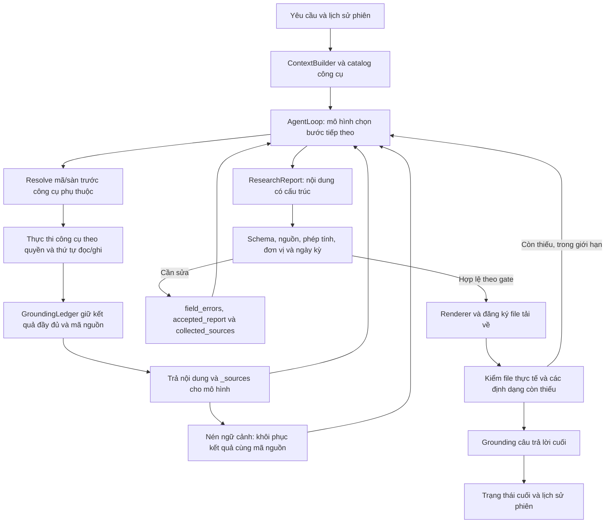

# Audit luồng AI nghiên cứu và giao kết quả - 10/11/2026

## Mục tiêu và phạm vi

Kiểm tra cách AI trong ứng dụng tự xử lý yêu cầu, lấy dữ liệu, giữ nguồn, phân tích, sửa lỗi và giao kết quả. Không viết lại báo cáo VIC bằng tay. Luồng VIC cũ là ca truy vết; các kiểm thử dùng dữ liệu tổng hợp và phản hồi mô hình giả lập để kiểm tra đúng mã chạy của ứng dụng.

Các phần đã đọc gồm AgentLoop, context/tool loading, lifecycle/retry/cache, identity/grounding, công cụ BCTC Việt Nam, report schema/evidence/service/tool, trạng thái kết thúc và lưu lịch sử phiên. Đây là kiểm toán phạm vi nghiên cứu/xuất báo cáo, không phải xác nhận toàn bộ repository.

## Bản đồ xử lý hiện tại

Model vẫn chịu trách nhiệm chọn công cụ, đọc và diễn giải bằng chứng, xây luận điểm, chọn phương pháp và sửa payload. Mã hệ thống kiểm các điều kiện có thể kiểm được; không tự thay một phép tính sai bằng số đúng rồi coi đó là phân tích của AI.

## Các lỗi tái hiện và thay đổi

| Điểm trong source | Hành vi trước sửa | Hành vi sau sửa | Kiểm thử chính |
| --- | --- | --- | --- |
| `tools/local_financial_statements.py`, `financial_statements_tool.py`, `vietnam_research_tool.py` | Lỗi cutoff, JSON, file đã cấu hình, cấu hình trùng và phép tính đều có thể mang nhãn thiếu cấu hình nguồn. AI bị hướng sang một lỗi không thể sửa dù nguyên nhân là đầu vào. | Chỉ không có nguồn cho mã mới mang `StatementSourceNotConfigured`. Các lỗi còn lại giữ nguyên nguyên nhân. Hướng phục hồi nêu công cụ đọc công bố gốc sẵn có và yêu cầu giữ URL/trang/kỳ/đơn vị. | `test_vietnam_statement_failure_classification.py`: 11 ca đỏ trước sửa. |
| `agent/tool_progress.py`, `tool_lifecycle.py` | Bộ chặn đếm cộng dồn cùng mã lỗi, kể cả sau bằng chứng mới hoặc sau khi danh sách lỗi đã giảm. Thiếu nguồn ở một mã còn chặn cả mã khác. | Bằng chứng mới mở lại nhóm lỗi có thể sửa. Tập `(field, problem)` giảm thực sự được tính là tiến bộ; đổi thứ tự, thay lỗi và lặp lại không được tính. Lỗi thiếu khả năng chặn payload cụ thể, không chặn lây công cụ trên mọi mã. Giới hạn retry và no-progress vẫn giữ. | `test_agent_loop_no_progress.py`, `test_tool_progress_failure_family.py`, `test_research_progress_regression.py`: đã quan sát lỗi rồi kiểm tra cả nhánh tiến bộ và nhánh vòng lặp. |
| `agent/tool_lifecycle.py` | Cache lưu kết quả trước khi gắn `_sources`. Sau compact/replay, AI lấy lại nội dung nhưng mất bản đồ S1/S2 tới URL. | Cache giữ payload đã gắn source index; replay giữ đúng ID ban đầu, không giả làm lần thu thập mới hoặc gán nguồn mới. | `test_readonly_replay_after_microcompact.py`: 2 ca đỏ trước sửa, cho readonly replay và deterministic cache; kiểm không gọi nguồn ngoài thêm lần nữa. |
| `reporting/evidence.py`, `service.py`, `tool.py` | Phép tính được kiểm chặt chủ yếu khi xếp hạng giá mục tiêu. Báo cáo chưa xếp hạng có thể đưa FCF hoặc tỷ lệ sai. Lỗi nguồn chủ yếu là chuỗi văn bản, khiến AI sửa từng lỗi rồi xóa bớt nội dung. | Kiểm lại công thức metric đã khai báo cả ở báo cáo chưa xếp hạng. Gom lỗi phép tính/nguồn, trả vị trí trường, công thức, đầu vào, giá trị kỳ vọng khi tính được, URL đã thu thập và bản payload cần sửa. Giữ số sai trong accepted_report để AI phải sửa, không âm thầm thay. | `test_report_calculation_validation.py`: FCF, nợ/tài sản, URL sai, sửa nhiều lỗi rồi xuất lại thành công. |
| `reporting/evidence.py` | Công thức sai cú pháp có thể rơi xuống nhánh phương pháp văn xuôi; phép trừ chỉ tiêu tài chính khác ngày kỳ vẫn qua; đơn vị shares làm EPS hợp lệ bị từ chối. | Công thức nhắc metric nhưng sai cú pháp trả lỗi sửa được. Cộng/trừ đầu vào tiền tệ ở financial_metrics phải khớp `as_of`. Định giá vẫn được kết hợp giá hiện tại với kỳ EPS khác. Các alias share/shares/CP dùng quy ước scalar/per-share hiện có. | 7 ca đỏ trước sửa; kiểm thêm EPS đúng/sai, công thức có chú thích và khả năng tương thích với giá mục tiêu cũ. |
| `reporting/service.py` | Cảnh báo thiếu analysis_sections được tạo trước render nhưng bị ghi đè sau render; AI không nhận được phản hồi về báo cáo chỉ có khung. | Giữ cảnh báo phân tích mỏng và cảnh báo chuẩn hóa cùng cảnh báo xuất file trong receipt. | `test_render_success_keeps_depth_feedback_for_the_ai`: đỏ trước sửa. |
| `agent/loop.py`, `write_targets.py`, `run_outcome.py` | Sau công cụ export thất bại, câu “đã hoàn thành” vẫn kết thúc success. Receipt giả không có file vẫn có thể được coi là thành công. Receipt thật có thể không được giao nếu model quên link. | Theo dõi định dạng mà công cụ export đã thử. Đối chiếu ID, tên file, URL với file đã đăng ký. Cho tối đa hai vòng phục hồi trước khi kết thúc; thiếu định dạng thì trạng thái `report_delivery_incomplete`. Link thật được gắn từ receipt. Trạng thái reset cho câu hỏi mới. | `test_agent_report_completion.py`: 4 ca đỏ ban đầu; thêm partial PDF/DOCX và tái sử dụng loop. Chạy qua `AgentLoop.run`, không chỉ gọi helper. |
| `session/service.py` | Kết quả export thiếu một định dạng bị ghi failed có thể mất cả lời giải thích và link file đã xuất khi lưu lịch sử. | Giữ nội dung kết thúc của lỗi giao báo cáo trong lịch sử, đồng thời giữ trạng thái failed; file một phần không biến yêu cầu thành completed. | `test_missing_report_format_keeps_the_verified_partial_delivery`: đỏ trước sửa. |
| `agent/context.py` | Hướng dẫn gọi `read_document(path=...)` khác schema thật `file_path`. | Hướng dẫn dùng đúng tham số `file_path`. | Đối chiếu trực tiếp schema `tools/doc_reader_tool.py`. |

## Điều tra VIC: phân biệt nguyên nhân và giả thuyết

- Phiên `724d1a8bcf4b`, run `20261109_114725_29_448dfd`, đã nạp skill Việt Nam và gọi nhiều công cụ tìm/đọc web. Không phải đơn giản là AI chưa được nhắc “nghiên cứu sâu”.
- Trace cho thấy công cụ BCTC thiếu nguồn; các lần structured export lỗi schema/evidence; bộ chặn lỗi kích hoạt; sau đó generic PDF writer tạo file. Đây là chuỗi đã quan sát, không suy từ hình thức PDF.
- Không thấy một bước đọc BCTC gốc trước bản xuất cũ. Tin tức và trang tổng hợp không tự thay thế BCTC/thuyết minh.
- Lệnh lấy VHM/VRE bị identity guard từ chối vì chỉ VIC được khóa danh tính, chưa resolve từng mã so sánh trước đó. Guard đó đúng; cách sửa là resolve từng mã, không bỏ kiểm tra danh tính.
- Mất `_sources` khi replay là lỗi tái hiện được trong source hiện tại. Nó có thể góp phần vào ghép sai nguồn sau compact, nhưng chưa có bằng chứng quy mọi URL sai của phiên VIC cho riêng lỗi này.

## Điều tra phiên FPT và lỗi kết thúc trong ảnh

Phiên `4d36075ab51c`, attempt `c704f2ed2731`, run `20261109_200236_89_44e983` nhận yêu cầu xuất DOCX lúc **20:02:36 ngày 09/11/2026 (UTC+7)**. Trace trên đĩa có 133 bản ghi cho phiên và attempt này đi đến bước 36; dòng “0 bước” trên giao diện không mô tả đúng công việc đã chạy.

| Bằng chứng quan sát | Ý nghĩa và cách sửa |
| --- | --- |
| Bước 31: export từ chối `price_history.*.price_basis=split_dividend`; bước 34 model đổi thành `split_adjusted`. | Tên của provenance công cụ và contract báo cáo không khớp, khiến sửa lỗi làm đổi ý nghĩa giá. Schema nay nhận alias `split → split_adjusted`, `split_dividend → total_return` ở Source/Metric/PricePoint. Không ánh xạ `split_dividend_additive` vì đó là cơ sở khác. Ca đỏ cho hai alias đã chuyển xanh; dữ liệu số không bị thay. |
| Bước 34: số kế hoạch năm có `as_of=2026-12-31` vượt cutoff; lỗi chỉ ghi `(root)`. | Giữ việc từ chối ngày tương lai. Lỗi nay chỉ đúng `financial_metrics.plan_revenue_2026.as_of`, yêu cầu đối chiếu ngày thông tin đã được công bố và giữ kỳ kế hoạch trong label/note; không tự đổi ngày để qua gate. Replay payload cũ nay vượt được lỗi alias và nhận đúng hướng sửa ngày này. |
| Bước 35: `key_stats.0` thiếu nguồn; model tiếp tục đọc accepted_report ở bước 36. | Đây là thiếu bằng chứng thực, không phải lỗi phải bỏ validation. Receipt hiện nêu đúng trường và yêu cầu gắn nguồn đã thu thập; báo cáo chưa có nguồn vẫn bị từ chối. |
| Attempt cũ có `run_dir=null`, `react_trace=[]` dù trace công cụ đã có trên đĩa; recovery ghi `partial=false`. | Trước sửa run_dir chỉ được lưu khi agent trả về, checkpoint chỉ lưu text; giai đoạn nghiên cứu dài chưa có text làm mất dấu công việc trong lịch sử. Nay lưu run_dir khi run phát sinh, checkpoint cả tool_call/tool_result, giữ trail ở nhánh gián đoạn/hủy/lỗi và giữ mốc thời gian đã biết. |
| Lúc 20:20:12, startup recovery ghi nhãn `service_restart`. | Nhãn này được tạo bởi constructor, không phải bằng chứng độc lập về nguyên nhân process dừng. Tái hiện được constructor thứ hai tự đánh dấu attempt đang sống là interrupted và gây hai reply. Nay khởi tạo singleton có khóa; cùng store dùng khóa phiên do OS giữ, recovery bỏ qua tác vụ còn chủ sở hữu. Kiểm cả hai process trên Windows và OS nhả khóa khi process chết. |
| Provider timeout/cancel được kiểm bên trong vòng nhận chunk; `next()` bị treo thì không tới được kiểm tra. | AgentLoop nay bao toàn bộ lời gọi adapter bằng deadline đã cấu hình và quan sát cancel độc lập với chunk. Giữ một lần retry hiện có; callback của lời gọi đã bỏ được chặn, giữ contextvars của phiên. Test provider giả bị block đã chạy đỏ trước sửa. Không có bằng chứng quy việc restart thực tế cho riêng lỗi treo này. |
| Hủy asyncio task không dừng thread `run_in_executor`. | Nay gửi cancel tới agent và giữ handle/quyền chạy đến khi worker thực sự kết thúc; không chờ vô hạn khi shutdown. Dịch vụ thứ hai không được phục hồi hoặc chạy chồng trong khoảng đó. Checkpoint vẫn còn cho lần khởi động tiếp theo. |

Log desktop tìm thấy cho ngày đó kết thúc trước thời điểm phiên FPT; chưa có log chứng minh tác nhân đã dừng process lúc 20:17–20:20. Không suy “provider làm crash backend” từ dòng thông báo phục hồi. Đợt sửa này không thay số liệu báo cáo, không chạy lại tác vụ tài chính cũ hay tự phát lại công cụ có tác dụng ghi.

README đã thêm luồng source thực tế và phân biệt với kiến trúc mục tiêu; bỏ mô tả mặc định 24 trang, bảo đảm loại bỏ mọi hallucination và hội đồng bắt buộc ở mọi lượt chat.

## Điều tra TCB: PDF trắng, nguồn hai khung và export

Phiên `86ff5450f6e5` ngày 10/11/2026 có các lỗi thực tế trong ảnh mới:

- Bước 40 gửi `financial_table.columns` dưới dạng `{key,label}`, hàng dùng `cells`, còn `valuation_scenarios` là mảng `{name, assumptions, implied}`. Contract thật cần tiêu đề cột dạng chuỗi, `values`/`cell_evidence` và object kịch bản có `rows`. Trước sửa, `cells` còn có thể bị Pydantic bỏ qua mà hàng không có số. Normalizer nay chuyển tiêu đề và ô bảng theo ánh xạ xác định, giữ nguyên giá trị và nguồn từng ô; ô null hiển thị dấu thiếu dữ liệu. Không tự biến văn xuôi `implied` thành giá mục tiêu: repair hint/tool description nêu đúng cấu trúc cần gửi.
- Bước 42 bị từ chối vì metric thiếu nguồn, bước 43 mới lộ `key_stats.0`. Schema trước đây dừng ở mục đầu tiên. Nay gom các lỗi thiếu nguồn, phương pháp và đầu vào trên các bề mặt nội dung trong cùng một `ValidationError`; receipt vẫn giới hạn kích thước nhưng nêu các nhóm còn lại. Test đỏ đã chứng minh cùng payload trước sửa chỉ trả một metric, sau sửa nêu cả hai metric, điểm nhấn và rủi ro. Không gán đại nguồn để ép export thành công.
- `_research_payload` trước đây bỏ mã ledger, danh sách khung phải không có `[S#]`, mở lại cùng truy vấn giữ kết quả cũ. Nay map URL theo cùng canonicalization của ledger, dùng ID đã có kể cả URL gặp lại ở lần gọi sau, loại URL trùng; checkpoint/history giữ ID. UI hiển thị ID, đánh dấu link đang mở và thay nội dung tab khi mở lại truy vấn có kết quả mới. Đổi nhãn thành “Nguồn tìm được” để không coi kết quả tìm kiếm là nội dung đã được thẩm định.
- PDF nguồn có hai nguyên nhân độc lập: bộ lọc `onBeforeRequest` chặn extension xem PDF và tài nguyên `chrome://resources` của nó; Electron **43.1.1** còn có lỗi upstream làm viewer không khởi tạo trong partition tạm thời, tái hiện được cả khi bỏ toàn bộ hook ứng dụng. Nâng cùng nhánh lên **43.4.1**, gồm [bản sửa chính thức #52810](https://releases.electronjs.org/pr/52810). `source-browser.ts` bật PDF plugin, cho phép origin viewer tích hợp và tài nguyên UI khi frame yêu cầu chính là viewer đó; không cho URL người dùng điều hướng tới các scheme nội bộ. Giữ session tạm thời, sandbox, tách cookie/auth, chặn quyền/download và giao thức/host không hợp lệ. Smoke mở rộng từ HTML sang PDF tạo trong bộ nhớ đã nhận **1 trang và loadProgress=100**, không chỉ có DOM/tab.

## Giới hạn còn lại

- Kiểm thử mô hình giả lập chứng minh nhánh xử lý của phần mềm, chưa chứng minh nhà cung cấp/model đang cấu hình sẽ tự chọn đúng công cụ và hoàn thành một báo cáo trực tiếp.
- Hiện không có hợp đồng công việc có cấu trúc bao trùm toàn bộ mục tiêu nghiên cứu. Gate giao file theo dõi **các lần export đã thử**, không chứng minh model luôn bắt đầu export khi người dùng yêu cầu một file nhưng model chưa gọi công cụ đó lần nào.
- Chỉ tiêu có `methodology` thuần văn xuôi như DCF/SOTP vẫn được giữ ở bản draft kèm cảnh báo chưa kiểm chứng phép tính. Không thể tuyên bố mọi phép tính trong văn xuôi đã được kiểm bằng máy.
- `as_of` kiểm được ngày kỳ, chưa đủ chứng minh YTD/TTM/standalone, hợp nhất/riêng, cùng mẫu số cổ phiếu hay ý nghĩa từng dòng kế toán. Các công cụ BCTC có cấu trúc giữ chi tiết hơn, nhưng contract báo cáo chưa mang toàn bộ thông tin đó.
- Source matching chứng minh nguồn đã được đọc và số xuất hiện trong nội dung; chưa chứng minh số đó chính là đúng dòng/chỉ tiêu/kỳ mà luận điểm sử dụng.
- Cảnh báo thiếu analysis_sections là phản hồi cho AI, chưa là đánh giá tự động về độ sâu, phản biện hoặc chất lượng SOTP. Không có chứng nhận CFA hoặc đảm bảo dự báo từ các gate này.
- Không sửa thủ công số liệu báo cáo người dùng, không chạy giao dịch, không cập nhật bộ cài trong đợt nghiên cứu source này.
- Python không thể cưỡng bức dừng một adapter đang block trong thread; deadline trả quyền điều khiển cho AgentLoop, thread daemon đó tồn tại tới khi transport trả về. Callback muộn bị chặn; muốn thu hồi cưỡng bức tài nguyên cần cô lập process.

## Kiểm chứng

Đợt FPT/TCB tiếp theo (các nhóm dưới đây không trùng file, không cộng lại với 611 test cũ):

- Runtime phiên/API, ownership Windows, checkpoint/hủy, provider deadline/retry, SDK streaming và context: **217 tests đạt**.
- Export, schema/normalization, nguồn UI, phép tính, evidence, cache/replay và giao artifact: **139 tests đạt**. Tổng backend lần kiểm này: **356 tests đạt**.
- Năm file kiểm frontend về tab/store, source browser, source evidence và mở nghiên cứu sau reload: **41 tests đạt**. Production frontend build đạt.
- Electron build đạt; native source-browser smoke kiểm PDF đã parse trang, trang chặn iframe, back/forward, cookie/auth tách biệt, không có bridge/require và đóng view sạch.
- Sau nâng Electron, các kiểm tra packaging checksum/retry, locale parity, backend path resolution và update-safety đạt. Chưa chạy smoke có khởi động backend thật, chưa đóng gói/cài đè hoặc nghiệm thu PDF nhà phát hành trong ứng dụng đang mở.
- Tái hiện lỗi bằng payload FPT cũ chỉ để validate/replay trên source hiện tại; không sửa hay xuất lại báo cáo của người dùng. Tái hiện callback cleanup gọi muộn để chứng minh không được xóa handle/quyền chạy của attempt mới; test đỏ rồi xanh.
- `git diff --check` đạt; cảnh báo pytest/NumPy và kích thước bundle Vite không phải test thất bại.

Đợt VIC trước đó:

- Nhóm vòng lặp, trạng thái kết thúc, grounding, retry, cache/replay và lưu phiên: **380 tests đạt** trên lần chạy hợp nhất sau sửa.
- Nhóm export, phép tính, nguồn và công cụ BCTC: **231 tests đạt** trên lần chạy hợp nhất sau sửa. Hai nhóm không trùng file kiểm thử: tổng cộng **611 tests đạt**.
- Các ca lỗi mới đã được chạy đỏ trước thay đổi production, rồi chạy lại qua cùng call site. Các nhóm cũ về cache, identity, cutoff, unit và rating được giữ trong kiểm tra tương thích.
- `git diff --check` đạt. Các cảnh báo trong nhóm hợp nhất là deprecation có sẵn của pytest-asyncio/NumPy; không có test thất bại.
