# Kiểm tra số liệu và biểu đồ trong câu trả lời — 08/11/2026

## Kết quả xác minh

Đã lần theo phiên MB/MBB thực tế bị lỗi từ trace, kết quả công cụ đầy đủ, bản nháp, cổng kiểm chứng số, bản phát hành và renderer chat. Không dùng preview bị cắt ngắn của trace để kết luận công cụ không trả chart.

Phiên đối chiếu: `20261107_233205_66_258497`, mã `MBB.VN`. Các số và biểu đồ phát lại là dữ liệu đã ghi nhận ngày 07/11/2026, không phải báo giá trực tiếp ngày 08/11/2026. Không gọi model trả phí và không đặt lệnh trong kiểm tra này.

## Nguyên nhân

| Điểm lỗi | Bằng chứng / tác động | Sửa ở nguồn dùng chung |
| --- | --- | --- |
| Bộ lọc số quét vào JSON chart | `range.returned: 53` bị thay bằng `(đã lược※)`, JSON không parse được dù công cụ đã trả 53 nến | Chỉ payload chart chính xác từ công cụ dữ liệu thị trường của phiên được tin cậy; giữ nguyên JSON đó qua bộ lọc số |
| UI che lỗi kiểm chứng | Đổi marker thành `—` và giấu thông báo số bị loại, nhưng giữ nhận định tự tin | Bỏ sanitizer che lỗi; câu trả lời mới rút đoạn, tiêu đề và toàn bộ hàng bảng phụ thuộc số chưa xác minh |
| Nhận nguồn inline chưa đầy đủ | Một số giá trị có trong nguồn `[S14]`, `[S40]` vẫn bị loại vì chỉ kế thừa citation từ caption bảng | Áp dụng cùng quy tắc kiểm tra giá trị trong nguồn cho citation inline; ID nguồn tự bịa vẫn bị chặn |
| Khai báo số trộn định dạng | Một dòng khai báo hỏng làm mất cả những khai báo đúng | Nhận dạng dấu phân cách theo ngữ cảnh và giữ các dòng khai báo còn hợp lệ; kiểm chứng lại sau sửa |
| Sửa cục bộ bị bỏ đi | Sửa được citation nhưng còn một lỗi khác thì candidate đã sửa không đến bước phát hành cuối | Giữ candidate chỉ khi số lỗi giảm, ghi trace `answer_partially_repaired` và kiểm chứng lại |
| Chart phụ thuộc model chép JSON | Có kết quả thị trường không đảm bảo câu trả lời chứa chart dùng được | Thu chart từ kết quả công cụ trước khi cắt ngắn context; gắn tối đa ba mã sau đoạn mở đầu và đồng bộ SSE |
| Renderer không giải thích chart hỏng | JSON không hợp lệ / thiếu OHLC không tạo được biểu đồ | Hiện trạng thái không đủ dữ liệu; không tạo nến từ giá đóng cửa thay O/H/L bị thiếu |
| Volume/MACD thiếu bị hiển thị như số không | Volume thiếu thành `0`; histogram MACD trong giai đoạn chưa đủ nến thành `0` | Giữ khoảng trống; giữ riêng giá trị `0` quan sát/tính được thật; báo thiếu volume |
| Bộ chọn khoảng thời gian phụ thuộc số nến cố định | `1M` bằng 22 nến cả khi dữ liệu là nến tuần | Dùng ngày lịch tính từ nến cuối; kiểm tra tháng có ngày cuối khác nhau và múi giờ gốc |

Chart do model tự viết không được miễn kiểm chứng. Nó được thay bằng dữ liệu công cụ đã quan sát; khi không có kết quả công cụ phù hợp, không dựng giá từ trí nhớ model. Kết quả công cụ có `ok:false`, `success:false` hoặc trạng thái lỗi không được tin cậy dù kèm các dòng giá.

## Luồng sau sửa

```mermaid
flowchart LR
    A[Khóa mã và sàn] --> B[Công cụ dữ liệu]
    B --> C[Thu bằng chứng đầy đủ và chart OHLC]
    C --> D[Model viết phân tích]
    D --> E[Gắn chart đã quan sát]
    E --> F[Kiểm chứng số và nguồn]
    F --> G[Sửa tham chiếu duy nhất và kiểm chứng lại]
    G --> H[Phát hành hoặc rút đoạn chưa xác minh]
    H --> I[SSE và nội dung lưu giống nhau]
    I --> J[MarkdownContent / ChartBlock / ECharts]
```

Tham chiếu dạng `tool_name::field` chỉ được sửa tự động khi có đúng một kết quả công cụ phù hợp; giá trị vẫn phải qua kiểm chứng sau sửa. Không chọn tùy ý giữa nhiều call.

Nguồn `[S#]` được gắn URL thu thập thực tế cạnh citation sau khi kiểm chứng, không sửa bên trong code/JSON hoặc thay URL người viết đã gắn. Chart giữ URL, thời điểm lấy, đơn vị, tiền tệ và cơ sở điều chỉnh của dữ liệu. Nến lịch sử đã điều chỉnh không được trình bày như báo giá giao dịch trực tiếp.

## Thiếu dữ liệu thật trong phiên MB

Trace đầy đủ ghi nhận 12 lượt công cụ thất bại:

- Hai lần xung đột định danh khi resolver và lệnh lấy dữ liệu phụ thuộc được gọi chung một batch. Các lần resolve/fetch MBB sau đó thành công. Hướng dẫn xử lý yêu cầu tách thành hai lượt công cụ; cổng định danh vẫn chặn batch không hợp lệ.
- Ba lỗi BCTC từ `vietnam_research` / `get_financial_statements`: chưa có đúng một nguồn `financial_statements` cho mã này trong Data Bridge. Bộ đọc `.VN` hiện dùng JSON được cấu hình; chưa có bộ lấy BCTC trực tuyến tổng quát tự động.
- Bảy lần `read_url` thất bại qua remote reader. Không bật lại kết nối origin không được bảo vệ: fallback cũ bị vô hiệu để tránh DNS rebinding/redirect vào dịch vụ nội bộ.

Vì vậy các chỉ tiêu báo chí/trang web chưa được đối chiếu với BCTC gốc. Bản phát hành hiện thông báo thiếu BCTC; dữ liệu của mã khác không được dùng để che thiếu hụt của MBB. Việc số xuất hiện trong nguồn không tự chứng minh đúng kỳ, đúng chỉ tiêu, đúng cơ sở hợp nhất hay đủ điều kiện đưa ra khuyến nghị đầu tư.

Không thể gọi bản phân tích này là báo cáo được CFA chứng nhận. Không tạo nội dung đệm đủ 24 trang khi bằng chứng tài chính chưa đủ. Hệ thống báo cáo DOCX/PDF/PPTX và preview sidebar đã được kiểm tra riêng ở tài liệu `MODEL_CONTEXT_REPORT_PIPELINE_AUDIT_2026-11-07.md`; lượt này tập trung vào lỗi số/chart của chat.

## Phạm vi thay đổi

- Backend: `answer_charts.py`, `tool_lifecycle.py`, `loop.py`, `loop_grounding.py`, `tools/price_chart_tool.py`, các mô-đun `grounding/{ledger,figures,figures_checks,policies,release}.py`.
- Frontend: `MessageBubble`, `ChartBlock`, `CandlestickChart`, `legacyGrounding.ts`, bản dịch đủ 14 ngôn ngữ, bộ chọn model/mức suy nghĩ trong `Composer` và nơi gọi tại `Agent`.
- Chống trùng lặp model: `ModelRuntimeBar` tự ẩn khi provider/model/effort trùng cấu hình composer; trigger trong composer không còn lặp nhãn "Nhà cung cấp mặc định" khi không có effort rõ ràng.
- Câu trả lời cũ: đoạn, tiêu đề, hàng bảng và fence phụ thuộc marker bị rút; chỉ còn một thông báo cục bộ. Chart fence cũ được giữ cho `ChartBlock` hiện trạng thái "không thể dựng lại" thay vì JSON hỏng.
- Prompt/skill: `context.py` và `vietnam-deep-research/SKILL.md` nêu cấu trúc equity research kiểu CFA (kết luận, bằng chứng thị trường, cơ bản, định giá, kịch bản, rủi ro/phản biện, khoảng trống dữ liệu, nguồn) và bắt buộc chart nến quan sát được cho câu hỏi giá/xu hướng; không tuyên bố chứng chỉ CFA.
- Kiểm tra: dữ liệu MB đã ghi nhận trong fixtures, hồi quy bộ kiểm chứng, gắn chart qua lifecycle/SSE, render chat đã lưu, trạng thái chart hỏng, composer với chuột/bàn phím và chế độ provider không hỗ trợ.

Các sửa đổi dùng chung cho mã chứng khoán phù hợp với công cụ, không nhánh đặc biệt cho FPT hay MBB. Fixture MBB chỉ tái hiện lỗi cụ thể.

## Bằng chứng có thể mở

- `artifacts/grounding-release-audit-20261108/`: bản phát lại kiểm chứng và receipt so sánh.
- `artifacts/chart-replay-mbb/`: 53 nến từ kết quả chart gốc, JSON hợp lệ, câu trả lời Markdown và hash/receipt.
- `artifacts/ui-review/mbb-chart-replay-desktop.png`: dữ liệu trên render qua `MarkdownContent` và ECharts thật; không phải ảnh chart vẽ riêng.
- `artifacts/ui-review/mbb-chart-calendar-1m.png`: bấm 1M trên nến tuần, hiện đúng năm nến từ 09/10 đến 06/11/2026.
- `artifacts/ui-review/codex-composer-desktop-dark.png`: model/context nằm trong khung nhập, popover và thanh chọn mức suy nghĩ theo ảnh tham chiếu.
- `artifacts/ui-review/codex-composer-mobile-320.png`: kiểm tra khung 320 px; bộ chọn không tràn viewport.

UI review sử dụng cấu hình model mô phỏng và dữ liệu chart đã ghi nhận. Nó không chứng minh endpoint của người dùng hỗ trợ mức suy nghĩ hay cửa sổ context được mô phỏng. Khả năng thật vẫn lấy từ cấu hình/metadata của endpoint; không phát hiện được thì phải ghi rõ fallback.

## Kiểm thử

- Bộ grounding rộng: 1.349 đạt, 2 bỏ qua; sau sửa hàng bảng/citation cùng hàng, 169 kiểm thử liên quan đạt.
- Chart backend: 20 kiểm thử gắn chart và công cụ đạt sau thay vị trí chart lên đầu câu trả lời.
- Lần chạy lại 08/11: `pytest agent/tests -k "grounding or chart"` đạt 1.470, bỏ qua 10; riêng `test_answer_charts`, hồi quy MBB, `test_price_chart_tool` và các bộ grounding liên quan đạt 254.
- Frontend lần chạy lại 08/11: toàn bộ 122 file / 1.108 kiểm thử đạt; `npm run build` (`tsc -b && vite build`) đạt. Kiểm thử mới phủ `legacyGrounding`, trạng thái chart cũ, ẩn thanh runtime trùng cấu hình và trigger không lặp nhãn mặc định.
- Các kiểm tra UI thật ở trên dùng trình duyệt, `MarkdownContent` và ECharts; composer có kiểm tra chế độ sáng/tối, bàn phím và chiều rộng 320 px.
- Các assertion logo cũ và dấu phân cách số theo locale của máy được cập nhật cho logo PNG hiện dùng và cách hiển thị phụ thuộc locale, không đổi giá trị tiền/tỷ lệ trong production.

## Lịch sử và giới hạn

Không viết đè lịch sử phiên MB gốc. JSON cũ đã hỏng không thể khôi phục số từ nội dung text mà không đối chiếu sidecar. Sau cập nhật, UI hiện lỗi chart rõ ràng cho bản cũ; bản phát lại riêng có 53 nến đầy đủ. Cần tạo lượt trả lời mới để dùng luồng gắn chart đã sửa.

Chưa xác minh lại bằng lượt LLM/provider trực tiếp và chưa đóng gói/cài lại Electron. Kết quả kiểm tra mã nguồn và phát lại không chứng minh mọi dữ liệu tài chính hoặc mọi nhà cung cấp đều đúng.
