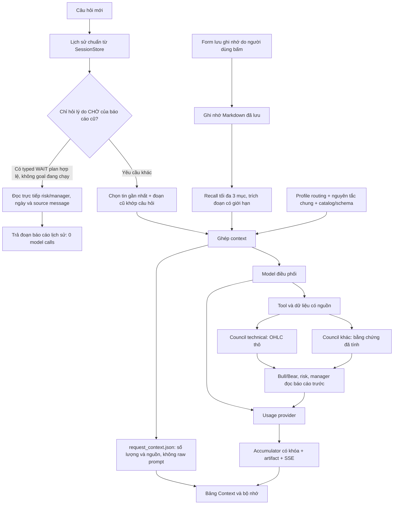

# Kiểm tra context, bộ nhớ và token của Vibe-Trading

Ngày kiểm tra: 2026-11-03. Phạm vi: chat Web, context/compaction, PersistentMemory và council Forex. Các số đo prompt bên dưới là ký tự hoặc token có nguồn được ghi rõ; không quy đổi thành tiền khi chưa biết bảng giá của custom provider.

## Kết luận từ source và dữ liệu local

Ứng dụng có context và bộ nhớ nền tảng, nhưng cách ghép chúng trước thay đổi còn nhiều khoảng trống. Không thể kết luận “đã có file lịch sử” là AI nhớ đủ, hoặc coi bộ nhớ là khả năng tự học lại trọng số model.

| Phần | Trước thay đổi | Đã xử lý trong đợt này |
| --- | --- | --- |
| Lịch sử chat | JSONL bền vững; lượt tiếp theo chỉ chọn đuôi trong khoảng 12.000 ký tự | Giữ budget 12.000, có truy xuất thêm tối đa ba đoạn cũ liên quan theo từ khóa; xét tối đa 1.000 tin |
| Báo cáo Forex cũ | Plan được lưu trong metadata để vẽ card, nhưng converter chỉ lấy `content`, bỏ qua lý do risk/manager | Đưa đoạn giải thích risk/manager có ngày nguồn vào ngữ cảnh lịch sử; không mang các trường giá entry/Bid/Ask sang làm quote mới |
| Bộ nhớ dài hạn | Có `remember`, file Markdown, tìm kiếm từ khóa/FTS; thư mục local kiểm tra có **0 file Markdown** | Có bảng xem trạng thái và form lưu ghi nhớ trực tiếp, không cần model call; không giả vờ đã có ghi nhớ |
| Ngôn ngữ Việt | Token scan theo ASCII có thể tách vụn các từ có dấu | Gấp dấu Latin cho tìm kiếm, có kiểm thử ghi nhớ được tìm lại sau khi mở instance mới |
| System prompt | Template ban đầu dài 24.480 ký tự, gồm routing của nhiều tác vụ trong mọi câu hỏi | Profile Forex chỉ bỏ routing tác vụ không liên quan; nguyên văn Output Principles, toàn bộ Guidelines, catalog tool/skill vẫn giữ |
| Cache prefix | Đồng hồ từng phút được đưa trong system prompt | Đồng hồ chuyển vào request user; phần system của cùng profile giữ ổn định |
| Council | Mỗi vai trò nhận lại toàn bộ 4 × 32 OHLC và metadata runtime của báo cáo trước | Chỉ technical nhận OHLC thô; năm vai trò sau nhận chỉ báo/price action đã tính và báo cáo cần đọc |
| Usage council | Sáu model calls không đi qua accumulator của AgentLoop | Ghi usage từng vai trò, gồm cả output lỗi schema; trả riêng trong plan và cộng vào usage của chat |
| Counter SSE | Dedup theo iteration có thể bỏ các lời gọi phụ trong cùng iteration | Dùng ID accounting/call riêng, có nhãn usage chưa biết và cache là tập con của input |
| Thread context | Thread tool và thread role không tự kế thừa ContextVar của cuộc hội thoại | Copy context ở từng ranh giới thread, giữ đúng ID hội thoại; lượt HTTP độc lập có ID riêng cho council |
| Hỏi lại vì sao CHỜ | Runtime thử thật còn yêu cầu resolve identity cho một câu hỏi chỉ đọc báo cáo cũ, gây thêm vòng model | Với ý định lịch sử rõ ràng và typed plan hợp lệ, đọc trực tiếp trích đoạn risk/manager, không gọi model; không thay các gate dữ liệu mới |

### Một bản ghi usage thật trước sửa

Một run council đã hoàn tất đủ sáu vai trò, nhưng `llm_usage.json` chỉ ghi **hai lời gọi điều phối**, tổng input **31.688**, output **222**, cache-read **25.344**. Vì vậy số này thiếu usage của các role, không phải tổng đầy đủ của toàn workflow. Không sửa ngược bản ghi cũ để điền token không được provider báo.

Cache-read đã nằm trong input. Hiệu `31.688 - 25.344 = 6.344` chỉ là phần input không nằm trong cache-read **của hai lời gọi được ghi**, không phải số tiền thanh toán hoặc tổng input của council. Custom gateway có thể có chính sách giá khác API gốc.

## Phân biệt bốn khái niệm

| Khái niệm | Được lưu ở đâu / dùng để làm gì | Có tự giảm token không? |
| --- | --- | --- |
| Lịch sử chuẩn | `sessions/<id>/messages.jsonl`, attempts và artifacts | Không; phải chọn phần nào đưa lại vào request |
| Context đang gửi | System + schema + lịch sử đã chọn + recall + kết quả tool của lượt đang chạy | Là phần chiếm cửa sổ context; được đo riêng với tổng usage |
| Bộ nhớ dài hạn | Markdown trong `memory/`, index `MEMORY.md`, FTS khi bật | Chỉ giúp khi lưu được thông tin bền vững và truy xuất đúng phần cần thiết |
| Prompt cache của provider | Tái sử dụng tính toán trên prefix trùng khớp | Có thể giảm giá/latency theo provider; không thay thế một bộ nhớ có truy xuất hay xác nhận thông tin còn đúng |

Counter `↑input ↓output` là cộng dồn qua các model calls của một lượt, không phải số token đang nằm trong một request duy nhất. Trong UI mới, cache, số lời gọi và phần thiếu usage được phân biệt. Không cộng reasoning hoặc cache thêm lần nữa vào token đã bao gồm chúng.

## Nghiên cứu nguồn gốc

[Anthropic: Effective context engineering](https://www.anthropic.com/research/effective-context-engineering-for-ai-agents) phân biệt nén lịch sử, ghi chép ngoài cửa sổ và phân chia công việc. Tích hợp ở đây chọn truy xuất có giới hạn và giữ artifacts đầy đủ; không dùng một bản tóm tắt LLM duy nhất làm nguồn sự thật. Nén quá mạnh có thể làm mất điều kiện hoặc bằng chứng.

[LangGraph: memory](https://docs.langchain.com/oss/python/langgraph/memory) phân biệt trạng thái hội thoại với bộ nhớ dài hạn. Dự án đã có hai vùng lưu trữ tương ứng, vì vậy chưa cần thay runtime bằng LangGraph chỉ để có một nhãn “memory”.

[Mem0: cơ chế add/search, source chính thức trên GitHub](https://github.com/mem0ai/mem0/blob/main/docs/core-concepts/how-it-works.mdx) tổ chức trích xuất và truy xuất ghi nhớ. Đây là hướng tham khảo cho semantic memory về sau, nhưng không cài Mem0 trong đợt này: trích xuất bằng LLM/embedding cũng có chi phí, và dữ liệu tài chính cần scope, thời gian hiệu lực, xử lý mâu thuẫn trước khi tự động ghi nhớ.

[DeepSeek: context caching](https://api-docs.deepseek.com/guides/kv_cache/) mô tả cache prefix và trường hit/miss. Thiết kế mới đưa phần chung trước phần role/report thay đổi. Cache vẫn là best effort; tài liệu API gốc không chứng minh gateway custom của máy này tính giá giống hệt.

## Luồng mới



Việc xem context và lưu ghi nhớ trực tiếp không gọi LLM. Không có job tự trích xuất facts sau mọi lượt. Bộ nhớ dài hạn dùng chung giữa các phiên trong runtime hiện tại; chưa phải namespace theo từng người dùng/tenant hoặc tài khoản broker.

### Chọn lịch sử

- Với hội thoại ngắn, giữ nguyên lịch sử hợp lệ.
- Khi dài hơn budget, giữ phần gần nhất và dành tối đa 3.000 ký tự cho đoạn cũ liên quan; nếu không có kết quả phù hợp thì trả budget cho phần gần nhất.
- Tối đa ba đoạn cũ, có `source_message`, role và nhãn lịch sử. Tiếng Việt có dấu/không dấu được chuẩn hóa trong truy xuất.
- Nếu một tin quá dài, có marker rút gọn và số tin bị rút gọn. Bản đầy đủ vẫn ở SessionStore.
- Không tạo ra semantic summary, không đảm bảo giữ toàn bộ yêu cầu quan trọng trong một hội thoại rất dài. `session_search` và artifacts vẫn là đường đọc sâu khi cần.

### Lý do trong báo cáo cũ

Plan Forex đã lưu được chiếu thành `historical-analysis-not-current-market-data`: symbol, ngày công bố, trạng thái và trích đoạn risk/manager. Có cờ cho biết đoạn bị cắt. Các trường entry/SL/TP/Bid/Ask không được sao chép vào phần carry này.

Những đoạn báo cáo vẫn là ý kiến lịch sử của model. Câu hỏi giải thích lại báo cáo có thể dùng chúng để trả lời định tính; yêu cầu giá mới hoặc phân tích mới vẫn cần dữ liệu broker mới. Ghi nhớ không cấp mandate, thay allowlist, bật runner hoặc thay bằng chứng hiện tại.

Với câu hỏi chỉ giải thích vì sao CHỜ từ “báo cáo cũ/lượt trước/đã lưu”, service có nhánh đọc trực tiếp typed `TradePlan` hợp lệ, kèm ngày, source message và các vai trò. Không gọi LLM, không lấy quote, không dựng lại card giá. Nhánh này dùng nhận dạng ý định hẹp; câu hỏi yêu cầu dữ liệu mới, so sánh, mã nguồn/tệp hoặc khác symbol quay về agent. Không áp dụng khi có goal đang chạy. Các quy tắc identity/financial grounding không bị nới lỏng.

Một lần kiểm tra trước khi thêm nhánh này đã dùng ba lời gọi model (46.725 input, 2.225 output) vì identity gate đòi resolve lại symbol, dù model đã đọc được lý do cũ. Đây là lỗi định tuyến công việc, không chứng minh bộ nhớ bị mất. Không xóa hoặc sửa usage thật của lượt đó.

### Profile và giới hạn prompt

Profile Forex chỉ chọn khi câu hỏi có marker Forex/native rõ và không đồng thời yêu cầu backtest, team, code, tài liệu hoặc nghiệp vụ khác. Chỉ đoạn **Task Routing** được thay bằng routing ngắn; các nguyên tắc grounding/thực thi không bị cắt. Profile general vẫn giữ toàn bộ template.

Template general sau bổ sung hướng dẫn follow-up là 24.939 ký tự; profile Forex là 16.170. Đây chưa gồm catalog/skill được render, schema, lịch sử hoặc tool results và không phải token provider thực báo.

Compaction nhiều lớp có sẵn tiếp tục hoạt động trong một run. Giá trị mặc định `VIBE_TRADING_CONTEXT_MAX_TOKENS=200000` là trần độ dài prompt, không phải hạn mức tổng tiền/token qua mọi lời gọi. Goal token budget là cơ chế khác; usage council mới được chuyển về cùng accumulator/monitor. Không âm thầm hạ trần của mọi tác vụ nghiên cứu trong đợt này.

## Đo tiết kiệm đúng đơn vị

Bộ fixture sạch có cùng bốn khung × 32 OHLC, sáu vai trò và cùng báo cáo trước từng stage. So sánh tổng system + user prompt của các role:

| Vai trò | Trước, ký tự | Sau, ký tự |
| --- | ---: | ---: |
| technical | 11.797 | 11.087 |
| macro | 11.818 | 3.997 |
| bull | 13.897 | 5.877 |
| bear | 13.898 | 5.878 |
| risk | 15.987 | 7.773 |
| manager | 17.031 | 8.720 |
| Tổng | **84.428** | **43.332** |

Giảm **48,68% ký tự** trong fixture này. Đã loại năm bản sao OHLC thô và metadata runtime không cần cho suy luận, đồng thời dùng JSON gọn. Các báo cáo, phản biện, veto, giá kịch bản và canonical evidence đầy đủ vẫn được giữ ở output/artifacts.

Không suy từ ký tự sang phần trăm tiền tiết kiệm. Tokenizer, ngôn ngữ báo cáo, cache hit/miss, reasoning/output và giá của gateway có thể làm kết quả thực khác. Sáu lời gọi vẫn tồn tại và vẫn tiêu thụ token.

## API và cấu trúc

```http
GET /sessions/{session_id}/context
```

Trả `preview` lịch sử cho lượt tới, trạng thái memory/recall và bản ghi `last_run` nếu run mới đã tạo `request_context.json`. Run cũ thiếu manifest hiển thị thiếu, không suy diễn đầu vào cũ từ preview hiện tại. `model_calls=0` của endpoint chỉ nói việc đọc bảng không gọi model.

```http
POST /sessions/{session_id}/memory
Content-Type: application/json

{"title":"Quy trình phân tích","content":"Ưu tiên nến đã đóng, giải thích bằng tiếng Việt.","memory_type":"user"}
```

Thao tác do người dùng bấm, dùng PersistentMemory sẵn có, không gọi model. Response phân biệt `saved`/`skipped`; không trả đường dẫn local. Hai route giữ auth của API hiện có. Không có API tự xóa toàn bộ memory hoặc tự nâng quyền giao dịch.

```text
agent/src/
  session/context.py                mới: recent + keyword recall + carry báo cáo cũ
  session/context_view.py           mới: diagnostics chỉ đọc
  session/forex_history.py          mới: đọc lại typed WAIT report, 0 model calls
  session/service.py                dùng packet có budget, đọc tối đa 1.000 tin
  api/sessions_routes.py            GET context; POST lưu ghi nhớ rõ ràng
  agent/prompt_profile.py           mới: projection routing bảo thủ
  agent/context.py                  clock ngoài system, counters recall/profile
  agent/loop.py                     manifest context, khóa usage, sink council
  agent/tool_lifecycle.py           truyền ContextVar qua thread
  trading/forex/council_context.py   mới: role views và JSON gọn
  trading/forex/council.py           usage từng role, copy context, ID hội thoại
  tools/forex_market_tool.py         chuyển usage về AgentLoop
  memory/persistent.py              chuẩn hóa tìm kiếm tiếng Việt
frontend/src/
  components/chat/ContextMemoryPanel.tsx   mới: xem context, memory, lưu trực tiếp
  components/forex/ForexCouncilUsage.tsx   mới: usage có nguồn theo role
  components/chat/ForexTradeCards.tsx     gắn usage council
  hooks/useLlmUsageCounter.ts             ID từng call/event, cache và missing
  hooks/useSSE.ts                         context/usage-unavailable events
  components/chat/LlmUsageCounter.tsx    phân biệt tổng usage với context size
  pages/Agent.tsx                         gắn panel và live context
```

## Khoảng trống còn lại

1. Chưa có semantic/vector memory, tự trích xuất facts theo schema, xử lý mâu thuẫn hoặc TTL theo loại dữ liệu. Không gọi keyword recall là RAG ngữ nghĩa.
2. Chưa có rolling summary ngữ nghĩa của cả phiên. Compaction LLM vẫn giới hạn trong run; bản đầy đủ có thể đọc lại từ lịch sử/artifacts.
3. Chưa có namespace memory theo tenant/account, phân quyền từng mục, UI sửa/xóa/version hoặc provenance trích dẫn đến từng câu.
4. Cần benchmark recall tiếng Việt theo tập câu hỏi dài hạn, tỉ lệ lấy nhầm/bỏ sót, token và latency. Tests synthetic không đo được chất lượng phân tích tài chính.
5. Chưa có bảng giá đáng tin của custom gateway để tính tiền, hoặc hạn mức tổng token tùy chỉnh cho mọi chat thông thường. Không coi trần context 200k là ngân sách tiêu thụ.
6. Chưa cấp max-output-token riêng cho mọi provider/role; giới hạn schema, timeout và số stage không thay thế trần generation token tương thích từng API.

Hướng tiếp theo nên đi từ phép đo recall/cost và scope dữ liệu rồi mới thêm embedding/automatic extraction có opt-in. Với giá thị trường, luôn ưu tiên source mới thay vì “nhớ giá” để tiết kiệm token.

## Kiểm chứng

Đã có kiểm thử cho: truy xuất đoạn cũ đúng nguồn/budget, giữ lý do risk mà không mang entry quote thành giá mới, ghi/mở lại memory tiếng Việt trong thư mục fixture, API đọc/lưu không LLM, role projection, token của output lỗi schema, unknown usage, idempotent SSE, truyền conversation qua thread và cộng usage song song.

- Backend: **823 passed, 5 skipped**, gồm context, lifecycle session, memory, grounding, council, MT5 và các gate mandate/kill-switch/read-only. Log: `.codex-backups/forex-autoconnect/context-backend-tests.log`.
- Frontend: **159 passed / 18 files**, gồm panel context, memory save, SSE usage, council usage, Forex và chat. Log: `.codex-backups/forex-autoconnect/context-frontend-tests.log`.
- Ruff pass cho các file Python thay đổi. Production build pass; còn cảnh báo kích thước chart chunk vốn có. Log: `.codex-backups/forex-autoconnect/context-frontend-build.log`.
- Runtime thật trên `127.0.0.1:8001`, phiên `5f4181be4032`: câu hỏi chỉ giải thích CHỜ của báo cáo cũ trả đúng trích đoạn risk/manager và ngày nguồn. Run `20261103_232629_43_090178` ghi **0 model calls, 0 input, 0 output**, một báo cáo được đọc lại, **41 ms** elapsed của lần thử này. Không suy rộng latency này sang phân tích mới hay council.
- Manifest lịch sử giữ source message `713252782912`, thời điểm report `2026-11-03T15:30:56.217749+00:00` và hai role. Giá entry/Bid/Ask không được dựng lại thành báo giá mới.
- Trước nhánh đọc trực tiếp, đã kiểm tra một run model thật có `native_forex_research`, history 3.749 ký tự và request manifest. Phát hiện ba lần gọi do identity recovery được ghi riêng ở trên; không giấu số token đã tiêu thụ.
- Mở panel, mở form lưu nhớ và kiểm tra hiển thị; không ghi sở thích giả vào kho nhớ thật của người dùng. API lưu/mở lại memory được kiểm thử bằng thư mục fixture. Kho local thật vẫn có 0 mục.
- Bảng context được kiểm tra ở **320/768/1024/1440 px**, không tràn ngang trong panel; đã reset viewport. Ảnh bằng chứng: `C:/Users/KIMPC/.codex/visualizations/2026/11/02/01a19c85-c9eb-7231-89de-b39033d0092d/context-memory-proof.png`.
- Hai Forex runner vẫn dừng khi nạp lại ứng dụng. Không gửi lệnh hoặc thay quyền execution. Accounting đủ sáu role được kiểm thử bằng provider fixture; đợt này không chạy thêm một council trả phí để khẳng định số token live của toàn bộ sáu role sau sửa.

Đây là kiểm chứng cho lát cắt context/memory/usage đã thay đổi, không phải toàn bộ repository hoặc chất lượng dự báo giao dịch.
