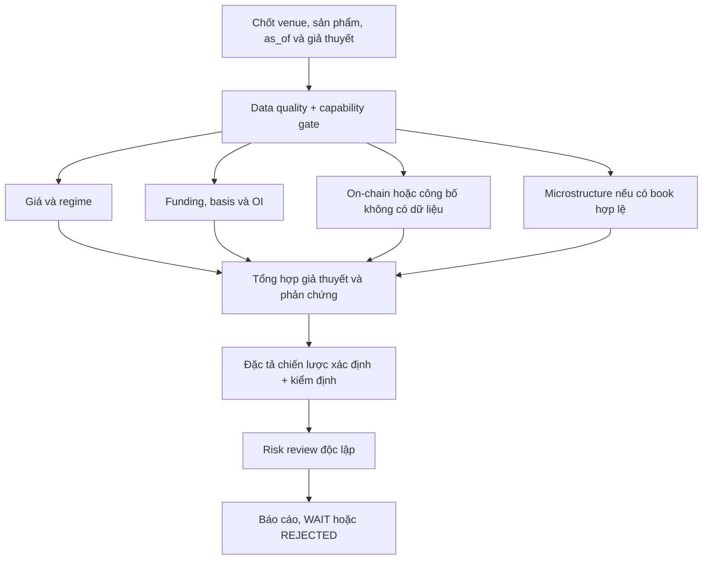

# Crypto Intelligence: dữ liệu sàn, on-chain và kiểm định phái sinh

Ngày rà soát nguồn: **2026-11-04**. Tài liệu này xác định cách mở rộng nghiên cứu crypto từ mã nguồn hiện có. Những luồng có nhãn **đề xuất** chưa được triển khai hoặc kiểm chứng đầu cuối trong đợt viết tài liệu. Không có giao dịch thật được thực hiện để xác minh tài liệu.

Đọc cùng [kiến trúc đa thị trường](MULTI_MARKET_ARCHITECTURE.md), [hợp đồng bằng chứng](DATA_EVIDENCE_CONTRACTS.md), [lộ trình triển khai](IMPLEMENTATION_ROADMAP.md) và [baseline mã nguồn](SOURCE_BASELINE.md).

Bản nghiên cứu này được mở rộng bằng [danh mục 72 đặc tả Crypto](specs/CRYPTO_72.md), giữ đúng ID `CRYPTO-194`–`CRYPTO-265` của [master plan](../VIBE_TRADING_MULTI_MARKET_MASTER_PLAN_V1.md). Danh mục nối từng yêu cầu với seam trong source, phần còn thiếu, fixture nghiệm thu và priority. Các mục 12–16 dưới đây bổ sung phép tính, protocol theo venue, durable recovery và tokenomics; chúng là thiết kế cần triển khai, không đổi capability hiện tại.

## 1. Sản phẩm và ranh giới xác nhận

Crypto Intelligence cần trả lời ba lớp câu hỏi riêng: thị trường và dòng tiền đang diễn ra thế nào; giả thuyết có vượt qua kiểm định với dữ liệu đúng sản phẩm không; kết quả mô phỏng còn giới hạn gì. LLM điều phối, diễn giải và phản biện; tính giá, phí, funding, risk và kiểm định phải tái tính bằng code có đầu vào được lưu.

| Năng lực | Chỉ xác nhận từ mã nguồn | Không được suy ra |
| --- | --- | --- |
| OHLCV nhiều nguồn | [registry.py](../agent/backtest/loaders/registry.py) khai báo chuỗi `okx → binance → ccxt → yfinance → local`; [binance_loader.py](../agent/backtest/loaders/binance_loader.py) dùng Binance spot hoặc USD-M | Không đồng nghĩa venue interchangeable; một bar Yahoo không thay cho mark/funding cùng sàn |
| Định danh spot/perp | [ccxt_loader.py](../agent/backtest/loaders/ccxt_loader.py) phân biệt `BTC-USDT` với `BTC-USDT-PERP` và mapping `BTC/USDT:USDT` | Suffix không mô tả toàn bộ contract multiplier, tài sản thế chấp hoặc inverse/linear |
| Perpetual simulation | [crypto.py](../agent/backtest/engines/crypto.py) có maker/taker, slippage, funding và liquidation; `perpetual_strict` yêu cầu funding từ dữ liệu | Không phải chứng nhận parity với matching/liquidation engine của sàn; default fixed funding không phải lịch sử funding thật |
| Strict risk inputs | [perpetual_risk.py](../agent/backtest/perpetual_risk.py), [ccxt_loader.py](../agent/backtest/loaders/ccxt_loader.py) có mark/execution frames, maintenance-bracket artifact và kiểm tra | Artifact đúng schema không tự chứng minh bracket đúng cho tài khoản, thời điểm lịch sử hoặc venue khác |
| Order-book spot | [orderbook_depth_tool.py](../agent/src/tools/orderbook_depth_tool.py) lấy snapshot L2 OKX/Binance, units, spread, imbalance, impact và partial fill | Chỉ spot REST snapshot; không phải perpetual book, lưu lịch sử L2 hay bảo đảm lệnh thật được khớp |
| Đội agent | [crypto_research_lab.yaml](../agent/src/swarm/presets/crypto_research_lab.yaml), [crypto_trading_desk.yaml](../agent/src/swarm/presets/crypto_trading_desk.yaml) đã có nhiệm vụ on-chain/DeFi/funding/risk | Nội dung prompt không chứng minh có provider on-chain, MVRV/SOPR, options hoặc liquidation heatmap hoạt động |
| USD-M account observation | [usdm.py](../agent/src/trading/connectors/binance/usdm.py) chỉ gọi hai account reads được cho phép, kiểm tra trạng thái và ghép phản hồi | Là hai lần đọc nối tiếp, không phải atomic snapshot; không đặt được lệnh qua module này |
| Connector profiles | [profiles.py](../agent/src/trading/connectors/binance/profiles.py) và [sdk.py](../agent/src/trading/connectors/binance/sdk.py) phân biệt chế độ | Live-trade spot không chứng minh live USD-M; USD-M Shadow Account là bề mặt đọc riêng có giới hạn |
| Đăng ký và thống kê | [sdm_register_tool.py](../agent/src/tools/sdm_register_tool.py), [quantlib_tool.py](../agent/src/tools/quantlib_tool.py) và [strategy_store](../agent/src/strategy_store) | Có registry/tool không chứng minh chiến lược có alpha hay đủ điều kiện thực thi |

**Chưa kiểm chứng runtime:** request dữ liệu sàn thật, credentials, khả năng truy cập theo địa lý/tài khoản, thu thập on-chain, dịch vụ 24/7, khôi phục stream khi mất kết nối, paper/live parity và lợi nhuận thực tế.

## 2. Spot, margin, perpetual và hợp đồng đáo hạn

Mỗi nghiên cứu phải khóa `venue`, `instrument_id`, `instrument_type`, base/quote/settlement/collateral currency, linear/inverse, contract size, tick/step/min notional, margin mode và trạng thái listing tại thời điểm nghiên cứu. Cùng ticker BTC không làm những sản phẩm này trở thành cùng một chuỗi dữ liệu.

| Sản phẩm | Dữ liệu/chi phí cần | Lỗi cần tránh |
| --- | --- | --- |
| Spot không vay | Giá tiền mặt, inventory, phí, spread, min notional | Dùng funding hoặc liquidation của perp để tính PnL spot |
| Spot margin | Thêm tài sản vay, lãi vay, khả năng vay và risk policy của venue | Gọi mọi vị thế short là perpetual; giả định lãi vay bằng funding |
| Linear perpetual | Execution/last, mark, index, funding, bracket, collateral và margin mode | Lấy close giao dịch làm mark hoặc áp funding của venue khác |
| Inverse/coin-margined | Công thức contract/PnL/collateral riêng | Áp công thức `quantity × price_change` của linear mà không đổi đơn vị |
| Hợp đồng có đáo hạn | Expiry, settlement, roll, basis và calendar | Annualize basis bằng ngày không đúng hoặc kéo series qua đáo hạn không khai báo |

Đây là taxonomy thiết kế; engine `CryptoEngine` hiện được mô tả là perpetual-contract engine. Việc loader trả OHLCV spot không chứng minh cấu hình chạy backtest đã mô phỏng đúng spot. Trước khi xuất kết quả cần đọc rõ engine/config và báo cáo loại sản phẩm thực sự được mô hình.

## 3. Hợp đồng dữ liệu — đề xuất

### 3.1. Envelope dùng chung

```text
schema_version, dataset_id, source, venue, environment,
instrument_id, instrument_type, base_asset, quote_asset, settlement_asset,
event_time, received_at, ingested_at, available_at,
timestamp_source, timestamp_precision, source_timezone,
sequence_id, raw_payload_hash, normalization_version,
coverage_start, coverage_end, gaps, quality_flags, source_url
```

`environment` phân biệt public production market data, sandbox và account observations; không ghép sandbox quote với production positions. Thời gian chuẩn hóa UTC nhưng giữ raw timestamp và đơn vị epoch. `event_time` là mốc do nguồn gán; `received_at` là lúc nhận ở client; nếu nguồn thiếu thời gian, chỉ được ghi thời gian client kèm `timestamp_source=client`, không tự gọi là exchange timestamp.

As-of join dùng `available_at <= decision_time` và kiểm soát độ lệch giữa các nguồn. Giá, OI, funding và on-chain có cadence khác nhau; không forward-fill vô hạn để tạo cảm giác đồng bộ. Bar chưa đóng cần `is_closed=false`; dùng cho research phải ghi rõ, dùng trong backtest đóng nến phải bị loại đến khi có thể biết.

### 3.2. Các bảng dữ liệu riêng

| Dataset | Trường bổ sung | Gate tối thiểu |
| --- | --- | --- |
| OHLCV/trades | Open/close time, trade price type, base/quote volume, trade IDs, completeness | Không duplicate timestamp; OHLC hợp lệ; phân biệt bar không có giao dịch và mất dữ liệu |
| Mark/index | `price_type`, price, index constituents/version nếu có | Không alias last sang mark; cùng sản phẩm và thời điểm với risk frame |
| Funding | Settlement time, realized rate, interval, predicted/realized flag, mark tại settlement nếu cần | Không dùng predicted rate như realized; không áp hai lần cùng settlement |
| OI | Observation/window end, contracts/base/notional unit, contract size, valuation price | Không cộng OI khác đơn vị; không suy ra long/short direction từ một con số OI |
| L2 book | Snapshot/update IDs, bids/asks, depth, quantity units, event/client times, valid/rebuild state | Không tính imbalance/impact từ book mất chuỗi, crossed, thiếu một phía hoặc quá hạn |
| Liquidation events | Venue, event scope, side, size unit, event ID, aggregation/sampling rule | Dữ liệu quan sát được không đại diện toàn bộ liquidation nếu feed bị lọc/lấy mẫu |
| Contract rules | Tick, step, min/max, bracket/hash, effective range, source/account applicability | Không dùng rule hiện tại cho lịch sử dài hạn nếu không có bằng chứng thời kỳ |
| On-chain | Chain ID, block number/hash/parent hash, tx hash/log index, contract, decimals, finality | Chặn chain/asset ambiguity, reorg và dữ liệu provisional khi yêu cầu finalized |

## 4. Derivatives intelligence có giới hạn rõ

### 4.1. Funding và basis

Binance công bố riêng lịch sử funding và `fundingInfo`, trong đó có `fundingIntervalHours`. Do đó không hardcode mọi hợp đồng luôn theo lịch tám giờ. Giữ realized settlement riêng dự báo funding kế tiếp. Đối chiếu tài liệu chính thức đã đọc 2026-11-04: [Funding Rate History](https://developers.binance.com/en/docs/catalog/core-trading-derivatives-trading-usd-s-m-futures/api/rest-api/market-data#get-funding-rate-history) và [Funding Rate Info](https://developers.binance.com/en/docs/catalog/core-trading-derivatives-trading-usd-s-m-futures/api/rest-api/market-data#get-funding-rate-info).

Thiết kế đề xuất:

- Tính dòng tiền funding theo loại hợp đồng, dấu vị thế, notional và settlement events thực tế; lưu từng event để đối chiếu tổng. Không chèn funding ngày thiếu bằng mức mặc định rồi gắn nhãn historical.
- Annualized funding chỉ là phép quy đổi theo giả định rate/cadence; ghi công thức simple hoặc compounded, không gọi là lợi suất carry được đảm bảo.
- Basis cần cùng thời điểm spot/perp hoặc dated futures, cùng quote/FX policy; snapshot không đồng bộ làm basis không đáng tin.
- Cash-and-carry cần phí hai chân, slippage, funding biến đổi, borrow/transfer/collateral costs và risk của venue. Funding dương không tự động là arbitrage không rủi ro.
- Không cộng lợi nhuận từ giá spot và perp mà bỏ qua chênh lệch collateral, vốn bị khóa và nguy cơ liquidation từng chân.

Trong code, `CryptoEngine` mặc định `funding_mode='fixed'`, rate `0.0001`. Cấu hình này hữu ích cho scenario, phải được ghi là giả định. `perpetual_strict=True` đòi `funding_mode='data'`; loader còn cần maintenance brackets được cung cấp như artifact có provenance/hash, không tự lấy signed endpoint trong đường public data. Không đổi tên strict thành “giống sàn 100%”.

Giới hạn cần sửa trước khi khẳng định historical funding đầy đủ: [CCXT loader](../agent/backtest/loaders/ccxt_loader.py) hiện kiểm lịch funding theo các giờ UTC cố định `00/08/16` và ghép settlement timestamp giao với bar timestamps. Cadence thay đổi hoặc nhiều settlement trong một daily/coarse bar chưa được bảo đảm thu đủ; cần aggregation theo cửa sổ bar hoặc từ chối interval/cadence không hỗ trợ, kèm fixture chứng minh không mất event. Chọn `funding_mode='data'` tự nó chưa giải quyết giới hạn này.

### 4.2. Open interest và vị thế thị trường

[Open Interest Statistics của Binance](https://developers.binance.com/en/docs/catalog/core-trading-derivatives-trading-usd-s-m-futures/api/rest-api/market-data#open-interest-statistics), đọc 2026-11-04, giới hạn lịch sử khả dụng ở một tháng gần nhất và cung cấp cả lượng OI, giá trị OI, timestamp cuối kỳ. Vì vậy nghiên cứu dài hạn cần archive có provenance hoặc provider phù hợp; endpoint tồn tại không chứng minh có nhiều năm dữ liệu.

Phương pháp đề xuất: báo OI theo từng venue/sản phẩm; thống nhất contract size và currency khi tổng hợp; tách thay đổi do số hợp đồng với thay đổi notional do giá. OI tăng kết hợp funding/giá là một giả thuyết positioning, không phải bằng chứng tiền “đổ vào long” hay dự báo chắc chắn. Long/short ratios cần định nghĩa population, account/position weighting và coverage; không trộn các chỉ số cùng tên từ nhiều sàn.

### 4.3. Liquidation và mark price

Không suy ra bản đồ vị trí liquidation toàn thị trường từ OHLCV, funding hoặc một vài liquidation events. Nếu sử dụng heatmap của provider, lưu phương pháp/độ phủ/phiên bản, ghi `estimated`, tách cluster giả định với lệnh thanh lý đã quan sát. Không đưa số tiền cluster vào báo cáo khi chỉ có prompt yêu cầu.

Trong strict simulation, mark dùng định giá/risk còn execution dùng khớp lệnh; đầu vào phải đồng bộ. Code có isolated/cross risk nhưng bars không chứng minh thứ tự high/low, funding, rebalance và liquidation trong nội phiên. Điều kiện interval tối đa 1H cho strict leverage từ 100x trong code chỉ là giới hạn độ phân giải, không xác nhận trình tự liquidation. Không tăng leverage để làm đẹp backtest trước khi đo fidelity này.

## 5. Order book: snapshot khác stream lịch sử

Tool hiện hữu [orderbook_depth](../agent/src/tools/orderbook_depth_tool.py) chỉ đọc spot OKX/Binance. Code giữ base quantity/quote notional riêng, báo partial fill khi thiếu độ sâu, từ chối book crossed/thiếu một phía và phân biệt timestamp nguồn/client. Phải giữ các giới hạn này khi đưa vào báo cáo; impact từ snapshot là ước tính tại thời điểm quan sát, chưa bao gồm queue position, cancellation hoặc di chuyển giá khi gửi lệnh.

[Tài liệu Spot WebSocket của Binance](https://developers.binance.com/en/docs/catalog/core-trading-spot-trading/api/ws-streams/~#diff-depth-stream), đọc 2026-11-04, mô tả diff-depth updates với ID đầu/cuối của từng event. Đề xuất khi cần stream: buffer delta, lấy snapshot, đồng bộ sequence theo quy tắc venue, áp delta theo thứ tự và rebuild khi phát hiện gap. Không biến REST polling thành tuyên bố đã có stream đầy đủ.

Mỗi feature microstructure cần lưu cửa sổ, depth, units, book validity và stale policy. Mất sequence làm invalid book ngay; không tiếp tục tính imbalance trên trạng thái trước lỗi. Reconnect phải đánh dấu khoảng gián đoạn. Nếu chiến lược dùng feature L2, backtest cần L2 archive tương ứng; ảnh chụp hôm nay không được dùng để ước lượng lịch sử nhiều tháng mà không ghi là giả định.

## 6. On-chain: định danh, finality và nhãn thực thể

### 6.1. Dữ liệu thật sự đo được

Asset phải định danh bằng chain/network và contract address; ticker không đủ. Phân biệt native token, wrapped token, bridged representation và tài sản cùng tên ở chain khác. Contract decimals, token migrations, rebases và proxy upgrades có phiên bản theo block. Không cộng supply các bản bridge vào một supply gốc mà không giải thích cách loại trùng.

[Ethereum JSON-RPC](https://ethereum.org/developers/docs/apis/json-rpc/) hỗ trợ các block tags `latest`, `safe`, `finalized` và trường định danh block/log; [tài liệu PoS Ethereum](https://ethereum.org/en/developers/docs/consensus-mechanisms/pos/) giải thích cơ chế finality. Nguồn được đọc 2026-11-04. Đây là cơ sở phân biệt trạng thái của Ethereum, không phải policy finality dùng chung cho mọi blockchain hoặc L2.

Thiết kế đề xuất cho ingest:

1. Lưu raw response, chain ID, block number/hash/parent và mốc quan sát. Event key gồm chain, block hash, transaction hash và log index; không chỉ block number.
2. Phân loại `provisional`, `safe`, `finalized`, `orphaned` theo chain/provider policy. Lưu finality checkpoint tại lúc tính feature.
3. Phát hiện parent/hash mismatch, đánh dấu bản cũ orphaned, rollback cursor tới common ancestor theo giới hạn đã khai báo, replay và tái tính feature phụ thuộc.
4. Không xóa lịch sử quan sát cũ; ghi revision và báo cáo đã bị ảnh hưởng. Mỗi feature có thể chỉ ra block range và revision tạo nó.
5. Khi provider không hỗ trợ finality tag hoặc archive block được yêu cầu: báo capability gap, không đổi `latest` thành finalized bằng tên trường.

### 6.2. Ý nghĩa chỉ số và bất định

| Chỉ số/nhãn | Cách dùng đề xuất | Bất định phải trình bày |
| --- | --- | --- |
| Active addresses | Đếm theo định nghĩa event, chain và cửa sổ | Địa chỉ không phải số người; bot, contract, batching và sybil làm sai cách diễn giải |
| Exchange inflow/outflow | Net flow trên tập địa chỉ có nhãn và thời điểm phiên bản | Nhãn ví có thể sai/chưa đầy đủ; chuyển nội bộ có thể bị nhầm là deposit/withdrawal; không chứng minh hành vi bán |
| Holder distribution | Snapshot balance theo block và nhóm đã công bố | Một tổ chức có nhiều ví; custodian/bridge chứa tài sản của nhiều người |
| MVRV/SOPR | Chỉ dùng khi có provider/phương pháp phù hợp tài sản và lịch sử | Cost-basis inference và entity adjustments không tương đương cost basis từng nhà đầu tư; không tự tính từ OHLCV |
| TVL/protocol revenue | Contract set, methodology, price source, token double-counting policy | TVL bằng USD đổi do giá và số lượng; phí người dùng không tự động là doanh thu thuộc token holder |
| Token unlock | Văn bản/token schedule có phiên bản, điều kiện thực tế | Lịch thông báo không tự chứng minh lượng token đã lưu hành hoặc đã bán |

Nhãn thực thể cần `label_source`, `label_version`, `observed_at`, confidence/methodology. Backtest dùng nhãn được biết tại thời điểm đó hoặc phải báo rõ hindsight labeling. Không hồi tố ví được nhận diện hôm nay vào feature lịch sử rồi gọi là strategy PIT.

## 7. Đồ thị nghiên cứu và phối hợp agent — đề xuất

Tái dùng Swarm DAG và các preset crypto hiện có; sửa nhiệm vụ theo năng lực provider thật, không tạo runtime riêng. Một run nhỏ chỉ bật nhánh có dữ liệu.



| Nhiệm vụ | Artifact yêu cầu | Ràng buộc |
| --- | --- | --- |
| Data steward | Dataset manifest, units, timestamps, gaps, capability matrix | Dữ liệu thiếu nhánh nào ghi unavailable nhánh đó; không tạo neutral signal thay dữ liệu |
| Derivatives analyst | Funding ledger, basis alignment, OI với đơn vị | Mọi con số trỏ tới dataset/window; predicted và realized tách riêng |
| On-chain analyst | Block-range evidence, label version, methodology | Không báo MVRV/flow khi không có dữ liệu hoặc phương pháp |
| Microstructure analyst | Book validity, spread/impact/partial-fill evidence | Không gọi spot snapshot là perp liquidity |
| Strategy researcher | Quy tắc vào/ra, exposure, trigger, timeout, dữ liệu cần | Mô tả kiểm định được, không để LLM tự quyết mỗi tick |
| Quant validator | Reproducible run, fees/funding/slippage, split, thử nghiệm thất bại | Không chọn thông số theo holdout rồi vẫn gọi holdout là ngoài mẫu |
| Risk reviewer | Stress, margin/collateral, drawdown và điểm chưa mô hình | Có quyền chặn dù alpha hypothesis hấp dẫn |
| Editor | Claims, evidence IDs, limits, invalidation conditions | Không làm trung bình tín hiệu thiếu dữ liệu để tạo conviction score |

Các yêu cầu trong preset như current multi-exchange funding, liquidation heatmap, options structure và on-chain cycle indicators phải được kiểm tra tool/provider trước khi chạy. Prompt không được nâng cấp capability; tool trả lỗi/metadata-only phải đi xuyên suốt đến kết luận.

## 8. Nghiên cứu định lượng và replay

Mỗi strategy hypothesis có đặc tả xác định: data cadence; giá dùng phát hiện/tính lệnh; bar-close timing; dấu/đơn vị position; sizing; phí và funding; margin/collateral; giới hạn giao dịch; invalidation và lý do `NO_TRADE`. Dùng quantlib có sẵn cho thống kê, impact/risk và validation; dùng SDM để đăng ký artifact sau khi có source/method/results, không đăng ký một prompt rồi gắn validated.

Manifest một run tối thiểu cần raw/normalized dataset hashes, acquisition range, actual coverage, instrument specs theo thời kỳ, bracket provenance, code/config/dependency identity, random seed nếu có, trial count, train/validation/holdout windows và output hashes. Thay nguồn trong fallback tạo dataset identity mới; phải ghi nguồn thực dùng từng đoạn. Không nối dữ liệu spot venue A với perp venue B mà vẫn giữ cùng nhãn chiến lược venue-specific.

Kiểm định cần tách:

- **Signal validity:** feature có tồn tại đúng thời điểm quyết định, có leak hoặc hindsight labels không.
- **Statistical validity:** số lần thử, dependence/overlap, walk-forward phù hợp, holdout và sensitivity chi phí. Phụ thuộc giữa quan sát không tự biến mất vì có hàng nghìn bar.
- **Execution fidelity:** bar/snapshot/stream hỗ trợ đến mức nào, order size so với depth/volume, partial fills, latency và venue filters.
- **Risk/account fidelity:** collateral, margin mode, bracket, funding order, liquidation và terminal state; phần chưa mô hình phải được liệt kê.

Account shadow hiện hữu có thể dùng làm điểm so sánh đọc: lưu mốc bắt đầu/kết thúc hai signed reads, cấu hình hash và fidelity flags. Account thay đổi trong khoảng đọc có thể gây incoherence; phải từ chối hoặc thu lại, không chỉnh response để khớp mô hình. Không bật quyền giao dịch để thu dữ liệu mà read-only contract đã đủ.

## 9. Failure paths và đầu ra

| Lỗi | Hành vi yêu cầu |
| --- | --- |
| Rate limit, endpoint unavailable, geo restriction | Retry có budget, trạng thái từng nguồn, stale marker; không tuyên bố lỗi đã khắc phục bằng fallback sai loại sản phẩm |
| Thiếu lịch sử funding/OI | Báo range thật; chặn hypothesis cần đoạn thiếu hoặc giới hạn phạm vi; không tạo số thay |
| Funding cadence đổi/settlement trùng | Lưu rule version và event ID; không giả định lịch cố định, không tính hai lần |
| Mark/execution không đồng bộ | Chặn strict simulation; không lấy close điền vào trường mark |
| Book crossed, stale hoặc sequence gap | Invalidate/rebuild và dừng feature phụ thuộc; giữ gap trong manifest |
| Reorg/provider lệch chain head | Quarantine/replay theo block hash; đánh dấu report cần tính lại |
| Chain/contract/quote không rõ | `INSUFFICIENT_DATA`; yêu cầu định danh bằng dữ liệu, không chọn asset theo độ phổ biến |
| Bracket/fees/filter không có bản lịch sử | Scenario có nhãn hoặc từ chối claim exchange-fidelity; không dùng current snapshot như fact lịch sử |
| Chỉ thấy paper hoặc sandbox | Báo đúng environment; không tuyên bố đã có live readiness |
| Strategy không qua kiểm định/risk | `REJECTED` với lý do và artifacts; không đổi seed/window cho tới khi xanh |

Đầu ra gồm market brief có `as_of` và data freshness, sản phẩm/venue, fact–inference–assumption tách rõ, giả thuyết và phản chứng, evidence theo nhánh, kết quả validation hoặc lý do chưa chạy, risk/model limits và điều kiện vô hiệu. Chỉ đưa entry/size nếu đã có dữ liệu và quy tắc tính hợp lệ; nếu không thì `WAIT`/`INSUFFICIENT_DATA`.

## 10. Milestone và nghiệm thu — đề xuất

| Mốc | Phạm vi nhỏ nhất | Điều kiện chấp nhận |
| --- | --- | --- |
| CR-1: identity và OHLCV | Một venue, một spot và một linear perp được định danh riêng | Units/timestamps/source đúng; fallback không làm đổi sản phẩm âm thầm; bar mở/missing được nhận biết |
| CR-2: derivatives pack | Mark, execution, realized funding, OI, bracket artifact trong range thực có | Không gán forecast vào realized; không double-count settlement; OI không vượt range; thiếu strict input bị chặn |
| CR-3: spot microstructure | Dùng tool REST snapshot hiện hữu | Timestamp client/source hiển thị đúng; partial fill giữ nguyên; book lỗi/stale không sinh signal; chưa tuyên bố stream |
| CR-4: một nhánh on-chain | Một chain/asset, provider đã chọn, block-hash evidence | Reorg fixture rollback và tái tính đúng; labels có version; provisional không bị gọi finalized |
| CR-5: research DAG | Data gate + các nhánh thực có + quant/risk review | Nhánh provider lỗi giữ trạng thái thiếu; mọi claim trọng yếu nối dataset; risk gate chặn được kết quả |
| CR-6: reproducible strategy | Một hypothesis với split/chi phí/collateral rõ | Rerun số nhất quán trong tolerance; không leak; stress/gaps/terminal states có báo cáo; SDM không tự nâng validation |
| CR-7: shadow comparison có giới hạn | Account reads và market snapshots được phép, không submit lệnh | So sánh có observation window và tolerance; incoherence fail-closed; trình bày sai lệch chưa giải thích |

Test cần bổ sung ở đợt code gồm: funding interval thay đổi; duplicate settlement; USDT/USDC/inverse mapping; OI đơn vị khác; partial fill; missing exchange timestamp; duplicate/out-of-order book deltas; reorg cùng block height; bridge double counting; label hindsight; mark gap; bracket version đổi; outage trong holdout; equity/margin terminal state và replay cùng input hash.

Điểm bắt đầu là các test đã có: [test_crypto_engine.py](../agent/tests/test_crypto_engine.py), [test_ccxt_perpetual_loader.py](../agent/tests/test_ccxt_perpetual_loader.py), [test_perpetual_risk.py](../agent/tests/test_perpetual_risk.py), [test_binance_usdm_readonly.py](../agent/tests/test_binance_usdm_readonly.py), [test_binance_account_reconciliation.py](../agent/tests/test_binance_account_reconciliation.py) và [test_binance_shadow_evidence.py](../agent/tests/test_binance_shadow_evidence.py). Kiểm tra offline các file này không xác nhận kết nối sàn, capability tài khoản hoặc order parity.

## 11. Phần chưa kiểm chứng và rủi ro còn lại

Chưa chạy provider/sàn/on-chain thực tế, replay stream, kiểm định lợi nhuận hay paper/live account parity. Việc đọc tài liệu Binance/Ethereum không chứng minh adapter đã hỗ trợ toàn bộ API. Rủi ro chính là nhầm spot với perp, dùng mark/funding/bracket không cùng thời kỳ, mất sequence/finality và diễn giải nhãn ví như sự thật về hành vi nhà đầu tư.

## 12. Accounting: ví dụ có thể tái tính và source gaps

Tất cả số dưới đây là **SYNTHETIC**, dùng làm oracle kiểm thử, không phải giá thị trường, thông số khuyến nghị hay kết quả chạy hệ thống. Tách journal cash, inventory/position, fees, funding và unrealized PnL trước khi cộng equity; giữ currency ở từng dòng. Stablecoin chỉ quy ra USD qua price/haircut policy có thời điểm, không tự xem là tiền USD.

### 12.1. Spot cash và linear perpetual có cùng đường giá

Giả định bắt đầu 10.000 USDT, giá mua 50.000 rồi bán 51.000 USDT/BTC; size 0,1 BTC; phí hai chiều 0,05% notional, trả bằng USDT, không slippage. Linear perp có leverage 5x, một settlement funding dương 0,01%, mark tại settlement 50.000; bỏ qua liquidation để chỉ kiểm journal cơ bản.

| Bước | Cash spot | Linear perp | Invariant |
| --- | --- | --- | --- |
| Mở | Trả 5.000 cho 0,1 BTC và phí 2,5; cash=4.997,5, inventory=0,1 BTC | Wallet còn 9.997,5 sau phí 2,5; initial margin giả định=1.000 là vốn bị ràng buộc, không phải chi phí hoặc notional bị trừ khỏi wallet | Spot có asset inventory; perp là contract exposure |
| Funding | Không có funding | Long trả 0,1×50.000×0,0001=0,5 USDT; wallet=9.997 | Funding là cash event, không nhân thêm leverage vào 0,1 BTC đã là position size |
| Giá lên 51.000 | Equity=4.997,5+0,1×51.000=10.097,5 trước phí bán | Unrealized PnL=0,1×(51.000−50.000)=100; margin equity=10.097 trước phí đóng | Initial margin không bị cộng lần hai vào equity |
| Đóng | Thu 5.100−2,55; final cash=10.094,95, inventory=0 | Realized +100, phí đóng 2,55; final wallet=10.094,45 | Chênh 0,5 là funding theo giả định, không phải sai số làm tròn |

Trong isolated mode, khoản funding/fee còn ảnh hưởng allocation và liquidation buffer riêng của position; bảng chỉ là journal cấp wallet, không thay `evaluate_isolated`. Nếu fee trả bằng token thứ ba, phải thêm dòng token debit và FX valuation, không ghi như cash USDT đã trả. Tính spot margin cần thêm borrow principal/interest; không dùng funding làm lãi vay.

**Khoảng hở source cần xử lý trước khi gọi cash-spot backtest:** [runner.py](../agent/backtest/runner.py) `_select_market_engine` chọn `CryptoEngine` cho source `okx`/`ccxt` và crypto qua `yfinance`. [crypto.py](../agent/backtest/engines/crypto.py) là perpetual engine, mặc định `funding_mode='fixed'`. Vì vậy metadata OHLCV spot đúng vẫn có thể đi vào mô hình perpetual. Đợt code cần chọn engine theo contract accounting và test journal như trên; không chỉ thêm một nhãn spot vào report.

### 12.2. Inverse và multiplier không được suy từ ticker

Giả định inverse contract có face value 100 USD/contract, long 10 contracts, entry 50.000 USD/BTC, exit 55.000. Theo **công thức giả định của fixture**, PnL settle BTC là `10×100×(1/50.000−1/55.000)=0,0018181818 BTC`; quy giá exit thành 100 USD. Đây không phải 10 BTC và không được tính `10×(55.000−50.000)`.

Fixture linear khác: 100 contracts × contract size 0,001 BTC = 0,1 BTC; giá tăng 1.000 quote/BTC cho PnL 100 quote. Adapter phải xác nhận `contractSize`, linear/inverse, settlement và multiplier từ market metadata/rule version; quy tắc tính của fixture inverse phải được đối chiếu venue cụ thể trước dùng. [CCXT Manual](https://github.com/ccxt/ccxt/wiki/Manual#common-pitfalls), đọc 2026-11-04, phân biệt số contracts với base quantity qua `contractSize`.

Source `_parse_ccxt_symbol` hiện chỉ nhận perp dạng `BASE-USDT-PERP`, mapping `BASE/USDT:USDT`; chưa có đường generic inverse/USDC perp. `CryptoEngine.round_size` làm tròn 6 decimals; đây không phải thực thi tick/step/min-notional của mọi sàn. `calc_commission` dùng taker khi mở và maker khi đóng ở non-strict; strict dùng taker. Những default này là giả định mô phỏng cần báo, không chứng minh maker fill hoặc ưu đãi tài khoản thật.

### 12.3. Funding: event-time trước, resample sau

Fixture giữ long 0,1 BTC xuyên ba settlement cùng ngày, rates `0,0001`, `−0,0002`, `0,0003`, marks `50.000`, `51.000`, `49.000`. Long cash changes lần lượt `−0,5`, `+1,02`, `−1,47` USDT; tổng **−0,95 USDT**. Daily candle chỉ có timestamp 00:00 vẫn phải giữ cả ba event. Cộng rates rồi nhân một mark cho ra −1 USDT sẽ sai trong fixture này; vị thế đổi giữa ngày còn khiến phép cộng rates sai lớn hơn.

Thiết kế nhỏ nhất: ledger settlement riêng keyed bởi `(venue, environment, account/simulation_run, contract_id, settlement_time)`, kèm rate, position quantity ngay trước settlement, mark/notional, cash currency và source revision. Revision thay dữ liệu tạo correction/reversal có lineage cho cùng event identity, không tự post lần hai. Dữ liệu bar là view để trình bày; không làm primary key cho cash events. Fixture thêm position mở đúng settlement phải kiểm timing policy đã công bố; source hiện `_apply_data_funding` bỏ position có `entry_time >= settlement`, không đủ để suy thứ tự matching/funding engine của sàn.

Source `_fetch_perpetual` đang chọn required hours `00/08/16`, sau đó chỉ ghép `funding.index.intersection(result.index)`. `_fetch_funding_history` làm tròn timestamp về giây. Một daily bar không thể đại diện đầy đủ ba settlement; rule/cadence đổi cũng chưa được đảm bảo. Không sửa bằng cách tự fill rate mặc định: chọn event ledger hoặc fail closed với resolution/cadence không hỗ trợ. Funding API và metadata cadence của Binance có thể đổi theo symbol; current `fundingInfo` không tự cung cấp toàn bộ lịch sử rule changes. [Binance USD-M Market Data](https://developers.binance.com/en/docs/catalog/core-trading-derivatives-trading-usd-s-m-futures/api/rest-api/market-data#get-funding-rate-info), đọc 2026-11-04.

### 12.4. OI: tách số hợp đồng, notional và dữ liệu biết được

Ví dụ SYNTHETIC: OI=1.000 contracts, size=0,001 BTC/contract, price từ 50.000 lên 55.000 USDT. Quantity OI vẫn 1 BTC, notional từ 50.000 lên 55.000; mức tăng 10% notional không chứng minh có 10% hợp đồng mới hoặc dòng tiền long. Lưu cả raw quantity/unit và conversion price/time, không ghi đè một trường OI khi đổi đơn vị.

Feature chỉ dùng observation khi `available_at <= decision_time`; timestamp kết thúc bucket không chứng minh observation đã đến client ngay lúc đó. Không trộn current OI snapshot với historical bucket cùng tên; ghi coverage/lag theo từng endpoint. Độ phủ archive là dữ liệu thực đã thu, không suy ra từ số tháng người dùng yêu cầu. Chưa tìm thấy OI archive adapter chuyên biệt trong các source seam đã rà.

## 13. Order book: protocol riêng và trạng thái lưu bền

### 13.1. Điều chỉnh yêu cầu checksum theo tài liệu hiện hành

**Phát hiện mới khi rà 2026-11-04:** OKX chuẩn `books`, `books-l2-tbt`, `books50-l2-tbt` đánh dấu checksum deprecated, giá trị cố định 0; dùng `seqId/prevSeqId`. Channel spread `sprd-books-l2-tbt` vẫn có checksum riêng. Heartbeat có thể giữ nguyên sequence; maintenance có thể reset sequence. Không dùng một CRC policy cho mọi channel. [OKX API Guide — Order book channel](https://www.okx.com/docs-v5/en/#order-book-trading-market-data-ws-order-book-channel).

Do đó business rule “ordered updates with checksum” ở master `CRYPTO-197` cần được diễn giải thành **integrity policy theo venue/channel/protocol version**. Checksum chỉ bắt buộc khi nguồn còn công bố và định nghĩa; luôn giữ kiểm sequence, schema, crossed book, units và freshness. Đây là cập nhật thiết kế từ nguồn chính thức, không phải đã thêm stream adapter vào code.

| Venue/path | Bootstrap và cursor đề xuất | Điều kiện làm mất validity |
| --- | --- | --- |
| Binance spot diff-depth | Buffer stream, lấy REST snapshot rồi nối bằng update range; cursor giữ snapshot ID và last applied `u` | Khoảng update bị thiếu phải rebuild; quantity là giá trị thay thế tại price level, 0 xóa level |
| OKX standard incremental book | Snapshot channel rồi áp update có chain prev/seq hợp lệ; policy có heartbeat/reset riêng | Prev/seq không nối được hoặc epoch/session không rõ → dừng feature và rebuild; checksum 0 không chứng minh integrity |
| REST snapshot hiện tại | Một `fetch_order_book`, identity spot và thời gian quan sát | Snapshot stale/crossed/missing side bị loại; chưa có cursor stream để khẳng định continuity |

Quy trình Binance dựa trên [tài liệu WebSocket chính thức](https://github.com/binance/binance-spot-api-docs/blob/master/web-socket-streams.md#how-to-manage-a-local-order-book-correctly), đọc 2026-11-04. Độ sâu snapshot có giới hạn; mức giá chưa có trong snapshot chưa trở thành full-market liquidity chỉ vì stream đang chạy. Chi tiết bootstrap phải khóa theo revision tài liệu khi triển khai, không sao chép nguyên quy tắc futures sang spot.

### 13.2. Durable recovery — đề xuất, chưa có trong tool REST

State tối thiểu: `venue/environment/contract/channel`, `protocol_version`, `session_generation`, `snapshot_hash/id`, `last_committed_sequence`, `raw_segment_hash`, `gap_ranges`, `received_at`, `validity` và `normalizer_version`. Raw frame được lưu trước khi commit cursor; checkpoint và materialized book phải cùng revision để crash không có cursor mới với book cũ. Nếu lưu không atomic được, recovery kiểm hash/sequence và rebuild, không tin cursor riêng lẻ.

Trạng thái: `UNINITIALIZED → BUFFERING → VALID`; bất kỳ gap/stale/schema error nào sang `INVALID/REBUILDING`; chỉ snapshot+bridge delta hợp lệ mới quay lại VALID. Agent/strategy không được tính imbalance khi state khác VALID. L2 tính từ dataset bị gap giữ gap trong artifact; không interpolate missing book thành lịch sử.

Fixture SYNTHETIC sau khi đã bootstrap hợp lệ tới 100:

1. Nhận `[U=101,u=103]`, commit last=103; một level quantity 0 bị xóa.
2. Nhận `[U=105,u=106]`: thiếu 104, giữ raw event nhưng state=INVALID; không công bố impact mới.
3. Crash sau raw append, trước cursor commit: restart đọc checkpoint 103 và raw 105–106; vẫn phát hiện gap, không tự nhảy cursor 106.
4. Fetch snapshot mới, bootstrap đúng revision rồi mở lại feature; report khoảng 104 thiếu không bị xóa.

OKX fixture riêng cần heartbeat `(prev=15,seq=15)`, reset `(prev=15,seq=3)` theo tài liệu current và event sau reset `(prev=3,seq=5)`. Reset không được bỏ bằng quy tắc generic “seq giảm là duplicate”; nếu implementation chưa hỗ trợ reset an toàn, rebuild có reason rõ. Không lấy REST polling làm fixture giả cho stream continuity.

## 14. On-chain: reorg, decimals và tokenomics có đơn vị

### 14.1. Ví dụ reorg và record bị thay thế

Fixture SYNTHETIC khóa canonical block 100/hash H100 với balance 1.000 token. Nhánh A: A101(parent H100) chuyển ra 100, A102(parent A101) chuyển vào 30 → balance provisional 930. Provider sau đó báo B101(parent H100) chuyển vào 5 và B102(parent B101) không có transfer → canonical balance **1.005**, không phải 935 hoặc 1.035.

Recovery phải giữ A101/A102 làm orphaned; vô hiệu feature/report dùng các event A; quay về state tại H100 rồi replay B101/B102. Không chỉ giảm confirmations hoặc ghi đè row theo block height. Key event gồm chain ID, block hash, tx hash, log index; cùng tx được tái include ở block mới cần lineage để giữ hai observations và chỉ một canonical effect. Replay lần hai không thay balance.

Lưu head, safe/finalized checkpoints, parent links, raw response hash và commit cursor. Mâu thuẫn finalized checkpoint là incident cần quarantine; không tự lùi finality để che lỗi provider. `latest/safe/finalized` và log `removed` là semantics được Ethereum JSON-RPC công bố; provider/chain khác phải có policy riêng, L2 cần xét thêm settlement layer. [Ethereum JSON-RPC API](https://ethereum.org/developers/docs/apis/json-rpc/), đọc 2026-11-04.

### 14.2. Decimals, balance và supply không đồng nghĩa transfer sum

ERC-20 `decimals()` là optional; vì vậy metadata thiếu không được mặc định 18. Raw amount 1.234.567 với decimals=6 là 1,234567 token; lưu integer nguyên gốc và Decimal representation, không float round-trip rồi dùng làm evidence. Token identity gồm chain+contract+metadata revision theo block. [ERC-20 specification](https://eips.ethereum.org/EIPS/eip-20), đọc 2026-11-04.

Thiết kế decoder cần phân biệt zero transfer, mint/burn convention, fee-on-transfer, rebasing, proxy upgrades và native transfers. Chỉ nhìn Transfer logs không đủ chứng minh balance nếu tài sản có cơ chế đổi số dư khác; phải đối chiếu `balanceOf/totalSupply` tại block với capability archive được xác nhận. Chưa có decoder/reorg store này trong bề mặt source đã rà.

### 14.3. Unlock, dilution và giá trị thuộc token holder

Fixture SYNTHETIC: circulating=100 triệu token, total/max=1 tỷ, giá 2 USD. Circulating cap=200 triệu USD; FDV theo giả định max supply=2 tỷ USD. Unlock lịch 10 triệu bằng 10% circulating ban đầu, không phải 1%; nếu toàn bộ thực sự trở thành circulating thì circulating=110 triệu. Giữ giá cố định chỉ tạo scenario cap=220 triệu, không phải dự báo giá hoặc tạo thêm giá trị kinh tế.

Ở scenario khác, giữ circulating cap 200 triệu sau dilution 110 triệu token thì giá toán học là khoảng 1,81818 USD. Đó là giả định một biến cố định để đo sensitivity; không kết luận thị trường chắc chắn giảm 9,09%. Nếu max supply không bị giới hạn, không xuất FDV như một giá trị xác định theo max supply tưởng tượng.

Mỗi tranche cần beneficiary, allocation, cliff/start/duration, released/releasable, revocable/admin rights, contract implementation hash và source disclosure version. Tách `scheduled`, `vested/unlocked`, `released`, `circulating`, `venue-deposited`, `sold`; chỉ chuyển trạng thái khi có bằng chứng phù hợp. [OpenZeppelin VestingWallet](https://docs.openzeppelin.com/contracts/5.x/api/finance#VestingWallet), đọc 2026-11-04, cho thấy lịch có thể tùy biến; tài sản nạp sau khi vesting bắt đầu có thể releasable ngay một phần và ownership có thể chuyển. Không mặc định mọi dự án dùng đúng implementation này.

Fixture protocol fees=100, LPs=70, protocol revenue=30, holder distributions=5 phải giữ bốn số với vai trò khác nhau; token holder không tự sở hữu treasury hoặc có quyền nhận 30. TVL cần giữ số token và price effects riêng, loại trùng underlying/receipt theo methodology version. Các định nghĩa TVL, fees, revenue và holders revenue được phân biệt trong [DefiLlama Data Definitions](https://docs.llama.fi/analysts/data-definitions), đọc 2026-11-04; adapter của hệ thống cần khai báo policy tương ứng thay vì mặc định dashboard nào cũng tính giống nhau.

## 15. Exchange truth, permissions và canary

`paper` trong connector là spot testnet account có host/key riêng; USD-M Shadow Account chỉ là observation surface đọc production account theo contract đã giới hạn. Không được đổi nhãn shadow thành simulated exchange, hoặc xem spot testnet fill là chứng cứ perp execution. [CCXT Manual — Testnets and Sandbox](https://github.com/ccxt/ccxt/wiki/Manual#testnets-and-sandbox-environments), đọc 2026-11-04, yêu cầu chọn sandbox trước các call khác và tách key sandbox/production; [OKX Demo Trading](https://www.okx.com/docs-v5/en/#overview-demo-trading-services) dùng header môi trường riêng.

Trong source [usdm.py](../agent/src/trading/connectors/binance/usdm.py) `read_account_observation` gọi account v2 rồi positionRisk v3; output giữ `client_observation_time` và `sequential_signed_reads`. Hai lần đọc không atomic; position đổi giữa hai response có thể bị từ chối vì incoherent totals. Giữ discrepancy thay vì sửa dữ liệu cho giống model. `assert_exchange_endpoints` khóa chính xác HTTPS host/path, không phải phát hiện tự động mọi quyền của API key.

| Claim | Bằng chứng cần trước khi viết claim | Trạng thái đợt tài liệu |
| --- | --- | --- |
| Research credential read-only | Capability/permission inspection từ venue hoặc cấu hình operator có xác nhận; logs chứng minh không gọi write | Source có call allowlist; chưa kiểm key/account thật |
| Position reconciliation đầy đủ | Balances + positions + orders + fills + transfers cùng scope/time, handling manual action và freeze integration | Có pure account comparison và drift artifacts; chưa xác nhận coverage toàn ledger |
| Live-ready | Supported product/flags, rule versions, timeouts/ambiguity reconcile, risk gates, operator policy và runtime evidence | Chưa xác nhận bằng tài liệu hoặc offline test |
| Canary-approved | Approval gắn strategy/config/data versions, notional/expiry cap và halt/resume criteria | Chỉ là yêu cầu thiết kế, chưa cấp quyền hoặc bật canary |

Canary tối thiểu không cần auto-promotion hay tự tăng vốn. Đầu tiên kiểm new-risk freeze khi stale feed, reconciliation mismatch hoặc mandate hết hạn; risk-reducing actions còn phải theo capability/venue availability thực. Kill switch không thể bảo đảm cancel ở venue đang offline. Rollback bảo toàn journal/audit và hạ về read-only, sau đó operator đối chiếu trạng thái; không xóa artifact drift để quay lại màu xanh.

## 16. Failure fixtures, nghiệm thu nhóm và lộ trình nhỏ nhất

| Fixture bắt buộc trước năng lực tương ứng | Output mong đợi | State giữ để khôi phục |
| --- | --- | --- |
| Spot OHLCV đi vào perp default | Accounting mismatch bị chặn hoặc report nêu rõ perp scenario; không gắn cash-spot validated | Product/accounting kind + engine config/code hash |
| Ba funding events trong daily bar + crash sau cash commit | Tổng -0,95 trong fixture §12.3; replay không post lại | Settlement IDs, position-at-event, journal commit và cursor |
| Rule bracket đổi giữa run | Source hiện từ chối version change; thiết kế lịch sử cần effective ranges trước khi cho replay qua đổi rule | Artifact revisions/hash, applicability và report invalidation |
| OI cùng quantity nhưng price tăng | Quantity delta=0 và notional delta dương; không gọi long inflow | Raw unit, multiplier, price và availability |
| Binance gap / OKX heartbeat+reset | Book INVALID trong gap; heartbeat không tạo phantom change; reset theo policy, checksum-deprecated không được coi như proof | Protocol/session generation, raw frames, last committed valid state |
| Reorg cùng height, replay lặp | Balance 1.005 như §14.1; observations A vẫn giữ nhưng không có canonical effect | Canonical graph/checkpoints + derived dependencies |
| Decimals thiếu, internal wallet shuffle, bridge duplicate | UNKNOWN_UNIT; external flow=0 cho internal; không tăng global supply hai lần | Contract metadata và label/canonical-mapping vintages |
| Delist và migration ratio | Khóa tradability đúng effective_at; adjustment ratio giải thích được return series | Notice/document hash, valid dates, old/new relation |
| API key scope unknown / unsupported USD-M order flag | UNKNOWN/DENIED trước write; không downgrade sang sản phẩm khác | Scope proof, host/environment và denied operation log |
| Manual trade giữa sequential account reads | Incoherence/discrepancy rõ; không sửa observation theo local state | Observation window, response hashes và tolerance/config hash |

Thứ tự đề xuất: (1) khóa product identity và spot/perp accounting; (2) funding-event/risk journal cùng strict inputs; (3) dùng REST spot depth hiện hữu đúng phạm vi; (4) chỉ thêm stream khi có nhu cầu L2 replay, với venue-specific protocol; (5) một chain/asset có reorg/decimals/finality trước on-chain intelligence; (6) một research hypothesis có PIT và holdout; (7) shadow comparison; canary là đợt riêng sau các gate. Không cần thêm runtime agent hoặc thư viện mới để viết/kiểm định các hợp đồng này.

[Danh mục 72 đặc tả](specs/CRYPTO_72.md) là nơi theo dõi từng ID. Phần chưa kiểm tra vẫn gồm kết nối sàn/provider thực, stream/reorg service hoạt động 24/7, key permissions, private account parity, order execution và hiệu quả chiến lược. Các fixture mới ở trên là yêu cầu cho đợt implementation, không được tính là tests đã đạt chỉ vì đã mô tả.
