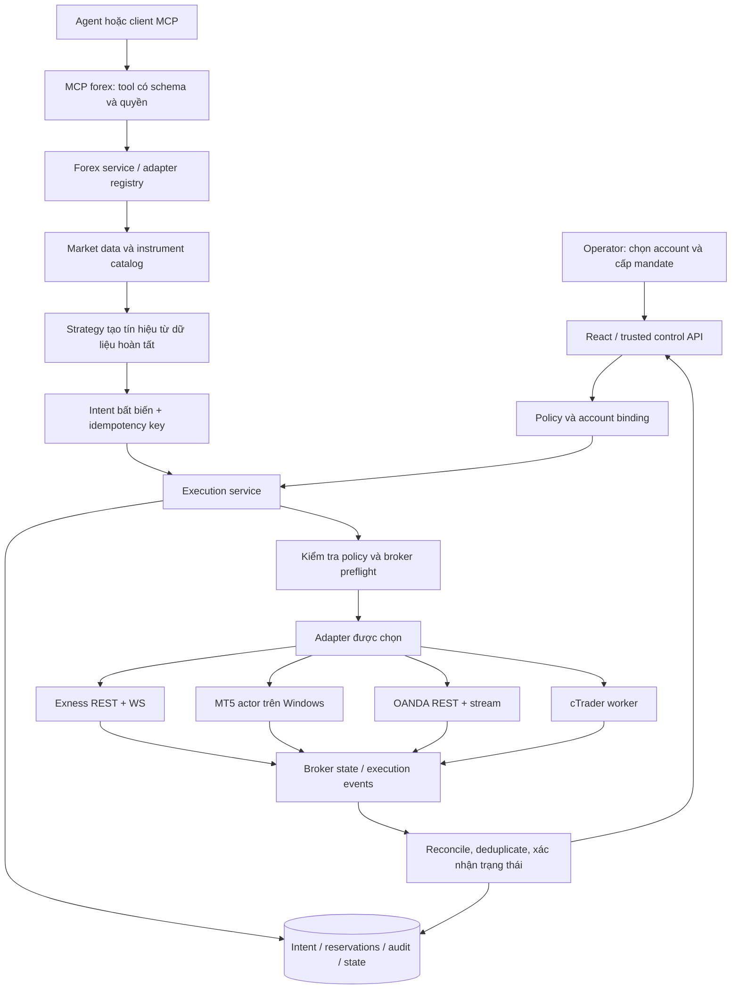
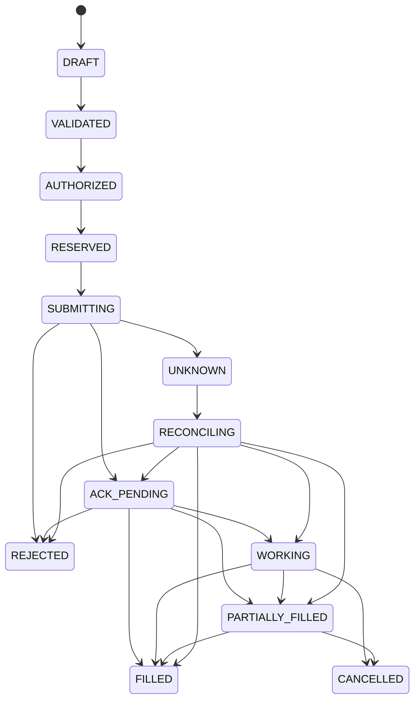

# Nghiên cứu tích hợp Exness và nhiều broker forex qua MCP

Ngày kiểm tra: **02/11/2026**, múi giờ Asia/Saigon. Mã nguồn được đọc tại `D:\Vibe-Trading-0.1.18`, phiên bản khai báo `vibe-trading-ai 0.1.18`.

**Trạng thái bản nghiên cứu ngày 02/11: thiết kế đề xuất. Cập nhật ngày 03/11/2026: đã có module Forex cho MT5, Exness API, OANDA, trang `/forex`, MCP stdio, SMA runner; bổ sung auto-attach phiên MT5, AI phân tích và mở/đóng vị thế MT5 Demo Hedge.** Xem [mã đã tích hợp, luồng xử lý và hướng dẫn chạy](FOREX_MCP_IMPLEMENTATION.md) để biết khả năng thực tế và các phần còn thiếu. Code/đường dẫn đề xuất bên dưới vẫn là tài liệu nghiên cứu. Đợt nghiên cứu ban đầu không đăng nhập broker; đợt bổ sung đã attach phiên Exness Demo có sẵn và kiểm tra dữ liệu/model thật theo yêu cầu operator. Không tạo API key, không gửi broker order; terminal ở lần kiểm tra đó đang chặn thực thi. Bản thư mục không có `.git`, vì vậy không có commit SHA cục bộ để gắn vào kết luận.

## Cập nhật đối chiếu ngày 04/11/2026

Từ mục 1 trở xuống là **khảo sát và thiết kế gốc ngày 02/11**, gồm các câu “chưa có adapter/runner” theo trạng thái lúc đó. Không dùng các câu này như ma trận tính năng hiện tại. Source mới có `agent/src/trading/forex/adapters/{mt5,exness,oanda}.py`, journal/risk/policy và MCP riêng; connector MT5/loader lịch sử cũ vẫn tồn tại với trách nhiệm khác. Nguồn sự thật về cách dùng là [Forex MCP implementation](FOREX_MCP_IMPLEMENTATION.md).

| Nội dung cần đọc theo trạng thái hiện tại | Kết luận từ source ngày 04/11 |
| --- | --- |
| Exness API và OANDA | Đã có adapter; sự tồn tại của adapter không chứng minh account có quyền API hoặc order đã fill |
| Native MT5 chart/research | Chart polling có bar 0; research/runner lấy nến đóng từ vị trí 1; exact connection và symbol không fallback public |
| Nhiều role AI | Đã có council sáu role chỉ đọc và forecast có điều kiện; riêng AI Demo runner có quyền execution khi operator bật |
| Thời gian thực | Chưa có persistent tick/transaction stream service cùng recorder/replay; OANDA source hiện REST; Exness WS quote chưa là daemon liên tục |
| Strategy Registry | Đã có SDM/StrategyDiscovery dùng chung; mở rộng evidence/contract Forex trên nền này |
| Runtime và thực thi | Bằng chứng Demo đọc/model là của ngày 03/11; đợt 04/11 không kiểm tra lại terminal, credentials, model hoặc broker order |

Thiết kế mới được hệ thống hóa tại [Forex & XAUUSD Lab](FOREX_XAUUSD_LAB.md): contract/sizing, event time, deterministic strategy, news, walk-forward/OOS, paper/demo/live và tiêu chí nghiệm thu. [Kiến trúc đa thị trường](MULTI_MARKET_ARCHITECTURE.md) và [hợp đồng bằng chứng](DATA_EVIDENCE_CONTRACTS.md) là phạm vi mở rộng; tài liệu không tự tạo thêm chức năng phần mềm.

## 1. Kết luận cần nắm trước khi triển khai

1. **Exness hiện có Trading API chính thức.** Help Center liên kết trực tiếp tới `www.exness-api.com`. API cung cấp REST và WebSocket; quyền truy cập phụ thuộc tài khoản Exness được hỗ trợ và bước xác minh. Tài liệu phân biệt tài khoản nền tảng Exness với tài khoản MetaTrader thông thường, nên không thể dùng mọi số tài khoản MT5 để gọi API này. Phải kiểm tra quyền API trong Personal Area của chính tài khoản. [Exness Help Center](https://get.exness.help/hc/en-us/articles/27866287512476-Exness-API), [Trading prerequisites](https://www.exness-api.com/trading/get-started).
2. **Với tài khoản Exness MT5, đường tích hợp thực tế là Python → terminal MT5 → server broker.** Dự án đã có connector và loader MT5; nên mở rộng phần này, thay vì viết lại cầu nối chỉ mang tên Exness. Cùng adapter có thể phục vụ tài khoản MT5 của broker khác sau khi kiểm tra server, symbol và contract specification của tài khoản. [MetaQuotes Python integration](https://www.mql5.com/en/docs/python_metatrader5).
3. **MCP là giao thức giữa ứng dụng AI và công cụ, không thay thế API giao dịch của broker.** Bên dưới MCP vẫn phải có adapter Exness, MT5, OANDA hoặc cTrader. Không có căn cứ để gọi API broker nêu trong tài liệu này là “MCP chính thức của Exness”.
4. **MCP xuất ra của Vibe-Trading hiện chỉ có thao tác đọc/nghiên cứu đối với giao dịch broker.** `trading_place_order` và `trading_cancel_order` không được công bố qua `agent/mcp_server.py`. Agent nội bộ có đường đặt lệnh khác đi qua `trading/service.py` và live gate.
5. **Có connector đặt lệnh chưa đồng nghĩa đã có hệ thống tự động trade MT5.** Runner hiện chọn profile `remote_mcp`; MT5 là `broker_sdk`. Exness API lại trả ACK trước kết quả cuối, không tương thích trực tiếp với quy ước `status=ok` của live SDK gate hiện tại.
6. **Thiết kế đề xuất:** giữ MCP nghiên cứu hiện có; bổ sung một MCP forex riêng và một dịch vụ thực thi dùng chung. Mặc định chỉ đọc. Chế độ tự động hoạt động sau khi operator cấp mandate ràng buộc đúng tài khoản, chiến lược, giới hạn và thời hạn; mỗi lệnh vẫn phải được kiểm tra bằng code xác định.

Đây là kết luận kỹ thuật, không phải đánh giá lợi nhuận của một chiến lược. Việc tài liệu API tồn tại chưa chứng minh tài khoản của người dùng đã được cấp quyền hoặc lệnh đã chạy thành công.

## 2. Kiến trúc hiện có: bằng chứng từ mã nguồn

Đường dẫn bên dưới tính từ thư mục gốc dự án. Các kết luận trong bảng là đọc source; không phải kết quả kiểm thử broker thực tế.

| Thành phần có sẵn | File / điểm nối | Khả năng và giới hạn đã thấy |
|---|---|---|
| MCP cung cấp cho client ngoài | `agent/mcp_server.py` | FastMCP; stdio, Streamable HTTP, SSE cũ; có `trading_check/account/positions/orders/quote/history`. Không xuất tool đặt/hủy lệnh. |
| MCP client kết nối server ngoài | `agent/src/tools/mcp.py` | `MCPServerAdapter`; khác vai trò với MCP server phía trên. Không cần thêm MCP bên ngoài để gọi SDK MT5 cục bộ. |
| Hạ tầng tool nội bộ | `agent/src/agent/tools.py` | `BaseTool`, `ToolRegistry`; đây là file thực tế, không phải `src/tools/registry.py`. |
| Tool giao dịch của agent | `agent/src/tools/trading_connector_tool.py` | Có đọc dữ liệu, `trading_place_order`, `trading_cancel_order`; chuyển tiếp vào service. |
| Router connector | `agent/src/trading/service.py` | `_SDK_MODULES` có `mt5`; `place_order()` từ khoảng dòng 698 chặn profile readonly, demo gọi SDK, live đi qua `execute_live_order()`. |
| Registry profile | `agent/src/trading/profiles.py`, `types.py` | `TradingProfile`: connector, environment, transport, capabilities, readonly, config. Mặc định profile toàn cục là IBKR paper, không phải MT5. |
| Connection instance và secrets | `agent/src/trading/connections.py`, `credentials.py` | Instance `connection_id`, credential reference và OS keyring. API tạo connection hiện dành cho profile đọc; không tự biến instance này thành quyền trade. |
| API kết nối | `agent/src/api/connection_routes.py` | `/api/connections`; có kiểm tra quyền cấu hình. Cần bổ sung binding thực thi, không bỏ readonly để mở trade hàng loạt. |
| MT5 facade | `agent/src/trading/connectors/mt5/sdk.py` | Re-export config, account, quote, bars, orders, place/cancel/close và hàm định giá notional. |
| Phiên MT5 | `agent/src/trading/connectors/mt5/_client.py` | Có `_MT5_LOCK`, attach/detach, kiểm tra login và `trade_mode` mỗi phiên account. Config cũ lưu ở runtime root `mt5.json`. |
| Profile MT5 | `agent/src/trading/connectors/mt5/profiles.py` | `mt5-paper-sdk`, `mt5-live-sdk-readonly`, `mt5-paper-trade`, `mt5-live-trade`. `paper` của connector là **tài khoản demo broker**, khác bộ giả lập paper nội bộ. |
| Dữ liệu MT5 | `agent/src/trading/connectors/mt5/reads.py` | Quote bid/ask, account/positions/orders, symbol search, bars; bars hiện lấy từ vị trí 0 nên có thể chứa nến đang hình thành. |
| Lệnh MT5 | `agent/src/trading/connectors/mt5/orders.py` | Market/limit; quantity tính bằng lot; kiểm tra volume/notional, `order_check`, `order_send`, xử lý partial fill. `place_order()` hiện chưa nhận SL/TP. |
| Phân loại MT5 | `agent/src/trading/connectors/mt5/symbols.py`, `classification.py` | Phân biệt forex/CFD theo symbol; operation chưa biết được coi là ghi. Không suy mọi symbol 6 ký tự là cùng loại hợp đồng. |
| Loader nghiên cứu/backtest | `agent/backtest/loaders/mt5_loader.py`, `agent/src/market_data.py` | Có forex routing MT5 và fallback dữ liệu. Loader có session/cache riêng, không dùng `_MT5_LOCK` của connector. |
| Kiểm soát live | `agent/src/live/sdk_order_gate.py`, `enforcement.py` | Mandate, expiry, halt, notional, positions, exposure, leverage, daily count, audit. Kết quả SDK phải `status=ok` mới được tính là thành công. |
| Sổ lệnh chưa rõ kết quả | `agent/src/live/pending_action.py` | Có nền tảng recovery, nhưng các nhánh durable recovery trong SDK gate đang có điều kiện riêng `broker == "alpaca"`. Chưa thể mặc định áp dụng cho MT5/Exness. |
| Consent và điều khiển | `agent/src/api/live_routes.py` | Có `/mandate/commit`, `/live/halt`, `/live/resume`, `/live/status`, `/live/runner/start`, `/live/runner/stop`. Commit/start là hành động operator, không phải tool cho agent tự cấp quyền. |
| Runner | `agent/src/live/runtime/runner.py`, `scheduler.py`, `reconcile.py`, `triggers.py` | Có vòng halt → expiry → reconcile → quyết định → audit. `service.profile_supports_live_runner()` khoảng dòng 1271 hiện yêu cầu `remote_mcp`. |
| Desktop | `desktop/electron/src/backend-manager.ts`, `main.ts`, `secure-credentials.ts` | Host khởi động backend, quản lý vòng đời, token nội bộ và secrets của desktop. Không đặt domain logic forex vào Electron main. |
| Dependencies MT5 | `pyproject.toml`, extra `mt5` | `MetaTrader5>=5.0.45` chỉ trên Windows. Cài base package không bảo đảm đã có extra này. |

### 2.1. Các khoảng trống phải giải quyết

- Hai nơi quản lý MT5 session có thể tác động cùng trạng thái SDK process-global. Đây là **rủi ro suy ra từ source**, chưa tái hiện race trong đợt này. Với nhiều tài khoản phải đưa cả loader lẫn trading qua một actor sở hữu terminal/account.
- Một khóa Python trong một process không bảo vệ được nhiều process, nhiều MCP client hoặc terminal bị người dùng đổi account. Phải pin cả terminal, login, server và môi trường; kiểm tra lại sát lúc thực thi.
- `get_historical_bars()` dùng `copy_rates_from_pos(..., 0, ...)`; runner phải lọc nến chưa đóng trước khi tạo tín hiệu. Không dùng cây nến số 0 như dữ liệu hoàn tất.
- `place_order()` MT5 chưa có tham số SL/TP; cần bổ sung cùng thao tác sửa stops, kiểm tra `trade_stops_level`, freeze level và khả năng broker chấp nhận protection trong lệnh mở.
- Connector có `close_position()`, nhưng `service.close_position()` hiện là nhánh eToro. MT5 đang dùng `cancel_order()` để phân giải pending ticket hoặc position ticket. API mới phải tách hai khái niệm rõ ràng.
- `_order_result()` MT5 nhận DONE/DONE_PARTIAL; cần kiểm tra và biểu diễn PLACED của pending order thành trạng thái đã chấp nhận nếu broker trả retcode đó. Không coi pending được chấp nhận là đã khớp.
- Mandate/counter/halt/runner hiện có nhiều chỗ khóa theo tên broker. Nhiều account MT5 không thể dùng mỗi khóa `mt5` làm danh tính thực thi. Schema mandate đã có `consent.account_ref`, nhưng phải thực thi binding xuyên suốt mọi đường ghi.
- Không đưa ACK `accepted` của Exness vào `status=ok` rồi tăng bộ đếm “đã khớp”. Phải có trạng thái pending, reservation và reconciliation.
- Không cho MCP tool nhận password, private key, tùy ý chọn URL, lệnh shell hoặc tự sửa mandate. MCP annotations chỉ mô tả công cụ; quyền thật phải được kiểm tra phía server.

### 2.2. Cấu trúc đang có

```text
Vibe-Trading-0.1.18/
├── pyproject.toml
├── agent/
│   ├── api_server.py
│   ├── mcp_server.py
│   ├── cli/
│   ├── src/
│   │   ├── agent/tools.py
│   │   ├── tools/{mcp.py,trading_connector_tool.py}
│   │   ├── trading/
│   │   │   ├── service.py,profiles.py,types.py
│   │   │   ├── connections.py,credentials.py,onboarding.py
│   │   │   └── connectors/
│   │   │       ├── mt5/{sdk.py,_client.py,reads.py,orders.py,...}
│   │   │       ├── ibkr/,robinhood/,alpaca/,etoro/,...
│   │   ├── live/
│   │   │   ├── sdk_order_gate.py,enforcement.py,audit.py,halt.py
│   │   │   ├── mandate/,pending_action.py,daily_count.py
│   │   │   └── runtime/{runner.py,scheduler.py,reconcile.py,...}
│   │   └── api/{connection_routes.py,live_routes.py,...}
│   ├── backtest/loaders/{mt5_loader.py,registry.py,...}
│   └── tests/
├── frontend/src/{pages,components,lib}
└── desktop/electron/src/
```

## 3. Kết nối broker bằng đường nào?

Các tên broker dưới đây là mục tiêu tích hợp. Cột “đã có” chỉ mô tả adapter trong repository, không chứng nhận account đã kết nối. Availability và instrument phụ thuộc pháp nhân, khu vực và loại tài khoản của từng broker.

| Broker / nhóm tài khoản | Adapter đề xuất | Lấy dữ liệu | Tự động giao dịch | Hiện trạng |
|---|---|---|---|---|
| Exness, tài khoản Exness hỗ trợ API | `exness_api` | REST candles, WS ticks/account/events | REST có chữ ký, theo dõi kết quả bất đồng bộ | Chưa có adapter trong repo; API chính thức đã xác minh. |
| Exness MT5 | `mt5` | Terminal SDK | Terminal SDK | Có source đọc/ghi và live gate; thiếu runner SDK và các bổ sung ở §2.1. |
| IC Markets MT5 | `mt5` | Terminal của account | Cùng SDK, contract riêng | Có thể tái sử dụng kiến trúc; chưa kiểm thử account IC Markets. |
| Pepperstone MT5 / cTrader | `mt5` hoặc `ctrader` | SDK terminal hoặc Open API | Theo đúng nền tảng của account | MT5 có source; cTrader chưa có adapter. |
| FxPro MT5 / cTrader | `mt5` hoặc `ctrader` | SDK terminal hoặc Open API | Theo đúng nền tảng của account | Tương tự; không chuyển account MT5 sang cTrader chỉ bằng đổi server. |
| OANDA v20 | `oanda` | REST và HTTP streaming | REST order/trade API | Cần account v20 và token có quyền; chưa có adapter. |
| FXCM Trading Station | `fxcm` | ForexConnect SDK | ForexConnect SDK | Hướng mở rộng sau; cần kiểm tra binary/runtime của SDK và điều kiện truy cập. |
| IG | `ig` | REST và streaming theo IG | REST dealing API | Hướng mở rộng sau; API key và session/account token; chưa có adapter. |

Nguồn nền tảng: [IC Markets account guide](https://cdn.icmarkets.com/uploads/AU/New_TradingView_UserGuide_EN.pdf), [Pepperstone account platforms](https://pepperstone.com/en-gb/trading/trading-accounts), [FxPro platform comparison](https://www.fxpro.com/trading-platforms/comparison), [OANDA v20](https://developer.oanda.com/rest-live-v20/introduction/), [FXCM ForexConnect](https://github.com/fxcm/ForexConnectAPI), [IG REST guide](https://labs.ig.com/rest-trading-api-guide.html).

**Ưu tiên:** hoàn thiện MT5 demo cho account đang dùng → Exness API nếu account đủ quyền → OANDA practice → cTrader demo. FXCM/IG là adapter sau cùng, không bắt buộc hoàn thành để nghiệm thu Exness/MT5.

MT4 là dự án bridge riêng bằng EA MQL4 hoặc dịch vụ trung gian, không được hỗ trợ bởi package `MetaTrader5`. Không đưa một repo MT4/MT5 bất kỳ vào runtime rồi mặc định tin rằng lệnh đã được kiểm soát như live gate của Vibe-Trading.

## 4. Nghiên cứu GitHub: dùng gì và không dùng gì làm nền tảng?

Đã tra README, API metadata và một số file source. SHA bên dưới lấy từ GitHub ngày nghiên cứu; không đồng nghĩa code đã được chạy, audit toàn bộ hoặc kiểm thử tài khoản thực. Công cụ connector GitHub của phiên làm việc trả `Unknown tool`; nghiên cứu tiếp tục bằng web, raw source và GitHub REST đọc công khai.

| Repository | Revision đã xem | Phạm vi sử dụng đề xuất |
|---|---|---|
| [spotware/OpenApiPy](https://github.com/spotware/OpenApiPy/tree/e944996e6fe9436b8b4a1b668da4ac41a826bb85) | `e944996e6fe9436b8b4a1b668da4ac41a826bb85`, MIT | SDK Python do Spotware duy trì. Source `ctrader_open_api/client.py` dùng Twisted/Deferred; nên cô lập worker thay vì chạy reactor tự phát trong event loop FastAPI. |
| [oanda/v20-python](https://github.com/oanda/v20-python/tree/f28192f4a31bce038cf6dfa302f5878bec192fe5) | `f28192f4a31bce038cf6dfa302f5878bec192fe5`, MIT | Bindings của OANDA; tham khảo request/response cùng API docs. Cần kiểm tra tương thích Python hiện tại; adapter HTTPX mỏng là lựa chọn phù hợp dependency đã có. |
| [fxcm/ForexConnectAPI](https://github.com/fxcm/ForexConnectAPI/tree/c401f790f6f9434ed83d897250cf94b7d23d0d4d) | `c401f790f6f9434ed83d897250cf94b7d23d0d4d` | Repo của FXCM, có tài liệu và SDK samples. GitHub metadata chưa xác định SPDX; đọc EULA/license gói trước khi phân phối. |
| [exness-pymt5/metatrader5](https://github.com/exness-pymt5/metatrader5/tree/09b86887c3af49328f0ead755a793b1a5acfea94) | `09b86887c3af49328f0ead755a793b1a5acfea94` | Có ví dụ MT5/strategy. Không có đủ bằng chứng để coi namespace này là SDK Trading API chính thức hiện hành; không thay thế tài liệu Exness được Help Center liên kết. Metadata license chưa xác định. |
| [CodeWithBehnam/meta-trader-5-mcp](https://github.com/CodeWithBehnam/meta-trader-5-mcp/tree/b280d4d674d5c17d1dd00665709f3d65be207333) | `b280d4d674d5c17d1dd00665709f3d65be207333`, MIT | Repo cộng đồng, chủ yếu cho macOS/Wine. Đã đọc `execute.py`, `server.py`, `orders.py`: có pattern audit intent trước send và kết quả unknown khi mất kết nối. Tham khảo thiết kế, không thay connector Windows hiện có. |
| [ariadng/metatrader-mcp-server](https://github.com/ariadng/metatrader-mcp-server/tree/bd2ff591e32cb492fafefe74221d502dd78b71ef) | `bd2ff591e32cb492fafefe74221d502dd78b71ef`, MIT | `docs/README.md` tại revision này tự ghi MCP balance còn dùng dữ liệu ngẫu nhiên. Không lấy tên repo hoặc quảng cáo “automated trading” làm bằng chứng hệ thống đã trade thật. |
| [modelcontextprotocol/python-sdk](https://github.com/modelcontextprotocol/python-sdk) | Tài liệu hiện hành, không pin để cài trong đợt này | Chuẩn client/server MCP. Repo Vibe-Trading đang dùng thư viện `fastmcp`; không đổi sang import SDK khác chỉ vì ví dụ bên ngoài dùng một phiên bản khác. |

Kết quả lựa chọn kiến trúc: tái sử dụng connector/gate hiện có, viết adapter mỏng từ API chính thức, chỉ học các pattern có ích từ repo cộng đồng. Không cài hoặc chạy các repo cộng đồng trong đợt nghiên cứu.

## 5. Nguyên lý hoạt động của phần tích hợp

### 5.1. Ba lớp độc lập

- **MCP:** công bố schema tool, nhận yêu cầu có danh tính/quyền, trả kết quả có cấu trúc.
- **Trading service:** resolve account, instrument, policy, intent, reservation, trạng thái lệnh và audit; đây là nơi quyết định có được gửi lệnh hay không.
- **Broker adapter:** chuyển yêu cầu đã được duyệt sang REST/WebSocket/terminal SDK và chuẩn hóa dữ liệu trả về.

Một external MCP server có tool `place_order` không được phép bỏ qua Trading service của Vibe-Trading. Host UI và agent chỉ thấy `connection_id`, `intent_id`, trạng thái và thông tin đã che secrets.



### 5.2. Chế độ quyền

| Mode | Agent/MCP được làm gì? | Ai cấp quyền? |
|---|---|---|
| `readonly` | Quote, bars, instruments, account, positions, history | Operator chọn connection đọc. Không đăng ký tool ghi vào `tools/list`. |
| `supervised-demo` | Tạo intent demo, xem preview; gửi sau phê duyệt demo | Operator phê duyệt đúng intent/hash. |
| `autonomous-demo` | Strategy/agent gửi intent hợp lệ trong mandate demo | Operator cấp mandate demo và start runner; kiểm tra account demo thật tại broker. |
| `supervised-live` | Tạo intent; phê duyệt từng lệnh từ trusted UI | Operator phê duyệt đúng account, payload, expiry. |
| `autonomous-live` | Runner thực thi trong mandate còn hiệu lực | Operator cấp mandate có giới hạn; không cần hỏi lại từng lệnh nằm trong phạm vi. |

Agent không có tool commit mandate, start runner, resume sau halt, bật live, chọn secret hoặc tự gia hạn consent. Một tool được mô tả `readOnlyHint=true` vẫn cần authorization thật. Thiết kế MCP dựa trên stdio hoặc Streamable HTTP; stdio phải giữ stdout chỉ cho thông điệp MCP, log đi stderr. [MCP transports](https://modelcontextprotocol.io/specification/2025-11-25/basic/transports).

### 5.3. Nhiều account và nhiều broker

Đơn vị định danh đề xuất:

```text
ConnectionKey = (connection_id, connector, account_ref, environment)
InstrumentKey = (connection_id, account_ref, native_symbol_or_id)
ExecutionKey  = (connection_id, account_ref, idempotency_key)
StrategyKey   = (strategy_id, strategy_revision, connection_id, account_ref)
```

Không sử dụng “account mặc định đầu tiên” cho ghi lệnh. Đổi tài khoản, server hoặc môi trường phải tạo binding mới và làm mất hiệu lực quyền cũ. Các khóa `(broker)` hiện có phải được nâng cấp có migration; trong giai đoạn chuyển tiếp, khóa global/broker vẫn có thể chặn mọi account của broker.

## 6. Luồng xử lý từ kết nối đến tự động trade

### 6.1. Onboarding

1. Operator chọn connector và loại tài khoản: Exness API, MT5, OANDA hoặc cTrader.
2. Lưu metadata connection; secrets vào OS vault, không đưa vào tool arguments. Với Exness private key, chuẩn hóa định dạng khóa trong backend.
3. Kết nối **đọc**: xác nhận account thực tế, demo/live, server/host, currency, permission và trade mode.
4. Nạp catalog symbol/instrument: không giả định `EURUSD`, `EURUSDm`, `EUR_USD` hay numeric `symbolId` tương đương hoàn toàn.
5. Nạp trading sessions, volume min/max/step, precision, contract size, commission/swap, margin mode và rate limits.
6. Hiện trạng thái `ready_readonly`, `missing_permission`, `account_mismatch` hoặc `unavailable`; chưa có quyền trade chỉ vì quote đọc được.
7. Chạy chiến lược bằng replay/paper nội bộ hoặc demo broker; hai loại kết quả phải có nhãn riêng.
8. Operator cấp mandate và start runner cho một `ConnectionKey`. Reconcile phải thành công trước khi bắt đầu tạo exposure mới.

### 6.2. Luồng đọc dữ liệu

```mermaid
sequenceDiagram
    participant Client as MCP / UI
    participant Service as Forex service
    participant Actor as Adapter / account actor
    participant Broker as Broker
    Client->>Service: get_quote(connection_id, symbol)
    Service->>Service: Kiểm tra principal, binding và catalog
    Service->>Actor: Read với native instrument đã resolve
    Actor->>Broker: SDK / REST / stream cache
    Broker-->>Actor: bid, ask, timestamp, trạng thái
    Actor-->>Service: Snapshot + source + received_at
    Service->>Service: Kiểm tra stale / permission / provenance
    Service-->>Client: Dữ liệu hoặc lỗi có nguyên nhân
```

Dữ liệu nghiên cứu có thể fallback nếu ghi rõ nguồn. Dữ liệu định giá để thực thi, margin và spread phải đến từ đúng broker/account; **không âm thầm lấy Yahoo thay quote Exness để quyết định lệnh**. Cache phải chứa source, account, instrument, interval, bid/ask/mid và thời điểm nhận. `tick_volume` của forex không được trình bày như khối lượng giao dịch toàn thị trường.

### 6.3. Luồng thực thi

1. Runner nhận sự kiện nến đã đóng hoặc timer. Khóa quyết định theo `StrategyKey + bar_close_time` để tránh mỗi lần restart lại mở cùng tín hiệu.
2. Nạp quote, account, positions, pending orders và catalog từ cùng connection; xác minh freshness và account identity.
3. Strategy tạo tín hiệu hoặc không giao dịch. LLM có thể phân tích/tạo đề xuất ở ngoài vòng gửi lệnh; không dùng LLM để xác định số lot cuối cùng hay diễn giải retcode.
4. Tạo intent bất biến: account, instrument, side, đơn vị khối lượng, stops, strategy revision, expiry và idempotency key. Hash payload phải bao gồm toàn bộ trường ảnh hưởng giao dịch.
5. Preview tính risk, margin, spread và trạng thái mandate. Với supervised mode, operator duyệt đúng hash. Với autonomous mode, mandate hợp lệ là quyền giới hạn đã cấp trước.
6. Bắt đầu transaction ngắn trong DB: kiểm tra chưa submit, cấp execution lease/fencing token, kiểm tra policy hiện hành và **giữ chỗ risk/counter cho cả lệnh đang chờ**. Commit trước khi gửi.
7. Account actor kiểm tra lại login/server/environment, halt generation, lease, quote và expiry ngay trước send; chạy broker preflight khi có, ví dụ MT5 `order_check`. Bước preview trước đó không bảo đảm send sẽ thành công.
8. Ghi attempt durable rồi gửi đúng một lần. Không giữ DB transaction qua toàn bộ network request; giữ single-writer actor/lease và reservation.
9. ACK, pending, partial, filled, rejected hoặc unknown là các kết quả khác nhau. Persist identifiers rồi cập nhật bằng execution event, poll hoặc broker history.
10. Reconcile account state, ghi fill/fee/swap thực, giải phóng hoặc chuyển reservation sang exposure thực tế. Push trạng thái về UI và audit.

**Halt semantics:** đóng admission cho lệnh tăng rủi ro và đánh dấu generation mới. Lệnh đã đi vào broker có thể vẫn khớp; ghi nhận, reconcile rồi thực hiện cancel/close theo quyền operator. Không hứa halt có thể thu hồi một packet đã gửi.

### 6.4. State machine đề xuất



Intent có thể hết hạn/bị từ chối trước send. Reconcile không đủ bằng chứng thì giữ `UNKNOWN` và chặn exposure mới theo policy, không tự chuyển thành failed để gửi lệnh mới. `PARTIALLY_FILLED → CANCELLED` vẫn phải giữ khối lượng đã khớp. Không tự bù phần còn lại nếu chưa có intent mới và risk check mới.

## 7. Dữ liệu, định lượng và nguyên tắc tính risk

### 7.1. Canonical model

| Đối tượng | Trường bắt buộc nên có |
|---|---|
| Connection | ID, connector, account_ref, environment, credential_ref, allowed hosts/terminal pin, capabilities, readiness. |
| Instrument | Canonical pair, native ID/name, loại hợp đồng, base/quote/profit/margin currency, digits, point, tick size/value, contract size, volume unit/min/max/step, sessions. |
| Quote | Bid/ask, broker timestamp, received UTC, monotonic receive time, source, account_ref, freshness; `last` chỉ khi có ý nghĩa. |
| Candle | Open/close UTC, timeframe, giá bid/ask/mid, `is_complete`, source, native instrument và semantics của volume. |
| OrderIntent | Connection/account/env, symbol ID, side, order type, quantity **kèm đơn vị**, limit/stops, strategy revision, payload hash, idempotency key, expires_at. |
| Execution | Intent/attempt ID, broker operation/order/deal/position IDs, state, filled/remaining quantity, fill price, commission, swap, event timestamp. |

ID account/order/deal dạng uint64 từ broker nên được truyền qua JSON bằng string để tránh mất chính xác trong JavaScript. Exness money/volume/trading-price dùng decimal string; tick/candle trong YAML hiện hành là JSON number. Chuẩn hóa bằng `Decimal(str(value))`, không gọi `Decimal(float)` trực tiếp.

### 7.2. Lot, unit, pip và point

- MT5 `volume` là lot; contract size lấy từ `symbol_info`, không hardcode mọi sản phẩm đều 100.000.
- OANDA `units` là số đơn vị instrument, có dấu theo chiều giao dịch; không gửi `0.01` lot trực tiếp vào units.
- cTrader protocol biểu diễn volume theo 1/100 đơn vị; phải chuyển theo catalog và giới hạn symbol. Numeric symbol ID thuộc account/server context.
- Exness `volume` phải tuân theo contract/instrument conditions. Không mặc định volume của API Exness và lot của một account MT5 có cùng hệ số.
- MT5 deviation tính bằng **points**, không phải mặc định pips. XAUUSD, JPY và các CFD có tick/pip conventions khác nhau.

Nguồn: [MT5 order_send](https://www.mql5.com/en/docs/python_metatrader5/mt5ordersend_py), [OANDA order API](https://developer.oanda.com/rest-live-v20/order-ep/), [cTrader model messages](https://help.ctrader.com/open-api/model-messages/), [Exness instrument schema](https://www.exness-api.com/openapi/trading.public.yaml).

### 7.3. Sizing và các điều kiện chặn

Cách tính đề xuất: lấy ngân sách rủi ro theo mandate → ước lượng mức lỗ tại stop bằng công thức broker/`order_calc_profit` → quy đổi currency → cộng chi phí dự kiến → làm tròn volume **xuống** theo step. Nếu thấp hơn minimum thì bỏ tín hiệu. Sau đó kiểm tra margin bằng API/SDK và policy dự phòng; margin không đồng nghĩa mức lỗ tối đa.

Policy tối thiểu phải kiểm tra: market/session, quote age, spread, SL distance/freeze level, exposure đã mở + pending + reservations, correlated currency exposure, account equity/free margin, leverage, daily realized/unrealized loss theo định nghĩa đã cấp, trade count/rate, và expiry. Stop loss là yêu cầu gửi broker, không bảo đảm giá khớp tuyệt đối khi gap/slippage. Mất dữ liệu FX conversion hoặc account currency thì chặn tăng exposure.

Không hardcode “forex mở 24/5” để gửi lệnh: dùng session của broker, DST, holiday, maintenance và instrument trade mode. Lệnh hủy/đóng giảm rủi ro vẫn cần đúng tài khoản, quyền, position ticket và audit; không được biến lệnh bán đối ứng trên tài khoản hedging thành hành vi “close” giả.

## 8. API bên ngoài: hợp đồng kết nối cụ thể

### 8.1. Exness Trading API

Tài liệu chính thức đã kiểm tra:

- [API Key & Host Setup](https://www.exness-api.com/authentication/api-key-and-host-setup).
- [Request signing](https://www.exness-api.com/authentication/request-signing).
- [Access Point discovery](https://www.exness-api.com/trading/get-started/access-point-host-discovery).
- [Trading OpenAPI YAML](https://www.exness-api.com/openapi/trading.public.yaml).

Bản YAML tải ngày 02/11/2026 khai báo **1.0.2**, SHA-256:

```text
ebde19011ffbd30240e918f9369c8233fc9c5a4afb27eca0462b40a141d0f1b3
```

Đây là dấu nhận diện nội dung đã nghiên cứu, không phải hash của package cài đặt. Khi triển khai phải so sánh lại contract và lưu revision đã kiểm thử. Tài liệu hướng dẫn và YAML có thể cập nhật không đồng thời; ưu tiên schema cho tên trường/enum, hướng dẫn cho trình tự kết nối, và xác minh lại những điểm không thống nhất.

**Khởi tạo kết nối:** API key identifier + khóa ký Ed25519 → lấy Gateway từ DNS widget trong Key Management → gọi discovery có chữ ký → cache `access_point` đúng account → đọc account, instruments, limits → mở stream. Không hardcode `api.exness.com`, không lấy host ví dụ làm fallback và không coi Gateway là Access Point. [Host discovery](https://www.exness-api.com/trading/get-started/access-point-host-discovery).

| Chức năng | Method / path chính thức |
|---|---|
| Tìm Access Point | `GET /v1/trading/access-point?account_id={account_id}` tại Gateway; được mô tả trong guide riêng. |
| Account configuration | `GET /v1/configuration/accounts/{account_id}/account` |
| Danh sách instruments | `GET /v1/configuration/accounts/{account_id}/instruments` |
| Contract/trading conditions | `GET /v1/configuration/accounts/{account_id}/instruments/{instrument}/conditions` |
| API limits | `GET /v1/configuration/accounts/{account_id}/limits` |
| Lịch sử candles | `GET /v1/market-data/accounts/{account_id}/candles` |
| Current orders/positions/account | `GET /v1/trading/accounts/{account_id}/snapshot` |
| Mở vị thế market | `POST /v1/trading/accounts/{account_id}/positions` |
| Đóng/đóng một phần vị thế | `DELETE /v1/trading/accounts/{account_id}/positions/{position_id}`, volume tùy chọn trong query. |
| Tạo pending/SLTP order | `POST /v1/trading/accounts/{account_id}/orders` |
| Sửa pending/SLTP order | `PATCH /v1/trading/accounts/{account_id}/orders/{order_id}` |
| Hủy pending/SLTP order | `DELETE /v1/trading/accounts/{account_id}/orders/{order_id}` |
| Kết quả operation | `GET /v1/trading/accounts/{account_id}/operations/{operation_id}` |
| Lịch sử orders | `GET /v1/history/accounts/{account_id}/orders` |
| Lịch sử deals | `GET /v1/history/accounts/{account_id}/deals` |
| Tick stream | WebSocket `/v1/server-events/accounts/{account_id}/ws/ticks` |
| Transaction/account/instrument/HMR stream | WebSocket `/v1/server-events/accounts/{account_id}/ws/events` |

Nguồn đường dẫn: [Trading YAML](https://www.exness-api.com/openapi/trading.public.yaml). YAML mô tả WS subscription command dưới operation POST, nhưng kết nối WebSocket thực tế dùng **GET Upgrade handshake có chữ ký**, rồi gửi JSON subscription; không gọi HTTP POST thông thường để thay handshake. [WebSocket guide](https://www.exness-api.com/trading/get-started/subscribe-to-websocket-events).

**Chữ ký:** tạo body bytes một lần; hash SHA-256 chính body đó; tạo JSON metadata chứa api key, idempotency key, timestamp milliseconds, version, method, path **kèm query đúng bytes sẽ gửi**, body hash. Ký bytes JSON bằng Ed25519. `EXN-DATA` và `EXN-SIGN` là base64url không padding; không ký chuỗi base64 thay cho payload. Với GET, header idempotency vẫn phải có giá trị rỗng. Mỗi request/WS handshake cần timestamp và chữ ký mới. [Signing specification](https://www.exness-api.com/authentication/request-signing).

Ví dụ payload mở market dưới đây là **request shape**, chưa có phê duyệt hoặc network send. `volume` và stops phải được xác định từ catalog/risk service, không dùng giá minh họa này như mức giao dịch:

```json
{
  "instrument": "EURUSD",
  "side": "buy",
  "volume": "0.01",
  "stop_loss_price": "1.07000",
  "take_profit_price": "1.09000"
}
```

`OpenPositionRequest` của YAML cho phép `price` và `deviation` khi execution mode yêu cầu; `price` không áp dụng cho market execution. Schema tối thiểu bắt buộc instrument/side/volume; policy ứng dụng có thể chặt hơn, ví dụ bắt buộc stop trước khi tăng exposure.

**Kết quả bất đồng bộ:** lưu `operation_id` và `client_request_id` của ACK; chờ transaction event hoặc đọc operation status. Operation confirmed phải được đối chiếu entity/deal; chỉ pending order được tạo không có nghĩa đã fill. Khi reconnect, rebuild từ snapshot và history; stream không cung cấp replay bền vững. Operation status được lưu 24 giờ theo guide; không suy ra idempotency record cũng có cùng thời hạn. [First trade](https://www.exness-api.com/trading/get-started/place-first-trade), [Runtime semantics](https://www.exness-api.com/trading/guides/runtime-semantics).

**Throttling:** đọc limits sau discovery, đếm request cục bộ, áp dụng backoff và `Retry-After` khi phù hợp. Limits là cấu hình, không phải remaining quota. Thiếu field không có nghĩa unlimited. Candle query dùng instrument/timeframe/from và chọn count hoặc to; kiểm tra giới hạn hiện hành. [API configuration and limits](https://www.exness-api.com/trading/guides/api-configuration-and-limits).

### 8.2. MT5: SDK API cho Exness và các broker dùng terminal

| Nhu cầu | SDK function | Xử lý ở service |
|---|---|---|
| Kết nối, đọc identity | `initialize`, `account_info`, `terminal_info` | Pin path/login/server/môi trường; kiểm tra terminal connected và quyền trade. |
| Symbol catalog | `symbols_get`, `symbol_info` | Resolve native symbol chính xác; ambiguity thì yêu cầu chọn. |
| Quote/tick | `symbol_info_tick`, `copy_ticks_range` | UTC timestamps, stale guard, giới hạn số dòng. |
| Bars | `copy_rates_range`, `copy_rates_from_pos` | Chỉ nến đóng cho signal; phân biệt tick/real volume. |
| State | `positions_get`, `orders_get` | Phân biệt exposure với resting instruction. |
| Ước lượng | `order_calc_profit`, `order_calc_margin`, `order_check` | Preflight; không phải bảo đảm fill. |
| Gửi/sửa/hủy | `order_send` + action tương ứng | Chỉ từ executor; map retcode thành trạng thái, không retry mù. |
| Reconciliation | `history_orders_get`, `history_deals_get` | Ticket/deal history, partial fill, phí và kết quả sau timeout. |

Nguồn: [MetaQuotes Python API](https://www.mql5.com/en/docs/python_metatrader5), [order_check](https://www.mql5.com/en/docs/python_metatrader5/mt5ordercheck_py), [order_send](https://www.mql5.com/en/docs/python_metatrader5/mt5ordersend_py), [rates UTC/history](https://www.mql5.com/en/docs/python_metatrader5/mt5copyratesrange_py).

Một worker MT5 sở hữu một terminal/account, một queue và SDK session. Không `login()` luân phiên account A/B giữa một chuỗi preflight/send; không để loader gọi `shutdown()` khi executor đang gửi lệnh. Worker phải có giới hạn queue, heartbeat, circuit breaker và cơ chế đánh dấu in-flight unknown nếu process bị kill. Không spawn worker khác cho cùng account khi attempt chưa reconcile.

EA không bắt buộc khi dùng Python SDK cục bộ. Nếu chọn EA bridge để chạy logic sát terminal, phải định nghĩa riêng IPC/auth/protocol và quyền. Exness xác nhận EA hoạt động trên MT4/MT5 desktop, không trên bản mobile/web. [Exness EA support](https://get.exness.help/hc/en-us/articles/360019530859-Using-Expert-Advisors-EA).

### 8.3. OANDA v20

| Nhu cầu | Endpoint |
|---|---|
| Account | `GET /v3/accounts/{accountID}/summary` |
| Instruments | `GET /v3/accounts/{accountID}/instruments` |
| Quote | `GET /v3/accounts/{accountID}/pricing?instruments=EUR_USD` |
| Bars theo account | `GET /v3/accounts/{accountID}/instruments/{instrument}/candles` |
| Price stream | `GET /v3/accounts/{accountID}/pricing/stream` tại streaming host. |
| Order | `POST /v3/accounts/{accountID}/orders` |
| Pending orders / open trades | `GET /v3/accounts/{accountID}/pendingOrders`, `GET /v3/accounts/{accountID}/openTrades` |
| Cancel / close | `PUT /v3/accounts/{accountID}/orders/{orderSpecifier}/cancel`, `PUT /v3/accounts/{accountID}/trades/{tradeSpecifier}/close` |
| Transactions/recovery | `GET /v3/accounts/{accountID}/transactions/sinceid`, `GET /v3/accounts/{accountID}/transactions/stream` |

REST practice: `https://api-fxpractice.oanda.com`; streaming practice: `https://stream-fxpractice.oanda.com`. Live dùng fxtrade hosts riêng. Auth là Bearer token; pin account và environment, không tự đổi practice sang live. Luồng stream là HTTP streaming, không phải WebSocket. [Development guide](https://developer.oanda.com/rest-live-v20/development-guide/), [pricing endpoints](https://developer.oanda.com/rest-live-v20/pricing-ep/), [order endpoints](https://developer.oanda.com/rest-live-v20/order-ep/), [transaction endpoints](https://developer.oanda.com/rest-live-v20/transaction-ep/).

Không suy `HTTP 201` đồng nghĩa fill: đọc `orderFillTransaction`, `orderCancelTransaction` và transaction IDs. Client ID dùng đối chiếu không được mặc định coi là bảo đảm idempotency giống Exness. Token cá nhân phải được bảo vệ như quyền truy cập tài khoản; profile readonly của ứng dụng không làm token broker tự trở thành read-only.

### 8.4. cTrader Open API

OAuth/app registration → app auth → account list → operator chọn account → account auth → catalog → subscribe → reconcile → trading. Không dùng account đầu tiên trong ví dụ SDK làm account mặc định production. [Authentication](https://help.ctrader.com/open-api/account-authentication/).

| Chức năng | Message |
|---|---|
| App auth | `ProtoOAApplicationAuthReq` |
| Account discovery/auth | `ProtoOAGetAccountListByAccessTokenReq`, `ProtoOAAccountAuthReq` |
| Symbols | `ProtoOASymbolsListReq`, `ProtoOASymbolByIdReq` |
| Spot/history | `ProtoOASubscribeSpotsReq`, `ProtoOAGetTrendbarsReq` |
| Order | `ProtoOANewOrderReq` |
| Cancel/close | `ProtoOACancelOrderReq`, `ProtoOAClosePositionReq` |
| Stops | `ProtoOAAmendPositionSLTPReq` |
| Result | `ProtoOAExecutionEvent`, `ProtoOAOrderErrorEvent` |
| State/recovery | `ProtoOAReconcileReq`, deal/order history messages |

Python SDK chính thức dùng TLS TCP và Twisted; tài liệu hiện nói SDK Python **không hỗ trợ WebSocket**. Nếu chọn WS phải tự hiện thực client phù hợp, không giả định OpenApiPy có sẵn. Nên chạy worker cTrader riêng; multiplex account qua connection demo/live nhưng vẫn giữ identity/authorization từng account. Có heartbeat, request queue, timeout và resubscribe. [Connection guide](https://help.ctrader.com/open-api/connection/), [message contract](https://help.ctrader.com/open-api/messages/).

Lưu ý contract: absolute `stopLoss`/`takeProfit` trên `ProtoOANewOrderReq` không hỗ trợ MARKET theo message reference; cần dùng relative protection được hỗ trợ hoặc workflow amend sau fill với policy xử lý khoảng trống protection. Không gửi field của MT5 sang cTrader nguyên xi. [New order schema](https://help.ctrader.com/open-api/messages/#protooaneworderreq).

### 8.5. FXCM và IG ở giai đoạn sau

FXCM: ưu tiên nghiên cứu ForexConnect từ repo chính thức, kiểm tra EULA, phiên bản binary, Python ABI và platform hỗ trợ trước khi chọn dependency. Không mặc định `fxcmpy` REST wrapper cũ còn là đường truy cập phù hợp cho mọi account. [FXCM ForexConnect](https://github.com/fxcm/ForexConnectAPI).

IG: `X-IG-API-KEY` cùng session/account tokens theo API version; phân biệt demo/live gateway và các version của `/session`. Tạo, sửa, đóng lệnh cần đối chiếu confirmation; streaming cần adapter riêng theo tài liệu IG. Không áp dụng auth OANDA cho IG. [IG API guide](https://labs.ig.com/rest-trading-api-guide.html).

## 9. MCP tools và HTTP API đề xuất bên trong Vibe-Trading

**Toàn bộ tên `forex_*` và route `/api/forex/*` dưới đây là đề xuất, chưa tồn tại trong ứng dụng.** Không đổi hợp đồng MCP nghiên cứu hiện tại bằng cách gắn thêm write tool vào read-only mirror.

| MCP tool đề xuất | Input chính | Quyền / tác dụng |
|---|---|---|
| `forex_connection_status` | Connection đã bind ở server | Read; trả readiness và lý do hạn chế. |
| `forex_list_instruments` | query, limit, cursor | Read; native ID và contract metadata. |
| `forex_get_quote` | symbol | Read; bid/ask/source/timestamps. |
| `forex_get_candles` | symbol, timeframe, from/to, limit | Read; có `is_complete`, pagination. |
| `forex_get_account` | Không nhận secret | Read account đã được cấp quyền. |
| `forex_get_positions` | cursor, limit | Read; riêng pending orders với positions. |
| `forex_get_orders` | cursor, limit | Read; trạng thái hiện tại. |
| `forex_get_deals` | from/to, cursor, limit | Read history; không nhầm history với current state. |
| `forex_preview_order` | Validated intent payload | Ước lượng không gửi lệnh; không tự gọi broker write/preflight bị phân loại WRITE. |
| `forex_create_intent` | payload + idempotency_key | Ghi kế hoạch cục bộ; chưa gửi broker; `readOnlyHint=false`. |
| `forex_submit_intent` | intent_id | Chỉ mode ghi và quyền account/mandate phù hợp; không có `approved=true` từ model. |
| `forex_cancel_order` | broker_order_id + request key | Ghi broker; chỉ pending order đã xác minh ownership; audit. |
| `forex_close_position` | position_id, quantity tùy chọn, request key | Ghi broker, giảm exposure; không mở hedge mới. |
| `forex_modify_stops` | position/order ID, stops mới, request key | Có thể tăng risk nếu nới stop; đánh giá lại policy. |
| `forex_get_execution` | intent_id | Read ACK/fill/recovery và identifiers. |

MCP session hoặc stdio process bind một principal/connection. Nếu triển khai multi-connection tools, thêm connection selector nhưng server vẫn phải kiểm tra quyền trên mỗi account. Không dùng tool `trading_select_connection` thay danh tính của một runner đang hoạt động.

| HTTP route đề xuất | Mục đích và quyền |
|---|---|
| `GET /api/forex/connections` | Connection readiness/capabilities được phép xem. |
| `POST /api/forex/connections/{id}/verify` | Kiểm tra kết nối; không tự login bằng secret từ prompt. |
| `GET /api/forex/connections/{id}/instruments` | Catalog có phân trang. |
| `GET /api/forex/connections/{id}/quotes/{symbol}` | Quote snapshot. |
| `GET /api/forex/connections/{id}/candles` | Bars theo nguồn/account. |
| `POST /api/forex/intents/preview` | Preview với auth, request schema, không submit. |
| `POST /api/forex/intents` | Lưu intent/idempotency/payload hash. |
| `POST /api/forex/intents/{id}/approve` | Trusted operator UI only, ràng buộc hash + expiry. |
| `POST /api/forex/intents/{id}/submit` | Thực thi qua cùng execution service như MCP/runner. |
| `GET /api/forex/intents/{id}` | Trạng thái cuối hoặc pending/unknown. |
| `POST /api/forex/orders/{id}/cancel` | Cancel đúng connection/account và idempotency. |
| `POST /api/forex/positions/{id}/close` | Close đúng position/khối lượng. |
| `GET /api/forex/events` | UI SSE, hỗ trợ cursor từ event store cục bộ. |

Control routes existing `/mandate/commit`, `/live/halt`, `/live/resume`, `/live/runner/*` cần version/account binding thay vì tạo một cửa bypass mới. Approval, consent và start/resume dùng authorization của trusted UI; không chỉ kiểm tra có header tùy ý. Browser write phải giữ CSRF/origin/session controls hiện có. Remote MCP cần danh tính, account scopes và transport security; Host/Origin allowlist không thay thế authentication.

Lỗi chuẩn đề xuất: `ACCOUNT_MISMATCH`, `ENVIRONMENT_MISMATCH`, `CREDENTIALS_UNAVAILABLE`, `CAPABILITY_UNAVAILABLE`, `STALE_QUOTE`, `INCOMPLETE_CANDLE`, `SYMBOL_AMBIGUOUS`, `MARKET_CLOSED`, `INVALID_VOLUME_STEP`, `MANDATE_REQUIRED`, `MANDATE_EXPIRED`, `RISK_LIMIT`, `HALTED`, `IDEMPOTENCY_CONFLICT`, `EXECUTION_UNKNOWN`, `RECONCILIATION_REQUIRED`. Trả `retryable` và next action cụ thể; write timeout không mặc định `retryable=true`.

## 10. Cấu hình đề xuất và cách khởi động

### 10.1. Cấu hình đã có cho MT5

Legacy config có login/password/server/terminal_path/profile/symbol_suffix và giới hạn volume/notional. `MT5Config` thực tế có `readonly`, nhưng quyền ghi còn được quyết định tại `TradingProfile`/service; không dùng một field JSON như cơ chế authorization duy nhất. Profile `mt5-paper-sdk` đọc demo; `mt5-paper-trade` có quyền ghi demo.

Lệnh cài extra dưới đây dùng khi bắt đầu triển khai MT5; **chưa được chạy để kết nối broker trong nghiên cứu**:

```powershell
uv pip install --python .venv\Scripts\python.exe -e ".[mt5,keyring]"
```

MCP nghiên cứu đang có có thể được một client hỗ trợ stdio khởi động bằng cấu hình sau. Đường dẫn này cụ thể cho máy hiện tại; secrets vẫn nằm trong cấu hình/vault backend:

```json
{
  "mcpServers": {
    "vibe-trading-research": {
      "command": "D:\\Vibe-Trading-0.1.18\\.venv\\Scripts\\python.exe",
      "args": ["D:\\Vibe-Trading-0.1.18\\agent\\mcp_server.py"]
    }
  }
}
```

### 10.2. Schema connection forex mới

Đây là **schema mới đề xuất**, không phải JSON hiện đã được `ConnectionStore` chấp nhận. Account IDs, hostname và terminal path bên dưới là placeholder; không đoán server Exness từ ví dụ.

```json
{
  "schema_version": 1,
  "connection_id": "exness-demo-01",
  "connector": "mt5",
  "account_ref": "REPLACE_WITH_DEMO_LOGIN",
  "environment": "demo",
  "profile_id": "mt5-paper-sdk",
  "credential_ref": "keyring://vibe-trading/exness-demo-01",
  "terminal_path": "C:\\PATH_FROM_OPERATOR\\terminal64.exe",
  "server": "EXACT_SERVER_FROM_BROKER",
  "execution_enabled": false,
  "allowed_instruments": ["EUR/USD"],
  "market_data_policy": "execution_broker_only"
}
```

`environment=demo` mới phải map rõ sang `paper` của connector cũ; paper simulator nội bộ có mode riêng. Với Exness API thay terminal bằng Gateway/allowed-host policy và private-key credential reference; không đưa PEM vào JSON này.

Bootstrap MCP forex sau khi đã tạo file/module ở §12, không phải lệnh đang chạy được trong checkout hiện tại:

```json
{
  "mcpServers": {
    "vibe-forex-readonly": {
      "command": "D:\\Vibe-Trading-0.1.18\\.venv\\Scripts\\python.exe",
      "args": [
        "D:\\Vibe-Trading-0.1.18\\agent\\forex_mcp_server.py",
        "--mode", "readonly",
        "--connection-id", "exness-demo-01"
      ]
    }
  }
}
```

Chế độ ghi phải do operator khởi động cùng cấu hình policy/mandate hợp lệ. Không bật ghi bằng biến do agent tự gửi trong tool call. Nếu server nằm ngoài máy cục bộ, bổ sung deployment/auth design và kiểm thử network trước; thiết kế local ưu tiên stdio.

## 11. Code mẫu và giới hạn sử dụng

Các mẫu được tự viết cho thiết kế này, không sao chép một trading bot GitHub để chạy. Mẫu A/B/C/F là Python độc lập về cú pháp; D là bootstrap dùng interface cần hiện thực; E là mã giả. Không mẫu nào tự tạo consent hoặc cấu hình một account thật. Không chạy những đoạn đọc broker nếu chưa có kết nối được operator cho phép.

### 11.1. Mẫu A — dùng lại service đọc MT5 hiện có

File có thể tạo sau này: `agent/examples/forex/read_mt5.py`. Đoạn này yêu cầu connection demo đã được cấu hình đúng và extra MT5; chưa chạy trong đợt nghiên cứu.

```python
import json
from src.trading.service import get_quote, get_history


def read_mt5_demo(connection_id: str) -> dict:
    # Profile là loại capability; connection_id là instance chứa credential ref.
    common = {
        "profile_id": "mt5-paper-sdk",
        "connection_id": connection_id,
    }
    quote = get_quote("EUR/USD", **common)
    bars = get_history("EUR/USD", period="15m", limit=100, **common)
    return {"quote": quote, "bars": bars}


# Chỉ minh họa cách gọi; không có lời gọi network ở cấp module.
# print(json.dumps(read_mt5_demo("exness-demo-01"), ensure_ascii=False))
```

Đoạn sample tái sử dụng đúng API service hiện có. Bar completeness/freshness phải bổ sung theo thiết kế, không mặc định output hiện tại đã đáp ứng điều kiện chiến lược.

### 11.2. Mẫu B — chữ ký Exness và client GET có discovery

File đích đề xuất: `agent/src/trading/connectors/exness_api/auth.py`, `_client.py`. Mẫu dùng `httpx` và `cryptography` đã có trong dependencies. Mẫu chỉ nhận khóa **Ed25519 PKCS8 PEM đã chuẩn hóa**; khóa do Key Management cung cấp có thể ở định dạng khác nên backend phải chuyển đổi đúng theo [key-format guide](https://www.exness-api.com/authentication/api-key-and-host-setup), không cắt tùy ý bytes từ private key.

`allowed_hosts` là cấu hình operator xác nhận, không lấy từ tool args. Mẫu yêu cầu allowlist cả Gateway và AP; AP mới chưa được cho phép sẽ dừng để operator kiểm tra. Implementation production có thể dùng quy tắc host/discovery được xác minh thay cho danh sách tĩnh, nhưng vẫn phải chặn URL có userinfo, địa chỉ nội bộ và redirect không tin cậy.

```python
import base64
import hashlib
import json
import re
import time
from dataclasses import dataclass

import httpx
from cryptography.hazmat.primitives import serialization
from cryptography.hazmat.primitives.asymmetric.ed25519 import Ed25519PrivateKey


def b64url(raw: bytes) -> str:
    return base64.urlsafe_b64encode(raw).rstrip(b"=").decode("ascii")


def load_ed25519_pem(pem: bytes) -> Ed25519PrivateKey:
    key = serialization.load_pem_private_key(pem, password=None)
    if not isinstance(key, Ed25519PrivateKey):
        raise ValueError("Expected an Ed25519 private key")
    return key


def sign_request(
    request: httpx.Request,
    key: Ed25519PrivateKey,
    api_key: str,
    idempotency_key: str = "",
    *,
    now_ms: int | None = None,
) -> dict[str, str]:
    method = request.method.upper()
    if method == "GET":
        if idempotency_key:
            raise ValueError("Signed GET uses an empty idempotency key")
    elif not re.fullmatch(r"[A-Za-z0-9._~-]{5,128}", idempotency_key):
        raise ValueError("A valid mutation idempotency key is required")
    timestamp = time.time_ns() // 1_000_000 if now_ms is None else now_ms
    # raw_path của HTTPX gồm query và chính escaping sẽ được gửi.
    path = request.url.raw_path.decode("ascii")
    metadata = {
        "api_key": api_key,
        "idempotency_key": idempotency_key,
        "timestamp": timestamp,
        "sign_version": 1,
        "method": method,
        "path": path,
        "body_hash": b64url(hashlib.sha256(request.content).digest()),
    }
    payload = json.dumps(
        metadata, separators=(",", ":"), ensure_ascii=False
    ).encode("utf-8")
    return {
        "EXN-API-KEY": api_key,
        "EXN-IDEMPOTENCY-KEY": idempotency_key,
        "EXN-TIMESTAMP": str(timestamp),
        "EXN-SIGN-VERSION": "1",
        "EXN-DATA": b64url(payload),
        "EXN-SIGN": b64url(key.sign(payload)),
    }


@dataclass
class ExnessReadClient:
    http: httpx.Client
    api_key: str
    key: Ed25519PrivateKey
    account_id: str
    gateway: str
    allowed_hosts: frozenset[str]
    access_point: str | None = None

    def _base(self, value: str) -> str:
        url = httpx.URL(value)
        if (
            url.scheme != "https"
            or url.host not in self.allowed_hosts
            or url.port not in (None, 443)
            or url.username or url.password
            or url.query or url.fragment
            or url.path not in ("", "/")
        ):
            raise ValueError("Unapproved Exness base URL")
        return str(url).rstrip("/")

    def _get(self, base: str, path: str) -> dict:
        request = self.http.build_request("GET", self._base(base) + path)
        request.headers.update(sign_request(request, self.key, self.api_key))
        response = self.http.send(request, follow_redirects=False)
        response.raise_for_status()
        return response.json()

    def discover(self) -> str:
        if (
            not re.fullmatch(r"[0-9]{1,20}", self.account_id)
            or not 0 < int(self.account_id) <= 2**64 - 1
        ):
            raise ValueError("Invalid Exness account ID")
        result = self._get(
            self.gateway,
            "/v1/trading/access-point?account_id=" + self.account_id,
        )
        if str(result.get("account_id")) != self.account_id:
            raise ValueError("Discovery returned another or missing account ID")
        self.access_point = self._base(result["access_point"])
        return self.access_point

    def account(self) -> dict:
        if not self.access_point:
            raise RuntimeError("Discover the account Access Point first")
        return self._get(
            self.access_point,
            f"/v1/configuration/accounts/{self.account_id}/account",
        )
```

Khi gửi mutation trong adapter thật: tạo JSON body bytes một lần → `build_request(method, url, content=body_bytes, headers=...)` → ký request đó bằng `sign_request()` với key của intent đã được persist → send. Không dùng `json=` để serialize body lần hai sau khi đã hash một bản khác. Client GET trên chưa có retry, rate limiter, account-state validation hay execution service; không coi nó là connector hoàn chỉnh.

### 11.3. Mẫu C — intent bất biến, số thập phân và payload hash

File đích đề xuất: `agent/src/trading/forex/models.py`. Đây là schema tối thiểu cho một order mới; cancel/close/modify nên có schema riêng để không nhầm position ID với order ID.

```python
import hashlib
import json
from datetime import datetime, timezone
from decimal import Decimal, InvalidOperation
from typing import Literal

from pydantic import BaseModel, ConfigDict, Field, field_validator, model_validator


class FxOrderIntent(BaseModel):
    model_config = ConfigDict(extra="forbid", frozen=True)
    connection_id: str = Field(min_length=1, max_length=80)
    account_ref: str = Field(min_length=1, max_length=128)
    environment: Literal["demo", "live"]
    symbol: str = Field(min_length=1, max_length=80)
    side: Literal["buy", "sell"]
    order_type: Literal["market", "limit"]
    quantity: str
    quantity_unit: Literal["lots", "units", "native_contracts"]
    limit_price: str | None = None
    stop_loss: str
    take_profit: str | None = None
    strategy_revision: str = Field(min_length=1, max_length=128)
    idempotency_key: str = Field(pattern=r"^[A-Za-z0-9._~-]{5,128}$")
    expires_at: datetime

    @field_validator("quantity", "limit_price", "stop_loss", "take_profit")
    @classmethod
    def positive_decimal(cls, raw: str | None) -> str | None:
        if raw is None:
            return None
        try:
            value = Decimal(raw)
        except (InvalidOperation, ValueError) as exc:
            raise ValueError("Expected a positive decimal string") from exc
        if not value.is_finite() or value <= 0:
            raise ValueError("Expected a finite positive value")
        return format(value.normalize(), "f")

    @field_validator("expires_at")
    @classmethod
    def utc_expiry(cls, value: datetime) -> datetime:
        if value.tzinfo is None or value.utcoffset() is None:
            raise ValueError("Expiry must include a timezone")
        return value.astimezone(timezone.utc)

    @model_validator(mode="after")
    def order_fields(self):
        if self.order_type == "limit" and self.limit_price is None:
            raise ValueError("Limit orders require limit_price")
        if self.order_type == "market" and self.limit_price is not None:
            raise ValueError("Unexpected limit_price for market order")
        return self

    def fingerprint(self) -> str:
        raw = json.dumps(
            self.model_dump(mode="json"),
            sort_keys=True, separators=(",", ":"), ensure_ascii=False,
        ).encode("utf-8")
        return hashlib.sha256(raw).hexdigest()
```

Schema không xác nhận quyền từ `connection_id/account_ref/environment` do caller cung cấp. Service phải đối chiếu các trường này với binding đã lưu và account broker. Cần kiểm tra expiry so với clock tin cậy ở bước submit, stops đúng chiều/precision và quantity đúng instrument unit/step. Production cũng cần giới hạn chiều dài decimal và exponent để chặn payload gây tốn CPU/bộ nhớ.

### 11.4. Mẫu D — đăng ký MCP mà không xuất quyền ghi mặc định

File đích: `agent/src/trading/forex/mcp_tools.py`. Đây là bootstrap dùng protocol; service được inject từ process đã bind principal và connection. Chưa có implementation để chạy entrypoint, không thay `agent/mcp_server.py` hiện hành.

```python
from typing import Any, Protocol
from fastmcp import FastMCP


class ForexService(Protocol):
    async def quote(self, principal: str, symbol: str) -> dict[str, Any]: ...
    async def create_intent(
        self, principal: str, payload: dict[str, Any], request_key: str
    ) -> dict[str, Any]: ...
    async def submit(
        self, principal: str, intent_id: str
    ) -> dict[str, Any]: ...


def build_forex_mcp(
    service: ForexService, *, principal: str, write_enabled: bool = False
) -> FastMCP:
    server = FastMCP("Vibe-Forex")

    @server.tool(annotations={"readOnlyHint": True, "destructiveHint": False})
    async def forex_get_quote(symbol: str) -> dict[str, Any]:
        return await service.quote(principal, symbol)

    if write_enabled:
        @server.tool(annotations={
            "readOnlyHint": False, "destructiveHint": False,
            "idempotentHint": True,
        })
        async def forex_create_intent(
            payload: dict[str, Any], request_key: str
        ) -> dict[str, Any]:
            # Implementation phải validate FxOrderIntent và chống đổi payload
            # với cùng request_key trước khi claim idempotentHint=true.
            return await service.create_intent(principal, payload, request_key)

        @server.tool(annotations={
            "readOnlyHint": False, "destructiveHint": True,
            "idempotentHint": False,
        })
        async def forex_submit_intent(intent_id: str) -> dict[str, Any]:
            # Chính submit() kiểm tra mandate/auth/identity/halt ở mỗi lần gọi.
            return await service.submit(principal, intent_id)

    return server
```

Production nên thay `dict` payload bằng schema Pydantic typed để client thấy enum/required fields; sample tập trung vào ranh giới quyền. Không cung cấp `forex_set_mandate`, `forex_enable_live` hoặc raw SDK execution tool. Stdio instance có principal cố định; multi-user HTTP phải resolve principal từ phiên auth xác thực trên từng call, không dùng closure principal chung cho mọi client.

### 11.5. Mẫu E — thuật toán submit và tự động trade

**Mã giả**, các hàm bên dưới là trách nhiệm cần tạo, không phải API đã tồn tại:

```text
submit(principal, intent_id):
    intent = load_immutable_intent(intent_id)
    binding = authorize_principal_for_intent(principal, intent)
    require_account_and_environment_match(binding, intent)
    require_hash_matches_approval_or_autonomous_mandate(intent)

    in short database transaction:
        if same execution key exists: return stored state
        if same key has different payload hash: reject IDEMPOTENCY_CONFLICT
        lease = acquire_account_execution_lease_with_fencing()
        check_policy_and_halt_and_expiry()
        reserve_pending_exposure_and_order_slot()
        append_durable_attempt_before_send()
    commit

    account_actor.verify_lease_identity_halt_and_freshness_again()
    account_actor.broker_preflight(intent)
    response = account_actor.send_once(intent)
    persist_ack_or_unknown_without_claiming_fill(response)
    start_or_continue_reconciliation()
    return execution_receipt()

on_strategy_tick(connection, strategy_revision, closed_bar):
    stop_if_halted_or_mandate_expired()
    reconcile_first_or_abort_tick()
    ignore_unfinished_or_duplicate_bar()
    signal = deterministic_strategy(closed_bar, broker_data)
    if signal is NONE: persist_no_trade_decision(); return
    plan = risk_service.build_sized_intent(signal, account_snapshot)
    intent = persist_once(plan, decision_key)
    if supervised: publish_for_operator_approval()
    else: submit(bound_runner_principal, intent.id)
```

Nếu preflight từ chối trước send: giải phóng reservation, ghi refusal. Nếu lỗi sau khi bắt đầu send: đánh dấu `UNKNOWN`, giữ reservation bảo thủ và reconcile. Nếu adapter có broker-side idempotency như Exness, chỉ retry cùng key/payload trong điều kiện hợp đồng còn bảo đảm; vẫn dùng timestamp/chữ ký mới. MT5 không có bảo đảm đó: `magic/comment` hỗ trợ đối chiếu, không phải khóa idempotency được broker cưỡng chế. Không retry `order_send` vì một timeout.

Có thể tái sử dụng `check_mandate`, `load_mandate`, halt và audit hiện có. Cần tách policy thuần dùng chung khỏi hàm SDK gate đang giả định phản hồi đồng bộ. Không gọi cả gate cũ và gate mới để cùng tăng hai bộ đếm; dùng một nguồn accounting có reservation và state transition.

### 11.6. Mẫu F — đọc giá OANDA practice và dựng payload, chưa gửi lệnh

File có thể tạo: `agent/examples/forex/oanda_practice.py`. Token được truyền vào từ backend vault; function không gọi tự động ở import.

```python
from decimal import Decimal
import httpx


def read_oanda_practice_quote(
    account_id: str, token: str, instrument: str = "EUR_USD"
) -> dict:
    with httpx.Client(
        base_url="https://api-fxpractice.oanda.com",
        headers={"Authorization": "Bearer " + token},
        timeout=10.0, follow_redirects=False,
    ) as client:
        response = client.get(
            f"/v3/accounts/{account_id}/pricing",
            params={"instruments": instrument},
        )
        response.raise_for_status()
        return response.json()


def build_oanda_market_payload(
    instrument: str, signed_units: str, stop_loss: str
) -> dict:
    quantity, stop = Decimal(signed_units), Decimal(stop_loss)
    if not quantity.is_finite() or quantity == 0:
        raise ValueError("Expected non-zero finite units")
    if not stop.is_finite() or stop <= 0:
        raise ValueError("Expected positive finite stop")
    return {"order": {
        "type": "MARKET",
        "instrument": instrument,
        "units": format(quantity, "f"),
        "timeInForce": "FOK",
        "positionFill": "DEFAULT",
        "stopLossOnFill": {"price": format(stop, "f")},
    }}
```

Adapter thật phải validate account/instrument từ cấu hình đã bind, `tradeUnitsPrecision`, min/max, stop distance và mode netting/hedging; account path không lấy trực tiếp từ dữ liệu không tin cậy. FOK là semantics mẫu, không cam kết execution; client phải đọc broker transaction. Không dùng hàm dựng payload này để POST trực tiếp từ tool MCP.

### 11.7. cTrader request mẫu để reconcile

File đích đề xuất: `agent/src/trading/connectors/ctrader/reads.py`. Cần extra `ctrader-open-api`, chưa cài trong nghiên cứu. Đây là request đọc, cần chờ app/account auth hoàn tất và pin account trước khi worker gửi.

```python
from ctrader_open_api.messages.OpenApiMessages_pb2 import ProtoOAReconcileReq


def build_ctrader_reconcile(account_id: int) -> ProtoOAReconcileReq:
    if account_id <= 0:
        raise ValueError("Expected a positive account ID")
    return ProtoOAReconcileReq(ctidTraderAccountId=account_id)
```

Khi hiện thực order: map catalog → `ProtoOANewOrderReq` → lưu client message/order correlation → chờ execution event. `clientMsgId/clientOrderId` là đối chiếu; không tự coi đây là bảo đảm không trùng lệnh. Callback Deferred thành công cũng chưa đủ nếu executionType chỉ ACCEPTED.

## 12. Cấu trúc tích hợp thêm và các file phải tạo/sửa

### 12.1. Cây thư mục đề xuất

`[mới]` nghĩa là file/module chưa tồn tại; `[sửa]` nghĩa là mở rộng điểm nối đã có. Đây là thiết kế module, không phải danh sách file đã được tạo trong nghiên cứu.

```text
agent/
├── forex_mcp_server.py                            [mới] entrypoint riêng
├── src/
│   ├── trading/
│   │   ├── forex/                                 [mới] orchestration dùng chung
│   │   │   ├── __init__.py
│   │   │   ├── models.py                          intent/quote/execution types
│   │   │   ├── bindings.py                        account và environment binding
│   │   │   ├── instruments.py                     catalog và units conversion
│   │   │   ├── service.py                         read / intent service
│   │   │   ├── execution.py                       authorization + submit workflow
│   │   │   ├── store.py                           durable state / reservation
│   │   │   ├── migrations/001_forex.sql
│   │   │   ├── risk.py                            sizing, freshness, spread, stops
│   │   │   ├── actors.py                          single-writer interface / queue
│   │   │   ├── runner_adapter.py                  tích hợp runner hiện có
│   │   │   ├── reconciliation.py                  broker event/history recovery
│   │   │   ├── mcp_tools.py                       read/write tool registration
│   │   │   └── errors.py
│   │   ├── connectors/
│   │   │   ├── mt5/                              [sửa]
│   │   │   │   ├── worker.py                      [mới] SDK owner process
│   │   │   │   ├── _client.py,reads.py,orders.py,sdk.py,profiles.py
│   │   │   │   └── classification.py
│   │   │   ├── exness_api/                        [mới]
│   │   │   │   ├── __init__.py,_client.py,auth.py,sdk.py
│   │   │   │   ├── reads.py,orders.py,events.py
│   │   │   │   └── profiles.py,classification.py
│   │   │   ├── oanda/                             [mới]
│   │   │   │   ├── __init__.py,_client.py,sdk.py,reads.py,orders.py
│   │   │   │   └── events.py,profiles.py,classification.py
│   │   │   └── ctrader/                           [mới]
│   │   │       ├── __init__.py,auth.py,worker.py,sdk.py
│   │   │       ├── reads.py,orders.py,events.py
│   │   │       └── profiles.py,classification.py
│   │   ├── service.py,profiles.py,types.py         [sửa] dispatch/capabilities
│   │   ├── connections.py,onboarding.py           [sửa] metadata và quyền riêng
│   │   └── credentials.py                        [tái sử dụng] OS vault
│   ├── live/
│   │   ├── execution_policy.py                    [mới] policy thuần dùng chung
│   │   ├── sdk_order_gate.py                      [sửa] dùng chung policy
│   │   ├── paths.py,daily_count.py,halt.py         [sửa] account-scoped identity
│   │   └── runtime/                              [sửa] transport abstraction
│   ├── tools/forex_tool.py                        [mới] agent nội bộ, cùng service
│   └── api/forex_routes.py                        [mới] trusted API và UI events
├── backtest/loaders/
│   ├── mt5_loader.py                              [sửa] dùng account actor
│   └── forex_broker_loader.py                     [mới] data qua adapter service
├── examples/forex/                                [mới] read-only/offline samples
└── tests/                                         [thêm] cases ở §15
frontend/src/
├── components/forex/                              [mới] dashboard/proposal/status
├── components/portfolio/ConnectionCenter.tsx        [sửa] verify và account binding
├── pages/Settings.tsx                              [sửa] onboarding provider
├── pages/Runtime.tsx                               [sửa] runner/halt/recovery
└── lib/forexApi.ts                                 [mới] typed client
```

FXCM/IG tạo dưới `connectors/fxcm`, `connectors/ig` ở phase riêng sau khi chốt runtime/terms; không tạo skeleton rỗng rồi công bố đã hỗ trợ.

### 12.2. Các điểm sửa cụ thể

| File hiện có | Thay đổi cần làm khi triển khai |
|---|---|
| `agent/src/trading/types.py` | Bổ sung typed capabilities về execution, streaming, stops và partial close; có trạng thái “unsupported” rõ. Không gắn capability chỉ vì có method stub. |
| `agent/src/trading/profiles.py` | Import profile Exness/OANDA/cTrader, giữ default đọc; demo/live pin rõ. |
| `agent/src/trading/service.py` | Thêm facade v2 gọi forex service và adapter registry; legacy `place_order` không được bypass policy v2 cho account đã migrate. Không đổi mọi phản hồi cũ thành kiểu async một lượt. |
| `agent/src/trading/connections.py` | Giữ connection đọc hiện có; thêm execution binding/approval model riêng. `_sdk_config` không được fallback sang credential legacy của account khác khi binding thực thi bắt buộc vault. |
| `agent/src/trading/onboarding.py` | Credential field metadata và hướng dẫn server/host/permissions đúng từng connector; không cung cấp password cho LLM. |
| `agent/src/tools/__init__.py` | Kiểm tra auto-discovery của tool mới; không để tool ghi được đăng ký vào context readonly do import mặc định. |
| `agent/src/live/execution_policy.py` (mới) | Tái sử dụng `check_mandate` và kiểm tra identity/freshness/halt; trả quyết định typed. Storage/reservation và send thuộc executor, không nằm trong policy thuần. |
| `agent/src/live/sdk_order_gate.py` | Tách policy để hai đường dùng chung; bảo toàn hành vi broker cũ và tránh tăng counter hai lần. Async ACK chưa phải fill. |
| `agent/src/live/mandate/model.py`, `store.py`, `paths.py` | Version binding identity/strategy/policy, validate account, migration schema. Mandate cũ không tự được nâng thành quyền cho account mới. |
| `agent/src/live/daily_count.py`, `halt.py`, `runtime/jobstore.py` | Tách cấp global/broker/account; counters/reservations dùng nguồn authoritative duy nhất. Không reset quota chỉ vì đổi kiểu storage. |
| `agent/src/live/runtime/runner.py`, `reconcile.py`, `flatten.py` | Inject interface adapter hỗ trợ SDK và remote MCP; không sửa if-condition rồi bỏ qua các giả định account/tool mapping ở phần sau. |
| `agent/src/live/runtime/triggers.py` | Hiện có us_equity/crypto; thêm forex sessions lấy từ broker và kiểm tra DST/holiday/maintenance. |
| `agent/src/api/live_routes.py` | Runner start phải resolve đúng connection/account/transport; commit/start/resume tiếp tục chỉ từ trusted operator surface. |
| `agent/api_server.py` | Register forex routes, khởi động/đóng actor và stream có ownership. Không tự bật live khi API server khởi động. |
| `agent/backtest/loaders/mt5_loader.py` | Dùng chung actor và runtime root; bỏ session/cache attach độc lập. Loader hiện hardcode home config path, cần thống nhất với `get_runtime_root()`. |
| `agent/src/market_data.py`, `agent/backtest/loaders/registry.py` | Đăng ký nguồn broker mới và provenance; tách fallback nghiên cứu khỏi nguồn execution bắt buộc. |
| `pyproject.toml` | Entry `vibe-forex-mcp` nếu chọn; extra cTrader và optional broker SDK sau khi thử ABI. Package-data phải gồm SQL migrations. HTTPX/cryptography đã có. |
| `desktop/electron/scripts/build-backend.ps1`, Windows requirements lock | Bao gồm extra/dependency đã kiểm thử, actor modules, migrations và runtime cần thiết; đóng app phải dừng owned workers. Không coi source run là packaged support. |
| `README.md`, generated capability matrix, tài liệu public liên quan | Chỉ cập nhật khi code đã thực hiện và có bằng chứng tương ứng; phân biệt declaration, demo test và live verification. |

Không thêm logic order sizing hoặc SDK broker vào React/Electron main. Frontend chỉ trình bày kết quả policy, lấy approval của operator và quản lý trạng thái. Có thể tái sử dụng các event/SessionService hiện có để agent thấy kết quả, nhưng sổ execution không được phụ thuộc chat history.

## 13. Persistence, concurrency và recovery

Runtime đề xuất nằm dưới `get_runtime_root()/forex`, tách khỏi source repository:

```text
<runtime_root>/forex/
├── bindings.json                 # metadata, không chứa secret
├── execution.db                  # SQLite + WAL, migrations có version
├── market-cache/                  # account/source/interval tách biệt
└── workers/                       # leases, heartbeat, diagnostics đã che secret
```

| Bảng đề xuất | Vai trò / ràng buộc |
|---|---|
| `execution_intents` | Immutable payload/hash, account/env, mandate revision, expiry; unique execution key. |
| `submission_attempts` | Attempt được ghi trước send; operation/client/order/deal refs; không xóa khi unknown. |
| `risk_reservations` | Pending exposure/counter slots được cấp atomically; không đợi fill mới tính risk. |
| `broker_events` | Append event đã chuẩn hóa, source event ID/sequence khi có; xử lý lặp lại không áp dụng fill hai lần. |
| `execution_transitions` | State trước/sau, lý do, correlation, actor/fencing token, thời gian UTC. |
| `runner_state` | Strategy revision, quyết định theo nến, last processed bar, pause/recovery và budget state. |
| `runtime_leases` | Single executor cho account; TTL, owner và fencing generation. |
| `schema_migrations` | Version schema; migration crash-safe và phục hồi. |

SQLite WAL phù hợp một backend local. Nhiều máy cùng execute một account cần coordinator/DB hỗ trợ khóa phân tán; không đặt WAL trên network drive rồi mặc định đã có distributed locking. Credential vault không phải event store; audit không được log private key, auth headers hoặc password.

### 13.1. Duplicate và crash

- `UNIQUE(connection_id, account_ref, idempotency_key)` kèm payload hash. Cùng key/cùng hash trả state cũ; khác hash trả conflict.
- Repeated bar/event không tạo intent mới. Một signal thực sự mới có decision key mới và risk check mới.
- Crash trước send: khôi phục attempt/reservation rồi xác minh có thể tiếp tục. Không giải phóng reservation bằng TTL đơn thuần nếu chưa biết send có bắt đầu hay không.
- Crash sau send: MT5 reconcile bằng account + broker IDs/history; `magic/comment` không đủ chứng minh duy nhất. Không đủ bằng chứng thì giữ unknown và chặn tăng exposure.
- Exness có broker idempotency trong thời gian retention giới hạn; không giả định mãi mãi. Khi reconnect lấy snapshot và operation status theo thời gian còn hỗ trợ; local journal giữ lâu hơn broker recovery window.
- Duplicate/out-of-order event phải được dedup và kiểm tra state transition; không cộng filled quantity bằng mọi thông điệp nhận được một cách mù quáng.
- Broker được dùng từ MT5/mobile/web bên ngoài Vibe-Trading: state thật vẫn là nguồn chính. Unknown/manual position phải có policy ownership; không tự close các lệnh ngoài chiến lược.

Mục tiêu là tránh duplicate và phục hồi có bằng chứng. Không tuyên bố “exactly once end-to-end” khi MT5/network crash không cung cấp bảo đảm đó.

### 13.2. Migration để không có hai đường ghi

1. Tạo schema/binding v2, khởi chạy readonly và shadow reconcile trước.
2. Operator bind account thực tế và chọn strategy; không copy consent từ tên broker sang mọi account.
3. Khi migrate một connection sang forex executor, khóa legacy trade path của cùng identity. Các tool nội bộ cũ phải đi cùng executor hoặc trả thông báo chưa hỗ trợ.
4. Bảo toàn số đếm/giới hạn trong ngày; dùng trạng thái cũ một cách bảo thủ khi thiếu account scope. Không dual-write hai bộ đếm rồi chọn giá trị thấp hơn.
5. Sau migration, chỉ một store/actor authoritative; rollback chuyển về readonly và reconcile, không xóa attempt chưa rõ kết quả.

## 14. Giao diện và trải nghiệm vận hành

- **Connection Center:** broker/platform/account và demo/live dễ nhận biết; separate status cho credential, market data, trade permission, mandate, actor và stream. Không gộp thành một nút xanh “Connected” nếu chỉ đọc được quote.
- **Market data panel:** bid/ask, spread theo đơn vị, timestamp/source/age, candle hoàn tất hay đang chạy. Missing/unknown không hiển thị thành 0.
- **Trade proposal:** intent hash, account, symbol native, volume + unit, exposure và worst-case estimate theo stop, margin, SL/TP, expiry và lý do policy. Đây là nơi duyệt trong supervised mode.
- **Automation panel:** strategy revision, cadence, decision gần nhất, last closed bar, mandate expiry, budgets và trạng thái reconcile. Start/stop chỉ với đúng account được chọn.
- **Execution timeline:** tách submitted/ACK/working/partial/filled/rejected/unknown; có request/operation/order/deal IDs cần thiết để tra soát. Không ghi “Trade successful” chỉ vì HTTP 200.
- **Halt:** luôn có thao tác dừng tăng exposure. Cancel pending/close position là thao tác riêng có quyền và trạng thái kết quả; cho thấy lệnh đã gửi trước halt vẫn có thể hoàn tất.
- **App shutdown:** chọn chính sách operator rõ ràng về runner/terminal. Đóng cửa sổ local không tự đảm bảo pending order ở broker đã bị hủy hay exposure đã đóng. Detached service trên VPS phải có ownership/liveness riêng.

## 15. Kế hoạch kiểm thử và tiêu chí nghiệm thu

### 15.1. Những test đã có để tái sử dụng

Các file thực tế: `test_mt5_connector.py`, `test_mt5_loader.py`, `test_mt5_connector_project_period_aliases.py`, `test_sdk_order_gate.py`, `test_mandate_forex.py`, `test_mandate_enforcement.py`, `test_readonly_default.py`, `test_killswitch_blocks_orders.py`, `test_mcp_new_tools.py`, `test_trading_connections.py` trong `agent/tests/`.

Phần MT5 unit test hiện dùng FakeMT5; việc pass test đó không chứng minh terminal/broker thật chạy được. Đợt tài liệu này không chạy bộ test broker hoặc full application suite.

### 15.2. Test mới phải tạo

| File test mới đề xuất | Trường hợp quan trọng |
|---|---|
| `test_forex_mcp_permissions.py` | Readonly không list/call write tool; HTTP principal A không dùng binding B; agent không commit/resume. |
| `test_forex_account_binding.py` | Đổi login/server/env/terminal giữa preview và send; reject đúng trước network write. |
| `test_forex_units_and_symbols.py` | Lot/units/cTrader hundredths, suffix ambiguity, XAUUSD, JPY, account currency khác USD, precision/volume step. |
| `test_forex_risk_reservations.py` | Hai lệnh đồng thời cùng hạn mức; pending orders/partial fills; không oversubscribe exposure và daily slots. |
| `test_forex_intent_idempotency.py` | Cùng key/hash, khác hash, duplicate bar, restart, expiration. |
| `test_forex_unknown_recovery.py` | Crash trước send/sau send/sau ACK/sau fill trước persist; không resend mù. |
| `test_mt5_actor_isolation.py` | Loader + read + trade queue dùng cùng actor; hai account không xen phiên; watchdog/restart có attempt chưa rõ. |
| `test_mt5_protection_and_retcode.py` | SL/TP, min stops/freeze/filling, DONE/PARTIAL/PLACED/requote/None, đúng close ticket trên hedging account. |
| `test_exness_signing.py` | Bytes body/query không đổi; empty GET idempotency; Ed25519 verification; timestamp; PEM/key format. |
| `test_exness_discovery.py` | Gateway khác AP, account echo mismatch, unapproved host/redirect, cache/rediscovery. |
| `test_exness_async_execution.py` | ACK không phải fill; operation/event correlation; pending→confirmed/rejected; reconnect snapshot và dedup. |
| `test_oanda_adapter.py` | Practice/live, units/precision, orderCreate/Fill/Cancel transaction và stream cursor. |
| `test_ctrader_adapter.py` | App/account auth, refresh, reconnect, volume/price conversion, executionType và Twisted lifecycle. |
| `test_forex_runtime_and_halt.py` | SDK runner support, expiry, broker calendar/DST, halt race và thao tác giảm risk. |
| `test_forex_packaged_lifecycle.py` | Packaged Windows có dependencies/migrations, worker health và shutdown ownership. |

### 15.3. Lộ trình thực hiện có đầu ra kiểm tra được

| Phase | Deliverable | Điều kiện hoàn thành |
|---|---|---|
| P0 — Contract/binding | Models, catalog, capabilities, source identity, readonly MCP bootstrap | Mock/offline contract tests; không có write tools trong readonly. |
| P1 — MT5 đọc | Actor dùng chung loader/connector, account pin, quote/bars/current state | Đọc demo được operator cho phép; data source/age đúng, không còn shared-session race trong tests. |
| P2 — MT5 execution demo | Intent store, policy extraction, reservations, SLTP/close/retcodes | Explicit demo test, crash/retry/halt cases; không account live nào nhận lệnh. |
| P3 — Exness API | Auth/discovery/limits/read/stream rồi async submit/reconcile | Quyền account xác minh; test đọc trước; mutation chỉ trên môi trường broker cho phép và operator phê duyệt. Không giả định có demo API riêng nếu tài liệu/account chưa xác nhận. |
| P4 — OANDA + cTrader | Practice/demo adapters, auth/stream/reconcile | Test contract + account demo; cùng kiểu dữ liệu và policy engine. |
| P5 — Autonomous runner | SDK adapter cho runner, forex calendar, replay/decision dedup | Restart không trade trùng; mandate expiry/halt/risk hiệu lực; quan sát demo qua các phiên và tình huống lỗi đã định nghĩa. |
| P6 — Live rollout giới hạn | Operator consent đúng account, recovery dashboard, audit và packaged support | Mọi điều kiện trên đạt, quyền broker hợp lệ, operator cấp phạm vi live cụ thể. |

Không đặt một số ngày demo thành chứng nhận lợi nhuận hay an toàn tuyệt đối. Nghiệm thu kỹ thuật phải dựa trên các tình huống/account/feed/phiên được ghi nhận. Backtest cần spread, commission, swap/rollover, bid/ask và tránh look-ahead; không quy đổi kết quả backtest thành bằng chứng lệnh live đã chạy.

### 15.4. Rollback

Bật halt admission → stop quyết định mới → reconcile tất cả in-flight → operator chọn cancel pending/close owned positions nếu cần → chuyển connection readonly → giữ journal và audit. Không rollback bằng cách xóa DB hoặc đổi `UNKNOWN` thành `FAILED`. Không tự restore process cũ có quyền gửi lệnh trong khi actor mới vẫn chạy.

## 16. Bằng chứng, giả định và việc chưa xác minh

| Nhóm | Trạng thái trong nghiên cứu |
|---|---|
| Source MCP/MT5/service/gate/runner | Đã đọc và đối chiếu điểm nối; các giới hạn ở §2 là source-level findings. |
| Exness API chính thức | Đã xem liên kết từ Help Center, auth/discovery/WS/runtime guide và tải OpenAPI 1.0.2 có hash. |
| GitHub | Đã xem các repo và revision ở §4; một số source file được đọc; chưa audit toàn bộ repository. |
| OANDA/cTrader/FXCM/IG | Đã nghiên cứu tài liệu chính thức và SDK references được liên kết; chưa đăng nhập account. |
| Broker của người dùng | Chưa biết account thuộc nền tảng nào, demo/live, pháp nhân/server, quyền API/EA hoặc instruments được phép. Đây là prerequisite cho implementation, không cản trở viết thiết kế. |
| Kết nối mạng broker và execution | Chưa test account, streaming, order_check có account, lệnh demo hoặc live. |
| Strategy tự động | Chưa chọn chiến lược/risk limits cụ thể; ví dụ chỉ mô tả protocol và kiến trúc. |
| Các file mới ngoài tài liệu | Chưa tạo module/adapter/route/MCP entrypoint; các cây thư mục ở §12 là đề xuất. |
| Kiểm tra code mẫu của tài liệu | Kết quả được ghi ở phần xác nhận cuối file sau bước kiểm tra offline. |

## 17. Nguồn tham khảo chính

Các link inline là nguồn cho từng claim. Danh sách sau giúp lần lại contract, không thay thế việc đọc đúng endpoint/version trước khi code.

1. [Exness API — Help Center](https://get.exness.help/hc/en-us/articles/27866287512476-Exness-API): xác nhận API và điều kiện account.
2. [Exness Developer Portal](https://www.exness-api.com/): tài liệu được Help Center liên kết.
3. [API Key & Host Setup](https://www.exness-api.com/authentication/api-key-and-host-setup): credential, private key formats và Gateway.
4. [Request signing](https://www.exness-api.com/authentication/request-signing): EXN headers và Ed25519.
5. [Host discovery](https://www.exness-api.com/trading/get-started/access-point-host-discovery): Gateway → account Access Point.
6. [Place first trade](https://www.exness-api.com/trading/get-started/place-first-trade): ACK và final result.
7. [WebSocket events](https://www.exness-api.com/trading/get-started/subscribe-to-websocket-events): handshake và subscriptions.
8. [Runtime semantics](https://www.exness-api.com/trading/guides/runtime-semantics): snapshot/recovery và operation status.
9. [Limits](https://www.exness-api.com/trading/guides/api-configuration-and-limits): runtime configuration/rate controls.
10. [Trading YAML](https://www.exness-api.com/openapi/trading.public.yaml): exact endpoints và schemas đã tải.
11. [MetaQuotes Python integration](https://www.mql5.com/en/docs/python_metatrader5): SDK terminal.
12. [OANDA development guide](https://developer.oanda.com/rest-live-v20/development-guide/), [pricing](https://developer.oanda.com/rest-live-v20/pricing-ep/), [orders](https://developer.oanda.com/rest-live-v20/order-ep/), [transactions](https://developer.oanda.com/rest-live-v20/transaction-ep/).
13. [cTrader Open API](https://help.ctrader.com/open-api/), [account auth](https://help.ctrader.com/open-api/account-authentication/), [connection](https://help.ctrader.com/open-api/connection/), [messages](https://help.ctrader.com/open-api/messages/).
14. [IG REST guide](https://labs.ig.com/rest-trading-api-guide.html), [FXCM ForexConnect](https://github.com/fxcm/ForexConnectAPI).
15. [MCP transport specification](https://modelcontextprotocol.io/specification/2025-11-25/basic/transports), [Python SDK](https://github.com/modelcontextprotocol/python-sdk).
16. Các repository GitHub có revision cụ thể ở §4; mô tả “chính thức” chỉ dùng cho SDK/tài liệu có bằng chứng publisher, không suy từ tên namespace cộng đồng.

Tài liệu này được lưu trong `docs/` như bản thiết kế nội bộ theo quy ước `CONTRIBUTING.md`. Khi implementation hoàn thành, chuyển nội dung public phù hợp sang wiki/source docs và cập nhật README/capability matrix theo bằng chứng runtime thực tế.

## 18. Kết quả kiểm tra chính file tài liệu

Đã thực hiện offline trên Python 3.12 của workspace:

- 20 fenced code blocks đóng/mở đầy đủ; 6 block Python parse AST thành công; 4 block JSON parse thành công.
- Mẫu chữ ký: tạo khóa Ed25519 tạm trong bộ nhớ, verify chữ ký bằng public key, kiểm tra hash chính body UTF-8 và raw path/query; GET giữ header idempotency rỗng, mutation thiếu key bị từ chối.
- Client đọc Exness chạy qua `httpx.MockTransport`: discovery/account mock, kiểm tra account echo, host allowlist, scheme/userinfo/port/path; không gửi request tới broker.
- Intent model: kiểm tra normalize decimal/fingerprint, NaN/Infinity/0/âm, timezone của expiry, thiếu limit_price và extra fields bị từ chối.
- FastMCP: kiểm tra đăng ký trong bộ nhớ; readonly chỉ có quote, write mode có đúng các tool mẫu. Không khởi động server, không mở port.
- OANDA payload builder: kiểm tra finite/nonzero quantity và stop; không gọi network.
- Payload Exness minh họa hợp lệ với schema `OpenPositionRequest` trong YAML đã tải; đây chỉ là schema validation, chưa kiểm tra contract limits của account.
- Đối chiếu tồn tại 29 đường dẫn source và 10 file test được viện dẫn; không chạy những test broker này.

Chưa kiểm tra runtime của cTrader sample do chưa cài optional SDK; chưa kiểm tra auth/key/account thực, streaming hoặc broker execution. Không có kết luận “tự động trade đã hoạt động” từ các kiểm tra offline nêu trên.
