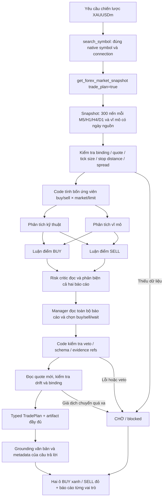

# Forex research council và hai ô BUY / SELL

Ngày kiểm tra source: 2026-11-03. Phạm vi: phân tích Forex native qua MT5, câu trả lời chat, HTTP và MCP. Đây là mô tả triển khai và giới hạn kiểm chứng, không phải báo cáo hiệu quả đầu tư.

Đối chiếu ngày **04/11/2026**: council chỉ đọc, SMA runner và AI Demo runner là ba đường khác nhau. Sáu role có thể dùng cùng một model; role count không chứng minh model diversity, JSON hợp lệ không chứng minh forecast đúng. [Forex & XAUUSD Lab](FOREX_XAUUSD_LAB.md) bổ sung nguyên tắc deterministic engine/LLM, metadata SDM đã có, OOS/walk-forward, chi phí và gate paper/demo/live. Đợt tài liệu này không gọi lại model hoặc broker; kết quả runtime phía dưới giữ ngày gốc.

Bổ sung cùng ngày: [chart nến MT5 và dự báo từ OHLC](FOREX_LIVE_CANDLES.md). Chart có nến đang hình thành; council chỉ nhận nến đã đóng, thêm dạng nến/swing/vùng giá và 32 OHLC gần nhất mỗi khung. Technical/manager trả forecast có khung và horizon sáu nến, lý do/điều kiện vô hiệu. Các kết quả runtime ở mục 9 bên dưới thuộc lần kiểm tra council trước bổ sung chart; kiểm chứng mới được ghi trong tài liệu chart.

Tối ưu tiếp theo: [context, bộ nhớ và token](CONTEXT_MEMORY_TOKEN_AUDIT.md). Chỉ technical nhận chuỗi OHLC thô; các vai trò khác dùng projection chỉ báo/price action và báo cáo đã có. Mỗi role có usage riêng, được cộng vào tổng run khi gọi từ chat; usage không được provider trả về được đánh dấu thiếu. Sáu vai trò vẫn có thể cùng một model, không tự trở thành sáu model độc lập.

## 1. Kết luận kiểm tra kiến trúc cũ

Ứng dụng có AgentLoop gọi tool, hệ thống Swarm chạy DAG, grounding kiểm tra con số và engine Forex tự động. Các phần đó chưa tự hợp thành một nhóm AI tranh luận cho mọi câu hỏi Forex:

| Phần có sẵn | Hoạt động thực tế trước thay đổi | Khoảng trống |
| --- | --- | --- |
| `agent/context.py`, `agent/loop.py` | Một LLM chính quyết định gọi tool và trả lời | Không mặc định có báo cáo BUY/Bear/risk độc lập |
| `swarm/runtime.py`, `swarm/presets/` | DAG worker thật, có trạng thái, artifact, retry; chỉ gọi khi yêu cầu Swarm | Preset tổng quát không tự bảo đảm cùng snapshot và đúng tài khoản Forex |
| `trading/forex/ai.py` | Một model được cấu hình đề xuất buy/sell/hold/close; code sở hữu thực thi | Không phải hội đồng nhiều model, không có đối luận BUY/SELL bắt buộc |
| `trading/forex/analysis_context.py` | 300 nến đã đóng cho từng M5/H1/H4/D1, chỉ báo tính trên toàn cửa sổ | Dữ liệu đầy đủ hơn không tự tạo ra vòng phản biện |
| `agent/grounding/` | Ràng buộc symbol/source/as-of/unit và kiểm tra con số trong văn bản | Không có hợp đồng dữ liệu hai ô giao dịch |
| `MessageBubble.tsx` | Markdown của câu trả lời | Không có hai ô typed BUY/SELL hoặc trạng thái hết hạn |

Đánh giá: đã có nền tảng agent và orchestration, nhưng chưa đủ bằng chứng để gọi luồng Forex cũ là một hội đồng phân tích có tranh luận. Không có một nhãn “chuẩn Agentic” duy nhất có thể thay thế việc kiểm tra các bước thực sự chạy.

## 2. Nghiên cứu nguồn gốc và quyết định tích hợp

### TradingAgents

[Repository chính thức](https://github.com/TauricResearch/TradingAgents), [paper v7](https://arxiv.org/abs/2412.20138v7), [graph thực thi](https://github.com/TauricResearch/TradingAgents/blob/main/tradingagents/graph/trading_graph.py).

Framework chia vai trò phân tích, lập luận tăng/giảm, quản lý rủi ro và tổng hợp quyết định. Điểm phù hợp là đối luận có đầu vào là báo cáo trước đó, thay vì chỉ đặt nhiều tên vai trò trong một prompt. Paper nghiên cứu giao dịch cổ phiếu; kết quả tác giả công bố không xác nhận hiệu quả của bản tích hợp XAUUSDm/Exness này.

Quyết định triển khai: dùng cấu trúc vai trò/đối luận, giữ nguồn MT5 và lớp thực thi hiện có. Không clone toàn bộ framework, không thay thế broker journal/mandate bằng kết luận LLM. Không sao chép code từ framework vào dự án.

Đọc sâu code chính thức cho thấy khác biệt quan trọng:

| Cơ chế | TradingAgents, source đã đọc | Bản tích hợp này |
| --- | --- | --- |
| Analyst/tool loop | [`setup.py`](https://github.com/TauricResearch/TradingAgents/blob/main/tradingagents/graph/setup.py) tạo graph riêng cho analyst và chặn số vòng tool | Tool thu thập một snapshot; role không có tool riêng, tránh lệch nguồn native |
| Debate | [`conditional_logic.py`](https://github.com/TauricResearch/TradingAgents/blob/main/tradingagents/graph/conditional_logic.py) luân phiên Bull/Bear đến `2 × max_debate_rounds` | BUY/SELL song song, sau đó risk critic đọc cả hai; không tuyên bố có phản hồi luân phiên |
| Risk | Cùng router luân phiên aggressive/conservative/neutral, sau đó Portfolio Manager | Một risk critic có veto, một manager; ít lời gọi và giới hạn rõ |
| Model/config | [`default_config.py`](https://github.com/TauricResearch/TradingAgents/blob/main/tradingagents/default_config.py) có deep/quick model, provider, debate/tool limits và checkpoint config | Một cấu hình model hiện tại, ghi runtime identity từng vai; không resume node |

Đây là sự khác biệt về phạm vi triển khai, không phải kết luận bản nào có lợi nhuận cao hơn.

### FinRobot

[Repository chính thức](https://github.com/AI4Finance-Foundation/FinRobot), [paper](https://arxiv.org/abs/2405.14767).

FinRobot tổ chức ứng dụng tài chính quanh các tác vụ/agent và dữ liệu nghiên cứu. Điểm tham khảo là tổ chức báo cáo có nguồn theo nhiệm vụ. Nó không phải driver native cho terminal Exness đang mở; các ví dụ nghiên cứu vốn cổ phần không tự giải quyết quote MT5, suffix symbol, SL/TP, fill hay giao dịch pending của dự án này.

[README hiện tại](https://github.com/AI4Finance-Foundation/FinRobot#readme) tách Desktop V2, Equity V1 và AutoGen V0 giáo dục. Vì vậy không coi code minh họa AutoGen của paper là cùng runtime với Desktop hiện tại. Nhãn production của upstream là tuyên bố của tác giả, không phải chứng nhận cho dự án Forex này.

### LangGraph

[Workflows and agents, tài liệu chính thức](https://docs.langchain.com/oss/python/langgraph/workflows-agents).

Tài liệu phân biệt workflow có đường đi được định trước với agent tự quyết định tiến trình/tool; có các mẫu parallelization, orchestrator-worker và evaluator-optimizer. Triển khai mới là **workflow nghiên cứu nhiều vai trò có giới hạn nằm trong AgentLoop**, không phải sáu agent tự do có toàn quyền tool hoặc một quá trình tối ưu vô hạn. Mỗi node là lời gọi model thật. Một lần phản biện rủi ro không được mô tả thành nhiều vòng tranh luận.

Không thêm phụ thuộc LangGraph: DAG bốn lớp này đủ nhỏ để kiểm thử trực tiếp; Swarm tổng quát của ứng dụng tiếp tục giữ nhiệm vụ riêng. Việc chưa tái sử dụng checkpoint/retry của Swarm là một đánh đổi: council hiện không resume giữa các vai trò; lỗi dẫn đến CHỜ.

### Ngữ nghĩa lệnh MT5

[MetaTrader 5: loại lệnh](https://www.metatrader5.com/en/terminal/help/trading/general_concept#order_types), [MetaQuotes Python order_check](https://www.mql5.com/en/docs/python_metatrader5/mt5ordercheck_py).

MARKET đề xuất vào ở thị trường: BUY tham chiếu Ask, SELL tham chiếu Bid. BUY LIMIT chờ mức thấp hơn thị trường, SELL LIMIT chờ mức cao hơn. Lệnh pending khác với giao dịch tức thời. Một lần `order_check` thành công không bảo đảm gửi/khớp thành công.

Hai ô trong chat là **kịch bản đề xuất**, không phải biên nhận đặt lệnh. Executor `Order` hiện dùng market deal có bảo vệ; triển khai này **không bổ sung thực thi pending LIMIT**. Không chuyển một LIMIT thành market một cách im lặng.

## 3. Luồng đã tích hợp



Các lớp gọi model:

1. `technical`, `macro`: cùng evidence, độc lập với nhau.
2. `bull`, `bear`: cùng đọc báo cáo hai analyst; mỗi bên phải nêu điều kiện vô hiệu.
3. `risk`: đọc cả hai lập luận; bắt buộc trích `report.bull` và `report.bear`.
4. `manager`: đọc toàn bộ phần trước; bắt buộc trích `report.risk`; không thể thắng một veto bằng văn bản.

Sau khi tool hoàn tất, câu hỏi nghiên cứu trực tiếp nhận câu trả lời ngắn do ứng dụng tạo cùng typed cards, không gọi thêm một model viết lại báo cáo. Văn bản này vẫn đi qua grounding; báo cáo chi tiết nằm trong từng vai trò và bảng dữ liệu có nguồn. Shortcut không áp dụng cho goal đang chạy hoặc yêu cầu còn file chưa ghi.

Tối đa sáu lời gọi, hai lời gọi đồng thời, timeout mỗi lời gọi 40 giây, không retry. Kiểm tra tổng budget trước mỗi lớp và trước khi công bố, giới hạn 180 giây cho council (thu thập dữ liệu chạy trước budget này). Hủy được kiểm tra giữa các lớp; lời gọi provider đang chạy có thể tiếp tục đến timeout. Giao diện nhận heartbeat và tiến độ lớp.

Một model được cấu hình có thể đảm nhiệm sáu vai trò qua sáu lời gọi riêng. `unique_models` lấy từ provider/model thực tế; không suy ra sự độc lập từ tên vai trò. Bản này không có cấu hình phân công sáu provider riêng và không tuyên bố đa dạng model khi chưa có.

## 4. Giá vào / SL / TP được tạo như thế nào?

LLM không tự viết giá vào các ô. `candidates()` dùng Decimal và dữ liệu native:

- `price_step` lấy `trade_tick_size` của broker; fallback `point` chỉ nằm trong SDK adapter khi tick size bằng 0. Không suy ra tick size bằng số chữ số của quote.
- Khoảng stop tối thiểu lấy `trade_stops_level × point`. Không có trường này thì chặn tính kịch bản.
- Thước đo biến động là ATR14 trên M5; cấu trúc là high/low của 20 nến M5. Đây là **heuristic v1**, chưa tối ưu hoặc backtest.
- `distance = max(1.5 × ATR, minimum_stop_distance + spread + price_step)`.
- `gap = max(0.5 × ATR, 2 × spread, minimum_stop_distance + price_step)`.
- BUY MARKET dùng Ask làm tròn lên tick; SELL MARKET dùng Bid làm tròn xuống.
- BUY LIMIT dùng `Bid - gap`, làm tròn xuống. SELL LIMIT dùng `Ask + gap`, làm tròn lên. Giá limit nằm ngoài spread, có kiểm tra hướng.
- BUY SL là mức thấp hơn giữa `entry - distance` và `range_low_20 - step`, làm tròn xuống. SELL SL đối xứng với `range_high_20 + step`.
- TP bằng hai lần khoảng cách risk, làm tròn theo hướng tăng reward. Validator yêu cầu reward/risk ít nhất 2 và đúng hình học SL/entry/TP.
- Spread lớn hơn 0.25 ATR thì chặn. Đây là ngưỡng nghiên cứu v1, không thay thế giới hạn thực thi theo tài khoản.

Sau debate, đọc quote mới và tính lại ứng viên bằng cùng công thức. Nếu Bid hoặc Ask lệch quá 0.25 ATR so với quote được review, kết luận thành CHỜ, yêu cầu phân tích lại. Thời hạn hiển thị 60 giây tính từ lúc công bố; hết hạn tự bỏ nhãn ưu tiên. Giá MARKET là tham chiếu, không cam kết fill.

Một hướng được ưu tiên hoặc cả hai cùng chờ; hướng đối ứng luôn là kịch bản điều kiện, mặc định LIMIT. Không có hai khuyến nghị mở đồng thời. Khi chưa có dữ liệu hợp lệ, các mức giá là `—`, không phải 0.

Yêu cầu MARKET/LIMIT của người dùng được gửi tới từng vai trò. Code không nâng một LIMIT của risk thành MARKET do manager muốn vào ngay; timing không được chấp thuận dẫn tới CHỜ. Veto ở technical/macro/bull/bear là đề nghị; veto của risk/manager mới là cổng bắt buộc. Không biết currency thì hiển thị UNKNOWN và chặn, không giả định USD.

## 5. Hợp đồng dữ liệu và an toàn của nguồn

`TradePlan` version 1 có: symbol/currency/MT5 environment, broker server, hash binding/evidence, timestamp quote/created/expiry, bid/ask, price step/minimum stop, status, recommendation, reasons, hai scenario, tối đa sáu report, unique_models và `trading_performed=false`.

Payload có thêm evidence đã lọc theo allowlist: số nến/ngày từng khung, chỉ báo thực tính và các nguồn vĩ mô kèm ngày/đơn vị/URL. UI có phần Dữ liệu và nguồn phân tích mở rộng, nên người dùng có thể kiểm tra đầu vào của nhận định.

Mỗi report có stance, loại entry đề xuất, tóm tắt, phản biện/điều kiện vô hiệu, evidence refs, veto, runtime provider/model và elapsed. Không yêu cầu hoặc lưu private chain-of-thought. Nội dung các báo cáo là ý kiến LLM, không tự trở thành bằng chứng quan sát.

Các biện pháp:

- Roles không nhận account login, balance, path, connection ID, mật khẩu hoặc order tools.
- Evidence refs phải nằm trong allowlist snapshot/report đã thật sự có trước node đó. Kiểm tra reference không chứng minh mọi diễn giải ngôn ngữ đều đúng.
- Binding tài khoản được kiểm tra trước/sau thu thập và trước công bố. Thay tài khoản/connection là lỗi, không tự đăng nhập hoặc sửa quyền.
- `ToolCallLifecycle` chỉ nhận `_trade_plan` từ class first-party `ForexMarketSnapshotTool` thành metadata, validate schema; không đọc card JSON từ câu trả lời Markdown, file LLM viết hoặc tool MCP khác.
- Grounding ingest **toàn bộ** evidence trước projection gọn cho model viết câu trả lời cuối. Giá kịch bản không được đăng ký giả thành giá thị trường quan sát.
- Cùng typed payload được lưu trong transcript và SSE `attempt.completed`, nên tải lại chat vẫn có hai ô. Câu trả lời cũ không có metadata không bị suy diễn thành card.
- Có artifact `forex_trade_plan.json`, `forex_council_evidence.json` trong run hiện tại, giữ nguồn để truy vết. Không dùng dữ liệu riêng của máy làm fixture public.
- Kịch bản không tự gọi `submit`, không sửa allowlist, không cấp mandate, không bật runner. Execution journal/halt/consent hiện có vẫn là ranh giới thực thi riêng.

Lỗi role có mã riêng (`INVALID_JSON`, `REPORT_TOO_LONG`, `INVALID_REPORT_SCHEMA`, `INVALID_EVIDENCE_REFS`, `MODEL_REQUEST_FAILED`), giữ các báo cáo đã thành công và dừng các lớp phụ thuộc. Không lưu raw output lỗi hoặc exception chứa request/credentials. Prompt yêu cầu tóm tắt ngắn; transport nhận tối đa 1.600 ký tự tóm tắt / 1.000 ký tự phản biện, không cắt mất đoạn phủ định để ép schema thành công.

## 6. API và code mẫu

Chat tool (sau khi resolver đã khóa symbol/connection):

```python
from src.tools.forex_market_tool import ForexMarketSnapshotTool

result = ForexMarketSnapshotTool().execute(
    symbol="XAUUSDm",
    connection_id="your-saved-mt5-connection",
    trade_plan=True,
    entry_mode="auto",  # hoặc market / limit khi người dùng chỉ định
)
```

HTTP, giữ cơ chế read auth sẵn có. POST dùng để khởi tạo phân tích có lời gọi model, không thay đổi tài khoản/lệnh:

```http
POST /api/forex/research-plan
Content-Type: application/json

{"symbol":"XAUUSDm","connection_id":"your-saved-mt5-connection","entry_mode":"auto","include_macro":true}
```

Response là `TradePlan` version 1. `status=ready` không phải order approval. `status=wait|blocked` buộc recommendation `wait`. JSON sai schema bị 422; broker/binding lỗi giữ mã HTTP của Forex routes. Endpoint gọi model theo cấu hình đang dùng, có thể phát sinh chi phí provider.

MCP native MT5 có thêm tool read-only, gắn cùng một account của process:

```json
{"name":"forex_research_plan","arguments":{"symbol":"XAUUSDm","entry_mode":"limit","include_macro":true}}
```

MCP tool không nhận account khác hoặc thông tin xác thực qua arguments. Mỗi lần gọi có thể dùng sáu model calls. Cấu hình mặc định vẫn không lộ tool gửi lệnh.

Frontend lấy metadata, không parse văn bản:

```tsx
const plan = parseForexTradePlan(message.metadata?.forex_trade_plan);
// Cùng parser được dùng khi nhận SSE và tải lịch sử.
return plan ? <ForexTradeCards plan={plan} /> : null;
```

## 7. Cấu trúc có sẵn và phần thêm

```text
agent/src/
  agent/
    loop.py                         [sửa] reset/carry typed plan theo run
    tool_lifecycle.py               [sửa] first-party intake, artifact, projection
    context.py                      [sửa] native strategy -> trade_plan=true
    grounding/                      [giữ] kiểm chứng số trong văn bản
  swarm/                            [giữ] orchestration tổng quát
  session/service.py                [sửa] persist/SSE cùng payload
  tools/forex_market_tool.py         [sửa] tùy chọn trade_plan / entry_mode
  api/forex_routes.py               [sửa] POST research-plan
  trading/forex/
    council.py                     [mới] contracts, price candidates, role DAG
    analysis_context.py             [có sẵn] snapshot đa khung
    macro_context.py                [có sẵn] nguồn vĩ mô công khai, ngày/unit
    adapters/mt5_worker.py           [sửa] quote thêm minimum_stop_distance
    mcp_server.py                   [sửa] forex_research_plan read-only
    ai.py / runner.py / policy.py    [giữ] executor riêng, không nối card tự gửi
agent/tests/test_forex_council.py    [mới] dữ liệu tổng hợp, không lệnh/network
frontend/src/
  lib/forexTradePlan.ts              [mới] typed schema + parser
  types/agent.ts                    [sửa] forexTradePlan trên answer
  pages/Agent.tsx                   [sửa] hydrate SSE và lịch sử
  components/chat/
    ForexTradeCards.tsx             [mới] hai ô, expiry, debate reports
    MessageBubble.tsx               [sửa] gắn card vào câu trả lời
    __tests__/ForexTradeCards.test.tsx [mới] UI/schema/expiry/no prose injection
```

## 8. Đánh giá chất lượng và khoảng trống còn lại

Đã triển khai một lát cắt nghiên cứu end-to-end: nguồn broker, tính mức giá, sáu vai trò, phản biện, tổng hợp, chặn lỗi, metadata bền vững và UI. Chưa nên gọi toàn bộ sản phẩm là một tổ chức trading tự trị đã được xác nhận hiệu quả.

Những giới hạn phải giữ đúng khi vận hành:

1. Sáu vai trò cùng model có sai lệch tương quan. Chưa có phân công model/provider theo vai trò hoặc phép đo độc lập.
2. Các báo cáo có schema/reference được kiểm tra, nhưng nhận định ngữ nghĩa vẫn có thể sai. Không công bố xác suất thắng từ sự đồng thuận.
3. Một critique round, không có vòng bull phản hồi bear rồi bear phản hồi lại; không tự bổ sung nghiên cứu mới khi thiếu dữ liệu. Lỗi chuyển sang CHỜ, không resume node.
4. 300 nến D1 cung cấp cửa sổ lớn hơn M5 nhưng không bao phủ mọi chế độ thị trường. Không có đánh giá walk-forward, holdout, leakage, spread/slippage/swap, latency và drawdown của heuristic ATR v1 trong lần triển khai này.
5. Volume MT5 thường chỉ có tick count. CME futures là thị trường khác và có thể timeout; GLD share volume/estimated creation không phải global gold flow. Daily DXY/TIPS/GLD không thay thế economic calendar hoặc feed tin tức intraday.
6. Lệnh LIMIT mới là kế hoạch trong UI; chưa có pending-order lifecycle/expiration/reconciliation tương ứng trong executor. Không tự gửi kịch bản qua engine market.
7. Hết thời hạn hoặc giá đi quá xa cần một phân tích mới. Không sửa câu trả lời lịch sử để trông như một quote đang sống.

Trước khi nối council vào auto-execution: cần benchmark có costs và holdout, kiểm tra policy định lượng độc lập, map quyết định thành intent có expiry/account binding, hỗ trợ đúng loại pending nếu cần, kiểm thử unknown/fill/reconciliation, rồi mới đánh giá vận hành demo. Một báo cáo AI hoặc card đẹp không thay các điều kiện đó.

## 9. Kiểm chứng

Các kiểm thử synthetic bao phủ lời gọi thật ở mức workflow qua model stub, dependency giữa các báo cáo, veto/WAIT/error, dữ liệu thiếu/cũ, tick alignment, limit geometry, reward/risk, price drift, đổi binding, cùng payload persist/SSE. Frontend kiểm tra hai ô, chỉ một ưu tiên, tự hết hạn, missing `—`, parser từ chối payload sai, JSON trong Markdown không sinh card.

Kiểm thử provider/MT5 thật và quan sát UI được ghi riêng theo lần chạy ở phần kết quả triển khai; không suy từ unit test rằng provider đang hoạt động, hoặc từ read-only rằng một lệnh đã khớp.

### Kết quả thực tế ngày 2026-11-03

- Lần chạy cuối bằng câu hỏi chiến lược thông thường tự chọn `trade_plan=true`, resolver và tool hoàn tất trong hai bước AgentLoop, không có model viết lại báo cáo sau council.
- Nguồn MT5/Exness Demo thật: mỗi M5/H1/H4/D1 có 300 nến và trạng thái recent/ok; DXY, GLD, FRED real yield và broad USD có dữ liệu với ngày quan sát riêng. CME futures volume vẫn unavailable.
- Sáu báo cáo hoàn thành, không có role failure; tất cả runtime identity là cùng model DeepSeek được cấu hình. Kỹ thuật và bear nghiêng SELL, risk chọn WAIT và veto; manager kết luận WAIT. Không có broker write.
- Tổng thời gian lần đó 94,13 giây (94 130 ms). Đây là một lần đo, không phải SLA hoặc benchmark phân phối latency.
- Backend: 604 kiểm thử liên quan qua, gồm grounding, council, HTTP/MCP, identity, executor/runner và order gates. Có cảnh báo dependency sẵn có; chưa chạy toàn bộ test của mọi module trong repository.
- Frontend: 107 kiểm thử qua trên 11 file, bao phủ component cards/expiry/role failure/Markdown, Forex, locale/tool labels, SSE/history/runtime/activity. Build production thành công. Tải lại trình duyệt thực tế vẫn giữ hai ô và mở đọc được báo cáo sáu vai trò; plan cũ chuyển thành hết hạn đúng timestamp.
- MCP stdio thật handshake được chín tool, tất cả read-only, có `forex_research_plan`; gọi `forex_get_quote` nhận quote MT5 thật và đủ trường tick size/minimum stop. Council có provider thật được kiểm tra qua chat; HTTP/MCP research-plan được kiểm tra routing/schema bằng model stub, không chạy thêm sáu model calls chỉ để lặp lại cùng kiểm chứng.

Trong một lần trước đó, role không đạt schema nên chỉ có các báo cáo thành công được giữ và hệ thống trả WAIT. Không dùng trường hợp đó để tuyên bố đủ sáu vai trò; UI có số hoàn tất và mã lỗi. Không biến một lần đủ sáu vai trò thành bảo đảm mọi provider call sau đều thành công.
