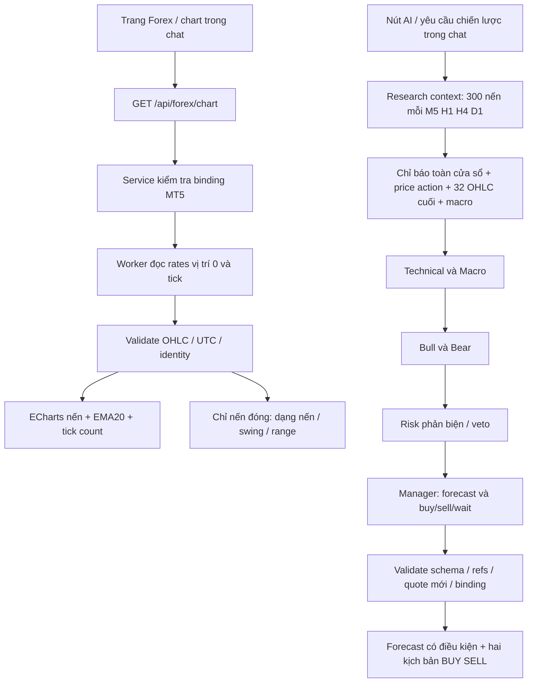

# Nến MT5 cập nhật liên tục và AI phân tích mô hình

Ngày triển khai: 2026-11-03. Phạm vi hiện tại: terminal MT5 native trên Windows, gồm Exness và các broker MT5 tương thích. Đây là mô tả dữ liệu, thuật toán và phần mềm; chưa phải bằng chứng về hiệu quả dự báo hay lợi nhuận.

Đối chiếu source ngày **04/11/2026**: luồng chart vẫn là HTTP polling, không phải một tick event bus bền vững. `retrieved_at` là thời điểm tạo snapshot sau đọc/validate; chưa có receive-time ingress và sequence/replay đầy đủ. [Forex & XAUUSD Lab](FOREX_XAUUSD_LAB.md) mô tả hợp đồng source/receive/compute time, late ticks, gap/reconnect, closed-bar replay và kiểm chứng chiến lược cần bổ sung. Các kết quả thực nghiệm trong tài liệu này thuộc đợt 03/11; đợt tài liệu mới chưa kiểm tra lại terminal/model.

## Cách dùng

Mở `/forex`, chọn kết nối MT5 đã xác minh và đúng symbol tại broker, ví dụ `XAUUSDm`. Phần **Nến trực tiếp & AI phân tích mô hình** có chart M5/H1/H4/D1, EMA20, Bid/Ask, số tick và bảng OHLC. Đổi khung chỉ đổi chart; không khởi động giao dịch.

Chart đọc lại dữ liệu khoảng **3 giây sau mỗi response**; không có request chồng nhau. Đây là polling, không phải luồng WebSocket theo từng tick. Nến cuối có nhãn **CHƯA ĐÓNG** khi đang hình thành, màu nhạt hơn và có thể thay đổi OHLC. Thời gian chart là UTC. Đường EMA20 có tính cả nến đang hình thành.

Nút **AI: mô hình nến & dự báo xu hướng** tạo một lần phân tích mới cho khung đang chọn. AI nhận bối cảnh của cả M5/H1/H4/D1, nhưng dự báo có horizon cụ thể: **sáu nến kế tiếp của khung được chọn**. AI không được gọi mỗi ba giây. Kết quả có hai kịch bản BUY/SELL và forecast tăng/giảm/đi ngang/chưa rõ, lý do và điều kiện vô hiệu. Dự báo hướng đi có thể khác quyết định vào lệnh: giá có thể nghiêng tăng nhưng risk vẫn yêu cầu CHỜ.

Chart tiếp tục cập nhật trong khi báo cáo giữ nguyên snapshot có timestamp. Báo cáo trên trang Forex là state của lần mở trang; tải lại cần phân tích lại. Kết quả trong câu trả lời chat tiếp tục được lưu bằng metadata của chat như trước. Plan mới có connection ID để mở chart đúng nguồn; plan lịch sử thiếu trường này không bị suy diễn nguồn.

Forecast hiển thị riêng giờ mở của nến đóng cuối trong đầu vào. Horizon sáu nến bắt đầu sau nến đó, không tự kéo về phía trước khi quote hoặc chart thay đổi trong lúc model phân tích. `created_at` là thời điểm công bố báo cáo, không thay cho timestamp nến nguồn. Các mốc `confirmed_at` của swing cũng là timestamp nến xác nhận, không phải giờ tick đến terminal.

## Nguồn và nguyên lý

[MetaQuotes copy_rates_from_pos](https://www.mql5.com/en/docs/python_metatrader5/mt5copyratesfrompos_py) quy định vị trí 0 là nến hiện tại. Vì vậy hai đường đọc được tách rõ:

| Đường đọc | Vị trí bắt đầu | Mục đích |
| --- | --- | --- |
| Native `chart` | 0 | Hiển thị cả nến đang hình thành |
| `candles`, research context, chiến lược | 1 | Phân tích nến đã đóng |

Chart đọc 200 nến mặc định; API cho phép 30–300. Research context vẫn đọc 300 nến **mỗi khung**, tính chỉ báo và cấu trúc trên toàn cửa sổ. Technical nhận thêm 32 nến OHLC đã đóng gần nhất mỗi khung; các vai trò còn lại nhận chỉ báo, price action đã tính và báo cáo trước đó, tránh gửi lặp toàn bộ OHLC sáu lần. Chuỗi gọn có các cột `time_utc, open, high, low, close, ticks`; không thay chuỗi giá bằng một ảnh chart. Chi tiết phép đo và giới hạn: [context, bộ nhớ và token](CONTEXT_MEMORY_TOKEN_AUDIT.md).

SDK trả về dữ liệu thực từ terminal. Backend kiểm tra binding tài khoản trước/sau thao tác, timestamp, thứ tự, trùng lặp, số hữu hạn dương, hình học OHLC và số tick. Frontend kiểm tra lại identity/schema và bỏ response đến muộn của symbol/connection/khung cũ. Không dựng nến để lấp khoảng nghỉ thị trường. MT5 chỉ trả lịch sử sẵn có trong terminal và chịu giới hạn lịch sử của chart.

Chart và bảng tài khoản có thể đọc cùng terminal đồng thời. Worker chờ lấy khóa terminal tối đa 10 giây cho các thao tác đọc, **trước khi attach SDK**; không chạy lại thao tác native đã bắt đầu. Hết thời gian trả `MT5_BUSY`. Khóa admission của gửi lệnh vẫn fail closed ngay khi tranh chấp; không thêm retry broker write. Điều này khắc phục lỗi đọc tạm thời do khóa non-blocking khi chart/account cùng cập nhật.

Giá broker có timestamp riêng; lỗi polling hoặc quote quá cũ đổi trạng thái thành **BÁO GIÁ CŨ / MẤT KẾT NỐI**. Dữ liệu nhận lần cuối vẫn hiển thị kèm lỗi. Tạm dừng hoặc ẩn tab dừng polling; mở lại tab tiếp tục đọc. Tạm dừng chart không điều khiển runner hay vị thế.

`volume` trong luồng này là **tick count**, không phải khối lượng khớp toàn thị trường. Không gộp nó với hợp đồng CME hoặc dòng vốn ETF. Daily macro vẫn giữ ngày quan sát và trạng thái thiếu/cũ riêng.

## Bộ quy tắc price action v1

Các ngưỡng sau là heuristic được viết rõ để kiểm thử; chưa có calibration hay backtest khẳng định sức dự báo. [CME: các loại chart](https://www.cmegroup.com/education/courses/technical-analysis/chart-types-candlestick-line-bar) và [CMC Markets: mô hình nến](https://www.cmcmarkets.com/en/technical-analysis/candlestick-patterns-explained) cung cấp ngữ nghĩa nến. Các tỷ lệ cụ thể bên dưới là lựa chọn triển khai của dự án.

Với `R = high - low`, `B = abs(close - open)`, râu trên/dưới tính theo thân nến:

| Dạng | Điều kiện |
| --- | --- |
| Doji | `B <= 0.1 R` |
| Hammer shape | `0.1 R < B <= 0.35 R`, râu dưới `>= 2 B`, râu trên `<= 0.15 R` |
| Shooting star shape | Đối xứng Hammer |
| Bullish engulfing | Nến trước giảm, nến sau tăng; thân sau phủ thân trước và lớn hơn |
| Bearish engulfing | Đối xứng bullish engulfing |
| Inside bar | High thấp hơn và Low cao hơn nến trước |

Chỉ tìm dạng trong tám nến đóng gần nhất; trả tối đa 12 phát hiện. Các dạng Hammer/Engulfing mang nhãn ứng viên, chưa xác nhận đảo chiều nếu chưa xét xu hướng trước đó, vùng giá và nến xác nhận. Doji/Inside bar là trung tính. Không tự kết luận xu hướng từ một dạng đơn lẻ.

Swing high/low dùng fractal bán kính hai nến: một pivot cần hai nến đã đóng ở bên phải mới được xác nhận. Hai nến đóng cuối chưa thể thành pivot. So hai swing high và hai swing low gần nhất với dung sai `0.1 ATR`: HH/HL, LH/LL hoặc xen kẽ/đi ngang. Mỗi pivot có thời điểm nến và `confirmed_at`; thuật toán không sử dụng nến tương lai chưa có trong snapshot.

Vùng hỗ trợ/kháng cự lấy 20 nến **trước nến đóng mới nhất**. Close vượt đỉnh vùng cộng `0.1 ATR` hoặc dưới đáy vùng trừ `0.1 ATR` là điều kiện breakout theo quy tắc. Các mức điều kiện này là giá suy ra, không phải báo giá giao dịch quan sát và không tự trở thành entry/SL/TP.

## Luồng xử lý



Technical và manager phải có `forecast` đúng khung được yêu cầu và trích reference `timeframes.<frame>.price_action` khi evidence có trường này. Thiếu/sai schema hoặc refs dẫn đến lỗi role và CHỜ. Forecast có đúng sáu nến, lý do và điều kiện vô hiệu; dữ liệu price action thiếu chỉ cho phép `uncertain`. Các role không có tool đặt lệnh, thông tin xác thực hoặc số dư tài khoản.

Sáu vai trò là sáu lời gọi thật đến model đang cấu hình, không mặc định là sáu model khác nhau. DAG, budget, veto và giá kịch bản độc lập với LLM được mô tả trong [tài liệu council](FOREX_AGENTIC_RESEARCH.md). Forecast ngôn ngữ chưa được kiểm chứng ngữ nghĩa chỉ nhờ JSON hợp lệ. Không hiển thị xác suất thắng từ sự đồng thuận.

Đường AI Demo hiện có cũng nhận thêm `price_action` và chuỗi OHLC qua research context. Lần bổ sung này không nối council vào runner, không thêm thực thi pending LIMIT, không tự cấp quyền hoặc khởi động giao dịch.

## API và code mẫu

Đọc chart, giữ read auth hiện có:

```http
GET /api/forex/chart?connection_id=your-mt5-connection&symbol=XAUUSDm&timeframe=5m&limit=200
```

Response version 1 có `source`, `connection_id`, `binding_hash`, `broker_server`, `environment`, `timeframe`, `retrieved_at`, `quote`, `bars`, `forming_bar_time`, `price_action`, `volume_unit=tick_count` và `trading_performed=false`. Không chứa mật khẩu, token hoặc login.

API chart hỗ trợ `1m, 5m, 15m, 30m, 1h, 4h, 1d`; UI hiện cung cấp M5/H1/H4/D1, khớp các khung research. Chưa cung cấp chart native cho Exness REST/OANDA ở bản này.

```http
POST /api/forex/research-plan
Content-Type: application/json

{"connection_id":"your-mt5-connection","symbol":"XAUUSDm","forecast_timeframe":"1h","entry_mode":"auto","include_macro":true}
```

Khung forecast chỉ nhận `5m, 1h, 4h, 1d`. Mặc định `5m`. POST gọi model có thể phát sinh chi phí, nhưng không gửi lệnh. HTTP/MCP/chat dùng cùng workflow. Chat tool và MCP `forex_research_plan` đều nhận thêm `forecast_timeframe`.

```python
from src.tools.forex_market_tool import ForexMarketSnapshotTool

result = ForexMarketSnapshotTool().execute(
    symbol="XAUUSDm",
    connection_id="your-mt5-connection",
    trade_plan=True,
    forecast_timeframe="1h",
    entry_mode="auto",
)
```

Report technical/manager thêm trường:

```json
{
  "forecast": {
    "direction": "uncertain",
    "timeframe": "1h",
    "horizon_bars": 6,
    "rationale": "Các nến đã đóng đang cho tín hiệu xung đột giữa các khung.",
    "invalidation": "Cần nến đóng vượt vùng giá xác nhận trong evidence để đánh giá lại."
  }
}
```

## Cấu trúc tích hợp

```text
agent/src/
  trading/forex/
    price_action.py              mới: heuristic chỉ trên nến đóng
    chart.py                     mới: validate snapshot chart
    adapters/mt5_worker.py        chart pos=0; candles pos=1; chờ khóa chỉ cho đọc
    adapters/mt5.py               bridge chart qua worker
    service.py                   allowlist read chart
    analysis_context.py          PA trên toàn bộ lịch sử + 32 OHLC cuối/khung
    council.py                   typed forecast, khung yêu cầu, refs
    ai.py                        hướng dẫn dùng PA cho AI Demo hiện có
    mcp_server.py                tham số khung forecast
  api/forex_routes.py            GET chart; POST plan thêm khung
  tools/forex_market_tool.py     chuyển khung vào council; giữ budget quote gọn
  agent/context.py              native strategy nhận chuỗi nến/forecast
  agent/grounding/evidence.py    không đăng ký giá PA suy ra thành quote
frontend/src/
  lib/forexChart.ts              mới: fetch và validate identity/OHLC
  hooks/useForexChart.ts         mới: polling/abort/visibility/late response
  components/forex/
    ForexCandlePlot.tsx          mới: nến, EMA20, ticks, zoom, ResizeObserver
    ForexLiveChart.tsx           mới: controls/freshness/PA/bảng OHLC
    ForexMarket.tsx              mới: chart + nút AI chỉ đọc
    ForexTrendForecast.tsx       mới: dự báo có điều kiện
    ForexPlanChart.tsx           mới: chart mở theo nhu cầu từ plan chat
  pages/Forex.tsx                gắn chart và resolver đọc kết nối hợp lệ
  components/chat/ForexTradeCards.tsx  forecast + chart liên kết
  lib/forexTradePlan.ts          validate forecast; plan cũ vẫn tương thích
```

Không thêm thư viện: dùng ECharts hiện có. [Source tài liệu candlestick chính thức](https://github.com/apache/echarts-doc/blob/master/en/option/series/candlestick.md) quy định thứ tự `[open, close, lowest, highest]`. Chart có bảng OHLC để đọc ngoài canvas, các controls dùng HTML có label. Polling chỉ cập nhật series theo ID để giữ zoom/pan; unmount hủy request/timer và dispose chart. Không nối chart vào nhóm chart toàn ứng dụng.

## Kiểm chứng và giới hạn

- Backend: 626 kiểm thử liên quan qua, gồm chart/forming bar, geometry/timestamps, pattern fixtures, pivot confirmation, breakout loại nến cuối, context, council/forecast, grounding, MT5 binding, HTTP/MCP, executor và order gates. Bốn ca mới xác nhận chờ khóa đọc có giới hạn, không lặp lại operation khi đã bắt đầu và submit vẫn fail closed. Ruff qua trên các file Python thay đổi.
- Frontend: 138 kiểm thử qua trên 14 file, bao phủ chart/parser/polling, không tự gọi AI, response đến muộn, forecast/cards, chat/SSE, i18n và runtime. Sau đó bổ sung ba ca tooltip (ECharts có/không có category coordinate và dữ liệu sai/HTML escape); 19 kiểm thử trên năm file liên quan qua, gồm ba ca mới. Tổng cộng 141 ca khác nhau được kiểm tra trong đợt này; build production sau sửa tooltip thành công.
- MT5 thật: mỗi chart M5/H1/H4/D1 trả 200 nến, gồm 199 nến đóng và một nến đang hình thành; quan sát được Bid/Ask/OHLC thay đổi và nến mới trên trình duyệt. Sau sửa tranh chấp, thử đồng thời bốn chart và một account read: cả năm trả 200, khoảng 1,01–1,61 giây trong lần đo này. Đối chiếu tooltip OHLC của một nến đã đóng với API khớp cả bốn giá. Không suy từ một lần đo thành SLA hoặc bảo đảm lịch sử mọi symbol luôn sẵn có.
- Trình duyệt thực: kiểm tra 320/768/1024/1440 px, không có tràn ngang ở các section. Tooltip ECharts được bọc trong vùng canvas và cho phép ngắt dòng khi hẹp; bảng OHLC có vùng cuộn riêng. Tạm dừng giữ nguyên quote, tiếp tục/đổi khung đọc lại đúng khung; khôi phục viewport mặc định sau kiểm thử. Không chạy toàn bộ test của mọi module trong repository.
- Không gửi broker order để kiểm thử chart. Cần benchmark holdout/walk-forward, phí/spread/slippage, latency, leakage và drawdown trước khi đánh giá chất lượng chiến lược. Không có mô hình dự báo được huấn luyện/hiệu chỉnh hay xác suất thắng được kiểm chứng trong lần bổ sung này.

### Lần chạy provider thật

Nút AI trên trang Forex đã hoàn tất 6/6 vai trò bằng cùng model DeepSeek đang cấu hình, không có role failure. Technical và manager có reference `timeframes.5m.price_action`; các báo cáo phản biện dùng cả price action H1/D1 và báo cáo trước đó. Forecast manager là đi ngang, M5, sáu nến tiếp theo, có điều kiện vô hiệu; risk veto làm quyết định vào lệnh vẫn là CHỜ. Đây là quan sát một lần chạy, không phải đánh giá độ chính xác của dự báo.

Plan được công bố lúc `2026-11-03T14:51:21Z`. Sau 60 giây, UI chuyển hai kịch bản thành hết hạn trong khi chart tiếp tục đọc quote mới. Không sửa timestamp hoặc kéo dài expiry để làm báo cáo cũ trông như phân tích mới. Bảng báo cáo phân biệt sáu vai trò với một model thực tế.
