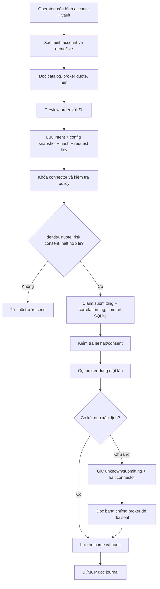
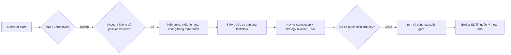
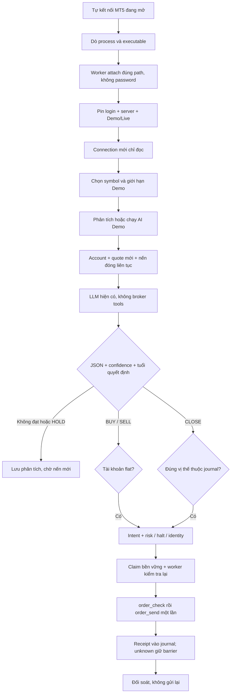
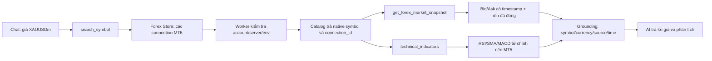
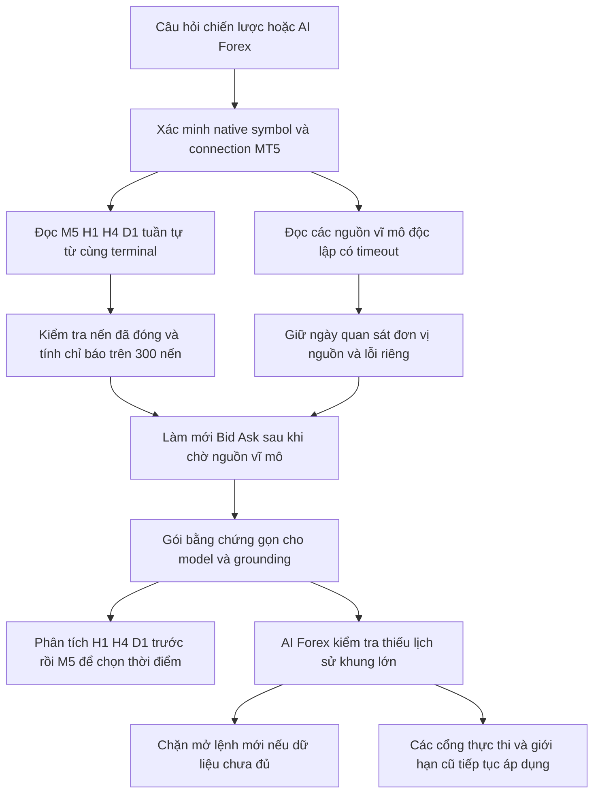

# Forex MCP: mã đã tích hợp và cách sử dụng

Ngày đối chiếu tài liệu/source gần nhất: **2026-11-04**. Workspace: `D:\Vibe-Trading-0.1.18`. Kết quả runtime, ảnh và số test trong các mục theo đợt bên dưới giữ nguyên ngày kiểm tra gốc; đợt viết tài liệu 04/11 không chạy terminal/model hoặc broker order.

Phần mở rộng nghiên cứu: [Forex & XAUUSD Lab](FOREX_XAUUSD_LAB.md) phân biệt polling với tick stream, ba mốc thời gian, contract/sizing, tin kinh tế, SDM/strategy evidence, walk-forward/OOS và các gate paper/demo/live. Xem [kiến trúc đa thị trường](MULTI_MARKET_ARCHITECTURE.md) để nối luồng Forex với hạ tầng dùng chung.

Đây là hướng dẫn cho phần **đã viết vào source**. [Bản nghiên cứu API và kiến trúc](EXNESS_FOREX_MCP_INTEGRATION_RESEARCH.md) mô tả phạm vi rộng hơn; cTrader, FXCM, IG, pending order/cancel và streaming daemon chưa được triển khai. Đợt bổ sung ngày 03/11 có auto-attach MT5, AI phân tích bằng provider đã cấu hình và mở/đóng vị thế trên MT5 Demo Hedge; xem mục 10.

## 1. Kết quả và phạm vi hiện tại

| Đường kết nối | Đọc dữ liệu | Thực thi đã có trong code | Điều kiện |
|---|---|---|---|
| MT5 đa broker, gồm tài khoản MT5 của Exness | Account, positions, orders, instruments, quote, OHLC và tick volume | Market entry với SL bắt buộc; đóng đúng ticket của ứng dụng trên Demo Hedge; phân biệt demo/live từ SDK | Windows, SDK MetaTrader5; dùng phiên đã đăng nhập hoặc credentials trong OS vault; luôn pin path/login/server |
| Exness Trading API gốc | Discovery, account/snapshot, instruments/conditions, quote qua WS, OHLC | Mở vị thế, ACK và polling operation; khôi phục operation ID mất ACK bằng bằng chứng broker | Tài khoản Exness platform có quyền API; API key, Ed25519 key, Gateway/AP được phê duyệt; không giả định tài khoản MT5 dùng được API này |
| OANDA v20 | Account, open trades/pending orders, instruments, quote, OHLC và số lần cập nhật giá | Protected market FOK, SL/TP on-fill; practice/live host riêng; tìm lại order bằng client ID | Tài khoản v20, account ID và personal token có quyền tương ứng |

Connection mới mặc định **chỉ đọc**. Nút **Tự kết nối MT5 đang mở** dò executable của process đang chạy và tạo connection gắn đúng danh tính từ SDK, không bật thực thi hoặc tự chạy chiến lược. Chế độ `existing_terminal` không đọc/lưu mật khẩu; chế độ `credentials` dùng OS vault. Mọi thao tác kiểm tra lại account/server/demo-live. Không có dữ liệu broker thì trả lỗi; không lấy quote Yahoo để quyết định gửi lệnh. OANDA tính gross từ trị tuyệt đối từng open trade để hai chiều hedge không triệt tiêu rủi ro; buy/sell đều dùng giá ask bảo thủ cho notional.

Thực thi hiện giới hạn **tài khoản USD**. Exness API còn giới hạn instrument định giá bằng USD. MT5 dùng quote broker mới để định giá và chuyển đổi USD theo suffix của instrument; thiếu mapping hoặc conversion mới thì chặn. OANDA dùng account pricing/home conversions. Symbol, spread point và đơn vị khối lượng giữ nguyên quy ước broker: **lot MT5, unit OANDA, volume native Exness**.

Lần kiểm tra runtime được ghi ngày 03/11 đã xác minh kết nối một tài khoản Exness **Demo** đang đăng nhập, đọc account/quote/nến và gọi model thật. **Chưa gửi order tới broker**, chưa kiểm chứng fill demo hoặc tài khoản tiền thật. Terminal tại thời điểm kiểm tra đó đang tắt Algo Trading và bật chặn external Python API; trạng thái hiện tại chưa được xác minh lại.

## 2. Cấu trúc cũ và phần thêm

Các thành phần cũ tiếp tục đảm nhiệm vai trò hiện có:

| Thành phần có sẵn | Module Forex sử dụng như thế nào |
|---|---|
| `agent/api_server.py` và `src/api/security.py` | Đăng ký router mới; read dùng auth hiện có, write dùng auth cấu hình kèm kiểm tra cross-site |
| `src/trading/credentials.py` | Lưu secrets trong OS vault, namespace `forex-<connection-id>` |
| `src/live/daily_count.py` | Khóa liên tiến trình theo connector; đếm số lần gửi theo mandate key riêng |
| `src/live/halt.py` | Dùng sentinel global, connector và connection; MCP không được gỡ halt |
| `src/live/mandate/*` và `src/live/enforcement.py` | Giữ writer commit hiện có; live cần consent đúng account, expiry và hard caps |
| `src/live/audit.py` | Ghi outcome live vào ledger redacted hiện có, bên cạnh journal SQLite |
| `src/trading/connectors/mt5/*` | Tái sử dụng lifecycle native SDK, filling mode và classifier; gọi từ worker riêng |
| `agent/mcp_server.py` | MCP nghiên cứu hiện có giữ nguyên; Forex là entry point riêng |

Các file mới chính:

```text
agent/
├── forex_mcp_server.py                   entry point đóng gói
├── src/api/forex_routes.py               REST + operator controls
└── src/trading/forex/
    ├── models.py                        Connection, Limits, Order, Strategy, AIStrategy
    ├── errors.py                        lỗi có code, không chứa secrets
    ├── store.py                         SQLite, immutable binding, claim, events
    ├── pending.py                       barrier dùng chung với SDK gate cũ
    ├── risk.py                          tính hợp lệ quote/volume/stops/caps
    ├── policy.py                        consent, halt, daily cap, drawdown
    ├── audit.py                         ghi ledger live hiện có
    ├── service.py                       điều phối, vault, submit và recovery
    ├── runner.py                        vòng chạy SMA hoặc AI, operator-started
    ├── ai.py                            LLM JSON decision + demo execution controller
    ├── discovery.py                     dò process MT5 + tạo connection không mật khẩu
    ├── mcp_server.py                    MCP stdio gắn một connection
    └── adapters/
        ├── mt5.py                       JSON/stdin tới subprocess SDK
        ├── mt5_worker.py                identity + prepare/check/send/reconcile
        ├── exness_auth.py               exact-byte Ed25519 signing
        ├── exness.py                    Gateway/AP, REST/WS, ACK/operation
        └── oanda.py                     v20 practice/live

frontend/src/
├── pages/Forex.tsx                      route /forex
├── lib/forexApi.ts                      contracts và API client không retry lệnh
└── components/forex/
    ├── ForexConnectionForm.tsx
    ├── ForexOrders.tsx
    ├── ForexAutomation.tsx
    └── ForexAI.tsx                      readiness, AI analysis/start/stop, managed close

docs/examples/forex/
├── mt5-demo.json                         cấu hình không secrets, chỉ đọc
└── oanda-practice.json                   cấu hình không secrets, chỉ đọc
```

File cũ được nối thêm: `pyproject.toml`, `agent/requirements.txt`, `agent/api_server.py`, `agent/src/live/sdk_order_gate.py`, frontend router/navigation và các khóa navigation locale. SDK gate cũ kiểm tra lại halt **trong khóa gửi lệnh**, đồng thời chặn khi journal Forex cùng connector còn kết quả chưa rõ. Đây không phải thay thế toàn bộ connector framework cũ hay tự đăng ký thêm profile vào Portfolio.

## 3. Luồng xử lý



1. **Cấu hình** không chứa password, token hoặc private key. Secrets đi qua endpoint riêng hoặc prompt ẩn của CLI, sau đó vào OS vault. MCP không có tool cấu hình credentials hoặc cấp consent.
2. **Preview** chỉ đọc broker. Kiểm tra native symbol allowlist; account/env; quote age, market status và spread; min/max/step; hướng và tick precision của SL/TP; notional, stop risk, gross exposure, leverage và margin.
3. **Intent** lưu nguyên payload, config snapshot, hash và expiry. Cùng key/cùng payload trả bản cũ; đổi payload/config dưới key cũ bị conflict. Khi có history, không đổi connector/account/env/terminal/server của ID đó; tạo connection mới khi đổi danh tính.
4. **Gửi** cần `execution_enabled`. Live còn cần mandate đã commit cho `forex-<id>` và đúng account. Daily count dùng UTC, tính bảo thủ cả những lần đã bắt đầu gửi nhưng bị từ chối. Drawdown tính từ đỉnh equity quan sát tại các lần authorize, không phải PnL ngày hay dịch vụ giám sát equity liên tục.
5. **Claim trước send** được commit với `synchronous=FULL`. Claim lưu `vfx-…`, symbol và timestamp để recovery còn dữ liệu nếu tiến trình chết sau gửi. MT5 worker kiểm tra policy thêm lần nữa trong tiến trình SDK.
6. **Không retry broker mutation tự động**. Lần gọi submit tiếp theo cho intent đã claim chỉ trả journal hiện có. `accepted`, `working`, `partial`, `unknown`, `submitting` chặn gửi mới trên connector cho đến khi được đối soát.
7. **ACK không phải fill**. Exness operation `confirmed` được giữ là `confirmed`, không đổi tên thành `filled`. OANDA chỉ báo filled khi có fill transaction/order evidence; MT5 dùng retcode và order history.
8. **Recovery** chỉ chấp nhận bằng chứng đúng correlation. OANDA đọc order bằng client ID; MT5 tìm đúng magic/comment/symbol trong history. Exness polling cần operation ID: nếu ACK mất, operator có thể nhập ID từ broker rồi hệ thống kiểm tra exact client request ID. Không có bằng chứng thì vẫn unknown; không có nút sửa tay thành filled.

## 4. Nguyên lý chiến lược tự động

Runner đầu tiên là SMA crossover có tham số `fast`, `slow`, timeframe, quantity, SL distance, TP/SL ratio và cadence. Đây là logic mẫu có thể thay bằng chiến lược riêng; không cần LLM để chạy.



Runner chỉ mở khi **toàn tài khoản flat**, không tự đảo chiều hay đóng position từ chiến lược khác. Dữ liệu thiếu đoạn, nến tương lai hoặc quá cũ không tạo lệnh. Quyết định theo nến được deduplicate bằng journal, kể cả khi lần trước bị từ chối. Backend restart không tự khởi động runner. Halt, unknown hoặc lỗi consent/cap cần operator sẽ dừng runner; gỡ halt không tự chạy lại.

**Dừng runner / halt kết nối chặn lệnh mới; không tự flatten/cancel vị thế đang có.** SL/TP tại broker vẫn hoạt động. Quản lý hoặc đóng vị thế qua terminal/giao diện broker. Giá SL và giới hạn risk là ước tính trước lệnh, không bảo đảm giá fill khi gap/slippage; chưa tính toàn bộ commission/swap/fee vào stop-risk cap.

## 5. Chạy trên máy này

Cài từ source trong venv (PowerShell):

```powershell
# Dùng khi tạo môi trường mới; extra mt5 chỉ có tác dụng trên Windows.
uv pip install --python .venv/Scripts/python.exe -e ".[mt5,keyring]"
npm run build --prefix frontend

# API chỉ nghe loopback. Giao diện dùng frontend/dist vừa build.
.\.venv\Scripts\vibe-trading.exe serve --host 127.0.0.1 --port 8899
```

Mở `http://127.0.0.1:8899/forex`, hoặc mục **Forex** trong Desktop sau khi restart backend. Bản desktop đóng gói dùng Python runtime khác venv này nên cần đóng gói kèm extras và build lại trước khi coi tính năng có sẵn trong installer.

Trên giao diện:

1. Thêm connection, chọn MT5 / Exness API / OANDA; điền account/env chính xác.
2. Dùng terminal riêng cho account tự động hóa MT5; cấu hình đường dẫn `terminal64.exe` và broker server cụ thể. Không đổi account thủ công trong terminal khi worker đang thao tác. Worker riêng cách ly SDK khỏi backend; không kiểm soát được terminal hoặc phần mềm bên ngoài ứng dụng.
3. Lưu secrets vào vault, bấm **Xác minh tài khoản**. Xác minh identity không chứng minh order sẽ được broker chấp nhận.
4. Đọc catalog để chọn đúng symbol/suffix, lưu allowlist và giới hạn phù hợp đơn vị broker. Lot tối thiểu có thể vượt notional cap mặc định; preview sẽ nêu lỗi thay vì tự nới cap.
5. Preview lệnh demo trước. Bật execution bằng thao tác riêng khi đã sẵn sàng.
6. Với live: chuẩn bị proposal, xem order/gross/leverage/daily caps rồi tự consent. Writer vẫn là `/mandate/commit` cũ; AI không được tự commit.
7. Gửi lệnh đã preview hoặc start chiến lược; theo dõi journal. Khi có unknown, đối soát rồi gỡ halt đúng scope và chủ động start lại.

Mẫu JSON chỉ là placeholder và luôn `execution_enabled=false`:

```powershell
# Sửa account, server, terminal và symbols trong bản sao trước khi import.
.\.venv\Scripts\vibe-forex-mcp.exe --import-config .\docs\examples\forex\mt5-demo.json
.\.venv\Scripts\vibe-forex-mcp.exe --connection-id mt5-demo --set-credentials
.\.venv\Scripts\vibe-forex-mcp.exe --list-connections
```

Các lệnh cấu hình này là thao tác của operator; không đưa secrets vào chat, command arguments hay file config.

## 6. Kết nối MCP

Entry point: `vibe-forex-mcp` hoặc `python -m forex_mcp_server`. Mỗi tiến trình gắn **một connection và config fingerprint**. Sửa config thì restart MCP. `VIBE_TRADING_HOME` phải trùng runtime root của backend để dùng đúng config, mandate và journal.

Sinh config chứa đường dẫn Python thực của máy, không phụ thuộc global PATH:

```powershell
.\.venv\Scripts\vibe-forex-mcp.exe --connection-id mt5-demo --print-mcp-config
```

Giao diện có cùng chức năng tại **MCP → Tạo cấu hình cho máy này**. Đưa object `mcpServers` sinh ra vào cấu hình operator của Codex/Claude/Cursor hoặc agent MCP client hiện có. Không tự chèn MCP command từ chat/session overrides.

Ví dụ hình dạng cấu hình trên máy này:

```json
{
  "mcpServers": {
    "forex-mt5-demo": {
      "command": "D:\\Vibe-Trading-0.1.18\\.venv\\Scripts\\python.exe",
      "args": ["-m", "forex_mcp_server", "--connection-id", "mt5-demo"],
      "env": {"VIBE_TRADING_HOME": "C:\\PATH_TO_OPERATOR_RUNTIME"}
    }
  }
}
```

Tool nền tảng: `forex_connection_status`, `forex_list_instruments`, `forex_get_account`, `forex_get_quote`, `forex_get_candles`, `forex_preview_order`, `forex_get_execution`. MT5 có thêm tool chỉ đọc `forex_research_context` (phần 12) và `forex_research_plan` ([hội đồng phân tích và BUY/SELL cards](FOREX_AGENTIC_RESEARCH.md)); hiện tổng cộng chín tool đọc. Plan gọi model có cấu hình, không gửi lệnh.

Operator có thể thêm `--allow-execution` sau khi bật execution của connection để có thêm **3 tool**: `forex_create_intent`, `forex_submit_intent`, `forex_reconcile_execution`. Reconcile đọc broker rồi cập nhật journal nên được đánh dấu mutation cục bộ. Tất cả write vẫn qua cùng policy gate. Không có tool set credentials, enable execution, start runner, clear halt hoặc commit consent. MCP này chỉ phục vụ stdio cục bộ.

## 7. REST API đã có

Prefix: `/api/forex/connections/{id}`. Mọi write dùng auth operator hiện có; đây là ứng dụng shared-key/loopback **một operator**, chưa phải tài khoản đa người dùng tách quyền.

| Method | Path sau prefix | Ý nghĩa |
|---|---|---|
| GET | `/api/forex/connections` (không theo prefix) | Danh sách config không secrets, halt theo scope, identity lock |
| PUT | `/api/forex/connections/{id}` | Lưu config; runner phải dừng, không có execution active |
| POST | `/credentials` | Lưu `password`, `api_key/private_key` hoặc `token` vào vault |
| POST | `/verify` | Xác minh account/env bằng broker |
| GET | `/mcp-config` | Sinh cấu hình MCP cục bộ không secrets |
| GET | `/account`, `/instruments?query=&limit=` | Account/positions/orders và catalog |
| GET | `/quote?symbol=`, `/candles?symbol=&timeframe=&limit=` | Dữ liệu gốc từ broker; tối đa 300 nến |
| POST | `/preview` | Assessment trước gửi, không đặt lệnh |
| POST / GET | `/intents` | Tạo intent / đọc journal |
| GET | `/intents/{intent_id}` | Đọc intent đúng connection |
| POST | `/intents/{intent_id}/submit` | Một lần gửi có claim bền vững |
| POST | `/intents/{intent_id}/reconcile` | Đọc bằng chứng broker và cập nhật journal |
| POST | `/intents/{intent_id}/operation-reference` | Exness: `{ "operation_id": "…" }`; kiểm tra exact correlation |
| GET | `/events?after=` | Tối đa 100 event sau cursor |
| GET | `/runner` | Trạng thái runner hiện tại |
| POST | `/runner/start`, `/runner/stop` | Operator start/stop SMA runner |
| POST | `/halt`, `/resume` | Halt/gỡ halt connection; không gỡ global/connector halt |
| POST | `/resume-broker` | Gỡ halt connector khi mọi execution active đã giải quyết; dừng runner liên quan trước khi gỡ |
| POST / GET | `/mandate-proposal`, `/mandate` | Chuẩn bị proposal live / xem trạng thái consent |
| POST | `/mandate/commit` (route cũ) | Chỉ writer cũ nhận thao tác consent của operator |

Body mẫu dùng cho preview và tạo intent:

```python
from datetime import timedelta
from src.trading.forex.models import Order, utcnow

order = Order(
    symbol="EURUSDm", side="buy", quantity="0.01",
    stop_loss="1.07500", take_profit="1.08500",
    request_key="operator-preview-001",
    expires_at=utcnow() + timedelta(minutes=2),
)
print(order.model_dump_json())
# Chỉ tạo JSON; không gọi broker. Giá và khối lượng phải được preview
# theo quote thực và limits của connection trước khi gửi.
```

Tạo `Order` không đặt lệnh. Mẫu này không tự tạo mandate hay gọi submit.

## 8. Persistence và phục hồi

`<VIBE_TRADING_HOME>/forex/execution.db` dùng SQLite WAL, schema 2:

- `connections`: metadata cấu hình, không secrets.
- `intents`: unique `(connection_id, request_key)`, payload/binding snapshots và hashes, state, timestamps và broker receipt/correlation.
- `events`: timeline local append trong code, đọc theo cursor.
- `equity_peaks`: high-water mark quan sát của connection, không tự reset hằng ngày.

Schema 1/2 được nâng lên **3**; row cũ không có snapshot được giữ `{}` thay vì tạo provenance giả. Bảng `ai_decisions` lưu reservation và kết quả theo connection binding + chiến lược + nến đóng + trạng thái vị thế; crash giữa phân tích không tự gọi model/gửi lại cùng quyết định. Journal không được xóa để bỏ qua pending hoặc đổi request key để gửi lại lệnh timeout. SQLite events không có hash chain; outcome live còn được ghi qua ledger `live/audit.jsonl` và bản hash-chained hiện có. Nếu accounting/ledger thất bại sau send, hệ thống halt và giữ barrier để recovery.

Khóa connector cố ý thô: hai connection cùng connector không gửi song song, và một unresolved execution chặn connector đó. Không có reservation engine phân tán nhiều máy. MT5 dùng thêm lock theo terminal path giữa các worker của module; các tiến trình/terminal ngoài module không nằm trong bảo đảm này.

## 9. Kiểm chứng và giới hạn

Kết quả đợt Forex/AI ngày 03/11/2026, trước khi nối thêm luồng chat ở mục 11:

| Kiểm tra | Kết quả |
|---|---|
| Forex backend, gồm AI, MCP subprocess stdio và fake SDK/broker | 88 passed |
| Hồi quy SDK gate, mandate, kill switch, readonly, MT5 và MCP nghiên cứu | 227 passed |
| Frontend Forex, navigation và i18n | 61 passed |
| TypeScript + Vite production build | Passed |
| Ruff cho module/router/test Forex mới, Python compile và wiki parity | Passed |
| SDK MetaTrader5 trong venv | 5.0.6231; đã attach phiên Demo và đọc dữ liệu |

Tổng **315 test backend + 61 test frontend**. Không chạy toàn bộ test suite. Bản frontend vẫn có cảnh báo chunk vendor lớn; pytest có cảnh báo cấu hình loop scope từ dependency, không gây fail các bộ trên.

Đợt đầu dùng runtime giả lập chỉ đọc riêng: [ảnh kiểm chứng ban đầu](verification/forex-readonly-ui.png). Đợt bổ sung đã nối phiên Exness Demo theo yêu cầu operator, lưu allowlist/giới hạn Demo trong runtime đang phục vụ cổng 8000 và phân tích nến bằng provider hiện có. Không lấy mật khẩu MT5. Không lưu danh tính/số dư tài khoản thực vào fixture công khai. Chưa gửi broker order; quyền terminal đang chặn.

Các bộ kiểm thử không dùng tài khoản broker:

```powershell
.\.venv\Scripts\python.exe -m pytest agent/tests/test_forex_core.py agent/tests/test_forex_execution.py agent/tests/test_forex_runner.py agent/tests/test_forex_adapters.py agent/tests/test_forex_exness_auth.py agent/tests/test_forex_mt5.py agent/tests/test_forex_surfaces.py agent/tests/test_forex_ai.py -q
.\.venv\Scripts\python.exe -m pytest agent/tests/test_sdk_order_gate.py agent/tests/test_mandate_enforcement.py agent/tests/test_readonly_default.py agent/tests/test_killswitch_blocks_orders.py agent/tests/test_mt5_connector.py agent/tests/test_mcp_server_smoke.py -q
npm run test:run --prefix frontend -- src/pages/__tests__/Forex.test.tsx src/components/layout/__tests__/Navigation.test.tsx src/i18n/__tests__/i18n.test.ts
npm run build --prefix frontend
```

Đã kiểm tra crypto bằng public-key verification, HTTP bằng MockTransport, native SDK bằng fake, MCP qua subprocess stdio thực và FastAPI với auth/cross-site rejection. Có test restart/idempotency, lỗi lưu sau send, halt race, exact account consent, closed/stale/gapped bars, pending recovery và late response khi đổi account. Kết quả này chưa chứng minh server broker, entitlement API hay fill thật.

10 tình huống chấp nhận khi mở rộng adapter/MCP:

1. List tools mặc định không có create/submit/reconcile mutation.
2. Tool schema không nhận password/token/private key.
3. Symbol có suffix được giữ nguyên từ catalog tới broker request.
4. Account/env khác cấu hình bị từ chối trước order send.
5. Quote cũ hoặc SL sai hướng/precision bị từ chối.
6. Lệnh live thiếu mandate hoặc consent khác account bị từ chối.
7. Hai caller cùng key/payload chỉ tạo một intent; resend intent đã claim không gọi broker.
8. Timeout/crash sau send giữ correlation và barrier qua restart.
9. ACK Exness không biến thành fill; operation khác client ID không được giải phóng barrier.
10. Đổi account trên UI không hiển thị journal/preview trả muộn của account trước.

Chưa có: native adapter cTrader/FXCM/IG, cancel/pending order, đóng vị thế Exness API/OANDA hoặc Live, AI tự giao dịch Live, persistent transaction streaming/replay service, FX conversion matrix đầy đủ cho Exness, cashflow-adjusted drawdown, nhiều operator/máy, installer đã đóng gói extras, hoặc acceptance test khớp lệnh broker. Các chức năng này cần một đợt code và xác minh riêng trước khi công bố hỗ trợ.

Nguồn API chính: [Exness API](https://www.exness-api.com/), [Exness signing](https://www.exness-api.com/authentication/request-signing), [Exness runtime semantics](https://www.exness-api.com/trading/guides/runtime-semantics), [OANDA order API](https://developer.oanda.com/rest-live-v20/order-ep/), [MetaTrader 5 Python integration](https://www.mql5.com/en/docs/python_metatrader5). Danh sách GitHub và đánh giá phương án nằm trong bản nghiên cứu liên kết ở đầu file.

## 10. Auto-connect MT5 và AI tự mở/đóng lệnh Demo

### Nguyên lý và cấu trúc tích hợp

`discovery.py` lấy đường dẫn executable của các process `terminal64.exe` đang chạy. Worker attach bằng `initialize(exact_path, timeout=10000)` không truyền login/password và không gọi `login()`. SDK trả danh tính đang đăng nhập; ứng dụng lưu path, login, server, environment vào connection riêng. Mọi thao tác kiểm tra lại danh tính; đổi account trong terminal làm request cũ bị từ chối. Không đọc file password/token MT5. [MetaQuotes: initialize](https://www.mql5.com/en/docs/python_metatrader5/mt5initialize_py).

AI dùng lại `providers/chat.py::ChatLLM` và provider/model/credentials trong Cài đặt. Nội dung gửi model chỉ gồm symbol, bid/ask/time, tick size, 60 nến đóng, SMA10/SMA30 và hướng/giá vào/SL/TP của vị thế được quản lý nếu có. Không gửi login, tên khách hàng, server, balance/equity, ticket, mật khẩu hoặc khóa broker. Ticket được giữ cục bộ.

Model không có tool hoặc quyền gọi SDK. Nó trả JSON được validate bằng `Decision`: `action`, `confidence`, `rationale`, `stop_loss`, `take_profit`. Buy/sell cần SL/TP và reward/risk tối thiểu 1,5 theo snapshot; code kiểm tra lại giá mới, spread, precision, stop risk, margin và cap trước gửi. JSON lỗi, SL/TP sai, confidence thấp, dữ liệu cũ hoặc provider lỗi đều không tạo giao dịch. Confidence là tự đánh giá của model, không phải xác suất thắng được hiệu chuẩn.



File mới: `src/trading/forex/ai.py`, `discovery.py`, `frontend/src/components/forex/ForexAI.tsx`, `agent/tests/test_forex_ai.py`. Các file models/store/service/risk/policy/worker/runner và router hiện có được nối thêm; không cần dịch vụ cloud hoặc database bên ngoài. SMA và AI dùng cùng registry runner, mỗi connection chỉ chạy một loại. MCP nhận hợp đồng `Order` mở rộng qua tool execution hiện có; không được auto-connect, cấp quyền hoặc start runner.

### Điều kiện terminal, giới hạn và dừng

Sau khi cập nhật source, cần khởi động lại backend để nạp Python mới; frontend build không tự reload module backend. Đợt kiểm tra chat đã nạp phần kết nối chat vào cổng 8000; bản cuối có thêm chỉ báo native được chạy riêng tại **http://127.0.0.1:8001** vì lần restart tiếp theo bị bộ duyệt lệnh chặn (`blocked by policy`). Hai dịch vụ dùng cùng runtime operator, không tự resume runner. Không nên chạy đồng thời chiến lược từ nhiều cửa sổ/dịch vụ. Có thể khởi động server tại cổng trống bằng `D:\Vibe-Trading-0.1.18\.venv\Scripts\python.exe -m cli serve --host 127.0.0.1 --port 8001` trong workspace.

1. MT5 đăng nhập **Demo Hedge** đúng connection và kết nối broker.
2. Bật **Algo Trading** (`Ctrl+E`).
3. **Tools/Công cụ → Options/Tùy chọn (`Ctrl+O`) → Expert Advisors**: bỏ chọn **Disable automatic trading through the external Python API**.
4. Connection cho phép execution, có exact native symbol, account USD, không halt/unresolved execution.
5. Bấm **Chạy AI tự động Demo**; dừng bằng **Dừng AI / chiến lược** hoặc halt kết nối.

Trang AI đọc riêng các permission từ SDK và hiển thị chặn; không tự sửa cài đặt bảo vệ MT5. Algo Trading là quyền dùng chung trong terminal, nên kiểm tra các EA đang gắn chart và dùng terminal Demo riêng. Với Live có thể đọc/phân tích; endpoint AI start từ chối `AI_DEMO_ONLY`.

Phiên Demo operator yêu cầu hôm nay được cấu hình `XAUUSDm`, 0,01 lot, cap notional/gross 5.000 USD, leverage tối đa 2 × equity, stop risk 10 USD, drawdown quan sát 50 USD, entry submission ceiling 5/ngày UTC, spread 500 broker points, confidence tối thiểu 0,75. Đây là cấu hình cho phiên Demo được yêu cầu, không phải default của auto-connect hoặc khuyến nghị cho Live. Notional khác margin và mức lỗ ước tính tại SL; gap/slippage có thể làm lỗ vượt ước tính. SL/TP không bảo đảm giá khớp.

Lưu cấu hình không khởi chạy. API/server khởi động lại không tự resume. Stop trong khi model đang làm việc hoặc ở preflight ngăn gửi tiếp; broker submission đã bắt đầu được hoàn tất/ghi journal trước khi stop trả thành công. Không tự đóng vị thế khi stop/halt; SL/TP tại broker vẫn tồn tại.

### Đóng đúng vị thế

`Order.action` là `open` hoặc `close`. Open cần SL; close cần `position_ticket` và không nhận SL/TP. Worker kiểm tra:

- MT5 Demo Hedge, đúng account/server/path/env, ticket còn tồn tại và symbol trùng.
- `magic == 2601103`, broker comment trùng `broker_reference(entry_intent_id)`.
- Journal connection này có entry `filled`, đúng danh tính/symbol/hướng; broker `order_id` trùng ticket hoặc position identifier.
- Side đóng ngược side vị thế, quantity không vượt volume còn lại, đúng min/max/step.

Request đóng có `TRADE_ACTION_DEAL` và **`position: <ticket>`**. Trên tài khoản hedge, market order đối ứng thiếu ticket có thể tạo thêm vị thế thay vì đóng. [MetaQuotes: order_send và ví dụ close](https://www.mql5.com/en/docs/python_metatrader5/mt5ordersend_py).

Close dùng cùng journal/claim/correlation/reconcile. Entry cap/drawdown không chặn một close được chứng minh giảm vị thế Demo thuộc journal; readonly, halt, identity, ownership, volume, spread, freshness và unresolved barrier vẫn áp dụng. Close vẫn được đếm trong journal. Partial/unknown không tự gửi phần còn lại. Lệnh tay, EA khác, netting hoặc position không chứng minh được nguồn gốc phải quản lý trong MT5.

### API và code mẫu

Auth giữ nguyên; write dùng `require_settings_write_auth` và kiểm tra cross-site.

| Method/path | Chức năng |
|---|---|
| `POST /api/forex/mt5/auto-connect` | Dò terminal đang chạy, attach, tạo connection chỉ đọc; không nhận password/path tùy ý |
| `GET /api/forex/connections/{id}/ai` | Phân tích gần nhất và runner state |
| `POST /api/forex/connections/{id}/ai/analyze` | Gọi model bằng dữ liệu broker, không gửi order; có thể dùng credit provider |
| `POST /api/forex/connections/{id}/ai/start` | Kiểm tra Demo/permission/hedging và chạy định kỳ |
| `POST /api/forex/connections/{id}/runner/stop` | Dừng SMA hoặc AI, chờ submission đang diễn ra ghi journal |
| `GET .../{id}/account` | Thêm permission, hedging và `positions[].managed` |
| `POST .../{id}/intents` | Bổ sung `action=close` + `position_ticket`; submit/reconcile giữ endpoint cũ |

Ví dụ phân tích với connection Demo đã lưu allowlist/giới hạn:

```python
import httpx

api = httpx.Client(base_url="http://127.0.0.1:8000", timeout=180)
# Nếu có API_AUTH_KEY, thêm header auth theo cấu hình server.
api.post("/api/forex/mt5/auto-connect", json={}).raise_for_status()
connection_id = "<connection-id-da-luu>"
prefix = f"/api/forex/connections/{connection_id}"
account = api.get(f"{prefix}/account")
account.raise_for_status()
assert account.json()["data"]["environment"] == "demo"
strategy = {
    "symbol": "XAUUSDm", "quantity": "0.01", "timeframe": "5m",
    "lookback": 60, "interval_seconds": 60, "minimum_confidence": 0.75,
}
analysis = api.post(f"{prefix}/ai/analyze", json=strategy)
analysis.raise_for_status()
print(analysis.json())  # Source/model/bar time; không tự gửi order.

# Khi operator đã bật quyền terminal và connection Demo:
# api.post(f"{prefix}/ai/start", json=strategy).raise_for_status()
# api.post(f"{prefix}/runner/stop", json={}).raise_for_status()
```

Payload close ví dụ cho `/intents` rồi `/intents/{intent_id}/submit`; ticket phải chứng minh được ownership:

```json
{
  "action": "close", "position_ticket": "111111", "symbol": "XAUUSDm",
  "side": "sell", "quantity": "0.01", "request_key": "close-demo-unique-key",
  "expires_at": "<UTC-ISO-trong-60-giay-toi>", "strategy_revision": "operator-close-v1"
}
```

### Kiểm chứng và phần mở rộng

21 test backend mới kiểm tra market-only prompt, analysis không trade, JSON sai, confidence thấp, open/close đúng ticket, once-only qua journal, vị thế EA khác, stop lúc model/preflight, chặn Live, stale quote, account switch, native request có `position`, giới hạn close và discovery không bật execution. Ba test UI bổ sung kiểm tra terminal permission, explicit start và chỉ tạo close intent cho managed ticket.

Đã attach phiên Exness Demo, đọc account/quote/nến và gọi provider thật. Model trả quyết định dưới ngưỡng cấu hình; không gửi order. MT5 tại thời điểm kiểm tra còn chặn Algo Trading/external Python API. Broker fill demo và toàn bộ chu trình AI trên broker chưa được xác nhận; test open/close dùng fixture, không thay thế acceptance test khớp lệnh.

Để mở rộng sang OANDA/Exness cần adapter close theo native position/trade ID, ownership bằng transaction evidence, test unknown/partial/hedging và review account consent. Multi-machine cần reservation/reconciliation service riêng. Không mở rộng bằng cách bỏ account pin, claim hoặc risk gate.

## 11. Chat nghiên cứu đọc dữ liệu MT5 thật

### Lỗi đã tái hiện và cách nối

Trang Forex và profile Portfolio trước đây là hai kho cấu hình riêng. Chat dùng `search_symbol` theo profile Portfolio (ở phiên lỗi là IBKR), nên không tìm thấy `XAUUSDm` đã có ở Forex; sau đó đi sang Yahoo spot/futures. Khi operator đổi tài khoản trong terminal, connection Forex cũ còn báo `ACCOUNT_MISMATCH`. Bài kiểm tra trước sửa xác nhận `search_symbol("XAUUSDm")` trả 0 candidate dù SDK đang có symbol này.

Đã bổ sung cầu nối **chỉ đọc** `src/trading/forex/research.py`:



- `search_symbol` dùng catalog thật, giữ `XAUUSDm` và `connection_id`, không đổi hậu tố theo suy đoán. Connection sai account được ghi thành issue; connection đúng đang đọc được có thể trả candidate. Nếu có nhiều connection hợp lệ cho cùng native symbol, phải chỉ định một connection.
- `get_forex_market_snapshot` được đăng ký vào research tool registry và nhóm schema ban đầu, dùng cùng `ForexService`/worker với trang Forex. Không đọc/gửi account password; không có API đặt lệnh/start runner.
- `get_market_data` nhận diện native symbol và đọc cùng nguồn MT5; `technical_indicators` cũng lấy nến MT5 thay vì dùng loader public cho symbol broker.
- `grounding/identity.py` nhận diện native suffix và chỉ khóa sau khi catalog xác minh; `grounding/evidence.py` ghi riêng Bid/Ask, timestamp, currency, source. Tick không được biến thành nến OHLC giả. Giá ngoài bằng chứng vẫn bị từ chối.
- Các cặp crypto công khai như `BTCUSDT` giữ luồng crypto, không bị hiểu nhầm là `BTCUSD` với hậu tố broker `T`.

### Dữ liệu, API và giới hạn

`GET /api/forex/market-snapshot?symbol=XAUUSDm&connection_id=<id>&timeframe=5m&limit=60` dùng auth đọc hiện có. MT5 hỗ trợ 1m/5m/15m/30m/1h/4h/1d, tối đa 300 nến mỗi lần đọc; các adapter khác giữ timeframe cũ. Broker quotes ở `_broker_quotes`; nến nằm dưới exact native symbol; `_provenance` chứa source, currency, environment, server, connection binding và đơn vị volume `tick_count`.

Bid/Ask là giá tick broker có thời gian UTC và `is_fresh`; close cuối là nến đã đóng, không phải giá tick hiện tại. Quote cũ vẫn được gắn tuổi và trạng thái stale, không tự giả lập quote mới. `get_market_data` cho native symbol hiện chỉ đọc cửa sổ gần nhất tối đa 300 nến rồi lọc khoảng ngày được yêu cầu, có `_coverage.latest_window_only`; không công bố đây là bộ dữ liệu lịch sử đầy đủ. History sâu cần một API đọc range có pagination riêng.

Ví dụ dùng đúng công cụ chat, không cần chuyển profile Portfolio:

```python
import json
from src.tools.symbol_search_tool import SymbolSearchTool
from src.tools.forex_market_tool import ForexMarketSnapshotTool

resolved = json.loads(SymbolSearchTool().execute(query="XAUUSDm"))
candidates = resolved["data"]["candidates"]
assert len(candidates) == 1, "Chọn rõ connection khi có nhiều nguồn"
native = candidates[0]
snapshot = json.loads(ForexMarketSnapshotTool().execute(
    symbol=native["native_symbol"], connection_id=native["connection_id"],
    analysis_context=False, timeframe="5m", limit=60,
))
print(snapshot["_broker_quotes"][native["native_symbol"]])
print(snapshot["_provenance"][native["native_symbol"]])
```

File thêm: `agent/src/trading/forex/research.py`, `agent/src/tools/forex_market_tool.py`, `agent/tests/test_forex_research.py`. File tích hợp: symbol search, market data, technical indicator, context/tool-loading policy, grounding identity/evidence/ledger/policies, Forex router/service/worker và nhãn tool frontend. Không thay đổi quyền giao dịch hoặc profile Portfolio khi chat đọc giá.

### Kiểm chứng

Đã đọc trực tiếp quote/currency/server và 60 nến M5 từ phiên Exness MT5 Demo đang mở. Công cụ chỉ báo native đã trả RSI từ đúng nến broker. Chat đã gọi resolver và snapshot MT5 rồi trả bảng Bid/Ask với timestamp, nguồn và môi trường Demo; không dùng Yahoo/GC=F để thay native instrument.

Đợt hồi quy mới: **441 test backend** (chat/grounding, search, market data, chỉ báo, deferred tools và các phần Forex liên quan), **53 test frontend** (tool labels/i18n), production build, Ruff và compile đều qua. Không chạy toàn bộ repository suite. Cảnh báo dependency NumPy/pandas/pytest hiện có không làm fail các bộ trên.

`test_forex_research.py` có 9 test: tách profile IBKR khỏi Forex store, nhận diện native identity, giữ case khi gửi SDK, phân biệt tick/candle, từ chối account sai, buộc chọn connection khi mơ hồ, nguồn/currency/time trong grounding, chặn giá bịa và public fallback, stale quote, chỉ báo dùng cùng nến MT5. Fixture hoàn toàn giả lập; kết nối broker trực tiếp chỉ dùng để xác minh dữ liệu đọc.

## 12. Phân tích đa khung và bối cảnh vĩ mô (03/11/2026)

### Vấn đề và hành vi mới

Trước đây tool chat và cửa sổ AI chỉ có 60 nến M5. Tool chat `get_forex_market_snapshot` nay mặc định `analysis_context=true`, đọc **300 nến đã đóng trên từng khung M5/H1/H4/D1** từ cùng connection MT5 được xác minh. Không dựng H1/H4/D1 bằng cách phóng to 60 nến M5.

Mỗi khung có số nến thực nhận, ngày đầu/cuối UTC, số ngày lịch, tuổi nến cuối, SHA-256 bộ dữ liệu và trạng thái đủ lịch sử. EMA20/SMA50/SMA200, RSI14, ATR14 và đỉnh/đáy 20 nến được tính cục bộ trên toàn bộ nến đã lấy. SMA200 chỉ có giá trị khi thực nhận ít nhất 200 nến. Thiếu khung, nến sai, timestamp trùng hoặc dữ liệu cũ không được biến thành số liệu đầy đủ.

Khung lớn được coi đủ bối cảnh giá khi H1/H4/D1 đều có ít nhất 200 nến và nến cuối không trễ quá ba chu kỳ tương ứng sau thời điểm đóng. Thị trường đóng cửa vẫn có thể làm dữ liệu báo cũ. Điều này là cổng chất lượng dữ liệu, không phải bằng chứng dự báo sẽ đúng.

### Luồng xử lý



### Nguồn và ý nghĩa chính xác

| Dữ liệu | Nguồn / API | Cách dùng và giới hạn |
|---|---|---|
| Giá và nến native | MT5 `copy_rates_from_pos(..., start_pos=1, count=300)` | Chỉ dùng symbol đúng broker; giá tick nằm riêng với close của nến. [Tài liệu MetaQuotes](https://www.mql5.com/en/docs/python_metatrader5/mt5copyratesfrompos_py). |
| DXY | Yahoo chart API, chính xác `DX-Y.NYB`, interval `1d`, range `3mo` | Đóng cửa ngày đã hoàn tất, bỏ thanh ngày đang chạy theo New York. Đây là dữ liệu Yahoo phân phối, không phải kết nối ICE thời gian thực có bản quyền. [Định nghĩa ICE](https://developer.ice.com/fixed-income-data-services/catalog/ice-data-indices-currency-indices). |
| Lợi suất thực 10 năm | FRED CSV `DFII10` | Lợi suất TIPS 10 năm, đơn vị phần trăm; biến động là điểm phần trăm. [Nguồn FRED](https://fred.stlouisfed.org/series/DFII10). |
| USD diện rộng | FRED CSV `DTWEXBGS` | Chỉ số Fed, gốc tháng 1/2006=100; được giữ riêng, không gọi là DXY. [Nguồn FRED](https://fred.stlouisfed.org/series/DTWEXBGS). |
| ETF vàng | XLSX lịch sử chính thức của [SPDR GLD](https://www.spdrgoldshares.com/usa/gld/) | Lượng vàng nắm giữ và volume giao dịch chứng chỉ GLD; không phải volume XAUUSD hoặc dòng vốn toàn thị trường ETF. |
| Volume giao dịch tập trung | [CME Daily Bulletin, Metals 02B](https://www.cmegroup.com/market-data/daily-bulletin.html) | OVERALL VOLUME của GC tiêu chuẩn, tổng các tháng hợp đồng, đơn vị hợp đồng. Đọc ngày từ PDF, không gán ngày tải làm ngày giao dịch. Parser từ chối layout không xác minh được. |

GLD chỉ cung cấp proxy phát hành/rút ròng ước tính: `estimated_shares = round(total_ounces / ounces_per_share)`; từng ngày `estimated_net_creation_usd = Δestimated_shares × NAV_per_share`, rồi cộng cho 5/20 quan sát. Không lấy biến động AUM làm dòng tiền. Số làm tròn, phí và corporate actions có thể ảnh hưởng proxy; đây **không phải cash flow chính thức của issuer hoặc toàn bộ ETF vàng**. Thay đổi lượng vàng theo tấn cũng được trả riêng.

SDK giữ riêng `real_volume` do broker trả về. Khi toàn bộ bằng 0 hoặc không có, `real_volume_status=unavailable` và giá trị diễn giải là `null`; không kết luận thị trường không giao dịch. `volume` cũ vẫn là `tick_count`. Volume GC (hợp đồng) và volume GLD (chứng chỉ) chỉ là tham chiếu ở thị trường khác, không được gán thành volume spot/CFD toàn cầu.

Các nguồn có ngày quan sát, tuổi dữ liệu, ngày tải và trạng thái `ok/stale/unavailable` riêng. Không forward-fill số thiếu và không thay lỗi bằng 0. Cache thành công 15 phút, lỗi 60 giây; FRED đọc hai series bằng một request để giảm tải. Các nguồn chạy độc lập; lỗi CME không làm mất nến MT5 hoặc GLD. Request công khai không đọc/gửi khóa, tài khoản hay mật khẩu.

### API, MCP và code mẫu

```http
GET /api/forex/research-context?symbol=XAUUSDm&connection_id=<id>
GET /api/forex/research-context?symbol=XAUUSDm&connection_id=<id>&include_bars=true
GET /api/forex/research-context?symbol=XAUUSDm&connection_id=<id>&include_macro=false
```

Các API dùng auth đọc hiện có. MCP MT5 thêm `forex_research_context(symbol, include_macro=true)` với annotation read-only; không nhận connection khác từ model. API snapshot một khung cũ được giữ cho người chỉ cần giá/nến một khung.

```python
import json
from src.tools.forex_market_tool import ForexMarketSnapshotTool
from src.trading.forex.analysis_context import research_context

# id và symbol phải lấy từ search_symbol / catalog MT5 đã xác minh.
context = json.loads(ForexMarketSnapshotTool().execute(
    symbol="XAUUSDm", connection_id=verified_connection_id,
))
for frame, panel in context["_timeframes"].items():
    print(frame, panel.get("candle_count"), panel.get("first_bar"),
          panel.get("last_bar"), panel.get("indicators"))
for name, source in context["_macro_context"].items():
    print(name, source.get("status"), source.get("as_of"))

# Khi cần đối chiếu toàn bộ lịch sử với hash của bản tóm tắt:
full = research_context("XAUUSDm", connection_id=verified_connection_id,
                        include_bars=True, include_macro=False)
```

Gói chat chỉ trả một nến cuối mỗi khung cùng chỉ báo, phạm vi và hash tính từ toàn bộ lịch sử. Ngân sách 10.000 ký tự được đo **sau bước redaction/serialize thực tế của agent**, không chỉ trên JSON compact do tool trả về. Khi cần, bỏ mô tả trùng và URL định nghĩa bổ sung; vẫn giữ source URL, toàn bộ khung, số liệu, ngày, đơn vị và trạng thái. `include_bars=true` của API/Python trả đủ nến để kiểm tra. Giá Bid/Ask và spread được lấy/tính lại sau các request vĩ mô, không giữ quote đầu vào đã cũ do chờ mạng.

### Tích hợp AI Forex và giao diện

`AIEngine` vẫn giữ cửa sổ nến của khung vào lệnh để tạo nhịp quyết định, đồng thời nhận cùng `_timeframes` và `_macro_context`. Chỉ gửi dữ liệu thị trường đã chọn; không gửi connection ID, số tài khoản, server, đường dẫn terminal, password, số dư hoặc equity. Revision `ai-context-v2` tách quyết định cũ chỉ có một khung. H1/H4/D1 thiếu hoặc cũ thì quyết định BUY/SELL bị từ chối với `AI_CONTEXT_INCOMPLETE`; cơ chế đóng vị thế được quản lý và các cổng hạn mức/SL/TP/mandate/halt vẫn áp dụng. Không tự bật runner hoặc quyền giao dịch.

Kết quả phân tích lưu `evidence` để giao diện Forex hiển thị phần “Dữ liệu và nguồn phân tích”: số nến, khoảng thời gian, trạng thái, ngày quan sát và link nguồn. Số liệu thiếu hiển thị dấu gạch hoặc trạng thái thiếu, không hiển thị 0 giả.

### Cấu trúc bổ sung

```text
agent/src/trading/forex/
  research.py                 # bridge một khung hiện có, giữ real_volume riêng
  analysis_context.py         # mới: bốn khung, chỉ báo, coverage, hash, refresh quote
  macro_context.py            # mới: nguồn cố định, parser, cache, timeout từng nguồn
  ai.py                       # thêm context và cổng lịch sử trước mở lệnh
  mcp_server.py               # thêm tool read-only cho MT5
agent/src/tools/forex_market_tool.py
agent/src/api/forex_routes.py  # endpoint read-only mới
agent/src/agent/context.py
agent/src/agent/grounding/{evidence,ledger,policies}.py
frontend/src/components/forex/
  ForexAI.tsx
  ForexEvidence.tsx            # mới: trình bày bằng chứng đã dùng
frontend/src/lib/forexApi.ts
agent/tests/test_forex_context.py
```

Grounding giữ giá native, khung thời gian, nguồn, currency và đơn vị riêng với số liệu vĩ mô. Chỉ số/yield/ETF không được dùng làm giá broker. Đặc biệt DFII10=2.6 chỉ hỗ trợ 2.6%, không phải 260%; số USD của proxy GLD không được dùng làm Bid XAUUSDm.

### Bằng chứng thực nghiệm và phần còn thiếu

Đọc thật từ MT5 Demo ngày 03/11/2026 đã trả 300 nến mỗi khung: M5 khoảng 1,08 ngày lịch, H1 khoảng 19 ngày, H4 khoảng 68 ngày và D1 khoảng 350 ngày. Đây là cửa sổ broker thực trả, có khoảng nghỉ thị trường, không phải các chuỗi giả được nội suy.

Đã đọc được DXY từ Yahoo, DFII10/DTWEXBGS từ FRED và archive GLD từ SPDR trong các lượt kiểm tra nguồn. Mạng FRED đôi khi timeout; khi xảy ra, response phải báo thiếu đúng nguồn. CME trên máy này timeout kết nối nên **chưa xác minh được volume GC mới nhất trong runtime**; parser chỉ được kiểm tra bằng PDF fixture đã khử dữ liệu. Không có nguồn volume spot vàng toàn cầu trong MT5. Phần này vẫn là giới hạn thực tế, không được xóa bằng cách đổi nhãn tick volume.

Kiểm tra cuối: một lượt đọc thật đã đồng thời trả đủ DXY (02/11), DFII10 và DTWEXBGS (30/10), GLD (02/11), cùng 300 nến trên cả bốn khung. Gói sau redaction có **9.490 ký tự**, JSON còn đầy đủ bốn khung và macro, không phải chuyển sang file trung gian. CME vẫn báo timeout. Đây là trạng thái nguồn tại lượt kiểm tra, không bảo đảm lần truy vấn sau sẽ luôn thành công.

MCP **stdio thật** đã handshake và gọi `forex_research_context` trên connection Demo đang mở: 8 tool đều read-only, trả 300 nến M5/H1/H4/D1, `trading_performed=false`. Không dùng `--allow-execution`. Chat model thật đã hoàn tất câu hỏi giá/chiến lược với bảng bốn khung, bối cảnh DXY/TIPS/Fed USD và nêu phần thiếu CME; trong lần kiểm tra, AI mất khoảng bốn phút do có các vòng sửa số liệu qua grounding. Thời gian trả dữ liệu nguồn và thời gian hoàn tất suy luận AI là hai giai đoạn khác nhau.

Hồi quy cuối **578 test backend** và **62 test frontend** đều qua; production frontend build, Ruff và compile cũng qua. Backend gồm 14 test context/parser/delivery, các test Forex/AI/runner/grounding/search/market data/indicator và các test order gate/mandate/kill switch/read-only. Có test riêng bảo đảm gói sau redaction không vượt ngân sách, không mất khung hoặc đổi nguồn thiếu thành 0; cấm dùng proxy USD GLD làm Bid XAUUSDm; không nhầm 2.6% với 260%; không gửi định danh tài khoản trong context AI. Không chạy toàn bộ repository suite.

Không đặt lệnh broker trong các lượt xác minh thật; runner trên các connection vẫn dừng. Chạy mở/đóng lệnh chỉ được kiểm thử bằng broker fixture trong các test có kiểm soát. Ảnh giao diện và JSON kiểm chứng lưu ở thư mục backup cục bộ, không phải dữ liệu fixture để đưa lên repository công khai.
