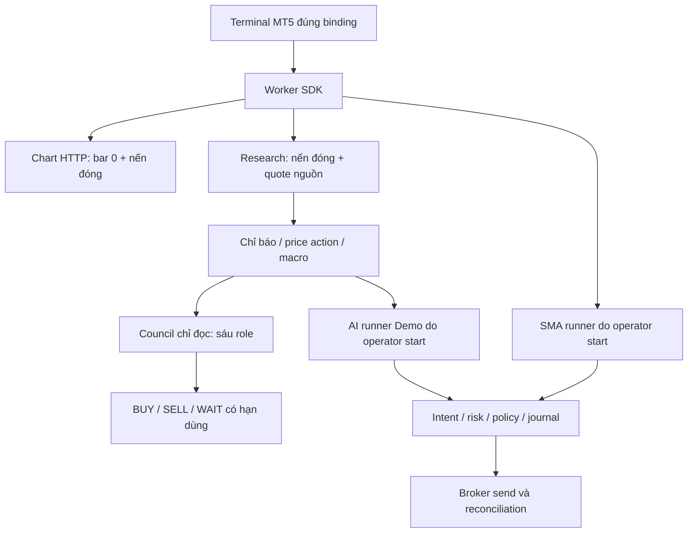

# Forex & XAUUSD Research Lab: dữ liệu, chiến lược và kiểm chứng

Ngày đối chiếu source và tài liệu chính thức: **04/11/2026**, Asia/Saigon. Phạm vi: bản source `0.1.18` trong workspace; đợt viết tài liệu này không attach terminal, đọc tài khoản, gọi model hoặc gửi lệnh broker. Các kết quả runtime ngày 03/11 trong tài liệu cũ là bằng chứng lịch sử, không phải kiểm tra lại ngày hôm nay.

Tài liệu này cụ thể hóa nhánh Forex của [kiến trúc đa thị trường](MULTI_MARKET_ARCHITECTURE.md). Đọc cùng [62 đặc tả Forex đối chiếu source](specs/FOREX_XAUUSD_62.md), [hợp đồng dữ liệu và bằng chứng](DATA_EVIDENCE_CONTRACTS.md), [lộ trình triển khai](IMPLEMENTATION_ROADMAP.md), [hướng dẫn Forex đang có](FOREX_MCP_IMPLEMENTATION.md), [research council](FOREX_AGENTIC_RESEARCH.md) và [chart nến](FOREX_LIVE_CANDLES.md). Những mục ghi **đề xuất** chưa phải API, schema hoặc dịch vụ đã triển khai.

## 1. Mục tiêu và ranh giới

Lab cần trả lời ba câu khác nhau: dữ liệu nào vừa được quan sát; quy tắc nào tạo tín hiệu; bằng chứng nào cho phép đưa tín hiệu sang paper hoặc thực thi được ủy quyền. Một báo cáo BUY/SELL có cấu trúc không tự trả lời câu thứ ba.

XAUUSD tại một broker là instrument có contract, phiên giao dịch, spread và đơn vị riêng. `XAUUSDm` từ MT5, hợp đồng vàng GC trên CME và tài sản GLD không phải các tên thay thế cho cùng một series. Nguồn công khai có thể bổ sung bối cảnh; giá dùng để đánh giá lệnh phải thuộc đúng connection và native symbol của broker.

Không đặt mục tiêu suy luận LLM trên từng tick. Phần cần quyết định theo thời gian và quy tắc lặp lại được thuộc engine xác định; LLM phục vụ nghiên cứu, phản biện, giải thích, xây giả thuyết và đề xuất thay đổi có review. Code hiện có thêm một AI runner Demo; phải mô tả đúng khả năng đó, đồng thời giữ nó tách khỏi tiêu chuẩn engine xác định được đề xuất.

## 2. Bản đồ thực tế trong source

Các đường dẫn trong bảng tính từ root repository. **Có source** nghĩa là tìm thấy đường triển khai và test liên quan; không có nghĩa đã kết nối hoặc được nghiệm thu trên mọi broker.

| Khả năng | Source chính | Hiện trạng và giới hạn |
| --- | --- | --- |
| Connection, account binding, vault, preview, submit, reconcile | `agent/src/trading/forex/{models,service,store,risk,policy}.py` | MT5/Exness API/OANDA có adapter; execution mặc định tắt; live cần mandate đúng tài khoản |
| MT5 terminal worker | `agent/src/trading/forex/adapters/{mt5,mt5_worker}.py` | Subprocess SDK, pin terminal/login/server/demo-live, kiểm tra identity; không sở hữu mọi tiến trình bên ngoài cùng terminal |
| Connector MT5 cũ | `agent/src/trading/connectors/mt5/` | Surface account/quote/order của framework trading có sẵn; không đồng nhất với Forex store mới |
| Loader lịch sử MT5 | `agent/backtest/loaders/mt5_loader.py` | Đường lịch sử/backtest, có config/session và fallback chain riêng; không phải dịch vụ phát tick |
| Chart native | `agent/src/trading/forex/chart.py`, `frontend/src/hooks/useForexChart.ts` | HTTP polling khoảng ba giây sau response; chart gồm bar 0 đang hình thành; hiện chỉ có MT5 |
| Chat research native | `agent/src/trading/forex/research.py`, `agent/src/tools/forex_market_tool.py` | Exact symbol/connection, bid/ask tách khỏi nến đóng, không thay nguồn public khi native unavailable |
| Bối cảnh nhiều khung | `agent/src/trading/forex/{analysis_context,price_action,macro_context}.py` | Yêu cầu 300 nến đóng mỗi M5/H1/H4/D1, chỉ báo cục bộ, hash tập nến, macro có ngày/đơn vị; có thể partial |
| Council chỉ đọc | `agent/src/trading/forex/{council,council_context}.py` | Sáu role technical/macro/bull/bear/risk/manager theo DAG hữu hạn, veto, schema và reference checks; không gửi lệnh |
| SMA runner | `agent/src/trading/forex/runner.py` | Operator start, nến đóng liên tục, toàn tài khoản flat, deduplicate theo strategy revision/bar; không tự resume |
| AI runner Demo | `agent/src/trading/forex/ai.py` | Model đề xuất buy/sell/hold/close; code kiểm tra và có thể mở/đóng vị thế ứng dụng sở hữu trên MT5 Demo Hedge; không phải council |
| MCP riêng | `agent/forex_mcp_server.py`, `agent/src/trading/forex/mcp_server.py` | Stdio, một connection/fingerprint mỗi process; tool execution chỉ thêm khi operator chọn cờ và config cho phép |
| Registry chiến lược | `agent/src/strategy_store/`, `agent/src/strategy_discovery/`, `agent/src/tools/strategy_discovery_tool.py` | Đã có SDM/artifact lifecycle, bench evidence và discovery; cần mở rộng contract cho Forex, không xây registry thứ hai |
| Backtest Forex | `agent/backtest/engines/forex.py` | Có spread, slippage, sizing và swap model; nhiều giả định mặc định, chưa đại diện contract/account đang chạy |
| Paper nội bộ | `agent/src/tools/paper_trade/` | Contract `pt-v1.1` hiện chỉ cn_a/hk/us, theo ngày và close; chưa phải Forex paper driver |

**Chưa tìm thấy trong đường Forex hiện tại:** event bus tick bền vững, recorder/replay theo sequence, daemon transaction streaming liên tục, lịch tin kinh tế point-in-time dùng như hard gate, hoặc workflow tự động nối một artifact đã OOS sang quyền execution. OANDA adapter hiện gọi REST; endpoint streaming của nhà cung cấp không tự trở thành chức năng đã tích hợp. Exness có đọc quote WS và polling operation, chưa là stream account/tick liên tục có replay.

## 3. Phân biệt bốn luồng đang có

Chart tự cập nhật không tự gọi model hoặc khởi động runner. Council có khả năng từ chối khuyến nghị khi role lỗi, quote cũ, dữ liệu thiếu hoặc risk veto. Nhãn `limit` trên scenario mô tả điều kiện nghiên cứu, không chứng minh Forex execution đã hỗ trợ pending LIMIT. AI Demo gọi model khác workflow council; sự tồn tại của hai đường không tạo ra một vòng tự học hoặc orchestration liên tục.

MCP mặc định có bảy tool đọc chung; MT5 có thêm context và plan, thành chín. `--allow-execution` thêm create/submit/reconcile intent; không có tool cấp credentials, bật execution, clear halt, start runner hoặc commit consent. CLI setup giữ secrets ở prompt ẩn và OS vault; không đưa credentials vào ví dụ chat hoặc file cấu hình công khai.

## 4. Dữ liệu cập nhật liên tục: polling, tick và nến

### 4.1. Hợp đồng nguồn cần giữ

MetaQuotes quy định bar vị trí 0 là bar hiện tại; worker mới dùng `start_pos=0` cho chart và `start_pos=1` cho research/runner. Dữ liệu lịch sử phụ thuộc phần terminal đang có và giới hạn lịch sử chart. Không được đổi nhãn một cửa sổ 300 nến thành toàn bộ lịch sử thị trường. [MetaQuotes: copy_rates_from_pos](https://www.mql5.com/en/docs/python_metatrader5/mt5copyratesfrompos_py).

MT5 Python trả timestamp tick/bar theo UTC; tạo datetime truy vấn phải có UTC. UI có thể hiển thị giờ địa phương nhưng dataset và artifact giữ UTC cùng timezone/session dùng để chia bar. Bar mở lúc nào khác thời điểm tín hiệu được phép dùng nó. [MetaQuotes: copy_rates_from](https://www.mql5.com/en/docs/python_metatrader5/mt5copyratesfrom_py).

OANDA phân biệt bid/ask/mid candles; `volume` là số lần tạo giá và `complete` mô tả bar đã hoàn tất. Adapter hiện đọc mid OHLC và giữ `volume_type=price_updates`; không gọi đó là volume khớp lệnh toàn thị trường. [OANDA: Candlestick](https://developer.oanda.com/rest-live-v20/instrument-df/).

OANDA pricing stream giới hạn tối đa bốn cập nhật mỗi giây cho mỗi instrument, có thể bỏ qua giá phát sinh trong cùng cửa sổ; heartbeat khoảng năm giây. Vì vậy cả khi tích hợp stream cũng không được tuyên bố có mọi tick hay reconstruct chính xác mọi high/low từ nó. [OANDA: Pricing stream](https://developer.oanda.com/rest-live-v20/pricing-ep/).

### 4.2. Những trường có rồi và phần phải bổ sung

Hiện đã có quote `timestamp`, chart `retrieved_at`, research `_meta.as_of`, bar open time và plan `created_at/expires_at`. Các trường đó chưa hình thành log sự kiện có đủ source/receive/compute time. `retrieved_at` hiện được ghi sau thao tác đọc/validate; không phải thời điểm NIC nhận gói tin và không đo được độ trễ tick trọn vẹn.

**Envelope đề xuất**, dùng chung [hợp đồng bằng chứng](DATA_EVIDENCE_CONTRACTS.md), là semantic contract trước khi chọn transport; đây không phải response v1 đã phát hành:

| Nhóm | Trường cần ghi | Lý do |
| --- | --- | --- |
| Identity | `event_id`, `schema_version`, `event_type`, `connection_id`, `binding_hash`, `source`, `native_symbol`, `environment` | Không trộn hai account/server hoặc instrument gần tên |
| Thời gian | `source_time`, `received_at`, `computed_at`, `available_at` | Phân biệt lúc nguồn tạo dữ liệu, ingress nhận, engine tính và dữ liệu được phép dùng |
| Tính liên tục | `source_sequence` nếu nguồn cung cấp, `ingest_sequence`, `session_id`, `gap_status`, `replay` | Không bịa sequence nguồn; phát hiện thiếu/lặp khi reconnect |
| Nội dung | Decimal price/quantity, `price_basis`, currency, `quantity_unit`, `volume_unit`, metadata contract revision | Không mất đơn vị khi chuẩn hóa |
| Chất lượng | `freshness`, `clock_skew`, `is_complete`, `revision`, `payload_hash`, `parent_event_ids` | Biết tín hiệu dựa vào bar/revision nào |

Không lấy `received_at - source_time` làm latency thuần mạng nếu chưa đánh giá clock skew. Dùng đồng hồ monotonic cho thời lượng xử lý cục bộ; UTC cho audit và join dữ liệu. `computed_at` không được làm tăng độ mới của một quote cũ. Dataset lịch sử chưa có receive time phải ghi unknown, không gán giờ tải hiện tại thành thời điểm biết thông tin trong quá khứ.

### 4.3. Service streaming đề xuất

1. Một owner cho mỗi terminal/account binding đọc feed và catalog; adapter chuẩn hóa, validate trước khi publish. Historical loader và trading worker cần có quy tắc sở hữu chung để tránh session cạnh tranh; không chỉ thêm một khóa Python trong một process.
2. Recorder append sự kiện cùng cursor/checkpoint; consumer có deduplication và backpressure. Chọn storage tối thiểu theo tải đo được, không mặc định cần Kafka hoặc một database mới.
3. Khi disconnect, đánh dấu stale/gap và khóa entry mới; reconnect xác minh lại identity, lấy account/position snapshot, backfill khoảng dữ liệu broker cho phép rồi mới đánh giá readiness. Snapshot mới không chứng minh đã khôi phục mọi tick bị mất.
4. Bar builder khóa alignment/timezone và price basis; closed bar có ID/revision. Tick đến muộn cần correction event hoặc policy loại rõ ràng; không âm thầm sửa history rồi giữ nguyên hash tín hiệu.
5. Engine chỉ tiêu thụ `candle_closed` hoặc event đã khai báo. Không lấp cuối tuần bằng bar giả; phân biệt market closed với data gap. Runner hiện tại yêu cầu lookback liên tục nên có thể chặn sau khoảng nghỉ cho tới khi đủ nến; đây là hành vi hiện có, chưa phải lịch phiên đầy đủ.
6. UI nhận dữ liệu đã có trạng thái freshness; dashboard repaint không phát sinh quyết định mới. API chart polling hiện tại vẫn là consumer hiển thị riêng cho tới khi service mới được nghiệm thu.

MetaQuotes có API đọc tick lịch sử theo khoảng thời gian; API đó là cơ sở có thể dùng cho backfill, không phải lời hứa rằng terminal/broker giữ đủ tick ở mọi thời kỳ. [MetaQuotes: copy_ticks_range](https://www.mql5.com/en/docs/python_metatrader5/mt5copyticksrange_py).

## 5. Phương pháp nghiên cứu và vai trò AI

Giữ bốn lớp: quan sát nguồn → feature tính bằng code → giả thuyết/diễn giải → tín hiệu/đánh giá risk. Giá breakout suy ra không được đăng ký thành quote quan sát; forecast sáu nến không phải xác suất thắng đã hiệu chỉnh.

Council đang có technical/macro → bull/bear → risk → manager. Nâng chất lượng bằng dữ liệu và tiêu chí phản biện trước khi tăng số agent. Các role có thể dùng cùng model/provider; không đo model diversity bằng số tên role. Mỗi role cần runtime identity, usage thực được provider trả về và failure riêng; usage thiếu không thay bằng số 0.

| Vai trò chức năng đề xuất | Tận dụng phần có sẵn | Điều kiện cần bổ sung |
| --- | --- | --- |
| Chief Strategist | Manager/council và orchestration hiện hữu | Chọn hoặc từ chối artifact đủ evidence, không tự promote chiến lược |
| Macro Analyst | Macro role, FRED/SPDR/CME context | Lịch phát hành, revision, độ trễ và phạm vi tin tức |
| Structure/Regime Analyst | Price action + technical role | Regime deterministic versioned; validation riêng, không coi SMA alignment là regime đầy đủ |
| Strategy Researcher | SDM, hypothesis và discovery workflow | Giả thuyết, rule specification, lineage và số thí nghiệm |
| Quant Engineer | SignalEngine template, backtest và bench evidence | OOS, chi phí broker, deterministic replay, stress scenarios |
| Live Signal Monitor | SMA runner/quote freshness | Event service, health/SLA và bằng chứng nhận bar một lần |
| Independent Risk Officer | Risk role + `risk.py`/`policy.py` | Veto mô hình và hard gate độc lập; model không nới cap |

Risk role có quyền veto báo cáo. Execution risk code là lớp khác và vẫn kiểm tra sau khi báo cáo được chấp nhận; đồng thuận hội đồng không được bỏ qua quote freshness, account, margin hoặc mandate.

## 6. Strategy Lab: mở rộng SDM hiện có

`agent/src/strategy_store/models.py` đã lưu source, signal/entry/exit/sizing, engine/run path, hypothesis, lineage `derived_from`, owner/validator/approver, version và validation status. Discovery đọc Alpha Zoo/SDM và bằng chứng backtest. Dùng các hợp đồng đó làm nguồn sự thật; không dựng thêm thư mục “strategy registry” độc lập chỉ để chứa prompt.

Một artifact Forex cần xác định thêm metadata hoặc manifest liên kết, theo khả năng schema hiện có: market/instrument mapping, broker spec snapshot, price basis, timeframe/alignment, data revision/hash, warmup, entry/exit/SL/TP, sizing/rounding, allowed regime, session/news policy, cost model, train/test boundaries, code/config/model/prompt hash và giới hạn dùng. Bất kỳ trường nào chưa lưu được phải được ghi là khoảng trống triển khai.

| Họ phương pháp nghiên cứu | Quy tắc phải định nghĩa trước thử nghiệm | Rủi ro cần đo |
| --- | --- | --- |
| Trend following | Điều kiện trend, crossover/threshold, volatility filter, exit | Churn trong range, lag, chi phí mỗi lần đảo tín hiệu |
| Pullback continuation | Trend nền, vùng hồi, nến xác nhận, invalidation | Dùng pivot chưa xác nhận, bắt đầu reversal thành pullback |
| Breakout/retest | Cửa sổ range loại nến trigger, buffer, thời hạn retest | False breakout, gap, spread nới, limit không fill |
| Range mean reversion | Cách xác định range và chế độ hủy range | Tail loss khi regime đổi, averaging làm tăng exposure |
| Session/volatility rules | Timezone/DST, giờ phiên, ATR reference, hold horizon | Calendar sai, rollover, spread theo phiên |
| News avoidance hoặc event study | Nguồn lịch, phát hành/revision, trước/sau bao lâu | Look-ahead consensus/actual, lịch thiếu, slippage cực đoan |

Các hàng là đề bài nghiên cứu; chưa phải những chiến lược đã cài, đã OOS hoặc có lãi. Bản đầu nên hoàn thiện một baseline SMA deterministic đang có cùng quy trình kiểm chứng, rồi thêm một phương pháp có giả thuyết riêng. Không cần triển khai đồng thời mọi chỉ báo và role.

Điều kiện promote đề xuất bổ sung trên lifecycle/validation status của SDM: definition reviewed → reproducible backtest → OOS reviewed → paper observed → demo acceptance → quyền live được operator cấp riêng. Tên các gate là quy trình nghiệm thu đề xuất, không phải enum đang có. Thay parameter/rule/data/cost quan trọng tạo revision hoặc child artifact, không ghi đè evidence cũ.

## 7. Risk, sizing và đơn vị tiền

### 7.1. Lớp kiểm tra đã có

`risk.py` kiểm tra allowlist, account/env, account currency USD, quyền trade, quote timezone/age, bid ≤ ask, tradeable, spread theo point, volume min/max/step, tick precision và hình học SL/TP. Mở lệnh cần SL; notional/stop-risk/gross/leverage/free-margin còn phải nằm trong cap. `policy.py` thêm execution flag, fingerprint, halt, outstanding execution barrier, daily count, drawdown từ equity peak quan sát và mandate live.

MT5 worker dùng `order_calc_profit` để ước lượng loss đến stop và `order_calc_margin` cho margin; conversion/notional dùng quote native còn mới. MetaQuotes trả PnL theo đồng tiền tài khoản nên không được đặt nhãn USD cho mọi account; execution hiện chặn account khác USD. [MetaQuotes: order_calc_profit](https://www.mql5.com/en/docs/python_metatrader5/mt5ordercalcprofit_py).

Lot MT5, unit OANDA và volume native Exness phải được giữ nguyên. `symbol_info` cung cấp point, tick size/value, contract size, currency, min/max/step và stops/freeze metadata; không hardcode một lot vàng luôn bằng một lot FX. Broker specifications có thể khác default của backtest. [MetaQuotes: symbol_info](https://www.mql5.com/en/docs/python_metatrader5/mt5symbolinfo_py).

### 7.2. Sizing đề xuất trước khi promote

Với budget rủi ro đã được phê duyệt `B`, ước lượng loss cho một đơn vị native tại entry/stop bằng hàm broker, cộng commission/financing/slippage buffer theo cost model. Tìm quantity trên đúng lưới min/step, làm tròn xuống và đánh giá lại cả margin, gross exposure và stop-risk; nếu quantity tối thiểu vượt budget thì NO TRADE. Không tự nới cap để đáp ứng minimum lot.

Không dùng `budget / khoảng cách giá` như sizing phổ quát: phép chia đó thiếu contract multiplier, account-currency conversion và đơn vị quantity. Không giả định relation tuyến tính khi đổi sang instrument hoặc fee model khác. Preview phải trình bày quantity unit, quote time, giả định chi phí và lý do block; một số lot không có ý nghĩa nếu thiếu contract snapshot.

| Giới hạn hiện tại | Hệ quả khi nghiệm thu |
| --- | --- |
| Stop-risk chưa bao gồm đủ commission/swap/fee; SL không bảo đảm giá fill | Stress gap/slippage, báo loss dự kiến và tail loss riêng |
| Equity peak chỉ cập nhật ở lần authorize | Không gọi đây là equity monitoring liên tục hoặc daily loss đã điều chỉnh cashflow |
| Chưa có news blackout hard gate | Thiếu lịch quan trọng phải là missing policy/evidence, không tự suy “không có tin” |
| Close mới cho vị thế journal-owned MT5 Demo Hedge | Không suy hỗ trợ close Live/OANDA/Exness hoặc flatten toàn tài khoản |
| Halt/stop runner không tự đóng/cancel exposure | Halt còn chặn cả close qua app vì kiểm trước close exemption; stop runner chỉ dừng actor, không tương đương halt mọi caller; phải có runbook riêng |

Đọc positions toàn tài khoản để tính exposure; net hai chiều bằng 0 không có nghĩa gross risk bằng 0. Với MT5, position và order là các đối tượng khác nhau; phải đóng đúng ticket/ownership thay vì gửi ngược chiều rồi coi là đã đóng. [MetaQuotes: positions_get](https://www.mql5.com/en/docs/python_metatrader5/mt5positionsget_py).

## 8. Macro và tin kinh tế

Context hiện lấy DXY từ Yahoo, TIPS real yield và broad USD từ FRED; với vàng có GLD holdings/ước lượng thay đổi shares và volume futures CME khi lấy được. Mỗi series có source/date/unit và tình trạng stale/unavailable; không gộp ngày tải với ngày quan sát. Đây là context theo ngày, chưa phải luồng calendar CPI/NFP/FOMC hay dịch vụ news liên tục.

Lịch tin đề xuất cần `event_id`, currency/country, scheduled time UTC, actual release time, `first_seen_at`, impact taxonomy, consensus vintage, previous/revised/actual cùng nguồn. Consensus được tải sau công bố không được coi là consensus biết trước công bố. Event bị dời/hủy phải có revision; thiếu API không trở thành “lịch trống”.

Blackout policy phải cấu hình và kiểm thử theo revision chiến lược: event nào ảnh hưởng instrument nào, trước/sau bao lâu, xử lý vị thế đang có và khi calendar stale. LLM được giải thích bối cảnh; hard gate dùng lịch/clock/policy xác định. Không lấy text báo chí không timestamp làm lý do tự động bỏ hoặc cấp phép lệnh.

VWAP dùng tick count OTC chỉ là proxy theo feed đó nếu công thức có trọng số tick; không mang nghĩa VWAP giao dịch tập trung. GLD shares/holdings không phải dòng tiền vàng spot toàn cầu; CME GC volume không phải MT5 tick volume. Chỉ so sánh sau khi giữ nguyên đơn vị và thời điểm quan sát.

## 9. Backtest, OOS và khả năng tái lập

ForexEngine hiện có giả định spread điển hình, half-spread cộng `slippage_pips`, explicit commission bằng 0 và swap model; `can_execute()` trả `True` thay vì kiểm lịch broker. Metal sizing dùng specs quy ước. Vì vậy kết quả engine là kết quả trong mô hình, chưa phải simulation được hiệu chỉnh cho account Exness/OANDA cụ thể. Default leverage trong code cũng không phải mức leverage được đề xuất hoặc quyền account hiện có.

Quy trình nghiên cứu đề xuất:

1. **Khóa giả thuyết trước thử:** rule, universe/native mapping, horizon, warmup, cost model và tiêu chí bác bỏ; lưu số trial và các lần thất bại. Không chọn biểu đồ đẹp rồi viết lại lý do sau.
2. **Đóng băng dataset:** raw và normalized hash, provenance/coverage, timezone/alignment, price basis, contract snapshot, gap/revision policy. 300 nến context chỉ phục vụ cửa sổ phân tích, không đủ mặc định cho nghiên cứu nhiều regime.
3. **Chia train/validation/OOS theo thời gian:** parameter chọn trong train; validation điều chỉnh trong budget đã định; OOS giữ kín. Nếu nhìn OOS rồi thay rule, tạo thí nghiệm mới và mất tính độc lập của holdout đó.
4. **Walk-forward:** công bố cửa sổ train/test, lịch refit, warmup và cách nối equity. Feature tại `t` chỉ dùng dữ liệu available tại `t`; pivot hai nến phải chờ đúng confirmation time. Với nhãn/hold horizon chồng lấp, cần khoảng cách/purge phù hợp để tránh rò rỉ; không random split time series cho thuận tiện.
5. **Mô phỏng fill đúng giới hạn dữ liệu:** bid/ask và costs là ưu tiên. Nếu một bar cùng chạm SL và TP mà thiếu tick, dùng policy thứ tự bảo thủ và ghi ambiguity; không chọn đường giá có lợi. Không giả định mọi LIMIT được fill chỉ vì low/high chạm giá.
6. **Báo cáo ngoài lợi nhuận:** số trade, turnover, exposure, drawdown và duration, tail loss, net expectancy, phân bố R, chi phí/tổng PnL, theo session/regime; nêu sample size và khoảng bất định. Không hiển thị win rate khi chưa có số đo.
7. **Stress:** spread/commission/swap tăng, slippage/gap, quote trễ, missing bars, đổi specification, disconnect, partial/unknown; đánh giá sensitivity quanh parameter. Monte Carlo trade shuffle bỏ qua phụ thuộc thời gian nên cần công bố giả định, không thay OOS.
8. **Lưu artifact:** code/config/environment/dependency/data/seed hash, manifest/run card, order/trade ledger, rejection log, split boundaries và bench record. Gắn `artifact_id` đúng SDM để history có lineage; failure/missing metrics không tự trở thành bench thành công.

Một LLM report tái tạo JSON không chứng minh tái tạo được lời giải thích hay dự báo. Khi benchmark LLM, giữ prompt/model/runtime identity và raw decision output, policy/budget, input hash, số lần gọi cùng lỗi; so với baseline deterministic trên cùng dữ liệu/chi phí. Không chọn lại câu trả lời model sau khi đã biết kết quả thị trường.

## 10. Shadow, paper, broker demo và live

| Mức nghiệm thu | Bằng chứng cần thu | Điều chưa được suy ra |
| --- | --- | --- |
| Fixture/unit | OHLC/identity/precision/expiry/veto/idempotency bằng dữ liệu kiểm soát | Terminal thật, mạng thật hoặc fill thật |
| Shadow read-only | Snapshot thật, freshness/gap/clock, signal log có input hash và không send | Broker chấp nhận order |
| Paper nội bộ | Simulated orders/fills, cost/rejection model và replay cùng revision | Execution latency, reject và thanh khoản broker |
| Broker Demo | Account xác nhận demo, contract thật, lifecycle open/partial/close/reconcile | Chất lượng fill và sức chịu đựng tài khoản tiền thật |
| Live được ủy quyền | Mandate, hard caps, journal/audit, monitoring/runbook và acceptance riêng | Lợi nhuận tương lai hoặc an toàn tuyệt đối |

Profile MT5 có tên `paper` có thể chỉ **demo broker**; paper engine nội bộ là mô phỏng. UI/docs phải ghi rõ loại nào. Không dùng hai từ thay thế để nâng mức kiểm chứng.

`order_check` thành công không bảo đảm operation sẽ được thực thi; ACK cũng không phải fill. Lệnh có kết quả unknown phải giữ durable claim và reconciliation barrier; không gửi lại bằng request key mới để “thử lại”. [MetaQuotes: order_check](https://www.mql5.com/en/docs/python_metatrader5/mt5ordercheck_py).

## 11. Tiêu chí nghiệm thu cho nhánh Forex

| Gate | Kiểm tra tối thiểu | Bằng chứng đầu ra |
| --- | --- | --- |
| Source identity | Đổi account/server giữa read/model/submit; nhiều native connection cùng tên | Response bị loại hoặc yêu cầu chọn đúng connection |
| Clock/freshness | Quote cũ/tương lai, clock lệch, reconnect có khoảng trống | Không có entry mới; health nêu lý do và source time |
| Candle boundary | Bar 0, duplicate/conflicting/out-of-order, late correction, cuối tuần | Feature/decision chỉ từ bar được phép dùng, không repaint âm thầm |
| Contract/sizing | Gold/FX khác multiplier, suffix, min lot vượt risk, conversion thiếu | NO TRADE hoặc quantity đúng đơn vị/lưới; không fallback public |
| Research | Role lỗi/veto, stale macro, quote đổi sau debate | WAIT/partial có refs; không giả đủ role hoặc ghi 0 cho nguồn thiếu |
| Reproducibility | Hai lần replay cùng deterministic revision/dataset | Cùng features/signals/intents/rejections trong dung sai số đã công bố |
| Execution lifecycle | Timeout sau send, partial, process crash, duplicate submit | Không duplicate order; claim/audit phục hồi được, unknown giữ block |
| Promotion | Artifact thiếu OOS, cost model hoặc ownership | Chặn promotion; operator không bị trình bày trạng thái “ready” giả |

Các test source đáng đọc: `agent/tests/test_forex_{core,research,context,chart,council,ai,execution,runner,mt5}.py`; frontend có `frontend/src/lib/__tests__/forexChart.test.ts`. Tên test và fixture phản ánh hợp đồng được kiểm tra; tài liệu này không gán chúng là kết quả broker acceptance.

## 12. Thứ tự triển khai tối thiểu

1. Giữ chart/research đang chạy và hoàn chỉnh readiness contract, dataset/run manifest cùng native symbol mapping. Xác minh một connection Demo bằng thao tác chỉ đọc, thu health và latency evidence.
2. Thêm recorder/replay tối thiểu cho closed-bar strategy trước; thống nhất ownership MT5 và chính sách gap/correction. Chưa cần full tick HFT nếu chiến lược chỉ quyết định khi nến đóng.
3. Đưa baseline SMA qua SDM → chi phí broker → walk-forward/OOS → shadow/paper; mọi kết quả gắn revision. Đo replay trước khi bổ sung phương pháp mới.
4. Bổ sung calendar/news hard gate và monitoring; thử failure/recovery cùng một strategy đã khóa. Chỉ mở rộng feeds/market khi contract và runbook đủ bằng chứng.
5. Nghiệm thu Demo open/close/reconcile bằng kịch bản operator phê duyệt riêng. Live là giai đoạn độc lập, không được bật do viết xong tài liệu hoặc model trả confidence cao.

Chưa kiểm tra lại terminal, provider, quyền API, installer hoặc khớp lệnh trong đợt tài liệu ngày 04/11/2026. Không có kết luận chiến lược đã sinh lợi; mọi trạng thái runtime cần bằng chứng có ngày, binding và artifact cụ thể.

## 13. Phân rã chính xác 62 đặc tả của Master Plan

[Danh mục 62 đặc tả](specs/FOREX_XAUUSD_62.md) giữ nguyên ID **FX-132 đến FX-193** và tiêu đề trong [Master Plan V1](../VIBE_TRADING_MULTI_MARKET_MASTER_PLAN_V1.md). Mỗi hàng có trạng thái source, file/symbol tái sử dụng, acceptance có thể kiểm tra và ưu tiên. Một hàng `source-partial` không phải feature hoàn thành; acceptance là yêu cầu cho đợt triển khai sau.

Phân rã này ưu tiên những khoảng trống làm sai kết luận nghiên cứu hoặc rủi ro account: broker contract snapshot, causal multi-timeframe join, tick/SL-TP ambiguity, OOS thật sự, sizing theo budget, cashflow-aware drawdown, unknown reconciliation, position/deal ownership và halt runbook. Nhiều chỉ báo hay nhiều agent hơn không tự giải quyết các khoảng trống đó.

### 13.1. Đường gọi và vị trí phải thay đồng bộ khi triển khai

| Seam hiện tại | Caller đã đối chiếu | Ranh giới phải giữ nếu mở rộng |
| --- | --- | --- |
| `ForexService.preview/create_intent/submit/execution` | HTTP trong `agent/src/api/forex_routes.py`, MCP trong `agent/src/trading/forex/mcp_server.py`, SMA `runner.py`, AI Demo `ai.py` | Các caller cùng dùng risk/policy/store; không tạo send path riêng cho agent hoặc UI |
| `Connection`, `Order`, `Strategy`, `AIStrategy` trong `models.py` | HTTP request model, MCP schema, worker JSON, runner và frontend Forex API | `extra="forbid"`; field/action mới phải version/compatibility review, không thêm vào ví dụ rồi gọi là API đã có |
| `Native.quote/candles/chart/prepare/submit/reconcile` | Adapter `MT5.call` → subprocess worker → SDK | UTC/native identity/quantity unit, vault không đi qua tool arguments, terminal lock và ownership |
| `Store.create_intent/claim/finish/active/owns_position` | Service, policy, worker close và runner | Durable claim và binding snapshot phải giữ qua restart; không xóa DB hoặc active row để mở lại execution |
| `Artifact`, `BenchResult`, validation primitives | Strategy store/discovery, backtest và hypothesis workflows | Dùng registry hiện hữu; nối dataset/spec/cost/fold manifest, không lập registry prompt song song |

Current API là `/api/forex/connections/{identifier}/preview`, `/intents`, `/intents/{intent_id}/submit`, `/reconcile`, `/runner/start`, `/runner/stop`, `/halt`, `/resume` và `/resume-broker` dưới connection prefix phù hợp. Các tên tool draft `fx.*.v1` trong master là target contract; không thay các URL này trong hướng dẫn sử dụng cho tới khi có implementation/version migration.

### 13.2. Source facts cần giữ khi mô tả realtime

`adapters/mt5.py:MT5.call` chạy subprocess timeout 40 giây mỗi operation. `mt5_worker.py:dispatch` lấy lock theo terminal path; read có bounded lock wait, write không tự retry operation. Khóa phối hợp các caller tuân thủ cùng cơ chế, không sở hữu mọi EA hoặc terminal action bên ngoài. Không thể gọi chart poll ba giây là SLA tick ba giây: thời gian chờ response/lock/SDK cũng thuộc chu kỳ.

`Native.quote` trả last tick UTC từ `time_msc` nếu có; chưa lưu raw flags vào recorder. `Native._rates` trả broker OHLC với `tick_count`; chưa phát side-specific bid/ask candles từ tick log. `service.read` giới hạn tối đa 300 records, là cửa sổ đọc tương tác, không thay historical bulk loader. Recorder/replay phải là seam mới rõ ràng, không cho một poll response đóng vai mọi tick giữa hai lần poll.

Giới hạn sampling/heartbeat của OANDA ở mục 4 vẫn áp dụng; không dùng bid/ask stream đó thay tick log MT5. [OANDA: Pricing stream](https://developer.oanda.com/rest-live-v20/pricing-ep/).

## 14. Ví dụ sizing XAUUSD có kiểm toán đơn vị

**Toàn bộ số dưới đây là SYNTHETIC**, chỉ dùng kiểm chứng thiết kế FX-165, không phải quote thật, contract Exness/OANDA, mức leverage khuyến nghị hoặc cấu hình account đã được cấp phép. Quantity tính ra chỉ là candidate; execution vẫn phải qua tất cả caps/mandate/binding/freshness hiện tại.

| Input fixture | Giá trị/đơn vị |
| --- | --- |
| Account | USD; equity 10,000 USD; free margin 9,000 USD |
| Native contract | `XAUUSD-FIXTURE`, 100 troy oz/lot; min 0.01 lot, step 0.01 lot, max 100 lot |
| Price metadata | point 0.01 USD/oz, tick size 0.01 USD/oz; minimum stop distance 0.20 USD/oz |
| Bid / ask tại quyết định | 2,400.00 / 2,400.40 USD/oz, freshness hợp lệ trong fixture |
| Lệnh nghiên cứu | BUY tại ask 2,400.40; SL 2,390.00 USD/oz |
| Broker loss fixture | `abs(order_calc_profit(...,1.00 lot,2400.40,2390.00)) = 1,040 USD` |
| Chi phí bổ sung fixture | commission round-trip 7 USD/lot + adverse-slippage buffer 10 USD/lot; không cộng spread lần hai |
| Risk budget fixture | 50 USD; financing 0 chỉ vì fixture không qua rollover, không phải default chung |

Tổng ước lượng tới SL có chi phí cho một lot là `1,040 + 7 + 10 = 1,057 USD/lot`. Candidate chưa làm tròn `50 / 1,057 ≈ 0.04730 lot`. Trên grid min 0.01, step 0.01, chọn **0.04 lot**; đánh giá lại broker calculator và chi phí cho đúng quantity này:

- Broker stop-loss estimate: `0.04 × 1,040 = 41.60 USD`.
- Chi phí bổ sung: `0.04 × 17 = 0.68 USD`; tổng estimated risk **42.28 USD**, trong budget50. Candidate0.05 lot cho52.85USD nên vượt budget.
- Gross notional: `0.04 lot × 100 oz/lot × 2,400.40 USD/oz = 9,601.60 USD`; không lấy `0.04 × price` làm notional.
- Giả sử margin calculator fixture trả96.02USD cho0.04lot thì còn cần kiểm free margin, total gross và leverage. Không suy margin thật bằng cách chia notional cho một leverage hardcoded.
- Nếu budget chỉ10USD, min0.01lot có estimated risk10.57USD nên **NO TRADE**; không làm tròn lên minimum và không tự nới budget.

Ở ví dụ này spread là40points. Defaults hiện tại trong `Limits` có `max_spread_points=30`, `max_quantity=0.01`, `max_order_notional_usd=1000`, `max_total_exposure_usd=3000`, vì vậy **candidate0.04 vẫn bị block bởi nhiều caps**. Ví dụ chỉ kiểm toán thuật toán sizing đề xuất; nó không hướng dẫn thay caps để gửi lệnh. Một test cho sizing phải giữ riêng “candidate theo risk” và “được toàn policy cho phép”.

Hàm sizing phải đi tìm quantity trên grid `(q-minimum)%step==0`, đánh giá chi phí theo đúng mô hình thay vì mặc định tuyến tính. Công thức trên đúng vì fixture đã định nghĩa linear cost/contract; thực tế có minimum fee hoặc nonlinear margin phải revalue candidate, giảm theo step và giới hạn số vòng. Không có quantity hợp lệ thì từ chối. Broker PnL calculator trả account currency, nên account khác USD hiện vẫn bị `UNSUPPORTED_ACCOUNT_CURRENCY`. [MetaQuotes: order_calc_profit](https://www.mql5.com/en/docs/python_metatrader5/mt5ordercalcprofit_py), [MetaQuotes: symbol_info](https://www.mql5.com/en/docs/python_metatrader5/mt5symbolinfo_py).

## 15. Causal timestamps, regime và backtest không nhìn tương lai

Một M5 bar mở10:30, đóng10:35 không được dùng full close trước10:35; H1 bar10:00–11:00 không được join full close vào quyết định M5 lúc10:35. Join đề xuất là latest **available-at ≤ decision-at**, không chỉ latest bar-open ≤ decision-at. Snapshot live hiện tại chỉ phục vụ bối cảnh lúc gọi; nó không phải historical feature store đủ để tái dựng mọi quyết định trước đây.

`price_action.py:candle_evidence` hiện có pivot cần hai nến bên phải, lưu pivot `time` và `confirmed_at`. Cột `confirmed_at` là timestamp nến xác nhận trong dataset; consumer cần cộng convention bar duration/available-at tương ứng để biết lúc sử dụng, không cho pivot xuất hiện từ lúc chính nó mở. Breakout reference20nến loại nến trigger; điều này phải giữ trong compiler/regime mới.

Để kiểm tra causality, replay từng prefix dữ liệu và lưu features/signals tại thời điểm đó; append future bars không được sửa decision cũ. Future-confirmed pivot có thể xuất hiện trong báo cáo hồi cứu nhưng phải giữ confirmation time; không vẽ ngược lên lịch sử rồi lấy hình vẽ làm evidence entry sớm. Feature correction tạo revision và invalidation rõ ràng.

`summarize_frame` có SMA alignment, EMA/RSI/ATR và price-action heuristic; chưa có detector trend/range với hysteresis/dwell hay calibrated probabilities. Thiết kế FX-146/147 phải khóa feature normalization, train-only thresholds, warmup, transition policy và unknown state. Số lần đổi regime, delay xác nhận, false transitions và coverage cần đo theo OOS; không lấy tên regime làm chứng cứ thị trường sẽ tiếp tục như vậy.

### 15.1. Hai primitive có tên dễ bị hiểu quá khả năng

`agent/backtest/validation.py:walk_forward_analysis` **chia một equity curve đã tính** thành sequential windows và báo consistency. Nó không fit lại strategy/optimizer trong train folds. Cần fold runner riêng kết nối `purged_walk_forward_splits`/registry/backtest hiện có, lưu fitted parameters và boundaries; chỉ sau đó mới có bằng chứng train→OOS thực sự. Thay test labels mà fitted train parameters đổi là test phát hiện leakage cần fail.

`monte_carlo_test` hoán vị cùng trade PnL bằng seed. Nó kiểm đường vốn dưới thứ tự thay đổi, giữ tổng PnL; chưa là block bootstrap giữ serial dependency, chưa mô phỏng margin/financing/cost theo đường giá mới. Risk-of-ruin phải định nghĩa horizon, ruin condition và account model; không gọi zero failures trong ít simulation là xác suất phá sản bằng0.

Forex bar engine hiện `can_execute=True`, commission0 và micro-lot/metal specification quy ước; kết quả chưa chứa đầy đủ calendar, fee minimum, account stop-out và broker terms. Bar chạm SL/TP cả hai phía cần ambiguity policy khóa trước. Tick replay giúp biết trình tự observed quotes, nhưng fill vẫn phụ thuộc latency/liquidity model; tick đầy đủ không chứng minh mọi order được fill.

## 16. Recovery, halt, ownership và rủi ro rollback

[State machine và danh mục recovery](specs/FOREX_XAUUSD_62.md#7-state-machine-execution-và-recovery) phân biệt `prepared`, durable `submitting`, ACK/working/partial, terminal receipt và unknown. `preflight_rejected` có thể chỉ là event khi row vẫn prepared; không được báo mọi rejected preflight như một broker reject. Một intent entry `filled` cũng không phải trade đã đóng có lợi nhuận.

Source `Store.owns_position` hiện đòi entry journal state `filled`, binding snapshot, native symbol/side, magic, correlation comment và ticket/identifier đúng. Một partial position có thể tồn tại thật nhưng chưa đạt điều kiện close ownership hiện tại; account exposure vẫn phải tính nó. Position không được coi absent chỉ vì journal chưa chứng minh ownership. Reconcile order/history chưa thay deal-level realized PnL/exit reason taxonomy.

`policy.authorize` kiểm execution flag, binding, halt và outstanding connector claim **trước** close exemption. Close exemption chỉ bỏ entry-count/drawdown limits đối với close được chứng minh; không bỏ quote freshness, USD currency, permission, ownership, halt hoặc account-mode validation. Worker vẫn có khoảng thời gian giữa authorize, `order_check` và SDK send; chưa có chứng cứ atomic halt ở mọi thời điểm. Test tương lai phải đặt halt ở từng boundary và định nghĩa admission/drain, không hứa thu hồi hành động đã bắt đầu. Vì vậy có hai thao tác khác nhau:

1. **Stop runner:** dừng actor và đợi thao tác đã bắt đầu ghi receipt; không thu hồi lệnh broker đã gửi và không tự halt mọi HTTP/MCP caller.
2. **Halt:** chặn submission qua policy, gồm close qua app; không tự cancel/flatten exposure. Reconcile/inspect chỉ đọc vẫn cần khả dụng để operator xử lý.

Khi unknown, giữ connector barrier và correlation tag; không tạo request key mới, xóa DB, xóa halt file hoặc chuyển connection ID để né unknown. Reconcile thành công không tự cấp quyền chạy lại: resume đúng scope chỉ clear halt sau kiểm outstanding, runner vẫn cần operator start. Nếu broker-native intervention cần thiết, lưu evidence và reconcile trở lại journal trước tiếp tục.

MT5 connector cũ có `close_position` theo ticket và magic khác (`862001` so với Forex worker `2601103`). Source comment của connector ghi generic `src.live.runtime.flatten` có thể mở hedge đối ứng trên Hedge account; do đó không dùng tên “flatten” làm bằng chứng đã đóng ticket, hết financing hoặc hết gross exposure. Việc thống nhất ownership/close across surfaces là thay đổi execution riêng, cần acceptance riêng.

| Failure scenario | Hành vi cần giữ / phần cần bổ sung | Rollback có ý nghĩa |
| --- | --- | --- |
| Crash sau durable claim, trước/không rõ sau send | Active intent tiếp tục fence connector; read-only history correlation; không resend | Giữ journal, stop runner, reconcile; revert code không hủy lệnh broker |
| Reconnect sang sai login/server | Native identity và binding checks từ chối trước data/order | Restore binding đã review; không auto-login tài khoản thay thế |
| Feed/replay gap hoặc disk đầy | Chặn entry theo readiness, giữ gap evidence, không bỏ log im lặng | Dừng recorder/consumer; dùng polling hiển thị với stale status, không promote execution |
| Spec/fee/strategy revision lỗi | Không sửa artifact/bench cũ; deactivate revision mới | Khôi phục revision đã review, giữ mọi intent/exposure cũ trong runbook |
| Halt đang bật nhưng còn position | UI/runbook nói rõ close qua app bị block; chuẩn bị đường operator broker-native | Không tự clear halt toàn cục để “cứu”; xử lý/reconcile theo account rồi mới resume |
| Build/package Windows restart | Không auto-resume runner, kiểm đúng user/session/vault/terminal | Read-only start + operator start; chưa gọi đây là Windows service được nghiệm thu |

`order_check` không bảo đảm execution; MT5 có nhiều trade transactions trong một lifecycle. Nếu sau này thêm EA bridge `OnTradeTransaction`, cần correlation, ordering/dedup và backpressure; không giả API Python đã có push callback đó. [MetaQuotes: order_check](https://www.mql5.com/en/docs/python_metatrader5/mt5ordercheck_py), [MetaQuotes: OnTradeTransaction](https://www.mql5.com/en/docs/event_handlers/ontradetransaction).

Đợt nghiên cứu này đọc source/caller/fixture và nguồn chính thức ngày04/11/2026; chưa nghiệm thu tick feed, broker Demo/live, Windows service, latency, fills hoặc chiến lược sinh lợi. Tất cả metric mới và acceptance trong danh mục là yêu cầu cần đo, không phải số đo đã đạt.
