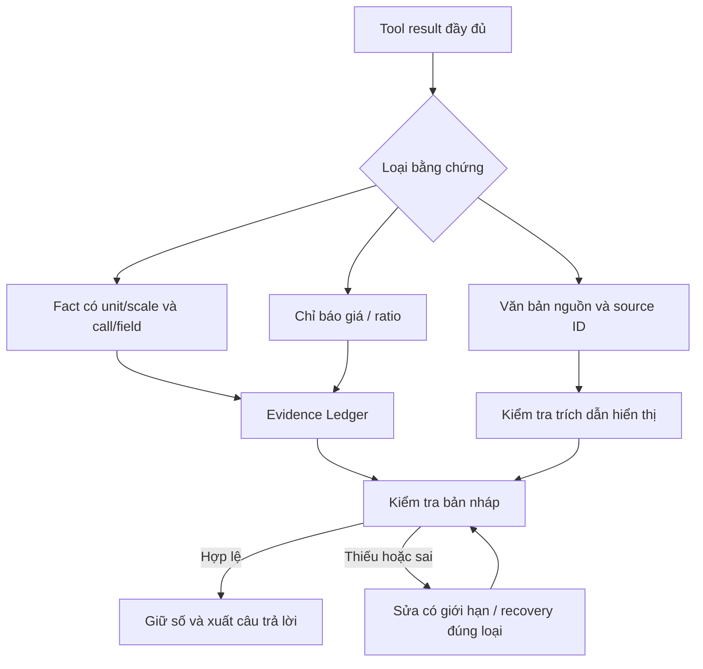

# Grounding cho báo cáo tài chính Việt Nam

Kiểm tra ngày 07/11/2026 tại `D:\Vibe-Trading`. Đường dẫn cũ
`D:\Vibe-Trading-0.1.18` không còn tồn tại trong môi trường này.

## Hành vi sau sửa

BCTC dạng chuỗi thập phân có `value`, `unit`, `scale` được nạp vào Evidence
Ledger. Số khớp bằng chứng, mã, đơn vị và kỳ được giữ khi xuất câu trả lời.
Giá trị thiếu hoặc mâu thuẫn vẫn phải được sửa, bỏ khỏi khuyến nghị, hoặc loại
riêng khi hết lượt sửa. Không bỏ kiểm chứng cho toàn bộ tác vụ nghiên cứu.

| Nhận định trong bản chẩn đoán | Kết quả kiểm tra |
| --- | --- |
| Chuỗi số BCTC bị bỏ qua | Xác nhận; đã thêm bộ nạp fact có kiểu. |
| Cần đưa TOI/NII/CASA vào `_PRICE_FIELDS` | Không áp dụng: tiền, tỷ lệ và giá có chiều đo khác nhau. |
| Mọi số trong tool JSON đều hợp lệ | Không áp dụng: ID, hash, revision, scale, metadata và null không được thành chỉ tiêu. |
| Số trong bài web tự trở thành `observed` | Không áp dụng: dùng nguồn phiên hiện tại và trích dẫn hiển thị với vai trò `cited`. |
| Grounding ép gọi web 40 lần | Không xác nhận từ code: recovery chỉ chọn `search_symbol` hoặc `get_market_data`. |
| Phiên TCB tốn 2,7 triệu token vì grounding | Chưa có trace usage của phiên đó để kiểm chứng hoặc quy nguyên nhân. |
| Đổi query có thể che việc không tiến triển | Xác nhận; đã sửa fingerprint cho search và local cache metadata. |
| Cache mọi công cụ tài chính như phép tính thuần | Không phù hợp: nguồn có thể cập nhật; đã bỏ cờ deterministic trên bốn công cụ đọc dữ liệu. |

## Luồng và vị trí mã nguồn



| File | Trách nhiệm |
| --- | --- |
| [`evidence.py`](../agent/src/agent/grounding/evidence.py) | Nạp số có kiểu; chuẩn hóa scale/ratio; giữ call, field, symbol và timestamp. |
| [`figures.py`](../agent/src/agent/grounding/figures.py) | Đơn vị tỷ/tỉ/triệu/nghìn, VND/đồng/₫, header và kỳ ISO hoặc `Q3/2026`. |
| [`policies.py`](../agent/src/agent/grounding/policies.py) | Đối chiếu chiều đo, nguồn tham chiếu, mã và kỳ; giữ quy tắc tail-risk. |
| [`release.py`](../agent/src/agent/grounding/release.py) | Recovery, sửa bản nháp và loại riêng giá trị không có bằng chứng. |
| [`loop_grounding.py`](../agent/src/agent/loop_grounding.py) | Điều phối kiểm tra/sửa/release; không thêm vòng web riêng. |
| [`tool_progress.py`](../agent/src/agent/tool_progress.py) | Phát hiện nghiên cứu không tạo thông tin mới. |
| [`web_reader_tool.py`](../agent/src/tools/web_reader_tool.py) | Đọc trang qua remote reader với cache và phản hồi có giới hạn. |
| [`context.py`](../agent/src/agent/context.py) | Hướng dẫn model khai báo đơn vị và nguồn ngay từ bản nháp. |

## Hợp đồng số liệu

Ví dụ giả lập dưới đây không phải số liệu doanh nghiệp hoặc khuyến nghị:

```json
{
  "period_end": "2026-09-30",
  "facts": {
    "toi": {"value": "39859", "unit": "VND", "scale": 1000000000},
    "casa": {"value": "0.45", "unit": "ratio", "scale": 1},
    "npl": {"value": "1.3", "unit": "percent", "scale": 1}
  }
}
```

- TOI chuẩn hóa thành `39859000000000 VND`, trình bày `39,859 tỷ VND`.
  Ghi `39,859 VND` hoặc `39,859 triệu VND` là sai scale và bị từ chối.
- CASA `ratio=0.45` có thể ghi `45%`; `0.45%` hoặc `4500%` bị từ chối.
  NPL `percent=1.3` chuẩn hóa thành ratio `0.013`, trình bày `1.3%`.
- Số âm và số không được giữ. Null, reason báo thiếu, bool, NaN, Infinity,
  overflow/underflow không được biến thành số 0.
- Chuỗi dữ liệu nguồn dùng thập phân chuẩn JSON. Không đoán `39,859` là dấu
  thập phân hay dấu hàng nghìn; định dạng hiển thị được xử lý riêng.
- Scale là số nguyên trong `[1, 10^12]`. Bộ nạp giới hạn 2.000 giá trị,
  20.000 node và độ sâu 32 trên mỗi payload tài chính.
- Các fact/inputs/metrics có đơn vị được hỗ trợ không cần một danh sách tên
  chỉ tiêu ngân hàng cố định. Đây là nạp bằng chứng, chưa phải bộ tính chỉ số ngân hàng.

Tham chiếu nên chỉ tới đúng call và trường, ví dụ:

```text
39,859 tỷ VND | observed | TOI quý độc lập, hợp nhất | financial-call::data.DEMO.VN.periods[0].facts.toi.value
45% | observed | CASA cuối kỳ | financial-call::data.DEMO.VN.periods[0].facts.casa.value
```

Header `Q3/2026` chỉ xác định ngày cuối quý lịch; không tự phân biệt lũy kế
9 tháng với quý độc lập. Nội dung cần giữ `period_basis`, consolidation và
revision; call/path phải trỏ đúng bản dữ liệu. Kiểm tra chiều đo không thay thế
kiểm toán tính hợp lý của chỉ tiêu hoặc xác minh tài liệu gốc.

SEC có `_units` được giữ đúng đơn vị báo cáo. Payload legacy Eastmoney/Yahoo
không khai báo tiền tệ chỉ giữ scalar chưa biết đơn vị; không suy tiền tệ BCTC
từ sàn niêm yết. Đơn vị phức hợp chưa hỗ trợ cần adapter và kiểm thử riêng.

## Chỉ báo và tin tức

Bollinger upper/middle/lower và SMA/EMA dùng registry trường giá. Tên giống giá
như `upper_percent`, `latest_close_count` không được cấp quyền giá. Volume
`ratio_20=1.86` tương đương `1.86 lần` hoặc `186%`, không phải `1.86%`.
Payload chỉ báo có mã trả về khác mã yêu cầu không được dùng cho mã đang phân tích.

Tin tức dùng `[S#]` do tool trả về, trên cùng dòng số liệu hoặc caption gần bảng,
với vai trò `cited` khi khai báo. Giá trị phải có trong phần nguồn đã thu thập.
Điều đó chứng minh nguồn đã báo cáo con số; chưa chứng minh con số đúng, nguồn
là tài liệu gốc hoặc dữ liệu còn mới. Không tự nâng văn bản web thành `observed`.

Free cash flow của `vietnam_research` tiếp tục yêu cầu capex là độ lớn chi ra
không âm. Không dùng `abs()` âm thầm đoán quy ước dấu của nguồn.

## Budget nghiên cứu và recovery

| Cơ chế | Giới hạn hiện có |
| --- | --- |
| Sửa bản nháp grounding | 2 bản nháp bị từ chối trên correction path |
| Tìm lại danh tính | 2 recovery attempts |
| Bổ sung dữ liệu giá | 3 recovery attempts |
| Outer recovery cap | 6 rounds; từng loại còn có cap riêng |
| Không tiến triển | 8 iteration tool liên tiếp không có thông tin mới |
| AgentLoop mặc định | 50 iteration; nhắc wrap-up ở 80% không phải hard stop |

Missing financial facts hoặc ratio không kích hoạt lấy giá vô ích. Kiểm tra
OHLC hiện có được giới hạn theo mã bị thiếu; giá ticker khác không chữa được lỗi.

Đổi query/backend nhưng cùng search hits, hoặc đọc lại trang chỉ khác tuổi local
cache, không reset stall budget. URL, nội dung và excerpt mới vẫn được giữ.
Projection chỉ dùng cho fingerprint; payload gửi model và ledger không bị sửa.
Test vòng lặp offline với cùng hits kết thúc ở iteration 9: một quan sát ban đầu
và tám iteration không tiến triển. Đây không phải cam kết mọi nghiên cứu dừng ở 9.

Nguồn có thể thay đổi không được cache như phép tính thuần. Cache của công cụ
tính toán và replay sau compaction tiếp tục dùng policy riêng. Deadline readonly
nằm trong `_invoke_tool`; `future.result(timeout=...)` trong pool context không
phải cơ chế hủy worker vì shutdown vẫn chờ. Write tool không bị bỏ mặc khi timeout.

## Web Reader

Cache process-local có khóa: tối đa 128 URL, tổng 2 MiB, TTL 300 giây tính từ lúc
tải. `no_cache=true` bỏ qua local hit, yêu cầu remote reader làm mới; thành công
cập nhật snapshot. Local hit có `memory_cached` và tuổi cache.

Phản hồi stream chỉ nhận MIME text/Markdown, tối đa 256 KiB, deadline xử lý
10 giây và socket timeout 8 giây. Đây không phải cam kết hủy DNS ở mức hệ điều
hành. Không tự theo redirect. Fallback gọi origin đã tắt vì cách cũ thiếu bảo vệ
DNS rebinding/redirect vào mạng riêng. Lỗi upstream không giả thành đọc thành công.
URL vẫn được gửi đến dịch vụ remote reader theo hợp đồng công cụ.

## Kiểm thử và áp dụng

**1.579 kiểm thử đạt, 2 skip do tài khoản Windows thiếu quyền tạo symlink**, trên
51 module liên quan; frontend `npm run build` đạt, còn cảnh báo bundle lớn hơn
500 kB. JUnit và danh sách module: `.codex-backups/2026-11-07-grounding-review/`.

- [`test_grounding_vietnam_financial_evidence.py`](../agent/tests/test_grounding_vietnam_financial_evidence.py):
  chuỗi BCTC, scale, ratio, kỳ, call, mã, invalid values, nguồn web và release.
- [`test_grounding_vietnam_indicators.py`](../agent/tests/test_grounding_vietnam_indicators.py):
  OHLCV fixture qua công cụ thật, Bollinger, volume ratio và trường giả giống giá.
- [`test_research_progress_regression.py`](../agent/tests/test_research_progress_regression.py):
  query/cache metadata và luồng AgentLoop offline.
- Hồi quy source/citation, tail risk, recovery, cache mutable, timeout, replay sau
  compaction, web reader và các công cụ BCTC/chỉ báo hiện có.

Các ca dùng fixture/mocks; không gọi model, feed thị trường hoặc broker thật.
Chưa chạy lại phiên TCB thực tế; không suy mức tiết kiệm token từ unit test.
Không chạy toàn repository. Build frontend không thay thế kiểm thử giao diện
hoặc xác minh tích hợp DOCX/PDF của Report Engine.

Khởi động lại backend để nạp code Python mới, rồi tạo run mới. Bản nháp và trace
cũ không tự được chỉnh sửa hoặc nâng thành báo cáo đã xác minh.

Rollback chỉ hoàn nguyên các hunk grounding/progress/web reader đã kiểm tra,
giữ thay đổi song song trong portfolio, report engine và giao diện. Không dùng
`git reset --hard` hoặc chép đè checkout. Trang cần mới hơn cache dùng
`no_cache=true`; không bật lại fallback origin thiếu bảo vệ.
