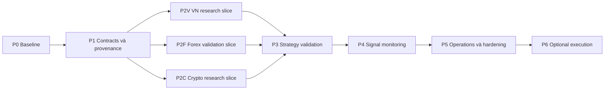

# Lộ trình triển khai và tiêu chí nghiệm thu

**Ngày:** 04/11/2026. **Trạng thái:** kế hoạch phát triển dựa trên source `0.1.18`, không phải danh sách tính năng vừa được triển khai. Bản sửa lần này là tài liệu; không bật feed, tài khoản, lệnh hay dịch vụ mới.

**Bổ sung 05/11:** bản master người dùng cung cấp dùng 10 giai đoạn P0–P9. [Board 10 giai đoạn/16 quyết định](specs/DELIVERY_10_PHASES_16_DECISIONS.md) là breakdown canonical, còn P2V/P2F/P2C bên dưới là các workstream con. [265 đặc tả](specs/README.md) giữ nguyên ID; [biên bản code](IMPLEMENTATION_STATUS_2026-11-05.md) ghi slice local đã triển khai và phần còn thiếu.

Đọc [baseline](SOURCE_BASELINE.md) trước [kiến trúc mục tiêu](MULTI_MARKET_ARCHITECTURE.md). Định nghĩa record và ví dụ nằm trong [data/evidence contracts](DATA_EVIDENCE_CONTRACTS.md). Danh sách bên dưới dùng các gate có thể kiểm tra, không ước lượng % hoàn thành hoặc hứa lợi nhuận.

## 1. Phạm vi và thứ tự

Giữ runtime đang có, hoàn thiện từng luồng đi được từ dữ liệu tới artifact và UI. Bắt đầu bằng luồng nghiên cứu chỉ đọc; execution nâng cấp riêng sau khi đã chứng minh đúng dữ liệu, phương pháp và quyền. Công việc không phụ thuộc nhau giữa VN, Forex và Crypto có thể làm song song sau khi thống nhất identity/timestamp/evidence contracts.

Không thêm Redis/TimescaleDB/vector DB hoặc một orchestrator mới chỉ để đủ sơ đồ. Mỗi infrastructure decision phải có workload, vấn đề đo được, lựa chọn thay thế và chi phí chuyển đổi.

## 2. P0 — Chốt baseline có thể tái kiểm tra

| Hạng mục | Việc phải làm | Bằng chứng hoàn thành |
| --- | --- | --- |
| Source identity | Ghi version, commit khi có Git, package/runtime versions | Manifest không nhầm tên folder với revision |
| Capability | Trace CLI/UI/API/tool/data/broker/persistence | Ma trận current/proposed/unverified và đường source |
| Prompt drift | Rà preset/docstring sai capability | Danh sách discrepancy và thay đổi có scope |
| Numerical fidelity | Xem currency, product routing, calendars, costs | Explicit limitations; test các giả định khi sửa code |
| Baseline tests | Chạy đúng nhóm liên quan trước và sau | Command + exit/result; tách pre-existing failure |
| Preservation | Snapshot tài liệu và migration plan cho data khi có | Restore được bản cũ, không đụng credential/runtime state |

Thư mục hiện tại không có `.git`; không được phát hành claim “đã audit commit X”. `docs/` đang được quy ước là local working notes trong [CONTRIBUTING](../CONTRIBUTING.md#keep-internal-documents-local). Nếu cần xuất bản, chọn nội dung công khai để đưa sang `wiki/docs/` theo workflow có sẵn; lần sửa tài liệu này không deploy wiki.

**Gate P0:** đủ bản đồ source để chọn slice; không còn nhầm capability khai báo với runtime đã xác minh. P0 chưa yêu cầu broker login hoặc lệnh thật.

## 3. P1 — Identity, provenance và ingest

### Công việc dùng chung

- Chốt field mapping vào record hiện có, thêm version/unknown semantics tương thích.
- Source registry ghi capability, entitlement, coverage, delay, units, rate limit và fallback policy.
- Lưu raw refs/content hash, normalized record, parser version, time policy và correction lineage.
- Thực hiện snapshot manifest trước khi mở rộng retrieval; retrieval phải trả evidence locator.
- Bổ sung error/partial-state rõ trong API và UI; secrets chỉ đi qua connection/credential store.

### Gate và failure cases

| Test cần có khi triển khai | Điều kiện đạt |
| --- | --- |
| Đổi nội dung tại cùng URL | Không mất bản cũ; report truy đúng revision |
| Parser OCR bỏ dấu âm/đơn vị | Không xuất fact verified; review hoặc reject |
| Nguồn hết quota / 403 / thiếu license | Hiển thị nguyên nhân theo nguồn, không mock dữ liệu |
| Timestamp không có timezone | Giữ unknown hoặc policy khai báo, không silent conversion |
| Snapshot cùng inputs | Hash/record membership ổn định theo serialization policy |
| Prompt injection trong PDF | Không làm worker gọi tool ngoài whitelist hoặc đổi execution mode |

**Gate P1:** một report có thể truy từ kết luận tới fact, raw document/quote và revision; một dữ kiện chưa có thời điểm công bố không được gắn nhãn PIT-safe.

## 4. P2V — Vietnam Equity Research

Slice đầu: một doanh nghiệp HOSE định danh rõ, báo cáo tài chính gốc được phép dùng, price source có nhãn, luận điểm và định giá có input truy nguyên. Không cần tạo dashboard toàn thị trường trước khi hoàn thành slice này.

| Thành phần | Tái sử dụng | Phần bổ sung |
| --- | --- | --- |
| Đọc tài liệu | read_url/read_document, report artifacts | Nguồn VN, parsing/financial mapping, revision/PIT |
| Nghiên cứu | Existing equity/fundamental/investment presets | Công cụ và prompt đúng nguồn VN, không gọi dữ liệu Trung Quốc thay |
| Định giá | quantlib valuation | Input mapper theo ngành, units, estimates và sensitivity |
| Giá/backtest | HOSE engine, loader registry | Data/corporate actions/calendar verified trước mở rộng venue |
| UI | Report viewer/chart components | Source links, financial table, assumptions, review state |

**Gate P2V:** báo cáo chỉ rõ BCTC hợp nhất hay riêng lẻ, kỳ quý/lũy kế, đơn vị, ngày công bố và giả định. Missing metric giữ null. HNX/UPCoM không được gắn fidelity HOSE nếu chưa có ruleset riêng. Acceptance chi tiết trong [VN research](VIETNAM_EQUITY_RESEARCH.md).

## 5. P2F — Forex/XAUUSD validation

Slice đầu: dùng ForexService và chart/account binding hiện có; khóa một demo connection, symbol native và timeframe; đánh giá một phương pháp close-based bằng dữ liệu đã đóng. Đây là bổ sung mức xác minh, không xây lại chart polling.

| Thành phần | Tái sử dụng | Phần bổ sung |
| --- | --- | --- |
| Chart/context | Forex routes, adapters, analysis context | Freshness/gap/reconnect evidence, data manifest |
| Research | Forex research, council, macro context | Ràng buộc input/output và điều kiện NO TRADE |
| Strategy | Strategy Store, discovery, backtest | Version gắn symbol specs, cost model, validation scope |
| Risk | Forex risk/policy, mandate và halt hiện có | Rà riêng từng action và timeout/reconciliation |
| Live data | Native snapshot/polling | Tick stream/replay chỉ khi chiến lược thật sự cần |

**Gate P2F:** chart bar đang chạy không vào strategy close-based; thiếu native feed không fallback sang Yahoo cho execution; min/step/margin/account currency được kiểm tra. Một backtest dùng default pip/lot/spread chưa được coi là calibrated cho broker thật. Chi tiết ở [Forex lab](FOREX_XAUUSD_LAB.md).

## 6. P2C — Crypto research

Slice đầu: một instrument cụ thể trên một exchange, phân biệt spot/perp; báo cáo derivatives có units/timestamps và statement rõ khi on-chain chưa tích hợp. Bổ sung một on-chain nguồn thật sau khi có chain/token identity và reorg/finality policy.

| Thành phần | Tái sử dụng | Phần bổ sung |
| --- | --- | --- |
| Dữ liệu | OKX/Binance/CCXT loaders | Native instrument mapping, funding/OI/price type provenance |
| Nghiên cứu | crypto_trading_desk và crypto_research_lab | Các nguồn thực sự có entitlement, không coi prompt là integration |
| Backtest | CryptoEngine, run evidence | Spot accounting vs perpetual fidelity, historical funding/cost assumptions |
| Account | Trading profiles/capability matrix | Kiểm chứng theo profile, không gộp read-only USD-M với spot writes |
| On-chain | Web/API adapters khi có | Block/hash/log identity, decimals, finality, attribution uncertainty |

**Gate P2C:** không trộn mark/index/trade prices; không cộng funding interval cố định khi historical schedule thay đổi; orderbook snapshot không được gọi là replay; thiếu on-chain metrics được ghi chưa có. Chi tiết ở [Crypto intelligence](CRYPTO_INTELLIGENCE.md).

## 7. P3 — Strategy Lab và kiểm định

Mở rộng registry hiện hữu với immutable version identity và run refs. Dùng các lifecycle/validation states trong [strategy models](../agent/src/strategy_store/models.py); mọi promotion phải có scope và evidence.

| Gate | Điều kiện |
| --- | --- |
| Hypothesis | Entry/exit, timing, sizing, regime, invalidation có định nghĩa thực thi được |
| Data | Universe/PIT/adjustment/calendar/source/spec version được khóa |
| Costs | Commission, spread, slippage, funding/swap/borrow và market impact phù hợp sản phẩm |
| Validation | Train/validation/OOS tách thời gian; chống leakage; ghi số lần thử |
| Robustness | Sensitivity, stress costs, subperiod/regime và sample adequacy |
| Reproducibility | Dataset/config/code hash, artifacts, seed/tolerance và replay checks |
| Review | Reviewer khác tác giả xem assumptions/failures, không chỉ chấp nhận summary |

Không có một ngưỡng Sharpe/win rate cố định đủ cho mọi thị trường. Ngưỡng promotion phải định trước theo mục đích, cỡ mẫu, leverage/liquidity và multiple testing; kết quả không đạt phải được lưu cùng kết quả đạt. Monte Carlo không biến một giả thuyết chưa có edge thành chiến lược có edge.

**Gate P3:** ít nhất một strategy có run card tái lập, OOS riêng, chi phí rõ, failure cases và reviewer evidence. `ACTIVE` của artifact không cấp quyền execution.

## 8. P4 — Signal monitoring và paper

Đánh giá theo sự kiện cần thiết của strategy. Close strategy dùng candle-close; tick strategy cần feed/replay phù hợp trước. LLM giải thích và nghiên cứu ở nhịp riêng, không nằm trên đường đánh giá từng tick.

**Gate P4:** dữ liệu stale/gap/clock skew/source mismatch khóa tín hiệu mới; reconnect phục hồi có dedupe; worker crash không tạo signal cũ dưới thời điểm mới; UI có trạng thái WAIT/REJECTED và lý do. Paper engine phải mô tả fill/cost semantics và sản phẩm hỗ trợ; [paper_trade_step](../agent/src/tools/paper_trade/) hiện là luồng riêng, không mặc định simulator Forex tick hoặc crypto perpetual.

Alert cần idempotency, expiry và delivery status; cảnh báo gửi thành công khác với broker order accepted. Không bật kênh gửi hoặc gửi cho người khác trong bước viết tài liệu.

## 9. P5 — Vận hành và hardening

| Chủ đề | Bằng chứng nghiệm thu cần có |
| --- | --- |
| Isolation | Session/connection/account không lẫn dữ liệu giữa người dùng |
| Tool boundary | Allowlist thực thi, shell/file/network restrictions, external MCP trust |
| Budget | Token/cost/quota có trần, retry có giới hạn, partial state rõ |
| Persistence | Atomic writes, migration tương thích, concurrent access và recovery |
| Backup/restore | Restore drill kiểm tra DB + evidence blobs + manifest consistency |
| Monitoring | Freshness, feed gaps, parser error, failed tasks, rejection, reconciliation mismatch |
| License/privacy | Nguồn dữ liệu và báo cáo có quyền lưu/hiển thị/phân phối phù hợp |
| Publication | Public docs không chứa secrets, local artifacts, accounts hoặc claims chưa xác minh |

Không tự chọn con số throughput/latency/availability trước benchmark. Định workload, hardware, data sources, số người dùng và yêu cầu latency rồi đặt SLO đo được.

## 10. P6 — Execution tùy chọn

Đây là gate độc lập cho từng broker/profile/product; không phải bước bắt buộc để một nghiên cứu hữu ích.

1. Operator chủ động cấp quyền đúng environment/account/strategy/symbol và thời hạn.
2. Demo hoặc sandbox test có order lifecycle đầy đủ, bao gồm reject/partial fill/cancel/timeout/restart.
3. Risk sizing được đối chiếu symbol specs, account currency, broker calculation và margin.
4. Pre-trade checks fail closed, live mandate/halt được kiểm tra trên đúng caller.
5. Reconciliation xử lý unknown order status trước retry, ngăn đặt trùng.
6. Audit có trace IDs và retained evidence; bảo vệ credentials và thông tin tài khoản.
7. Live canary chỉ trong phạm vi được operator phê duyệt và quy định áp dụng đã kiểm tra.

**Gate P6:** có evidence cho từng dòng trên. Không suy từ demo pass thành live pass; không chạy lệnh thật để xác minh một thay đổi tài liệu.

## 11. Nhóm kiểm tra hiện có để tái sử dụng

Tên file dưới đây là điểm bắt đầu, không khẳng định chúng đã pass trong môi trường người dùng:

| Bề mặt | Tests/source liên quan |
| --- | --- |
| README và profile declarations | [readme counts](../agent/tests/test_readme_counts.py), [capability matrix](../agent/tests/test_capability_matrix.py) |
| HOSE/mixed market | [composite Vietnam](../agent/tests/test_composite_vietnam_rules.py), [currency guard](../agent/tests/test_composite_currency_guard.py) |
| Swarm completion/dependencies | [DAG gating](../agent/tests/test_swarm_dag_gating.py), [output contract](../agent/tests/test_swarm_output_contract.py) |
| Strategy lifecycle | [strategy store](../agent/tests/test_strategy_store.py) |
| SDK/MCP execution gate | [SDK order gate](../agent/tests/test_sdk_order_gate.py), [mandate enforcement](../agent/tests/test_mandate_enforcement.py) |
| Historical data contracts | [data routing sources](../agent/tests/test_data_routing_sources_subset.py), [MT5 loader](../agent/tests/test_mt5_loader.py) |

Lệnh phù hợp cho **đợt tài liệu** là nhóm README/capability và kiểm tra links/fences/source refs. Không cần build toàn bộ UI hay chạy tất cả broker tests khi không sửa runtime. Khi triển khai slice, chọn thêm unit/integration/failure-path tests tương ứng rồi ghi kết quả thực tế.

## 12. Definition of Done cho mỗi thay đổi

- Có vấn đề cụ thể và before/after người dùng quan sát được.
- Liệt kê đầy đủ callers, schemas, config, exports, API/MCP, UI và tests bị ảnh hưởng.
- Dùng helper/registry hiện có; không có module placeholder chỉ để khớp sơ đồ.
- Có success và failure path, numerical/data/authorization checks tại biên liên quan.
- Ghi rõ source evidence, commands đã chạy, failure và phần chưa kiểm tra.
- Có rollback/migration plan; không xóa runtime data hay lịch sử evidence.
- README/docs phản ánh kết quả cuối; proposed không bị đổi thành implemented chỉ vì UI đã có nút.

## 13. Brief giao cho coding agent

Khi triển khai, giao **một milestone có gate**, kèm market/product và source cụ thể. Có thể dùng mẫu sau:

> Đọc SOURCE_BASELINE, MULTI_MARKET_ARCHITECTURE và contract domain liên quan, rồi xác minh lại source hiện tại. Hoàn thiện slice [tên milestone] từ adapter/input tới artifact và UI/API cần thiết. Tái sử dụng AgentLoop, Swarm, Strategy Store, quantlib và order gates; không tạo registry hoặc loop song song. Trước sửa, liệt kê callers và contract bị ảnh hưởng. Giữ dữ liệu thiếu, errors và provenance trung thực; không bịa giá, báo cáo hoặc metrics. Thêm test nhỏ cho logic mới và failure paths cần thiết, chạy checks phù hợp, báo bằng chứng cùng limits. Không đăng nhập, cấp quyền, bật dịch vụ công khai hoặc tác động broker ngoài phạm vi được operator cho phép.

Không dùng nguyên khối “build production hoàn chỉnh” làm tiêu chí nghiệm thu duy nhất: chia theo những đầu ra có thể xem, chạy lại và bác bỏ được.
