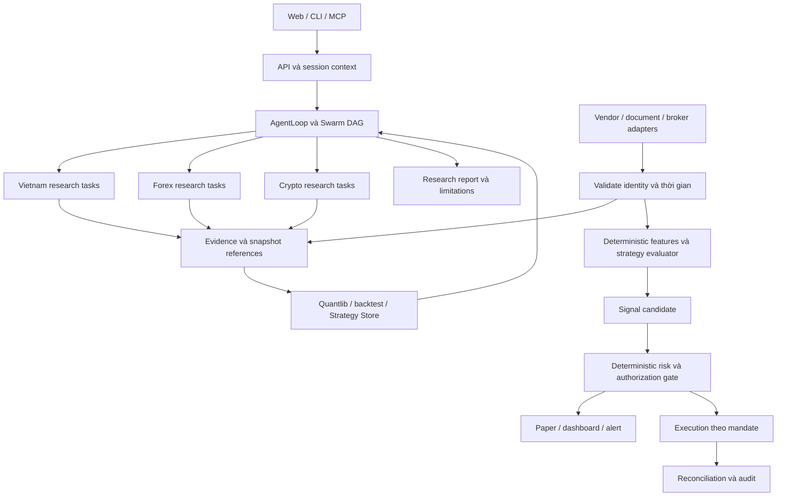

# Kiến trúc Vibe-Trading Multi-Market AI

**Ngày nghiên cứu:** 04/11/2026. **Baseline:** source cục bộ ghi phiên bản `0.1.18`; thư mục không có `.git`, không xác định được commit. **Trạng thái:** thiết kế mở rộng để triển khai từng phần, chưa phải công bố hệ thống production.

Đặc tả này viết lại đề xuất người dùng cung cấp sau khi đối chiếu source. Mục tiêu là ba môi trường nghiên cứu có chuyên môn riêng, dùng chung nền tảng điều phối và bằng chứng: chứng khoán Việt Nam, Forex/XAUUSD và Crypto. Một kết luận phải truy về dữ liệu và phương pháp; tên agent, dashboard hoặc một điểm tin cậy do LLM tự ghi không thay thế được kiểm chứng.

Đọc kèm [baseline mã nguồn](SOURCE_BASELINE.md), [hợp đồng dữ liệu](DATA_EVIDENCE_CONTRACTS.md) và [lộ trình nghiệm thu](IMPLEMENTATION_ROADMAP.md). Quy tắc từng thị trường nằm trong [Vietnam](VIETNAM_EQUITY_RESEARCH.md), [Forex/XAUUSD](FOREX_XAUUSD_LAB.md), [Crypto](CRYPTO_INTELLIGENCE.md).

Bổ sung nghiên cứu 05/11: [catalog 265 đặc tả](specs/README.md) đối chiếu đúng canonical IDs của master, [54 scenarios](specs/VALIDATION_54.md) có fixture/oracle riêng và [Core 67](specs/CORE_AI_PLATFORM_67.md) làm rõ memory/RAG/tool/cache/governance hiện có. Những thay đổi source local đầu tiên được ghi riêng trong [implementation status](IMPLEMENTATION_STATUS_2026-11-05.md); baseline 04/11 không tự đổi thành chứng nhận production.

## 1. Quy ước chứng cứ

| Nhãn | Ý nghĩa | Không suy ra được |
| --- | --- | --- |
| Có trong source | Đọc được implementation, registry, route hoặc test liên quan | Đã kết nối thành công tài khoản thật |
| Kiểm tra cục bộ | Có lệnh kiểm tra, môi trường, kết quả và ngày thực hiện | Dữ liệu vendor đúng hoặc production đã ổn định |
| Đề xuất | Contract, workflow hoặc giao diện cần xây thêm | Đã có API/module tương ứng |
| Cần xác minh ngoài hệ thống | Phụ thuộc tài khoản, quyền dữ liệu, broker, pháp lý hoặc vận hành | Có thể coi mặc định là đạt |

Không dùng tỷ lệ phần trăm hoàn thành khi chưa có mẫu số nghiệm thu. Một test có trong repository khác với một test đã chạy thành công trong phiên này; xem [nhật ký kiểm tra tài liệu](DOCUMENTATION_VERIFICATION.md).

## 2. Nền tảng cần kế thừa

| Trách nhiệm | Điểm mở rộng có thật | Cách dùng trong thiết kế |
| --- | --- | --- |
| Suy luận và gọi công cụ | [AgentLoop](../agent/src/agent/loop.py), [registry](../agent/src/agent/tools.py), [tool discovery](../agent/src/tools/__init__.py) | Giữ một loop, cung cấp bộ công cụ phù hợp nhiệm vụ |
| Điều phối nhóm | [Swarm runtime](../agent/src/swarm/runtime.py), [models](../agent/src/swarm/models.py), [presets](../agent/src/swarm/presets.py) | Mở rộng preset/task; không tạo orchestrator thứ hai |
| Dữ liệu lịch sử | [loader registry](../agent/backtest/loaders/registry.py), [runner](../agent/backtest/runner.py) | Thêm adapter đúng contract và test routing/fallback |
| Tính toán tài chính | [quantlib](../agent/src/quantlib/), [quantlib tool](../agent/src/tools/quantlib_tool.py) | Dùng hàm định lượng hiện có trước khi thêm công thức |
| Chiến lược và quản trị mô hình | [Strategy Store](../agent/src/strategy_store/), [strategy discovery](../agent/src/strategy_discovery/), [SDM tools](../agent/src/tools/sdm_register_tool.py) | Mở rộng artifact/version/validation, liên kết run evidence |
| Forex chuyên biệt | [Forex service](../agent/src/trading/forex/service.py), [routes](../agent/src/api/forex_routes.py) | Tái sử dụng account binding, chart, council, runner hiện có |
| Kết nối và quyền giao dịch | [profiles](../agent/src/trading/profiles.py), [trading service](../agent/src/trading/service.py), [SDK order gate](../agent/src/live/sdk_order_gate.py), [MCP order guard](../agent/src/live/order_guard.py) | Giữ kiểm tra quyết định ở Python; rà từng đường ghi |
| Bộ nhớ và artifacts | [persistent memory](../agent/src/memory/persistent.py), [run artifacts](../agent/src/agent/result_artifacts.py), [governance](../agent/src/governance/) | Bộ nhớ giữ bài học; artifact và snapshot giữ bằng chứng |
| API và UI | [FastAPI assembler](../agent/api_server.py), [MCP](../agent/mcp_server.py), [router](../frontend/src/router.tsx) | Thêm capability theo contract hiện tại, đồng bộ backend/UI |

Strategy registry, định giá DCF và Forex chart không phải các khối hoàn toàn chưa tồn tại. Một số prompt/docstring cũ chưa theo kịp implementation. Mặt khác, sự tồn tại của các khối này chưa chứng minh có pipeline BCTC Việt Nam, tick replay đa thị trường hoặc quản trị rủi ro tổng hợp đa tiền tệ.

## 3. Ranh giới sản phẩm

| Môi trường | Câu hỏi chính | Đầu ra nhỏ nhất có giá trị | Dữ liệu bắt buộc |
| --- | --- | --- | --- |
| Vietnam Stock Intelligence | Doanh nghiệp có gì thay đổi, giá trị phụ thuộc giả định nào? | Báo cáo có trích dẫn, bảng tài chính, kịch bản định giá và phản biện | Định danh sàn, tài liệu gốc, ngày công bố, đơn vị, giá có thời điểm |
| Forex/XAUUSD Trading Lab | Phương pháp có hoạt động trên dữ liệu và điều kiện broker này? | Strategy version, backtest có chi phí, trạng thái tín hiệu và lý do NO TRADE | Bid/ask, nến đóng, symbol specs, trạng thái tài khoản khi đánh giá thực thi |
| Crypto Intelligence | Sản phẩm nào, sàn nào, rủi ro đòn bẩy/dòng tiền nào? | Báo cáo spot/perp riêng, derivatives/on-chain evidence, mô phỏng phù hợp | Instrument identity, loại giá, funding/OI có đơn vị, thời điểm và venue |

Một màn hình có thể dùng chung chart/report viewer nhưng phải giữ phân biệt nguồn, thị trường, loại sản phẩm, tài khoản và trạng thái kiểm định. Không gộp VND, USD, JPY và USDT thành một equity curve khi chưa có mô hình quy đổi, thời điểm FX và treatment cho stablecoin.

## 4. Kiến trúc mục tiêu

Sơ đồ dưới đây mô tả trách nhiệm mục tiêu. Các mũi tên từ signal sang thực thi là phần có điều kiện; không phải mọi đường đi đã được nối trong source.

### 4.1. Control plane và data plane

**Control plane:** người dùng đặt phạm vi; orchestrator chọn nhiệm vụ, budget, deadline và công cụ; agent đọc chứng cứ, viết giả thuyết, phản biện và yêu cầu backtest. LLM có thể đề xuất thay đổi strategy nhưng phải tạo version mới trước khi đánh giá.

**Data plane:** adapter lấy dữ liệu, validator chuẩn hóa, engine tính indicator/tín hiệu, risk gate kiểm tra quyền và giới hạn, connector nhận lệnh theo cơ chế hiện có. Cùng snapshot và strategy version phải tạo cùng quyết định định lượng trong giới hạn số học được công bố.

Một nhãn `APPROVE` của Risk Agent chỉ là nội dung phân tích. Nó không phải token cấp quyền, không sửa mandate và không bỏ qua order gate. Agent có quyền đọc file hoặc chạy shell quá rộng vẫn có thể đi vòng ý định của preset; bộ công cụ tối thiểu và sandbox cần được kiểm tra ở runtime.

### 4.2. Một research run từ đầu đến cuối

1. **Scope:** khóa `market`, instrument, horizon, `analysis_as_of`, ngôn ngữ, nguồn được phép và mức chi phí. Từ chối mã mơ hồ trước khi gọi vendor.
2. **Ground:** xác định dữ liệu thiếu; lấy snapshot với source/retrieval metadata; không tự thay feed broker bằng một feed khác rồi giữ nguyên nhãn.
3. **Analyze:** task độc lập chạy song song; mỗi task ghi evidence IDs, observed facts, estimates và unknowns riêng.
4. **Quantify:** valuation/backtest/portfolio dùng input đã chuẩn hóa; lưu config, hash, phiên bản và giả định chi phí.
5. **Challenge:** reviewer đọc kết quả upstream và tài liệu gốc cho kết luận trọng yếu; đánh dấu bất đồng chưa giải quyết.
6. **Validate:** kiểm tra bằng chứng, PIT, dữ liệu thiếu, numerical validity và eligibility của sản phẩm; `WAIT` là kết quả hợp lệ.
7. **Deliver:** lưu báo cáo, snapshot refs, số liệu validation, phương pháp và limitations. Không chèn entry price khi không có quote phù hợp.
8. **Monitor:** lịch giám sát liên kết run gốc; công bố/correction mới tạo version mới, giữ lịch sử kết luận trước đó.

### 4.3. Điều phối nhóm tối thiểu

Số vai trò trong đề xuất gốc là bản đồ chuyên môn, không bắt buộc một tiến trình LLM cho từng vai trò. Bắt đầu với ba đến bốn worker cho một yêu cầu; tách thêm khi chất lượng hoặc thời gian xử lý có bằng chứng cần thiết.

| Nút DAG | Đầu vào | Đầu ra | Gate trước nút kế tiếp |
| --- | --- | --- | --- |
| `sources` | Phạm vi và source policy | Evidence manifest + missing-data list | Định danh, timestamps và quyền sử dụng hợp lệ |
| `fundamental_or_macro` | Manifest cố định | Fact table + giả thuyết | Mỗi kết luận trọng yếu có evidence |
| `market_or_quant` | Snapshot cố định | Feature/valuation/backtest artifacts | Không dùng dữ liệu tương lai, chỉ số hữu hạn hoặc null có lý do |
| `independent_review` | Hai đầu ra upstream | Kết luận, bất đồng, điều kiện vô hiệu | Task upstream bắt buộc phải có kết quả hữu ích |

Schema preset hiện có gồm `agents`, `tasks`, `depends_on`, `input_from`, `variables`; xem [models](../agent/src/swarm/models.py). Không gửi toàn bộ PDF vào mọi worker: truyền manifest, đoạn trích và locator; cho reviewer đọc lại bản gốc khi cần. Retry chỉ áp dụng lỗi có thể phục hồi, có trần, giữ attempt ID. Failed/cancelled/incomplete không tự đổi thành completed; downstream thiếu đầu vào phải thể hiện bị chặn.

### 4.4. Budget và mô hình

Đặt hạn mức cho mỗi run: tổng token/cost được chấp nhận, max_iterations, worker timeout, tối đa task đồng thời, lượt gọi nguồn trả phí và số tài liệu cần đọc sâu. Theo dõi token do provider báo riêng với token ước tính. Giá token và quota vendor cần đọc từ cấu hình/provider hiện hành, không cố định trong tài liệu.

Đo chất lượng bằng coverage nguồn, độ đúng của phép tính, tính tái lập và mức bất đồng được giải quyết. Không dùng số agent hoặc độ dài báo cáo làm tiêu chí thành công.

## 5. Dữ liệu, evidence và lưu trữ

### 5.1. Tái sử dụng trước khi thay hạ tầng

Source có [SQLite Strategy Store](../agent/src/strategy_store/sqlite_store.py), file memory, run artifacts và các store theo domain. Giữ chúng cho giai đoạn đơn máy. Chuẩn hóa metadata/snapshot trước; một cơ sở dữ liệu mới không tự sửa được dữ liệu sai đơn vị hoặc thiếu ngày công bố.

Đề xuất bố trí tài liệu gốc theo content hash, metadata/index theo transactional store và time series theo access pattern đo được. PostgreSQL, TimescaleDB, Redis, pgvector và object storage là lựa chọn khi có yêu cầu cụ thể, chưa phải stack đã cài sẵn cho toàn hệ thống.

| Nhu cầu đã đo | Lựa chọn xem xét | Điều kiện trước khi chuyển |
| --- | --- | --- |
| Nhiều writer cạnh tranh, nhiều instance hoặc yêu cầu phân quyền DB | PostgreSQL | Migration, consistency, restore, unique keys và concurrent tests |
| Replay nhiều consumer với backpressure | Durable event log/stream | Retention, ordering theo instrument, dedupe và recovery contract |
| Nhiều tài liệu lớn | Object storage | Checksum, versioning, access policy, metadata liên kết |
| Retrieval bằng ngữ nghĩa không đủ với full-text | Vector index | Đo recall trên tập câu hỏi có đáp án và locator thật |

SQLite WAL cho phép reader và writer cùng hoạt động nhưng vẫn chỉ có một writer tại một thời điểm; WAL cần các tiến trình dùng DB trên cùng host và không phù hợp network filesystem. Đây là ràng buộc tham khảo để quyết định quy mô, không phải benchmark của repository. [SQLite WAL](https://sqlite.org/wal.html)

Nếu chuyển PostgreSQL, nhiều câu `SELECT` ở mặc định Read Committed không tự tạo cùng snapshot xuyên cả run. Cần giữ snapshot IDs/version cố định hoặc dùng transaction phù hợp cho đoạn đọc nhất quán. Không giữ transaction mở trong lúc LLM suy luận nhiều phút. [PostgreSQL transaction isolation](https://www.postgresql.org/docs/current/transaction-iso.html)

### 5.2. Evidence khác memory

| Loại | Nên chứa | Không được dùng làm bằng chứng thay thế |
| --- | --- | --- |
| Evidence | Bản gốc, content hash, extraction version, fact, locator, publication/availability times | Một tóm tắt không còn truy về nguồn |
| Research artifact | Giả thuyết, phương pháp, mô hình, report version, validation result | Một giá trị tự ghi trong prompt |
| Memory | Sở thích người dùng, bài học phương pháp, link đến run | Giá hiện tại, BCTC được coi luôn mới, quyền giao dịch |
| Audit | Actor, action, input refs, policy/version, outcome, attempt IDs | Chứng minh bên ngoài rằng broker đã fill nếu chưa reconciliation |

Tham khảo W3C PROV: phân biệt entity, activity và agent chịu trách nhiệm. Thiết kế ở đây áp dụng ý tưởng provenance, không tuyên bố triển khai chuẩn RDF/PROV đầy đủ. [W3C PROV-DM](https://www.w3.org/TR/prov-dm/)

### 5.3. Không trộn trạng thái

Research state, model-validation state, signal state và order state có vòng đời riêng. `ArtifactStatus.ACTIVE` hiện có không tự đồng nghĩa `ValidationStatus.APPROVED` hay được trade live. Khi tích hợp cần đọc enum và validator trong [strategy models](../agent/src/strategy_store/models.py), không tạo một cờ `approved=true` thay tất cả gate.

## 6. Rủi ro và thực thi

| Lớp | Kiểm tra bắt buộc trong thiết kế mở rộng | Hành vi khi không xác định |
| --- | --- | --- |
| Dữ liệu | Nguồn, instrument, staleness, nến đóng, units, gaps | Không phát tín hiệu thực thi |
| Strategy | Version, validation scope, compatible regime, không disabled | Không tự chuyển sang strategy chưa kiểm định |
| Tài khoản | Environment, broker/account binding, equity, positions, margin | Chặn lệnh mở mới |
| Chính sách | Mandate còn hạn, symbols/size/exposure/day limits, halt | Deny, giữ reason code |
| Execution | Idempotency, specs mới, preflight, broker response | Unknown state cần reconciliation trước retry |
| Hậu kiểm | Order/fill/position reconciliation, audit | Hiển thị pending/unknown; không báo fill giả |

Không có bảo đảm exactly-once xuyên HTTP timeout và broker. Thiết kế cần `client_order_id` khi broker hỗ trợ, kiểm tra order history trước gửi lại và có trạng thái `execution_unknown`. Timeout không được coi là lệnh chưa gửi. Hủy lệnh, đóng vị thế và kill switch cũng phải kiểm tra riêng; không suy từ gate của placement.

Quyền theo vai trò trong đề xuất là mục tiêu. Existing SDK/MCP/Forex có đường kiểm soát khác nhau, phải rà từng caller; không tuyên bố tất cả connector đã có cùng mức bảo vệ. Một halt chặn lệnh mới cũng không tự chứng minh đã hủy working orders hoặc đóng exposure đang mở.

## 7. API và giao diện

### 7.1. Bản đồ hiện tại

Các route UI đọc được trong [router](../frontend/src/router.tsx): `/agent`, `/forex`, `/runtime`, `/reports`, `/paper-trading`, `/portfolio`, `/settings`, `/runs/:runId`, `/correlation`, `/options`, `/alpha-zoo`, `/pixel-office`. Route `/vietnam` hoặc `/crypto` chuyên biệt chưa được xác nhận trong router này.

Backend có route modules cho Forex, Swarm, run artifacts, paper accounts, portfolio và live. Không áp đặt ngay prefix `/api/v1/markets/*` lên tất cả API cũ. Chọn một vertical slice, mở rộng request/response tương thích, rồi tích hợp UI và MCP cùng semantics.

### 7.2. Quy tắc màn hình mục tiêu

- Workspace luôn hiển thị market/product, venue, source time, timezone, độ trễ và mode research/paper/demo/live.
- Financial table giữ giá trị thiếu là thiếu; không biến null thành 0 hoặc phần trăm tin cậy mặc định.
- Report có tab nguồn, assumptions, numerical results và bất đồng; một click truy về locator và snapshot.
- Strategy Lab hiển thị phiên bản, OOS window, costs, số giao dịch và limitations cùng metric.
- Signal row có trạng thái WAIT/REJECTED/STALE, reason codes và thời điểm đánh giá; LONG/SHORT là phân tích cho tới khi order gate cho phép.
- Command Center hiển thị task graph, attempt, lỗi nguồn và budget; phân biệt worker đang chạy với task đã hoàn thành có artifact.
- Chart và quyết định dùng cùng instrument/source context; reconnect không giữ nhãn fresh cho dữ liệu cũ.

## 8. Các quyết định kiến trúc đề xuất

Tất cả quyết định dưới đây có trạng thái **Proposed**. Tài liệu không tự phê duyệt thay đổi production.

| ID | Lựa chọn | Lý do và đánh đổi | Khi xem lại |
| --- | --- | --- | --- |
| MM-01 | Modular monolith, mở rộng source hiện có | Ít vận hành hơn ba backend và ba orchestrator; cần ranh giới domain rõ | Có bottleneck đo được hoặc yêu cầu isolation riêng |
| MM-02 | LLM nghiên cứu, engine xác định đánh giá tín hiệu | Tái lập được và giữ latency khỏi vòng suy luận; tốn công formalize phương pháp | Không dùng LLM làm đường đặt lệnh theo tick |
| MM-03 | Evidence/snapshot trước vector DB và microservices | Sửa tính đúng trước quy mô; retrieval ban đầu có thể đơn giản | Khi measured retrieval/throughput không đạt |
| MM-04 | Mở rộng Strategy Store và governance | Tránh hai lifecycle strategy mâu thuẫn; cần migration/backward compatibility | Khi contract hiện có không biểu diễn được version/evidence |
| MM-05 | Provider/native account identity đi cùng dữ liệu | Tránh risk và order trên hai tài khoản/feed khác nhau | Mọi adapter mới phải qua conformance tests |
| MM-06 | Shared portfolio khác currency chưa gộp NAV | Ngăn cộng sai tiền tệ; mất một phần trải nghiệm tổng hợp ban đầu | Sau khi có FX snapshot và currency accounting đã kiểm thử |

Không sao chép ngay cây `markets/`, `research/`, `strategies/`, `risk/` trong đề xuất gốc: nhiều trách nhiệm đã có owner. Chỉ tạo module mới khi một slice thật sự cần, đặt cạnh owner hiện hữu và cập nhật callers/registry/API/test tương ứng.

## 9. Vận hành và biên tin cậy

Tài liệu web/PDF, tin tức và output tool là dữ liệu không tin cậy. Nội dung “bỏ qua chính sách”, yêu cầu đọc key hoặc tự bật execution trong một báo cáo không được nâng thành chỉ dẫn hệ thống. Áp dụng least privilege, tách nội dung với instruction, giới hạn tool arguments và kiểm tra output tại trust boundary; bộ lọc prompt đơn lẻ không giải quyết toàn bộ vấn đề. [OWASP LLM Prompt Injection Prevention](https://cheatsheetseries.owasp.org/cheatsheets/LLM_Prompt_Injection_Prevention_Cheat_Sheet.html)

Theo dõi ít nhất freshness/gap theo nguồn, lỗi ingest/parser, retry, task incomplete, run budget, signal rejection, order uncertainty và reconciliation mismatch. Latency báo p50/p95 theo workload thật; không ghi số SLA marketing trước khi đo.

Backup phải bao gồm transactional snapshot nhất quán và metadata tham chiếu tài liệu gốc. Restore cần kiểm tra checksum, schema version, evidence resolution và chạy ở mode research trước. Giữ kill switch và mandate ngoài việc rollback tài liệu/code thông thường.

## 10. Điều kiện sẵn sàng để triển khai

Một slice chỉ được coi hoàn thành khi data contract, backend logic, API/MCP khi cần, UI đúng trạng thái, test failure path và runbook đều có. Các bước phụ thuộc vendor phải có evidence riêng; nếu thiếu tài khoản hoặc license thì ghi chặn ở đúng capability, không gọi toàn hệ thống “hoạt động thật 100%”. Danh sách cụ thể ở [lộ trình triển khai](IMPLEMENTATION_ROADMAP.md).
