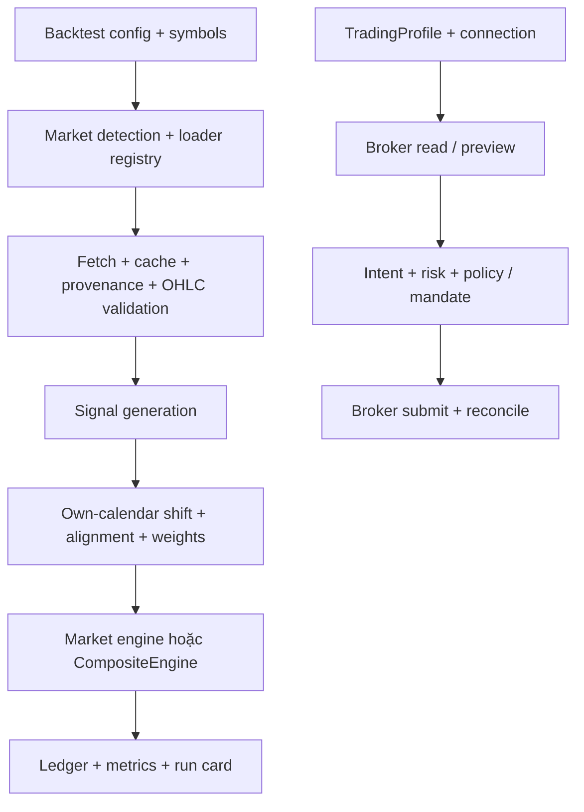

# Baseline mã nguồn Vibe-Trading 0.1.18

Ngày chụp trạng thái: **2026-11-04**. Phạm vi nghiên cứu: đường dữ liệu, mô phỏng, connector và kiểm soát lệnh liên quan Việt Nam, Forex và Crypto trong bản workspace này. Không có commit hash được xác nhận trong baseline.

Đây là kết quả đọc mã nguồn và nội dung test, **chưa phải biên bản chạy test, kết nối broker hoặc xác nhận vận hành**. Một function, profile, route hoặc test tồn tại chỉ chứng minh có phần triển khai tương ứng. Ngày, phí, quy tắc thị trường được nhắc dưới đây là giả định mã nguồn đang sử dụng; cần đối chiếu nguồn chính thức và điều kiện tài khoản trước khi dùng cho quyết định thực tế.

## 1. Cách đọc mức độ chứng cứ

| Nhãn | Ý nghĩa trong tài liệu |
| --- | --- |
| Có mã | Đã tìm thấy triển khai và đường gọi liên quan trong phạm vi đọc |
| Có test | Có test thể hiện hành vi dự kiến; chưa chạy trong lượt nghiên cứu này |
| Có điều kiện | Cần dependency, tài khoản, dữ liệu, quyền hoặc cấu hình bổ sung |
| Khoảng trống | Chưa có bằng chứng đủ để cam kết chức năng hoặc chất lượng vận hành |
| Đề xuất | Hợp đồng, cơ chế hoặc mốc nghiệm thu cần xây dựng tiếp |

Các trạng thái này không thay thế nhau: `orders.place` trong registry không có nghĩa lệnh đã được broker nhận; history có OHLCV không có nghĩa đó là tick, bid/ask hoặc dữ liệu phù hợp mô phỏng thanh lý.

## 2. Bản đồ nguồn cần giữ khi mở rộng

| Khu vực | Nguồn và điểm vào | Vai trò đã thấy |
| --- | --- | --- |
| Chọn engine | [runner.py](../agent/backtest/runner.py), `_select_market_engine`, khoảng dòng 1744–1880 | Nhận diện thị trường từ symbol trước, sau đó mới xét nguồn dữ liệu |
| Nhận diện symbol | [_market_hooks.py](../agent/backtest/engines/_market_hooks.py), `_MARKET_PATTERNS`, `_detect_market`, `code_currency` | Regex, currency mapping và một số hook dùng chung |
| Registry dữ liệu | [registry.py](../agent/backtest/loaders/registry.py), `VALID_SOURCES`, `register`, `FALLBACK_CHAINS` | Nguồn hợp lệ, đăng ký loader, thứ tự fallback và ngoại lệ không tự đổi nguồn |
| Hợp đồng loader | [base.py](../agent/backtest/loaders/base.py), `DataLoaderProtocol`, dòng 935 | `fetch(codes, start_date, end_date, interval, fields)` trả `dict[str, DataFrame]` |
| Tải và kiểm tra dữ liệu | [runner.py](../agent/backtest/runner.py), `fetch_data_map`, `_sanitize_data_map`, khoảng dòng 2020–2220 | Phục hồi key symbol, ghi nguồn thực sự phục vụ, kiểm tra OHLC, báo thiếu symbol |
| Vòng mô phỏng | [engines/base.py](../agent/backtest/engines/base.py), `_align`, `BaseEngine.run_backtest`, `_execute_bars` | Căn lịch, dịch tín hiệu, mô phỏng khớp lệnh, ledger và kết quả |
| Quy tắc Việt Nam | [vietnam_equity.py](../agent/backtest/engines/vietnam_equity.py), `VietnamEquityEngine`, `hose_can_execute` | HOSE/VND, lot, tick, biên độ và điều kiện giữ cổ phiếu |
| Quy tắc Forex | [forex.py](../agent/backtest/engines/forex.py), `ForexEngine` | Spread, pip, lot, swap; tách quy cách kim loại |
| Quy tắc Crypto | [crypto.py](../agent/backtest/engines/crypto.py), `CryptoEngine` | Phí, funding, margin và đường perpetual strict |
| Danh mục nhiều market | [composite.py](../agent/backtest/engines/composite.py), `CompositeEngine`, `_reject_mixed_currency` | Một pool vốn, nhiều bộ quy tắc; chặn tiền thanh toán khác nhau ở đường composite |
| Risk perpetual | [perpetual_risk.py](../agent/backtest/perpetual_risk.py) | `ExecutionFrame`, `MarketRiskFrame`, bracket, isolated/cross risk |
| Artifact nghiên cứu | [run_card.py](../agent/backtest/run_card.py), `write_run_card`, dòng 168 | Hash cấu hình/strategy, nguồn, cảnh báo, metrics, artifact và model provenance |
| Kiểu connector | [types.py](../agent/src/trading/types.py), `TradingProfile` | Environment, transport, capability, readonly, config và notes |
| Registry connector | [profiles.py](../agent/src/trading/profiles.py), `BUILTIN_PROFILES`, `profile_by_id` | Profile broker có sẵn và lựa chọn profile |
| Ma trận capability | [capability_matrix.py](../agent/src/trading/capability_matrix.py), `render`, `sync_readme` | Sinh block README từ profile, giữ riêng môi trường và quyền từng hàng |
| Giao dịch Forex | [forex/service.py](../agent/src/trading/forex/service.py), `ForexService` | Verify/read, preview, tạo intent, submit và reconciliation |
| Hợp đồng Forex | [forex/models.py](../agent/src/trading/forex/models.py), `Connection`, `Order`, `Limits` | Model kiểm tra đầu vào, identity, allowlist symbol và execution opt-in |
| Quyền giao dịch Forex | [forex/policy.py](../agent/src/trading/forex/policy.py), `authorize` | Risk, binding, halt, pending intent, daily/drawdown cap và live mandate |

Không nên tạo một registry loader hoặc một registry broker thứ hai để viết lại các khái niệm trên. Phần kiến trúc mới cần chỉ ra seam mở rộng, migration và nguồn chân lý sau thay đổi.

## 3. Đường thực thi hiện tại

Mô phỏng và broker execution là hai đường riêng. Run backtest thành công không đưa cấu hình tự động qua live mandate. Một loader dùng SDK broker chỉ để đọc lịch sử cũng không chứng minh connector đặt lệnh đã hoạt động.

`_align` dịch tín hiệu một bar trên **lịch riêng của từng symbol**, rồi đặt lên lịch union; mô phỏng sử dụng semantics tín hiệu hiện tại cho lần mở bar kế tiếp. Giá phục vụ quyết định được forward-fill có giới hạn: 5 bar cho một market, 10 bar cho nhiều market; giá định giá mang close cuối qua thời gian halt dài hơn. Đây là cơ chế căn lịch/định giá, không phải tạo giao dịch thực tại phiên nghỉ. Xem [engines/base.py](../agent/backtest/engines/base.py), `_align`, dòng 245–367.

Việc dịch tín hiệu chỉ bảo vệ một phần tính nhân quả. Strategy vẫn có thể nhìn trước nếu tự đọc tương lai, dùng universe hiện tại cho quá khứ, dùng fundamental chưa công bố hoặc chọn tham số từ tập đánh giá.

## 4. Ma trận ba miền ưu tiên

| Miền | Dữ liệu/backtest có mã | Điều kiện và giới hạn | Broker execution được chứng minh đến đâu |
| --- | --- | --- | --- |
| Việt Nam | Symbol `.VN`; `VietnamEquityEngine`; Yahoo/yfinance/local; quy tắc HOSE và VND | Mô hình daily HOSE; long-only; lot 100; tick theo vùng giá; giữ 2 phiên theo giả định; chưa có mô hình HNX/UPCOM/odd-lot tương ứng | Chưa tìm thấy connector SSI/DNSE/TCBS/VNDIRECT trong phạm vi registry và loader đã đọc; không cam kết live Việt Nam |
| Forex/kim loại | `ForexEngine`; MT5 history, AkShare, yfinance, local; TickerAll explicit-only | Spread/slippage và swap là mô hình; quy cách XAU/XAG/XPT/XPD riêng; terminal/account/history depth tùy môi trường; chưa chứng minh currency conversion cho cả danh mục | Có `ForexService` với MT5/Exness/OANDA adapters, intent/risk/policy; chưa xác nhận endpoint, account entitlement hoặc thực thi thật trong lượt này |
| Crypto spot | OKX/Binance/CCXT/yfinance/local có đường tải giá; Binance và OKX có profile paper/live riêng | Nguồn có nến spot không tự chứng minh engine spot accounting riêng: `CryptoEngine` được mô tả và cấu hình theo perpetual/funding | Binance profile trade ghi rõ Spot; live placement cần mandate; runtime chưa được xác nhận |
| Crypto perpetual | CCXT/Binance parse `BASE-USDT-PERP`; mark/trade/funding tách riêng; strict risk isolated/cross; artifact bracket | Funding strict cần dữ liệu; bracket phải do caller cung cấp hợp lệ; dữ liệu bar không chứng minh intrabar liquidation sequence hay exchange parity | Binance USD-M Shadow Account chỉ đọc account/position theo cấu hình hiện có; không đồng nghĩa USD-M order execution |

### 4.1 Việt Nam: mô hình HOSE đang làm gì

`VietnamEquityEngine.__init__` từ chối `allow_short=True`; mặc định `price_limit=0.07`, `vn_brokerage=0.0015`, `vn_tax_sell=0.001`, `vn_settlement_bars=2`. Đây là giá trị mô hình, không phải bảng giá áp dụng chung cho mọi broker hoặc mọi pháp nhân. Xem [vietnam_equity.py](../agent/backtest/engines/vietnam_equity.py), dòng 355–397.

Tick grid trong mã là 10 VND dưới 10.000; 50 VND từ 10.000; 100 VND từ 50.000. Lot được làm tròn theo 100 cổ phiếu. Logic trần/sàn lượng tử hóa theo tick thay vì chỉ nhân tỷ lệ. Ngày đầu, resume hoặc ex-right đặc biệt cần giá tham chiếu và cấu hình phù hợp; một tỷ lệ mặc định không mô tả mọi phiên.

Settlement sử dụng opening fill mới nhất để giữ cả vị thế sau scale-in. Điều này thận trọng nhưng chưa phải ledger settlement theo từng lot: một lot cũ đã đủ điều kiện có thể bị giữ theo lot mới. Bar daily không biểu diễn được thời điểm hàng về trong phiên hoặc T+1.5 theo cách gọi thị trường. Xem `newest_opening_bar_idx`, `hose_is_settled`, `hose_settlement_ok` và [test_vietnam_backtest_smoke.py](../agent/tests/test_vietnam_backtest_smoke.py).

Chú thích registry nói Yahoo `.VN` chỉ cung cấp HOSE; HNX/UPCOM có thể đi qua file local. **Đưa HNX/UPCOM vào local không tự thay đổi bộ quy tắc thành HNX/UPCOM**: cần instrument/venue metadata và engine phù hợp trước khi công bố hỗ trợ hai sàn này. Xem [registry.py](../agent/backtest/loaders/registry.py), dòng 232–234 và [vietnam_equity.py](../agent/backtest/engines/vietnam_equity.py), dòng 25–34.

### 4.2 Forex: history, backtest và execution

`ForexEngine` dùng lot chuẩn 100.000 đơn vị base cho FX, đồng thời khai báo quy cách riêng cho kim loại; rounding theo 0,01 lot. Spread lấy từ bảng/override; phí commission trả 0 trong mô hình, còn chi phí được đưa vào half-spread và slippage. Broker ECN, spread biến thiên, commission theo volume và swap thực tế cần cấu hình hoặc dữ liệu riêng. Xem [forex.py](../agent/backtest/engines/forex.py), dòng 22–58 và 105–163.

Loader MT5 cần Windows, package tùy chọn và terminal phù hợp; history bị giới hạn bởi cấu hình terminal. Đường history attach hiện có không nên được mô tả như bằng chứng binding account cho mọi lệnh. `forex.models.Connection` ở đường execution yêu cầu login/server/path rõ cho MT5, có fingerprint và execution opt-in; hai đường này có trách nhiệm khác nhau. Xem [mt5_loader.py](../agent/backtest/loaders/mt5_loader.py), dòng 1–15 và [forex/models.py](../agent/src/trading/forex/models.py), `Connection.binding`.

`Connection` mặc định `environment="demo"`, `execution_enabled=False`; connector enum gồm `mt5`, `exness`, `oanda`. Với Exness, model từ chối demo vì eligibility chưa xác minh, yêu cầu gateway/approved hosts và account ID. Không suy từ adapter tồn tại rằng mọi retail account đều được cấp API. Xem [forex/models.py](../agent/src/trading/forex/models.py), dòng 78–116.

`authorize` kiểm tra risk, execution-enabled, fingerprint, halt và outstanding intent trước khi xét giới hạn ngày/drawdown. Với opening live, còn cần mandate đúng connection/account, chưa hết hạn và nằm trong cap. Closing có nhánh riêng để cho phép giảm vị thế đã xác minh sau entry cap; vẫn cần audit từng adapter và tình huống reconcile. Xem [forex/policy.py](../agent/src/trading/forex/policy.py), `authorize`.

### 4.3 Crypto: strict không phải chứng nhận giống sàn

Mặc định `CryptoEngine` dùng `funding_mode="fixed"`, `funding_rate=0.0001` và `perpetual_strict=False`. Đường strict yêu cầu `funding_mode="data"`, margin mode hợp lệ và liquidation fee hợp lệ. Khi leverage từ 100, engine giới hạn interval cho phép đến 1H và nhỏ hơn; chính thông báo lỗi nói 1H chỉ là boundary độ phân giải, **không bảo đảm trình tự thanh lý**. Xem [crypto.py](../agent/backtest/engines/crypto.py), dòng 55–97.

CCXT perpetual loader lấy trade candles và mark candles, yêu cầu timestamps đồng bộ, ghép funding settlements và từ chối dữ liệu thiếu/trùng theo contract của nó. Maintenance brackets được gắn khi caller đưa artifact hợp lệ, không gọi API authenticated để tự tải leverage tiers trong đường historical. `require_brackets=True` thiếu artifact sẽ fail trước network call. Xem [ccxt_loader.py](../agent/backtest/loaders/ccxt_loader.py), dòng 237–254 và 311–372.

`MarketRiskFrame` giữ mark, funding, bracket, provenance và fidelity input; risk evaluator thêm `conservative_intrabar_assumption` khi cần giả định về cực trị của bar. Giữ nguyên fidelity flags trong artifact/UI. Không chuyển một cờ thận trọng thành nhãn “liquidation chính xác theo sàn”. Xem [perpetual_risk.py](../agent/backtest/perpetual_risk.py), dòng 227–270 và 284–332.

Đối soát account Binance, drift evidence và tolerance calibration đã có module riêng. Calibration chỉ chứng minh tolerance bao phủ tập quan sát được ghi; docstring không khẳng định áp dụng cho mọi account hoặc tương lai. Đọc [binance_account_reconciliation.py](../agent/backtest/binance_account_reconciliation.py), [binance_shadow_evidence.py](../agent/backtest/binance_shadow_evidence.py) và [binance_tolerance_calibration.py](../agent/backtest/binance_tolerance_calibration.py).

## 5. Fallback, provenance và corporate actions

Các chain dưới đây là **mặc định trong mã**, chưa phải xác nhận nguồn đang truy cập được tại máy hoặc vùng mạng của người dùng. Environment overrides có thể đổi thứ tự.

| Market | Chain mặc định | Ghi chú |
| --- | --- | --- |
| Vietnam equity | `yahoo → yfinance → local` | Nguồn `.VN` không tạo coverage mọi venue Việt Nam |
| Forex | `mt5 → akshare → yfinance → local` | MT5 phụ thuộc môi trường; không tự coi dữ liệu fallback là broker feed tương đương |
| Crypto | `okx → binance → ccxt → yfinance → local` | Coverage symbol, bar size, trade/mark/funding khác nhau |
| Futures | `akshare → local` | Chain chú thích network path phục vụ Chinese contracts; không cam kết dữ liệu mọi global contract |

Nguồn: [registry.py](../agent/backtest/loaders/registry.py), `FALLBACK_CHAINS`, dòng 180–267. TickerAll, QVeris và một số nguồn khác là explicit/opt-in; đừng tự đưa vào chain chỉ vì đã đăng ký.

`local`, `qveris`, `tickerall`, `fmp`, `nobitex`, `wallex`, `b3_cotahist` có contract không tự degrade sang network source khi được yêu cầu rõ. Đây là bảo toàn provenance/currency và ý định người dùng; không phải lỗi cần “sửa” bằng dữ liệu thay thế im lặng. Xem `_NO_NETWORK_FALLBACK_SOURCES`, dòng 141–162.

`fetch_data_map` ghi nguồn thật sự trả dữ liệu, xử lý fallback theo symbol, từ chối symbol vẫn thiếu, sanitize OHLC và trả cảnh báo price caliber. Điều này chưa đồng nghĩa xác minh đủ mọi ngày lịch sử, không survivorship bias, timestamp nguồn đúng hoặc dữ liệu có license sử dụng phù hợp. Missing symbol và incomplete historical range là hai loại kiểm tra khác nhau.

Registry phân biệt `raw`, `split`, `split_dividend`, `split_dividend_additive`, `na`, `unknown`; ưu tiên metadata `frame.attrs["adjustment"]` khi loader đã chuyển đổi. Additive adjustment có cảnh báo riêng vì tỷ suất tính từ level có thể không tương đương multiplicative return. Không dùng một nhãn “adjusted” duy nhất để gộp các caliber. Xem [registry.py](../agent/backtest/loaders/registry.py), `PRICE_CALIBER_BY_SOURCE`, `frame_caliber`, `mixed_caliber_warning`, `additive_caliber_warning`.

DataLoader protocol cũng nói rõ `volume` có thể là shares hoặc lots, provenance không khai báo thì phải để chưa biết. Cache giữ một số attrs tiền tệ/adjustment, không phải chứng cứ raw payload archive đầy đủ. Xem [base.py](../agent/backtest/loaders/base.py), `_LOADER_FRAME_METADATA_ATTRS` và `DataLoaderProtocol`.

## 6. Tiền tệ và danh mục: giới hạn quan trọng

`CompositeEngine` giữ **một scalar pool vốn**; sub-engine cung cấp quy tắc commission/slippage/rounding. `_reject_mixed_currency` chặn basket có settlement currencies khác nhau vì chưa có FX translation. Ví dụ test cho phép `AAPL.US + ESZ4 + BTC-USDT` theo USD, từ chối `VIC.VN + AAPL.US` hoặc cổ phiếu CNY + USD. Xem [composite.py](../agent/backtest/engines/composite.py), dòng 88–118 và 157–174; [test_composite_currency_guard.py](../agent/tests/test_composite_currency_guard.py).

Mapping hiện có coi crypto theo USD peg; điều đó không mô phỏng stablecoin depeg. Mapping symbol sang currency cũng chưa phải một ledger base/quote/settlement/account currency thống nhất cho mọi instrument. Xem [\_market_hooks.py](../agent/backtest/engines/_market_hooks.py), `_MARKET_CURRENCY`, `code_currency`.

**Khoảng trống cần audit trước khi cam kết đa tiền tệ:** guard được tìm thấy tại `CompositeEngine`; router chọn `ForexEngine` trực tiếp khi toàn bộ mã cùng market `forex`. Vì vậy guard cross-market không chứng minh basket `EUR/USD + USD/JPY` trong một ForexEngine được quy đổi hoặc từ chối. `ForexEngine` không override `_calc_pnl`/`_calc_margin` của BaseEngine trong mã đã đọc. Tài liệu không nên lặp lại claim “cross-pair converted” chỉ từ docstring đầu file.

Tương tự, router kiểm tra “có Chinese futures” để chọn `ChinaFuturesEngine` ở nhánh một market futures; cần nghiệm thu riêng basket vừa Chinese vừa global futures. Không suy từ support từng engine rằng mọi tổ hợp đều được route đúng.

LSE được normalize từ GBp sang GBP khi metadata xác nhận; các line không đúng currency contract bị từ chối. Một phép đổi đơn vị pence/pound khác với FX translation theo thời gian. HK counter không phải HKD được chặn trong router theo code currency; các venue BYMA/B3/Canada có kiểm tra declared currency ở loader helpers. Xem [base.py](../agent/backtest/loaders/base.py), dòng 29–162 và [runner.py](../agent/backtest/runner.py), dòng 1761–1775.

## 7. Mô hình dữ liệu chung và connector contract: có gì để tái sử dụng

Trong các đường đã đọc chưa xác lập một schema dữ liệu chung duy nhất bao trùm bars, events, instrument terms, account risk và order lifecycle. SDM trong bộ tài liệu này chỉ Strategy Development Manager/artifact store, không phải tên schema dữ liệu thị trường. Hiện có những contract chuyên trách cần tái sử dụng:

1. **Dữ liệu lịch sử:** `DataLoaderProtocol` + DataFrame + provenance/attrs; registry quyết định availability và fallback.
2. **Mô phỏng:** `Position`, trade/fill/equity records trong [models.py](../agent/backtest/models.py), cùng hook market của BaseEngine.
3. **Perpetual risk:** dataclass tách execution price, mark price, maintenance schedule và account state.
4. **Connector chung:** `TradingProfile` cùng capability strings và environment/transport/readonly.
5. **Forex execution:** Pydantic contracts, binding fingerprint, risk limits, intent state và reconcile.
6. **Chứng cứ run:** run card với schema version, hashes, provenance, warning và artifact citations.

Mô hình dữ liệu chung đề xuất phải phân biệt tối thiểu canonical instrument ID với provider/native symbol; venue với asset class; base/quote/settlement/account currency; timestamps event/received; raw/adjusted price; price unit và volume unit; revision/availability; data completeness và fidelity. Đây là **đề xuất hợp đồng**, chưa phải field đã có đồng đều ở mọi loader.

Capability registry hiện không khai báo đầy đủ order kinds và runtime verification. Generator đã nói rõ điều này. Khi thêm broker Việt Nam hoặc provider mới, cần cập nhật registry, implementation, trust-boundary validation, test và evidence runtime; không chỉ thêm tên vào bảng marketing. README block `BEGIN/END GENERATED broker-capability-matrix` phải giữ đúng một cặp để `sync_readme` và drift guard tiếp tục hoạt động.

## 8. Phạm vi các market còn lại

Router có nhánh A-share, US/HK/Canada/UK, India, Korea, Brazil, Vietnam, Forex, Crypto, China/global futures và index. Mức fidelity khác nhau; danh sách này không phải bảo đảm toàn bộ venue hoặc mọi sản phẩm.

- Argentina `.BA` có data routing, nhưng runner và composite **chủ động từ chối backtest execution rules** vì chưa mô hình BYMA. Xem [runner.py](../agent/backtest/runner.py), dòng 1819–1827.
- Global futures có multiplier/commission table nhưng docstring nói roll/expiry chưa mô hình, giả định continuous front-month; bảng initial margin được chú thích chưa tiêu thụ. Xem [global_futures.py](../agent/backtest/engines/global_futures.py), dòng 1–10 và 54–74.
- China futures có margin/price-band/commission mặc định theo sản phẩm, night session chưa enforce ở bar-level. Các tham số tĩnh chưa thay thế lịch rule theo ngày. Xem [china_futures.py](../agent/backtest/engines/china_futures.py), dòng 1–10.
- Options engine tạo **giá lý thuyết** từ underlying, Black–Scholes, historical volatility và smile/early-exercise heuristic. Không gọi đây là backtest option chain/bid-ask lịch sử. Xem [options_portfolio.py](../agent/backtest/engines/options_portfolio.py), dòng 1–18.
- `_detect_market` vẫn mặc định `a_share` cho mã không match. Instrument validation/canonical registry là một hạng mục cần làm rõ trước khi nhận symbol tùy ý từ AI hoặc plugin.

## 9. Tests hiện có và bằng chứng còn thiếu

Những file sau là điểm bắt đầu cho nghiệm thu; baseline này chỉ đọc nội dung hoặc tên test, **chưa chạy** và không đánh dấu pass:

| Nhóm | Tests liên quan | Hành vi cần giữ |
| --- | --- | --- |
| Causality | [test_execution_causality.py](../agent/tests/test_execution_causality.py) | Không dùng giá tương lai cho quyết định/khớp |
| HOSE | [test_vietnam_equity_engine.py](../agent/tests/test_vietnam_equity_engine.py), [test_vietnam_backtest_smoke.py](../agent/tests/test_vietnam_backtest_smoke.py), [test_composite_vietnam_rules.py](../agent/tests/test_composite_vietnam_rules.py) | Tick, band, settlement, scale-in và shared-state dispatch |
| Currency | [test_composite_currency_guard.py](../agent/tests/test_composite_currency_guard.py), [test_hk_counter_currency.py](../agent/tests/test_hk_counter_currency.py) | Từ chối trộn đơn vị khi chưa có conversion |
| Giá/nguồn | [test_price_caliber.py](../agent/tests/test_price_caliber.py), [test_ohlc_validation.py](../agent/tests/test_ohlc_validation.py), [test_get_market_data_provenance.py](../agent/tests/test_get_market_data_provenance.py) | Không mất adjustment, dữ liệu sai cấu trúc hoặc nguồn thật |
| Perpetual data/risk | [test_ccxt_perpetual_loader.py](../agent/tests/test_ccxt_perpetual_loader.py), [test_perpetual_risk.py](../agent/tests/test_perpetual_risk.py) | Mark/funding sync, bracket validation, isolated/cross threshold |
| Binance evidence | [test_binance_account_reconciliation.py](../agent/tests/test_binance_account_reconciliation.py), [test_binance_tolerance_calibration.py](../agent/tests/test_binance_tolerance_calibration.py), [test_binance_usdm_readonly.py](../agent/tests/test_binance_usdm_readonly.py) | Drift/currency/account semantics và giới hạn read-only |
| Forex execution | [test_forex_execution.py](../agent/tests/test_forex_execution.py), [test_forex_runner.py](../agent/tests/test_forex_runner.py), [test_forex_mt5.py](../agent/tests/test_forex_mt5.py) | Intent, retry/reconcile, broker binding và worker failures |
| Artifact | [test_run_card.py](../agent/tests/test_run_card.py), [test_run_card_strict_json.py](../agent/tests/test_run_card_strict_json.py), [test_run_card_structured_metrics.py](../agent/tests/test_run_card_structured_metrics.py) | Reproducibility, valid JSON và không mất risk diagnostics |

`validation` trong BaseEngine là tùy chọn. Monte Carlo, bootstrap và walk-forward analysis có triển khai, nhưng việc lưu validation result không tự chứng minh đã train/refit strategy theo các cửa sổ walk-forward, không leakage hoặc đã hiệu chỉnh lựa chọn nhiều chiến lược. Xem [validation.py](../agent/backtest/validation.py), `run_validation` và `walk_forward_analysis`.

Các mốc còn cần bằng chứng độc lập trước khi gắn nhãn vận hành:

1. Dataset/provider manifest thực tế: coverage venue/symbol/date, license, timezone, gaps, revision và corporate-action semantics.
2. Kiểm thử route theo instrument, đặc biệt cùng market nhưng khác currency/venue; tài khoản đa tiền tệ và stablecoin depeg.
3. Replay từ dữ liệu đã đóng băng với expected fills, phí, settlement, mark/funding và equity; giữ payload provenance/hash.
4. Broker read-only smoke bằng tài khoản phù hợp; paper/demo execution rồi reconciliation, timeout, duplicate, reconnect và cancel/close scenarios.
5. Xác minh live mandate, identity, kill switch và thao tác khôi phục trên đúng profile/account trước mọi thử nghiệm có tiền thật được cấp phép.
6. Runtime/UI evidence cho các trạng thái unsupported, partial, stale, unverified và rejected; không biến thành số 0 hoặc trạng thái connected giả.

Baseline chưa kiểm tra credentials, broker account, quyền dữ liệu, endpoint đang hoạt động, giao dịch thực, toàn bộ test suite hoặc packaged application. Những khoảng trống này phải được giữ trong README, kiến trúc và tiêu chí nghiệm thu cho đến khi có artifact mới thay thế.
