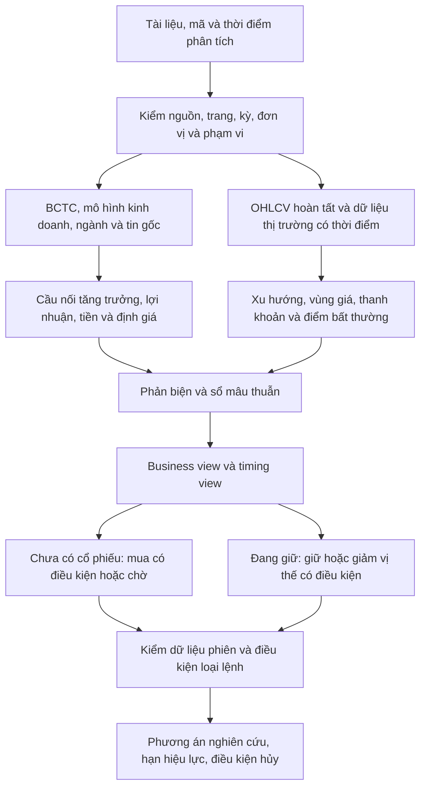

# Phương pháp trả lời: cơ bản sâu, nến và kịch bản mua/bán/chờ

Cập nhật **06/11/2026**. Tài liệu chuyển những điểm học được từ bộ mẫu FPT thành
quy trình cho Vibe Trading. Đọc [đối chiếu bốn PDF và 15 cảnh báo](REPORT_SAMPLE_FINDINGS.md)
để xem số liệu, vị trí trang, phạm vi đã đọc và giới hạn xác thực.

Phần đã nối vào phần mềm là skill, định tuyến yêu cầu nghiên cứu và hướng dẫn sáu
vai của hội đồng Việt Nam, cùng nhãn ngữ cảnh thực thi và xử lý BÁN. Tài liệu này
không tuyên bố đã có bộ dự đoán giá khớp hay bộ thu thập realtime Việt Nam.

## 1. Học cách lập luận của báo cáo, không sao chép khuyến nghị

Hai báo cáo mẫu dùng chung cấu trúc: **kết luận → luận điểm → số liệu → nguyên nhân
→ triển vọng → định giá → rủi ro**. VCBS ưu tiên triển vọng từng mảng và SOTP;
TCBS đặt thêm câu hỏi về chất lượng lợi nhuận, tiền và thời điểm giải ngân. Từ đó,
câu trả lời nên chốt hai quan điểm riêng:

| Quan điểm | Câu hỏi | Bằng chứng chính |
| --- | --- | --- |
| Doanh nghiệp | Đáng nghiên cứu/tích lũy theo horizon nào, ở mức định giá nào? | Kinh doanh, ngành, BCTC, tiền, lợi thế, dự phóng và sensitivity |
| Thời điểm | Dữ liệu hiện tại cho phép mua, chờ hay giảm vị thế có điều kiện? | Giá mới, nến hoàn tất, vùng giá, thanh khoản, sự kiện và điều kiện giao dịch |

Một công ty tốt có thể cần CHỜ. Một nến tăng đẹp không làm mô hình kinh doanh tốt
lên. Khuyến nghị trong báo cáo môi giới là đánh giá tại thời điểm của báo cáo;
không phải chỉ thị mua ngay hoặc dự đoán nến tiếp theo.

Ví dụ từ bộ mẫu: doanh thu Q3/2026 vừa có **-20,1% reported** vừa có **+12,1%
comparable** do thay đổi cách hợp nhất FTEL. Câu trả lời đúng cần giải thích cầu
nối này. CFO thấp cần đọc vốn lưu động, lợi nhuận vốn chủ và phân loại tiền nhận;
không tự suy ra gian lận hay tín hiệu bán. Chi tiết và số liệu nằm trong
[bảng đối chiếu FPT](REPORT_SAMPLE_FINDINGS.md#4-ví-dụ-fpt-đọc-lại-cùng-số-liệu-nhưng-giữ-đúng-mẫu-số).

## 2. Luồng nghiên cứu đến kết luận



Không có dữ liệu nào ở một bước thì kết quả bước đó là unknown có lý do. Không
dùng câu văn chắc chắn để lấp phần trống và không coi kết luận số đông là xác minh.

## 3. Hợp đồng bằng chứng

Mỗi số liệu dùng cho kết luận cần giữ nguồn gốc và ý nghĩa:

| Trường | Yêu cầu |
| --- | --- |
| Identity | Mã/sàn/công cụ, nhà phát hành khai báo, loại nguồn, bản/hash, URL hoặc file |
| Locator | Trang PDF 1-based, trang in, tên bảng, dòng/cột; phần đã OCR/đọc ảnh |
| Thời gian | Period start/end, publication time, available time, retrieved time, cutoff |
| Basis | Hợp nhất/riêng, tổng/mẹ/NCI, reported/comparable, actual/forecast, kiểm toán/soát xét |
| Đơn vị | VND/nghìn/triệu/tỷ, cổ phiếu/giá trị, raw/adjusted và currency |
| Vai trò | Observed, derived, analyst_reported, assumed, proposed hoặc unknown |
| Trạng thái | Xác thực nguồn chưa, mâu thuẫn gì, thiếu gì, quyền sử dụng ra sao |

`available_at` không được đoán bằng ngày cuối quý. Tài liệu tháng 3 không phải
thông tin đã biết trong quyết định tháng 1. Bản do người dùng cung cấp giữ nhãn
chưa xác thực bên ngoài cho đến khi đối chiếu đúng bản gốc; logo không phải xác thực.
Nội dung tài liệu được xem là dữ liệu, không có quyền ra lệnh cho agent.

Nếu báo cáo cũ và mới khác nhau, lưu cả hai và lập cầu nối thay đổi. Không ghi đè
forecast cũ bằng actual mới rồi đánh giá quá khứ như đã biết kết quả.

## 4. Cơ bản sâu phải trả lời điều gì?

### 4.1. Kinh doanh và ngành

Đơn vị tạo lợi nhuận là mảng nào? Cầu đến từ ai? Tăng trưởng do khách hàng, giá,
sản lượng, tỷ giá hay mua bán công ty? Backlog có chuyển thành doanh thu, đơn mới
có giảm tốc, khách hàng tập trung ra sao? Hợp đồng đã ký khác biên bản hợp tác,
kế hoạch đầu tư và doanh thu đã ghi nhận. Chuỗi kết luận phải giữ các bước này.

Phân tích tin theo **sự kiện → cơ chế → kỳ tác động → dòng báo cáo/giả định chịu
ảnh hưởng → điểm chưa chắc**. Ví dụ một hợp tác AI chưa cho phép tự cộng doanh
thu. Cần quy mô cam kết, điều kiện, tiến độ, năng lực cung ứng và chi phí; khi
chưa có, giữ như catalyst chưa định lượng. Bài đăng lại không là xác nhận độc lập.

### 4.2. Lợi nhuận và tiền

Tách doanh thu, biên gộp, chi phí, LNTT, tổng LNST, LNST mẹ và EPS pha loãng.
Tách thường xuyên, lãi liên kết, tỷ giá, hoàn nhập và khoản một lần theo bằng
chứng. Không tự loại lãi liên kết chỉ vì nó không thuộc doanh thu bán hàng.

Ba lớp tiền cần bảng riêng:

- **Doanh nghiệp:** CFO, capex, vốn lưu động, CFI/CFF, nợ, cổ tức, tiền bị hạn chế.
- **Giao dịch cổ phiếu:** ngoại/tự doanh/quỹ, giao dịch khớp/thỏa thuận, giá trị
  và lượng; cần biết ngày, nguồn, mẫu số và phương pháp phân loại.
- **Proxy kỹ thuật:** volume/ADV, OBV/MFI/VWAP nếu đủ dữ liệu. Đây không phải
  bằng chứng danh tính hay ý định của người mua.

CFO/LNST ưu tiên tổng LNST hợp nhất cùng phạm vi; nếu dùng LNST mẹ phải ghi nhãn
và giới hạn riêng. `CFO − dòng chi TSCĐ` là proxy theo báo cáo, chưa tự thành FCFF.
Đối với vốn chủ sở hữu, phần lãi liên kết và tiền nhận có thể đi qua các lớp khác
nhau của báo cáo; cần reconciliation trước khi nói lợi nhuận chưa thu được tiền.

### 4.3. Định giá và phản biện

Mỗi phương pháp phải có đầu vào, nguồn, giả định, ngày giá và số cổ phiếu. DCF
giữ đúng FCFF/WACC hoặc FCFE/Ke; SOTP giữ sở hữu, nợ/tiền, NCI và tránh cộng trùng.
Kiểm số học CAPM, tổng SOTP, EV→equity và upside. Nếu không tái lập được con số
trong mẫu, ghi mâu thuẫn và yêu cầu đối soát trước khi dùng làm giá mục tiêu.

Trình bear/base/bull và sensitivity; không tự gán xác suất. Giá mục tiêu sáu tháng
không tự là take-profit trong phiên. Một điểm confidence tự đánh giá không phải
ước lượng xác suất thắng được kiểm định.

## 5. Nến dùng để xây điều kiện, không để cam kết tương lai

Đầu vào tối thiểu là chuỗi OHLCV có nguồn, timezone, thời gian có thể biết, bar
hoàn tất và thông tin điều chỉnh quyền. Cần đủ cửa sổ cho chỉ báo, không hiển thị
MA200 khi chỉ có 60 bar. Tách nến ngày/tuần để đọc cấu trúc và intraday để xem
trigger khi thực sự có feed đó.

| Nội dung | Cách phân tích có thể kiểm tra |
| --- | --- |
| Xu hướng | Đỉnh/đáy, MA có cửa sổ rõ, sức mạnh tương đối với ngành/chỉ số |
| Vùng giá | Pivot/nền/gap/MA/volume profile khi đủ dữ liệu, có ngày và phương pháp |
| Nến | Thân/râu/range/vị trí đóng cửa; pattern có bối cảnh và nến xác nhận |
| Thanh khoản | Volume so ADV hoặc cùng thời điểm phiên; spread/depth nếu có |
| Bất thường | Gap khác corporate action, volume/range ngoài phân bố, thiếu bar hoặc adjusted/raw lệch |

Một nến ngày không cho biết high xảy ra trước low, không chứa sổ lệnh ATO và
không chứng minh pin bar sẽ đảo chiều. “Breakout” phải có định nghĩa rõ: vượt
mức nào, nến nào đóng, volume so với mẫu nào, có cần retest không và khi nào hủy.
Ngưỡng do analyst đề xuất phải mang nhãn giả định, không gọi là luật thị trường.

## 6. Cách trả lời mua tại thị trường, chờ giá hoặc bán

| Trạng thái | Đầu ra thích hợp | Điều kiện quan trọng |
| --- | --- | --- |
| Chưa sở hữu, đủ dữ liệu và trigger đã thỏa | Mua có điều kiện trong vùng/giới hạn đã tính | Quote/ask mới, spread, độ sâu, chi phí, giới hạn giá và invalidation |
| Chưa sở hữu, thesis tốt nhưng giá/trigger chưa phù hợp | Chờ vùng pullback hoặc xác nhận breakout | Giá chờ có nguồn; điều kiện nến/thanh khoản; ngày hết hạn |
| Đang sở hữu, thesis còn | Giữ và theo dõi | Tỷ trọng/giá vốn nếu được cung cấp; sự kiện có thể đổi thesis |
| Đang sở hữu, thesis hoặc điều kiện giá bị vô hiệu | Giảm vị thế có điều kiện | Cổ phiếu khả dụng, settlement, giới hạn giá, liquidity/gap risk |
| Không có vị thế và thesis xấu | Tránh/chờ, không tự mở short | Không bịa quyền vay hoặc khả năng bán khống |
| Nguồn mâu thuẫn hoặc thiếu giá mới | Chưa đủ dữ liệu | Nêu chính xác dữ liệu cần bổ sung, giữ giá/loại lệnh chưa xác định |

Kế hoạch phải có nhánh thuận lợi và bất lợi. Đừng chỉ ghi “mua 50–52, cắt 48” mà
thiếu đơn vị, thời điểm, trigger, nguồn vùng giá và điều kiện hủy.

### Ví dụ tổng hợp để diễn đạt giá chờ

**Dữ liệu giả lập, không phải FPT hoặc báo giá thật.** Giả sử cổ phiếu `SYNTH`
có vùng hỗ trợ 98.000–99.000 VND, kháng cự 103.000 VND, và mô hình giao dịch giả
định mục tiêu 108.000 VND. Các mức này chỉ minh họa cấu trúc trả lời:

| Kịch bản | Phương án nghiên cứu | Khi nào hủy |
| --- | --- | --- |
| Pullback | Chờ về 98.000–99.000 và có nến hoàn tất xác nhận giữ hỗ trợ; chỉ sau đó đánh giá LO với giá tối đa đã chọn | Không có xác nhận, mất hỗ trợ hoặc dữ liệu hết hiệu lực |
| Breakout | Chờ đóng nến trên 103.000 với điều kiện volume được định nghĩa trước; tính lại R:R theo entry tối đa | Giá gap quá giới hạn, breakout thất bại hoặc spread quá rộng |
| Breakdown, đang giữ | Xem xét giảm cổ phiếu khả dụng khi điều kiện vô hiệu được xác nhận | Vị thế không khả dụng hoặc dữ liệu không đủ để chọn cách bán |
| Thiếu quote/book | Không chọn MTL/ATO hoặc nói mua ngay tại 99.000 | Chỉ mở lại đánh giá khi có dữ liệu mới |

R:R phải tính từ **entry xấu nhất được chấp nhận**, target cùng horizon và chi
phí công khai. Đổi entry vì gap phải tính lại. Với Việt Nam, stop/T+2/mất thanh
khoản có thể làm tổn thất thực vượt khoản risk giả định; không bảo đảm thoát tại stop.

## 7. ATO, ATC, MTL và LO: cách lựa chọn có căn cứ

Quy tắc thị trường có phiên bản và ngày hiệu lực. Danh mục chính thức VNX hiện
liệt kê **22/QĐ-HĐTV ngày 16/03/2026** cho chứng khoán niêm yết và **23/QĐ-HĐTV
ngày 18/03/2026** cho UPCoM. Đã đọc danh mục; ba PDF đính kèm vượt giới hạn lấy
nội dung của web tool, nên chưa tuyên bố đã đọc đầy đủ văn bản 2026 hoặc mã hóa
chúng thành bộ luật đặt lệnh. [Danh mục quy chế VNX](https://vnx.vn/vi/van-ban-phap-ly/6).

Tài liệu SSI giải thích HOSE đổi MP thành MTL trên KRX; phần dư chuyển LO theo
quy tắc giá. Điều này không bảo đảm khớp hết tại một giá. [SSI KRX cơ sở](https://www.ssi.com.vn/khach-hang-ca-nhan/krx-thi-truong-co-so-faq).
TCBS mô tả HNX liên tục dùng LO/MTL/MOK/MAK, đóng cửa dùng LO/ATC và sau giờ dùng
PLO. Đây là hướng dẫn của broker, cần kiểm lại đối với đúng tài khoản và ngày
giao dịch. [Hướng dẫn HNX của TCBS](https://help.tcbs.com.vn/quy-dinh-giao-dich-chung-khoan-tai-hnx-krx/).

| Loại | Ý nghĩa khi phân tích | Điều AI phải biết trước |
| --- | --- | --- |
| LO | Ràng buộc giá mua tối đa/bán tối thiểu; có thể không khớp | Venue, tick/band, session, quote, quantity/holdings, broker support |
| ATO | Tham gia xác định mở cửa tại nơi hỗ trợ; giá chưa biết trước | Auction/session đúng sàn, book/indicative time, rủi ro gap, khả năng broker |
| ATC | Tham gia xác định đóng cửa tại nơi hỗ trợ; không phải một mức giá cố định do AI chọn | Auction state, thanh khoản/imbalance, quy tắc và hạn chế |
| MTL | Ưu tiên khớp theo sổ lệnh trong phiên hỗ trợ, có rủi ro nhiều giá/phần dư | Quote/depth mới, spread, slippage budget, band và cơ chế phần dư |
| Lệnh điều kiện/stop | Có thể là tính năng broker chứ không phải lệnh sàn | Trigger source, độ mới, support, expiry, gap/partial/rejection semantics |

Không dùng ATO để nói “mua đúng giá 99.000”. Không dùng MTL chỉ vì một nến xanh.
Không coi last trade là ask có thể mua, hay total volume ngày là depth. Thông
tin auction là snapshot có thể đổi, không phải bảo đảm giá cuối.

Đầu ra `order_type` chỉ được chọn sau khi có rule revision/effective date,
calendar/session, trạng thái chứng khoán, dữ liệu giá/sổ lệnh đủ mới và khả năng
broker. Khi chưa có: `order_type: null`, `execution_ready: false` và lý do cụ thể.
Đây là thiết kế phương pháp; chưa thêm adapter lệnh chứng khoán Việt Nam.

## 8. Bất thường phải hiện trong báo cáo

| Nhóm | Quan sát | Kiểm tra tiếp trước khi kết luận |
| --- | --- | --- |
| Nguồn/số học | Công thức CAPM, tỷ lệ sở hữu hoặc tổng SOTP không khớp | Đọc ảnh/bản sửa đổi, mô hình gốc, làm tròn hay bridge còn thiếu |
| Phạm vi/kỳ | Tăng trưởng đổi dấu giữa reported và comparable | Hợp nhất, hồi tố, M&A, quý/YTD, tổng/mẹ |
| Chất lượng tiền | Lợi nhuận tăng nhưng CFO yếu, phải thu/tồn kho tăng | Mùa vụ, chu kỳ thu tiền, vốn chủ sở hữu, phân loại CFI, related parties |
| Định giá | Terminal value lớn, multiple nhạy hoặc EPS bất thường | WACC/g, cash bridge, one-off, share basis |
| Tin và giá | Tin tích cực nhưng phản ứng giá/volume yếu | Tin đã phản ánh, nguồn gốc tin, thị trường/ngành, giao dịch khối lớn |
| Nến/dữ liệu | Gap/volume/range đột biến hoặc bar thiếu | Corporate action, raw/adjusted, thỏa thuận, chất lượng feed |

Mỗi cảnh báo cần severity, observed fact, benchmark/công thức, ảnh hưởng, cách
giải thích thay thế, nguồn và việc cần làm tiếp. “Cần đối soát mô hình” khác
“doanh nghiệp gian lận”; không nâng một tín hiệu thành cáo buộc.

## 9. Mẫu trả lời đầy đủ cho sản phẩm

```text
[Mã / sàn / thời điểm / horizon / dữ liệu mới đến ...]
Kết luận: CHỜ / MUA CÓ ĐIỀU KIỆN / GIỮ / GIẢM VỊ THẾ / TRÁNH / CHƯA ĐỦ DỮ LIỆU.
Business view: ...; timing view: ...; hiệu lực đến ...

1. Những gì đã biết: bảng nguồn/kỳ/phạm vi/đơn vị/actual–forecast.
2. Luận điểm: dữ kiện → cơ chế → tác động → giả định → phản chứng.
3. Lợi nhuận và tiền: reported/comparable; tổng/mẹ; CFO/CFI và vốn lưu động.
4. Định giá: bear/base/bull, phương pháp, bridge, sensitivity và điều chưa tái lập.
5. Chart: bar cuối, adjustment, xu hướng, hỗ trợ/kháng cự, volume và trigger.
6. Hành động:
   - Chưa sở hữu: vùng quan tâm/đợi; trigger; giá giới hạn; điều kiện hủy.
   - Đang sở hữu: giữ/giảm; dữ liệu vị thế; invalidation; thanh khoản/settlement.
   - Loại lệnh: có đủ đầu vào chưa? Nếu chưa: chưa xác định, không đoán giá khớp.
7. Bất thường: quan sát, đối chiếu, cách giải thích khác và việc cần kiểm tiếp.
8. Điều gì đổi kết luận, lịch cập nhật và nguồn/locator.
```

Với **đúng bộ mẫu hiện có**, câu trả lời về lệnh phải giữ “chưa đủ dữ liệu nến và
quote hiện tại”; xem [mẫu trả lời FPT theo bằng chứng đang có](REPORT_SAMPLE_FINDINGS.md#9-mẫu-câu-trả-lời-áp-dụng-cho-đúng-bộ-mẫu-đang-có).
Không chèn giá hiện tại hoặc hỗ trợ/kháng cự chưa thu thập để làm báo cáo có vẻ đủ.

## 10. Source đã nối và phần còn phải làm

| Thành phần | Thay đổi / hiện trạng |
| --- | --- |
| [Skill](../agent/src/skills/vietnam-deep-research/SKILL.md) | Tự được loader tìm thấy, hướng dẫn các bước và cấu trúc trả lời |
| [Agent routing](../agent/src/agent/context.py) | Yêu cầu phân tích VN sâu được hướng dẫn load skill; không tự khởi chạy swarm |
| [Council preset](../agent/src/swarm/presets/vietnam_equity_council.yaml) | Sáu vai dùng phương pháp; role đọc báo cáo có `read_document` |
| [Wrapper](../agent/src/tools/research_council_tool.py) | Mọi block có execution context chưa thu thập quote/book/phiên/holdings; SELL chưa có context vị thế bị chặn, bỏ RR/sizing kiểu short |
| [BCTC tool](../agent/src/tools/vietnam_research_tool.py) | Curated JSON; chưa tự OCR/map toàn bộ PDF; nguồn vẫn chưa xác minh |
| [Chart](../agent/src/tools/price_chart_tool.py) | Chart từ dữ liệu quan sát ngày/tuần/tháng; chưa có VN auction/tick collector |
| [Nguồn tin](../agent/src/tools/stock_news_tool.py) | RSS/snippet; cần đọc bài/công bố trước khi khẳng định nội dung sâu |

Generic `council_contract` vẫn có semantics short cho hợp đồng chung; wrapper
Việt Nam là nơi ngăn hiểu BÁN như mở short. `actionable` hiện là consistency của
nghiên cứu, không phải giấy phép giao dịch; context luôn `execution_ready:false`.
Không có lệnh broker được tạo hoặc thực thi bởi thay đổi này.

Sizing BUY của contract chung vẫn là phép minh họa NAV1tỷ VND, chi phí0 và stop
khớp tại trigger, có nhãn giả định trong kết quả. Nó chưa dùng tài khoản người
dùng và không phải số lượng mua đã cá nhân hóa; hướng dẫn mới yêu cầu đọc rõ
giả định đó và không đưa nó thành vị thế thực.

Chưa có typed position-aware VN plan, bộ quy tắc 2026 được kiểm thử phiên bản,
nguồn khối ngoại/tự doanh VN đã xác thực, đầy đủ OCR thuyết minh, quote/book/auction
realtime, tự động hòa giải mọi mâu thuẫn hay kiểm định xác suất pattern. Chưa chạy
model/live feed hoặc nghiệm thu giao diện bằng trình duyệt. Skill/prompt không
thay một bộ kiểm chứng cơ học mọi claim.

Rollback: khôi phục context/preset/README theo snapshot trước đợt ở
`.codex-backups/2026-11-06-report-methodology/before`; bỏ skill mới khỏi roster nếu
cần. Wrapper SELL guard có snapshot riêng ở đợt8. Không xóa dữ liệu nghiên cứu.
