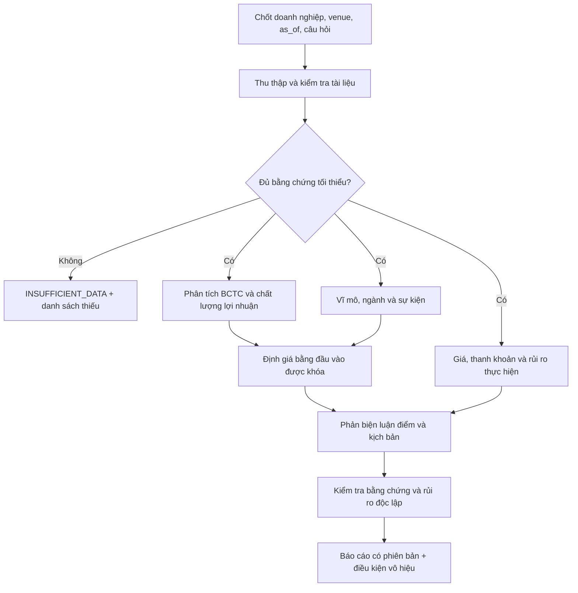

# Vietnam Stock Intelligence: nghiên cứu cổ phiếu bằng bằng chứng

Ngày rà soát nguồn: **2026-11-04**. Tài liệu thiết kế phát triển tiếp từ bản đề xuất của người dùng, đối chiếu với mã nguồn trong workspace và một số nguồn chính thức. Đây là đặc tả nghiên cứu và nghiệm thu; không phải chứng nhận đã chạy pipeline Việt Nam hoặc tư vấn mua bán một chứng khoán cụ thể.

Đọc cùng [kiến trúc đa thị trường](MULTI_MARKET_ARCHITECTURE.md), [hợp đồng dữ liệu và bằng chứng](DATA_EVIDENCE_CONTRACTS.md), [lộ trình triển khai](IMPLEMENTATION_ROADMAP.md) và [ma trận mã nguồn](SOURCE_BASELINE.md).

Đợt nghiên cứu sâu tiếp theo được ghi trong [64 capability specs Việt Nam](specs/VIETNAM_STOCK_64.md): giữ đúng định danh/tiêu đề của [master plan người dùng cung cấp](../VIBE_TRADING_MULTI_MARKET_MASTER_PLAN_V1.md), đối chiếu từng seam mã nguồn với acceptance cụ thể. Catalog bổ sung pipeline có checkpoint, truy vấn revision/PIT, mapping ngân hàng/phi tài chính, reconciliation bằng số **tổng hợp**, quyền/cổ tức và rollback; toàn bộ yêu cầu chưa được triển khai vẫn mang nhãn rõ.

## 1. Phạm vi và mức xác nhận

Mục tiêu đầu tiên là một hồ sơ doanh nghiệp có thể kiểm tra lại: người đọc truy ngược được mọi số liệu về báo cáo gốc, biết dữ liệu nào đã tồn tại tại ngày nghiên cứu, xem được giả định định giá và hiểu điều kiện khiến luận điểm mất hiệu lực. Báo cáo thiếu dữ liệu vẫn hữu ích nếu chỉ rõ khoảng trống; giá mục tiêu không có đầu vào kiểm chứng được thì không được xuất.

| Thành phần | Chỉ xác nhận từ mã nguồn | Khoảng trống cần triển khai hoặc kiểm chứng |
| --- | --- | --- |
| Engine cổ phiếu Việt Nam | [vietnam_equity.py](../agent/backtest/engines/vietnam_equity.py) mô hình HOSE trên daily bars, VND, long-only; xử lý bước giá, lô chẵn, biên độ và chờ thanh toán | Không tương đương toàn bộ HOSE; chưa mô hình riêng HNX/UPCoM, thứ tự khớp lệnh nội phiên, hàng đợi, lô lẻ |
| Đường nạp giá | [registry.py](../agent/backtest/loaders/registry.py) khai báo `vietnam_equity`: Yahoo → yfinance → local; chú thích giới hạn `.VN` của đường Yahoo là HOSE | Chưa xác minh độ phủ từng mã, corporate action, chất lượng hoặc quyền tái phân phối; local không tự bảo đảm quy tắc sàn |
| BCTC có cấu trúc | Đợt code 05/11 nối `.VN` local JSON vào [tool](../agent/src/tools/financial_statements_tool.py)/MCP với disclosure-time revision và provenance; xem [cấu hình, schema và ví dụ](LOCAL_VN_FINANCIAL_STATEMENTS.md) | Reader không tự thu thập/xác minh tài liệu gốc; [fundamentals_loader.py](../agent/backtest/loaders/fundamentals_loader.py) vẫn là SEC/XBRL US và chưa nhận facts Việt Nam |
| Hồ sơ/multiples | [stock_profile_tool.py](../agent/src/tools/stock_profile_tool.py) dùng Yahoo quoteSummary; đợt code 05/11 đã gắn `.VN` → `vn`, giữ metadata nguồn/null và có test qua MCP | Chưa xác minh coverage Yahoo; snapshot hiện tại không phải chuỗi định giá lịch sử |
| Tính toán định giá | [valuation/dcf.py](../agent/src/quantlib/valuation/dcf.py), [comps.py](../agent/src/quantlib/valuation/comps.py), [threestatement.py](../agent/src/quantlib/valuation/threestatement.py) đã có mã; [quantlib_tool.py](../agent/src/tools/quantlib_tool.py) allowlist các module này | Khả năng tính toán không cung cấp thay dữ liệu, giả định hay mapping BCTC Việt Nam; chưa kiểm chứng chuỗi gọi thực tế từ giao diện |
| Kỷ luật đầu vào | [contracts.py](../agent/src/quantlib/valuation/contracts.py) có `MissingInputError`, `Assumption`; [artifact.py](../agent/src/quantlib/valuation/artifact.py) có input hash và artifact định giá | Tái dùng contract hiện tại, bổ sung bằng chứng nguồn Việt Nam; không tạo engine định giá thứ hai |
| Multi-agent | [fundamental_research_team.yaml](../agent/src/swarm/presets/fundamental_research_team.yaml) có financial/valuation/quality → report | Prompt hiện có câu “không có DCF/WACC engine” lệch với quantlib hiện tại; các yêu cầu như percentile lịch sử không chứng minh đã có dữ liệu |
| Lưu chiến lược | [sdm_register_tool.py](../agent/src/tools/sdm_register_tool.py) ghi factor/strategy vào strategy store, mô tả research-only | Không dùng việc đăng ký SDM làm bằng chứng chiến lược đã được xác thực hoặc được phép giao dịch |

**Chưa kiểm chứng runtime:** báo cáo Việt Nam đầu cuối, thu thập BCTC từ sàn/doanh nghiệp, OCR tiếng Việt, danh sách niêm yết lịch sử, feed nội phiên có phép sử dụng, tài khoản môi giới và kết quả đầu tư. Không có kết quả lợi nhuận hay tỷ lệ bao phủ được xác nhận trong tài liệu này.

### 1.1. Các phát hiện mới cần giải quyết trước backtest fidelity

Đã đọc lại source ngày 2026-11-04: [local_loader.py](../agent/backtest/loaders/local_loader.py) `_normalize_columns` chỉ giữ OHLCV ở dòng 226–230 nên `pre_close` nhập trong file bị bỏ; [yahoo_loader.py](../agent/backtest/loaders/yahoo_loader.py) `_rows_to_frame` cũng chọn OHLCV. Trong khi đó `hose_base_price` ở [engine](../agent/backtest/engines/vietnam_equity.py) cần `pre_close` hoặc fallback close phiên trước, và `hose_can_execute` dòng 303–314 trả True cùng warning nếu thiếu reference. Một backtest hoàn tất vì vậy chưa chứng minh mọi phiên đã kiểm biên độ bằng giá tham chiếu chính thức.

[yahoo_client.py](../agent/backtest/loaders/yahoo_client.py) `_parse_chart` điều chỉnh OHLC theo adjclose/close khi có; [yfinance_loader.py](../agent/backtest/loaders/yfinance_loader.py) gọi `auto_adjust=True`. Đổi nguồn fallback không cung cấp một raw execution series riêng. Trước khi mở rộng cần giữ raw/reference/status cùng hợp đồng có nhãn adjustment và kiểm callers; không dùng adjusted historical price để tự chứng nhận tick/band/fees đúng giá tiền mặt. [valuation_loader.py](../agent/backtest/loaders/valuation_loader.py) chỉ lấy CN symbols và trả NaN cho `.VN`, còn bảng default ở [benchmark.py](../agent/backtest/benchmark.py) chưa có Vietnam. Các khoảng trống này đã có acceptance cụ thể trong catalog; chưa sửa code ở đợt tài liệu.

### 1.2. Bổ sung implementation ngày 2026-11-05: local reference và cảnh báo fidelity

Baseline source ngày 2026-11-04 ở trên được giữ làm lịch sử. Slice triển khai tiếp theo đã sửa local loader để giữ `pre_close` có sẵn hoặc được map từ cột gốc, kể cả qua cache. Khi gộp intraday thành daily, reference lấy từ hàng mở đầu; reference thiếu không được thay bằng hàng sau. Giá trị không dương/không hữu hạn được giữ là thiếu. Cột này là giá tham chiếu **do bộ dữ liệu cung cấp**, không phải xác nhận sở đã chứng thực giá.

Data Bridge có thể khai báo `adjustment` theo từng nguồn: `raw`, `split`, `split_dividend`, `split_dividend_additive` hoặc `unknown`. Không khai báo thì là `unknown`; `raw` là lời khai của người cung cấp dữ liệu, không phải kết quả tự kiểm chứng. Declaration được giữ trong frame/cache; đổi declaration hoặc schema chuẩn hóa làm cache key thay đổi. Ví dụ khi người dùng đã xác minh bộ CSV là giá tiền mặt VND và có cột tham chiếu:

```yaml
sources:
  - symbol: VIC.VN
    type: csv
    path: /path/to/authorized-hose-bars.csv
    adjustment: raw
    columns:
      pre_close: Reference
```

Engine giữ hành vi mô phỏng trước đây nhưng ghi cảnh báo fidelity vào run card khi giá không được khai báo raw hoặc thiếu cả reference lẫn close trước. Cảnh báo nguồn đã có được giữ cùng cảnh báo phát sinh lúc chạy; composite ghi vào state chung. Vì vậy người đọc không phải tìm riêng log để biết có phiên không kiểm được band. Các trường hợp ngày quyền, corporate-action cash/share ledger, lịch từng sở, quyền sử dụng feed và quy chế đang hiệu lực vẫn chưa được hoàn thiện bởi slice này. Không đổi Yahoo/yfinance thành raw, không kết nối SSI và không thêm luồng lệnh thật.

Regression được định nghĩa trong [test_local_vietnam_reference.py](../agent/tests/test_local_vietnam_reference.py): mapped/canonical reference qua `fetch_data_map`, band dùng reference khác close trước, resample có ngày trống/missingness, cache/declaration, composite và serialization run card. Kết quả chạy test phải đọc trong báo cáo kiểm chứng của đợt implementation; việc liệt kê fixture tại đây không chứng nhận PASS.

## 2. Nguồn dữ liệu và cách kiểm tra

### 2.1. Thứ tự sử dụng nguồn — đề xuất

| Nhóm | Vai trò | Bằng chứng tối thiểu | Không được suy ra |
| --- | --- | --- | --- |
| Công bố của sở/doanh nghiệp | Xác nhận BCTC, nghị quyết, phát hành, thay đổi trạng thái giao dịch | Tệp gốc, công bố gốc, thời điểm, số văn bản, phiên bản và người phát hành | Bài báo dẫn lại không thay được bản gốc |
| VSDC và thông báo quyền | Xác nhận sự kiện quyền, ngày chốt và thanh toán | Loại quyền, tỷ lệ/giá thực hiện, các ngày liên quan và văn bản điều chỉnh | Ngày không hưởng quyền, ngày đăng ký cuối cùng và ngày nhận tài sản là các mốc khác nhau |
| Nhà cung cấp giá có quyền sử dụng | Giá, khối lượng, tham chiếu, trạng thái, lịch phiên | Venue, loại bảng, đơn vị, độ trễ, phiên bản điều chỉnh và điều khoản sử dụng | Website công khai không đồng nghĩa feed thời gian thực hoặc giấy phép tái phân phối |
| Báo cáo công ty chứng khoán | So sánh giả định, dự báo, phương pháp | Tác giả, ngày báo cáo, kỳ dự phóng, nguồn số và lịch sử thay đổi | Giá mục tiêu của bên thứ ba không phải kết quả mô hình của hệ thống |
| Thống kê/vĩ mô chính thức | Bối cảnh ngành, giá, cầu, vốn và tỷ giá | Kỳ tham chiếu, ngày phát hành và bản sửa đổi | Số liệu công bố tháng sau không được đặt vào ngày kết thúc tháng trước |
| Tin tức | Phát hiện sự kiện để truy tìm nguồn gốc | URL, thời gian, phát biểu được dẫn, liên kết về nguồn đầu tiên | Không biến tin đồn hoặc nhận xét thành dữ kiện tài chính đã xác nhận |

[Trang dữ liệu của Cục Thống kê](https://www.nso.gov.vn/du-lieu-va-so-lieu-thong-ke/) hiển thị riêng ngày đăng và kỳ tham chiếu ở các mục công bố; thiết kế phải giữ cả hai mốc, không chỉ tên tháng. Đã đọc trang ngày 2026-11-04; chưa tích hợp bộ thu thập.

[Trang dữ liệu UPCoM của HNX](https://www.hnx.vn/vi-vn/co-phieu-etfs/du-lieu-thi-truong-uc.html) là nguồn để khảo sát cấu trúc dữ liệu chính thức. [Trang cổ phiếu công khai HNX](https://upcom.hnx.vn/vi-vn/co-phieu.html) có thông báo dữ liệu trễ 15 phút. Không dùng trang này để tuyên bố hệ thống đang có feed trực tiếp. Quyền sử dụng cần kiểm tra theo gói cụ thể; [biểu giá dữ liệu HNX 2025](https://owa.hnx.vn/ftp/PORTALNEW/FileContent/Bieu%20gia%202025%2820241231_170640_184%29.pdf) chỉ là tài liệu tham khảo lịch sử, không phải báo giá xác nhận cho 2026.

Đường [công bố niêm yết HNX](https://portal.hnx.vn/vi-vn/thong-tin-cong-bo-ny-hnx.html) trong bản đề xuất đã timeout khi rà soát bằng công cụ web. Đây là nguồn dự kiến, chưa được xác nhận thu thập ổn định. Không ghi `connected` chỉ vì có URL.

### 2.2. Điểm vào triển khai nhỏ nhất

Bắt đầu bằng một doanh nghiệp HOSE và tập báo cáo do người dùng cung cấp hoặc được phép tải. Lưu bản gốc trước, trích xuất bảng sau, kiểm tra các chỉ tiêu trọng yếu rồi mới xây báo cáo. Mở rộng lên bộ thu thập tự động khi đã chứng minh được cách nhận biết tài liệu sửa đổi và cách đối chiếu đơn vị. Không cần một kho vector hoặc evidence graph riêng ngay ở bước đầu; artifact hiện hữu kèm bảng chỉ tiêu và locator đủ cho một hồ sơ kiểm tra được.

### 2.3. Cập nhật khảo sát nguồn chính thức

Lần mở lại ngày 2026-11-04: [HOSE](https://www.hsx.vn/) và [VCBS ngành](https://www.vcbs.com.vn/trung-tam-phan-tich/bao-cao-chi-tiet?code=BCN) chỉ trả JavaScript shell; HNX trực tiếp timeout. Chưa có bằng chứng crawler ổn định. [Hồ sơ chứng khoán VSDC](https://vsdc.vn/vi/s-detail/758) đọc được identifier/venue/lịch sử đăng ký và sự kiện, giúp thiết kế mapping; lượng đăng ký không tự là số cổ phiếu đã giao dịch được tại một ngày quá khứ.

Đã tìm thấy tài liệu chính thức [SSI MCP](https://mcp.ssi.com.vn/docs/en/) và [điều khoản OAuth/tài khoản](https://mcp.ssi.com.vn/docs/en/dieu-khoan-su-dung/), cùng [FastConnect V3](https://developers.ssi.com.vn/docs/faq/service-overview). Đây là ứng viên nguồn dữ liệu; chưa kết nối hay cấp quyền. Catalog ghi riêng giới hạn history, ngữ nghĩa BCTC, entitlement và kiểm chứng cần có; không suy quyền tái phân phối hoặc dữ liệu PIT chỉ từ một tool trả dữ liệu lịch sử.

## 3. Hợp đồng dữ liệu Việt Nam — đề xuất

### 3.1. Định danh và thời gian

Không dùng một ticker làm khóa doanh nghiệp vĩnh viễn. Mỗi hồ sơ cần `issuer_id`, `security_id`, `symbol`, `exchange`, `security_type`, `listing_valid_from/to`, `currency`, `price_scale`, `timezone`. Chuyển sàn, đổi mã, hủy niêm yết và niêm yết lại phải là các khoảng hiệu lực, không ghi đè lịch sử. Venue không suy ra từ suffix `.VN` khi dữ liệu local được nhập.

| Trường thời gian | Ý nghĩa | Quy tắc |
| --- | --- | --- |
| `period_start`, `period_end` | Kỳ kinh tế của chỉ tiêu | Không dùng thay thời điểm biết số liệu |
| `published_at` | Mốc nguồn công bố | Lưu timezone và độ chính xác; thiếu giờ phải ghi `date_only` |
| `first_seen_at` | Lần đầu hệ thống thấy tài liệu | Không lùi về thời gian công bố để che việc thu thập muộn |
| `ingested_at` | Mốc đã lưu bản gốc | Phục vụ kiểm toán vận hành, không phải ngày phát sinh sự kiện |
| `available_at` | Mốc bộ mô phỏng cho phép dùng | Tính từ policy PIT được lưu phiên bản; không được sớm hơn công bố đáng tin cậy |
| `effective_at` | Mốc thay đổi quyền/quy tắc có hiệu lực | Có thể khác ngày công bố và ngày giao dịch |
| `as_of` | Ngày/giờ chốt hồ sơ nghiên cứu | Cố định cho cả dữ liệu, giá và universe của một lần chạy |

Hai chế độ phải tách rõ: **nghiên cứu lịch sử theo thông tin công khai** sử dụng thời điểm công bố đáng tin cậy cùng độ trễ xử lý đã khai báo; **replay hệ thống thực tế** còn phải thỏa `first_seen_at <= decision_time`. Không mô tả dữ liệu tải hôm nay là đã có sẵn trong hệ thống nhiều năm trước.

Nếu chỉ biết ngày công bố và không chứng minh được giờ: policy mặc định đề xuất là dùng từ phiên tiếp theo, ghi rõ mức bảo thủ. Nếu không có ngày công bố đáng tin cậy: `pit_status=unknown`, không cho vào backtest PIT. Giữ ngày/giờ gốc tại `Asia/Ho_Chi_Minh`, chuẩn hóa trao đổi sang UTC và dùng lịch phiên cho thao tác cộng phiên.

### 3.2. Bản ghi tài chính và sửa đổi

Mỗi chỉ tiêu cần:

```text
issuer_id, security_id, statement_scope, statement_type,
accounting_standard, audit_status, fiscal_year, period_start, period_end,
metric_code, metric_label_original, value, currency, unit_scale,
source_url, document_id, document_sha256, page, table, row, column,
published_at, published_at_precision, first_seen_at, available_at,
revision_id, supersedes_revision_id, extraction_method, extraction_version,
verification_status, verified_by, missing_reason
```

`statement_scope` phân biệt hợp nhất/riêng; `audit_status` phân biệt chưa kiểm toán/soát xét/kiểm toán; `verification_status` là trạng thái kiểm tra phép trích xuất, không tự đánh giá báo cáo có trung thực hay không. Số không trong tài liệu được giữ là `0`; ô không đọc được là `null` với lý do. Không tự điền `0` để bảng đẹp hơn.

Chuỗi sửa đổi lưu dạng append-only. Bản kiểm toán hoặc báo cáo điều chỉnh không thay thế vật lý bản cũ. Truy vấn tại ngày D chỉ chọn revision đã công bố trước D; nghiên cứu hiện tại có thể trình bày cả số ban đầu, số sửa và chênh lệch. Nếu cùng URL đổi nội dung, hash mới tạo revision mới. Nhận diện tài liệu trùng bằng hash và metadata, không chỉ tên file.

Các kiểm tra bắt buộc trước khi dùng mô hình:

- Đơn vị đồng/nghìn/triệu/tỷ phải được chuẩn hóa một lần và lưu `unit_scale`; giữ nguyên giá trị gốc để đối chiếu.
- Doanh thu/lợi nhuận lũy kế được đổi sang quý riêng chỉ khi cùng phạm vi và phiên bản tương thích; lưu công thức và hai chỉ tiêu gốc.
- Tổng tài sản, nợ và vốn chủ được đối chiếu với tolerance theo độ làm tròn của báo cáo; sai không tự sửa.
- EPS dùng lợi nhuận thuộc cổ đông và số cổ phiếu đúng cơ sở; không chia lợi nhuận hợp nhất toàn bộ cho số cổ phiếu cuối kỳ rồi gọi là EPS đã công bố.
- TTM yêu cầu đủ kỳ không trùng/khuyết và cùng cơ sở; bản điều chỉnh làm phát sinh TTM revision mới.
- OCR phải kiểm tra riêng dấu âm trong ngoặc, dấu phân cách thập phân/hàng nghìn, cột kỳ trước và chỉ tiêu cùng tên ở nhiều bảng.

## 4. Quy tắc giao dịch: HOSE không đại diện mọi thị trường

[Tài liệu đơn vị giao dịch/yết giá của HOSE](https://staticfile.hsx.vn/Uploads/UploadDocuments/2372200/3.don%20vi%20giao%20dich%2C%20don%20vi%20yet%20gia.pdf), đọc ngày 2026-11-04, nêu lô chẵn 100, lô lẻ 1–99 và bước giá cổ phiếu/chứng chỉ quỹ đóng là 10/50/100 đồng theo vùng giá. Tài liệu cũng tách ETF/chứng quyền với bước giá 10 đồng. Vì vậy không mở rộng `VietnamEquity` sang mọi loại chứng khoán bằng một bảng tick chung.

[Thông báo VSD về quy chế thanh toán có hiệu lực 29/8/2022](https://vsdc.vn/vi/ad/152750) mô tả hoàn tất thanh toán buổi trưa T+2 và phân bổ trước 13h. Đây là đối chiếu lịch sử có ngày hiệu lực, chưa phải rà soát đầy đủ các sửa đổi pháp lý đến 2026. Daily bars không diễn tả được chính xác ranh giới buổi sáng/buổi chiều; engine hiện dùng chờ hai bar và khóa theo lần mua bổ sung mới nhất, bảo thủ hơn hạch toán từng lô.

| Hạng mục | Hiện trạng mã nguồn | Điều kiện trước khi mở rộng |
| --- | --- | --- |
| Biên độ/tham chiếu | Mặc định HOSE 7%; special band truyền thủ công qua `price_limit`; tính từ tham chiếu trong mô hình | Nạp tham chiếu chính thức, trạng thái phiên và rule có `effective_from/to`; không lấy close cũ khi có sự kiện quyền |
| HNX/UPCoM | Không có đường feed/quy tắc riêng được xác nhận; local có thể mang dữ liệu nhưng không bổ sung luật tự động | Bộ fixture theo từng sở, phiên thường/đặc biệt, trạng thái hạn chế và giá tham chiếu; xác minh văn bản đang hiệu lực trước khi điền thông số |
| Thanh toán | Chờ theo bar và lần mở vị thế gần nhất | Ledger từng lô, lịch nghỉ, thời gian chứng khoán được bán; không dùng cộng hai ngày lịch |
| Thanh khoản/khóa trần sàn | Có logic HOSE ở engine | Bar có giá không chứng minh lệnh được khớp; cần khối lượng khả dụng, hàng đợi hoặc giả định tham gia được khai báo |
| Lô lẻ, ATO/ATC, thỏa thuận | Không mô hình đầy đủ bằng daily OHLCV | Tách board/session và dữ liệu phù hợp; không trộn thanh khoản thỏa thuận vào khả năng khớp lệnh liên tục |
| Thuế/phí | Defaults trong code: `vn_brokerage=0.0015` mỗi phía, `vn_tax_sell=0.001` phía bán | Chỉ là tham số mô phỏng; lưu đối tượng nhà đầu tư, broker, lịch phí, ngày hiệu lực. Chưa xác minh thuế hiện hành trong đợt docs này |
| Bán khống/đòn bẩy | Constructor từ chối `allow_short=True`; chỉ long-only | Không mở bằng đổi cờ. Sản phẩm khác cần đường dữ liệu, quy tắc và phê duyệt riêng |

Không lấy giá đã điều chỉnh để tính giới hạn khớp lệnh như giá tiền mặt. Lưu riêng raw prices để mô phỏng giao dịch và adjusted/total-return series để nghiên cứu, kèm cách xử lý cổ tức tiền, chia/tách, quyền mua và ngày nhận cổ phiếu. Dữ liệu đã điều chỉnh lùi theo sự kiện tương lai cần được nhận diện trong kiểm tra PIT.

## 5. Đội nghiên cứu và đồ thị công việc — đề xuất

Tái dùng Swarm DAG; không cần dựng một runtime agent Việt Nam song song. Tên dưới đây là tên nhiệm vụ, có thể gộp vai trò ở một run nhỏ. Không cần tạo mười worker thường trực.



| Nhiệm vụ | Đầu ra bắt buộc | Quyền chặn |
| --- | --- | --- |
| Điều phối | Research brief, universe, `as_of`, ngân sách dữ liệu, tiêu chí dừng | Không chạy mô hình ngoài phạm vi dữ liệu |
| Thu thập/kiểm chứng | Manifest tài liệu, revision, bảng nguồn/đơn vị, gaps | Chặn PIT nếu thiếu thời gian hoặc nguồn tài liệu |
| Tài chính | Metrics tái tính được, phần bất thường, working capital, OCF/profit bridge | Không kết luận tăng trưởng khi kỳ/scope không so sánh được |
| Ngành/vĩ mô | Tác động doanh nghiệp cụ thể, chu kỳ, đối thủ, phản chứng | Tách sự kiện, dự báo bên ngoài và giả thuyết của agent |
| Định giá | Input ledger, mô hình, sensitivity, khoảng kết quả hoặc `NOT_RUNNABLE` | Chặn giá mục tiêu thiếu đầu vào |
| Phản biện | Bull/bear dùng cùng snapshot, điểm bất đồng, dữ kiện có thể bác bỏ | Không ép đồng thuận thành một điểm số |
| Rủi ro | Thiếu hụt bằng chứng, liquidity, sự kiện, concentration, model limits | Có thể trả `WAIT` hoặc `REJECTED` dù các analyst tích cực |
| Biên tập | Claims liên kết evidence IDs, nguồn, khoảng trống, bản thay đổi | Không tự tạo con số để lấp báo cáo |

Không giao valuation song song độc lập với bộ BCTC chưa kiểm tra rồi chỉ ghép văn bản ở cuối. Prompt `fundamental_research_team` hiện tại cần được điều chỉnh ở đợt implementation để phản ánh quantlib thật, sự phụ thuộc đầu vào và quyền kết luận thiếu dữ liệu.

## 6. Định giá và kiểm định có thể tái lập

### 6.1. Chọn mô hình theo cơ chế kinh doanh

| Nhóm | Phương pháp có thể nghiên cứu | Điều kiện và giới hạn |
| --- | --- | --- |
| Doanh nghiệp phi tài chính | FCFF/DCF, so sánh P/E, EV/EBITDA | FCF/EBITDA phải định nghĩa nhất quán; kiểm tra minority, nợ thuê, cash không sẵn dùng và số cổ phiếu pha loãng |
| Ngân hàng/tổ chức tài chính | P/B–ROE, earnings, dividend/equity cash flow phù hợp | Không đưa tiền gửi của khách hàng vào net debt kiểu doanh nghiệp công nghiệp; kiểm tra NIM, chất lượng tài sản và dự phòng |
| Bất động sản/holding | SOTP/NAV và kịch bản dòng tiền dự án | Pháp lý, tỷ lệ sở hữu, tiến độ, capex, nợ và quyền nhận dòng tiền phải có căn cứ; không dùng NAV do agent tưởng tượng |
| Chu kỳ hàng hóa | Earnings qua chu kỳ, nhiều mức giá đầu vào | Không lấy biên lợi nhuận đỉnh chu kỳ làm mức vĩnh viễn |
| Doanh nghiệp lỗ/thiếu dữ liệu | Báo cáo mô tả và kịch bản vận hành | P/E không có ý nghĩa khi mẫu số không phù hợp; không tự chuyển sang multiple khác để luôn có giá mục tiêu |

Đây là lựa chọn phương pháp đề xuất, không khẳng định code đã có mọi mô hình ngành. Dùng `quantlib` hiện hữu cho phép tính được hỗ trợ; bài toán chưa có API phù hợp phải thể hiện là khoảng trống, không mượn tên module để tuyên bố đã tính được.

### 6.2. Input ledger và tính toán

Mỗi input được gắn một trong các loại: `reported`, `derived`, `external_forecast`, `analyst_assumption`. Input giả định có người chịu trách nhiệm, cơ sở và khoảng sensitivity. Nguồn `reported` cần trỏ tới document/locator; `derived` cần công thức và input IDs; giá hiện tại cần `price_as_of`, venue, currency và cơ sở điều chỉnh.

- DCF khóa forecast từng năm, thuế vận hành, reinvestment, cấu trúc vốn, WACC, terminal method, net-debt bridge và diluted shares. Không mặc định một suất chiết khấu hoặc terminal growth từ thị trường khác.
- Khi dùng Gordon growth, phải kiểm tra điều kiện hợp lệ giữa WACC và tăng trưởng dài hạn. Sai điều kiện thì mô hình không chạy, không chặn kết quả về một giá trần tùy ý.
- Comps giữ ngày giá, kỳ kế toán, scope, cơ sở EPS và tiêu chí loại peer. So sánh fiscal year khác nhau cần calendarization; không trộn trailing/forward trong một median.
- Không xuất “percentile P/E 5 năm” khi chỉ có một snapshot hoặc chuỗi giá không có earnings lịch sử PIT. Kết quả đó là `unavailable`.
- Bull/base/bear là kịch bản có giả định và sensitivity; không gắn xác suất nếu chưa có phương pháp xác định và kiểm định xác suất.
- Hash input, code/config, tài liệu gốc, phiên bản mô hình và thời điểm tạo theo artifact có sẵn. Cùng dữ liệu và cấu hình phải tái tính ra cùng số trong tolerance công bố.

Scorecard trọng số trong đề xuất ban đầu chỉ là giả thuyết sản phẩm. Bước đầu trình bày từng trục tài chính, định giá, chất lượng, thanh khoản và độ đầy đủ dữ liệu; chưa cần điểm tổng hợp. Nếu bổ sung điểm sau này, phải thử ngoài mẫu và báo cáo ảnh hưởng của thiếu dữ liệu, sector bias và thay đổi trọng số.

### 6.3. Screening/backtest

Universe phải chứa cả mã đã hủy niêm yết/chuyển sàn theo từng giai đoạn; không dùng danh sách hôm nay để đại diện quá khứ. Chỉ tiêu tài chính phải qua PIT gate. Tách giai đoạn phát triển, validation và holdout; ghi số lần thử giả thuyết, turnover, chi phí, capacity và benchmark cùng tiền tệ/cách tính total return. Tái dùng quantlib cho thống kê/rủi ro và SDM cho factor/strategy có bằng chứng; không đồng nhất một equity report với strategy đã validated.

## 7. Đầu ra và trạng thái lỗi

Báo cáo tối thiểu gồm: doanh nghiệp/venue/ngày chốt; executive thesis có phản chứng; bảng tài chính nguồn; chất lượng lợi nhuận; ngành/vĩ mô; valuation hoặc lý do chưa chạy; giá và thanh khoản có thời gian; rủi ro; dữ liệu còn thiếu; nguồn và lịch sử phiên bản. Báo cáo cập nhật chỉ rõ dữ kiện/giả định nào đổi và có thay đổi kết luận hay không.

| Tình huống | Hành vi yêu cầu |
| --- | --- |
| BCTC mới chưa có hoặc báo cáo chỉ có ảnh OCR chất lượng thấp | Giữ phần đọc được, gắn thiếu và yêu cầu kiểm tra; chặn mô hình cần trường đó |
| Hai nguồn khác số | Giữ cả hai, phân tích kỳ/scope/đơn vị/revision; không chọn số có lợi cho luận điểm |
| URL mất quyền truy cập/giới hạn tải | Ghi lỗi theo nguồn và lần thử; không thay bằng nội dung nhớ từ LLM |
| Tin tức mới sau `as_of` | Lưu cho run khác; loại khỏi đầu vào của snapshot đang chạy |
| Giá stale hoặc không rõ VND/nghìn VND | Chặn upside và sizing; không tự nhân/chia 1.000 dựa vào giá trông hợp lý |
| Mã local là HNX/UPCoM nhưng chỉ có rule HOSE | Cho nghiên cứu mô tả có nhãn; từ chối backtest có tuyên bố fidelity theo sàn |
| Thiếu lịch sử dữ liệu bao phủ | Xuất coverage thực đo theo mã/kỳ và missing reasons; không công bố tỷ lệ bao phủ suy đoán |
| Không đủ bằng chứng đầu tư | `INSUFFICIENT_DATA` hoặc `WAIT`, kèm việc cần làm; không ép thành BUY/SELL |

## 8. Milestone và nghiệm thu — chưa triển khai trong đợt tài liệu

| Mốc | Phạm vi nhỏ nhất | Tiêu chí chấp nhận |
| --- | --- | --- |
| VN-1: hồ sơ có nguồn | Một doanh nghiệp HOSE, tài liệu được phép dùng, ingest thủ công có kiểm tra | Mọi chỉ tiêu được dùng có locator/hash/đơn vị; mọi thiếu hụt là `null` có lý do; bản gốc còn nguyên |
| VN-2: revision và PIT | Một tập có báo cáo ban đầu, điều chỉnh, hợp nhất/riêng và công bố không rõ giờ | Query trước ngày sửa trả bản cũ; sau sửa trả bản mới; không trộn scope; ngày-only áp dụng policy bảo thủ |
| VN-3: định giá tái lập | Một mô hình phù hợp dữ liệu, input ledger và sensitivity | Thiếu input bị chặn; giả định không bị gọi là số báo cáo; rerun cùng hash cho kết quả số nhất quán |
| VN-4: nghiên cứu bằng Swarm | DAG có data gate, analyst, phản biện và risk review | Mỗi claim trọng yếu nối tới evidence; risk reviewer có thể chặn; upstream lỗi không được đổi thành kết luận đầy đủ |
| VN-5: backtest HOSE được giới hạn | Giá/rights/calendar/cost fixture và benchmark | Không bán trước settlement; không khớp sai bước giá; không giả định mua trần/bán sàn thành công khi thiếu thanh khoản |
| VN-6: HNX/UPCoM | Adapter và rule từng venue đã có nguồn hiệu lực | Bộ dữ liệu/reference/status riêng; phiên thường/đặc biệt có fixture; không kế thừa HOSE bằng đổi tên market |

Các ca kiểm tra cần có khi triển khai: nghìn/triệu/tỷ; dấu âm OCR; quý lũy kế; số liệu điều chỉnh cùng URL; mã chuyển sàn; phiên nghỉ giữa T và T+2; mua bổ sung; ngày quyền; EPS âm; shares thiếu; peer khác scope; claim từ nguồn chỉ có metadata; tài liệu mất truy cập.

Các test hiện hữu để bắt đầu đánh giá engine/routing là [test_vietnam_equity.py](../agent/tests/test_vietnam_equity.py), [test_vietnam_equity_engine.py](../agent/tests/test_vietnam_equity_engine.py), [test_vietnam_backtest_smoke.py](../agent/tests/test_vietnam_backtest_smoke.py) và [test_composite_vietnam_rules.py](../agent/tests/test_composite_vietnam_rules.py). Có tên test không đồng nghĩa đã chạy hoặc đã xác minh quy chế ngoài đời; đợt viết tài liệu này chỉ đọc nguồn và kiểm tra liên kết.

## 9. Phần chưa kiểm chứng và rủi ro còn lại

Chưa chạy thu thập Việt Nam, OCR, mô hình trên BCTC thật, benchmark dữ liệu, tài khoản môi giới hoặc toàn bộ test suite. Chưa rà soát toàn văn pháp lý/thuế/quy chế đang hiệu lực cho tất cả venue tại ngày 2026-11-04. Rủi ro lớn nhất là thời gian công bố, phạm vi BCTC, sửa đổi hồi tố và giả định khớp lệnh khiến báo cáo hoặc backtest trông chính xác hơn bằng chứng thực có.
