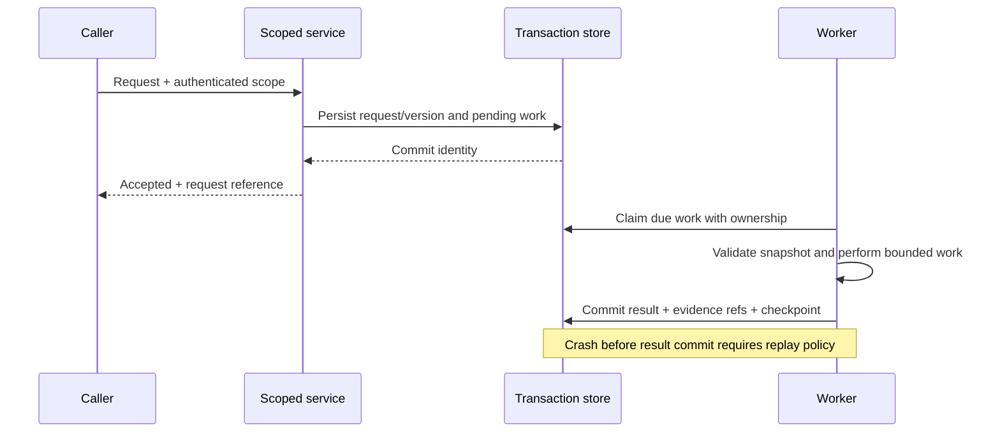

# Core AI Platform — đối chiếu 67 đặc tả

**Ngày:** 04/11/2026. **Nguồn yêu cầu:** [Master Plan V1](../../VIBE_TRADING_MULTI_MARKET_MASTER_PLAN_V1.md), nhóm Shared Platform / AI / Memory / Risk. Giữ nguyên 67 mã và tên gốc; bảng bổ sung dưới đây là nghiên cứu triển khai, không tuyên bố các capability đã hoàn thành.

`PARTIAL`: có nền trong source nhưng chưa đủ phạm vi đặc tả. `PROPOSED`: cần bổ sung contract/implementation, chưa tìm thấy một đường hoàn chỉnh trong phạm vi đọc. `EXISTING`: có hành vi hẹp được nêu ở cột source; vẫn cần nghiệm thu runtime riêng. Priority P0/P1/P2 là đề xuất thứ tự xử lý, không phải severity lỗ hổng đã tái hiện.

Các tiêu chí trong bảng là điều kiện phải chứng minh khi triển khai. Tên schema, gateway hoặc dịch vụ mới trong master vẫn là tên dự thảo. Không tự tạo PostgreSQL, vector DB, Redis hoặc API chỉ vì một dòng đặc tả nhắc đến chúng.

## 1. Danh mục có truy vết

| Mã | Tên giữ nguyên từ master | Trạng thái | Source/seam hiện tại | Tiêu chí nghiệm thu bổ sung | Ưu tiên |
| --- | --- | --- | --- | --- | --- |
| `PLATFORM-001` | Goal and Intent Resolver | PARTIAL | [goal/store.py](../../agent/src/goal/store.py), [swarm/presets.py](../../agent/src/swarm/presets.py) | Ticker mơ hồ giữa hai venue trả yêu cầu làm rõ; câu hỏi nghiên cứu không sinh execution scope | P0 |
| `PLATFORM-002` | Canonical Instrument Registry | PARTIAL | [_market_hooks.py](../../agent/backtest/engines/_market_hooks.py), `_detect_market` | Hai mã trần giống nhau không collision; unknown symbol không mặc định một thị trường để thực thi | P0 |
| `PLATFORM-003` | Market Calendar Service | PARTIAL | [paper calendar](../../agent/src/tools/paper_trade/calendar.py), [base engine](../../agent/backtest/engines/base.py) | Một holiday/weekend fixture có expected tradable/settlement instants theo venue và rule version | P0 |
| `PLATFORM-004` | Reference Currency Service | PARTIAL | [portfolio/fx.py](../../agent/src/portfolio/fx.py), `FxQuote`, `to_usd` | Thiếu FX ở as-of bị từ chối; giữ source time riêng retrieval time; không coi stablecoin luôn bằng USD | P0 |
| `PLATFORM-005` | Source Licensing Registry | PROPOSED | [loader registry](../../agent/backtest/loaders/registry.py) chưa thay entitlement registry | Request có retrieve/cache/redistribute purpose bị chặn độc lập theo license và thời hạn | P0 |
| `PLATFORM-006` | Data Source Health Router | PARTIAL | [registry.py](../../agent/backtest/loaders/registry.py), `FALLBACK_CHAINS` | Lỗi auth không bị coi transient network; fallback ghi source thật và không vượt feed/account binding | P0 |
| `PLATFORM-007` | Raw Archive Store | PARTIAL | [run artifacts](../../agent/src/agent/result_artifacts.py) | Cùng URL đổi bytes tạo revision khác; blob thiếu hoặc checksum sai làm evidence unresolved | P1 |
| `PLATFORM-008` | Canonical Data Normalizer | PARTIAL | [loaders/base.py](../../agent/backtest/loaders/base.py), [portfolio normalization](../../agent/src/portfolio/normalization.py) | Giá/volume/contract units không bị đổi ngầm; raw fields và transform version truy nguyên được | P0 |
| `PLATFORM-009` | Data Quality Gate | PARTIAL | [runner.py](../../agent/backtest/runner.py), `_sanitize_data_map` | NaN, impossible OHLC, duplicate và incomplete coverage có reason riêng; không lấp bằng giá giả | P0 |
| `PLATFORM-010` | Point-in-Time Snapshot Manager | PARTIAL | [fundamentals loader](../../agent/backtest/loaders/fundamentals_loader.py), [run card](../../agent/backtest/run_card.py) | Query as-of giữ đúng revision đã công bố; snapshot hash ổn định sau ingest bản sửa | P0 |
| `PLATFORM-011` | Corporate Action Processor | PARTIAL | [paper corporate actions](../../agent/src/tools/paper_trade/corporate_actions.py) | Raw fills cộng cash/share action đúng một lần; adjusted price không làm ledger nhận cổ tức hai lần | P0 |
| `PLATFORM-012` | Trading Halt Manager | PARTIAL | [halt.py](../../agent/src/live/halt.py) là operator halt, không phải exchange suspension calendar | Phân biệt operator stop với security suspension; suspended instrument không có fill dù còn cached quote | P0 |
| `PLATFORM-013` | Async Event Ingestion | PARTIAL | [Forex adapters](../../agent/src/trading/forex/adapters/), [scheduling kernel](../../agent/src/scheduling/kernel.py) | Crash sau nhận trước checkpoint không mất event; replay duplicate không tạo hai effects | P1 |
| `PLATFORM-014` | Realtime Event Sequence Checker | PROPOSED | Native [chart snapshots](../../agent/src/trading/forex/chart.py) không phải tick sequence recorder | Gap đánh dấu state invalid; không tính feature L2 trước khi hoàn tất rebuild đúng protocol | P0 |
| `PLATFORM-015` | Realtime Candle Aggregator | PARTIAL | [Forex chart](../../agent/src/trading/forex/chart.py), [MT5 worker](../../agent/src/trading/forex/adapters/mt5_worker.py) đọc candles | Late event/correction tạo candle revision; close-based strategy không đọc nến đang chạy | P0 |
| `PLATFORM-016` | Feature Computation Pipeline | PARTIAL | [factors](../../agent/src/factors/), [quantlib](../../agent/src/quantlib/) | Warm-up, publication lag và feature availability được khóa; output không đổi khi thêm dữ liệu tương lai | P0 |
| `PLATFORM-017` | Strategy Definition DSL | PARTIAL | [strategy models](../../agent/src/strategy_store/models.py) lưu rule text, không phải DSL tổng quát | Một rule compile thành evaluator có unit/timing/exit rõ; text không parse được không tự thực thi | P1 |
| `PLATFORM-018` | Strategy Lifecycle Registry | PARTIAL | [models.py](../../agent/src/strategy_store/models.py), `ArtifactStatus`, `ValidationStatus` | ACTIVE không tự APPROVED/live; thay tham số tạo version với validation scope và input refs mới | P0 |
| `PLATFORM-019` | Backtest Run Registry | PARTIAL | [core/state.py](../../agent/src/core/state.py), [run_card.py](../../agent/backtest/run_card.py) | Run truy được code/config/data/spec hashes, warnings và terminal status khi tiến trình crash | P0 |
| `PLATFORM-020` | Portfolio Ledger | PARTIAL | [backtest models](../../agent/backtest/models.py), [paper engine](../../agent/src/tools/paper_trade/engine.py) | Cash + marked inventory - liabilities đối chiếu NAV; giữ nguyên currency và cashflow labels | P0 |
| `PLATFORM-021` | Order Intent Store | PARTIAL | [Forex store](../../agent/src/trading/forex/store.py), [pending action](../../agent/src/live/pending_action.py) | Cùng idempotency key khác payload bị từ chối; transition unknown giữ barrier qua restart | P0 |
| `PLATFORM-022` | Risk Policy Engine | PARTIAL | [Forex policy](../../agent/src/trading/forex/policy.py), [enforcement](../../agent/src/live/enforcement.py) | Authorization kiểm tra lại quote/account/policy trước side effect, không tin approval text từ agent | P0 |
| `PLATFORM-023` | Order Reconciliation Worker | PARTIAL | [Forex service](../../agent/src/trading/forex/service.py) | ACK không gắn fill; timeout phải query trạng thái trước retry; partial fill giữ residual exposure | P0 |
| `PLATFORM-024` | Secrets and Credential Broker | PARTIAL | [credentials.py](../../agent/src/trading/credentials.py), [redaction.py](../../agent/src/tools/redaction.py) | Tool/error/report không lộ credential values; rotation và vault unavailable không fallback sang plaintext | P0 |
| `PLATFORM-025` | Tenant Access Control | PARTIAL | [API security](../../agent/src/api/security.py), [session models](../../agent/src/session/models.py) | Cache/artifact/memory lookup có principal scope; auth loopback không được gọi là SaaS tenant isolation | P0 |
| `PLATFORM-026` | Tool Capability Registry | PARTIAL | [tool registry](../../agent/src/agent/tools.py), [deferred registry](../../agent/src/agent/tool_loading.py) | Load schema không mở rộng permission; kiểm tra arguments thực tế và unknown tool tại server | P0 |
| `PLATFORM-027` | Read Tool Batch Scheduler | EXISTING | [tool_lifecycle.py](../../agent/src/agent/tool_lifecycle.py), read/write batching | Hai reads độc lập có thể chạy cùng batch; write giữ thứ tự và không bị retry như read | P1 |
| `PLATFORM-028` | Tool Failure Classifier | PARTIAL | [tool_lifecycle.py](../../agent/src/agent/tool_lifecycle.py), [Forex errors](../../agent/src/trading/forex/errors.py) | Auth/schema/stale/transient/ambiguous write có retry disposition khác nhau và giữ root cause | P0 |
| `PLATFORM-029` | Goal DAG Orchestrator | PARTIAL | [runtime.py](../../agent/src/swarm/runtime.py), [task_store.py](../../agent/src/swarm/task_store.py) | Failed/incomplete required parent chặn child; retry không nhập artifacts của attempt thất bại | P0 |
| `PLATFORM-030` | Specialist Agent Registry | PARTIAL | [Swarm models](../../agent/src/swarm/models.py), [presets](../../agent/src/swarm/presets.py) | Role khai báo tool whitelist/timeout/model; tên role không cấp capability chưa có adapter | P1 |
| `PLATFORM-031` | Independent Evidence Review | PARTIAL | [grounding](../../agent/src/agent/grounding/), [report audit](../../agent/src/tools/report_audit_tool.py) | Reviewer kiểm tra fact+locator từ nguồn, không chỉ lặp summary; unsupported claim không verified | P0 |
| `PLATFORM-032` | Disagreement Resolution Engine | PARTIAL | [investment committee](../../agent/src/swarm/presets/investment_committee.yaml) | Hai luận điểm dùng revision khác nhau phải hiện conflict; majority vote không thay financial evidence | P1 |
| `PLATFORM-033` | Research Artifact Revision Store | PARTIAL | [strategy store](../../agent/src/strategy_store/sqlite_store.py), [result artifacts](../../agent/src/agent/result_artifacts.py) | Revision cũ không bị overwrite; report ghi cụ thể source/strategy/attempt revision | P0 |
| `PLATFORM-034` | Session Memory and FTS | EXISTING | [session store](../../agent/src/session/store.py), [memory search](../../agent/src/memory/search_index.py) | Save/reload/search giữ scope, timestamps và links; empty result không bị thay bằng content tenant khác | P1 |
| `PLATFORM-035` | Semantic RAG Index | PARTIAL | [semantic_links.py](../../agent/src/memory/semantic_links.py) có BM25; không suy ra vector DB | Corpus có relevance labels, đo retrieval recall/precision và citation resolution trước chọn embeddings | P1 |
| `PLATFORM-036` | Memory Quality Validator | PARTIAL | [lifecycle.py](../../agent/src/memory/lifecycle.py), [persistent.py](../../agent/src/memory/persistent.py) | Scoring chất lượng không gắn factual truth; stale fact không trở thành giá hiện tại khi recall | P0 |
| `PLATFORM-037` | Memory Garbage Collection | PARTIAL | [memory lifecycle](../../agent/src/memory/lifecycle.py) | GC dry-run có manifest; evidence đang được report tham chiếu không bị xóa theo age đơn thuần | P1 |
| `PLATFORM-038` | Context Compression Controller | EXISTING | [context_budget.py](../../agent/src/agent/context_budget.py), [context_compact.py](../../agent/src/agent/context_compact.py) | Budget gồm static/schema; compaction giữ evidence refs, unknowns và source status; overflow có trần retry | P0 |
| `PLATFORM-039` | Model Router and Budgeter | PARTIAL | [Swarm models](../../agent/src/swarm/models.py) có model override; [provider factory](../../agent/src/providers/llm.py) | Chọn model theo benchmark/task; budget tính retry/failed attempts và dừng trước vượt cap | P1 |
| `PLATFORM-040` | Token Usage Ledger | PARTIAL | [llm_usage.py](../../agent/src/agent/llm_usage.py), [Swarm usage](../../agent/src/swarm/models.py) | Provider usage khác estimates; interrupted call không có usage phải ghi unknown, không kết luận miễn phí | P0 |
| `PLATFORM-041` | Cache and Singleflight Manager | PARTIAL | [tool_lifecycle.py](../../agent/src/agent/tool_lifecycle.py), deterministic cache/replay | Key chứa source/snapshot/scope; live refresh bypass cache; không reuse write hoặc stale account read | P0 |
| `PLATFORM-042` | Prompt Injection Firewall | PARTIAL | [security scanner](../../agent/src/security/scanner.py), [grounding](../../agent/src/agent/grounding/) | Injection trong PDF/tool result không làm đổi tool permission; scanner pass không coi là bảo đảm tuyệt đối | P0 |
| `PLATFORM-043` | Tool Permission Firewall | PARTIAL | [MCP wrappers](../../agent/src/tools/mcp.py), [SDK gate](../../agent/src/live/sdk_order_gate.py) | Unknown write tool fail closed; restricted shell/file path không bị vượt bằng tool name alias | P0 |
| `PLATFORM-044` | Audit Ledger and Hash Chain | PARTIAL | [ledger.py](../../agent/src/governance/ledger.py), [live audit](../../agent/src/live/audit.py) | Sửa/xóa/đổi thứ tự record bị phát hiện; hash chain không bị mô tả là chữ ký số hoặc chống admin rewrite | P0 |
| `PLATFORM-045` | Metrics and Distributed Tracing | PARTIAL | [trace.py](../../agent/src/agent/trace.py), [Swarm events](../../agent/src/swarm/models.py) | Một run trace nối được request/tool/attempt/order refs; không dùng token/symbol tùy ý làm metric label vô hạn | P1 |
| `PLATFORM-046` | Structured Error Catalogue | PARTIAL | [Forex errors](../../agent/src/trading/forex/errors.py), API errors theo module | Stable reason code tách public message/scrubbed cause/retry policy, UI giữ partial/unknown | P0 |
| `PLATFORM-047` | Queue Backpressure Controller | PROPOSED | [Swarm ThreadPoolExecutor](../../agent/src/swarm/runtime.py) chưa là durable queue | Producer vượt consumer không OOM; queue cap, rejection và replay cursor có policy đo được | P1 |
| `PLATFORM-048` | Durable Job Scheduler | PARTIAL | [job store](../../agent/src/scheduled_research/store.py), [kernel](../../agent/src/scheduling/kernel.py) | Restart không dispatch hai chủ cùng job; clock/lease/retry và ownership được kiểm tra riêng | P1 |
| `PLATFORM-049` | Worker Isolation Sandbox | PARTIAL | [core runner](../../agent/src/core/runner.py), AST scrubber [backtest runner](../../agent/backtest/runner.py) | Windows local và hardened Linux container có capability matrix riêng; degraded isolation hiện rõ | P0 |
| `PLATFORM-050` | Schema Evolution Registry | PARTIAL | [strategy sqlite](../../agent/src/strategy_store/sqlite_store.py), [paper schema](../../agent/src/tools/paper_trade/schema.py) | Reader cũ/new version gặp nhau có explicit compatibility; unknown schema không tự cast thành success | P1 |
| `PLATFORM-051` | Artifact Object Storage | PROPOSED | Local run artifacts là nền, chưa xác nhận object-store backend chung | DB commit và blob visibility có checksum, orphan cleanup an toàn và restore từ manifest | P2 |
| `PLATFORM-052` | Database Migration Manager | PARTIAL | [sqlite_store.py](../../agent/src/strategy_store/sqlite_store.py), versioned local migrations | Crash giữa migration có recovery; rollback không làm mất revision hoặc duplicate ledger entry | P0 |
| `PLATFORM-053` | API Contract Test Harness | PARTIAL | [test_swarm_route_contracts.py](../../agent/tests/test_swarm_route_contracts.py) và test modules | Fixture so API/CLI/MCP semantics chung; runtime implementation không phải oracle duy nhất | P1 |
| `PLATFORM-054` | Release Feature Flag Manager | PARTIAL | [env schema](../../agent/src/config/env_schema.py) có knobs theo module | Default off ở entrypoint liên quan; disable có effect rõ với in-flight work và rollback reader | P1 |
| `PLATFORM-055` | Incident Kill Switch Manager | PARTIAL | [halt.py](../../agent/src/live/halt.py), [Forex policy](../../agent/src/trading/forex/policy.py) | Halt chặn new effects theo paths đã xác minh; không báo đã flatten/cancel toàn exposure | P0 |
| `PLATFORM-056` | Backup and Restore Controller | PROPOSED | SQLite/file stores hiện có; chưa xác nhận coordinated restore controller | Restore drill kiểm DB+WAL/blobs+hash refs; RPO/RTO đo từ event/cutover thực tế | P0 |
| `PLATFORM-057` | Clock and Timezone Monitor | PARTIAL | [Forex risk](../../agent/src/trading/forex/risk.py) kiểm quote age/timezone | Quote tương lai do clock drift không fresh; wall clock khác monotonic timeout được xử lý | P0 |
| `PLATFORM-058` | Market Data Replay Engine | PROPOSED | Swarm event replay khác market tick/orderbook replay | Snapshot+ordered event log tạo cùng features/orders paper; gap/finality policy có version | P1 |
| `PLATFORM-059` | User Consent and Mandate Manager | PARTIAL | [mandate model](../../agent/src/live/mandate/model.py), [store](../../agent/src/live/mandate/store.py) | Consent bound account/env/expiry/caps; prompt/human_approval boolean không tự tăng quyền | P0 |
| `PLATFORM-060` | Operational Runbooks | PARTIAL | [contributor guide](../../AGENT_CONTRIBUTOR_GUIDE.md), docs hiện có | Một drill có actor/steps/expected state/reconcile/rollback và timestamp, không chỉ checklist | P1 |
| `PLATFORM-061` | Research Quality Dashboard | PROPOSED | [frontend router](../../frontend/src/router.tsx) có runtime/reports, chưa xác nhận dashboard chất lượng chung | Citation/numeric/PIT metrics hiện denominator, missing results và version evaluation set | P2 |
| `PLATFORM-062` | Experiment Design Registry | PARTIAL | [hypotheses](../../agent/src/hypotheses/), [Strategy Store](../../agent/src/strategy_store/) | Trial thất bại và số lần tuning được giữ; OOS không bị dùng lại như train khi promote | P0 |
| `PLATFORM-063` | Provider Circuit Breakers | PARTIAL | [providers](../../agent/src/providers/), [Swarm retry](../../agent/src/swarm/runtime.py) | Timeout/retry không tạo storm; half-open probe budget riêng, auth fail không retry vô hạn | P1 |
| `PLATFORM-064` | Report Publishing Pipeline | PARTIAL | [pdf report](../../agent/src/tools/pdf_report.py), [report artifacts](../../agent/src/tools/report_artifacts.py) | Publish kiểm rights/redaction/citation resolution; draft khác delivered; delivery lỗi không đánh dấu sent | P1 |
| `PLATFORM-065` | Data Entitlement Audit | PROPOSED | Credentials/provider available không chứng minh rights audit | Hết license dừng fetch/redistribute đúng phạm vi; policy lịch sử và audit actor còn truy được | P0 |
| `PLATFORM-066` | Evaluation Dataset Manager | PARTIAL | [eval harness](../../agent/evals/harness/) | Dataset version + frozen split + expected facts/locators; ingestion không làm test set trôi ngầm | P1 |
| `PLATFORM-067` | Cross-Market Exposure Service | PARTIAL | [portfolio fx](../../agent/src/portfolio/fx.py), [composite engine](../../agent/backtest/engines/composite.py) | VND/JPY/USDT exposure thiếu conversion/spec không cộng NAV; stress gross và correlated risk riêng | P0 |

## 2. Những khác biệt quan trọng với template master

### 2.1. Hạ tầng lưu trữ và request envelope

Master lặp `tenant_id`, PostgreSQL và object storage cho mọi capability. Source hiện có các SQLite/file stores, run-local tool state và application auth; những thứ đó không tự cấu thành multi-tenant SaaS. Thiết kế single-operator nên giữ compatible request models hiện có; thêm principal/scope ở biên truy cập và chỉ migrate storage khi workload/isolation yêu cầu. Tenant ID do client gửi không thể là bằng chứng quyền.

Nên có contract chung về `request_id`, scope đã xác thực, instrument/source identity, as-of, schema version và evidence refs, nhưng không ép một `idempotency_key` materialization cho mọi pure read. Key read cache khác key side effect; key side effect phải bao gồm account/env/action và kiểm xung đột payload. [Data contracts](../DATA_EVIDENCE_CONTRACTS.md)

### 2.2. Manifest có caller thật, docstring chưa theo kịp

[governance/manifest.py](../../agent/src/governance/manifest.py) còn phần mô tả integration ngoài scope, nhưng [AgentLoop](../../agent/src/agent/loop.py) đã gọi `build_run_manifest` và ghi `run_manifest.json` qua `_write_run_manifest`. Dùng caller và [test wiring](../../agent/tests/test_run_manifest_wiring.py) để xác nhận; không kết luận thiếu chỉ từ docstring. Hash prompt/skill/tool composition hỗ trợ so sánh run, chưa bảo đảm dataset giống nhau hoặc LLM tạo cùng văn bản.

### 2.3. Tool discovery, execution và replay là ba việc khác

[DeferredToolRegistry](../../agent/src/agent/tool_loading.py) giữ catalog, chỉ trì hoãn schema exposure. Không có cơ chế top-k semantic router ở class này. Permission thuộc source tools và server gates; schema được load không cấp quyền broker. [Tool lifecycle](../../agent/src/agent/tool_lifecycle.py) phân biệt readonly, deterministic, repeatable, `no_cache` và replay-after-compaction. Readonly không đồng nghĩa vĩnh viễn cache được: account, quotes và order state thay đổi theo thời gian.

### 2.4. Bộ nhớ hiện hữu không phải vector RAG đầy đủ

[SemanticLinker](../../agent/src/memory/semantic_links.py) dùng tokenization/IDF/BM25; [MemorySearchIndex](../../agent/src/memory/search_index.py) dùng FTS. Không gọi lớp semantic links là embedding database. Khi thêm RAG, giữ content hash, passage locator, revision và permission scope trong cả index và returned evidence. Xóa/correction phải invalidate index, cache và report-resolution policy phù hợp, không chỉ file gốc.

## 3. Protocol đánh giá chất lượng và token

### 3.1. Dataset và đối chứng

Lập tập nhiệm vụ có ground truth: định danh cổ phiếu trùng tên, đọc BCTC số âm/scale, PIT revision, tính phí, xác định nến đóng, thiếu dữ liệu và prompt injection. Tách development set với frozen acceptance set. Các biến thể chạy cùng snapshot, tool responses, model version khi provider cung cấp, seed nếu có và concurrency. Không dùng câu trả lời LLM cũ làm oracle cho phép tính tiền.

So baseline và candidate theo cặp; lặp đủ để công bố variability và failure count. Người chấm nên không biết biến thể, giữ rubric và adjudication log. Chốt non-inferiority margin trước khi chạy; không chọn ngưỡng sau khi thấy kết quả đẹp.

| Chỉ số | Định nghĩa kiểm tra được | Bẫy cần tránh |
| --- | --- | --- |
| Citation precision | Số claim có citation hỗ trợ trực tiếp / số claim có citation được chấm | Hai bài copy cùng nguồn không là hai xác nhận |
| Evidence coverage | Claim trọng yếu có evidence đủ / toàn bộ claim trọng yếu | Bỏ claim khó khỏi denominator |
| Numeric fidelity | Fact/derived values đúng sign, unit, period, inputs / số values được chấm | Một giá trị đúng nhưng sai kỳ vẫn fail |
| Abstention correctness | Missing/contradictory inputs dẫn WAIT/unknown đúng rubric | Viết một report dài để che missing data |
| Tool efficiency | Useful unique calls và repeated calls theo normalized key | Ít call nhưng thiếu evidence không tốt hơn |
| End-to-end cost | Chi phí của mọi attempt kể cả retry/cancel trong run | Không có usage không có nghĩa 0 cost |
| Latency/recovery | p50/p95 với workload, timeout/error riêng và recovery clock | Chỉ tính request thành công, bỏ provider delay |

### 3.2. Công thức usage và cost

Tách provider-reported với estimated usage. `chars/4` trong context budgeting là heuristic, không dùng làm invoice token count. Cache-read, cache-creation, input/output và reasoning có semantics khác theo provider: cần adapter mapping trước khi cộng tiền, tránh đếm reasoning hai lần nếu đã nằm trong output. Giá dùng price-table version + currency + effective_at; khi thiếu pricing/usage trả unknown/range có giải thích.

Ví dụ **tổng hợp để kiểm thử**, không là giá của nhà cung cấp: một run có 2 attempt, 1000 và 500 input units, mỗi unit giả định 0,001 đơn vị tiền; output lần lượt 100 và 0 units, giá giả định 0,002. Known cost = 1,5 + 0,2 = 1,7. Nếu attempt thứ hai timeout trước usage response thì 1,7 không còn là tổng xác nhận; lưu known cost 1,2 và unknown-cost attempt riêng, không ghi tổng 1,2 là final.

### 3.3. Compaction benchmark

Kiểm ba lỗi riêng: evidence biến mất; permission/state bị summary làm sai; model lặp lại tool đã thành công vì không thấy result. Fixture phải chứa fact bị sửa, một nguồn bị từ chối và một giới hạn live quyền. Sau compaction, những thông tin này còn truy được qua refs. Đo tokens gồm static prompt/schema, active context, retrieved passages và provider cache categories; không chỉ đo text của user/assistant.

## 4. Reliability và recovery

Đây là protocol **đề xuất** để chuẩn hóa những job cần durability, không khẳng định scheduler/thread pool hiện đã có distributed lease/outbox. Side effects ngoài DB không có exactly-once chỉ nhờ transaction nội bộ. Read retry được với policy; broker timeout phải reconciliation và giữ unknown barrier.

SQLite đang chạy cần backup nhất quán, không chỉ copy file `.db` rồi bỏ WAL hoặc artifact blobs. Online Backup API hỗ trợ copy theo connection với kiểm soát locking; chương trình vẫn phải phối hợp metadata/blob snapshot và thử restore. [SQLite Backup API](https://sqlite.org/backup.html)

Trace giữ run/request/attempt IDs và liên kết parent phù hợp, không nhét source text/secrets vào attributes. OpenTelemetry mô tả span context và quan hệ parent/link; việc đọc hướng dẫn không có nghĩa project đã cài exporter hoặc hệ thống distributed tracing. [OpenTelemetry Tracing API](https://opentelemetry.io/docs/specs/otel/trace/api/)

## 5. Rủi ro, rollout và rollback

| Nhóm | Rủi ro chính | Điều kiện rollout | Rollback đúng phạm vi |
| --- | --- | --- | --- |
| Identity/data | Đổi canonical ID làm gắn sai lịch sử | Mapping migration, aliases có effective dates, dual-read comparison | Dừng writer mới, giữ mapping cũ và revision mới để điều tra |
| Memory/RAG | Rò scope, evidence cũ bị coi hiện tại | Scoped retrieval và deletion/correction fixtures | Tắt index mới, quay full-text/source refs đã kiểm chứng; không xóa evidence gốc |
| Token/model | Rẻ hơn nhưng mất accuracy/abstention | Paired frozen-set benchmark, known/unknown cost accounting | Quay model/prompt/tool policy version trước; giữ experiment log |
| Scheduler/cache | Duplicate effects hoặc stale quotes | Restart/concurrency/gap cases qua oracle | Dừng dispatch/producer theo ownership, drain hoặc reconcile; không reset ledger |
| Security/audit | Scanner hoặc hash chain bị hiểu thành bảo đảm | Boundary tests, scope enforcement, external anchor/signature nếu thật sự cần | Revoke capability ảnh hưởng, giữ forensic logs, rotate chỉ secret liên quan |
| Storage | Migration không tương thích hoặc orphan blobs | Dry-run, restore drill, reader compatibility | Feature off/read-only, restore checkpoint đã xác minh và replay policy |

## 6. Phép kiểm định định lượng còn thiếu trong template

[walk_forward_analysis](../../agent/backtest/validation.py) hiện phân đoạn equity đã tính; không tự retrain/tune từng fold. `bootstrap_sharpe_ci` resample từng return độc lập; Monte Carlo hoán vị trade PnLs. Những cách này có mục đích kiểm tra cụ thể, không thay block bootstrap cho serial dependence hoặc nested walk-forward selection.

Huấn luyện/tuning thực sự cần lưu từng fold: train cutoff, fitted preprocessing/model hash, params chỉ chọn trên train/validation, purge/embargo dựa label spans và OOS predictions. [quantlib crossvalidation](../../agent/src/quantlib/crossvalidation.py) đã có split utilities cần tái sử dụng. TimeSeriesSplit có `gap` để loại một khoảng cuối train trước test; đó chưa tự giải quyết mọi nhãn chồng lấn. [scikit-learn TimeSeriesSplit](https://scikit-learn.org/stable/modules/generated/sklearn.model_selection.TimeSeriesSplit.html)

Scaler, imputer, feature selection chỉ fit bằng train của fold; pipeline giúp giữ chuỗi transform đúng, nhưng caller vẫn chịu trách nhiệm PIT và split semantics. [scikit-learn common pitfalls](https://scikit-learn.org/stable/common_pitfalls.html)

Việc promote cần xem simulator fidelity trước performance: same-market mixed currency, default funding/spread, adjusted/raw prices và missing reference price có thể làm metric sai dù thuật toán thống kê chạy đúng. Danh sách tình huống cụ thể ở [54 scenarios](VALIDATION_54.md).
