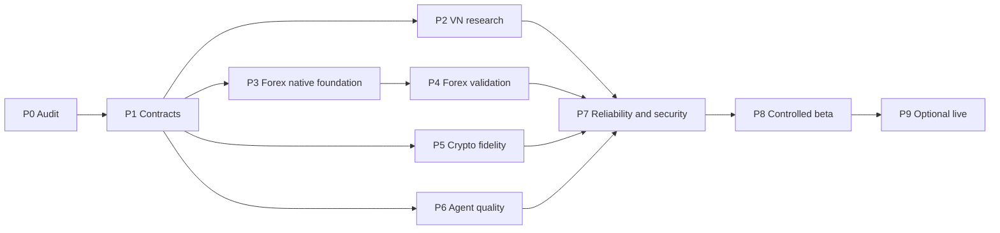

# 10 giai đoạn triển khai và 16 quyết định chờ phê duyệt

**Ngày:** 04/11/2026. Giữ nguyên mã/tên P0–P9 và câu hỏi DECISION-01–16 của [Master Plan V1](../../VIBE_TRADING_MULTI_MARKET_MASTER_PLAN_V1.md). Các cột bên dưới bổ sung dependency, bằng chứng, rủi ro và rollback. **Tất cả quyết định vẫn PENDING; viết tài liệu không phải phê duyệt triển khai hoặc live trading.**

## 1. Dependency và phạm vi

Đây là dependency đề xuất chi tiết hơn “previous milestone” trong template. Không bắt buộc mọi thị trường hoàn tất mọi tính năng trước beta: một beta có phạm vi hẹp được nghiệm thu riêng có thể chỉ bật các slice đã qua gate. Không sử dụng beta/live để che capability chưa đủ dữ liệu hoặc chưa có quyền nguồn.

## 2. Mười giai đoạn có đầu ra cụ thể

| Mã | Tên giữ nguyên từ master | Dependency | Đầu ra và acceptance gate | Rủi ro cần chặn | Rollback/recovery |
| --- | --- | --- | --- | --- | --- |
| `P0` | Repository audit và threat model | Source snapshot và phạm vi operator | Manifest version/hashes, source→caller→test map, current/proposed matrix, known test failures; không invent commit khi thiếu Git | Đọc docstring cũ thành capability hiện tại; gọi declared profile là verified | Khôi phục tài liệu/config snapshot; chưa đổi runtime nên không cần migration |
| `P1` | Core contracts và data governance | P0; quyết định scope/license liên quan | Instrument/time/unit/evidence schema; fixtures cho collision/revision/missing; migration dry-run; record raw/source identity | Trộn giá điều chỉnh, currency, account hoặc dữ liệu sau cutoff | Disable writer mới; giữ reader/schema cũ và versioned records để điều tra |
| `P2` | VN Source & Research MVP | P1; quyền sử dụng ít nhất nguồn filing và nguồn giá đã rõ | Một company case có BCTC+locator+publication time, số quý/lũy kế đúng, valuation assumptions và independent review; missing giữ unknown | SSI/public portal có endpoint nhưng không có entitlement; raw/reference price thiếu; dùng HOSE cho HNX/UPCoM | Tắt provider/mapping lỗi; giữ filings/versions; quay report-only không làm mất research history |
| `P3` | Forex realtime deterministic foundation | P1; broker-native demo context được operator xác nhận khi test ngoài fixture | Một connection/symbol/timeframe có source/receive time, closed-bar policy, freshness/gap behavior, restart state và symbol specs | Polling bị gọi tick stream; wrong account/server; stale quote đi vào decision | Dừng runner/dispatch, giữ journal/unknown barriers; kiểm tra terminal/broker thủ công trước resume |
| `P4` | Forex strategy research lab | P3; dataset và cost/spec snapshot | Một deterministic strategy có rule version, calibrated costs, train/tune/OOS folds riêng và replay/paper evidence phù hợp | Chia equity được gọi retrained WFA; optimize trên OOS; minimum lot vượt risk | Disable strategy version, giữ experiment/run artifacts; quay research-only; không auto thay model trên tài khoản |
| `P5` | Crypto research and derivatives fidelity | P1; venue/product/feed entitlement và historical data | Spot/perp route tests; book sequence protocol pin; funding settlement đầy đủ theo bar; mark/execution/maintenance và reorg oracles | Fixed eight-hour schedule, inverse sai formula, book gap bị bỏ qua, stablecoin=USD | Dừng product/feed bị ảnh hưởng, rebuild từ checkpoint; giữ raw event log và reconciliation backlog |
| `P6` | Agent quality & token optimization | P1; frozen evaluation set, provider usage mapping | Paired baseline/candidate quality+cost result, failures/unknown usage được tính, tool permission invariant giữ nguyên | Giảm token bằng mất evidence; cache giá/tài khoản; benchmark bỏ failed attempts | Quay prompt/model/tool-exposure policy version trước; giữ traces và evaluation version |
| `P7` | Production reliability & security | Gates của những slice sẽ đưa vào vận hành | Restore drill, scoped auth/cache/artifact checks, bounded retries/backpressure, incident runbooks, numerical regression pack | Mặc định local security bị gọi multi-tenant ready; backup không gồm WAL/blob; hash chain bị gọi chữ ký | Feature off/read-only, rollback schema có compatibility; restore checkpoint và reconcile trước dispatch |
| `P8` | Controlled beta | P7; scope/user cohort và budget được phê duyệt | UAT case thật trong phạm vi cho phép, accuracy/freshness/latency/error evidence, support và rollback drill | Người dùng thấy UI rồi hiểu capability đã verified; alerts trùng; chi phí không có trần | Thu hẹp cohort/capability, dừng schedule/alerts liên quan; giữ dữ liệu và feedback để tái kiểm |
| `P9` | Optional bounded live | P8 cho slice liên quan; separate operator/account/product mandate và review | Broker demo lifecycle + unknown/partial/cancel/restart parity, sizing đối chiếu specs, kill switch và canary limits được ký | Demo pass thành blanket live approval; timeout resend; halt được hiểu flatten | Chặn lệnh mới theo gate, reconcile và thực hiện runbook broker được cấp quyền; không xóa ledger/positions |

### Evidence pack tối thiểu ở mỗi gate

Pin source/dataset/spec/policy versions; input/output oracle; command và exit/result của tests; lỗi/skips; measurement workload; owner/reviewer; limitations; restore/rollback evidence. PR/CI links chỉ có khi thật sự tồn tại; bản thư mục local không được tạo link build giả. Chi phí nguồn và model lấy báo giá/quota có ngày hiệu lực, không dùng range engineer-weeks trong master làm báo giá hoặc lịch hoàn thành.

### Trách nhiệm đề xuất

Product owner quyết định outcome/scope; technical lead chịu contract/integration; domain lead xác minh semantics thị trường; independent reviewer xem evidence và oracle. Người giữ hai vai trò phải được ghi rõ để không gọi self-review là độc lập. Authorization thực thi thuộc operator có quyền tài khoản, không thuộc một LLM Risk Agent.

## 3. Mười sáu quyết định cần duyệt

Các recommended defaults dưới đây là **đề xuất nghiên cứu**, chưa là lựa chọn của người dùng. GOV/ADR trong master ghi lý do/guardrails; bảng DECISION này là board duyệt sản phẩm được giữ nguyên 16 mục, không sinh thêm một bộ approval IDs cạnh tranh.

| Mã | Câu hỏi giữ nguyên từ master | Đề xuất để review và evidence cần có | Rủi ro/tradeoff | Cách đổi/rollback | Trạng thái |
| --- | --- | --- | --- | --- | --- |
| `DECISION-01` | Ưu tiên môi trường nào làm MVP đầu tiên? | Chọn một report VN và một native Forex research/demo slice; phân biệt source/license blockers; Crypto bắt đầu sau identity contracts | Làm ba workspace rộng cùng lúc làm mỏng evidence và tăng integration cost | Đổi thứ tự backlog theo gate, giữ contracts chung và không bỏ artifacts đã có | PENDING |
| `DECISION-02` | Triển khai một người dùng hay nền tảng SaaS nhiều tenant? | Single-operator trước; trước SaaS cần auth principal, row/object/cache/index isolation và tenant-aware test set | Gắn tenant_id vào payload không tạo isolation; migration muộn có chi phí | Giữ mode local; nếu thử SaaS lỗi thì ngừng tenant onboarding, export dữ liệu đúng scope, không gom private stores | PENDING |
| `DECISION-03` | Có dữ liệu realtime VN có bản quyền không? | Chỉ gắn nhãn EOD/delayed khi chưa có entitlement+delay/coverage evidence; xem SSI source contracts | Có trang public/API không đồng nghĩa quyền tái phân phối realtime | Disable realtime label/provider; giữ historical permitted data và source timestamps | PENDING |
| `DECISION-04` | Có broker MT5 demo và cụ thể server/symbol không? | Operator xác nhận account/env/server/native symbol; chạy fake-SDK trước demo read/order tests được cấp | MT5 suffix/spec/currency/netting khác broker; code bridge tồn tại chưa chứng minh identity đúng | Quay fixture-only/research; dừng connection/runner và reconcile nếu có intent ngoài fixture | PENDING |
| `DECISION-05` | Có dự định đặt lệnh Forex/Crypto thật ngay không? | Mặc định research/paper; live chỉ theo account/product/strategy mandate và P9 evidence | Blanket approval hoặc demo credential nhầm live tạo side effect có tiền | Thu hồi capability/mandate và halt đúng scope, xử lý exposure theo runbook đã được cấp quyền | PENDING |
| `DECISION-06` | Có quyền truy cập báo cáo công ty chứng khoán/bên thứ ba? | Lưu policy retrieve/cache/display/redistribute và expiry; evidence metadata khác full-text rights | RAG/cache có thể giữ nội dung vượt scope hoặc hết quyền | Dừng ingest/publish nguồn, invalidate index theo policy; không bịa rằng bản public miễn mọi hạn chế | PENDING |
| `DECISION-07` | Storage deployment local/VPS/cloud? | Reuse SQLite/file stores cho local; đo contention/HA/tenant needs trước PostgreSQL/object-store migration | Master template lặp PostgreSQL nhưng source chưa là stack đó; multi-host WAL không phù hợp | Adapter/reader compatibility, migration dry-run và restore checkpoint; tránh dual-writer vô thời hạn | PENDING |
| `DECISION-08` | Mục tiêu concurrent users/traffic tick/subscriptions? | Chốt workload instruments×event rate×consumers×retention, p95/recovery và hardware benchmark | Con số throughput/SLO không workload dễ là cam kết không có cơ sở | Cap subscriptions/queue, shed noncritical reads; giữ replay gaps visible, không silently drop critical events | PENDING |
| `DECISION-09` | Mức ngân sách monthly LLM/data/compute? | Budget envelopes theo run/user/provider; pricing effective date và unknown-usage accounting | Retry/quota/licensed data tạo hidden costs; hard cap có thể làm report incomplete | Giảm concurrency/model scope, pause jobs theo policy; report phần chưa làm và không giả completion | PENDING |
| `DECISION-10` | Ngôn ngữ UI và báo cáo? | Báo cáo tiếng Việt, identifiers/schema/code giữ ổn định; dịch thuật ngữ tài chính có glossary | Nhân bản prompt/logic cho mỗi locale làm semantics và tests lệch nhau | Quay locale đã kiểm chứng, giữ raw original quote và translation label riêng | PENDING |
| `DECISION-11` | Ưu tiên nguồn nghiên cứu VN? | Công bố/BCTC gốc → official macro → broker estimates → press discovery; lưu origin graph | Syndication thành double corroboration, OCR table sai dấu/đơn vị, BCTC riêng/hợp nhất lẫn | Dừng source/mapping lỗi và reprocess raw version; report correction lineage thay xóa kết luận cũ | PENDING |
| `DECISION-12` | Năng lực phát triển kỹ thuật hiện tại? | Inventory người/kỹ năng/giờ, owner/reviewer và scope slice trước estimate | Thiếu domain QA hoặc ops làm không ai nhận gate; effort range bị đọc thành deadline | Thu hẹp rollout/vertical, giữ milestone evidence; chưa có năng lực thì không bật capability rủi ro | PENDING |
| `DECISION-13` | Tiêu chuẩn chấp nhận strategy profitability? | Định trước OOS/sample/cost/stress/liquidity criteria; ghi trial count, không bảo đảm lợi nhuận | Multiple testing, selection leakage, simulator fidelity thấp dù Sharpe đẹp | Disable promotion/version; giữ tất cả trial logs, chạy lại độc lập sau sửa assumptions | PENDING |
| `DECISION-14` | Cơ chế ghi nhớ người dùng? | Scope theo principal/goal; memory giữ refs, timestamp; correction/deletion có policy kiểm thử | Memory cũ thành giá mới, cross-user recall, index không xóa theo dữ liệu gốc | Tắt retrieval/index mới, quay scoped raw/source lookup và giữ audit deletion policy | PENDING |
| `DECISION-15` | Phương án vận hành 24/7? | Chỉ worker/feed cần liên tục; research theo lịch/event, có ownership/restart và backpressure | Nhiều poller cùng tài khoản, stream mất gap không báo, daemon sống nhưng dữ liệu stale | Dừng owner đúng process, restore cursor/checkpoint và rebuild validity trước resume | PENDING |
| `DECISION-16` | Cho phép AI tự sửa rules/skills không? | Agent tạo proposal/version; test/review trước activation; không tự đổi execution policy | Prompt/plugin có thể mở tool permission hoặc thay method giữa live run | Quay immutable rule/prompt/tool-manifest version trước, halt effect path nếu policy drift | PENDING |

### Nội dung của một record duyệt

Ghi decision ID, approver identity/role, phương án chọn, phạm vi, thời điểm, điều kiện, evidence version và điều kiện review lại. Một checkbox trong Markdown chưa đủ để một chương trình cấp quyền broker; mandate/runtime authorization là đối tượng riêng. Nếu mới duyệt research, phần live vẫn disabled. Các user instructions đã cấp trong chat được áp dụng đúng scope, không suy từ yêu cầu nghiên cứu tài liệu sang quyền giao dịch.

## 4. Cách chuyển sang implementation

Một work item nên liên kết: canonical spec IDs → owner source seam → input contract → acceptance scenarios → migration/security scope → rollout/rollback. Ví dụ xử lý funding theo event window nên gắn Crypto funding specs và scenarioC06, không mở thêm một service “funding-v2” không dùng caller hiện có.

Không cần hỏi duyệt lại những thao tác tài liệu/nghiên cứu đã được yêu cầu. Khi đến một thay đổi ngoài phạm vi, phải chuẩn bị phương án concrete cùng evidence để review; không tự đánh dấu các DECISION trên là accepted vì đã chọn default để viết spec.
