# Forex/XAUUSD: 62 đặc tả và đối chiếu khả năng thực tế

Đối chiếu **04/11/2026, Asia/Saigon**, workspace `0.1.18`. Phạm vi là nghiên cứu tài liệu và source; không attach terminal, mở tài khoản, gọi provider AI hoặc gửi lệnh. Danh mục giữ nguyên **62 ID và tiêu đề FX-132–FX-193** của [Master Plan V1](../../VIBE_TRADING_MULTI_MARKET_MASTER_PLAN_V1.md); số `62` trong tên file là số đặc tả, không phải dải ID mới. Đọc cùng [Forex Research Lab](../FOREX_XAUUSD_LAB.md) và [hợp đồng bằng chứng](../DATA_EVIDENCE_CONTRACTS.md).

## Cách đọc trạng thái

- `source-existing`: tìm thấy đường code trực tiếp cho yêu cầu cốt lõi; chưa đồng nghĩa đã nghiệm thu broker thật.
- `source-partial`: có primitive hoặc đường triển khai liên quan nhưng thiếu phần của đặc tả; cột acceptance mô tả đích nghiệm thu, không phải kết quả test đã chạy.
- `proposed`: chưa tìm thấy service/contract hoàn chỉnh tương ứng trong nhánh Forex; seam ghi rõ primitive có thể tái sử dụng hoặc `absent`.

P0 là điều kiện an toàn/dữ liệu phải hoàn thành trước pilot tương ứng; P1 là nghiên cứu hoặc vận hành cần cho chiến lược được chọn; P2 là mở rộng sau khi baseline đủ evidence. Ưu tiên này cụ thể hóa các nhãn ghép P0/P1/P2/P3 trong master, không cấp quyền execution. Tên `fx.*.v1` và envelope chuẩn trong master vẫn là **đề xuất**, không phải tool hiện đã đăng ký.

Đường `agent/src/trading/forex/` được viết đầy đủ trong cột seam để tra cứu không nhầm với connector MT5 cũ. Symbol trong cột này đã được tìm trong source; một seam không có nghĩa toàn bộ yêu cầu đã có.

## 1. Identity, native feed, chi phí và thời gian

| ID | Tiêu đề giữ nguyên từ master | Trạng thái | Source seam hiện tại / phần thiếu | Acceptance cụ thể | Ưu tiên |
| --- | --- | --- | --- | --- | --- |
| `FX-132` | MT5 Account Identity Guard | `source-existing` | `agent/src/trading/forex/adapters/mt5_worker.py` — `Native.identity`, `dispatch`; `agent/src/trading/forex/service.py` — `current_binding` | Đổi từng login/server/demo-live hoặc fingerprint trong lúc đọc/submit phải bị từ chối; fake SDK đếm `order_send=0`; mỗi artifact giữ binding tại thời điểm quan sát. | P0 |
| `FX-133` | MT5 Symbol Metadata Snapshot | `source-partial` | `agent/src/trading/forex/adapters/mt5_worker.py` — `instrument`, `instruments`, `prepare`; thiếu snapshot revision bền vững đủ tick value/freeze/session | Hai fixture XAUUSD cùng tên nhưng contract size 100 và 1 phải có revision khác; min/step/tick/currency/valid-from lưu cùng run; spec đổi giữa preview và send phải revalue hoặc block. | P0 |
| `FX-134` | MT5 Tick Feed Adapter | `source-partial` | `agent/src/trading/forex/adapters/mt5_worker.py` — `quote` đọc snapshot `symbol_info_tick`; absent recorder/sequence/replay | Feed synthetic có duplicate timestamp, out-of-order và disconnect phải giữ bid/ask/flags nguyên gốc; không dùng timestamp làm khóa duy nhất; gap khóa entry, local sequence không giả làm sequence broker. | P1 |
| `FX-135` | MT5 History Consistency Audit | `source-partial` | `agent/src/trading/forex/runner.py` — `completed_bars`; `agent/src/trading/forex/analysis_context.py` — `_normalize_bars`; thiếu đối chiếu loader/terminal manifest | Fixture lệch một giờ, trùng/conflict candle, thiếu bar và hai native feeds phải có report phân loại; không tự merge hoặc đổi source; sai lệch giá đo theo tick size của revision. | P0 |
| `FX-136` | Bid Ask Candle Builder | `proposed` | absent trong Forex; `agent/src/trading/forex/adapters/mt5_worker.py` — `_rates` là broker OHLC, chưa tổng hợp tick hai phía | Replay tick cố định tạo riêng bid/ask/mid OHLC theo cùng UTC interval và policy late event; BUY dùng ask, thoát long dùng bid; một bar không đủ hai phía không được gắn executable. | P1 |
| `FX-137` | Broker Clock and DST Guard | `source-partial` | `agent/src/trading/forex/adapters/mt5_worker.py` — `quote`, `_rates` xuất UTC; chưa có versioned session/DST calendar | Fixture hai lần chuyển DST New York/London, giờ không tồn tại và giờ lặp phải chọn session theo IANA zone; bar UTC không cộng offset server lần hai; clock skew vượt policy khóa entry. | P0 |
| `FX-138` | XAU Spread Regime Monitor | `source-partial` | `agent/src/trading/forex/risk.py` — `check` có cap spread points; absent phân vị causal và spread/ATR monitor | Phân vị chỉ dùng mẫu đã biết trước tick quyết định; spike vượt hard cap bị block ngay dù percentile baseline thấp; thiếu ATR hoặc warmup trả unknown, không làm 0. | P1 |
| `FX-139` | XAU Slippage and Fill Model | `source-partial` | `agent/backtest/engines/forex.py` — `apply_slippage_for_symbol`; chưa có model hiệu chỉnh fills/latency broker | Fit trên train theo session/volatility/size; holdout báo sample size và residual; buy adverse slip tăng giá, sell giảm; gap qua SL dùng first executable price, không ép fill tại stop. | P1 |
| `FX-140` | Swap and Overnight Cost Model | `source-partial` | `agent/backtest/engines/forex.py` — `on_bar`, `calc_forex_swap` import; chưa gắn swap terms native theo revision | Fixture long/short đi qua rollover, ngày multiplier và DST phải charge đúng một lần theo terms fixture; đổi terms áp dụng từ effective time; credit giữ dấu, unavailable không thành free carry. | P1 |
| `FX-141` | MT5 Netting Hedging Mode | `source-partial` | `agent/src/trading/forex/adapters/mt5_worker.py` — `account`, `prepare_close`; close hiện chỉ MT5 Demo Hedge | Hedge close bắt buộc đúng ticket/side/remaining quantity; Netting hoặc vị thế ngoài journal bị từ chối; mô phỏng lệnh ngược chiều phải phân biệt reduce/net với mở hedge, không tự gắn flatten thành closed. | P0 |
| `FX-142` | XAU Global Macro Calendar | `proposed` | absent calendar hard gate; `agent/src/trading/forex/macro_context.py` — `get_macro_context` chỉ context series | Event CPI bị dời giờ phải giữ revision và first-seen; thiếu feed trả calendar-unavailable; blackout join scheduled/actual/known-at theo policy; consensus tải sau release không được dùng như thông tin trước release. | P0 |
| `FX-143` | XAU Real Yield Context | `source-partial` | `agent/src/trading/forex/macro_context.py` — `parse_fred`, `get_macro_context`; chưa có vintage/lag evaluator | Dữ liệu theo ngày giữ observation date/unit/available-at; join intraday chỉ từ bản đã phát hành; correlation rolling có window/n, không suy dấu cố định hoặc đưa daily yield stale thành tick mới. | P1 |
| `FX-144` | XAU Intraday Session Profile | `proposed` | absent profile session broker; có `quote` và `_rates` trong `agent/src/trading/forex/adapters/mt5_worker.py` làm nguyên liệu | Report phân bố spread/ATR/slippage theo session calendar revision, số mẫu và missingness; tuần DST lệch EU/US không gộp nhầm; tick count ghi feed-local, không gọi volume toàn thị trường. | P1 |

## 2. Regime và phương pháp phải định nghĩa trước thử nghiệm

| ID | Tiêu đề giữ nguyên từ master | Trạng thái | Source seam hiện tại / phần thiếu | Acceptance cụ thể | Ưu tiên |
| --- | --- | --- | --- | --- | --- |
| `FX-145` | XAU Market Structure Engine | `source-partial` | `agent/src/trading/forex/price_action.py` — `candle_evidence`; có pivot 2-right-bar, chưa có stream feature event | Pivot tại i chỉ available sau nến i+2 đóng; sửa dữ liệu sau thời điểm đó tạo correction/revision; append các nến tương lai không thay quyết định được lưu trước confirmation. | P1 |
| `FX-146` | XAU Sideway Detector | `proposed` | absent detector ATR/ADX/slope có lifecycle; `agent/src/trading/forex/price_action.py` — `candle_evidence` chỉ `mixed_or_range` heuristic | Rule khóa width/ATR, slope, ADX và số retest trong train; fixture đi ngang rồi breakout phải chuyển invalidated tại bar xác nhận; warmup thiếu trả unknown, không tự range. | P1 |
| `FX-147` | XAU Trend Regime Detector | `source-partial` | `agent/src/trading/forex/analysis_context.py` — `summarize_frame` có SMA alignment; absent hysteresis/dwell detector | Khóa thresholds vào/ra và min dwell; fixture quanh threshold không đổi regime mỗi bar; state tái tạo sau replay/restart bằng cùng feature/config hash; alignment không tự biến thành dự báo. | P1 |
| `FX-148` | XAU Breakout Validator | `source-partial` | `agent/src/trading/forex/price_action.py` — `candle_evidence` loại nến trigger khỏi prior range; thiếu tradeable filter tích hợp | High wick vượt range nhưng close nằm trong range không phát breakout; close vượt buffer causal mới là candidate; quote/spread stale chặn entry; prior range không chứa trigger. | P1 |
| `FX-149` | XAU Pullback Entry Research | `proposed` | absent strategy thực thi; dùng `agent/src/trading/forex/price_action.py` — `candle_evidence` và registry hiện hữu làm seam | Manifest định nghĩa trend trước pullback, vùng hồi, trigger, expiry và structural stop; một tập fixture dán nhãn trước replay phải cho cùng trigger/rejection; không chọn pivot chưa confirmed. | P1 |
| `FX-150` | XAU Mean Reversion Research | `proposed` | absent range-reversion strategy; `agent/src/strategy_store/models.py` — `Artifact` làm seam đăng ký | Khóa distance/band/range invalidation/time stop; fixture breakout có xác nhận phải ngừng fade và không tự DCA; OOS giữ nguyên rule, costs và các lần thất bại. | P1 |
| `FX-151` | XAU Volatility Expansion Research | `proposed` | absent expansion strategy; `agent/src/trading/forex/analysis_context.py` — `summarize_frame` có ATR | Percentile/width dùng lookback trước trigger; một shock có spread quá cap hoặc calendar thiếu bị reject theo policy; edge báo cả chi phí stressed, không lấy mid-only move thành profit. | P1 |
| `FX-152` | XAU Price Action Rule Compiler | `source-partial` | `agent/src/trading/forex/price_action.py` — `candle_evidence` có rule hardcoded; absent typed rule compiler | Chỉ cho tập operator/field được duyệt, không eval code model; rule revision/hash tái tạo detector; OHLC sai/NaN/unknown operator bị reject; formation time tách confirmation time. | P2 |
| `FX-153` | XAU Session Breakout Strategy | `proposed` | absent session strategy; tái sử dụng `agent/src/trading/forex/runner.py` — `completed_bars` sau calendar gap policy | Khóa range build/end/release theo timezone; lệnh không xuất trước range đóng; Sunday/holiday/DST fixture xử lý rõ; period ngoài phiên không được tạo bar phẳng giả. | P1 |
| `FX-154` | XAU Moving Average Strategies | `source-partial` | `agent/src/trading/forex/runner.py` — `crossover`, `Runners.tick` có SMA; master đề cập EMA/OOS chưa được nối | Baseline SMA có fast/slow revision, nến đóng và dedup; EMA phải là artifact riêng; tất cả parameter chỉ chọn từ train, output OOS chứa trial registry và broker costs, không dùng window analysis như retraining. | P1 |
| `FX-155` | XAU ATR Stop Research | `source-partial` | `agent/src/trading/forex/analysis_context.py` — `summarize_frame`; `agent/src/trading/forex/adapters/mt5_worker.py` — `prepare`; chưa nối ATR sizing | ATR at decision time quyết định distance theo revision; stop được chuẩn tick rồi revalue loss và broker stop-level; rounding làm vượt budget phải reduce quantity hoặc NO TRADE, không dời stop tùy ý. | P1 |
| `FX-156` | XAU R Multiple and TP Study | `proposed` | absent net-R analytics xuyên fills/fees; `agent/src/trading/forex/runner.py` — `reward_ratio` chỉ dựng TP | Frozen initial risk denominator lưu tại entry; net PnL gồm commissions/swap/slip; partial exits cộng đúng cashflow; zero/unknown risk trả undefined, không báo R vô hạn hoặc gross R như realized. | P1 |
| `FX-157` | XAU Multi-Timeframe Consensus | `source-partial` | `agent/src/trading/forex/analysis_context.py` — `research_context`, `summarize_frame`; chưa có historical availability join | M5 quyết định 10:35 UTC chỉ join H1 cuối cùng đã đóng/available; fixture H1 10:00–11:00 không rò close11:00; input hash lưu từng frame, thiếu khung trả partial/WAIT theo policy. | P0 |

## 3. Replay, thử nghiệm và OOS

| ID | Tiêu đề giữ nguyên từ master | Trạng thái | Source seam hiện tại / phần thiếu | Acceptance cụ thể | Ưu tiên |
| --- | --- | --- | --- | --- | --- |
| `FX-158` | XAU Tick Replay Simulator | `proposed` | absent recorder/tick engine trong Forex; `agent/backtest/engines/forex.py` — `ForexEngine` là bar engine | Cùng tick log/spec/code/seed tạo cùng signal/order/fill/rejection hash; handle same-ms nhiều tick theo ingest order đã lưu; simulated fill luôn gắn giả định latency/liquidity, không gọi broker execution thật. | P1 |
| `FX-159` | XAU Intrabar Ambiguity Policy | `proposed` | absent Forex acceptance contract SL/TP ambiguity; seam `agent/backtest/engines/forex.py` — `ForexEngine` | Bar O=2400,H=2415,L=2385,C=2405 với SL2390/TP2410 phải đánh ambiguous; thiếu tick chọn policy bảo thủ đã khóa hoặc báo bounds; cấm tự chọn TP trước để tăng win rate. | P0 |
| `FX-160` | XAU Strategy Experiment Registry | `source-partial` | `agent/src/strategy_store/models.py` — `Artifact`, `BenchResult`; chưa bắt buộc toàn bộ trial/split/spec manifests | Một trial thất bại vẫn có artifact/input/config/result status; đổi rule/data/cost tạo revision/lineage; reviewer truy từ best result về mọi attempt trong budget, không chỉ giữ winner. | P1 |
| `FX-161` | XAU Walk-Forward Evaluator | `source-partial` | `agent/backtest/validation.py` — `walk_forward_analysis` chỉ chia equity thành windows; `agent/src/quantlib/crossvalidation.py` — `purged_walk_forward_splits` là primitive | Với ít nhất hai folds fixture, refit chỉ thấy train; test và purge/embargo tính theo label horizon; lưu fitted params/fold boundaries; đổi test labels không đổi params train; concatenated OOS không chứa train PnL. | P0 |
| `FX-162` | XAU Monte Carlo Trade Paths | `source-partial` | `agent/backtest/validation.py` — `monte_carlo_test` hoán vị PnL; absent dependent block-resampling pipeline cho Forex | Report nêu permutation hay bootstrap, block length/seed/n; cùng seed tái tạo bands; chuỗi losses clustered được giữ trong block; không diễn giải hoán vị tập trade cố định thành probability of future profitability. | P1 |
| `FX-163` | XAU Cost Stress Tester | `source-partial` | `agent/backtest/engines/forex.py` — `spread_pips_override`, `slippage_pips`, `on_bar`; thiếu broker-calibrated sweep manifest | Chạy cùng signals với base/2x/3x spread và explicit commission/gap fixtures; report break-even cost và net expectancy, kể cả negative; multiplier không được giảm spread hoặc double-charge bid/ask đã có. | P1 |
| `FX-164` | XAU Paper Trading Driver | `proposed` | absent Forex paper driver; `agent/src/tools/paper_trade/schema.py` — `MARKETS` chỉ cn_a/hk/us; không sửa tên market để lách schema | Driver mới phải định nghĩa lots/spec/mark-to-market/margin/swap, append immutable simulated fills và ledger; bid/ask roundtrip flat price có loss bằng costs; profile MT5 `paper` ghi broker Demo, không trộn internal paper. | P1 |

## 4. Sizing, risk và vòng đời execution

| ID | Tiêu đề giữ nguyên từ master | Trạng thái | Source seam hiện tại / phần thiếu | Acceptance cụ thể | Ưu tiên |
| --- | --- | --- | --- | --- | --- |
| `FX-165` | XAU Order Sizing Service | `source-partial` | `agent/src/trading/forex/adapters/mt5_worker.py` — `prepare`, `usd_notional`; hiện validate quantity caller, chưa tìm quantity từ budget | Ví dụ synthetic ở Lab cho 0.04 lot từ budget 50 USD/cost 1,057 USD per lot; minimum 0.01 vượt budget thì NO TRADE; đúng grid `(q-min)%step=0`; sau rounding gọi valuation/margin lại, giữ account currency. | P0 |
| `FX-166` | XAU Pre-Trade Risk Gate | `source-existing` | `agent/src/trading/forex/risk.py` — `check`; `agent/src/trading/forex/policy.py` — `authorize`; worker recheck trước send | Bất kỳ stale quote, account khác USD, invalid SL/tick/lot, thiếu exposure/margin, halt hoặc mandate sai đều khiến fake `order_send=0`; confidence model cao không nới cap; ACK không được coi fill. | P0 |
| `FX-167` | XAU Daily Drawdown Halt | `source-partial` | `agent/src/trading/forex/policy.py` — `authorize`, `equity_peaks`; peak hiện chỉ quan sát khi authorize, không daily cashflow-aware monitor | Chốt timezone/day boundary, deposit/withdraw adjustment, equity và realized basis; latch bền qua restart và không tự reset sau process launch; loss vượt threshold ngay giữa hai signal được phát hiện bởi monitor đề xuất. | P0 |
| `FX-168` | XAU Basket Hedge Risk | `source-partial` | `agent/src/trading/forex/adapters/mt5_worker.py` — `account` tính gross USD; thiếu basket stress/swap allocation | Long1 và short1 lot có net0 nhưng gross2; report margin/financing/SL gap theo ticket/account mode; một leg không định giá được khiến gross unavailable và block entry, không bỏ qua leg. | P0 |
| `FX-169` | XAU DCA Grid Path Stress | `proposed` | absent grid stress harness nối margin/native specs; `agent/backtest/engines/forex.py` — `ForexEngine` chỉ primitive | Với levels/lot escalation khóa trước, replay đơn hướng nhiều ATR + gap + spread spike; báo max lots, margin-call/stop-out point và max loss; không gán budget hữu hạn cho grid không chặn số cấp. | P1 |
| `FX-170` | XAU Trailing Stop State Machine | `proposed` | absent modify action trong `agent/src/trading/forex/models.py` — `Order` chỉ open/close | Đề xuất riêng action/schema có ownership/ticket/SL revision; long SL chỉ tăng, short chỉ giảm; duplicate modify không gửi lại; freeze/stops/requote thất bại giữ last confirmed SL, không ghi desired như broker-confirmed. | P2 |
| `FX-171` | XAU Breakeven Trigger Validator | `proposed` | absent SL modification trong Forex; `agent/src/trading/forex/adapters/mt5_worker.py` — `prepare_close` không sửa SL | Trigger dựa net excursion sau spread/commission/swap với cost snapshot; price=entry nhưng phí âm không gắn break-even; stale conversion/min-stop/freeze không cho update; không hứa guaranteed zero-loss khi gap. | P2 |
| `FX-172` | XAU Order Intent Reconciliation | `source-existing` | `agent/src/trading/forex/store.py` — `create_intent`, `claim`, `active`; `agent/src/trading/forex/service.py` — `submit`, `execution`; `Native.reconcile` | Hai submit cùng intent chỉ một send; crash sau claim/send giữ active barrier; unknown không tạo key mới; không/đa history match vẫn unknown; operator reconcile xong còn cần clear halt đúng scope và start riêng. | P0 |
| `FX-173` | XAU Broker Disconnect Gate | `source-partial` | `agent/src/trading/forex/service.py` — `submit` unknown trips halt; `runner.py` — `_loop`; absent continuous reconnect readiness machine | Ngắt feed khi có exposure không tự gắn closed; SAFE_HALT là trạng thái đề xuất, current unknown giữ barrier; reconnect cần identity + orders/positions/history reconciliation + fresh feed trước operator resume. | P0 |
| `FX-174` | XAU News Shock Circuit | `proposed` | absent calendar/volatility shock hard gate; `agent/src/trading/forex/risk.py` — `check` chỉ cap spread/freshness | Replay shock spread/vol hoặc calendar-high-impact phải block entry bằng code dù news agent lỗi; unverified headline không tạo BUY; circuit cooldown/release cần policy và fresh data, không chỉ hết timer. | P1 |
| `FX-175` | XAU Multi-Strategy Conflict Solver | `proposed` | absent portfolio allocator; `agent/src/trading/forex/runner.py` — `start` hiện một task/connection, SMA đợi toàn account flat | Hai revision gửi opposite intent cùng bar phải resolve deterministically theo policy đã khóa, caps tính atomic; không đổi side để churn; không gọi một runner slot là multi-strategy scheduling. | P2 |
| `FX-176` | XAU Slippage Attribution | `source-partial` | `agent/src/trading/forex/adapters/mt5_worker.py` — `submit` có filled price/quantity; thiếu signal/arrival/deal timeline join | Lưu signal decision/arrival quote/submit/fill time và side; buy fill cao hơn benchmark cho adverse cost dương, sell thấp hơn cũng dương; partial dùng VWAP fills, missing benchmark giữ unavailable, không 0. | P1 |
| `FX-177` | XAU Trade Journal Forensics | `source-partial` | `agent/src/trading/forex/store.py` — `events`, `executions`; `agent/src/trading/forex/audit.py` — `record_outcome`; chưa deal/exit forensic join | Từ realized trade truy được intent/revision/input hash/fills/fees/session/regime; group report có denominator/sample size và unknown exit; không lấy intent filled entry làm closed winning trade. | P1 |
| `FX-178` | XAU Strategy Drift Monitor | `proposed` | absent Forex sequential drift service; `agent/src/strategy_store/models.py` — `DecaySignal`, `DecaySnapshot` làm seam | Khóa reference window, min n, thresholds và multiple-look policy; false alarm đo bằng stable fixture; drift tạo review/halt theo policy, không tự tune rồi ghi đè OOS/baseline. | P2 |
| `FX-179` | XAU Auto Kill Switch Testing | `source-partial` | `agent/src/trading/forex/service.py` — `submit`; `policy.py` — `authorize`; `adapters/mt5_worker.py` — `submit` recheck; chưa hardware race acceptance | Barrier fixture bật halt trước worker authorize phải send 0; halt giữa authorize và SDK send phải có policy admission rõ, current code chưa atomic; nếu send đã bắt đầu thì drain receipt; halt hiện chặn cả close qua app, không flatten. | P0 |

## 5. Reliability, deployment, attribution và portfolio

| ID | Tiêu đề giữ nguyên từ master | Trạng thái | Source seam hiện tại / phần thiếu | Acceptance cụ thể | Ưu tiên |
| --- | --- | --- | --- | --- | --- |
| `FX-180` | XAU MT5 Windows Service Packaging | `proposed` | absent Windows service acceptance; `agent/src/trading/forex/adapters/mt5.py` — `MT5.call` subprocess và `runner.py` — `status` không auto-resume | Test đúng Windows user/session/vault/terminal build; restart không tự bật execution/runner; shutdown drain hoặc persist unknown; service account không nhìn terminal desktop phải báo unavailable, không auto-login sang tài khoản khác. | P1 |
| `FX-181` | XAU M1 Scalping Capacity | `proposed` | absent M1 runner/capacity study; `agent/src/trading/forex/models.py` — `Strategy` chỉ 5m/15m/1h/4h; chart có1m | Chỉ nghiên cứu M1 sau recorder/slip dataset; báo latency p50/p95/p99 và capacity theo size/session trên holdout; chart M1/poll3s không được chứng nhận low-latency engine; thiếu fill sample ghi insufficient. | P2 |
| `FX-182` | XAU M5 Swing Timing | `source-partial` | `agent/src/trading/forex/models.py` — `Strategy` có5m; `analysis_context.py` — `research_context`; chưa M5-H1 strategy artifact | Dùng fixture M5/H1 as-of, H1 forming không quyết định bias; freeze stop/expiry/spread rule; OOS cùng input timeline cho cùng entry, không lấy context hiện tại để tái dựng bias quá khứ. | P1 |
| `FX-183` | XAU Exit Reason Taxonomy | `proposed` | absent taxonomy deal-level Forex; `agent/src/trading/forex/store.py` — `events` chỉ lifecycle event | Exit reason từ broker deal/history và local action có precedence; TP/SL/manual/risk-close/stop-out/unknown tách biệt; halt không đóng lệnh thì không ghi risk_exit; partial exits giữ quantity và cashflow riêng. | P1 |
| `FX-184` | XAU Risk-of-Ruin Scenario | `proposed` | absent Forex ruin definition/horizon; `agent/backtest/validation.py` — `monte_carlo_test` không model dynamic margin/cost | Khóa ruin threshold/horizon/account model và stress assumptions; báo counts, interval, n và zero-observed-event bound thay vì risk0; include serial-loss blocks + gap + costs, không suy từ win rate độc lập. | P1 |
| `FX-185` | XAU Margin Stop-Out Simulator | `proposed` | absent native stop-out engine; `agent/src/trading/forex/adapters/mt5_worker.py` — `prepare` chỉ margin estimate trước order | Snapshot account margin/stop-out mode/threshold/currency; synthetic price path trigger đúng threshold fixture, broker liquidation-order unknown ghi scenario bounds; equity còn dương vẫn có thể stop-out khi margin level thấp. | P0 |
| `FX-186` | XAU Weekend Gap Policy | `source-partial` | `agent/src/trading/forex/runner.py` — `completed_bars` chặn gap; `agent/backtest/engines/forex.py` — `can_execute` luônTrue, chưa lịch broker | Fixture Friday close/Sunday reopen chỉ trade trong broker session; gap qua SL xử lý first quote; current runner đợi lookback liên tục, không giả đã có calendar-aware warmup; policy hold/exit cần khả năng close thực tế. | P0 |
| `FX-187` | XAU Broker Trade Context Guard | `source-partial` | `agent/src/trading/forex/adapters/mt5_worker.py` — `prepare`, `submit`; `agent/src/trading/connectors/mt5/orders.py` — `_filling_mode` fallback RETURN, còn dựa broker `order_check` | Unsupported filling/execution mode fail closed trước send; bổ sung fixture mask rỗng và execution-mode hạn chế RETURN; SL sai min/tick bị reject; không retry type khác; pending của connector cũ không mở rộng `Order` Forex. | P0 |
| `FX-188` | XAU Alert De-duplication | `proposed` | absent Forex recipient delivery ledger; `agent/src/trading/forex/runner.py` — `Runners.tick` có signal request-key dedup, không phải notification | Poll cùng candle 1.000 lần chỉ một alert cho recipient/channel/strategy/state transition; crash sau delivery phải có receipt-aware recovery; stale/recovered là thay đổi trạng thái, không spam mỗi poll; chưa tích hợp kênh thì không claim đã gửi. | P2 |
| `FX-189` | XAU Signal Explainability | `source-partial` | `agent/src/trading/forex/price_action.py` — `candle_evidence`; `runner.py` — `crossover`; chưa lưu đủ rule trace mỗi signal | Signal lưu values, thresholds, known-at, code/config/input hash và rejected gates; render explanation từ trace; LLM paraphrase không sửa số hoặc phát minh điều kiện; replay cùng hash giải thích cùng rule result. | P1 |
| `FX-190` | XAU Strategy Canary Rollout | `proposed` | absent promotion/canary workflow; `agent/src/strategy_store/models.py` — `ValidationStatus`; `agent/src/trading/forex/policy.py` — `authorize` giữ mandate riêng | Thiếu OOS/paper/Demo/operator sign-off chặn stage promotion; cap canary nhỏ vẫn phải hợp min lot/risk, không tự nâng cap; rollback dừng entry, giữ journal/exposure và có broker close procedure. | P1 |
| `FX-191` | XAU Data Freshness Watchdog | `source-partial` | `agent/src/trading/forex/risk.py` — `check` giới hạn age; `runner.py` — `completed_bars`; absent background SLO watchdog | Với max_age10s fixture, age10.001s hoặc future>2s bị block; receive/computed timestamp không refresh quote cũ; SLO theo feed/strategy revision, monitor gap không cần đợi LLM hoặc signal mới. | P0 |
| `FX-192` | XAU Broker Fill Policy Test | `source-partial` | `agent/src/trading/forex/adapters/mt5_worker.py` — `submit`, `reconcile`; `agent/tests/test_forex_mt5.py` fake retcodes; chưa Demo fill acceptance | Fixture10009/10010/10008/10012/10031 phân biệt filled/partial/working/unknown; partial exposure phải hiện trong account và chưa-owned-close được nêu rõ; broker Demo test phải operator approve riêng, MT5 Demo không gọi testnet. | P0 |
| `FX-193` | XAU Portfolio Exposure Correlator | `proposed` | absent factor mapper xuyên desks; `agent/src/trading/forex/adapters/mt5_worker.py` — `account`, `usd_notional` chỉ grossUSD | Hai account/desk cùng USD/rates risk được aggregate bằng as-of aligned positions và factor revision; correlation/beta có lookback/n/stress, không net trừ XAU risk chỉ vì hedge FX có dấu ngược; thiếu factor mapping giữ unknown. | P2 |

## 6. Những kết luận source làm thay đổi thiết kế

### 6.1. “Realtime” hiện là snapshot/polling

`MT5.call` chạy một subprocess cho mỗi operation; worker attach/read/validate rồi trả JSON. `useForexChart` đặt lần poll tiếp theo sau response khoảng ba giây, có timeout và dừng yêu cầu lúc trang ẩn. `Native.quote` lấy latest tick; đây không phải log đầy đủ tick. Hai tick cùng `time_msc` vẫn có thể khác giá/flags; event recorder đề xuất phải lưu thứ tự ingest, payload hash và gap policy, không deduplicate chỉ theo millisecond.

MetaQuotes có `copy_ticks_range` cho tick lịch sử theo UTC và flags; đó là primitive backfill, không chứng nhận lịch sử broker đầy đủ hoặc recorder đã có. OANDA pricing stream là nguồn khác, tối đa bốn cập nhật/giây/instrument và heartbeat năm giây; do vậy không dùng nguồn đó thay thế mọi tick MT5. [MetaQuotes: copy_ticks_range](https://www.mql5.com/en/docs/python_metatrader5/mt5copyticksrange_py), [OANDA: Pricing](https://developer.oanda.com/rest-live-v20/pricing-ep/).

Bar 0 theo MetaQuotes là bar đang hình thành. Source đã tách `candles(start_pos=1)` khỏi `chart(start_pos=0)`; bộ nghiên cứu tương lai phải giữ separation này khi thêm streaming. Chart có M1 không chứng minh runner hỗ trợ M1. [MetaQuotes: copy_rates_from_pos](https://www.mql5.com/en/docs/python_metatrader5/mt5copyratesfrompos_py).

### 6.2. Khác biệt giữa validation sẵn có và OOS cần xây

`walk_forward_analysis(equity_curve,trades)` chia một kết quả đã backtest thành các windows để báo consistency; nó không gọi optimizer, fit model hoặc strategy run lại từng fold. Gọi kết quả này là “OOS walk-forward đã tối ưu” sẽ đánh giá sai evidence. `purged_walk_forward_splits` có thể cấp splits; còn fold orchestration phải ghi rõ fit/transform/signal/evaluate và khóa dataset/costs.

`monte_carlo_test` dùng `rng.permutation(pnls)` trên cùng danh sách trade: tổng PnL được giữ nguyên, thứ tự thay đổi. Kết quả khảo sát độ nhạy đường vốn trong giả định đó; không phải mô hình đầy đủ của khả năng phá sản, không tái tạo financing/margin/stop-out động, không giữ clustered losses như block bootstrap. Chưa cần một framework mới: mở rộng validation/bench manifest đang có, ghi method và assumptions để không thay nghĩa các metric cũ.

`paper_trade_step` hiện có schema frozen chỉ `cn_a`, `hk`, `us`, matching theo ngày/close và quy tắc cổ phiếu. Đưa `XAUUSD` vào market `us` để tận dụng ledger sẽ sai lots, cash, margin, calendars và fill basis. Đặc tả FX-164 cần extension đúng version hoặc Forex driver độc lập dùng primitive chung đã đánh giá; tài liệu này không sửa contract đã được duyệt.

### 6.3. Risk có nguồn thật nhưng coverage chưa đủ

`prepare` đọc broker account/quote/spec và gọi `order_calc_profit`/`order_calc_margin` cho quantity caller đưa vào. `risk.check` validates quantity trên grid **min-anchored** `(qty-minimum)%step==0`, prices trên `price_step`, SL/TP geometry, USD risk/exposure/leverage/margin. Nó không tự tìm quantity từ risk budget và chưa tính đủ commission/financing/tail loss.

MetaQuotes định nghĩa profit calculation trả đồng tiền tài khoản; `risk.check` hiện yêu cầu account currency USD, kể cả close. Mở tài khoản EUR vẫn đọc được, nhưng execution phải fail closed thay vì gắn nhãn `_usd` vào số EUR. Nếu muốn hỗ trợ nhiều currency phải thay đồng bộ assessment, caps, mandate, journal, UI và tests; chỉ xóa guard USD là sai. [MetaQuotes: order_calc_profit](https://www.mql5.com/en/docs/python_metatrader5/mt5ordercalcprofit_py).

Spec của vàng cần đọc từ broker thay vì xem default `_METAL_SPECS` trong backtest là contract thật. `symbol_info` có quantity/tick/currency/stop metadata; snapshot cần thêm effective time và hash để phát hiện drift. [MetaQuotes: symbol_info](https://www.mql5.com/en/docs/python_metatrader5/mt5symbolinfo_py).

### 6.4. Durable intent không đồng nghĩa giám sát vị thế suốt vòng đời

`Store.ACTIVE` gồm `submitting/accepted/working/partial/unknown`. Claim được lưu trước send; sau restart intent active tiếp tục fence connector. `Native.reconcile` đọc order/history, và nếu mất ticket dùng tag+magic+symbol để tìm một match duy nhất. History chưa có hoặc có nhiều match giữ unknown; không kết luận rejected từ “chưa thấy”.

Đường này chủ yếu reconcile **entry/order receipt**. `filled` cho entry không chứng minh position hiện còn mở, đã đóng bởi TP/SL hay đã đủ net realized PnL. Cần deal/position journal cho FX-177/FX-183. Đặc biệt `Store.owns_position` hiện tìm entry state `filled`, vì vậy một position sinh từ partial fill có thể không đủ điều kiện journal-owned close tới khi reconciliation chứng minh trạng thái phù hợp; không được bỏ qua lượng exposure thực đã fill.

MetaQuotes tách kiểm tra request, xử lý trên server và chuỗi trade transactions. `order_check` thành công không bảo đảm thực thi; một operation có thể phát nhiều transaction, thứ tự nhận không được coi là một event order/fill duy nhất. Nếu chọn EA bridge `OnTradeTransaction` trong tương lai, bridge là thành phần mới, không phải Python callback hiện đã tồn tại. [MetaQuotes: order_check](https://www.mql5.com/en/docs/python_metatrader5/mt5ordercheck_py), [MetaQuotes: order_send](https://www.mql5.com/en/docs/python_metatrader5/mt5ordersend_py), [MetaQuotes: OnTradeTransaction](https://www.mql5.com/en/docs/event_handlers/ontradetransaction).

## 7. State machine execution và recovery

Các tên lowercase bên dưới là state hiện có. `preflight_rejected` là event; lỗi trước claim có thể để row ở `prepared`, không phải mọi lỗi đều tạo terminal row `rejected`.

```mermaid
stateDiagram-v2
    [*] --> prepared: persist request key and binding
    prepared --> prepared: preflight refused; no send
    prepared --> submitting: durable claim transaction
    submitting --> filled: definitive filled receipt
    submitting --> rejected: definitive broker/pre-send refusal
    submitting --> accepted: connector ACK only
    submitting --> working: order still working
    submitting --> partial: partial quantity receipt
    submitting --> unknown: timeout or accounting recovery
    accepted --> working: reconcile
    working --> partial: reconcile
    partial --> filled: definitive order history
    accepted --> confirmed: connector-specific evidence
    unknown --> filled: unique correlated history
    unknown --> rejected: definitive correlated evidence
    unknown --> unknown: missing or ambiguous match
    working --> cancelled: definitive cancellation
```

Diagram mô tả semantic transitions, không phải `Store.finish` đã enforce một transition table đầy đủ. `confirmed` là connector-specific, không được hiển thị như lượng fill nếu receipt không chứng minh quantity. Unknown trips broker/connector halt trong `ForexService.submit`; successful reconcile không tự clear halt. Endpoint resume kiểm tra outstanding executions và trả `operator_start_required`, không tự khởi động runner.

Halt và close có điểm cần ghi rõ trong runbook: `policy.authorize` kiểm halt **trước** nhánh exemption cho close. Close chỉ bypass entry-count/drawdown caps khi đúng journal-owned MT5 Demo Hedge; halt, identity, quote, claim và permission vẫn áp dụng. Do vậy nút Halt hiện không phải “đóng hết” và cũng có thể chặn đóng qua app. Khi có exposure, thao tác broker-native bởi operator là đường cần chuẩn bị; không khuyến nghị clear toàn bộ halt như bước đóng tự động.

Worker kiểm authorize rồi mới `order_check`, identity và `order_send`. Vẫn có khoảng thời gian giữa kiểm halt và SDK send; source không chứng minh atomic cancellation ở mọi thời điểm. FX-179 cần test halt đặt trước admission, giữa authorize/order_check/send và sau send; policy tương lai phải định nghĩa lúc một action đã được admitted, xử lý drain/reconcile, thay vì hứa không có lệnh đến muộn sau mọi lần bấm Halt.

`_filling_mode` hiện ưu tiên IOC/FOK theo bitmask rồi fallback RETURN; nó chưa tự xác nhận mọi tổ hợp execution mode cho fallback. Worker còn `order_check` để broker từ chối request trước send. Vì vậy FX-187 là partial và cần fixture mask/execution-mode, không gọi chọn mode trong source là bằng chứng mọi broker sẽ chấp nhận.

Connector cũ `agent/src/trading/connectors/mt5/orders.py` có `close_position` theo ticket và magic khác nhánh Forex mới. Comment source ghi generic `src.live.runtime.flatten` có thể tạo lệnh đối ứng trên Hedge account. Không chuyển ownership giữa hai journal hoặc gọi net exposure zero là vị thế đã đóng.

## 8. Thiết kế causal để một giả thuyết thành artifact có thể kiểm chứng

Một baseline nên chọn **SMA closed-bar đang có** trước khi làm M1 scalping, grid hoặc nhiều chiến lược đồng thời. Thiết kế tối thiểu dùng registry/validation hiện có:

1. Freeze `Artifact` với rule, native connection/spec revision, quantity unit, source data/hash, decision clock, allowed session/regime, cost assumptions và trial budget. Không tự thêm trường vào response API đang có.
2. Ghi dataset manifest theo source và available time. Feed cũ chỉ có source timestamp phải ghi availability unknown; tải hôm nay không biến thành “đã biết lúc đó”. As-of join luôn giữ cả bar-open, bar-close và known-at.
3. Train tính parameter/normalizer/regime thresholds. Validation dùng budget đã khóa; OOS chỉ evaluate; thay rule sau khi xem OOS tạo thí nghiệm mới. Warmup cho test chỉ dùng history quá khứ; không cộng warmup PnL vào test.
4. Replay từng event theo ledger với bid/ask và costs. Nếu không có tick, báo ambiguity policy/bounds. Mô hình fill là giả định có nhãn, không giả là execution broker đã đo.
5. Lưu metric net theo session/regime với sample size, drawdown duration, tail loss, reject rate, coverage, sensitivity và failed trials. No trade/insufficient data không thành win-rate0 hay return0.
6. Chuyển shadow → paper → Demo → live qua gate riêng; quyền account được operator cấp riêng. Nghiên cứu hoặc tài liệu hoàn thành không tự promote.

Regime đề xuất cần ba trạng thái thông tin tối thiểu: known regime, transitional/unstable, insufficient. Chẳng hạn width/ATR và EMA slope được normalized theo convention khóa trước; hysteresis vào/ra và minimum dwell chống flapping. Đây là mô hình nghiên cứu cần OOS; không lấy `mixed_alignment` hiện tại làm nhãn range đã được chứng minh.

## 9. Rủi ro, rollback và bằng chứng cần thu

| Nhóm thay đổi đề xuất | Rủi ro chính | Gate trước bật | Rollback khả dụng |
| --- | --- | --- | --- |
| Tick collector/recorder, FX-134/136/158/191 | Rớt tick, nhầm native feed, tranh session MT5 | Replay/gap/duplicate/identity fixtures; throughput và disk budget đo trên máy mục tiêu | Dừng collector/consumer, giữ raw log/checkpoint; UI trở lại polling có stale status; không xóa log để xóa gap |
| Regime/strategy/OOS, FX-145–163 | Look-ahead, hidden trials, chọn winner theo OOS | Frozen manifests, causal prefix tests, fold audit và adverse-cost scenarios | Disable revision mới, giữ lineage và dùng revision đã review; không sửa dữ liệu để chạy lại ra kết quả đẹp |
| Risk/sizing, FX-165–171/184–186 | Sai unit/currency/min lot hoặc over-margin | Synthetic worked examples + broker spec fixture + no-send guard tests | Execution disabled, giữ journal và caps; revert code không đóng exposure đã tạo |
| Execution/bridge, FX-172–180/187/192 | Duplicate, unknown, ownership sai, close nhầm | Crash-at-boundary và concurrency fixtures; Demo acceptance được operator duyệt | Stop runner, halt đúng scope, reconcile receipts, broker-native close khi cần; không reset DB/correlation tag |
| Canary/portfolio/drift, FX-175/178/190/193 | Hai desks cấp chung một risk budget | Atomic cap reservations, factor missingness và staged operator review | Dừng cấp entry mới theo revision/account; existing exposure vẫn theo runbook, không coi app rollback là broker rollback |

Bằng chứng source trọng yếu đã đọc: `service.py:181` preview, `:203` submit, `:338` reconcile; `store.py:115` create, `:147` claim, `:199` ownership; `policy.py:16` authorize; `risk.py:8` check; `runner.py:15` completed bars, `:109` loop, `:151` tick; `mt5_worker.py:63` identity, `:181` quote, `:229` prepare, `:277` close, `:322` submit, `:354` reconcile; `backtest/validation.py:30` permutation, `:232` window analysis. Line numbers là locator snapshot ngày đối chiếu, không phải API stability guarantee.

Fixture tests phù hợp để maintainer kiểm tra cục bộ: `agent/tests/test_forex_execution.py`, `test_forex_mt5.py`, `test_forex_runner.py`, `test_forex_context.py`, `test_forex_chart.py`. Chúng dùng fake service/SDK hoặc input kiểm soát; kết quả fixture không được nâng thành bằng chứng Demo/live. Kịch bản mới trong cột acceptance là backlog cần test tương ứng, không tuyên bố đã có coverage.

Tài liệu này không xác nhận khả năng sinh lợi, chất lượng fill, reconnect trên phần cứng thật, Windows service runtime, thanh khoản, hoặc broker terms của một tài khoản cụ thể. Các nguồn chính thức được đọc ngày 04/11/2026; cấu hình/terms native vẫn cần snapshot tại lần nghiệm thu được ủy quyền.
